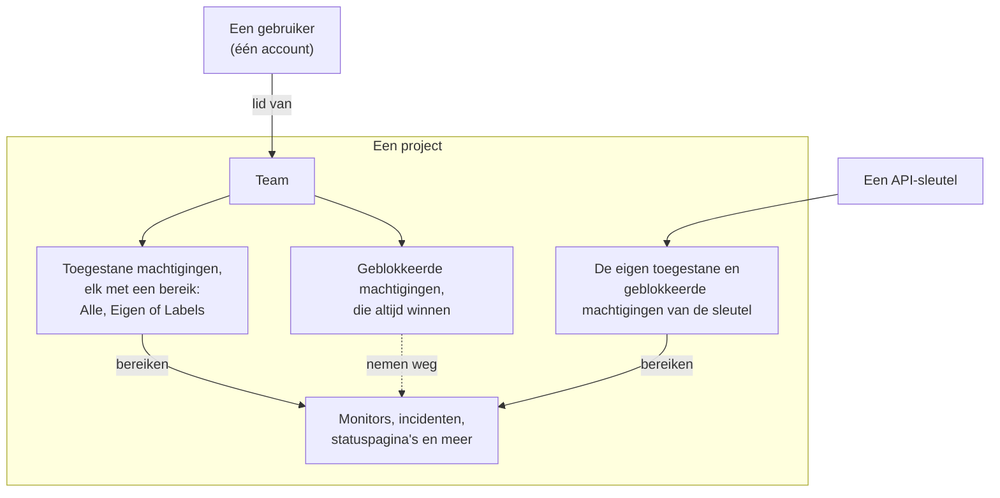
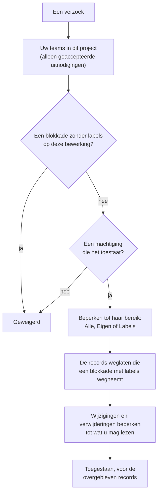

# Gebruikers, teams en machtigingen

Alles in OneUptime leeft binnen een **project**. Wie wat mag doen binnen dat project komt neer op drie dingen: de **gebruikers** erin, de **teams** waartoe die gebruikers behoren en de **machtigingen** die aan die teams zijn toegekend.

> [!IMPORTANT]
> **Gebruikers hebben nooit rechtstreeks machtigingen.** De toegang van een gebruiker is de vereniging van de machtigingen van elk team waartoe hij in dat project behoort. Wilt u veranderen wat iemand mag doen, verander dan zijn teamlidmaatschap of de machtigingen van dat team.

**Eigenaren** zijn een apart idee. Een eigenaar is degene die verantwoordelijk is voor een specifieke resource — een monitor, een incident, een dashboard. Eigenaren krijgen meldingen over hun resources, en machtigingen kunnen desgewenst worden beperkt tot "alleen de dingen die van mij zijn".

## Hoe toegang werkt

| Begrip | Wat het is |
| --- | --- |
| Gebruiker | Eén OneUptime-account. Eén login, een willekeurig aantal projecten. |
| Project | De tenantgrens. Monitors, incidenten, teams en data horen bij precies één project. |
| Team | Een benoemde groep binnen een project die machtigingen draagt. |
| Teamlid | Een gebruiker die voor een team is uitgenodigd en heeft geaccepteerd. |
| Machtiging | Eén vermogen, bijv. `CreateProjectMonitor`, of een rol die er veel bundelt, bijv. `MonitorAdmin`. |
| Bereik | Hoe ver een toegestane machtiging reikt: alle resources, alleen eigen of alleen gelabelde. |
| Eigenaar | Een gebruiker of team dat verantwoordelijk is gemaakt voor één specifieke resource. |
| Label | Een tag die u op resources zet, gebruikt om machtigingen te beperken en om te ordenen. |

## Gebruikers

Een gebruikersaccount is globaal binnen de OneUptime-instantie — dezelfde login werkt in elk project waarvoor de gebruiker is uitgenodigd.

Een gebruiker zit "in" een project als hij lid is van **minstens één team** daarin. Er is geen aparte stap "gebruiker aan project toevoegen": iemand voor een project uitnodigen betekent hem voor een team uitnodigen.

:::steps
1. Open **Gebruikers** in het menu **Producten**, onder **Instellingen**, en klik op **Gebruiker uitnodigen**. De lijst toont iedereen in het project en de status van hun uitnodiging.
2. Typ het **E-mail**-adres. Wie nog geen OneUptime-account heeft, wordt ook om een **Naam** gevraagd.
3. Kies het **Team**, dat bepaalt wat de persoon mag doen, en klik op **Uitnodigen**.
4. De persoon accepteert via de bel rechtsboven, op **Projectuitnodigingen**, en hoort vanaf dan bij het project.
:::

- Uitnodigingen maken een openstaand teamlid aan. De gebruiker telt pas als projectlid — en krijgt pas enige machtiging — **nadat hij de uitnodiging heeft geaccepteerd.**
- **Gebruiker uitnodigen** begint bij het ledenteam van het project: het team dat `ProjectMember` voor het hele project heeft, dus **Members** tenzij u het hebt hernoemd. Kies een ander team om de persoon meer of minder toegang te geven. Er is niets gekozen wanneer u zelf niet voor dat team zou mogen uitnodigen — wie iemand uitnodigt, geeft de machtigingen van het team door, en u kunt alleen machtigingen doorgeven die u zelf hebt — of wanneer het project zo'n team niet heeft. Het beheerdersdashboard begint bij hetzelfde team waar een beheerder van de instantie iemand aan een project toevoegt: **Gebruiker uitnodigen** bij een project, **Aan project toevoegen** bij een gebruiker en bij meerdere gebruikers tegelijk, en de projecten die aan een [globale SSO-provider](/docs/identity/global-sso) zijn gekoppeld.
- Een gebruiker uit alle teams van een project verwijderen ontneemt hem de toegang tot dat project, vanaf zijn volgende verzoek — ook terwijl hij is aangemeld. Zijn account en zijn andere projecten blijven ongemoeid. Hij wordt van de pikettroosters, escalatieregels en overrides van het project gehaald, uit de rollen van de open incidenten en episodes en uit de eigenaren van de resources; opgeloste incidenten houden vast wie ze bezat en leidde.
- Wie een project verlaat, krijgt er geen meldingen meer van. Zijn eigen meldingsmethoden, -regels en -instellingen voor het project verdwijnen met zijn laatste team — e-mail, sms, oproep, WhatsApp, Telegram, push, webhook, Slack en Microsoft Teams, de e-mailsamenvatting en de nog niet verstuurde e-mail, het nummer voor inkomende oproepen en de dienstherinneringen —, zodat opnieuw lid worden met de standaardwaarden begint. Wat hem daarna nog noemt, zoals de gebruiker die een regel voor inkomende oproepen belt of een eigenaar die op een opgelost incident blijft staan, stuurt hem geen meldingen meer: namens een project wordt niets gestuurd naar iemand die er geen lid van is, en een openstaande uitnodiging is nog geen lidmaatschap. Op die plekken staat **Geen lid meer** naast de naam, zodat u er iemand anders kunt neerzetten. Bij iemand die is uitgenodigd en nog niet heeft geaccepteerd, staat in plaats daarvan **Uitnodiging nog niet geaccepteerd**. Als een override iemands meldingen doorstuurt naar iemand die het project heeft verlaten, wordt in plaats daarvan de persoon gealarmeerd voor wie de override geldt. Bij vertrek worden ook de MCP-clients losgekoppeld die de persoon met het project heeft verbonden, en zijn persoonlijke link naar de piketagenda toont vanaf dan een lege agenda. Op OneUptime Cloud bevestigt iemand die via de single sign-on van het project terugkomt dat opnieuw vanuit zijn mailbox.
- Als uw project SSO afdwingt en een gebruiker zich nog niet via de identityprovider heeft geauthenticeerd, geldt hij als niet-geautoriseerde SSO-gebruiker en ziet hij niets tot hij dat doet. Zie [SSO](/docs/identity/sso).
- Met SCIM ingesteld kan uw identityprovider gebruikers en hun teamlidmaatschappen automatisch aanmaken, bijwerken en verwijderen. Zie [SCIM](/docs/identity/scim).

## Teams

Teams zijn de weg waarlangs machtigingen bij mensen komen. Elk nieuw project begint met drie:

| Team | Machtiging die het heeft | Bewerkbaar |
| --- | --- | --- |
| Owners | `ProjectOwner` | Nee. Heeft altijd minstens één lid. |
| Admin | `ProjectAdmin` | Nee |
| Members | `ProjectMember` | Ja — dit is een vertrekpunt, pas het vrij aan |

De teams **Owners** en **Admin** zijn bewust vergrendeld: hun machtigingen zijn niet te bewerken en de teams kunnen niet worden verwijderd of hernoemd. Dat voorkomt dat een project zichzelf per ongeluk buitensluit. Het Owners-team moet altijd minstens één lid houden.

`ProjectOwner` is het hoogste toegangsniveau: facturatie, het project verwijderen en alles wat een beheerder kan. `ProjectAdmin` dekt alles behalve facturatie en het verwijderen van het project.

SMS, telefoonoproepen, WhatsApp of Telegram voor het project aan- of uitzetten valt onder facturatie, omdat elk bericht geld kost. Alleen `ProjectOwner`, de rol `BillingAdmin` (**Billing Admin**) en de machtiging `ManageProjectBilling` (**Manage Billing**) kunnen die schakelaars wijzigen, onder **Projectinstellingen > Meldingen > Meldingsinstellingen** — niet `ProjectAdmin`.

Het bijvullen van de vooruitbetaalde saldi van het project valt ook onder facturatie. Op OneUptime Cloud worden SMS, telefoonoproepen, WhatsApp en Telegram betaald uit het saldo onder **Projectinstellingen > Meldingen > Meldingsinstellingen**, en AI uit de AI-tegoeden onder **Projectinstellingen > AI > AI-tegoeden**. Alleen een projecteigenaar of iemand met **Manage Billing** kan ze bijvullen of hun **Automatisch bijvullen** wijzigen — een projectbeheerder niet. Een melding over een saldo dat opraakt, noemt wie het kan bijvullen, en alleen die mensen krijgen een werkende knop **Saldo bijvullen** of een link naar de pagina.

Maak zoveel extra teams als u wilt — "Frontend-piket", "Support", "Alleen-lezen auditors" — en geef elk de machtigingen die het nodig heeft. Op OneUptime Cloud vraagt het aanmaken van een team en het wijzigen van zijn machtigingen het Scale-abonnement.

**Een team aanmaken** vraagt om een naam en zijn **Toegang**, dat wil zeggen wat de leden van het team mogen doen:

| Toegang | Wat de leden van het team mogen doen |
| --- | --- |
| Projectbeheerder | Alles in het project aanmaken, wijzigen en verwijderen, de instellingen inbegrepen. Niet de facturatie, en niet het project verwijderen. |
| Projectlid | Monitors, incidenten, statuspagina's en de andere resources van het project aanmaken, wijzigen en verwijderen. |
| Kijker | Alles in het project lezen en niets wijzigen. |
| Machtigingen later kiezen | Nog niets. Bij het begin gekozen. |

:::steps
1. Open **Teams** in het menu **Producten**, onder **Instellingen**, en klik op **Team maken**.
2. Typ de **Naam** van het team en kies zijn **Toegang**. De beschrijving staat onder **Meer velden**.
3. Maak het team aan. Een team met een rol opent op zijn pagina **Leden**, klaar om mensen uit te nodigen; met **Machtigingen later kiezen** opent het op zijn pagina **Machtigingen**, waar u een smallere rol zoals `IncidentMember` of losse machtigingen toevoegt.
:::

De rol die u kiest, wordt de eerste machtiging van het team, voor alle resources in het project, zodra het team bestaat — precies alsof u hem met **Rol toevoegen** op de pagina Machtigingen van het team had toegevoegd. U krijgt alleen de rollen aangeboden die u zelf hebt, omdat iedereen die u voor het team uitnodigt de machtigingen ervan krijgt, en wie teams mag aanmaken maar niet mag wijzigen wat ze kunnen, wordt niets gevraagd. Kan de rol niet worden toegevoegd, dan wordt het team toch aangemaakt en verwijst een melding boven de lijst ernaar.

Waar u het vindt: open een team onder **Teams** om naar **Leden** en **Machtigingen** te gaan; **Machtigingen blokkeren** staat onder **Meer instellingen** onderaan de pagina Machtigingen, waarvan de ingeklapte kop toont hoeveel het team er heeft.

## Machtigingen

Een machtiging is één vermogen. Er zijn twee manieren om ze toe te kennen, en beide staan op het tabblad **Machtigingen** van het team.

### Rollen

Een rol bundelt een heel productgebied op een van drie niveaus:

- **Admin** — wat de Member doet, plus de eigen configuratie van het gebied, zoals de ernstniveaus en statussen van incidenten en waarschuwingen, monitorstatussen en onderhoudsstatussen.
- **Member** — het dagelijkse werk: de resources van het gebied aanmaken, wijzigen en verwijderen, met hun notities, eigenaren en templates. Voor statuspagina's en piket doet de Member alles wat de Admin doet.
- **Viewer** — alleen lezen.

`MonitorAdmin`, `IncidentMember`, `StatusPageViewer` enzovoort. Rollen zijn bijna altijd wat u wilt — ze blijven kloppen naarmate OneUptime functies toevoegt, omdat een nieuwe monitorgerelateerde tabel aan de bestaande monitorrollen wordt toegevoegd in plaats van een nieuwe toekenning van u te vragen.

Workflows en runbooks zijn de uitzondering. Beide voeren code uit in uw project — een workflow zijn stappen, een runbook zijn scripts op uw Runners —, dus `WorkflowMember` opent workflows en hun uitvoeringen en voert ze met de hand uit, en `RunbookMember` opent runbooks en hun uitvoeringen en voert ze uit: het start een uitvoering, voltooit of slaat de stappen ervan over en annuleert haar. Geen van beide maakt, wijzigt of verwijdert wat het uitvoert; `WorkflowAdmin` en `RunbookAdmin` bouwen ze. Een rol voert alleen de runbooks uit die zijn bereik bereikt, dus een `RunbookMember` die tot enkele labels is beperkt, voert de runbooks uit die ze dragen. Zie [Workflowmachtigingen](/docs/workflows/configuration#machtigingen) en [Runbookmachtigingen](/docs/runbooks/configuration#machtigingen).

De regels van een gebied (label-, eigenaar-, piket-, groeperings- en herinneringsregels), aangepaste velden, SLA's en geheimen zijn projectconfiguratie: ze vragen `ProjectAdmin`, welke gebiedsrol iemand ook heeft. Hetzelfde geldt voor API-sleutels, teams en hun machtigingen, labels, SSO en domeinen — de Settings-rollen zorgen voor de diensten, probes, infrastructuur en integraties van het project, niet voor wie wat mag.

Facturatie heeft drie eigen rollen. `BillingViewer` leest de facturatie van het project — het abonnement, facturen, gebruik, saldi, AI-tegoeden, betaalmethoden en de factuurcontactgegevens — en wijzigt niets. `BillingMember` downloadt daarnaast facturen en wijzigt de factuurcontactgegevens. `BillingAdmin` doet wat `BillingMember` doet en zet SMS, telefoonoproepen, WhatsApp en Telegram aan en uit. Het abonnement, betaalmethoden of saldi wijzigen en facturen betalen vraagt `ProjectOwner` of **Manage Billing**; op de facturatiepagina's zijn die knoppen voor iedereen anders vergrendeld en zeggen ze wie ze mag gebruiken.

Alle {{PERMISSION_ROLE_COUNT}} rollen staan in de [Machtigingsreferentie](/docs/permissions/reference).

### Granulaire machtigingen

Elk afzonderlijk vermogen is ook los toe te kennen — `CreateProjectMonitor`, `ReadProjectIncident`, `DeleteProjectStatusPage` en {{PERMISSION_TOTAL_COUNT}} andere. Gebruik deze als een rol te breed is en u precies één ding wilt toekennen.

Een machtiging om iets te wijzigen of te verwijderen reikt alleen tot wat u ook mag lezen, dus geef de bijpassende leesmachtiging mee: `EditProjectIncident` wijzigt geen enkel incident zonder `ReadProjectIncident`. Een record dat via een ander record wordt gelezen, zoals de notitie bij een incident, heeft ook een machtiging nodig om dat andere record te lezen: `ReadIncidentInternalNote` bereikt geen enkele notitie zonder een machtiging om incidenten te lezen, en `CreateIncidentInternalNote` voegt alleen een notitie toe aan een incident dat u mag lezen. De rollen bevatten beide al.

Dit zijn ook de sleutels die u gebruikt bij het aanmaken van API-sleutels, en die de API en de Terraform-provider verwachten.

De volledige lijst staat in de [Machtigingsreferentie](/docs/permissions/reference).

### Toestaan en blokkeren

Elk team heeft twee lijsten:

- **Machtigingen** (toestaan) — wat dit team mag doen.
- **Machtigingen blokkeren** — wat dit team nooit mag doen, ongeacht welke toestaanregel ook.

Beide staan op de pagina **Machtigingen** van het team. Weinig teams hebben een blokkade nodig, dus de geblokkeerde machtigingen zijn ingeklapt onder **Meer instellingen** onderaan de pagina.

> [!WARNING]
> **Blokkeren wint altijd.** Een blokkaderegel zonder labels neemt dat vermogen helemaal weg voor het team. Een blokkaderegel met labels neemt het alleen weg voor resources met die labels — handig voor "dit team mag monitors bewerken, behalve de monitors met het label Production".

Een machtiging kan niet tegelijk in beide lijsten beperkingslabels dragen; OneUptime weigert de tweede met een uitleg.

De toegestane regels van een gebruiker tellen op over al zijn teams, maar een blokkade geldt voor alles wat de gebruiker doet: een blokkade zonder labels in één team neemt het vermogen weg, ook waar een ander team het toestaat, en een blokkaderegel kent nooit iets toe. Heeft iemand minder toegang dan u verwacht, zoek dan in elk van zijn teams naar een blokkade; heeft hij meer, zoek dan in elk team naar een toestemming.

### Een status wijzigen

Een incident, een waarschuwing, een waarschuwings- of incidentepisode en een gepland onderhoud wijzigen hun status, en een monitor zijn status, met een nieuwe rij op hun statustijdlijn. **Bevestigen**, **Oplossen**, **Status wijzigen**, de pagina **Statustijdlijn**, de API en workflows voegen er allemaal een toe. Dat vraagt de aanmaakmachtiging van die tijdlijn, samen met een machtiging om het record te lezen dat ze wijzigt:

| Om de status te wijzigen van | Is nodig |
| --- | --- |
| Een incident | **Create Incident State Timeline** |
| Een waarschuwing | **Create Alert State Timeline** |
| Een waarschuwingsepisode | **Create Alert Episode State Timeline** |
| Een incidentepisode | **Create Incident Episode State Timeline** |
| Een gepland onderhoud | **Create Scheduled Maintenance State Timeline** |
| Een monitor (zijn status) | **Create Monitor Status Timeline** |

Het record krijgt daarna de nieuwe status van OneUptime zelf, met wat erbij hoort, zoals wanneer een episode is opgelost of wanneer een onderhoud zijn abonnees weer herinnert. Een wijziging vraagt dus niet ook een machtiging om het record te bewerken: een aangepaste rol met **Create Incident State Timeline** maar zonder **Edit Incident** wijzigt de status van een incident. Wilt u een team ervan weerhouden statussen te wijzigen, blokkeer dan de aanmaakmachtiging van de tijdlijn; een blokkade op **Edit Incident** laat statuswijzigingen met rust. Labels, eigenaren en privérecords beperken de aanmaakmachtiging van de tijdlijn zoals ze elke andere beperken, via het record waarvan ze de status wijzigt: zie de bereikregels hieronder.

Alleen de status wordt voor u geschreven. Een notitie die met een wijziging wordt geplaatst, wordt namens u geplaatst en vraagt de eigen machtiging van de notitie, zoals beschreven in [Abonnees van de statuspagina een statuswijziging laten weten](/docs/incidents/states-and-severities#statuspagina-abonnees-informeren-over-een-statuswijziging). De waarschuwingen van een incident bevestigen terwijl u het meldt, vraagt hetzelfde als elk ervan op zijn eigen pagina bevestigen: **Create Alert State Timeline**, beperkt via elke waarschuwing, en geen **Edit Alert**. Zie [De waarschuwingen bevestigen terwijl u meldt](/docs/incidents/linked-alerts#de-waarschuwingen-bevestigen-terwijl-je-meldt).

## Bereik: hoe ver een toegestane machtiging reikt

Elke toegestane machtiging wordt toegekend met een bereik, gekozen onder **Bereik** wanneer u haar toevoegt:

| Bereik | Betekenis |
| --- | --- |
| Alle resources in het project | De standaard. De machtiging geldt voor elke passende resource. |
| In eigendom van dit team of zijn leden | De machtiging geldt alleen voor resources waarbij dit team, of de handelende gebruiker, als eigenaar staat. |
| Beperken op labels (geavanceerd) | De machtiging geldt alleen voor resources die minstens één van de gekozen labels dragen. |

**Eigen** is de eenvoudigste manier om een model "jullie zorgen voor je eigen diensten" op te zetten: geef een team `MonitorAdmin` met bereik Eigen en maak dat team eigenaar van de monitors waarvoor het verantwoordelijk is. Het beperkt alleen resources die echt eigenaren kunnen hebben — monitors, incidenten, dashboards, diensten en dergelijke. Projectconfiguratie (incidentstatussen, labels, de teams zelf) heeft geen eigenaar, dus daar gedraagt een rol met bereik Eigen zich normaal.

**Labels** is de handmatigere versie van hetzelfde idee: tag resources en ken dan machtigingen toe die tot die tags zijn beperkt.

**Handelen op het hele project vraagt een machtiging die het bereikt.** **Run Now** van een regel past de regel toe op elke resource van het project, en de regels voor sitetoewijzing, apparaatlabels en automatische import van een netwerk op elk netwerkapparaat of elke scan, dus dat vraagt machtigingen met een bereik over alle resources in het project: een machtiging die tot labels of eigen resources is beperkt, is niet genoeg, en een blokkade met labels op de resources die een run wijzigt, weigert de run, omdat die ook de resources met die labels zou wijzigen.

Sommige rollen zijn per definitie projectbreed en bieden helemaal geen bereik, omdat beperken zinloos zou zijn — "Billing Admin, maar alleen voor de facturatie die van mij is" beschrijft niets:

{{PERMISSION_SCOPE_EXEMPT_ROLES}}

## Eigenaren

Een eigenaar is een gebruiker of een team dat aan één specifieke resource is gekoppeld. De meeste resources die iets voorstellen wat u beheert — monitors, incidenten, waarschuwingen, geplande onderhouden, piketbeleid, dashboards, diensten, statuspagina's, workflows, runbooks en SLO's — hebben een tabblad **Eigenaren**.

Eigenaren hebben twee taken:

1. **Melding.** Eigenaren zijn degenen die OneUptime inlicht wanneer er iets met de resource gebeurt — een monitor valt uit, een incident wordt aangemaakt, een SLO begint zijn foutbudget op te branden.
2. **Toegang, als u daarom vraagt.** Eigendom is waartegen het machtigingsbereik `Owned` (Eigen) wordt opgelost. Een gebruiker past als hij persoonlijk eigenaar is, of als een van zijn teams eigenaar is.

Eigendom op zich verleent niets. Eigenaar van een monitor zijn geeft geen bewerkrecht, tenzij een van uw teams ook een monitormachtiging heeft. Eigendom perkt toegang in; het verruimt die nooit.

Wie eigenaar is van een resource, wordt gelezen via die resource. De eigenaren van een monitor of van een andere resource worden alleen weergegeven, gelezen, toegevoegd en verwijderd door iemand die die resource mag lezen, en een machtiging voor alleen eigenaren bereikt de eigenaren van geen enkele resource die u niet mag lezen.

## Labels

Labels zijn projectbrede tags die u aan resources hangt. Ze dienen twee doelen: filteren en groeperen in het dashboard, en machtigingen beperken zoals hierboven beschreven.

Aan een labelbeperking is voldaan als de resource **minstens één** van de labels van de machtiging draagt. Een resource zonder labels voldoet aan geen enkele labelbeperkte machtiging.

Een record zonder eigen labels, zoals de notitie bij een incident, een aankondiging op een statuspagina of een AI-inzicht over een service, draagt de labels van de records waar het bij hoort of over gaat. Een machtiging die tot labels is beperkt bereikt het als een van die records een van haar labels draagt, en een blokkade met labels neemt het weg als een van hen een geblokkeerd label draagt, bij lezen, wijzigen en verwijderen gelijk. Een record dat over geen van hen gaat, zoals een AI-inzicht over geen enkele service, hoort bij het project: een labelbeperking beperkt het niet, en een blokkade met labels neemt het niet weg.

Waar u het vindt: **Projectinstellingen > Basis > Labels**. De kleur van een nieuw label is al gekozen wanneer zijn formulier opent, een kleur die de labels op de pagina nog niet gebruiken; kies een andere als u wilt. Op OneUptime Cloud vraagt het aanmaken en wijzigen van labels het Growth-abonnement.

## Telemetrie

Logs, traces, metrics, uitzonderingen, profielen en sessieherhalingen horen bij de resource die ze verstuurde: een dienst, een host, een Kubernetes-cluster, een monitor, een RUM-applicatie en dergelijke. Een telemetriemachtiging leest zo ver als haar bereik reikt:

- **Alle resources** leest de telemetrie van elke resource in het project.
- **Eigen** leest de telemetrie van de resources die u of een van uw teams bezit, en telemetrie die geen resource noemt.
- **Labels** leest de telemetrie van de resources die een van de labels van de machtiging dragen.

Een blokkade met labels op een telemetriemachtiging laat de telemetrie weg van de resources die die labels dragen, wat u verder ook hebt. Dat geldt overal waar telemetrie wordt gelezen: de verkenners met hun grafieken, filters en attribuutlijsten, exports, sessieherhalingen en wat de AI-assistent voor u leest. De lijst met metricnamen toont de metrics die een dienst meldt die u mag lezen, en de metrics die geen enkele dienst meldt, zoals host- en clustermetrics. Mag u ook de telemetrie van andere soorten resources lezen, zoals hosts of clusters, dan toont de lijst alle metricnamen.

Het verwijderen van telemetrie blijft bij dezelfde resources: een verwijdering bereikt de rijen van de resources die zowel uw toestemming om het signaal te lezen als uw toestemming om het te verwijderen bereiken, min de resources die een blokkade met labels op een van beide weghaalt, en gebeurt in één project tegelijk.

Monitorlogs, SLO-geschiedenis, netwerkstromen en Kubernetes-kostenverdelingen worden op dezelfde manier gelezen, via de monitor, de SLO, het netwerkapparaat of het cluster waar ze bij horen: Eigen en Labels bereiken de rijen van de records die u mag lezen, en een blokkade met labels laat de rijen weg van de records die die labels dragen. Het auditlogboek en de threat-intelligence-indicatoren worden projectbreed gelezen door wie ze mag lezen.

## API-sleutels

API-sleutels krijgen machtigingen rechtstreeks, op de sleutel zelf — ze horen niet bij teams en worden niet beïnvloed door teamlidmaatschap.

- Ken dezelfde granulaire machtigingen en rollen toe die u een team zou geven.
- Sleutels ondersteunen **geblokkeerde machtigingen** en **labelbeperkingen**, net als teams.
- Sleutels ondersteunen het bereik Eigen **niet**. Eigendom wordt opgelost tegen een gebruiker, en een sleutel is geen gebruiker, dus geef sleutels de toegang die ze nodig hebben expliciet.

**Een sleutel aanmaken** vraagt om een naam en zijn **Toegang**:

| Toegang | Wat de sleutel mag doen |
| --- | --- |
| Projectbeheerder | Alles in het project aanmaken, wijzigen en verwijderen, de instellingen inbegrepen. Niet de facturatie, en niet het project verwijderen. |
| Projectlid | Monitors, incidenten, statuspagina's en de andere resources van het project aanmaken, wijzigen en verwijderen, zoals een projectlid dat kan. |
| Kijker | Alles in het project lezen en niets wijzigen. |
| Machtigingen later kiezen | Nog niets. Bij het begin gekozen. |

:::steps
1. Open **Projectinstellingen > Geavanceerd > API-sleutels** en klik op **API-sleutel aanmaken**. Op OneUptime Cloud vragen API-sleutels het Growth-abonnement.
2. Typ de **Naam** van de sleutel en kies zijn **Toegang**. De beschrijving en de vervaldatum staan onder **Meer velden**; een sleutel verloopt een jaar na de dag waarop hij is aangemaakt, tenzij u een andere datum kiest, en het ingeklapte deel zegt dat.
3. Maak de sleutel aan. Hij opent op zijn pagina, waar u hem kopieert.
:::

De rol die u kiest, wordt de eerste machtiging van de sleutel zodra de sleutel bestaat, precies alsof u hem op de pagina van de sleutel had toegevoegd. U krijgt alleen de rollen aangeboden die u zelf hebt — een sleutel kan nooit meer krijgen dan de persoon die hem geeft heeft — en wie sleutels mag aanmaken maar niet mag wijzigen wat ze kunnen, wordt niets gevraagd.

Op de pagina van een sleutel voegt **Rol toevoegen** een rol toe uit dezelfde lijst die het tabblad Machtigingen van een team aanbiedt, en voegt **Machtiging toevoegen** (in het menu **⋯** van de kaart) één granulaire machtiging toe. **Machtigingen blokkeren** staat onder **Meer instellingen** onderaan de pagina, waarvan de ingeklapte kop toont hoeveel de sleutel er heeft.

> [!TIP]
> Geef elke integratie een eigen sleutel met de smalste set machtigingen die werkt, zodat u er een kunt intrekken zonder de andere te storen.

## Hoe OneUptime bepaalt of een verzoek is toegestaan

Voor een aangemelde gebruiker, in volgorde:

1. Zoek de teams waartoe de gebruiker in dit project behoort, waarbij alleen geaccepteerde uitnodigingen meetellen. Een verzoek bereikt alleen de records van dit project: een record van een ander project, genoemd met zijn id of in een filter, wordt behandeld alsof het niet bestaat.
2. Verzamel elke machtigingsregel van die teams — toestaan en blokkeren, elk met labels en bereik.
3. Controleer eerst de blokkadelijst. Een blokkade zonder labels op een machtiging die de doeltabel voor deze bewerking accepteert, wijst het verzoek meteen af, in welk team die ook staat.
4. Controleer de toestaanlijst. Het verzoek heeft minstens één machtiging nodig die de doeltabel voor deze bewerking accepteert. Bij een operationele resource — een monitor, een incident, een dashboard en dergelijke — telt ook de bijpassende machtiging **All Operational Resources** (Create, Read, Edit of Delete), tenzij die zelf geblokkeerd is.
5. Pas het bereik toe. Toekenningen met bereik Eigen beperken de query tot resources in eigendom; die met labels beperken tot passende labels. Is een andere toekenning voor dezelfde bewerking breder, dan wint de bredere. Een record zonder eigen labels, zoals een notitie bij een incident, past bij een toekenning met labels als een van de records waar het bij hoort een van de labels van de toekenning draagt. Een **All Operational Resources**-toestemming die tot labels is beperkt, beperkt op dezelfde manier: ze bereikt de operationele resources die een van haar labels dragen, zoals de eigen toestemming van de resource met dezelfde labels zou doen. Een aanmaak wordt op dezelfde manier beperkt: een tot labels beperkte toestemming om statuspagina's aan te maken maakt alleen statuspagina's aan die een van haar labels dragen, en een tot labels beperkte toestemming om notities bij incidenten aan te maken voegt alleen notities toe aan incidenten die er een dragen, tenzij een andere toestemming voor de aanmaak het hele project bereikt; een aanmaak daarbuiten wordt geweigerd met een melding die de toegestane labels noemt. Een toestemming om aan te maken met het bereik Eigen maakt een resource met eigen eigenaren, zoals een monitor of een statuspagina, alleen aan voor een persoon, die er eigenaar van wordt, en een notitie alleen bij een incident waarvan u of een van uw teams eigenaar is. Een wijziging van de labels die een record draagt, wordt op dezelfde manier beperkt: met een tot labels beperkte toestemming om het te wijzigen houdt het record er ten minste één van, tenzij een andere toestemming om het te wijzigen het hele project bereikt, en een wijziging die het laatste ervan weghaalt, wordt geweigerd met een melding die de toegestane labels noemt. Als uw toestemming om een soort record aan te maken alleen bereikt wat van u is, wordt u eigenaar van wat u aanmaakt voordat er iets anders mee gebeurt, en lukt dat niet, dan wordt de aanmaak geweigerd en blijft er niets achter.
6. Pas labelblokkades toe. Een blokkade met labels wijst het verzoek af als de doelresource er één draagt. Een blokkade met labels op een **All Operational Resources**-toestemming haalt de resources met die labels weg uit wat die toestemming toekent. Heeft een record geen eigen labels, zoals een notitie bij een incident of een aankondiging op een statuspagina, dan laat een blokkade met labels het record weg bij lezen, wijzigen en verwijderen als een record waar het bij hoort een van die labels draagt. Een lijst met records uit al uw projecten tegelijk, zoals de incidenten op uw startpagina, beperkt de records van elk project met uw blokkades en toekenningen in dat project. Een blokkade met labels op een toestemming om aan te maken weigert een nieuw record dat een van haar labels draagt of, als het geen eigen labels heeft, hoort bij een record dat er een draagt. Een blokkade met labels op een toestemming om te wijzigen voorkomt dat u een record een van haar labels geeft of, als het geen eigen labels heeft, het laat verwijzen naar een record dat er een draagt.
7. Beperk wijzigingen en verwijderingen tot wat u mag lezen. Een wijziging of verwijdering wordt beperkt door uw leestoestemmingen en door de toestemming voor de wijziging: een record dat u niet mag lezen — buiten uw labels of eigenaren, of met een label dat een blokkade op lezen wegneemt — mag u ook niet wijzigen of verwijderen, en een blokkade zonder labels op het lezen van een soort record neemt ook het wijzigen en verwijderen ervan weg. Een record dat via een ander record wordt gelezen, zoals een notitie bij een incident of een aankondiging op een statuspagina, wordt alleen bereikt via een record dat u mag lezen: zonder toestemming om incidenten te lezen bereikt een toestemming voor notities geen enkele notitie, een blokkade met labels op het lezen van incidenten laat de notities weg van de incidenten die ze dragen, en heeft uw toestemming om incidenten te lezen het bereik Eigen, dan bereikt een toestemming voor notities alleen de notities van de incidenten waarvan u of een van uw teams eigenaar is. Zo'n record wordt ook alleen aangemaakt onder een record dat u mag lezen: een notitie alleen bij een incident dat u mag lezen, en een aankondiging alleen op statuspagina's die u mag lezen, elk daarvan; een record noemen dat u niet mag lezen, wordt geweigerd alsof het niet bestaat. Een wijziging volgt dezelfde regel: een record dat onder een ander wordt verplaatst, zoals een aankondiging die op een andere statuspagina komt, gaat alleen onder een record dat u mag lezen, en waar het al onder valt, blijft zoals het is. De records die een aanmaak of een wijziging opsomt, zoals de monitors van een incident of de services van een waarschuwing, houden zich aan uw toestemming om ze te lezen als u die hebt, en altijd aan een blokkade met labels op het lezen ervan: een record daarbuiten wordt geweigerd alsof het niet bestaat, terwijl een record dat al in de lijst staat, blijft. Het ene record dat een aanmaak of een wijziging in een eigen veld noemt, zoals de monitor van een waarschuwing of de monitor die een statuspagina toont, volgt dezelfde regel, en dat geldt ook voor de records die een template invult, zoals de monitors en statuspagina's die een incidenttemplate toevoegt aan een incident dat ermee wordt gemeld; de globale probes en AI-agents van OneUptime blijven open voor elk project. Een wijziging of verwijdering van één record, genoemd bij zijn ID, die niets bereikt, krijgt hetzelfde antwoord als een record dat niet bestaat (`404`) wanneer u het niet mag lezen, en wordt geweigerd wanneer u het wel mag lezen maar niet mag wijzigen. Het lezen van één record bij zijn ID krijgt op dezelfde manier `404` als antwoord wanneer het record niet bestaat of u het niet mag lezen.

Elk veld van een record wordt gelezen met de eigen leesmachtiging van dat record: een machtiging voor een ander soort record opent het nooit. Sommige velden zijn bewust beperkter. Geheimen worden alleen gelezen door wie het record mag bewerken of beheren waar ze bij horen, zoals de sleutels voor inkomende verzoeken en inkomende e-mail van een monitor en zijn serveragentsleutel, of de webhook- en e-mailsleutels van een workflow. De opname van een sessieherhaling bekijken vraagt **Watch Session Replays**, niet alleen **List Session Replays**. Telemetrie wordt per signaal gelezen: **Read Telemetry Service Log** leest logs, **Read Telemetry Service Traces** leest traces en **Read Telemetry Service Metrics** leest metrics, metriekgrafieken inbegrepen.

Velden volgen dezelfde regel. Een blokkade zonder labels op de machtiging van een veld haalt dat veld weg, en bij een operationele resource opent de bijpassende machtiging **All Operational Resources** elk veld dat iedereen mag openen die het record mag lezen of wijzigen — maar niet een veld dat bewust beperkter is, zoals een geheime sleutel.

Een instelling met inloggegevens wordt alleen genoemd door iemand die haar mag lezen. Een aanmaak of een wijziging noemt een SMTP-server, een aanbieder voor bellen en sms, runbook-inloggegevens, SNMP-inloggegevens, een videogesprekverbinding of een API-sleutel — zoals de SMTP-server waarmee een statuspagina e-mail verstuurt, of de inloggegevens waarmee een runbookstap draait — alleen als u dat soort instelling mag lezen; een die u niet mag lezen, wordt geweigerd alsof die niet bestaat, terwijl een record de instelling houdt die het al noemt. Bij een aanbieder voor bellen en sms zoeken naar nummers om te kopen, of de nummers weergeven die hij bezit, vraagt dezelfde leesmachtiging. Een AI-opdrachtplan met een SSH-opdracht goedkeuren, dat draait met runbook-inloggegevens die OneUptime AI koos uit die van zijn Runner, vraagt de leesmachtiging voor runbook-inloggegevens (**Read Runbook Credential**; Project Owners en Project Admins mogen dat), en dat geldt ook voor het opslaan van een regel voor automatisch herstel die OneUptime AI zijn opdrachten zonder te vragen laat uitvoeren, wanneer het opslaan dat aanzet of allowlist-patronen of Runners toevoegt, het aanzetten van **Voert AI-herstelopdrachten uit** voor een Runner die SSH-inloggegevens heeft, of het toewijzen van SSH-inloggegevens aan een Runner die de opdrachten van OneUptime AI uitvoert. Een workflowstap handelt als een Project Admin, maar krijgt nooit de leesmachtiging voor een instelling met inloggegevens geleend: hij noemt er geen en voert geen van deze wijzigingen uit; dat moet iemand doen die ze mag lezen.

Dezelfde regel beslist over al het andere dat vraagt of u een machtiging heeft: acties die geen gewone lees- of schrijfactie zijn — sms-, bel- of AI-tegoed toevoegen, een factuur betalen of een meldingsregel testen — en de knoppen die OneUptime toont. Een knop die u niet mag gebruiken wordt vergrendeld getoond en zegt waarom; is een blokkade in een van uw teams de reden, dan noemt hij de geblokkeerde machtiging.

Live-updates volgen dezelfde regel. Wordt een record aangemaakt, gewijzigd of verwijderd, dan meldt OneUptime dat aan de geopende pagina's van de mensen die dat record mogen lezen, en aan niemand anders. Wat beperkt wat u mag lezen, beperkt ook uw live-updates: labels, eigenaren, een blokkade met labels, een privé-incident of het AI-gesprek van iemand anders. Neemt een wijziging u de toegang tot een record af, bijvoorbeeld doordat het privé wordt gemaakt, dan krijgen uw geopende pagina's daar ook bericht van, zodat ze het niet meer tonen. Een wijziging van uw machtigingen, een blokkade of het verlies van uw rechten als master-admin bereikt uw geopende pagina's meteen.

Live-updates eindigen ook met de aanmelding waarmee ze zijn gestart. Afmelden, uw wachtwoord wijzigen of geblokkeerd worden stopt de live-updates van uw geopende pagina's meteen. Een geopende pagina vernieuwt haar aanmelding elke 15 minuten en hervat daarna haar live-updates; lukt het vernieuwen niet, dan brengt ze u naar de aanmeldpagina. Een project dat SSO vereist, stuurt live-updates alleen naar pagina's die met SSO zijn aangemeld, net als voor al het andere.

Elke ingelogde gebruiker heeft daarnaast een kleine set automatische machtigingen voor zaken als het lezen van zijn eigen profiel en zijn eigen meldingsregels. Dat zijn geen beheerdersrechten en ze ontsluiten niemand anders' gegevens.

Opgeloste machtigingen worden per gebruiker en project gecachet en vernieuwd wanneer teamlidmaatschap of teammachtigingen wijzigen. Ziet een gebruiker een wijziging niet meteen, laat hem dan herladen.

## Recepten

**Een team dat alleen meekijkt.** Maak het team aan met **Kijker** onder **Toegang**. Voor alleen enkele gebieden kiest u **Machtigingen later kiezen** en voegt u de `*Viewer`-rollen per gebied toe die het moet zien.

**Piketengineers die hun eigen diensten beheren.** Geef het team `MonitorAdmin`, `IncidentMember` en `OnCallMember` met bereik **Eigen**, en voeg het team toe als eigenaar van de monitors die het beheert.

**Externe partijen weg van productie.** Geef het team de rollen die het nodig heeft met bereik **Alle**, en voeg dan een **geblokkeerde machtiging** toe (onder **Meer instellingen** op de pagina Machtigingen van het team) voor de gevoelige vermogens, beperkt tot het label `Production`.

**Een CI-pipeline die alleen deployments meldt.** Maak een API-sleutel aan met **Machtigingen later kiezen**, en voeg dan op zijn pagina alleen de granulaire machtigingen toe die hij nodig heeft — geen rollen.

**Iemand die de facturatie niet mag wijzigen en geen facturen mag zien.** Geef hem `ProjectMember`, niet `ProjectAdmin`: een projectbeheerder kan het abonnement, betaalmethoden en saldi niet wijzigen, maar leest en downloadt facturen wel. Wie de facturatiepagina's alleen mag lezen zonder iets te wijzigen, krijgt `BillingViewer`.

Als de toegang niet is wat u verwacht:

:::details Iemand kan iets niet zien of wijzigen wat hij zou moeten kunnen
Controleer of hij de uitnodiging heeft geaccepteerd: een openstaand teamlid heeft geen machtigingen. Open daarna elk van zijn teams: een blokkade zonder labels in welk team ook neemt het vermogen weg, en een bereik Eigen of met labels bereikt alleen eigen of gelabelde resources. Een vergrendelde knop noemt de machtiging die hij nodig heeft, of de blokkade die hem weigert.
:::

:::details Iemand mag meer dan u verwacht
Zijn toegang is de vereniging van alle teams waarin hij zit, dus zoek in elk team naar een toestemming, ook in **Admin** en **Owners**. Om een vermogen weg te nemen, wat zijn teams ook toestaan, voegt u in een van zijn teams een geblokkeerde machtiging toe.
:::

## Volgende stappen

:::cards
- [Machtigingsreferentie](/docs/permissions/reference): Elke rol en elke granulaire machtiging, gegenereerd uit de broncode van OneUptime.
- [SSO](/docs/identity/sso): Laat mensen aanmelden met uw identityprovider.
- [SCIM](/docs/identity/scim): Maak gebruikers en teamlidmaatschappen aan vanuit uw identityprovider.
- [API-referentie](/docs/api-reference/api-reference): Roep de API aan met een API-sleutel en zijn machtigingen.
:::
