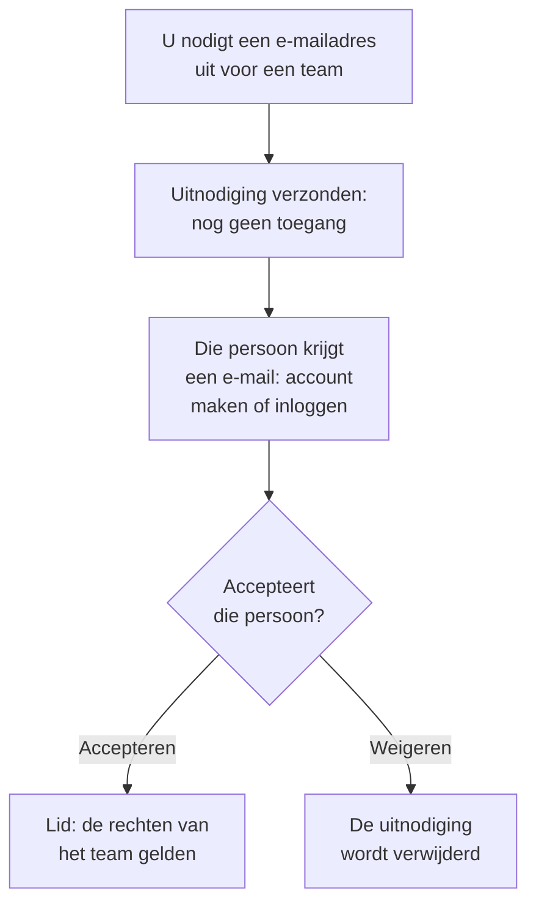

# Mensen uitnodigen

Mensen komen via een uitnodiging in een project. U nodigt iemands e-mailadres uit voor een team, die persoon accepteert, en vanaf dan bepaalt het team wat hij of zij mag doen. Deze pagina laat zien hoe u mensen uitnodigt, wat ze te zien krijgen en hoe u hun toegang later wijzigt of beëindigt.

:::cards
- [Iemand uitnodigen](#iemand-uitnodigen): Een e-mailadres en een team.
- [Een uitnodiging accepteren](#een-uitnodiging-accepteren): Wat de uitgenodigde persoon ziet en doet.
- [Iemands teams wijzigen](#iemands-teams-wijzigen): Meer toegang geven, of minder.
- [Iemand verwijderen](#iemand-uit-het-project-verwijderen): Wat het verlaten van het project meeneemt.
:::

## Zo werkt een uitnodiging

- **Het team bepaalt wat iemand mag.** Niemand heeft eigen machtigingen: iemand mag wat de teams waarin hij of zij zit toestaan. Zie [Gebruikers, teams en machtigingen](/docs/permissions/index).
- **Niets wordt toegekend tot de uitnodiging is geaccepteerd.** Een openstaande uitnodiging staat als **Uitnodiging verzonden** en geeft geen toegang tot het project.
- **Eén acceptatie geldt voor het hele project.** Wie één uitnodiging accepteert, accepteert alle andere uitnodigingen voor hetzelfde project. Een lid dat u later aan een ander team toevoegt, zit er meteen in, zonder iets te accepteren.

## Voordat u begint

- **Een rol die mensen mag uitnodigen.** Project Owner, Project Admin of een rol met de machtiging **Invite New Members**. U kunt mensen alleen uitnodigen voor een team waarvan u zelf de machtigingen hebt, omdat een uitnodiging hun de toegang van het team geeft.
- **In OneUptime Cloud: ruimte in uw abonnement.** Iedereen in het project is een plaats op de factuur, vanaf het moment van de uitnodiging. Het Free-abonnement heeft ruimte voor één persoon. Zie [Facturering en gebruik](/docs/configuration/billing#uw-abonnement-en-plaatsen).
- **Geen SCIM Push Groups.** Zolang uw identiteitsprovider de teams van het project via SCIM Push Groups beheert, nodigt u mensen daar uit en verwijdert u ze daar, niet in OneUptime.

## Iemand uitnodigen

:::steps
### Gebruikers openen

Ga naar **Producten → Instellingen → Gebruikers**. De lijst **Gebruikers** toont iedereen in het project, hun teams en of ze zijn toegetreden.

### Op Gebruiker uitnodigen klikken

Klik op **Gebruiker uitnodigen**. Het dialoogvenster **Nieuwe gebruiker uitnodigen** opent.

### Het e-mailadres invullen

Vul het adres in bij **E-mail**. Gebruikt nog geen OneUptime-account dit adres, dan vraagt het dialoogvenster ook om een **Naam**, waarmee het nieuwe account begint.

### Het team kiezen

**Team** begint bij het ledenteam van het project: het team dat Project Member voor het hele project heeft, of anders het team met de naam Members. Kies een ander team om meer of minder toegang te geven. **Team** blijft leeg als het project zo'n team niet heeft, of als u zelf niemand voor dat team zou mogen uitnodigen.

### De uitnodiging versturen

Klik op **Uitnodigen**. OneUptime e-mailt de uitnodiging en opent de pagina van die persoon. Tot de acceptatie staat die persoon als **Uitnodiging verzonden**.
:::

> [!TIP]
> Nodig mensen uit voor het kleinste team waarmee ze hun werk kunnen doen. U kunt ze later aan meer teams toevoegen, en elk team waarin ze komen, breidt uit wat ze mogen.

## Een uitnodiging accepteren

De uitnodigingsmail noemt het project. De knop erin is **Create Your Account** voor wie nog geen OneUptime-account heeft, en **Sign In to OneUptime** voor wie er al een heeft. Na het inloggen accepteert de persoon op een van twee plekken:

| Waar de persoon is | Wat die ziet | Waar die op klikt |
| --- | --- | --- |
| Nog in geen enkel project | De uitnodiging, op de pagina waar die na het inloggen terechtkomt | **Accept & Join**, of **Decline** |
| Al in een ander project | De openstaande uitnodiging bij de bel rechtsboven, die **Projectuitnodigingen** opent | **Accepteren**, of **Afwijzen** |

Na het accepteren zit de persoon meteen in het project, met de machtigingen van het team en de meldingsinstellingen waarmee elk lid begint: zie [Waarmee u begint](/docs/notifications/index#waarmee-je-begint). Weigeren verwijdert de uitnodiging, dus later toetreden vraagt een nieuwe.

## Zien wie in het project zit

**Gebruikers** heeft één rij per persoon:

| Kolom | Wat die toont |
| --- | --- |
| **Gebruiker** | Naam en e-mailadres. |
| **Teams** | Elk team van het project waarin die persoon zit of waarvoor die is uitgenodigd. |
| **Status** | **Lid** zodra die persoon is toegetreden, met het aantal nog niet geaccepteerde uitnodigingen voor andere teams. **Uitnodiging verzonden** tot dan. |

Filter de lijst op **Gebruiker**, **Status** of **Team**. Klik op een rij om de pagina van die persoon te openen:

| Pagina | Waarvoor die is |
| --- | --- |
| **Profiel** | Naam, e-mailadres, foto en gebruikers-ID. |
| **Teams** | De teams waarin die persoon zit. Voeg hier een team toe of verwijder er een. |
| **Gereedheid**, **Meldingsmethoden**, **Bereikbaarheidsregels** | Of die persoon kan worden opgeroepen, en hoe. Zichtbaar voor Project Owners, Project Admins, de persoon zelf en iedereen die de meldingsregels van anderen mag lezen. Zie [Gereedheid en rapporten](/docs/on-call/readiness). |
| **Aangepaste velden** | De aangepaste velden van het project voor personen, als het die heeft. |
| **Verwijderen uit project** | Die persoon uit het project halen. |

## Iemands teams wijzigen

:::steps
### De pagina Teams openen

Klik bij **Gebruikers** op de persoon en daarna op **Teams**.

### Aan een team toevoegen

Klik op **Uitnodigen**, kies het **Team** en klik in het dialoogvenster op **Uitnodigen**. Een lid zit meteen in het nieuwe team. Wie nog niet is toegetreden, krijgt nog een uitnodiging, en het accepteren van een van beide accepteert ze allebei.

### Uit een team halen

Klik op **Verwijderen** in de rij van het team. Is het het laatste team waarin die persoon is toegetreden, dan haalt het verwijderen die uit het project, en het dialoogvenster zegt dat voordat er iets verandert.
:::

Het Owners-team houdt altijd minstens één toegetreden lid, zodat een project nooit zijn laatste eigenaar kwijtraakt.

## Iemand uit het project verwijderen

Open bij **Gebruikers** het rijmenu van de persoon, **⋯**, en klik op **Verwijderen uit project**. Of open de persoon en kies **Verwijderen uit project** in het zijmenu. Om meerdere mensen tegelijk te verwijderen, selecteert u hun rijen en verwijdert u de selectie: elke persoon wordt op dezelfde manier verwijderd.

Verwijderen haalt iemand uit elk team van het project. Die persoon verliest meteen de toegang, ook als die is ingelogd, gaat uit de piketroosters en escalatieregels en krijgt de meldingen van het project niet meer. Het OneUptime-account wordt niet verwijderd, en u kunt die persoon opnieuw uitnodigen. [Gebruikers, teams en machtigingen](/docs/permissions/index#gebruikers) somt alles op wat het verlaten van een project meeneemt.

## Andere manieren om toe te treden

- **Single sign-on.** Wie voor het eerst inlogt via de identiteitsprovider van het project, komt in de teams die de provider noemt. Zie [Rollen en teams voor SSO-gebruikers](/docs/identity/sso#rollen-en-teams-voor-sso-gebruikers).
- **SCIM.** Uw identiteitsprovider maakt mensen aan en voegt ze toe aan de standaardteams van de koppeling. Zie [SCIM](/docs/identity/scim#zo-wordt-een-projectgebruiker-ingericht).
- **Het Admin Dashboard.** Op een zelf gehoste installatie kan een hoofdbeheerder iemand aan een project toevoegen en de uitnodiging voor die persoon accepteren. Zie [Gebruikers, teams en machtigingen](/docs/permissions/index#gebruikers).

## Problemen oplossen

:::details "This user has already been invited to this team"
Die persoon zit al in dat team, als lid of met een uitnodiging die nog niet is geaccepteerd. Open die persoon bij **Gebruikers** om de teams te zien, of nodig die uit voor een ander team.
:::

:::details "You have reached the user limit for the free plan"
In OneUptime Cloud heeft een project met het Free-abonnement ruimte voor één persoon. Wijzig het abonnement en nodig daarna opnieuw uit. Zie [Het abonnement wijzigen](/docs/configuration/billing#het-abonnement-wijzigen).
:::

:::details "Too many invitations were sent to this email address in the last hour"
Naar één adres kunnen 10 uitnodigingen per uur worden gestuurd, voor projecten en privéstatuspagina's samen, wie ze ook stuurt. Wacht een uur en nodig de persoon daarna opnieuw uit.
:::

:::details De uitnodigingsmail is niet aangekomen, of de link is verlopen
De uitnodiging hangt niet af van de e-mail. Vraag de persoon zich te registreren met het uitgenodigde adres: OneUptime stuurt dat adres een nieuwe link om het account af te maken. Wie al een account heeft, logt in en vindt de uitnodiging klaarstaan.
:::

:::details Gebruiker uitnodigen meldt dat gebruikers via SCIM Push Groups worden beheerd
Uw identiteitsprovider beheert de teams van het project. Nodig mensen uit of verwijder ze in de identiteitsprovider, of zet Push Groups uit onder **Projectinstellingen → Beveiliging → SCIM** om ze hier te beheren.
:::

## Volgende stappen

:::cards
- [Gebruikers, teams en machtigingen](/docs/permissions/index): Bepalen wat elk team mag.
- [Projectinstellingen](/docs/configuration/project-settings): Alles wat voor het hele project geldt.
- [Uw account](/docs/introduction/your-account): Inloggen, profiel en de projecten waarvan u deel uitmaakt.
- [SCIM](/docs/identity/scim): Mensen en teams door uw identiteitsprovider laten beheren.
:::
