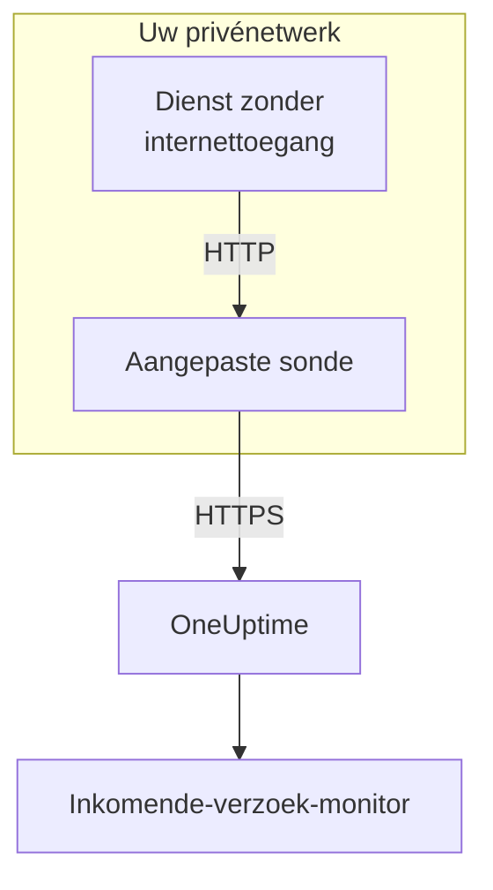

# Ingress voor inkomende verzoeken

Een dienst zonder internettoegang kan toch heartbeats sturen naar een [Inkomende-verzoek-monitor](/docs/monitor/incoming-request-monitor). Hij stuurt ze in plaats daarvan naar een [aangepaste sonde](/docs/probe/custom-probe) in zijn eigen netwerk, en de sonde geeft ze door aan OneUptime.

:::cards
- [Hoe het werkt](#hoe-het-werkt): Van uw dienst, via de sonde, naar de monitor.
- [De listener inschakelen](#de-listener-inschakelen): Eén instelling op de sonde, voor Docker, Docker Compose of Kubernetes.
- [Verzoeken naar de sonde sturen](#verzoeken-naar-de-sonde-sturen): De URL wijzigen waarnaar uw dienst stuurt, en verder niets.
- [Probleemoplossing](#probleemoplossing): Wat de sonde logt als een verzoek niet doorkomt.
:::

## Hoe het werkt



1. **Uw dienst stuurt het verzoek naar de sonde.** Dezelfde `GET` of `POST`, met dezelfde geheime sleutel, die hij naar OneUptime zou sturen, naar een poort waarop de sonde luistert.
2. **De sonde antwoordt meteen.** Hij antwoordt `200` voordat hij het verzoek doorgeeft, zodat uw dienst nooit op OneUptime wacht.
3. **De sonde stuurt het door.** Hij stuurt het verzoek door naar OneUptime met de methode, de headers en de body, en voegt een header `OneUptime-Probe-Id` toe die de sonde noemt.
4. **OneUptime leest het zoals altijd.** De criteria van de monitor zien het verzoek alsof de dienst het rechtstreeks had gestuurd.

De listener draait op een eigen poort, los van de gezondheidscontroles van de sonde, zodat u hem voor uw privénetwerk kunt openstellen zonder verder iets open te zetten.

## Wanneer u hem gebruikt

Gebruik de listener wanneer:

- Uw diensten draaien in een geïsoleerd netwerksegment zonder uitgaande HTTPS-toegang
- U al het bewakingsverkeer binnen uw VPC of on-premises netwerk moet houden
- U één uitgangspunt wilt, de sonde, dat OneUptime mag bereiken
- U al een [aangepaste sonde](/docs/probe/custom-probe) hebt uitgerold en die wilt hergebruiken voor inkomende heartbeats

Kunnen uw diensten `https://oneuptime.com` (of uw zelf gehoste URL) al rechtstreeks bereiken, dan hebt u deze functie **niet** nodig: roep de heartbeat-URL rechtstreeks vanuit de dienst aan.

## Voordat u begint

- **Een draaiende aangepaste sonde.** Zijn **Status** toont **Verbonden**. Zie [Aangepaste probes](/docs/probe/custom-probe) om er een te installeren.
- **Een monitor voor inkomende verzoeken.** Zijn heartbeat-URL bevat de geheime sleutel die uw dienst stuurt: zie [Inkomende-verzoek-monitor](/docs/monitor/incoming-request-monitor).
- **Een poort op de host van de sonde die uw diensten kunnen bereiken.** De voorbeelden gebruiken `3875`.

## De listener inschakelen

Stel `PROBE_INGRESS_PORT` in op de poort die de listener moet gebruiken. Elke waarde groter dan `0` schakelt hem in; niet ingesteld, of `0`, laat hem uit.

:::tabs
@tab Docker
```bash
docker run --name oneuptime-probe --network host \
  -e PROBE_KEY=<probe-key> \
  -e PROBE_ID=<probe-id> \
  -e ONEUPTIME_URL=https://oneuptime.com \
  -e PROBE_INGRESS_PORT=3875 \
  -d oneuptime/probe:release
```

Zonder `--network host` publiceert u de poort met `-p 3875:3875`.
@tab Docker Compose
```yaml title="docker-compose.yml"
services:
  oneuptime-probe:
    image: oneuptime/probe:release
    container_name: oneuptime-probe
    environment:
      - PROBE_KEY=<probe-key>
      - PROBE_ID=<probe-id>
      - ONEUPTIME_URL=https://oneuptime.com
      - PROBE_INGRESS_PORT=3875
    network_mode: host
    restart: always
```

Zonder `network_mode: host` publiceert u de poort onder `ports:` als `"3875:3875"`.
@tab Kubernetes
```yaml title="oneuptime-probe.yaml"
apiVersion: apps/v1
kind: Deployment
metadata:
  name: oneuptime-probe
spec:
  selector:
    matchLabels:
      app: oneuptime-probe
  template:
    metadata:
      labels:
        app: oneuptime-probe
    spec:
      containers:
        - name: oneuptime-probe
          image: oneuptime/probe:release
          env:
            - name: PROBE_KEY
              value: "<probe-key>"
            - name: PROBE_ID
              value: "<probe-id>"
            - name: ONEUPTIME_URL
              value: "https://oneuptime.com"
            - name: PROBE_INGRESS_PORT
              value: "3875"
          ports:
            - name: ingress
              containerPort: 3875
---
apiVersion: v1
kind: Service
metadata:
  name: oneuptime-probe-ingress
spec:
  selector:
    app: oneuptime-probe
  ports:
    - name: ingress
      port: 3875
      targetPort: 3875
  type: ClusterIP
```

Diensten in het cluster sturen dan naar `http://oneuptime-probe-ingress.<namespace>.svc.cluster.local:3875/heartbeat/<secret-key>`.
:::

Draait de listener, dan staat in het log van de sonde `Probe ingress listener started on port 3875 (heartbeat / incoming-request endpoints)`.

## Verzoeken naar de sonde sturen

Uw dienst stuurt naar de sonde in plaats van naar OneUptime. Vervang de openbare heartbeat-URL:

```text
https://oneuptime.com/heartbeat/<secret-key>
```

door de ingress-URL van de sonde:

```text
http://<probe-host>:<PROBE_INGRESS_PORT>/heartbeat/<secret-key>
```

Pad, methode, body en headers blijven verder gelijk, dus bestaande clientcode hoeft alleen de basis-URL te wijzigen. De sonde accepteert ook `/incoming-request/<secret-key>`, dat op dezelfde manier werkt.

```bash
# GET heartbeat
curl http://probe.internal:3875/heartbeat/YOUR_SECRET_KEY

# POST heartbeat with JSON body
curl -X POST http://probe.internal:3875/heartbeat/YOUR_SECRET_KEY \
  -H "Content-Type: application/json" \
  -d '{"status": "healthy", "version": "1.2.3"}'

# Cron job
*/5 * * * * curl -s http://probe.internal:3875/heartbeat/YOUR_SECRET_KEY > /dev/null
```

## Hoe verzoeken worden doorgestuurd

| Wat | Hoe de sonde ermee omgaat |
| --- | --- |
| Het antwoord | `200` met een leeg JSON-object (`{}`), gestuurd voordat het verzoek wordt doorgestuurd. Net als bij OneUptime wordt het gestuurd wat er daarna ook gebeurt: ook een verkeerde geheime sleutel krijgt het. |
| Methoden | `POST` wordt doorgestuurd als `POST`. `GET`, en `HEAD`, worden doorgestuurd als `GET`. Andere methoden krijgen een `404` van de sonde. |
| Headers | Alle, behalve de hop-by-hop-headers (`Host`, `Connection`, `Content-Length`, `Transfer-Encoding`, `Keep-Alive`, `Proxy-Authenticate`, `Proxy-Authorization`, `TE`, `Trailer`, `Upgrade`) en `Content-Encoding`, omdat de sonde de body ongecomprimeerd doorstuurt. De sonde voegt `OneUptime-Probe-Id` toe. |
| De body | JSON- en formulierbody's tot 50 MB, net als wanneer u rechtstreeks naar OneUptime stuurt. Net als daar komt elke andere body leeg bij de monitor aan. |
| Herhalingen | Mislukt het doorsturen, dan probeert de sonde het tot `PROBE_INGRESS_FORWARD_RETRY_LIMIT` keer opnieuw en wacht daarbij 2 s, dan 4 s, dan 8 s, en nooit langer dan 15 s. Daarna logt hij de fout en laat het verzoek vallen. |
| Proxy's | Het doorsturen gaat via de proxy van de sonde als `HTTP_PROXY_URL` of `HTTPS_PROXY_URL` is ingesteld. |
| Waar het heen gaat | `ONEUPTIME_URL`, gevolgd door `/incoming-request-ingest/incoming-request/<secret-key>`. |

## Omgevingsvariabelen

| Variabele | Standaard | Wat hij doet |
| --- | --- | --- |
| `PROBE_INGRESS_PORT` | niet ingesteld (uit) | De poort die de listener gebruikt. Elke waarde groter dan `0` schakelt hem in. |
| `PROBE_INGRESS_FORWARD_TIMEOUT_MS` | `10000` | Hoe lang elk doorsturen naar OneUptime mag duren, in milliseconden. Een waarde onder `1000` valt terug op de standaard. |
| `PROBE_INGRESS_FORWARD_RETRY_LIMIT` | `3` | Hoe vaak een mislukt doorsturen opnieuw wordt geprobeerd. `0` zet herhalingen uit. |

De gewone variabelen van de sonde (`PROBE_KEY`, `PROBE_ID`, `ONEUPTIME_URL` en de proxyvariabelen) gelden allemaal: zie [Aangepaste probes](/docs/probe/custom-probe) voor de volledige lijst.

## Beveiligingsoverwegingen

- **Het endpoint is bewust niet geauthenticeerd**: de geheime sleutel in het URL-pad *is* de authenticatie, net als bij het openbare endpoint `oneuptime.com`. Behandel de geheime sleutel als een inloggegeven.
- **Houd de listener in uw privénetwerk.** Hij hoort niet bereikbaar te zijn vanaf internet. Gebruik een network policy, een firewallregel of een `ClusterIP`-service om te beperken wie hem kan bereiken.
- **Zet TLS ervoor als u versleuteling in uw netwerk nodig hebt.** De listener spreekt gewoon HTTP. Plaats hem achter een interne load balancer of ingress-controller voor TLS op dat traject. Het doorsturen van de sonde naar OneUptime gebruikt HTTPS wanneer `ONEUPTIME_URL` met `https://` begint.
- **Begrens de bodygrootte zelf als 50 MB te veel is.** Plaats een reverse proxy met een lagere grens vóór de listener.

## Probleemoplossing

:::details Het log van de sonde meldt nooit dat de listener is gestart
`PROBE_INGRESS_PORT` is niet ingesteld, `0` of geen getal. Stel een poortnummer in en start de sonde opnieuw. De logregel is `Probe ingress listener started on port <port> (heartbeat / incoming-request endpoints)`.
:::

:::details De sonde logt `Probe ingress: failed to forward to <url> after N attempts`
De sonde kon OneUptime niet bereiken, ook niet na de herhalingen. Controleer de uitgaande connectiviteit van de sonde, de proxy-instellingen en de waarde van `ONEUPTIME_URL`. Toont de sonde ook **Verbinding verbroken**, zie dan [Aangepaste probes](/docs/probe/custom-probe) om te vinden waar zijn verzoeken blijven steken.
:::

:::details De sonde logt `Probe ingress: probe ID not available, forwarding without it`
De sonde is nog niet klaar met verbinden met OneUptime en stuurt het verzoek daarom door zonder de header `OneUptime-Probe-Id`. Het verzoek bereikt de monitor toch.
:::

:::details De monitor krijgt de verzoeken, maar niet via de sonde
Uw dienst stuurt nog naar de openbare URL. Controleer of hij naar `http://<probe-host>:<port>/...` stuurt: een DNS-naam of een vermelding in `/etc/hosts` die ergens anders naartoe wijst, is de gebruikelijke oorzaak.
:::

:::details De monitor krijgt niets, en de sonde logt niets
Het verzoek heeft de sonde nooit bereikt. Controleer of de dienst de host van de sonde op de poort kan bereiken: een firewallregel, een niet gepubliceerde poort, of een Kubernetes-Service die de pod van de sonde niet selecteert.
:::

## Volgende stappen

:::cards
- [Inkomende-verzoek-monitor](/docs/monitor/incoming-request-monitor): Bepalen wat telt als een gezonde heartbeat.
- [Aangepaste probes](/docs/probe/custom-probe): De sonde installeren, en elke instelling die hij leest.
:::
