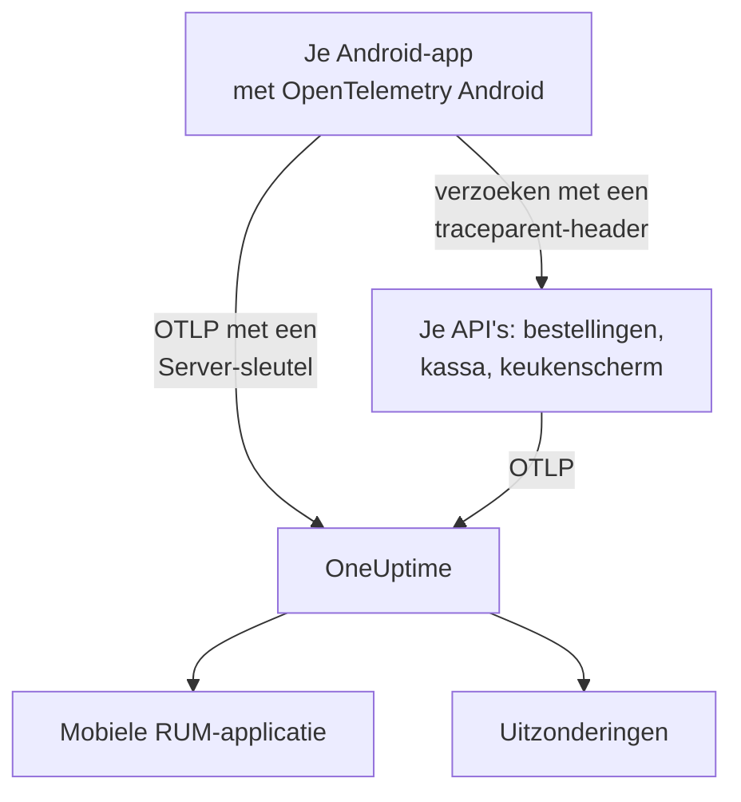

# Android-configuratie

Instrumenteer een native Android-app met OpenTelemetry Android, zodat hij zich bij OneUptime meldt als mobiele RUM-applicatie: zijn crashes en ANR's, trage en bevroren frames, app-starts, schermen, sessies en netwerkverzoeken, getraceerd tot in je backend.

:::cards
- [OpenTelemetry Android toevoegen](#opentelemetry-android-toevoegen): Eén Gradle-afhankelijkheid en een paar regels wanneer de app start.
- [Wat het rapporteert](#wat-het-rapporteert): Crashes, ANR's, bevroren frames, starts en sessies, en waar elk ervan terechtkomt.
- [Verzoeken naar je backend tracen](#verzoeken-naar-je-backend-tracen): Een span voor elke OkHttp-aanroep, met een `traceparent` erop.
- [Je eigen workflows tracen](#je-eigen-workflows-tracen): Een bestelling van het menu tot in de keuken, een betaalterminal, een printer.
- [Kiosken en andere apparaten die je bezit](#kiosken-en-andere-apparaten-die-je-bezit): Elk apparaat een naam geven, het vanuit je MDM configureren, gegevens bewaren terwijl het offline is.
:::

## Zo werkt het

OpenTelemetry Android draait in je app. Het verstuurt traces, logs en metrieken via OTLP naar OneUptime met een **Server**-ingestiesleutel, en voegt een W3C-header `traceparent` toe aan de verzoeken die je app doet, zodat de spans van je backend zich bij de traces van de app aansluiten.



## Voordat je begint

- Een Android-app waarvan de `minSdk` 23 of hoger is, gebouwd met `compileSdk` 34 of hoger. Zet bij een `minSdk` onder 26 [core library desugaring](https://developer.android.com/studio/write/java8-support#library-desugaring) aan, met Android Gradle Plugin 8.3.0 of later en `android.useFullClasspathForDexingTransform=true` in `gradle.properties`.
- Een **Server**-ingestiesleutel, aangemaakt onder **Projectinstellingen → Telemetrie & APM → Ingestiesleutels** met **Ingestiesleutel aanmaken**. Een **Browser**-sleutel wordt vanuit een app geweigerd: hij wordt gecontroleerd tegen de header `Origin`, die een app niet verstuurt.
- Deze OTLP-instellingen. Host je OneUptime zelf, vervang `https://oneuptime.com` dan door je eigen host.

| Instelling | Waarde |
| --- | --- |
| OTLP-endpoint | `https://oneuptime.com/otlp` |
| Header | `x-oneuptime-token: YOUR_TELEMETRY_INGESTION_TOKEN` |

> [!WARNING]
> De sleutel zit in je app, en een app kan worden uitgepakt, dus ga ervan uit dat iemand hem kopieert. Stel op de pagina van de sleutel een **Vastgezette servicenaam**, een **Requests Per Minute Limit** en een datum bij **Verloopt om** in, en vervang de sleutel bij je releases.

## OpenTelemetry Android toevoegen

:::steps
### De afhankelijkheid toevoegen

```kotlin title="app/build.gradle.kts"
dependencies {
    implementation("io.opentelemetry.android:android-agent:1.8.1")
}
```

De agent brengt de instrumentatie voor crashes, ANR's, trage rendering, activity's, fragments, netwerk en sessies mee. Kijk bij [de releases ervan](https://github.com/open-telemetry/opentelemetry-android/releases) of er een nieuwere versie is.

### De agent starten wanneer de app start

```kotlin title="KioskApplication.kt"
import android.app.Application
import io.opentelemetry.android.OpenTelemetryRum
import io.opentelemetry.android.agent.OpenTelemetryRumInitializer

class KioskApplication : Application() {
    lateinit var otelRum: OpenTelemetryRum

    override fun onCreate() {
        super.onCreate()

        otelRum = OpenTelemetryRumInitializer.initialize(this) {
            httpExport {
                baseUrl = "https://oneuptime.com/otlp"
                baseHeaders = mapOf("x-oneuptime-token" to BuildConfig.ONEUPTIME_TOKEN)
            }
            resource {
                put("service.name", "kiosk-ordering")
                put("deployment.environment.name", "production")
            }
        }
    }
}
```

`baseUrl` is het endpoint zonder signaal: de agent voegt er `/v1/traces`, `/v1/logs` en `/v1/metrics` aan toe. Stel `service.name` in, anders wordt de app genoemd naar zijn launcherlabel. Het is de identiteit van de applicatie in OneUptime, dus houd het van release tot release hetzelfde.

Noem de klasse in de `android:name` van het `<application>`-element van je manifest. `BuildConfig.ONEUPTIME_TOKEN` staat voor de plek waar je build de sleutel bewaart; een vloot kan hem in plaats daarvan van zijn MDM krijgen, zoals [Kiosken en andere apparaten die je bezit](#kiosken-en-andere-apparaten-die-je-bezit) laat zien.

### De app starten en controleren of het binnenkomt

```bash
curl -i https://oneuptime.com/otlp/v1/validate \
  -H "x-oneuptime-token: YOUR_TELEMETRY_INGESTION_TOKEN"
```

`200` met `"valid": true` betekent dat de sleutel wordt geaccepteerd. Start daarna de app en gebruik hem even: hij verschijnt onder **Producten → Bronnen → Real User Monitoring**, genoemd naar zijn `service.name`. De agent schrijft telemetrie naar schijf voordat hij die verstuurt, dus de eerste batch kan een minuut nodig hebben om binnen te komen.
:::

## Wat het rapporteert

OpenTelemetry Android legt dit allemaal uit zichzelf vast. De apparaatattributen die het instelt, `device.model.identifier`, `device.model.name` en `device.manufacturer`, delen de app in als mobiele RUM-applicatie en vullen zijn pagina **Clients**. Het stelt ook `os.name`, `os.version` en een `app.installation.id` per installatie in, en geen `device.id`.

| Wat | Hoe de agent het verstuurt | Waar het in OneUptime verschijnt |
| --- | --- | --- |
| Crashes | Een `app.crash`-gebeurtenis met het type, het bericht en de stacktrace van de uitzondering | **Uitzonderingen**, als niet-afgehandeld |
| ANR's | Een `device.anr`-gebeurtenis met de stack van de hoofdthread, zodra de app ongeveer 5 seconden niet meer reageert | **Uitzonderingen**, als niet-afgehandeld, onder het type `ANR` |
| Trage en bevroren frames | Een `app.jank`-gebeurtenis met `app.jank.frame_count`, de frames trager dan 16 ms (`app.jank.threshold` is `0.016`) of 700 ms (`0.7`) | **Logboeken**, met `@event.name:app.jank` |
| App-starts | Een `AppStart`-span, met `start.type` ingesteld op `cold`, `warm` of `hot` | **Traces** |
| Schermen | Een span voor elke stap in de levenscyclus van een activity of fragment, en `app.screen.name` op elke span en log | **Traces** |
| Sessies | `session.id` op elke span en log, en `session.start`- en `session.end`-gebeurtenissen | **Traces** en **Logboeken**, gezocht met `@session.id:` |
| Netwerkwijzigingen | Een `network.change`-gebeurtenis, en `network.connection.type` op elke span en log | **Logboeken** |

Crashes en ANR's komen in **Uitzonderingen** binnen als niet-afgehandeld, gegroepeerd op hun stacktraces, met de sessie waarin ze gebeurden. De agent slaat een crash op schijf op terwijl de app sterft en verstuurt hem van daaruit, dus een crash die offline gebeurt, komt toch binnen zodra de app weer draait met een netwerk.

Een sessie eindigt na 15 minuten op de achtergrond, of na 4 uur. Een app die nooit naar de achtergrond gaat, zoals een kiosk, houdt 4 uur lang één sessie, dus trace het bezoek van elke klant als een eigen span, zoals [Je eigen workflows tracen](#je-eigen-workflows-tracen) laat zien.

De eigen `android.util.Log`-aanroepen van je app worden ook logs wanneer je `android-log-library` en `android-log-agent` naast de OkHttp-modules hieronder toevoegt: de tag van elke aanroep komt in `android.log.tag`, en een aanroep met een throwable is een uitzondering in **Uitzonderingen**. OpenTelemetry Android leest Logcat niet.

## Verzoeken naar je backend tracen

Voeg de OkHttp-instrumentatie toe en de ByteBuddy-plugin waarmee die wordt gebouwd:

```kotlin title="app/build.gradle.kts"
plugins {
    // ...the plugins your app already applies, then:
    id("net.bytebuddy.byte-buddy-gradle-plugin") version "1.18.15"
}

dependencies {
    implementation("io.opentelemetry.android:android-agent:1.8.1")
    implementation("io.opentelemetry.android.instrumentation:okhttp3-library:1.8.1-alpha")
    byteBuddy("io.opentelemetry.android.instrumentation:okhttp3-agent:1.8.1-alpha")
}
```

De plugin instrumenteert de klasse `OkHttpClient` zelf, dus elke client in de app wordt getraceerd, ook de clients die bibliotheken aanmaken. Elk verzoek wordt een clientspan, genoemd naar zijn methode, met zijn URL, statuscode en duur, en draagt een W3C-header `traceparent`. Een backend die met [OpenTelemetry](/docs/telemetry/open-telemetry) is geïnstrumenteerd, zet de trace voort vanaf die header, zodat de bestel-API, de kassakoppeling en de keukenschermservice hun spans toevoegen aan dezelfde trace als de tik op de kiosk.

- `HttpURLConnection` heeft hetzelfde paar modules: `httpurlconnection-library` en `httpurlconnection-agent`.
- Zonder de plugin wikkel je zelf een client in: `OkHttpTelemetry.builder(otelRum.openTelemetry).build().createCallFactory(client)`, uit `io.opentelemetry.instrumentation:opentelemetry-okhttp-3.0`.
- Een span die je in je code opent, zoals in de volgende sectie, is de bovenliggende span van de verzoeken die erbinnen worden gedaan.

## Je eigen workflows tracen

Haal een tracer op bij de agent en maak één span voor de bestelling van één klant, met een onderliggende span voor elke stap ervan. Elke stap heeft dan zijn eigen duur en zijn eigen fouten, en de bestelling zegt hoe ze is afgelopen:

```kotlin title="OrderTrace.kt"
import io.opentelemetry.api.trace.Span
import io.opentelemetry.api.trace.StatusCode
import io.opentelemetry.api.trace.Tracer
import io.opentelemetry.context.Context

class OrderTrace(private val tracer: Tracer) {
    // order.session: from the first tap to the order reaching the kitchen.
    private val order: Span = tracer.spanBuilder("order.session").startSpan()
    private val parent: Context = Context.current().with(order)

    // One step: menu.browse, cart.customize, payment.process, pos.inject.
    fun <T> step(name: String, block: (Span) -> T): T {
        val span = tracer.spanBuilder(name).setParent(parent).startSpan()
        return try {
            span.makeCurrent().use { block(span) }
        } catch (error: Throwable) {
            span.recordException(error)
            span.setStatus(StatusCode.ERROR)
            throw error
        } finally {
            span.end()
        }
    }

    fun complete() = finish("completed")

    fun abandon(reason: String) {
        order.setAttribute("order.abandon_reason", reason)
        finish("abandoned")
    }

    private fun finish(outcome: String) {
        order.setAttribute("order.outcome", outcome)
        order.end()
    }
}
```

```kotlin title="CheckoutFlow.kt"
val order = OrderTrace(otelRum.openTelemetry.getTracer("kiosk.ordering"))

order.step("cart.customize") { span ->
    span.setAttribute("cart.items", cart.size.toLong())
}
order.step("payment.process") { terminal.charge(cart.total) }
order.step("pos.inject") { posApi.submit(cart) } // its OkHttp span is a child
order.complete()
```

Wikkel elke aanroep naar de SDK van een betaalterminal, een printer, een scanner of een NFC-lezer op dezelfde manier in, en zeg welk apparaat het was, zodat een traag of falend apparaat een trage of falende span is:

```kotlin title="ReceiptPrinter.kt"
order.step("printer.print") { span ->
    span.setAttribute("peripheral.type", "printer")
    span.setAttribute("peripheral.model", printer.model)
    span.setAttribute("peripheral.connection", "usb")
    printer.print(receipt, timeoutMillis = 10_000)
}
```

De attribuutnamen kies je zelf: houd ze in elke app hetzelfde, zodat één filter elke printer vindt. Geef elke aanroep een time-out, want een span eindigt pas wanneer zijn aanroep terugkeert. Een stap die meerdere schermen beslaat, zoals door het menu bladeren, is een span die je start wanneer het scherm opent en beëindigt wanneer het sluit, met dezelfde bovenliggende span. Stuur voor een feit zonder duur, zoals een printer waarvan het papier opraakt, een gebeurtenis: `otelRum.emitEvent("printer.paper_low")`.

Filter in **Traces** op de naam van een stap om te zien hoe lang hij duurt en hoe vaak hij faalt, en op `@order.outcome:abandoned` om de bestellingen te vinden die nooit zijn afgerond.

## Kiosken en andere apparaten die je bezit

### Elk apparaat een naam geven

OneUptime deelt een mobiele app in per applicatie, nooit per apparaat, zodat een app op duizenden telefoons nooit de telefoons van zijn gebruikers opsomt. Geef apparaten die je bezit elk een naam in `host.name`. Elk apparaat verschijnt dan in **Inventaris** als host, naast je andere machines, met het merk, het model en de OS-versie die de agent meldt, wat je hieronder toevoegt en wanneer het voor het laatst is gezien:

```kotlin title="KioskApplication.kt"
resource {
    put("service.name", "kiosk-ordering")
    put("host.name", deviceName)
    put("host.serial_number", serialNumber)
    put("device.type", "kiosk")
    put("device.location", "Store 0412")
}
```

De telemetrie van de app blijft bij zijn RUM-applicatie, en het apparaat wordt geen host in **Hosts**: een app meldt geen hostmetrieken, dus daar zou niets te tonen zijn. De pagina van het apparaat in **Inventaris** toont zijn eigen logs, traces en uitzonderingen, en `@resource.host.name:` vindt ze in **Traces** en **Logboeken**. Een apparaat dat 30 dagen niets verstuurt, verdwijnt uit **Inventaris**.

### De vloot vanuit je MDM configureren

Een app kan de beheerde configuraties van Android lezen, die elke dienst voor apparaatbeheer naar zijn apparaten pusht. Lees de sleutel en de naam van het apparaat daaruit, in plaats van ze in de app in te bouwen:

```kotlin title="KioskApplication.kt"
import android.content.RestrictionsManager

val restrictions = (getSystemService(RESTRICTIONS_SERVICE) as RestrictionsManager)
    .applicationRestrictions
val token = restrictions.getString("oneuptime_token").orEmpty()
val deviceName = restrictions.getString("device_name") ?: android.os.Build.MODEL
val serialNumber = restrictions.getString("device_serial").orEmpty()
```

Geef daarna `token` door aan `baseHeaders` in plaats van `BuildConfig.ONEUPTIME_TOKEN`, en `deviceName` en `serialNumber` aan de resource hierboven. Plak in Esper de configuratie hieronder bij **Managed Configuration** van de app in een blueprint. Esper vult de placeholders op elk apparaat in, met Esper Agent 8.00.0764 of later:

```json title="Managed configuration"
{
  "oneuptime_token": "YOUR_TELEMETRY_INGESTION_TOKEN",
  "device_name": "${esper.deviceName}",
  "device_serial": "${esper.serialNumber}"
}
```

Laat de apparaten na een wijziging convergeren, zodat ze de nieuwe waarden lezen. Declareer dezelfde sleutels in een `app_restrictions.xml` als je MDM om een schema vraagt. Esper weigert een APK zonder v1-handtekening, dus onderteken de release met het v1-schema naast v2 of v3.

### Bewaren wat offline wordt vastgelegd

De agent schrijft elke span, log en metriek naar schijf voordat hij die verstuurt. Zolang het netwerk plat ligt, houdt hij ze daar en verstuurt hij ze zodra het terug is, tot 18 uur later. Hij bewaart 10 MB; verhoog dat voor een apparaat dat vaak offline is:

```kotlin title="KioskApplication.kt"
diskBuffering {
    maxCacheSize = 50 * 1024 * 1024
}
```

## Probleemoplossing

:::details De app verschijnt onder Services in plaats van onder Real User Monitoring
OpenTelemetry Android stelt `device.model.identifier` zelf in, dus de app is met een andere SDK ingesteld, of zijn resource is vervangen met `resource(Resource)`, wat de eigen attributen van de agent laat vallen. Gebruik het blok `resource { }`, dat eraan toevoegt. De service die al is aangemaakt, wordt geen RUM-applicatie, dus verwijder hem onder **Producten → Services** zodra er RUM-telemetrie binnenkomt.
:::

:::details Er komt niets binnen, of de sleutel wordt geweigerd
Voer de sleutelcontrole uit in [OpenTelemetry Android toevoegen](#opentelemetry-android-toevoegen). Een `401` betekent dat de sleutel onbekend, ingetrokken, uitgeschakeld of verlopen is. Een **Browser**-sleutel wordt vanuit een app geweigerd: gebruik een **Server**-sleutel. Controleer of `baseUrl` eindigt op `/otlp`, zonder `/v1/traces`: de agent voegt het pad zelf toe.
:::

:::details Een crash of een ANR staat niet in Uitzonderingen
Een crash wordt opgeslagen terwijl de app sterft, en een ANR zodra de hoofdthread ongeveer 5 seconden vastzit. Beide wachten op schijf tot het apparaat ze kan versturen, dus kijk opnieuw nadat de app een minuut met een netwerk heeft gedraaid. Start de agent bovenaan in de `onCreate` van je `Application`, vóór alles wat kan crashen, zodat zijn crashhandler als eerste klaarstaat.
:::

:::details Een apparaat ontbreekt in Inventaris
Alleen een apparaat waarvan de app `host.name` instelt, wordt vermeld. Controleer de waarde in de resource-attributen van een span: een lege waarde noemt geen apparaat, en twee apparaten met dezelfde naam zijn één rij.
:::

## Volgende stappen

:::cards
- [Mobiele configuratie](/docs/rum/mobile-setup): iOS, React Native en de andere platforms.
- [Uitzonderingen](/docs/telemetry/exceptions): De crashes en ANR's triëren die je app meldt.
- [Traceverkenner](/docs/telemetry/traces-explorer): Een bestelling volgen van de kiosk tot in de keuken.
- [Applicaties beheren](/docs/rum/applications): Namen, labels, eigenaren en bewaartermijnen.
:::
