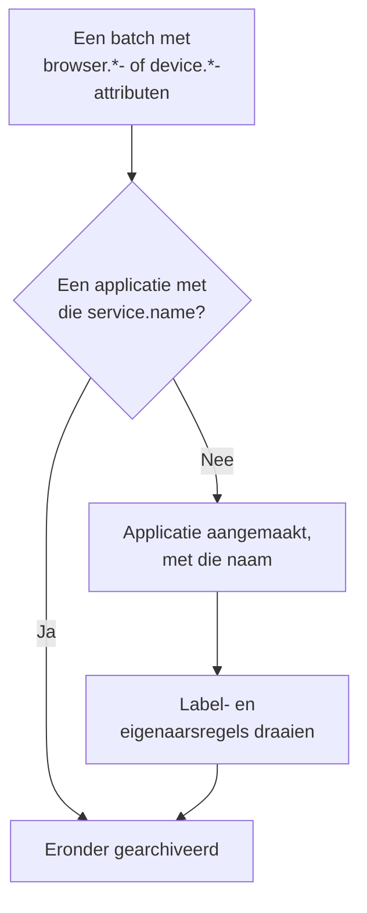

# Applicaties beheren

OneUptime maakt een RUM-applicatie aan zodra de telemetrie van je app voor het eerst binnenkomt. Deze pagina behandelt wat je daarna beheert: de naam van de applicatie, de labels en eigenaren, hoelang de gegevens bewaard blijven, archiveren, wie de applicatie kan zien en waarschuwingen.

:::cards
- [Hoe een applicatie wordt aangemaakt](#hoe-een-applicatie-wordt-aangemaakt): Herkend aan de `service.name` en aangemaakt met de eerste batch.
- [Labels](#labels): Groepeer applicaties en bepaal wie er toegang toe heeft.
- [Bewaring](#bewaring): Hoelang telemetrie en opnamen bewaard blijven.
- [Machtigingen](#machtigingen): Wie applicaties kan zien en wie opnamen kan bekijken.
:::

## Hoe een applicatie wordt aangemaakt

Je hoeft geen RUM-applicatie aan te maken. Wanneer er een batch telemetrie binnenkomt met browser- of apparaatattributen en een `service.name`, archiveert OneUptime die onder de applicatie met die `service.name`, en maakt de applicatie aan als het project er nog geen heeft.



- De `service.name` is de identiteit van de applicatie en wordt zonder onderscheid tussen hoofdletters en kleine letters vergeleken: `Storefront-Web` en `storefront-web` zijn één applicatie.
- Een nieuwe `service.name` start een nieuwe applicatie. De oude behoudt haar geschiedenis en gaat naar **Verbinding verbroken**, de nieuwe begint leeg, en de twee worden nooit samengevoegd.
- Gebruik één `service.name` per app, niet één per omgeving. Onderscheid omgevingen met een label zoals `oneuptime.label.env=production`, zodat ze één applicatie en één geschiedenis delen.

### Een applicatie hernoemen

De **Weergavenaam** begint als de `service.name`. Om hem te wijzigen open je de pagina **Instellingen** van de applicatie en klik je op **Details bewerken** op de kaart **Applicatiedetails**, waar je ook de beschrijving en de labels bewerkt. Telemetrie wordt gekoppeld via de **App-naam (service.name)**, die de kaart toont en die nooit verandert, dus hernoemen is veilig.

### Zelf een applicatie toevoegen

Maak zelf een applicatie aan wanneer je wilt dat de labels, eigenaren of het herhalingsbeleid klaarstaan voordat de eerste bezoeker komt.

:::steps
#### De lijst met applicaties openen

Ga naar **Producten → Bronnen → Real User Monitoring** en klik op **RUM-applicatie aanmaken**.

#### De app-naam invullen

Vul **App-naam (service.name)** in met de `service.name` die je app gaat versturen, precies zoals de app hem verstuurt.

#### Een naam geven en opslaan

De applicatie krijgt de naam van haar app, net als een ontdekte applicatie. Om een andere naam te tonen open je **Meer velden** en vul je een **Weergavenaam** in; de beschrijving en de labels staan daar ook. Sla daarna het formulier op.
:::

Daarna gaat de installatiegids van de applicatie vanzelf open, met de app-naam als `service.name` van het fragment. De laatste stap, **Wachten op verbinding**, meldt wanneer de eerste gegevens binnenkomen.

Als het project al een applicatie met die `service.name` heeft, ontdekt, eerder toegevoegd of gearchiveerd, meldt het formulier dat in plaats van een tweede aan te maken.

## Verbindingsstatus

Een applicatie toont **Verbonden** zolang er telemetrie binnenkomt en **Verbinding verbroken** na 15 minuten zonder. Zowel OpenTelemetry-telemetrie als verkeer van sessieherhalingen telt mee.

**Laatst gezien** wordt om de paar minuten bijgewerkt in plaats van bij elke batch, dus het kan tot ongeveer vijf minuten achterlopen op het echte verkeer, en de 15 minuten laten daar ruimte voor. Tijd waarin OneUptime zelf plat lag of zijn ingestiewachtrij aan het inhalen was, telt niet mee.

**Verbinding verbroken** is op zich geen fout: een interne tool zonder bezoekers 's nachts is echt niet verbonden. Als er mensen de app gebruiken, zie [RUM-probleemoplossing](/docs/rum/troubleshooting).

## Labels

Labels groeperen applicaties in lijsten en filters. Ze bepalen ook waar een lid dat tot bepaalde labels beperkt is bij kan: dat lid ziet alleen de applicaties die een van die labels hebben. Een applicatie krijgt op drie manieren labels:

| Hoe | Waar |
| --- | --- |
| Met de hand | In het aanmaakformulier, onder **Meer velden**, of later met **Details bewerken** op de kaart **Applicatiedetails** van de pagina **Instellingen** van de applicatie. Voor meerdere tegelijk selecteer je ze in de lijst en kies je **Labels toevoegen** onder **Bulkacties**. |
| Uit telemetrie | Een resource-attribuut met de naam `oneuptime.label.<name>` voegt het label `<name>:<value>` toe, zoals hieronder. |
| Uit een labelregel | Een regel voegt labels toe aan elke nieuwe applicatie die eraan voldoet. Zie [Labelregels en eigenaarsregels](#labelregels-en-eigenaarsregels). |

Zet de attributen op dezelfde resource als `service.name`, bijvoorbeeld in het bestand `src/telemetry.ts` uit [Browserconfiguratie](/docs/rum/browser-setup):

```ts
const resource = defaultResource().merge(
  resourceFromAttributes({
    [ATTR_SERVICE_NAME]: "storefront-web",
    "oneuptime.label.team": "payments",
    "oneuptime.label.env": "production",
  }),
);
```

Dit voegt de labels `team:payments` en `env:production` toe en maakt ze in het project aan als ze nog niet bestaan. Doordat de attribuutnaam in het label staat, blijven `oneuptime.label.team=prod` en `oneuptime.label.env=prod` gescheiden. Een label langer dan 100 tekens wordt ingekort tot 100, en een lege waarde of een waarde die geen string is voegt niets toe.

## Labelregels en eigenaarsregels

Een regel voegt labels of eigenaren toe aan elke nieuwe applicatie die eraan voldoet. Open **Real User Monitoring → Instellingen → Labelregels**, of **Eigenaarsregels**, en maak de regel in twee stappen aan:

1. Onder **Overeenkomst** geldt **Alle RUM-applicaties**, waar een nieuwe regel mee begint, voor elke applicatie. Om de regel in te perken, kies **Alleen RUM-applicaties die aan de voorwaarden voldoen** en voeg voorwaarden toe op **Applicatielabels** (heeft een, alle of geen van de labels die je kiest), **Applicatienaam** of **Applicatiebeschrijving** (is gelijk aan, bevat, begint met, eindigt op of voldoet aan een patroon).
2. Kies onder **Labels**, of **Eigenaren** voor een eigenaarsregel, wat de regel toevoegt. Een nieuwe regel moet minstens één label of eigenaar toevoegen. De **Naam** wordt ingevuld op basis van wat je kiest, zoals _Add team:payments_ of _Add Payments as owners_, totdat je zelf een naam typt. De **Beschrijving**, en **Eigenaren op de hoogte stellen** bij een eigenaarsregel, staan onder **Meer velden**.

Regels draaien wanneer een applicatie wordt aangemaakt, ook als die ontdekt is. Om een regel toe te passen op applicaties die je al hebt, open je het menu **⋯** van de rij en kies je **Nu uitvoeren**: zie [Regels uitvoeren op bestaande resources](/docs/configuration/run-rules-now). Een regel die door een bewerking niets meer toevoegt, staat in de lijst gemarkeerd met **Voegt niets toe**. [Label- en eigenaarsregels](/docs/configuration/label-and-owner-rules) behandelt de volledige formulieren.

### Eigenaren

Eigenaren zijn de mensen en teams die verantwoordelijk zijn voor een applicatie. Eigenaarsregels voegen ze toe aan nieuwe applicaties. Om ze met de hand toe te voegen of te verwijderen, selecteer je applicaties in de lijst en kies je **Eigenaar toevoegen** of **Eigenaar verwijderen** onder **Bulkacties**; de API voegt ze toe via `/rum-application-owner-user` en `/rum-application-owner-team`. Met **Eigenaren op de hoogte stellen** aan, wat de standaard is, krijgt elke eigenaar die een regel toevoegt een melding. Zet het uit voordat je een regel op veel applicaties uitvoert als niemand een melding hoeft te krijgen.

## Bewaring

De telemetrie van een applicatie en haar opnamen worden verschillend lang bewaard:

| Gegevens | Bewaard | Ingesteld op |
| --- | --- | --- |
| Logs, metrieken, traces en profielen | De bewaring van het project, tenzij de applicatie die overschrijft | De pagina **Instellingen** van de applicatie |
| Opnamen van sessieherhalingen | Standaard 7 dagen, of 1, 14, 30 of 90 dagen | **Replay Policy**, met **Beleid bewerken → Limieten** |

### Bewaring van telemetrie

Standaard wordt de telemetrie van een applicatie bewaard volgens de bewaring van het project, ingesteld onder **Projectinstellingen → Telemetrie & APM → Gegevensbewaring**. Twee kaarten op de pagina **Instellingen** van de applicatie, ingeklapt onder **Meer instellingen**, overschrijven die:

- **Bewaartermijn telemetriegegevens** bevat **Telemetriegegevens bewaren gedurende (dagen)**, één waarde voor alle telemetrie van de applicatie. Laat het leeg om de bewaring van het project te gebruiken.
- **Bewaring per telemetrietype** bevat een standaardwaarde voor logs, traces, metrieken en profielen, en voor logs per ernst en traces per status. Een lege waarde valt terug op de waarde van de applicatie en daarna op die van het project.

Overschrijvingen van de bewaring maken deel uit van de [Enterprise Edition](/docs/self-hosted/enterprise), en van het Scale-abonnement en hoger op OneUptime Cloud. Zonder die opties tonen de kaarten wat het abonnement toevoegt, en houdt de applicatie de bewaring van het project.

Op een lager Cloud-abonnement blijft een overschrijving die van een proefperiode is overgebleven gelden voor nieuwe telemetrie. De pagina **Instellingen** toont die op een kaart **Overschrijving van bewaring** met een knop **Overschrijving verwijderen**, die op elk abonnement werkt: daarna houdt de applicatie de bewaring van het project, en wat al is opgeslagen houdt de bewaring waarmee het is opgeslagen. Opnieuw een overschrijving instellen vereist het Scale-abonnement.

### Bewaring van sessieherhalingen

Opnamen hebben hun eigen bewaring, ingesteld op de pagina **Replay Policy** van de applicatie met **Beleid bewerken → Limieten**: standaard 7 dagen, of 1, 14, 30 of 90 dagen. Die is bewust kort, want een opname is veel gevoeliger, en veel groter, dan een span. De kaart **Bewaartermijn van sessieherhaling**, onder **Meer instellingen** op de pagina **Instellingen**, toont haar (_Session replays are kept for 7 days._), en de knop **Bewerken in Replay Policy** opent het beleid.

Een langere bewaring van telemetrie bewaart opnamen niet langer. De tellingen, signalen en het apparaat van een sessie verlopen samen met de beelden; alleen de logs, spans en uitzonderingen van de sessie volgen de bewaring van telemetrie. Zie [Bewaring en verwijdering](/docs/telemetry/session-replay#bewaring-en-verwijdering).

> [!TIP]
> RUM is vaak de omvangrijkste telemetrie van een project, omdat het meegroeit met je gebruikers in plaats van met je servers. Een kortere bewaring hier, en een langere op je backend-services, is een gangbare opzet.

## Archiveren en verwijderen

**Archiveren** verbergt een applicatie in **Alle applicaties** terwijl ze telemetrie blijft verzamelen. Archiveer een applicatie die je niet meer volgt maar waarvan je de geschiedenis wilt bewaren.

- Klik op **Archiveren** op de pagina **Instellingen** van de applicatie, of selecteer meerdere applicaties in de lijst en archiveer ze samen.
- Gearchiveerde applicaties staan onder **Real User Monitoring → Geavanceerd → Gearchiveerd**. **Geavanceerd** is in het zijmenu eerst ingeklapt: klik erop om **Gearchiveerd** te tonen. Gebruik daar **Uit archief halen** op één applicatie, of op meerdere tegelijk.

**Applicatie verwijderen**, in de sectie **Geavanceerd** van het zijmenu van de applicatie, verwijdert de applicatie definitief. Als de app nog telemetrie verstuurt, maakt de volgende batch de applicatie opnieuw aan, zonder haar instellingen, dus stop eerst de instrumentatie.

Om de gegevens van één persoon te verwijderen in plaats van een hele applicatie, dien je een wisverzoek in: zie [Sessies wissen](/docs/telemetry/session-replay#sessies-wissen).

## Machtigingen

Iedereen met de Viewer-rol van het project kan RUM-applicaties en hun telemetrie zien. Sessieherhaling valt bewust buiten die rol: opnamen opvragen, er een bekijken en lezen wie er een bekeek zijn aparte machtigingen. Projecteigenaren en -beheerders hebben ze allemaal. Machtigingskiezers tonen elke machtiging met haar titel, hier cursief weergegeven.

| Machtiging | Laat een lid |
| --- | --- |
| `ReadRumApplication` (_Read RUM Application_) | Applicaties en hun telemetriepagina's bekijken. |
| `CreateRumApplication`, `EditRumApplication`, `DeleteRumApplication` | Applicaties toevoegen, bewerken en verwijderen. |
| `ReadRumSessionReplay` (_List Session Replays_) | Opgenomen sessies en hun details opvragen, zonder ze af te spelen of te weten wie de gebruiker was. |
| `ReadRumSessionReplayPayload` (_Watch Session Replays_) | Opnamen afspelen en de referentie en kenmerken van de geïdentificeerde gebruiker lezen. |
| `ReadRumSessionReplayAudit` (_Read Session Replay Audit_) | Het **Toegangslog van replays** lezen: wie welke opname bekeek. |
| `DeleteRumSessionReplay` (_Delete Session Replays_) | Opnamen verwijderen. |
| `CreateRumSessionErasureRequest`, `ReadRumSessionErasureRequest` | Wisverzoeken indienen en volgen. |
| `ReadRumApplicationLabelRule`, `ReadRumApplicationOwnerRule` (en hun Create, Edit en Delete) | Labelregels en eigenaarsregels beheren. |
| `ReadRumApplicationOwnerUser`, `ReadRumApplicationOwnerTeam` (en hun Create, Edit en Delete) | Eigenaren via de API toevoegen en verwijderen. |

Een handige verdeling: geef een supportmedewerker `ReadRumApplication` en `ReadRumSessionReplay`. Die kan dan zien welke sessies fouten hadden zonder iemands scherm te bekijken of te weten wie de gebruiker was. Geef `ReadRumSessionReplayPayload` alleen aan de mensen die het nodig hebben; leden met `ReadRumSessionReplayAudit` zien dan elke weergave op de pagina **Toegangslog van replays** van de applicatie. [Wie een opname kan bekijken](/docs/telemetry/session-replay#wie-een-opname-kan-bekijken) toont wat elke machtiging ontgrendelt in de sessielijst en de speler.

## Waarschuwingen op RUM-gegevens

RUM-telemetrie bestaat uit gewone logs, metrieken en traces, dus er is geen aparte RUM-monitor: de gebruikelijke monitors werken ermee. De snelste start is de pagina **Aanbevelingen** van de applicatie, die monitors aanbiedt die al tot de applicatie beperkt zijn:

| Groep | Aanbevelingen |
| --- | --- |
| Core Web Vitals | Poor Largest Contentful Paint, Poor Interaction to Next Paint, Poor Cumulative Layout Shift, Slow First Contentful Paint en Slow Time to First Byte. Zie [Core Web Vitals](/docs/rum/web-vitals). |
| Fouten | Failed User Operations en Unhandled Browser Exceptions. |
| Sessieherhaling | De vier [waarschuwingen voor het opslagbudget](/docs/telemetry/session-replay#waarschuwingen-voor-het-opslagbudget), die waarschuwen voordat de daglimiet van het project of het maandbudget van de applicatie op is. Ze worden aangeboden zodra de applicatie een herhaling heeft opgenomen, en het maandpaar wanneer ze ook een maandbudget heeft. |

Om je eigen monitor te maken kies je de monitor die het signaal leest:

- [Metrics-monitor](/docs/monitor/metrics-monitor): een Core Web Vital, of een andere metriek die je app verstuurt.
- [Traces-monitor](/docs/monitor/traces-monitor): foutpercentage of latentie aan de clientkant.
- [Logs-monitor](/docs/monitor/logs-monitor): een patroon in browserlogs.
- [Uitzonderingen-monitor](/docs/monitor/exceptions-monitor): nieuwe of sterk stijgende uitzonderingen aan de clientkant.

Beperk elke monitor die je maakt tot de applicatie, zodat een backend-service met een vergelijkbare signatuur hem niet laat afgaan.

## Volgende stappen

:::cards
- [Sessieherhaling](/docs/telemetry/session-replay): Neem op wat gebruikers zagen, met een eigen beleid en eigen bewaring.
- [Label- en eigenaarsregels](/docs/configuration/label-and-owner-rules): De twee regelformulieren, stap voor stap.
- [Regels uitvoeren op bestaande resources](/docs/configuration/run-rules-now): Pas een nieuwe regel toe op de applicaties die je al hebt.
- [RUM-probleemoplossing](/docs/rum/troubleshooting): Wanneer een applicatie ontbreekt, leeg is of Verbinding verbroken toont.
:::
