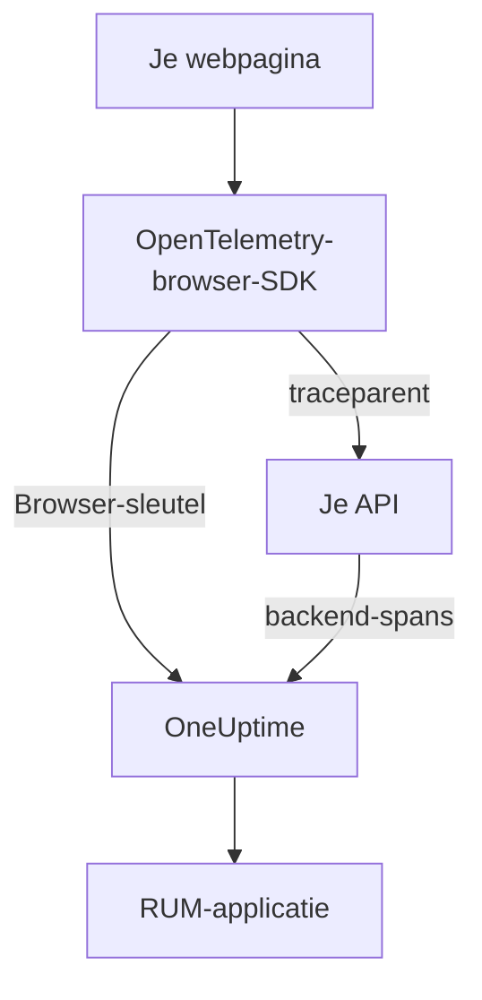

# Browserconfiguratie

Instrumenteer een web-app met de OpenTelemetry-browser-SDK, zodat hij zich bij OneUptime meldt als RUM-applicatie. Paginaladingen en verzoeken komen binnen als traces, en dezelfde configuratie vervoert ook je fouten, logs, metrieken en Core Web Vitals.

:::cards
- [Instellen](#instellen): Zes stappen van een Browser-sleutel tot je eerste paginalading.
- [Koppelen aan je backend](#koppelen-aan-je-backend-traces): Browserspans verbinden met de backend-traces die ze starten.
- [Fouten melden](#onafgevangen-fouten-melden): Onafgevangen fouten naar de weergave Uitzonderingen sturen.
- [Probleemoplossing](#probleemoplossing): Wat je controleert als er niets binnenkomt.
:::

## Zo werkt het

De SDK draait in de browsers van je bezoekers. Hij legt voor elke paginalading en elk verzoek een span vast en exporteert ze rechtstreeks naar OneUptime met een **Browser**-ingestiesleutel, zonder eigen collector of proxy ertussen.



## Voordat je begint

- Een web-app waarvan je de code kunt wijzigen en opnieuw kunt uitrollen, met afhankelijkheden die via npm worden geïnstalleerd.
- De origins waarvandaan je pagina's worden geserveerd, bijvoorbeeld `https://app.example.com`. Een Browser-sleutel accepteert alleen verzoeken van de origins die je erop opgeeft.
- Een rol die ingestiesleutels mag aanmaken: projecteigenaren en -beheerders mogen dat, en ook iedereen met de machtiging **Create Telemetry Ingestion Key**.

## Instellen

:::steps
### Een Browser-ingestiesleutel aanmaken

1. Ga naar **Producten → Projectinstellingen**.
2. Klap in het zijmenu **Telemetrie & APM** open en kies **Ingestiesleutels**.
3. Klik op **Inname-sleutel aanmaken** en kies **Browser** als **Sleuteltype**.
4. Geef in de stap **Browserinstellingen** je origins op onder **Allowed Origins** als JSON-array, bijvoorbeeld `["https://app.example.com"]`, en maak de sleutel aan. Op het gratis abonnement van OneUptime Cloud toont een laatste stap **Facturering** eerst de prijs van telemetrie.


De nieuwe sleutel opent op een eigen pagina. Kopieer de **Geheime sleutel**: dat is het token dat de SDK als `x-oneuptime-token` verstuurt.


### De pakketten installeren

```bash
npm install @opentelemetry/api \
  @opentelemetry/sdk-trace-web \
  @opentelemetry/resources \
  @opentelemetry/semantic-conventions \
  @opentelemetry/opentelemetry-browser-detector \
  @opentelemetry/exporter-trace-otlp-http \
  @opentelemetry/context-zone \
  @opentelemetry/instrumentation \
  @opentelemetry/instrumentation-document-load \
  @opentelemetry/instrumentation-fetch \
  @opentelemetry/instrumentation-xml-http-request
```

### Het telemetriebestand aanmaken

Maak `src/telemetry.ts` aan. `browserDetector` voegt de `browser.*`-attributen toe waardoor de telemetrie als RUM wordt ingedeeld, en `service.name` geeft de applicatie haar naam.

```ts title="src/telemetry.ts"
import {
  WebTracerProvider,
  BatchSpanProcessor,
} from "@opentelemetry/sdk-trace-web";
import { OTLPTraceExporter } from "@opentelemetry/exporter-trace-otlp-http";
import { ZoneContextManager } from "@opentelemetry/context-zone";
import { registerInstrumentations } from "@opentelemetry/instrumentation";
import { DocumentLoadInstrumentation } from "@opentelemetry/instrumentation-document-load";
import { FetchInstrumentation } from "@opentelemetry/instrumentation-fetch";
import { XMLHttpRequestInstrumentation } from "@opentelemetry/instrumentation-xml-http-request";
import {
  defaultResource,
  detectResources,
  resourceFromAttributes,
} from "@opentelemetry/resources";
import { browserDetector } from "@opentelemetry/opentelemetry-browser-detector";
import { ATTR_SERVICE_NAME } from "@opentelemetry/semantic-conventions";

const ONEUPTIME_URL = "https://oneuptime.com";
// Public: it ships in your page. It must be a Browser ingestion key.
const ONEUPTIME_TOKEN = "YOUR_TELEMETRY_INGESTION_TOKEN";

/*
 * browserDetector supplies the browser.* attributes. Without them this
 * telemetry is classified as a backend Service, not a RUM application.
 * The attributes set last win, so service.name here overrides the
 * "unknown_service" that defaultResource() provides.
 */
const resource = defaultResource()
  .merge(detectResources({ detectors: [browserDetector] }))
  .merge(
    resourceFromAttributes({
      [ATTR_SERVICE_NAME]: "storefront-web",
    }),
  );

const provider = new WebTracerProvider({
  resource: resource,
  spanProcessors: [
    new BatchSpanProcessor(
      new OTLPTraceExporter({
        url: `${ONEUPTIME_URL}/otlp/v1/traces`,
        headers: { "x-oneuptime-token": ONEUPTIME_TOKEN },
      }),
    ),
  ],
});

provider.register({
  contextManager: new ZoneContextManager(),
});

registerInstrumentations({
  instrumentations: [
    new DocumentLoadInstrumentation(),
    new FetchInstrumentation({
      // See "Linking to your backend traces" before widening this.
      propagateTraceHeaderCorsUrls: [/^https:\/\/api\.example\.com/],
    }),
    new XMLHttpRequestInstrumentation({
      propagateTraceHeaderCorsUrls: [/^https:\/\/api\.example\.com/],
    }),
  ],
});
```

### Het als eerste importeren

Maak het de eerste import van je app. De instrumentaties patchen `fetch` en `XMLHttpRequest`, en een verzoek van vóór de patch wordt niet getracet.

```ts
// src/index.tsx (React), src/main.ts (Vue / Angular), etc.
import "./telemetry";
import React from "react";
// ... the rest of your app
```

### De sleutel controleren

Vraag OneUptime of het de sleutel accepteert voordat je ergens anders gaat zoeken:

```bash
curl -i https://oneuptime.com/otlp/v1/validate \
  -H "x-oneuptime-token: YOUR_TELEMETRY_INGESTION_TOKEN"
```

`200` met `"valid": true` betekent dat de sleutel wordt geaccepteerd; voor een Browser-sleutel voegt het bericht toe dat hij alleen vanuit een browser werkt, vanaf een van zijn toegestane origins. `401` betekent dat de sleutel onbekend, ingetrokken, uitgeschakeld of verlopen is.

### Een pagina laden

Open je site. Binnen een minuut verschijnt de applicatie onder **Producten → Bronnen → Real User Monitoring**, genoemd naar haar `service.name`.
:::

## Wat een Browser-sleutel toestaat

Alles in het snippet gaat naar je bezoekers, dus iedereen kan het token van je pagina kopiëren. Een Browser-sleutel beperkt wat een kopie kan doen:

| Instelling | Wat het doet |
| --- | --- |
| **Allowed Origins** | Verzoeken worden alleen vanaf deze origins geaccepteerd, elk met schema en eventuele poort. Een host mag beginnen met één jokerteken `*.`: `https://*.example.com` dekt elk subdomein van `example.com`, maar niet `example.com` zelf. |
| **Requests Per Minute Limit** | Eén plafond voor alle bezoekers die de sleutel gebruiken: 6000 verzoeken per minuut, tenzij je een eigen limiet instelt. |
| **Pinned Service Name** | Dwingt `service.name` af op alles wat de sleutel schrijft, zodat een kopie haar telemetrie niet kan laten doorgaan voor een van je backend-services. |
| **Verloopt om** | Na deze datum wordt de sleutel niet meer geaccepteerd. |
| **Ingeschakeld** | Zet dit uit om een uitgelekte sleutel meteen te stoppen. |

Een Browser-sleutel schrijft OTLP-traces, -logs en -metrieken, plus sessieherhalingen; elke andere inname-route weigert hem. Deze instellingen wijzig je op de eigen pagina van de sleutel. Het sleuteltype kan na het aanmaken van de sleutel niet meer worden gewijzigd.

> [!WARNING]
> Zet nooit een **Server**-sleutel in een pagina. Een Server-sleutel schrijft elk soort telemetrie vanaf overal, zonder origin-controle, dus iedereen die je pagina leest, kan in je project schrijven.

## `browser.*` instellen zonder de detector

`browserDetector` leest de [UA Client Hints API](https://wicg.github.io/ua-client-hints/), die alleen Chromium-browsers hebben. In Safari en Firefox stelt hij `browser.language` en `user_agent.original` in, maar niet `browser.platform`, `browser.brands` of `browser.mobile`.

Dat is toch genoeg om de telemetrie als RUM in te delen, want `browser.language` alleen markeert een batch al als browser-RUM. De pagina **Clients** toont platforms echter op basis van `browser.platform`, dus bezoeken met Safari en Firefox voegen daar geen rij toe.

Om de detector over te slaan, of om elke browser een platform te geven, stel je de attributen zelf in:

```ts
const resource = defaultResource().merge(
  resourceFromAttributes({
    [ATTR_SERVICE_NAME]: "storefront-web",
    // browser.language or browser.platform marks the telemetry as browser RUM.
    "browser.language": navigator.language,
    "browser.platform":
      (navigator as any).userAgentData?.platform ?? "unknown",
    "browser.mobile": (navigator as any).userAgentData?.mobile ?? false,
    "user_agent.original": navigator.userAgent,
  }),
);
```

Houd `browser.platform` grof. Elke afzonderlijke waarde wordt een rij op de pagina **Clients**, dus een volledige user-agent-string of een waarde per gebruiker levert daar een eindeloze lijst op en is bovendien een privacyprobleem.

## Routewissels tracen

`DocumentLoadInstrumentation` traceert alleen de eerste lading. In een single-page-app blijven routewissels onzichtbaar tot je ze vastlegt, wat een paar regels in je router kost:

```ts
import { trace } from "@opentelemetry/api";

const tracer = trace.getTracer("app-router");

function onRouteChange(to: string): void {
  const span = tracer.startSpan("route-change", {
    attributes: { "app.route": to },
  });
  // End it when the route's data has loaded and the view has painted.
  requestAnimationFrame(() => {
    return span.end();
  });
}
```

Voeg `@opentelemetry/instrumentation-user-interaction` toe om ook klikken en andere DOM-gebeurtenissen te tracen. Voor de INP per route, zie [Single-page-apps](/docs/rum/web-vitals#single-page-apps).

## Koppelen aan je backend-traces

`propagateTraceHeaderCorsUrls` bepaalt welke cross-origin-verzoeken een W3C-header `traceparent` meekrijgen, die de browserspan verbindt met de backend-trace die hij startte. Verzoeken naar de eigen origin van je pagina krijgen hem zonder enige configuratie mee.

> [!WARNING]
> Stel het niet in op `/.*/`. De header maakt van een eenvoudig cross-origin-verzoek een verzoek met preflight, dus elke externe API die `traceparent` niet in zijn `Access-Control-Allow-Headers` vermeldt, begint te falen.

Vermeld alleen origins die je beheert en hebt geconfigureerd:

```ts
new FetchInstrumentation({
  propagateTraceHeaderCorsUrls: [
    /^https:\/\/api\.example\.com/,
    /^https:\/\/auth\.example\.com/,
  ],
});
```

Met [Sessieherhaling](/docs/telemetry/session-replay) geïnstalleerd dragen verzoeken naar je eigen origin ook de sessie-ID van de herhaling, waarmee je backend-telemetrie onder de opname wordt gearchiveerd: zie [Traces koppelen aan de sessieherhaling](#traces-koppelen-aan-de-sessieherhaling).

## Traces koppelen aan de sessieherhaling

Gebruik je ook [Sessieherhaling](/docs/telemetry/session-replay), dan sluit je **backend**-telemetrie zich zonder code op deze plek bij de opname aan. Terwijl een sessie uploadt, voegt de recorder een `tracestate`-lid met de sessie-ID toe aan de verzoeken die je pagina naar haar eigen origin doet, en laat hij de `traceparent` over aan je `FetchInstrumentation` / `XMLHttpRequestInstrumentation`. De spans van je backend krijgen bij de inname de sessie-ID, in elke service die de W3C-tracecontext voortzet, en de logs en uitzonderingen ervan sluiten zich via de trace-ID bij de opname aan. Zie [Correleren met je overige telemetrie](/docs/telemetry/session-replay#correlating-with-your-other-telemetry) voor hoe het werkt, wat het niet dekt en de schakelaar die het uitzet.

De recorder leest ook de `traceparent` terug die je instrumentaties instellen, of de aanroep nu een URL (met of zonder init-object) of een `Request`-object meegeeft, zodat elke verzoekrij in de herhaling naar haar backend-trace linkt. Vermeld een API op een andere origin hierboven in `propagateTraceHeaderCorsUrls`; de verzoeken ervan dragen geen sessie-ID en sluiten zich via de trace-ID bij de opname aan. **Trace propagation origins** in het herhalingsbeleid van de applicatie doet hetzelfde voor pagina's *zonder* deze SDK.

Wat de headers niet bereiken, zijn de eigen browserspans van deze SDK: documentladingen, routewissels en de fouten die je meldt. Om ook die onder de opname te archiveren, geef je elke span bij de start `session.id` mee. De recorder geeft je de ID via `onSessionChange`, dat meteen afgaat als er al een sessie is, en opnieuw telkens wanneer de ID verandert: als de bezoeker na 30 minuten inactiviteit terugkomt, bij de limiet van 4 uur, als `identify()` een andere gebruiker noemt, of als een ander tabblad van dezelfde bezoeker hem eerder veranderde.

```ts title="src/replaySession.ts"
import type { Context } from "@opentelemetry/api";
import type {
  ReadableSpan,
  Span,
  SpanProcessor,
} from "@opentelemetry/sdk-trace-web";

declare global {
  interface Window {
    OneUptimeReplayQueue?: Array<Array<unknown>>;
  }
}

let replaySessionId: string | null = null;

// The recorder script loads asynchronously. The queue is applied the
// moment it starts and stays live afterwards, so this works either way.
(window.OneUptimeReplayQueue = window.OneUptimeReplayQueue || []).push([
  "onSessionChange",
  (sessionId: string): void => {
    replaySessionId = sessionId;
  },
]);

export class ReplaySessionSpanProcessor implements SpanProcessor {
  public onStart(span: Span, _parentContext: Context): void {
    if (replaySessionId) {
      span.setAttribute("session.id", replaySessionId);
    }
  }

  public onEnd(_span: ReadableSpan): void {}

  public forceFlush(): Promise<void> {
    return Promise.resolve();
  }

  public shutdown(): Promise<void> {
    return Promise.resolve();
  }
}
```

Zet hem daarna als eerste bij de span-processors van de provider in `src/telemetry.ts`:

```ts
import { ReplaySessionSpanProcessor } from "./replaySession";

const provider = new WebTracerProvider({
  resource: resource,
  spanProcessors: [
    new ReplaySessionSpanProcessor(),
    new BatchSpanProcessor(
      new OTLPTraceExporter({
        url: `${ONEUPTIME_URL}/otlp/v1/traces`,
        headers: { "x-oneuptime-token": ONEUPTIME_TOKEN },
      }),
    ),
  ],
});
```

Spans die daarna starten, dragen de ID, het tabblad **Traces** van de herhalingsspeler toont ze op de klok van de opname, en elk ervan linkt in het dashboard terug naar het moment in de herhaling. Een span-processor geeft elke span de ID die gold toen hij startte; de ID in plaats daarvan in `resource.attributes` schrijven zou spans een ander label geven die nog in de exportbatch wachtten toen de sessie wisselde. De listener krijgt de ID zodra de recorder start, nog vóór toestemming of een opname-trigger, dus als dat ertoe doet, voeg de ID pas toe zodra je pagina toestemming heeft.

## Content Security Policy

Als je site een Content Security Policy verstuurt, blokkeert de browser de verzoeken van de exporter tot je OneUptime in `connect-src` toestaat. Niets faalt zichtbaar: de pagina meldt gewoon niets.

```text
connect-src 'self' https://oneuptime.com;
```

Voeg het samen met je bestaande `connect-src`-richtlijn. Host je OneUptime zelf, gebruik dan je eigen host.

## Onafgevangen fouten melden

De OpenTelemetry-browser-SDK vangt onafgevangen fouten niet op. Meld ze zelf, dan verschijnen ze onder **Uitzonderingen** naast je backend-fouten:

```ts
import { trace, SpanStatusCode } from "@opentelemetry/api";

const tracer = trace.getTracer("app-errors");

window.addEventListener("error", (event: ErrorEvent) => {
  const span = tracer.startSpan("window.onerror");
  span.recordException(event.error ?? new Error(event.message));
  span.setStatus({ code: SpanStatusCode.ERROR });
  span.end();
});

window.addEventListener("unhandledrejection", (event: PromiseRejectionEvent) => {
  const span = tracer.startSpan("unhandledrejection");
  span.recordException(
    event.reason instanceof Error ? event.reason : new Error(String(event.reason)),
  );
  span.setStatus({ code: SpanStatusCode.ERROR });
  span.end();
});
```

Met [Sessieherhaling](/docs/telemetry/session-replay) vangt ook de recorder onafgevangen fouten op en markeert ze op de tijdlijn van de herhaling. De pagina van de uitzondering toont dan een kaart **Watch what the user saw**, die de herhaling tien seconden vóór de fout opent. Met het standaardbeleid wordt elke sessie opgenomen, of er nu iets fout gaat of niet; de fout bepaalt alleen waar de kaart opent.

## Logs en metrieken toevoegen

Traces zijn genoeg om het overzicht te vullen. Voeg de log- en metriekpipelines toe als je browserlogs in OneUptime wilt, of om [Core Web Vitals](/docs/rum/web-vitals) te versturen:

```bash
npm install @opentelemetry/api-logs @opentelemetry/sdk-logs \
  @opentelemetry/exporter-logs-otlp-http \
  @opentelemetry/sdk-metrics @opentelemetry/exporter-metrics-otlp-http
```

```ts
import { LoggerProvider, BatchLogRecordProcessor } from "@opentelemetry/sdk-logs";
import { OTLPLogExporter } from "@opentelemetry/exporter-logs-otlp-http";
import { MeterProvider, PeriodicExportingMetricReader } from "@opentelemetry/sdk-metrics";
import { OTLPMetricExporter } from "@opentelemetry/exporter-metrics-otlp-http";
import { logs } from "@opentelemetry/api-logs";
import { metrics } from "@opentelemetry/api";

const headers = { "x-oneuptime-token": ONEUPTIME_TOKEN };

logs.setGlobalLoggerProvider(
  new LoggerProvider({
    resource: resource,
    processors: [
      new BatchLogRecordProcessor({
        exporter: new OTLPLogExporter({
          url: `${ONEUPTIME_URL}/otlp/v1/logs`,
          headers,
        }),
      }),
    ],
  }),
);

metrics.setGlobalMeterProvider(
  new MeterProvider({
    resource: resource,
    readers: [
      new PeriodicExportingMetricReader({
        exporter: new OTLPMetricExporter({
          url: `${ONEUPTIME_URL}/otlp/v1/metrics`,
          headers,
        }),
        exportIntervalMillis: 30000,
      }),
    ],
  }),
);
```

Bouw ze met hetzelfde `resource`-object. Een log- of metriekpipeline waarvan de resource geen `browser.*` heeft, wordt als aparte backend-service ingedeeld.

## Endpoint-referentie

| Signaal | Endpoint | Header |
| --- | --- | --- |
| Traces | `POST {host}/otlp/v1/traces` | `x-oneuptime-token: <token>` |
| Metrieken | `POST {host}/otlp/v1/metrics` | `x-oneuptime-token: <token>` |
| Logs | `POST {host}/otlp/v1/logs` | `x-oneuptime-token: <token>` |

`{host}` is `https://oneuptime.com`, of je eigen host als je OneUptime zelf draait; wijzig hem in de OTLP-URL's en in de vermelding in de Content Security Policy. OneUptime accepteert OTLP/JSON en OTLP/protobuf. De endpoints beantwoorden cross-origin-verzoeken vanaf elke origin en staan de header `x-oneuptime-token` toe, zodat een browser er rechtstreeks naartoe exporteert.

## Probleemoplossing

:::details Geen verzoek naar OneUptime in het tabblad Netwerk
Open de ontwikkelaarstools van je browser, ga naar het tabblad Netwerk en filter op `otlp`: je zoekt `POST /otlp/v1/traces`. Helemaal geen verzoek betekent dat de SDK nooit is gestart:

- `telemetry.ts` is niet de eerste import, of je bundler heeft hem weggelaten.
- De batch-processor heeft nog niet geëxporteerd. Hij wacht een paar seconden om een batch te vullen, dus wacht even, of ga naar een andere pagina, voordat je concludeert dat er niets wordt verstuurd.
- Een omgevingsvariabele uit de build werd `undefined`, waardoor de URL van de exporter stuk is. Log de URL één keer bij het opstarten.
:::

:::details De browser blokkeert het verzoek
- Een fout van de Content Security Policy in de console betekent dat `connect-src` OneUptime nog niet toestaat: zie [Content Security Policy](#content-security-policy).
- Een CORS-fout betekent bijna altijd dat het verzoek OneUptime nooit heeft bereikt, waarvan de endpoints elke origin toestaan: zoek naar een bedrijfsproxy, een adblocker of een typfout in de host.
:::

:::details OneUptime weigert het verzoek
- `422` met `Origin https://app.example.com is not allowed for this browser ingestion key.` betekent dat de exacte origin van de pagina (schema, host en poort) ontbreekt in de **Allowed Origins** van de sleutel.
- `422` met `This telemetry ingestion key has been disabled.` betekent dat iemand de sleutel heeft uitgeschakeld. Zet hem weer aan of gebruik een andere sleutel.
- `401` betekent dat de sleutel onbekend, ingetrokken of verlopen is. Voer de sleutelcontrole uit [Instellen](#instellen) uit en maak daarna een geldige Browser-sleutel aan.
- `404` betekent dat de URL fout is. De trace-exporter heeft het volledige pad nodig, `/otlp/v1/traces`.
:::

:::details De app verschijnt onder Services in plaats van onder Real User Monitoring
De resource heeft geen `browser.*`-attribuut, dus de telemetrie is als backend-service ingedeeld. Voeg `browserDetector` toe, of stel de attributen in zoals in [`browser.*` instellen zonder de detector](#browser-instellen-zonder-de-detector).

Controleer in het tabblad Netwerk, in de payload van het verzoek, wat je verstuurt: `resourceSpans[0].resource.attributes` is de lijst die het bepaalt. De service die al is aangemaakt, wordt geen RUM-applicatie, dus verwijder hem onder **Producten → Services** zodra er RUM-telemetrie binnenkomt.
:::

:::details De pagina Clients is leeg in Safari of Firefox
Clientrijen komen uit `browser.platform`, dat `browserDetector` alleen in Chromium-browsers instelt. Stel het zelf in om bezoeken met Safari en Firefox te tonen: zie [`browser.*` instellen zonder de detector](#browser-instellen-zonder-de-detector).
:::

## Volgende stappen

:::cards
- [Core Web Vitals](/docs/rum/web-vitals): LCP, INP, CLS, FCP en TTFB vanaf dezelfde pagina versturen.
- [Sessieherhaling](/docs/telemetry/session-replay): Opnemen wat de gebruiker zag, naast deze traces.
- [Applicaties beheren](/docs/rum/applications): Namen, labels, eigenaren en bewaartermijnen.
- [RUM-probleemoplossing](/docs/rum/troubleshooting): Elke controle, in de volgorde waarin problemen meestal optreden.
:::
