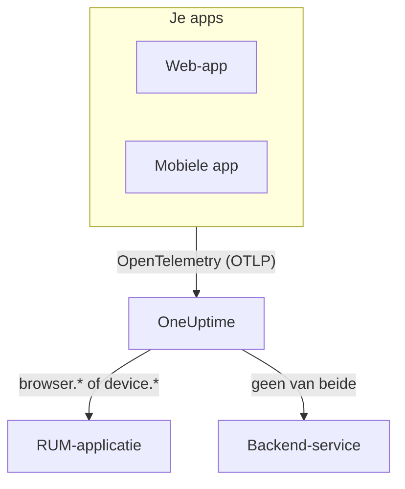

# RUM – Overzicht

Real User Monitoring (RUM) laat zien wat echte gebruikers in je web- en mobiele apps meemaken: paginaladingen, verzoeken, fouten en Core Web Vitals, gemeld door de app zelf in plaats van door een probe. OneUptime brengt die telemetrie onder in een RUM-applicatie die je in grafieken kunt zetten, kunt doorzoeken en met meldingen kunt bewaken.

:::cards
- [Zo werkt het](#zo-werkt-het): Eén OpenTelemetry-pipeline, bij aankomst als RUM ingedeeld.
- [Hoe OneUptime RUM herkent](#hoe-oneuptime-rum-herkent): De resource-attributen die het bepalen.
- [Wat je krijgt](#wat-je-krijgt): Het overzicht, de vitals, de verkenners en de herhalingen.
- [Aan de slag](#aan-de-slag): Van een ingestiesleutel tot je eerste paginalading.
:::

## Zo werkt het

RUM gebruikt dezelfde OpenTelemetry-pipeline als de rest van OneUptime. Er is geen RUM-agent en geen eigen overdrachtsformaat: je richt een OpenTelemetry-SDK voor browser of mobiel op OneUptime, en de telemetrie wordt bij aankomst als RUM ingedeeld.

- **Eén applicatie per app.** De identiteit is de `service.name` die je SDK meldt, en OneUptime maakt de applicatie aan bij de eerste batch telemetrie.
- **Nooit dubbel geteld.** Clienttelemetrie hoort alleen bij de eigen RUM-applicatie; ze verschijnt niet ook als backend-service.
- **Session Replay is een aparte, optionele laag.** Het heeft een eigen snippet en eigen privacy-instellingen: zie [Sessieherhaling](/docs/telemetry/session-replay).

## Waar je het vindt

Open **Producten → Bronnen → Real User Monitoring**. **Alle applicaties** toont je applicaties met hun **Clienttype**, **Status** en **Laatst gezien**. Twee andere secties van het zijmenu staan eerst ingeklapt:

- **Instellingen**: **Eigenaarsregels**, **Labelregels** en de projectbrede schakelaar **Session Replay**.
- **Geavanceerd**: **Gearchiveerd**, de applicaties die je hebt gearchiveerd.

Het zijmenu van een applicatie groepeert de pagina's zo; **Instellingen**, **Ontwikkelaars** en **Geavanceerd** staan eerst ingeklapt:

| Sectie | Pagina's |
| --- | --- |
| **Basis** | **Overzicht**, **Recommendations**, **Documentatie** |
| **Observability** | **Metrieken**, **Logboeken**, **Traces**, **Clients** |
| **Session Replay** | **Session Replay**, **User Flows**, **Replay Users**, **Health**, **Replay Policy**, **Replay Access Log**, **Documentatie** |
| **Instellingen** | **Instellingen** |
| **Ontwikkelaars** | **Terraform**, **API**, **AI-assistenten** |
| **Geavanceerd** | **Applicatie verwijderen** |

## Hoe OneUptime RUM herkent

De meeste vragen van het type 'mijn app verschijnt niet' eindigen hier. OneUptime beslist voor elke batch telemetrie bij aankomst, op basis van de **resource-attributen**:

1. Een batch waarvan de resource `browser.platform`, `browser.language` of een niet-lege `browser.brands` heeft, is **browser**-RUM.
2. Anders is een batch met `device.id` of `device.model.identifier` **mobiele** RUM.
3. Anders is een batch met `device.manufacturer` en zonder host-identiteit (`host.name`, `host.id` of `k8s.node.name`) ook **mobiele** RUM.
4. Al het andere is een backend-service.

Backend-SDK's stellen nooit `browser.*`, `device.id` of `device.model.identifier` in, dus dat zijn duidelijke signalen. `device.manufacturer` is de uitzondering: de inventaris van een host meldt daarmee ook het merk van een machine, dus het telt alleen op een resource zonder host-identiteit. Zie [Inventarisattributen](/docs/telemetry/host-otel-collector#inventarisattributen-ip-mac-serienummer-merk-model-firmware).

| Attribuut | Vereist | Wat het doet |
| --- | --- | --- |
| `service.name` | **Ja** | De identiteit van de applicatie, bijvoorbeeld `storefront-web`. Zonder dit attribuut wordt geen RUM-applicatie aangemaakt. |
| `browser.platform`, `browser.language`, `browser.brands` | Eén ervan, op het web | Markeert de batch als browser-RUM. `browser.platform` vult ook de pagina **Clients**. |
| `device.id`, `device.model.identifier` | Eén ervan, op mobiel | Markeert de batch als mobiele RUM. `device.model.identifier` vult ook de pagina **Clients**. |
| `device.manufacturer` | Nee | Markeert de batch alleen als mobiele RUM als de resource geen host-identiteit draagt. |
| `telemetry.sdk.language` | Nee | Getoond in het overzicht, bijvoorbeeld `webjs` of `swift`. |
| `telemetry.sdk.version` | Nee | Getoond als SDK-versie; ontbreekt het, dan wordt `oneuptime.agent.version` gelezen. |
| `oneuptime.label.<name>` | Nee | Voegt het projectlabel `<name>:<value>` toe aan de applicatie. |

OneUptime vindt de applicatie via `service.name`, zonder op hoofdletters te letten, en maakt haar aan als het project er nog geen heeft. Een nieuwe `service.name` start een nieuwe applicatie, dus houd hem stabiel en onderscheid omgevingen met een label in plaats van met een nieuwe naam. [Applicaties beheren](/docs/rum/applications) behandelt namen, labels, eigenaren en bewaartermijnen.

> [!IMPORTANT]
> De OpenTelemetry-browser-SDK voegt geen `browser.*`-attributen toe, tenzij je de browser-resourcedetector toevoegt of ze zelf instelt. Met alleen `service.name` wordt de telemetrie een backend-service, geen RUM-applicatie. [Browserconfiguratie](/docs/rum/browser-setup) laat beide manieren zien.

## Wat je krijgt

| Waar | Wat het toont |
| --- | --- |
| **Overzicht** | Tegels voor **Page loads**, **Page load time (p95)**, **Gebeurtenissen**, **Foutpercentage**, **Event duration (p95)**, **Uitzonderingen**, **Clients** en **Sessions recorded**, en trendgrafieken over het tijdsbereik dat je kiest. |
| **Core Web Vitals** | Een kaart in het overzicht met LCP, INP, CLS, FCP en TTFB, elk beoordeeld tegen de grenzen van Google, en de INP van elke route van een single-page-app. Zie [Core Web Vitals](/docs/rum/web-vitals) en [Single-page-apps](/docs/rum/web-vitals#single-page-apps). |
| **Metrieken**, **Logboeken**, **Traces** | De telemetrieverkenners, beperkt tot deze applicatie. |
| **Clients** | De browserplatforms en apparaatmodellen waarop de applicatie is gebruikt: een korte lijst per platform, nooit een rij per gebruiker. |
| **Session Replay** | Opnames van echte sessies, naast hun fouten, traces en logs: zie [Sessieherhaling](/docs/telemetry/session-replay). |
| **Recommendations** | Kant-en-klare monitors voor de applicatie: slechte Core Web Vitals, mislukte verzoeken, browseruitzonderingen en, zodra ze opneemt, budgetten voor Session Replay. |

De tellingen komen uit de spans die je instrumentatie verstuurt. **Page loads** telt de span `documentLoad` die de instrumentatie voor paginaladingen bij elke volledige lading vastlegt, dus een routewissel binnen een single-page-app is geen paginalading.

Een applicatie toont **Verbonden** zolang er telemetrie binnenkomt en **Verbinding verbroken** na 15 minuten zonder. Tijd waarin OneUptime zelf plat lag of zijn innamewachtrij inhaalde, telt niet mee voor die 15 minuten.

## Aan de slag

:::steps
### Een ingestiesleutel aanmaken

Open **Projectinstellingen → Telemetrie & APM → Ingestiesleutels** en klik op **Inname-sleutel aanmaken**. Een web-app heeft een **Browser**-sleutel nodig, die alleen werkt vanaf de origins die je opgeeft. Een mobiele app heeft een **Server**-sleutel nodig, omdat een mobiele SDK geen `Origin`-header verstuurt.

### Je app instrumenteren

Volg [Browserconfiguratie](/docs/rum/browser-setup) voor een web-app, of [Mobiele configuratie](/docs/rum/mobile-setup) voor Android, iOS, React Native en andere platforms.

### Een pagina openen

Laad een pagina van je site of start je app. De applicatie verschijnt bij de eerste batch telemetrie onder **Producten → Bronnen → Real User Monitoring**, genoemd naar haar `service.name`. Je hoeft haar niet eerst aan te maken.

### Vitals en herhalingen toevoegen

Als de basis binnenkomt, stuur je de [Core Web Vitals](/docs/rum/web-vitals) en voeg je [Sessieherhaling](/docs/telemetry/session-replay) toe. Beide zijn optioneel.
:::

Verschijnt er niets, dan loopt [RUM-probleemoplossing](/docs/rum/troubleshooting) de oorzaken langs in de volgorde waarin ze meestal optreden.

## Volgende stappen

:::cards
- [Browserconfiguratie](/docs/rum/browser-setup): Een web-app instrumenteren met de OpenTelemetry-browser-SDK.
- [Mobiele configuratie](/docs/rum/mobile-setup): Android, iOS, React Native en elke andere OpenTelemetry-SDK.
- [Core Web Vitals](/docs/rum/web-vitals): LCP, INP, CLS, FCP en TTFB versturen, en INP per route lezen.
- [Sessieherhaling](/docs/telemetry/session-replay): Zien wat de gebruiker zag, naast diens fouten en traces.
:::
