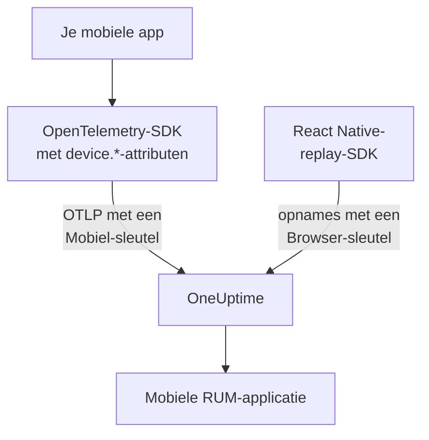

# Mobiele configuratie

Instrumenteer een Android-, iOS- of React Native-app met OpenTelemetry, zodat hij zich bij OneUptime meldt als mobiele RUM-applicatie. Elk ander platform met een OpenTelemetry-SDK werkt op dezelfde manier.

:::cards
- [Wat OneUptime nodig heeft](#wat-oneuptime-nodig-heeft): Twee resource-attributen, verstuurd met een Mobiel-sleutel.
- [Je platform instellen](#je-platform-instellen): Android, iOS, React Native en de rest.
- [Crashes en vastlopers op iOS](#crashes-en-vastlopers-op-ios): De rapporten van MetricKit en KSCrash in Uitzonderingen, benoemd door je dSYM's.
- [Controleren of het binnenkomt](#controleren-of-het-binnenkomt): De sleutel testen en dan de app vinden.
- [Session Replay op mobiel](#session-replay-op-mobiel): Opnames voor React Native-apps.
:::

## Zo werkt het

Je app exporteert OTLP rechtstreeks naar OneUptime met een **Mobiel**-ingestiesleutel, vastgezet op de app, dus alles wat hij verstuurt wordt als die mobiele RUM-applicatie ingedeeld. Met elke andere sleutel zijn de `device.*`-attributen op de resource wat hem als mobiele RUM indeelt in plaats van als backend-service.



## Wat OneUptime nodig heeft

Twee resource-attributen, op elke batch die je app exporteert:

| Attribuut | Wat het is |
| --- | --- |
| `service.name` | De identiteit van de applicatie, bijvoorbeeld `storefront-android`. |
| `device.id` of `device.model.identifier` | Markeert de telemetrie als mobiele RUM. `device.model.identifier` vult ook de pagina **Clients**. |

Verstuurd met een andere sleutel komt telemetrie zonder apparaatattribuut toch binnen en kun je haar opvragen, maar ze wordt als backend-service ingedeeld in plaats van als RUM-applicatie.

`device.manufacturer` markeert een batch ook als mobiel, maar alleen op een resource zonder host-identiteit, omdat de inventaris van een host daarmee het merk van een machine meldt. Stel ook `device.id` of `device.model.identifier` in, zoals elk recept hieronder doet, en dit maakt nooit uit.

Maak van `device.id` een ID per installatie, nooit een advertentie-ID of iets anders dat een persoon identificeert. OneUptime leest hem alleen om mobiele telemetrie te herkennen.

## Voordat je begint

- Een app met een OpenTelemetry-SDK: de OpenTelemetry Java SDK of OpenTelemetry Android, opentelemetry-swift, of de OpenTelemetry JavaScript SDK voor React Native.
- Een **Mobiel**-ingestiesleutel, aangemaakt onder **Projectinstellingen → Telemetrie & APM → Ingestiesleutels** met **Ingestiesleutel aanmaken**, met de `service.name` van je app als **Vastgezette servicenaam**. Een **Browser**-sleutel wordt vanuit een mobiele app geweigerd: hij wordt gecontroleerd tegen de header `Origin`, die mobiele SDK's niet versturen. Lever nooit een **Server**-sleutel mee in een app.
- Deze OTLP-instellingen. Host je OneUptime zelf, vervang `https://oneuptime.com` dan door je eigen host.

| Instelling | Waarde |
| --- | --- |
| OTLP-endpoint | `https://oneuptime.com/otlp` |
| Header | `x-oneuptime-token: YOUR_TELEMETRY_INGESTION_TOKEN` |
| Traces | `POST https://oneuptime.com/otlp/v1/traces` |
| Metrieken | `POST https://oneuptime.com/otlp/v1/metrics` |
| Logs | `POST https://oneuptime.com/otlp/v1/logs` |

> [!WARNING]
> De sleutel zit in je app, en een app kan worden uitgepakt, dus ga ervan uit dat iemand hem kopieert. Een kopie van een Mobiel-sleutel kan alleen de traces, logs en metrieken van deze app versturen, ingedeeld onder zijn **Vastgezette servicenaam**, en nooit vanaf een webpagina. Hij kan wel verzonnen gegevens voor deze app versturen, tot de **Limiet voor verzoeken per minuut** van de sleutel, dus voeg een datum bij **Verloopt om** toe en vervang de sleutel bij elke release.

## Je platform instellen

De snippets tonen de vorm van de configuratie. De mobiele OpenTelemetry-SDK's veranderen hun API's tussen releases, dus controleer de methodenamen tegen de versie die je vastzet. Wat OneUptime nodig heeft, verandert nooit: het endpoint, de header, `service.name` en één `device.*`-attribuut.

:::tabs
@tab Android
Gebruik de OpenTelemetry Java SDK en de OTLP-exporter ervan, die op Android draaien:

```kotlin title="app/build.gradle.kts"
dependencies {
    implementation(platform("io.opentelemetry:opentelemetry-bom:<latest>"))
    implementation("io.opentelemetry:opentelemetry-sdk")
    implementation("io.opentelemetry:opentelemetry-exporter-otlp")
}
```

```kotlin title="StorefrontApplication.kt"
import android.app.Application
import android.os.Build
import io.opentelemetry.exporter.otlp.http.trace.OtlpHttpSpanExporter
import io.opentelemetry.sdk.OpenTelemetrySdk
import io.opentelemetry.sdk.resources.Resource
import io.opentelemetry.sdk.trace.SdkTracerProvider
import io.opentelemetry.sdk.trace.export.BatchSpanProcessor

class StorefrontApplication : Application() {
    override fun onCreate() {
        super.onCreate()

        val resource = Resource.getDefault().toBuilder()
            .put("service.name", "storefront-android")
            .put("device.manufacturer", Build.MANUFACTURER)
            .put("device.model.identifier", Build.MODEL)
            .build()

        val exporter = OtlpHttpSpanExporter.builder()
            .setEndpoint("https://oneuptime.com/otlp/v1/traces")
            .addHeader("x-oneuptime-token", BuildConfig.ONEUPTIME_TOKEN)
            .build()

        OpenTelemetrySdk.builder()
            .setTracerProvider(
                SdkTracerProvider.builder()
                    .setResource(resource)
                    .addSpanProcessor(BatchSpanProcessor.builder(exporter).build())
                    .build()
            )
            .buildAndRegisterGlobal()
    }
}
```

De agent [OpenTelemetry Android](https://github.com/open-telemetry/opentelemetry-android) voegt daar crashes, ANR's, trage en bevroren frames en app-starts aan toe, en stelt `device.model.identifier` en `device.manufacturer` in op zijn eigen resource. [Android-configuratie](/docs/rum/android-setup) richt hem in, in plaats van de code hierboven.
@tab iOS
Gebruik [opentelemetry-swift](https://github.com/open-telemetry/opentelemetry-swift) en stel de apparaatattributen zelf in: de resource die elke versie uit zichzelf toevoegt, is tussen releases veranderd.

```swift
let resource = Resource(attributes: [
    "service.name": .string("storefront-ios"),
    "device.model.identifier": .string(UIDevice.current.model),
    "device.manufacturer": .string("Apple"),
    "device.id": .string(UIDevice.current.identifierForVendor?.uuidString ?? ""),
    "telemetry.sdk.language": .string("swift"),
])

let exporter = OtlpHttpTraceExporter(
    endpoint: URL(string: "https://oneuptime.com/otlp/v1/traces")!,
    config: OtlpConfiguration(
        headers: [("x-oneuptime-token", oneUptimeToken)]
    )
)

OpenTelemetry.registerTracerProvider(
    tracerProvider: TracerProviderBuilder()
        .with(resource: resource)
        .add(spanProcessor: BatchSpanProcessor(spanExporter: exporter))
        .build()
)
```

`UIDevice.current.model` geeft een korte naam zoals `iPhone`, waardoor de pagina **Clients** één rij per soort apparaat houdt. `identifierForVendor` is de installatie waarop OneUptime de crashvrije installaties telt, zoals [Sessies vastleggen](#sessies-vastleggen) beschrijft.
@tab React Native
React Native draait de OpenTelemetry JavaScript SDK, dus bouw de provider, de OTLP-exporter en de batch-processor zoals in [Browserconfiguratie](/docs/rum/browser-setup), met drie wijzigingen: verstuur met een **Mobiel**-sleutel, laat `browserDetector` en `DocumentLoadInstrumentation` weg, en stel de apparaatattributen zelf in.

```ts
import { Platform } from "react-native";
import * as Device from "expo-device"; // or react-native-device-info
import {
  defaultResource,
  resourceFromAttributes,
} from "@opentelemetry/resources";

const resource = defaultResource().merge(
  resourceFromAttributes({
    "service.name": "storefront-mobile",
    "device.manufacturer": Device.manufacturer ?? Platform.OS,
    "device.model.identifier":
      Device.modelId ?? Device.modelName ?? "unknown",
    "telemetry.sdk.language": "webjs",
  }),
);
```

`Device.modelId` is alleen op iOS ingesteld, dus Android valt terug op `Device.modelName`.
@tab Andere platforms
Flutter, Unity, .NET MAUI, een embedded client of een eigen OTLP-writer werken allemaal, zolang de resource `service.name` en één `device.*`-attribuut draagt. Een SDK die de standaard-omgevingsvariabelen van OpenTelemetry leest, neemt deze zo over:

```bash
OTEL_EXPORTER_OTLP_ENDPOINT="https://oneuptime.com/otlp"
OTEL_EXPORTER_OTLP_HEADERS="x-oneuptime-token=YOUR_TELEMETRY_INGESTION_TOKEN"
OTEL_RESOURCE_ATTRIBUTES="service.name=storefront-mobile,device.manufacturer=Acme,device.model.identifier=AC-100"
```

De SDK voegt `/v1/traces`, `/v1/metrics` en `/v1/logs` zelf aan het endpoint toe.
:::

## Crashes en vastlopers op iOS

opentelemetry-swift 2.3 en later melden de crashes en vastlopers van een iOS-app via de MetricKit-instrumentatie, die elke diagnose van Apple als logrecord aan OpenTelemetry doorgeeft. OneUptime deelt ze in zoals de crashes en ANR's van OpenTelemetry Android, zodat ze verschijnen in **Uitzonderingen** en op de pagina **Overzicht** van de applicatie:

| Diagnose van Apple | Gebeurtenisnaam | In Uitzonderingen |
| --- | --- | --- |
| Een crash | `metrickit.diagnostic.crash` | Een niet-afgehandelde uitzondering, met als type wat de app beëindigde: de Objective-C-uitzondering op iOS 17 en later, anders de Mach-uitzondering (`EXC_BAD_ACCESS`), anders het signaal (`SIGSEGV`) |
| Een vastloper | `metrickit.diagnostic.hang` | Een niet-afgehandelde uitzondering van het type **Hang**, de iOS-tegenhanger van een ANR, die bijhoudt hoe lang de vastloper duurde |

De tegel **Crashes** van het overzicht telt de crashes, en de tegel **ANR's** telt de vastlopers samen met de ANR's van Android. Elke stacktrace wordt getekend als de threads van een crashrapport, met de thread die crashte of vastliep bovenaan. Een frame van de code van je app wordt naar zijn functie benoemd, zoals `CartViewController.checkout()`, zodra de dSYM van zijn build is geüpload, zoals in [Je dSYM's uploaden](#je-dsyms-uploaden). Elk ander frame noemt zijn binary en hoe ver daarin de code zat, en **Binary Images** toont de UUID van elke binary, waaraan je ziet bij welke build de dSYM hoort die hem benoemt.

Crashes en vastlopers worden gegroepeerd op de frames van je app op de thread die crashte of vastliep: op hun functies waar een dSYM ze benoemde, zodat een crash van de ene release tot de volgende één uitzondering blijft, en op hun offsets in de binary waar geen enkele dSYM dat deed, die bij elke build veranderen. Een rapport wordt benoemd zodra het binnenkomt, dus upload de dSYM's van een build voordat je hem uitbrengt: een crash die vóór zijn dSYM binnenkwam, houdt zijn offsets.

:::steps
### Logs naast spans exporteren

MetricKit meldt diagnoses als logrecords, dus registreer naast de tracer provider een logger provider, met dezelfde resource, hetzelfde endpoint en dezelfde header:

```swift
let logExporter = OtlpHttpLogExporter(
    endpoint: URL(string: "https://oneuptime.com/otlp/v1/logs")!,
    config: OtlpConfiguration(
        headers: [("x-oneuptime-token", oneUptimeToken)]
    )
)

OpenTelemetry.registerLoggerProvider(
    loggerProvider: LoggerProviderBuilder()
        .with(resource: resource)
        .with(processors: [
            BatchLogRecordProcessor(logRecordExporter: logExporter),
        ])
        .build()
)
```

### De MetricKit-instrumentatie registreren

Voeg het product `MetricKitInstrumentation` van opentelemetry-swift toe en registreer het bij MetricKit zodra de logger provider is geregistreerd:

```swift
import MetricKit
import MetricKitInstrumentation

// MXMetricManager keeps only a weak reference: hold this for the app's lifetime.
let metricKitInstrumentation = MetricKitInstrumentation()
MXMetricManager.shared.add(metricKitInstrumentation)
```

### Sessies vastleggen

De tegels **Sessies** en **Crashvrije sessies** tellen de `session.id` op je spans. Het product `Sessions` van opentelemetry-swift stelt die in: voeg `SessionSpanProcessor` toe aan de tracer provider en verpak de logprocessor in `SessionLogRecordProcessor`, zodat ook diagnoses een sessie dragen.

De regel onder **Crashvrije sessies** toont het aandeel installaties dat niet crashte, en **Daily Crash Rate** en **Daily ANR Rate** waarschuwen op basis van het aandeel dat wel crashte. Een installatie is de `device.id` van de resource hierboven, de leveranciers-id van de app: één per apparaat voor al je apps, die blijft zolang een van die apps geïnstalleerd blijft, dus je enige app opnieuw installeren levert een nieuwe installatie op en een van twee apps opnieuw installeren niet. Een release van opentelemetry-swift die `app.installation.id` instelt, wordt in plaats daarvan daarop geteld.

### Je dSYM's uploaden

Xcode schrijft een dSYM voor elke binary van je app wanneer het de app archiveert, en App Store Connect geeft ze terug onder **Download dSYMs**. Upload ze na elke archivering, vanuit CI of een Xcode-buildfase, met de [OneUptime-CLI](/docs/cli/index) en een Server-sleutel van je build: een sleutel met een **Vastgezette servicenaam**, zoals die waarmee je app wordt uitgebracht, wordt geweigerd, omdat een dSYM de frames benoemt van elke app in het project die zijn binary meelevert.

```bash
oneuptime dsym upload "$ARCHIVE_PATH/dSYMs" --app storefront-ios --url https://oneuptime.com --ingestion-key YOUR_TELEMETRY_INGESTION_TOKEN
```

De CLI leest `.dSYM`-bundels, mappen en zips daarvan, en DWARF-bestanden waar ze staan, en verstuurt alleen de UUID, de architectuur en de functienamen van elke binary: de dSYM's van een grote app zijn honderden megabytes, hun namen een paar. Zonder de CLI verstuur je het DWARF-bestand van een dSYM, of een zip van `.dSYM`-bundels, zoals het is, tot 50 MB per bestand:

```bash
curl --fail -X POST "https://oneuptime.com/dsyms/v1/upload" \
  -H "x-oneuptime-token: YOUR_TELEMETRY_INGESTION_TOKEN" \
  -F "appName=storefront-ios" \
  -F "dsym=@MyApp.app.dSYM/Contents/Resources/DWARF/MyApp"
```

Elke binary wordt 400 dagen op zijn UUID bewaard, zodat een release die maanden later nog op de telefoons van mensen staat, nog steeds wordt benoemd, en een build opnieuw uploaden vervangt wat ervoor bewaard was. Een dSYM hoort bij het project, niet bij één app: een framework dat twee van je apps insluiten, wordt in beide benoemd.
:::

> [!NOTE]
> Apple levert de diagnoses van MetricKit pas bij een latere start aan de app, vanaf iOS 15 meteen en daarvoor één keer per dag, dus een crash of een vastloper kan minuten of een dag nadat hij gebeurde binnenkomen, en wordt geteld wanneer hij binnenkomt. «0 crashes in het afgelopen uur» op het overzicht van een iOS-app is dus nog geen goed nieuws. Een diagnose draagt de sessie die hem meldde, niet de sessie die hij beëindigde.

opentelemetry-swift legt geen span vast wanneer de app start, dus de tegels **App-starts** en **Koude start (p95)** blijven leeg tot je app er zelf een vastlegt: een span met de naam `AppStart`, met `start.type` ingesteld op `cold`, `warm` of `hot`, van het starten van het proces tot het eerste scherm klaar is.

### Als KSCrash een crash ook meldt

opentelemetry-swift kan crashes ook melden via KSCrash, dat zijn rapport als logrecord `device.crash` verstuurt wanneer de app de volgende keer wordt geopend, met het tijdstip waarop de app crashte. Een app die beide registreert, meldt elke crash twee keer: KSCrash bij de volgende start, MetricKit bij de volgende start of tot een dag later. OneUptime telt zo'n crash één keer: het eerste rapport dat binnenkomt is het voorval, en het tweede wordt ernaast bewaard, in dezelfde uitzondering, als bewijs van dezelfde crash, en in geen enkele tegel, grafiek of monitor geteld. In de **Voorvallen** van de uitzondering staat bij het voorval **Twee keer gemeld**.

Twee rapporten gelden alleen als één crash wanneer al het volgende klopt:

- Ze komen van de twee melders, KSCrash en MetricKit. Geen van beide meldt één crash twee keer, dus twee rapporten van één melder zijn twee crashes.
- Ze komen van dezelfde installatie: dezelfde `app.installation.id`, of `device.id`.
- Ze liggen niet meer dan 26 uur uit elkaar: MetricKit geeft een crash het einde van de dag waarover het rapporteert als tijdstip, KSCrash het moment van de crash.
- Ze komen overeen in het signaal, de Mach-uitzondering en de Objective-C-uitzondering, overal waar ze er allebei een noemen.
- De threads die crashten, komen frame voor frame overeen, vanaf waar de thread begon naar binnen toe, op binary en offset, over elk frame van de code van je app dat een van beide noemt. Een crash die helemaal in de code van Apple zit, moet in ten minste drie frames overeenkomen, en in allemaal.

Elk rapport wordt één keer gekoppeld, aan het rapport dat in de tijd het dichtst bij ligt, dus twee crashes door dezelfde bug op één installatie, minuten uit elkaar, zijn twee voorvallen, elk met zijn tweede rapport. Als OneUptime een rapport niet kan vergelijken met de andere van zijn installatie, telt het hem, zodat een crash in het slechtste geval twee keer wordt geteld, maar nooit verloren gaat.

## Controleren of het binnenkomt

:::steps
### De sleutel testen

Vraag OneUptime of het de sleutel accepteert, voordat je de instellingen van de SDK doorzoekt:

```bash
curl -i https://oneuptime.com/otlp/v1/validate \
  -H "x-oneuptime-token: YOUR_TELEMETRY_INGESTION_TOKEN"
```

`200` met `"valid": true` betekent dat de sleutel wordt geaccepteerd. Een Browser-sleutel antwoordt ook met `200`, maar zijn bericht zegt dat hij alleen vanuit een browser werkt: een mobiele app heeft een Mobiel-sleutel nodig. `401` betekent dat de sleutel onbekend, ingetrokken, uitgeschakeld of verlopen is, en geen SDK-instelling lost dat op.

### De app starten

Start de app en gebruik hem even. Hij verschijnt bij de eerste batch telemetrie onder **Producten → Bronnen → Real User Monitoring**, genoemd naar zijn `service.name`.

### De pagina Clients openen

Open de pagina **Clients** van de applicatie: elk apparaatmodel uit `device.model.identifier` heeft een rij. Blijft de pagina leeg terwijl **Traces** zich vult, dan bereiken de apparaatattributen de resource niet.
:::

## Session Replay op mobiel

React Native-apps kunnen sessies opnemen met `@oneuptime/react-native-replay`. Het neemt de native viewboom op als draadmodel, nooit schermafbeeldingen of de tekst op het scherm, en de opnames openen in dezelfde speler als die van het web. Het verstuurt met een **Browser**-sleutel waarvan de **Toegestane origins** je app vermelden als `app://` gevolgd door de Android-applicatie-ID of de iOS-bundle-ID: een andere sleutel dan de Mobiel-sleutel die je OpenTelemetry-SDK gebruikt. [Installeren in React Native](/docs/telemetry/session-replay#installeren-in-react-native) leidt je erdoorheen.

Native Android- en iOS-apps, en de andere platforms, hebben geen sessierecorder: hun pagina **Sessieherhaling** blijft leeg, terwijl traces, logs, metrieken, uitzonderingen en de pagina **Clients** gewoon werken.

## Probleemoplossing

:::details De sleutelcontrole geeft 401, of de sleutel wordt geweigerd
Een `401` betekent dat de sleutel onbekend, ingetrokken, uitgeschakeld of verlopen is: maak een Mobiel-sleutel aan en bouw de app er opnieuw mee.

Een Browser-sleutel doorstaat de controle, maar elke export vanuit een mobiele app wordt geweigerd met een `422` die luidt: `This request did not send an Origin header, so it cannot be checked against the allowed origins of this browser ingestion key. Use a mobile ingestion key in a mobile app, and a server ingestion key on a server.` Gebruik een **Mobiel**-sleutel. Ook een Mobiel-sleutel wordt met een `422` geweigerd via gRPC en vanaf een webpagina: exporteer via OTLP/HTTP.
:::

:::details De app verschijnt onder Services in plaats van onder Real User Monitoring
De telemetrie is met een andere sleutel dan een Mobiel-sleutel verstuurd, en de resource heeft geen `device.id` of `device.model.identifier`, dus ze is als backend-service ingedeeld. Verstuur met een Mobiel-sleutel, of stel ze in zoals bij [Je platform instellen](#je-platform-instellen).

De service die al is aangemaakt, wordt geen RUM-applicatie, dus verwijder hem onder **Producten → Services** zodra er RUM-telemetrie binnenkomt.
:::

:::details De pagina Clients is leeg
Clientrijen komen alleen uit `device.model.identifier`. Een SDK die alleen `device.id` of `device.manufacturer` instelt, deelt de app in als mobiele RUM, maar toont geen clients: stel ook `device.model.identifier` in.
:::

:::details De status zegt Geen recent verkeer terwijl de app wordt gebruikt
De status springt naar **Geen recent verkeer** na 15 minuten zonder telemetrie. Als mensen de app gebruiken:

- Een sampler gooit misschien alles weg: zoek naar een always-off-sampler of een zeer lage ratio.
- De app verstuurt misschien alleen telemetrie voor acties die in die tijd niemand uitvoerde.
- De sleutel is sinds de release misschien ingetrokken of verlopen: test hem zoals bij [Controleren of het binnenkomt](#controleren-of-het-binnenkomt).
:::

## Volgende stappen

:::cards
- [Sessieherhaling](/docs/telemetry/session-replay): React Native-sessies opnemen, naast hun traces.
- [Applicaties beheren](/docs/rum/applications): Namen, labels, eigenaren en bewaartermijnen.
- [OpenTelemetry](/docs/telemetry/open-telemetry): De OTLP-endpoints, limieten en fouten in detail.
- [RUM-probleemoplossing](/docs/rum/troubleshooting): Elke controle, in de volgorde waarin problemen meestal optreden.
:::
