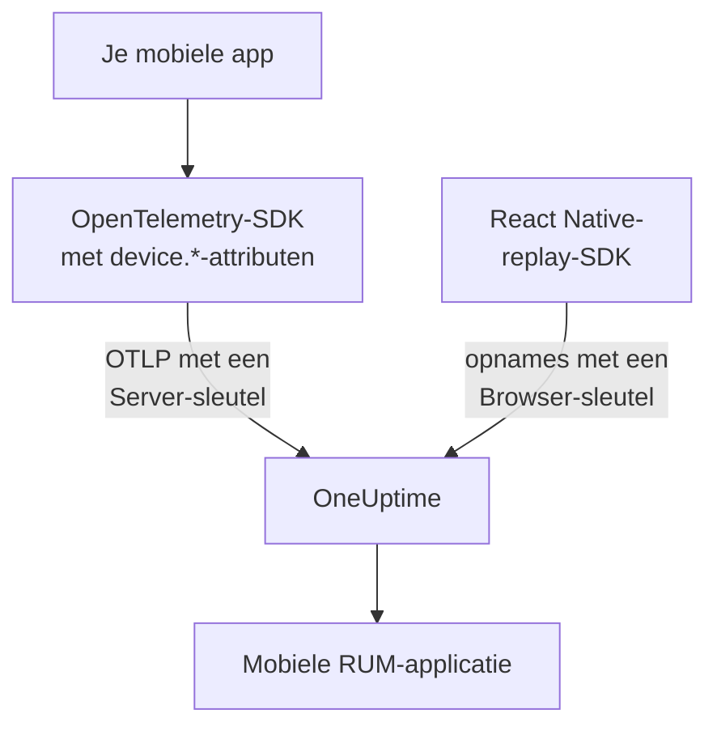

# Mobiele configuratie

Instrumenteer een Android-, iOS- of React Native-app met OpenTelemetry, zodat hij zich bij OneUptime meldt als mobiele RUM-applicatie. Elk ander platform met een OpenTelemetry-SDK werkt op dezelfde manier.

:::cards
- [Wat OneUptime nodig heeft](#wat-oneuptime-nodig-heeft): Twee resource-attributen, verstuurd met een Server-sleutel.
- [Je platform instellen](#je-platform-instellen): Android, iOS, React Native en de rest.
- [Controleren of het binnenkomt](#controleren-of-het-binnenkomt): De sleutel testen en dan de app vinden.
- [Session Replay op mobiel](#session-replay-op-mobiel): Opnames voor React Native-apps.
:::

## Zo werkt het

Je app exporteert OTLP rechtstreeks naar OneUptime met een **Server**-ingestiesleutel. De `device.*`-attributen op de resource zijn wat hem als mobiele RUM indeelt in plaats van als backend-service.



## Wat OneUptime nodig heeft

Twee resource-attributen, op elke batch die je app exporteert:

| Attribuut | Wat het is |
| --- | --- |
| `service.name` | De identiteit van de applicatie, bijvoorbeeld `storefront-android`. |
| `device.id` of `device.model.identifier` | Markeert de telemetrie als mobiele RUM. `device.model.identifier` vult ook de pagina **Clients**. |

Zonder apparaatattribuut komt de telemetrie toch binnen en kun je haar opvragen, maar ze wordt als backend-service ingedeeld in plaats van als RUM-applicatie.

`device.manufacturer` markeert een batch ook als mobiel, maar alleen op een resource zonder host-identiteit, omdat de inventaris van een host daarmee het merk van een machine meldt. Stel ook `device.id` of `device.model.identifier` in, zoals elk recept hieronder doet, en dit maakt nooit uit.

Maak van `device.id` een ID per installatie, nooit een advertentie-ID of iets anders dat een persoon identificeert. OneUptime leest hem alleen om mobiele telemetrie te herkennen.

## Voordat je begint

- Een app met een OpenTelemetry-SDK: de OpenTelemetry Java SDK of OpenTelemetry Android, opentelemetry-swift, of de OpenTelemetry JavaScript SDK voor React Native.
- Een **Server**-ingestiesleutel, aangemaakt onder **Projectinstellingen → Telemetrie & APM → Ingestiesleutels** met **Inname-sleutel aanmaken**. Een **Browser**-sleutel wordt vanuit een mobiele app geweigerd: hij wordt gecontroleerd tegen de header `Origin`, die mobiele SDK's niet versturen.
- Deze OTLP-instellingen. Host je OneUptime zelf, vervang `https://oneuptime.com` dan door je eigen host.

| Instelling | Waarde |
| --- | --- |
| OTLP-endpoint | `https://oneuptime.com/otlp` |
| Header | `x-oneuptime-token: YOUR_TELEMETRY_INGESTION_TOKEN` |
| Traces | `POST https://oneuptime.com/otlp/v1/traces` |
| Metrieken | `POST https://oneuptime.com/otlp/v1/metrics` |
| Logs | `POST https://oneuptime.com/otlp/v1/logs` |

> [!WARNING]
> De sleutel zit in je app, en een app kan worden uitgepakt, dus ga ervan uit dat iemand hem kopieert. Stel op de pagina van de sleutel een **Pinned Service Name** in, zodat een kopie niet onder de namen van je backend-services kan schrijven, voeg een **Requests Per Minute Limit** en een datum bij **Verloopt om** toe, en vervang de sleutel bij elke release.

## Je platform instellen

De snippets tonen de vorm van de configuratie. De mobiele OpenTelemetry-SDK's veranderen hun API's tussen releases, dus controleer de methodenamen tegen de versie die je vastzet. Wat OneUptime nodig heeft, verandert nooit: het endpoint, de header, `service.name` en één `device.*`-attribuut.

:::tabs
@tab Android
Gebruik de OpenTelemetry Java SDK en de OTLP-exporter ervan, die op Android draaien:

```kotlin title="app/build.gradle.kts"
dependencies {
    implementation(platform("io.opentelemetry:opentelemetry-bom:<latest>"))
    implementation("io.opentelemetry:opentelemetry-sdk")
    implementation("io.opentelemetry:opentelemetry-exporter-otlp")
}
```

```kotlin title="StorefrontApplication.kt"
import android.app.Application
import android.os.Build
import io.opentelemetry.exporter.otlp.http.trace.OtlpHttpSpanExporter
import io.opentelemetry.sdk.OpenTelemetrySdk
import io.opentelemetry.sdk.resources.Resource
import io.opentelemetry.sdk.trace.SdkTracerProvider
import io.opentelemetry.sdk.trace.export.BatchSpanProcessor

class StorefrontApplication : Application() {
    override fun onCreate() {
        super.onCreate()

        val resource = Resource.getDefault().toBuilder()
            .put("service.name", "storefront-android")
            .put("device.manufacturer", Build.MANUFACTURER)
            .put("device.model.identifier", Build.MODEL)
            .build()

        val exporter = OtlpHttpSpanExporter.builder()
            .setEndpoint("https://oneuptime.com/otlp/v1/traces")
            .addHeader("x-oneuptime-token", BuildConfig.ONEUPTIME_TOKEN)
            .build()

        OpenTelemetrySdk.builder()
            .setTracerProvider(
                SdkTracerProvider.builder()
                    .setResource(resource)
                    .addSpanProcessor(BatchSpanProcessor.builder(exporter).build())
                    .build()
            )
            .buildAndRegisterGlobal()
    }
}
```

De agent [OpenTelemetry Android](https://github.com/open-telemetry/opentelemetry-android) voegt daar automatische instrumentatie aan toe en stelt apparaatattributen in op zijn eigen resource. Gebruik je hem, richt dan zijn exporter op hetzelfde endpoint en dezelfde header, en controleer of `device.model.identifier` in jouw versie op de resource terechtkomt.
@tab iOS
Gebruik [opentelemetry-swift](https://github.com/open-telemetry/opentelemetry-swift) en stel de apparaatattributen zelf in: de resource die elke versie uit zichzelf toevoegt, is tussen releases veranderd.

```swift
let resource = Resource(attributes: [
    "service.name": .string("storefront-ios"),
    "device.model.identifier": .string(UIDevice.current.model),
    "device.manufacturer": .string("Apple"),
    "telemetry.sdk.language": .string("swift"),
])

let exporter = OtlpHttpTraceExporter(
    endpoint: URL(string: "https://oneuptime.com/otlp/v1/traces")!,
    config: OtlpConfiguration(
        headers: [("x-oneuptime-token", oneUptimeToken)]
    )
)

OpenTelemetry.registerTracerProvider(
    tracerProvider: TracerProviderBuilder()
        .with(resource: resource)
        .add(spanProcessor: BatchSpanProcessor(spanExporter: exporter))
        .build()
)
```

`UIDevice.current.model` geeft een korte naam zoals `iPhone`, waardoor de pagina **Clients** één rij per soort apparaat houdt.
@tab React Native
React Native draait de OpenTelemetry JavaScript SDK, dus bouw de provider, de OTLP-exporter en de batch-processor zoals in [Browserconfiguratie](/docs/rum/browser-setup), met drie wijzigingen: verstuur met een **Server**-sleutel, laat `browserDetector` en `DocumentLoadInstrumentation` weg, en stel de apparaatattributen zelf in.

```ts
import { Platform } from "react-native";
import * as Device from "expo-device"; // or react-native-device-info
import {
  defaultResource,
  resourceFromAttributes,
} from "@opentelemetry/resources";

const resource = defaultResource().merge(
  resourceFromAttributes({
    "service.name": "storefront-mobile",
    "device.manufacturer": Device.manufacturer ?? Platform.OS,
    "device.model.identifier":
      Device.modelId ?? Device.modelName ?? "unknown",
    "telemetry.sdk.language": "webjs",
  }),
);
```

`Device.modelId` is alleen op iOS ingesteld, dus Android valt terug op `Device.modelName`.
@tab Andere platforms
Flutter, Unity, .NET MAUI, een embedded client of een eigen OTLP-writer werken allemaal, zolang de resource `service.name` en één `device.*`-attribuut draagt. Een SDK die de standaard-omgevingsvariabelen van OpenTelemetry leest, neemt deze zo over:

```bash
OTEL_EXPORTER_OTLP_ENDPOINT="https://oneuptime.com/otlp"
OTEL_EXPORTER_OTLP_HEADERS="x-oneuptime-token=YOUR_TELEMETRY_INGESTION_TOKEN"
OTEL_RESOURCE_ATTRIBUTES="service.name=storefront-mobile,device.manufacturer=Acme,device.model.identifier=AC-100"
```

De SDK voegt `/v1/traces`, `/v1/metrics` en `/v1/logs` zelf aan het endpoint toe.
:::

## Controleren of het binnenkomt

:::steps
### De sleutel testen

Vraag OneUptime of het de sleutel accepteert, voordat je de instellingen van de SDK doorzoekt:

```bash
curl -i https://oneuptime.com/otlp/v1/validate \
  -H "x-oneuptime-token: YOUR_TELEMETRY_INGESTION_TOKEN"
```

`200` met `"valid": true` betekent dat de sleutel wordt geaccepteerd. Een Browser-sleutel antwoordt ook met `200`, maar zijn bericht zegt dat hij alleen vanuit een browser werkt: een mobiele app heeft een Server-sleutel nodig. `401` betekent dat de sleutel onbekend, ingetrokken, uitgeschakeld of verlopen is, en geen SDK-instelling lost dat op.

### De app starten

Start de app en gebruik hem even. Hij verschijnt bij de eerste batch telemetrie onder **Producten → Bronnen → Real User Monitoring**, genoemd naar zijn `service.name`.

### De pagina Clients openen

Open de pagina **Clients** van de applicatie: elk apparaatmodel uit `device.model.identifier` heeft een rij. Blijft de pagina leeg terwijl **Traces** zich vult, dan bereiken de apparaatattributen de resource niet.
:::

## Session Replay op mobiel

React Native-apps kunnen sessies opnemen met `@oneuptime/react-native-replay`. Het neemt de native viewboom op als draadmodel, nooit schermafbeeldingen of de tekst op het scherm, en de opnames openen in dezelfde speler als die van het web. Het verstuurt met een **Browser**-sleutel waarvan de **Allowed Origins** je app vermelden als `app://` gevolgd door de Android-applicatie-ID of de iOS-bundle-ID: een andere sleutel dan de Server-sleutel die je OpenTelemetry-SDK gebruikt. [Installeren in React Native](/docs/telemetry/session-replay#install-in-react-native) leidt je erdoorheen.

Native Android- en iOS-apps, en de andere platforms, hebben geen sessierecorder: hun pagina **Session Replay** blijft leeg, terwijl traces, logs, metrieken, uitzonderingen en de pagina **Clients** gewoon werken.

## Probleemoplossing

:::details De sleutelcontrole geeft 401, of de sleutel wordt geweigerd
Een `401` betekent dat de sleutel onbekend, ingetrokken, uitgeschakeld of verlopen is: maak een Server-sleutel aan en bouw de app er opnieuw mee.

Een Browser-sleutel doorstaat de controle, maar elke export vanuit een mobiele app wordt geweigerd met een `422` die luidt: `This request did not send an Origin header, so it cannot be checked against the allowed origins of this browser ingestion key. Use a server ingestion key for requests that are not sent by a browser.` Gebruik een **Server**-sleutel.
:::

:::details De app verschijnt onder Services in plaats van onder Real User Monitoring
De resource heeft geen `device.id` of `device.model.identifier`, dus de telemetrie is als backend-service ingedeeld. Stel ze in zoals bij [Je platform instellen](#je-platform-instellen).

De service die al is aangemaakt, wordt geen RUM-applicatie, dus verwijder hem onder **Producten → Services** zodra er RUM-telemetrie binnenkomt.
:::

:::details De pagina Clients is leeg
Clientrijen komen alleen uit `device.model.identifier`. Een SDK die alleen `device.id` of `device.manufacturer` instelt, deelt de app in als mobiele RUM, maar toont geen clients: stel ook `device.model.identifier` in.
:::

:::details De status zegt Verbinding verbroken terwijl de app wordt gebruikt
De status springt naar **Verbinding verbroken** na 15 minuten zonder telemetrie. Als mensen de app gebruiken:

- Een sampler gooit misschien alles weg: zoek naar een always-off-sampler of een zeer lage ratio.
- De app verstuurt misschien alleen telemetrie voor acties die in die tijd niemand uitvoerde.
- De sleutel is sinds de release misschien ingetrokken of verlopen: test hem zoals bij [Controleren of het binnenkomt](#controleren-of-het-binnenkomt).
:::

## Volgende stappen

:::cards
- [Sessieherhaling](/docs/telemetry/session-replay): React Native-sessies opnemen, naast hun traces.
- [Applicaties beheren](/docs/rum/applications): Namen, labels, eigenaren en bewaartermijnen.
- [OpenTelemetry](/docs/telemetry/open-telemetry): De OTLP-endpoints, limieten en fouten in detail.
- [RUM-probleemoplossing](/docs/rum/troubleshooting): Elke controle, in de volgorde waarin problemen meestal optreden.
:::
