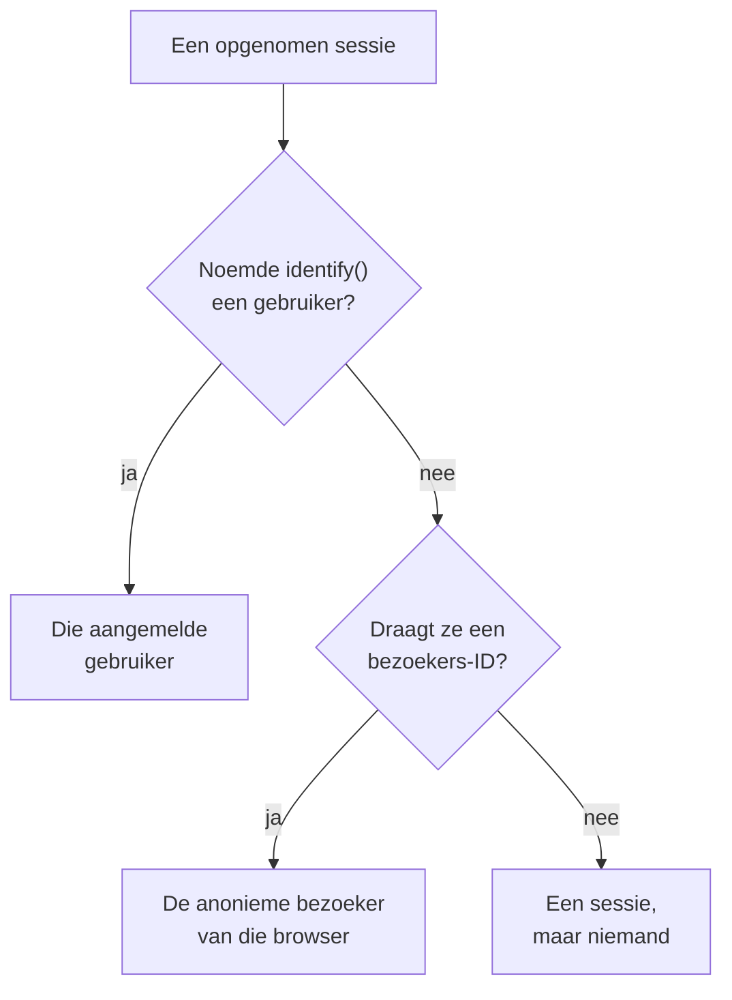

# Productanalyse

Productanalyse telt de mensen die een RUM-applicatie gebruiken, hoe hun sessies verlopen en wat ze doen: actieve, nieuwe, terugkerende, aangemelde en inactieve gebruikers, sessies per apparaat, browser, land en pagina, en de gebeurtenissen die je app verzendt, als trends, trechters en retentie. Ze telt de sessies die [Sessieherhaling](/docs/telemetry/session-replay) opneemt en de gebeurtenissen die de recorder daarvan verzendt, heeft dus geen eigen snippet nodig, en bewaart haar cijfers 13 maanden, lang nadat de opnamen zijn verlopen.

:::cards
- [Gebruikers](#gebruikers): Actieve, nieuwe, terugkerende, aangemelde, alle en inactieve gebruikers.
- [Sessies](#sessies): Hoeveel, hoe lang, en per apparaat, browser, land en pagina.
- [Gebeurtenissen en metrieken verzenden](#gebeurtenissen-en-metrieken-verzenden): Wat mensen doen, en de getallen die je pagina meet.
- [Gebeurtenissen](#gebeurtenissen): Hoe vaak iets gebeurde, wie het deed en waar.
- [Trechters](#trechters): Wie doorging, stap voor stap, en hoe lang dat duurde.
- [Gebruikersretentie](#gebruikersretentie): Wie terugkwam, cohort na cohort.
:::

## Hoe mensen worden geteld

Het zijmenu van een applicatie heeft een sectie **Productanalyse**: **Gebruikers**, **Sessies**, **Gebeurtenissen**, **Trechters**, **Gebruikersretentie**, **Gebruikersstromen** en **Analyse-instellingen**. **Gebruikers** en **Sessies** tellen de sessies die Sessieherhaling opneemt: ze beginnen dus wanneer de recorder van de applicatie begint, en een sessie die het herhalingsbeleid niet opneemt, wordt niet geteld. Elke sessie telt voor één persoon, of voor niemand:



- **Een aangemelde gebruiker telt één keer**, op elke browser en elk apparaat dat hij gebruikt: hij wordt herkend aan de eenrichtingshash van de referentie die je pagina aan `identify()` gaf (zie [Je gebruikers identificeren](/docs/telemetry/session-replay#je-gebruikers-identificeren)).
- **Een anonieme browser telt één keer**, via zijn [anonieme bezoekers-ID](/docs/telemetry/session-replay#anonieme-bezoekers). Twee browsers zijn twee bezoekers, en de sessies die een browser had voordat iemand zich erop aanmeldde, blijven van zijn bezoeker.
- **Een sessie van een oudere recorder**, die geen bezoekers-ID stuurde, telt als sessie maar niet als persoon.

**Gebeurtenissen**, **Trechters** en **Gebruikersretentie** tellen mensen op dezelfde manier, uit de gebeurtenissen die de recorder vanuit elke sessie verzendt, opgenomen of niet (zie [Gebeurtenissen en metrieken verzenden](#gebeurtenissen-en-metrieken-verzenden)).

Dagen worden geteld in je eigen tijdzone.

## Gebruikers

**Gebruikers** telt de mensen van de periode die je kiest:

| Tegel | Wat ze telt |
| --- | --- |
| **Actieve gebruikers** | Iedereen die in de periode kwam: elke aangemelde gebruiker één keer en elke anonieme browser één keer. |
| **Nieuwe gebruikers** | Actieve gebruikers van wie het eerste bezoek in de periode viel. |
| **Terugkerende gebruikers** | Actieve gebruikers die al vóór het begin van de periode waren gekomen. |
| **Aangemelde gebruikers** | Actieve gebruikers die je app met `identify()` aanmeldde, en hun aandeel in alle actieve gebruikers. |
| **Totaal aantal gebruikers** | Iedereen die de applicatie in de laatste 13 maanden heeft gezien. |
| **Inactieve gebruikers** | Mensen die eerder kwamen maar niet in de laatste 30 dagen, of in de 7, 14, 60 of 90 dagen die je kiest. |

De eerste drie zeggen ook hoe ze veranderden ten opzichte van de periode ervoor. Onder de tegels tekent **Actieve gebruikers** voor elke dag de mensen die die dag kwamen, die in de 7 dagen tot die dag en die in de 30 dagen tot die dag, en **Nieuwe en terugkerende gebruikers** splitst de mensen van elke dag in tweeën.

**Personen** toont iedereen die de tegels tellen, één rij per persoon, de laatst geziene eerst, en het filter toont de mensen van één tegel, de anonieme bezoekers of iedereen. Open een persoon voor het eerste en laatste bezoek en elke sessie van die persoon uit de laatste 13 maanden, met **Bekijken** bij elke sessie waarvan de opname nog wordt bewaard.

## Sessies

**Sessies** telt de sessies die in de periode begonnen: **Sessies**, **Aangemelde sessies**, **Mediane sessieduur**, **Pagina's per sessie**, **Sessies met fouten** en **Gefrustreerde sessies**. Onder de tegels:

- **Sessies per apparaat** tekent de sessies van elke dag vanaf desktops, telefoons en tablets. De sessie van een mobiele app op een scherm waarvan de korte zijde 600 punten of meer is, telt als die van een tablet.
- **Sessieduur** deelt de afgeronde sessies in naar hoe lang ze duurden, van minder dan 10 seconden tot meer dan 30 minuten. Een sessie die nog wordt opgenomen, heeft nog geen duur.
- **Uitsplitsing** rangschikt gebruikers en sessies op apparaattype, browser, besturingssysteem, land, appversie, startpagina of pagina, die met de meeste gebruikers eerst.

## Gebeurtenissen en metrieken verzenden

Gebeurtenissen worden verzonden zolang **Productanalysegebeurtenissen verzenden** aan staat, op de pagina **Analyse-instellingen** van de applicatie. Het staat aan voor een nieuwe applicatie, en uit voor een applicatie die is gemaakt voordat het bestond, dus zet het daar aan. Sessieherhaling moet ook aan staan voor de applicatie, want de recorder daarvan verzendt de gebeurtenissen; de React Native-recorder verzendt er nog geen.

Elke sessie waarin de browserrecorder draait, verzendt zelf haar begin en elke pagina die ze bekijkt, de routewijzigingen van een single-page-app inbegrepen, of de steekproef en het beleid van de herhaling die sessie nu opnemen of niet. Je eigen gebeurtenissen en getallen komen uit de code van je pagina:

```js
OneUptimeReplay.track("Signed up", { plan: "pro" });
OneUptimeReplay.metric("cart.value", 42.5, { currency: "EUR" });
```

| Aanroep | Wat die verzendt |
| --- | --- |
| `track(name, properties?)` | Een gebeurtenis die **Gebeurtenissen**, **Trechters** en **Gebruikersretentie** tellen, en een markering op de tijdlijn van de herhaling als de sessie wordt opgenomen. `name` ≤ 64 tekens; ≤ 20 eigenschappen met tekenreeks-, getal- of booleaanse waarden, sleutel ≤ 40 tekens, waarde ≤ 200 tekens. |
| `metric(name, value, attributes?)` | Een getal dat je pagina heeft gemeten, als punt van een metriek van de applicatie (zie [Dashboards en waarschuwingen](#dashboards-en-waarschuwingen)). `name` ≤ 100 tekens uit letters, cijfers, `_`, `.`, `-` en `/`, beginnend met een letter en niet met `oneuptime.`; `value` een eindig getal; `attributes` zoals de eigenschappen van `track()`. |

Voordat de recorder is geladen, zet je dezelfde aanroepen in `window.OneUptimeReplayQueue` als `["track", name, properties]` en `["metric", name, value, attributes]` (zie [JavaScript-API](/docs/telemetry/session-replay#javascript-api)).

- **Elke sessie, opgenomen of niet.** De steekproef en het uploadbeleid van de herhaling bepalen welke sessies worden opgenomen, niet welke worden geteld. Onder Do Not Track of Global Privacy Control wordt niets verzonden, en van een origin die de applicatie niet toestaat, wordt niets bewaard. Als het beleid toestemming vereist, wachten de gebeurtenissen op `grantConsent()`, hooguit 500, en `revokeConsent()` gooit ze weg.
- **Gemaskeerd zoals de opname.** Onder _Mask all text_ worden de waarden van eigenschappen en attributen gemaskeerd voordat ze de pagina verlaten. Een pagina wordt verzonden als haar pad, zonder query of fragment.
- **In kleine batches**, elke 5 seconden en wanneer het tabblad wordt verborgen. Een gebeurtenis die OneUptime meer dan 3 dagen nadat ze plaatsvond bereikt, wordt weggegooid, en een project mag 60.000 gebeurtenissen en metriekpunten per minuut verzenden, al zijn applicaties samen; daarboven wacht de recorder en verzendt ze opnieuw.

`metric()` verzendt niets zolang de gebeurtenissen uit staan, en `getDiagnostics().productAnalytics` zegt of ze aan staan (zie [`getDiagnostics()`](/docs/telemetry/session-replay#getdiagnostics)).

### Gebruikerseigenschappen

Om gebeurtenissen uit te splitsen en te segmenteren naar wie ze deed, zet je kenmerksleutels van `identify()` onder **Gebruikerseigenschappen voor analyse** op **Analyse-instellingen**, zoals `["plan", "role"]`, hooguit 20, vergeleken zoals ze geschreven zijn. Elke gebeurtenis draagt dan die kenmerken van de aangemelde gebruiker, zoals je pagina ze aan `identify()` gaf. De andere kenmerken verlaten de pagina nooit, en geen enkel kenmerk doet dat zolang **Identiteit van eindgebruiker vastleggen** uit staat. Zet geen kenmerken in de lijst die persoonsgegevens bevatten, zoals een e-mailadres.

## Gebeurtenissen

**Gebeurtenissen** toont één gebeurtenis tegelijk: de vaakst voorkomende gebeurtenis van je app tot je een andere kiest, of de meest bekeken pagina zolang die er geen verzendt. De kiezer toont ook **Sessie gestart** en elke bekeken pagina, en **Alle gebeurtenissen**, eronder, toont elke gebeurtenis van de periode met hoe vaak ze plaatsvond en hoeveel mensen ze deden; kies er een om haar erboven te zien.

- De tegels tellen de **Gebeurtenissen** van de gebeurtenis, met hoeveel elke persoon er gemiddeld deed, haar **Gebruikers** en haar **Sessies**.
- **Gebeurtenissen en gebruikers** tekent voor elke dag hoe vaak de gebeurtenis plaatsvond, en hoeveel mensen ze die dag deden.
- **Uitsplitsing** rangschikt de gebeurtenis op apparaattype, browser, besturingssysteem, land, appversie, pagina, gebeurteniseigenschap of gebruikerseigenschap, met de gebeurtenissen, gebruikers en het aandeel van elke waarde. Kies een waarde om alleen die te tonen.

**Segment** beperkt de pagina tot de gebeurtenissen waarvan de velden de waarden hebben die je kiest: **Filter toevoegen**, dan een veld en een waarde, exact vergeleken. Een segment bevat hooguit 5 filters, en een gebeurtenis moet aan alle voldoen. Het adres van de pagina bewaart de gebeurtenis, de periode, het segment en de uitsplitsing, zodat een link dezelfde weergave opent.

## Trechters

**Trechters** volgt mensen door 2 tot 6 stappen in volgorde, elk een gebeurtenis zoals **Gebeurtenissen** ze toont. Van de mensen die de eerste stap in de periode deden, telt het hoeveel daarna de tweede deden, dan de derde, allemaal binnen de tijd die je kiest vanaf hun eerste stap: **Binnen 1 uur**, **Binnen 1 dag**, **Binnen 7 dagen**, **Binnen 14 dagen** of **Binnen 30 dagen**. **Stap toevoegen** voegt er een toe.

Onder **Conversie** staan het aandeel mensen dat elke stap deed en, voor elke stap, hoeveel mensen die bereikten, welk aandeel van de mensen van de eerste stap dat is, hoeveel er sinds de vorige stap afhaakten en de mediane tijd die ze er vanaf daar over deden. Wie het meer dan eens probeerde, telt één keer, met de poging die het verst kwam.

Het segment van een trechter, en dat van een retentietabel, neemt de velden die elke gebeurtenis draagt en gebruikerseigenschappen, niet de eigen eigenschappen van een gebeurtenis, omdat de stappen verschillende gebeurtenissen zijn.

## Gebruikersretentie

**Gebruikersretentie** groepeert mensen op de dag, week of maand van de periode waarin ze voor het eerst een gebeurtenis deden, de **Startgebeurtenis**, en toont welk aandeel van elke groep een andere deed, de **Terugkeergebeurtenis**, in dat tijdvak en in elk tijdvak erna. Beide zijn **Sessie gestart** tot je andere kiest.

**Cohorten** stelt het tijdvak in: **Per dag**, **Per week** of **Per maand**. Als de periode meer tijdvakken bevat dan één tabel toont, 32 dagen, 26 weken of 13 maanden, maakt de pagina de cohorten langer en zegt ze dat.

Elke rij is een cohort en hoeveel mensen het bevat, en elke cel het aandeel van hen dat in dat tijdvak terugkwam, donkerder naarmate het er meer waren. Een tijdvak dat nog niet is begonnen, blijft leeg.

## Dashboards en waarschuwingen

Elke gebeurtenis wordt ook, minuut voor minuut, geteld als een metriek van de applicatie, en elke aanroep van `metric()` is een punt van een eigen metriek, onder de naam die hij opgeeft. Teken ze op de pagina **Metrieken** van de applicatie, voeg ze toe aan een dashboard, of laat een Metrics-monitor erop waarschuwen; **Metrieken openen**, onder **Alle gebeurtenissen**, opent de pagina.

| Metriek | Wat die telt | Per |
| --- | --- | --- |
| `oneuptime.rum.product.events` | Je `track()`-gebeurtenissen, per minuut | `event.name` |
| `oneuptime.rum.product.sessions` | Gestarte sessies, per minuut | `device.type` |
| `oneuptime.rum.product.page.views` | Bekeken pagina's, per minuut | `device.type` |

Deze drie worden niet gefactureerd, en `metric()` weigert een naam die met `oneuptime.` begint, zodat niets wat je pagina verzendt voor een van hen doorgaat. Je `metric()`-punten worden bewaard en gefactureerd zoals de andere metrieken van de applicatie.

## Privacy en bewaring

- **13 maanden.** De cijfers van een maand worden verwijderd op de eerste dag van de 13e maand erna, zodat de laatste 12 volle maanden er altijd zijn, wat de eigen bewaartermijn van de opnamen ook is (standaard 7 dagen). Gebeurtenissen worden op dezelfde manier bewaard.
- **Geen namen opgeslagen.** De cijfers bewaren de eenrichtingssleutel van een aangemelde gebruiker en de bezoekers-ID van een browser, nooit de referentie of een IP-adres, en van de kenmerken alleen de gebruikerseigenschappen die je opgeeft. Een rij noemt een aangemelde gebruiker alleen zolang een van diens opnamen nog wordt bewaard, en alleen voor een rol die identiteit mag lezen; anders staat er **Aangemelde gebruiker** of **Anonieme bezoeker** en het begin van de ID.
- **Op verzoek gewist.** Een wisverzoek verwijdert ook hier de bijbehorende cijfers en gebeurtenissen (zie [Sessies wissen](/docs/telemetry/session-replay#sessies-wissen)).

## Wie het kan zien

Deze pagina's lezen vraagt wat de sessielijst lezen vraagt: `ReadRumSessionReplay` (_List Session Replays_) of `ReadRumSessionReplayPayload` (_Watch Session Replays_), die projecteigenaren en beheerders hebben. Zien wie een aangemelde gebruiker is, en mensen op naam zoeken, vraagt de identiteitsrechten die [Wie een opname kan bekijken](/docs/telemetry/session-replay#wie-een-opname-kan-bekijken) beschrijft.

De gebeurtenissen aan- of uitzetten vraagt `EditRumApplication` (_Edit RUM Application_) of de rol van projecteigenaar, beheerder of lid. Gebruikerseigenschappen opgeven vraagt `EditRumApplication` of de rol van eigenaar of beheerder, omdat het bepaalt wat er over aangemelde mensen wordt bewaard.

## Volgende stappen

:::cards
- [Sessieherhaling](/docs/telemetry/session-replay): Neem de sessies op die deze pagina's tellen, en bekijk ze.
- [Applicaties beheren](/docs/rum/applications): Namen, labels, eigenaren en bewaring.
- [RUM – Overzicht](/docs/rum/index): Wat een RUM-applicatie nog meer laat zien.
:::
