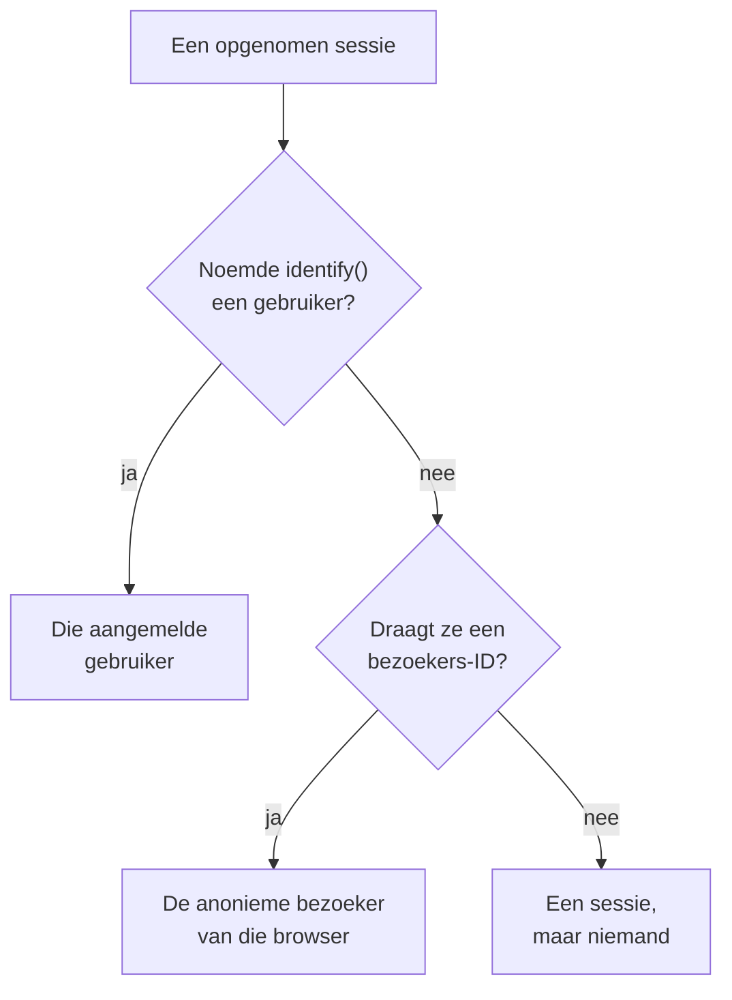

# Productanalyse

Productanalyse telt de mensen die een RUM-applicatie gebruiken en hoe hun sessies verlopen: actieve, nieuwe, terugkerende, aangemelde en inactieve gebruikers, en sessies per apparaat, browser, land en pagina. Ze telt de sessies die [Sessieherhaling](/docs/telemetry/session-replay) opneemt, heeft dus geen eigen snippet nodig, en bewaart haar cijfers 13 maanden, lang nadat de opnamen zijn verlopen.

:::cards
- [Hoe mensen worden geteld](#hoe-mensen-worden-geteld): Een aangemelde gebruiker één keer, een anonieme browser één keer.
- [Gebruikers](#gebruikers): Actieve, nieuwe, terugkerende, aangemelde, alle en inactieve gebruikers.
- [Sessies](#sessies): Hoeveel, hoe lang, en per apparaat, browser, land en pagina.
- [Privacy en bewaring](#privacy-en-bewaring): 13 maanden, geen namen opgeslagen, op verzoek gewist.
:::

## Hoe mensen worden geteld

Het zijmenu van een applicatie heeft een sectie **Productanalyse** met twee pagina's, **Gebruikers** en **Sessies**. Beide tellen de sessies die Sessieherhaling opneemt: ze beginnen dus wanneer de recorder van de applicatie begint, en een sessie die het herhalingsbeleid niet opneemt, wordt niet geteld. Elke sessie telt voor één persoon, of voor niemand:

- **Een aangemelde gebruiker telt één keer**, op elke browser en elk apparaat dat hij gebruikt: hij wordt herkend aan de eenrichtingshash van de referentie die je pagina aan `identify()` gaf (zie [Je gebruikers identificeren](/docs/telemetry/session-replay#je-gebruikers-identificeren)).
- **Een anonieme browser telt één keer**, via zijn [anonieme bezoekers-ID](/docs/telemetry/session-replay#anonieme-bezoekers). Twee browsers zijn twee bezoekers, en de sessies die een browser had voordat iemand zich erop aanmeldde, blijven van zijn bezoeker.
- **Een sessie van een oudere recorder**, die geen bezoekers-ID stuurde, telt als sessie maar niet als persoon.

Dagen worden geteld in je eigen tijdzone.

## Gebruikers

**Gebruikers** telt de mensen van de periode die je kiest:

| Tegel | Wat ze telt |
| --- | --- |
| **Actieve gebruikers** | Iedereen die in de periode kwam: elke aangemelde gebruiker één keer en elke anonieme browser één keer. |
| **Nieuwe gebruikers** | Actieve gebruikers van wie het eerste bezoek in de periode viel. |
| **Terugkerende gebruikers** | Actieve gebruikers die al vóór het begin van de periode waren gekomen. |
| **Aangemelde gebruikers** | Actieve gebruikers die je app met `identify()` aanmeldde, en hun aandeel in alle actieve gebruikers. |
| **Totaal aantal gebruikers** | Iedereen die de applicatie in de laatste 13 maanden heeft gezien. |
| **Inactieve gebruikers** | Mensen die eerder kwamen maar niet in de laatste 30 dagen, of in de 7, 14, 60 of 90 dagen die je kiest. |

De eerste drie zeggen ook hoe ze veranderden ten opzichte van de periode ervoor. Onder de tegels tekent **Actieve gebruikers** voor elke dag de mensen die die dag kwamen, die in de 7 dagen tot die dag en die in de 30 dagen tot die dag, en **Nieuwe en terugkerende gebruikers** splitst de mensen van elke dag in tweeën.

**Personen** toont iedereen die de tegels tellen, één rij per persoon, de laatst geziene eerst, en het filter toont de mensen van één tegel, de anonieme bezoekers of iedereen. Open een persoon voor het eerste en laatste bezoek en elke sessie van die persoon uit de laatste 13 maanden, met **Bekijken** bij elke sessie waarvan de opname nog wordt bewaard.

## Sessies

**Sessies** telt de sessies die in de periode begonnen: **Sessies**, **Aangemelde sessies**, **Mediane sessieduur**, **Pagina's per sessie**, **Sessies met fouten** en **Gefrustreerde sessies**. Onder de tegels:

- **Sessies per apparaat** tekent de sessies van elke dag vanaf desktops, telefoons en tablets. De sessie van een mobiele app op een scherm waarvan de korte zijde 600 punten of meer is, telt als die van een tablet.
- **Sessieduur** deelt de afgeronde sessies in naar hoe lang ze duurden, van minder dan 10 seconden tot meer dan 30 minuten. Een sessie die nog wordt opgenomen, heeft nog geen duur.
- **Uitsplitsing** rangschikt gebruikers en sessies op apparaattype, browser, besturingssysteem, land, appversie, startpagina of pagina, die met de meeste gebruikers eerst.

## Privacy en bewaring

- **13 maanden.** De cijfers van een maand worden verwijderd op de eerste dag van de 13e maand erna, zodat de laatste 12 volle maanden er altijd zijn, wat de eigen bewaartermijn van de opnamen ook is (standaard 7 dagen).
- **Geen namen opgeslagen.** De cijfers bewaren de eenrichtingssleutel van een aangemelde gebruiker en de bezoekers-ID van een browser, nooit de referentie, de kenmerken of een IP-adres. Een rij noemt een aangemelde gebruiker alleen zolang een van diens opnamen nog wordt bewaard, en alleen voor een rol die identiteit mag lezen; anders staat er **Aangemelde gebruiker** of **Anonieme bezoeker** en het begin van de ID.
- **Op verzoek gewist.** Een wisverzoek verwijdert ook hier de bijbehorende cijfers (zie [Sessies wissen](/docs/telemetry/session-replay#sessies-wissen)).

## Wie het kan zien

De twee pagina's lezen vraagt wat de sessielijst lezen vraagt: `ReadRumSessionReplay` (_List Session Replays_) of `ReadRumSessionReplayPayload` (_Watch Session Replays_), die projecteigenaren en beheerders hebben. Zien wie een aangemelde gebruiker is, en mensen op naam zoeken, vraagt de identiteitsrechten die [Wie een opname kan bekijken](/docs/telemetry/session-replay#wie-een-opname-kan-bekijken) beschrijft.

## Volgende stappen

:::cards
- [Sessieherhaling](/docs/telemetry/session-replay): Neem de sessies op die deze pagina's tellen, en bekijk ze.
- [Applicaties beheren](/docs/rum/applications): Namen, labels, eigenaren en bewaring.
- [RUM – Overzicht](/docs/rum/index): Wat een RUM-applicatie nog meer laat zien.
:::
