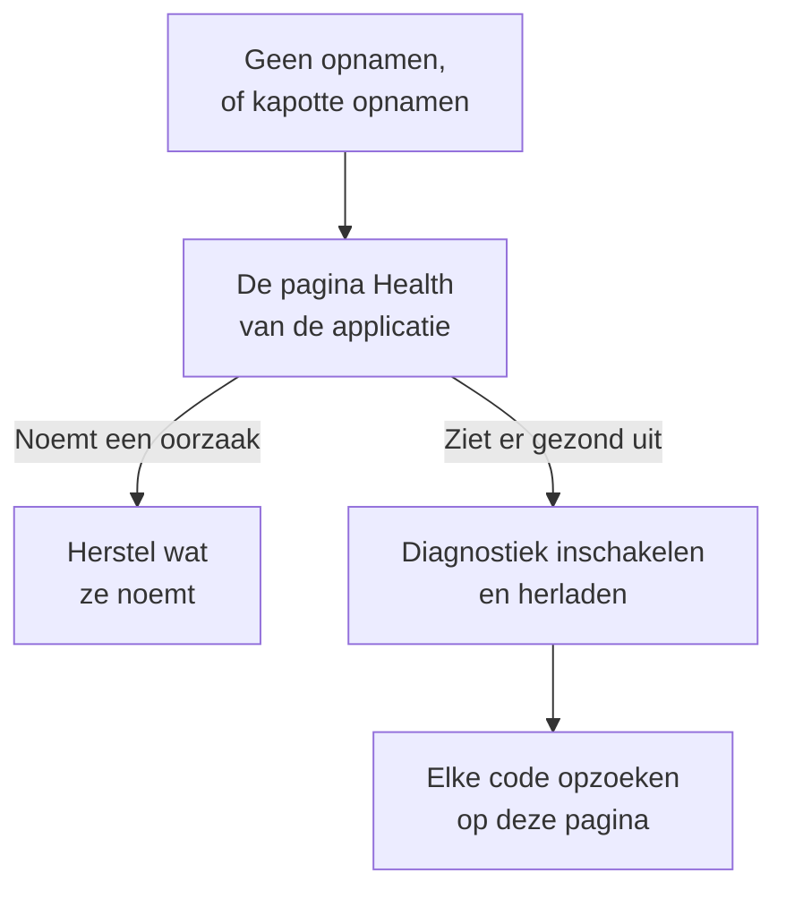

# Probleemoplossing voor sessieherhaling

Wanneer er geen opnamen binnenkomen, of ze kapot binnenkomen, vindt deze pagina de reden. Sessieherhaling neemt standaard elke sessie op en uploadt die terwijl ze loopt, dus een gezonde pagina verstuurt ongeveer elke 15 seconden een chunk zolang de gebruiker iets doet. Een inactief tabblad produceert geen gebeurtenissen en verstuurt niets, en na vijf minuten zonder invoer pauzeert de recorder volledig (`recording-paused-idle`), dus beweeg de muis of klik voordat je een installatie beoordeelt vanaf het tabblad Netwerk. Zie je daarna nog steeds geen verzoek naar OneUptime, dan is een van de oorzaken hieronder de reden.

:::cards
- [Diagnostiek inschakelen](#diagnostiek-inschakelen): Laat de recorder elke beslissing in de console uitleggen.
- [Codes](#codes): Elke regel die de recorder afdrukt, en wat je eraan doet.
- [Een firewall voor OneUptime weigert de chunks](#een-firewall-voor-oneuptime-weigert-de-chunks): Regels om te controleren en uitzonderingen om toe te voegen.
- [Afbeeldingen, pictogrammen of stijlen ontbreken in de herhaling](#afbeeldingen-pictogrammen-of-stijlen-ontbreken-in-de-herhaling): Opnamen die afspelen, maar niet zoals je gebruiker ze zag.
:::



De enige instelling waarbij stilte normaal is, is uploaden bij _On error or frustration_ (`OnErrorOrFrustration`): de recorder houdt dan een ringbuffer in het geheugen bij en uploadt alleen als er iets misgaat, wat er precies uitziet als een kapotte installatie totdat een trigger afgaat. Controleer welke je gebruikt voordat je iets anders zoekt: de regel `config-accepted` verderop drukt het af.

Begin aan de serverkant als dat kan. De pagina **Gezondheid** van de applicatie, in de sectie **Sessieherhaling** van het zijmenu, noemt de oorzaak wanneer er niets binnenkomt: de recorder is nooit geladen, is geladen maar heeft niets geüpload en waarom, uploads worden geweigerd en om welke reden, of het budget is op. Zie [Opnamestatus](/docs/telemetry/session-replay#opnamestatus). Wat volgt is de browserkant: schakel diagnostiek in, herlaad één keer en lees de console.

Komen opnamen binnen, maar spelen ze af met kapotte afbeeldingen, ontbrekende pictogrammen of onopgemaakte stukken? Dat is een afspeelkwestie, beantwoord in [Afbeeldingen, pictogrammen of stijlen ontbreken in de herhaling](#afbeeldingen-pictogrammen-of-stijlen-ontbreken-in-de-herhaling).

## Diagnostiek inschakelen

Kies de schakelaar die je bij de hand hebt. Ze doen allemaal hetzelfde.

:::tabs
@tab In de browser
In de browser waar het misgaat. Er is geen nieuwe uitrol nodig, het werkt in productie en het overleeft herladen:

```js
localStorage.setItem("oneuptime.sessionReplay.debug", "true");
// then reload the page
```

Schakel het weer uit met:

```js
localStorage.removeItem("oneuptime.sessionReplay.debug");
```
@tab Met een link
Voor iemand die niet technisch is, of een pagina waarop je geen console kunt openen, voeg je `oneuptime_debug=1` toe aan de URL. Het werkt ook in het fragment, dat een server overleeft die onbekende queryparameters verwijdert:

```text
https://your-app.example.com/checkout?oneuptime_debug=1
https://your-app.example.com/checkout#oneuptime_debug=1
```
@tab Op de scripttag
Voor een stagingomgeving, waar je het voor iedereen aan wilt:

```html
<script
  src="https://oneuptime.com/telemetry/session-replay/v1/recorder.js"
  data-oneuptime-token="YOUR_TELEMETRY_INGESTION_KEY"
  data-oneuptime-app-identifier="YOUR_RUM_APP_IDENTIFIER"
  data-oneuptime-debug="true"
  crossorigin="anonymous"
  async
></script>
```
@tab In de init-global
Als je de recorder configureert met de init-global:

```js
window.__ONEUPTIME_SESSION_REPLAY__ = {
  host: "https://oneuptime.com",
  token: "YOUR_TELEMETRY_INGESTION_KEY",
  appIdentifier: "YOUR_RUM_APP_IDENTIFIER",
  debug: true,
};
```
@tab Op de deployment
Op de OneUptime-deployment, de enige schakelaar waarvoor niemand bij de browser hoeft te zitten waar het misgaat. Stel `SESSION_REPLAY_DEBUG=true` in en herstart. Elke recorder die deze instantie levert logt dan, op elke pagina waarop hij draait, dus zet het aan, verzamel één herlaadbeurt en zet het weer uit. Het verandert geen beleid: niet de sampling, niet de maskering, niet de toestemming. Zie [Opmerkingen voor zelfhosting](/docs/telemetry/session-replay#opmerkingen-voor-zelfhosting) voor de andere instellingen van de deployment.
@tab Tijdens het draaien
Zodra de recorder is geladen:

```js
OneUptimeReplay.setDebug(true);
```
:::

De uitvoer ziet er zo uit:

```text
[OneUptime Session Replay] loader-start: Loader running.
[OneUptime Session Replay] init-options-read: Init options read. {host: "https://oneuptime.com", appIdentifier: "checkout-web", …}
[OneUptime Session Replay] config-fetch-start: Requesting the policy. {url: "https://oneuptime.com/telemetry/session-replay/v1/config", …}
[OneUptime Session Replay] config-accepted: Policy accepted. {captureTrigger: "Always", samplePercentage: 100, …}
[OneUptime Session Replay] recording: Recording and uploading …
```

## De tijdlijn krijgen zonder vooraf iets in te schakelen

De recorder bewaart zijn laatste 250 beslissingen, of diagnostiek nu aanstaat of niet. Als het probleem al is opgetreden, hoef je het niet te reproduceren met logging aan — vraag in plaats daarvan dit op:

```js
copy(JSON.stringify(OneUptimeReplay.getDiagnostics(), null, 2));
```

Dat geeft de versie van de recorder terug, de sessie-id, de `state` (`recording`, `uploading`, `not-sampled`, `stopped`…), waarom hij is gestopt als dat zo is, de `bootstrapDecision`, het antwoord van elke poort in `decisions` (gesampled of niet, toestemmingsstatus, of uploads zijn toegestaan en wat ze blokkeert, de laatste serverrichtlijn), de `capabilities` van de recorder en de volledige lijst met records — inclusief die van de loader, die draait voordat het recorderartefact bestaat en waar de meeste terugtrekkingen worden beslist. Het bevat door de opbouw geen pagina-inhoud; zie [Wat de diagnostiek nooit bevat](#wat-de-diagnostiek-nooit-bevat). De velden worden beschreven in [`getDiagnostics()`](/docs/telemetry/session-replay#getdiagnostics).

**Als je `OneUptimeReplay is not defined` krijgt**, is het recorderartefact nooit geladen — wat op zich al het antwoord is voor een groot deel van de codes hieronder, en precies wanneer je de tijdlijn het hardst nodig hebt. De records zijn er nog steeds, op een global waarin de loader schrijft voordat het artefact bestaat:

```js
copy(JSON.stringify(window.__ONEUPTIME_SESSION_REPLAY_DEBUG__.records, null, 2));
```

Plak een van beide in je supportticket — of in **Ask the browser** op de pagina **Gezondheid** van de applicatie, die elke code erin uitlegt. Vaak is dat op zich al genoeg.

## Wanneer stilte normaal is: het foutgestuurde beleid

Deze sectie geldt alleen als `config-accepted` `captureTrigger: "OnErrorOrFrustration"` heeft afgedrukt. Met het standaardbeleid `Always` verstuurt de recorder terwijl hij opneemt, en stilte op een pagina waarmee de gebruiker bezig is betekent dat er echt iets misgaat — lees dan verder voorbij deze sectie.

Als de console dit zegt:

```text
[OneUptime Session Replay] recording: Recording into memory. Nothing uploads until a trigger fires - call OneUptimeReplay.captureSession() to force one.
```

…dan werkt de recorder. Met een foutgestuurd beleid doet een gezonde pagina precies één verzoek naar OneUptime per paginalading (het ophalen van de configuratie) en verstuurt ze verder niets totdat er een fout, een 5xx, een frustratiesignaal of een overschrijding van een prestatiebudget optreedt.

Om het hele pad van begin tot eind te testen, forceer je een upload:

```js
OneUptimeReplay.captureSession("installation test");
```

Je zou meteen een `POST /telemetry/session-replay/v1/chunk` op het tabblad Netwerk moeten zien en een regel `chunk-accepted` in de console. Zo ja, dan is de installatie correct en verschijnt de herhaling binnen ongeveer een minuut in het dashboard, met je reden gemarkeerd op de tijdlijn.

Een `202` met `chunk-accepted` is waar je naar zoekt. Een `204` logt in plaats daarvan `chunk-not-recorded`: het verzoek was correct en de server besloot het niet op te slaan — budget overschreden, niet gesampled of applicatie uitgeschakeld. Dat is een antwoord van het beleid, geen installatiefout, en de regel `server-directive` ernaast zegt welke.

Om weer elke sessie op te nemen, zet je **Wanneer een opname uploaden** op _Always_ en **Steekproefpercentage** boven 0 op de pagina **Replay Policy** van de applicatie. Dat is de fabrieksinstelling.

## Codes

Elke regel draagt een stabiele `code`. Zoek de jouwe hier op.

### Opstarten

| code | wat het betekent |
| --- | --- |
| `loader-start` | Het recorderscript is uitgevoerd. Zie je dit niet terwijl diagnostiek aanstaat, dan is het script zelf nooit uitgevoerd — controleer het `<script>`-verzoek op het tabblad Netwerk en de `script-src` van je CSP. |
| `init-options-read` | Opties gevonden. Controleer `host` en `appIdentifier` in het detail: `appIdentifier` moet exact overeenkomen met de RUM-applicatie, en `host` moet je OneUptime-origin zijn, niet die van je eigen app. |
| `init-options-incomplete` | Er ontbreekt een verplichte optie. Het detail zegt welke van `hasHost` / `hasToken` / `hasAppIdentifier` false is. Als `hasHost` false is, heeft de scripttag geen `src` om de host uit af te leiden — voeg `data-oneuptime-host` toe. |
| `privacy-signal` | De browser verstuurt Do Not Track of Global Privacy Control en dat wordt gerespecteerd — door de pagina (niets op de scripttag zegt iets anders) of door het serverbeleid. Er wordt niets opgenomen; met `stage: "before-config-fetch"` wordt ook geen configuratieverzoek gedaan. Geen storing. Stel `data-oneuptime-respect-do-not-track="false"` alleen in als je juridische grondslag echt niet van het signaal afhangt. |
| `init-options-missing` | Er is niets op de pagina om te lezen: geen `script[data-oneuptime-token]`-tag en geen `window.__ONEUPTIME_SESSION_REPLAY__`. Het markeringsattribuut is verkeerd gespeld, de snippet is in een ander document beland of een tagmanager heeft hem verwijderd. |
| `loader-threw` | Een fout in de recorder zelf, niet in je configuratie. Meld die met de uitvoer van de diagnostiek. |

### Beleid

| code | wat het betekent |
| --- | --- |
| `config-fetch-start` | Staat op het punt het beleid op te vragen. De `url` in het detail is de exacte URL — controleer of die vanuit een browser antwoordt. |
| `config-fetch-rejected` | Het endpoint antwoordde met iets anders dan 2xx. Zie [Statussen van het ophalen van de configuratie](#statussen-van-het-ophalen-van-de-configuratie) hieronder. |
| `config-fetch-failed` | Het verzoek is nooit voltooid: `connect-src` van de CSP, een adblocker, DNS, TLS, geen verbinding of een time-out van 5 seconden. De browser logt meestal een eigen regel naast deze. |
| `config-body-unparseable` | Het endpoint antwoordde met 2xx en een body die helemaal geen JSON is. Anders dan `config-fetch-failed`: het verzoek is *wel* voltooid, dus iets onderweg — een proxy, een captive portal, een SSO-tussenpagina — antwoordde in plaats van OneUptime. |
| `config-unparseable` | De body *was* geldige JSON, maar geen object — `null`, een string, een array. Een herschrijvende proxy, of een server die op een ander pad antwoordt. |
| `config-disabled` | De server zegt dat herhaling hier uitgeschakeld is. De `disabledReason` in het detail is het antwoord: zie [disabledReason](#disabledreason) hieronder. |
| `config-recorder-version-invalid` | Het beleid noemde niet precies `latest` in kleine letters, dus er kon geen artefact-URL worden opgebouwd. Een herschrijvende proxy of een gemanipuleerd antwoord — een deployment zonder build meldt in plaats daarvan `config-disabled` met `recorder-not-built`. |
| `config-accepted` | Beleid geaccepteerd. Het detail is het hele beleid — `captureTrigger`, `samplePercentage`, `consentMode`, `maskingMode`. |
| `config-field-defaulted` | De server stuurde geen waarde voor een beleidsveld (genoemd in het detail), dus deze recorder gebruikte de productstandaard. Informatief: meestal een server die ouder is dan de recorder. Als het dashboard voor dat veld een andere waarde toont, werk OneUptime dan bij. |
| `config-value-unrecognised` | De server stuurde een waarde die deze build van de recorder niet kent, dus viel hij terug op de veiligste — die misschien niet is wat je dashboard toont. Meestal een pagina die nog een recorder uit een eerdere deployment draait. |
| `directive-stop` | De server heeft deze recorder gezegd zich terug te trekken. Controleer de opnamestatus van de applicatie op een budget, een snelheidslimiet of een kill switch. |

#### Statussen van het ophalen van de configuratie

| status | oplossing |
| --- | --- |
| `401` | Het ingestietoken is verkeerd, ingetrokken, verlopen of van een ander project. Maak er een aan onder **Projectinstellingen → Telemetrie & APM → Ingestiesleutels** en bevestig het met `GET /session-replay/v1/validate` — stuur de sleutel zoals de recorder dat doet en voeg de header `x-oneuptime-app-identifier` toe, en het antwoord bevat dan ook `isSessionReplayEnabled` voor die applicatie, `sessionReplayDisabledDetail` die de uitgeschakelde schakelaar noemt als dat niet zo is, `isIngestEnabledOnThisInstance` en het `keyType`. |
| `400` | `data-oneuptime-app-identifier` ontbreekt. |
| `403` | De origin van de pagina staat niet in de **Toegestane origins** van de ingestiesleutel. Voeg haar toe, of gebruik een sleutel waarvan de lijst met toegestane origins deze pagina dekt. |
| `404` | Het pad werd niet gevonden op de OneUptime-origin. Bijna altijd een verkeerde `data-oneuptime-host` — of een reverse proxy voor OneUptime die `/telemetry/*` niet doorstuurt. |
| `5xx` | Een fout aan de serverkant; controleer de logs van de OneUptime-app. |

#### disabledReason

| waarde | wat je doet |
| --- | --- |
| `not-enabled-for-application` | Sessieherhaling is uitgeschakeld voor deze RUM-applicatie, de identifier komt met geen enkele overeen, of het project mag geen herhaling gebruiken. `disabledDetail` zegt welke: `application-not-enabled` (de schakelaar van deze applicatie), `project-not-allowed` (de schakelaar voor het hele project, onder **Real User Monitoring → Instellingen → Sessieherhaling**), `application-unknown` (geen applicatie heeft deze `appIdentifier` — controleer de spelling op de pagina **Replay Policy** van de applicatie) of `project-killed` (een kill switch van de beheerder op deze deployment). |
| `budget-exhausted` | Het dagelijkse bytebudget van het project of het maandbudget van de applicatie is al op, dus krijgen recorders opdracht niet op te nemen in plaats van chunks te uploaden die geweigerd zouden worden. `disabledDetail` is `project-daily-budget-exhausted` of `app-monthly-budget-exhausted`, en `budgetResetsAt` zegt wanneer het weer vrijkomt. Verhoog het budget op de pagina **Replay Policy**, of wacht op de reset. |
| `recorder-not-built` | **De deployment heeft geen recorderartefact.** Niets op de pagina van de klant kan dit oplossen. De build die `packages/App/FeatureSet/BrowserRecorder/public/dist/manifest.json` produceert is niet gedraaid, of het resultaat is niet in de draaiende image beland. Bouw de OneUptime-app opnieuw en rol hem opnieuw uit. Dit is het gebruikelijke antwoord op een zelf gehoste installatie waar herhaling nooit heeft gewerkt. |
| `disabled-by-default` | `SESSION_REPLAY_ENABLED_BY_DEFAULT=false` op deze deployment. Zet het op `true` — en stel eerst `SESSION_REPLAY_MAX_BYTES_PER_PROJECT_PER_DAY` in als je zelf host, want herhaling is de zwaarste tabel die je hebt. |
| `ingest-disabled` | `SESSION_REPLAY_INGEST_ENABLED=false` op deze deployment. |
| `policy-unavailable` | De server kon het beleid niet bepalen — meestal Redis of Postgres. Faalt bewust gesloten. Controleer de logs van de OneUptime-app. |
| `not-reported` | De server is ouder dan dit veld. Gebruik in plaats daarvan het paneel **Test your installation** in het dashboard, op de pagina **Replay Policy**. |

### Het artefact

| code | wat het betekent |
| --- | --- |
| `artifact-requested` | De nieuwste recorderbundel wordt geïnjecteerd. De `url` is de exacte. |
| `artifact-load-failed` | Niet geladen. In volgorde van waarschijnlijkheid: een `script-src` van de CSP die je OneUptime-origin niet toestaat, een SRI-mismatch (een proxy die de bundel herschrijft) of een 404 omdat deze deployment de recorder niet heeft gebouwd. |
| `artifact-url-invalid` | Het beleid noemde niet precies `latest` in kleine letters, dus er is geen URL opgebouwd. Een gemanipuleerd of via een proxy gewijzigd configuratieantwoord. |
| `artifact-api-missing` | De bundel is geladen maar heeft `window.OneUptimeReplay` niet gepubliceerd — een ander script op de pagina heeft hem overschreven. |
| `bootstrap` | Het recorderartefact start op. |
| `bootstrap-already-started` | Twee kopieën van de snippet op één pagina. Verwijder er een. |
| `bootstrap-already-running` | `bootstrap()` werd opnieuw aangeroepen terwijl er al een recorder draaide. Onschuldig; meestal een dubbele integratie. |
| `bootstrap-cancelled` | Een `revokeConsent()` of `stop()` in de wachtrij `window.OneUptimeReplayQueue` werd uitgevoerd voordat de recorder startte, dus deze sessie wordt niet opgenomen. Correct als je banner al was afgewezen. |
| `start-stopped` | `start()` kreeg geen bruikbaar beleid op het pad van de zelfstandige bundel. De precieze reden staat in de `config-*`-regel er direct boven. |
| `rrweb-did-not-start` | De DOM-recorder weigerde te starten. Meld dit. |
| `rrweb-error` | De DOM-recorder kreeg op deze pagina een interne fout (de naam van de fout staat in het detail; hij wordt één keer gelogd). De opname kan rond dat punt overslaan of bevriezen, en na drie van zulke fouten draagt de sessie een getrouwheidsmelding die dat zegt. Meld het met het framework van de pagina en de naam van de fout. |

### Opnemen en uploaden

| code | wat het betekent |
| --- | --- |
| `not-sampled` | Deze sessie viel buiten de steekproef, dus er wordt helemaal niets opgenomen. Sampling is deterministisch op basis van de sessie-id, dus herladen helpt deze sessie niet. Verhoog het samplepercentage. |
| `recording` | Neemt op. Lees het detail: `uploading: true` is de normale toestand met de standaardtrigger `Always`. `uploading: false` met `captureTrigger: "OnErrorOrFrustration"` is de andere gezonde toestand, zonder verzoeken. |
| `same-origin-propagation` | Eén keer gelogd wanneer de recorder start: of hij tracecontext (`traceparent`, en een `tracestate` met de sessie-id) toevoegt aan verzoeken naar de eigen origin van de pagina. `enabled: true` met `reason: "on"` is de standaard. `reason: "policy-off"` betekent dat **Trace-doorgifte binnen dezelfde origin** uit staat op de pagina **Replay Policy** van de applicatie; `reason: "opaque-origin"` betekent dat de pagina geen eigen origin heeft (een iframe in een sandbox, `about:blank`, `srcdoc` of `file:`), dus niets telt als dezelfde origin. Ook als het aanstaat, gaan de headers alleen mee op verzoeken die worden gedaan terwijl de sessie uploadt, en nooit op een `POST` naar een pad dat eindigt op `/v1/traces`, `/v1/logs` of `/v1/metrics` (de eigen OpenTelemetry-exports van de pagina). Nog één keer gelogd, met `reason: "agent-stand-down"` en een veld `agent` (`DD_RUM`, `NREUM` of `elasticApm`), de eerste keer in een paginalading dat de recorder de `traceparent` van een verzoek naar dezelfde origin aan die agent overlaat, omdat die is ingesteld om het verzoek te tracen (Datadog RUM alleen in een sessie die het volgt); het verzoek krijgt nog steeds het `tracestate`-lid, en wordt alleen gekoppeld als de agent echt een `traceparent` verstuurt, wat Datadog alleen doet in een gevolgde Datadog-sessie die voor traces is gesampled. New Relic (`NREUM`) verstuurt zijn eigen `tracestate` in plaats van het lid, dus zijn verzoeken worden alleen via trace-id gekoppeld (zie [de tabbladen Logs en Traces zijn leeg](#de-tabbladen-logs-en-traces-van-de-speler-zijn-leeg)). Zie [Correleren met de rest van je telemetrie](/docs/telemetry/session-replay#correleren-met-de-rest-van-je-telemetrie). |
| `same-origin-propagation-tripped` | Een verzoek waaraan de recorder tracecontext had toegevoegd, mislukte op netwerkniveau, meestal een verzoek naar dezelfde origin dat is omgeleid naar een andere origin die `traceparent` en `tracestate` niet toestaat. De recorder is gestopt ze toe te voegen voor de rest van deze paginalading. `retried: true` betekent dat het een `fetch` `GET` of `HEAD` zonder body was en nog één keer precies zo is verstuurd als je pagina het deed; `false` betekent dat het niet opnieuw kon worden geprobeerd en mislukte: niets anders dan een `fetch` `GET` of `HEAD` zonder body (geen XHR, geen andere methode, geen verzoek met een body) wordt opnieuw geprobeerd. Annuleringen en time-outs van je eigen pagina activeren het niet, en een fout terwijl de browser zich offline meldt ook niet; de volgende paginalading begint opnieuw. Zie [Downloads of omleidingen mislukken na het inschakelen van sessieherhaling](#downloads-of-omleidingen-mislukken-na-het-inschakelen-van-sessieherhaling). |
| `trigger` | Er gebeurde iets dat het bewaren waard is. De `reason` is een van `error`, `frustration`, `performance`, `sampled` of `manual`. |
| `upload-started` | De pre-roll van de buffer wordt geleegd. De chunk-POST's beginnen hier. |
| `upload-blocked-consent` | Er ging een trigger af en er werd niets geüpload omdat er nooit toestemming is gegeven. Met de toestemmingsmodus `RequireExplicit` moet je pagina `OneUptimeReplay.grantConsent()` aanroepen wanneer je banner wordt geaccepteerd. |
| `chunk-discarded-consent` | Dezelfde oorzaak, een laag dieper: een volledige chunk is weggegooid. |
| `chunk-accepted` | Een chunk is aangekomen en opgeslagen. De installatie werkt. |
| `chunk-not-recorded` | De server accepteerde het verzoek en besloot het bewust niet op te nemen — budget overschreden, niet gesampled, applicatie uitgeschakeld of de chunklimiet per sessie. De regel `server-directive` ernaast geeft de reden. De installatie is correct; het beleid of het budget is niet wat je verwacht. |
| `chunk-post-failed` | De POST heeft de server nooit bereikt, voordat deze pagina iets succesvol had geüpload. `connect-src` van de CSP, een adblocker of CORS op de ingestie-origin — of een pagina die haar verbinding verloor vóór haar eerste upload. Telt mee voor de stroomonderbreker. |
| `chunk-held-offline` | Offlinemodus: het apparaat heeft geen verbinding (de browser meldt zich offline, of een verzoek heeft een server die eerder al antwoordde nooit bereikt). De opname gaat door en de chunk wacht; `queueDepth` is hoeveel er wachten en `retryInMs` wanneer de volgende poging is. Telt niet als fout en er gaat niets verloren. |
| `back-online` | Het eerste verzoek na een onderbreking heeft de server bereikt. De chunks in de wachtrij worden geüpload, van oud naar nieuw. |
| `browser-offline` | De browser heeft zijn `offline`-gebeurtenis uitgezonden. De opname gaat door; de recorder opent zijn offline opslag zodat de chunks van een tabblad dat nu wordt gesloten bewaard blijven. |
| `browser-online` | De browser heeft zijn `online`-gebeurtenis uitgezonden, en de `queuedChunks` worden nu geüpload in plaats van via de timer voor nieuwe pogingen. |
| `offline-queue-full` | De onderbreking duurde langer dan de uploadwachtrij aankan (240 chunks of 4 MB): de oudste `dropped` chunks zijn weggegooid om de nieuwste te houden. De sessie toont een gat waar ze zaten. |
| `offline-flush-stored` | De pagina werd verborgen of gesloten terwijl ze offline was, dus haar laatste chunks zijn in de IndexedDB van de browser geschreven in plaats van verstuurd. `storeOpen: false` betekent dat de opslag nog niet klaar was met openen en een tabblad dat sluit ze nog kan verliezen. De volgende pagina van de app uploadt ze. |
| `final-flush-deferred` | Het afsluitende verzoek kon niet alle chunks meenemen, en de rest (`kept`) is naar IndexedDB geschreven voor de volgende pagina in plaats van weggegooid. |
| `offline-chunks-restored` | Deze pagina vond `chunks` die een eerdere pagina offline had opgenomen en niet kon versturen, en uploadt die vóór die van zichzelf. |
| `offline-chunk-claimed-elsewhere` | Een ander tabblad van dezelfde app had een chunk die dit tabblad had opgeslagen al geüpload, dus dit tabblad heeft hem overgeslagen. Er ontbreekt niets. |
| `chunk-post-server-error` | De server antwoordde met 5xx. De recorder probeert het opnieuw; `consecutiveFailures` tegenover `maxFlushFailures` in het detail laat zien hoe dicht hij bij opgeven is. |
| `chunk-retry-scheduled` | Een fout die opnieuw geprobeerd kan worden (netwerk, 5xx of een beperking van de server) zette de chunk in de wachtrij voor nieuwe pogingen; `inMs` in het detail is de pauze voor de volgende poging, en `queueDepth` hoeveel chunks wachten. Er is nog niets verloren. |
| `chunk-retry` | De pauze is voorbij en de chunks in de wachtrij worden opnieuw verstuurd. |
| `chunk-abandoned` | Een chunk mislukte te vaak en is weggegooid; het uploaden gaat verder met de volgende. De sessie toont een gat waar hij zat. Kijk naar de eerdere `chunk-post-*`-regel voor de oorzaak. |
| `final-chunk-carried-queue` | De pagina werd verborgen of gesloten terwijl er nog chunks in de wachtrij stonden voor een nieuwe poging, en die gingen mee als extra frames van het ene verzoek van de pagina bij het verbergen: `frames` is hoeveel het verzoek meenam, `bytes` de totale grootte. Er is niets verloren — wat niet paste, meldt `final-flush-partial`. |
| `final-flush-truncated` | Toen de pagina wegging stond er meer in de buffer dan een keepalive-verzoek kan meenemen, dus de oudste gebeurtenissen van de afsluitende chunk zijn weggegooid om hem te laten passen; `droppedEvents` zegt hoeveel. Het einde van de sessie — het deel waar je meestal naar zoekt — is wat overblijft. |
| `final-flush-partial` | Het afsluitende verzoek kon niet alle chunks meenemen die het kreeg: `sent` frames gingen mee en `dropped` niet. De afsluitende chunk wordt eerst gekozen, dus wat verloren gaat zijn oudere chunks uit de wachtrij, en de sessie toont een gat waar ze zaten. |
| `chunk-too-large` | Een chunk was na compressie nog steeds groter dan de limiet per verzoek — een ondeelbare volledige paginasnapshot van een heel groot DOM. Alleen de opgegeven grootte wordt verstuurd, de server antwoordt met 422, en de sessie krijgt een getrouwheidsmelding in plaats van die snapshot in plaats van te mislukken. |
| `envelope-trimmed` | De header-JSON van de chunk was groter dan de envelopelimiet van 8 KB van de server, dus zijn optionele velden in deze volgorde weggelaten tot hij paste: trace-id's, routes, kenmerken, tags, getrouwheidsmeldingen (`shed` noemt wat er weg is). De beelden zijn niet getroffen; de sessie mist mogelijk wat correlatie- of taggegevens. Meestal 20 tags en 20 kenmerken op maximale lengte in één sessie. |
| `final-chunk-too-large` | Een chunk die werd verstuurd toen de pagina wegging, was groter dan de 56 KB die de recorder zich toestaat voor het legen bij het verbergen van de pagina — bewust onder het gezamenlijke keepalive-quotum van 64 KB van de browser. Met `sealed: true` was het de laatste chunk: de gebeurtenissen ervan zijn weggegooid, dus de opname eindigt een paar seconden eerder, en in plaats daarvan gaat er een lege laatste chunk mee, zodat de sessie toch met het tabblad eindigt en de chunkreeks geen gaten heeft. Met `sealed: false` was het geen laatste chunk: hij is in zijn geheel weggegooid, er is niets afgesloten, en de sessie blijft open met een gat waar die chunk zat. In beide gevallen gaan de gebeurtenissen van die chunk verloren; een chunk uit de wachtrij die niet in hetzelfde verzoek mee kon, wordt apart gemeld, door `final-flush-partial`. |
| `upload-blocked-transport` | Er ging een trigger af toen uploaden voor deze pagina al was uitgeschakeld. De regel `transport-disabled` erboven zegt waarom. |
| `chunk-rejected-terminal` | Het uploaden is definitief gestopt. `status: 401` is een verkeerd token; `status: 403` is een origin die niet in de lijst met toegestane origins van de applicatie of de sleutel staat; `status: 404` is een verkeerde host. Herstel en herlaad — de recorder probeert het niet zelf opnieuw. Lees eerst `answeredBy`: `"not-oneuptime"` betekent dat de weigering helemaal niet van OneUptime kwam — een web application firewall, een CDN of een proxy ervoor antwoordde, of de host is niet OneUptime. Zie [Een firewall voor OneUptime weigert de chunks](#een-firewall-voor-oneuptime-weigert-de-chunks). |
| `chunk-refused` | Een chunk is geweigerd (te groot, of onleesbaar) en de opname ging zonder hem door. |
| `chunk-refused-terminal` | Het uploaden is gestopt omdat de server elke chunk van deze recorder zal weigeren: ofwel is de `error` in het detail er een waarop de server altijd hetzelfde antwoordt (`unsupported-wire-version` — een recorder die de server niet meer accepteert; `app-identifier-mismatch` of `missing-app-identifier` — de chunk noemt een andere applicatie dan die waarvoor het beleid is opgehaald; `malformed-body` / `malformed-envelope` / `missing-envelope` — een proxy die het verzoek herschrijft), ofwel is elke recente chunk als misvormd geweigerd. Werk OneUptime bij zodat de gepubliceerde recorder bij de server past, en meld het met de diagnostiek als het aanhoudt. |
| `chunk-throttled` | Snelheid beperkt. Uploads pauzeren en hervatten vanzelf. |
| `transport-disabled` | De stroomonderbreker is na herhaalde fouten uitgeschakeld. De `reason` zegt welke. |
| `server-directive` | De server heeft halverwege de sessie veranderd wat de recorder moet doen. De `reason` komt uit een gesloten woordenlijst — zie [Statussen van de chunk-POST](#statussen-van-de-chunk-post) hieronder. |
| `recorder-stopped-by-server` | De server heeft de recorder gezegd te stoppen. Meestal het dagelijkse bytebudget. |
| `recorder-throttled-by-server` | De server vroeg de recorder om langzamer te gaan. Uploads hervatten vanzelf; er is niets te doen. |
| `recorder-stopped-transport` | Uploaden is blijvend mislukt, dus de opname is gestopt en de buffer is vrijgegeven. De `reason` is dezelfde die `transport-disabled` meldde. |
| `recorder-stopped` | De opname is beëindigd, met de totalen van de sessie: `droppedEvents`, `droppedChunks`, `flushFailures`. Alle drie horen 0 te zijn in een gezonde sessie. |
| `session-ended-idle` | Er gebeurde 30 minuten lang niets op de pagina, dus de sessie is beëindigd — met de datum van de laatste activiteit, niet van het moment waarop de recorder het merkte (`idleForMs` zegt hoelang geleden dat was). Er wordt niets meer geüpload, en verzoeken naar je eigen origin dragen geen sessie-id, totdat de gebruiker terugkomt; een open tabblad zonder iemand ervoor start niet elk half uur een nieuwe sessie. |
| `recording-paused-idle` | Niemand heeft 5 minuten lang een toets ingedrukt, geklikt, de muis bewogen, gescrold of de pagina aangeraakt, dus de opname is gepauzeerd (`idleForMs` zegt hoelang het was). Er wordt niets vastgelegd of geüpload, en verzoeken naar je eigen origin dragen geen sessie-id, totdat de volgende invoer dezelfde sessie hervat — zie [Inactieve tijd](/docs/telemetry/session-replay#inactieve-tijd). Normaal op elk tabblad dat met rust wordt gelaten. |
| `recording-resumed` | De gebruiker kwam terug terwijl de opname gepauzeerd was, dus ze is in dezelfde sessie hervat op een nieuwe snapshot (`pausedForMs` zegt hoelang ze gepauzeerd was). De speler slaat het stuk ertussen over. |
| `session-rotated` | Er is een nieuwe sessie begonnen (de gebruiker kwam terug na 30 minuten inactiviteit, de sessie bereikte 4 uur, `identify()` noemde een andere gebruiker dan die van de sessie — `rotationReason: "identity-change"` — of een ander tabblad van dezelfde bezoeker begon er eerder een — `rotationReason: "adopted"`). De opname gaat door met een nieuwe id, luisteraars van `onSessionChange` krijgen een melding, en vanaf dat moment dragen verzoeken naar je eigen origin de nieuwe id. |
| `command-queue-not-an-array` | `window.OneUptimeReplayQueue` is geen array, dus alle commando's in de wachtrij zijn genegeerd. Het moet een array van `[command, ...arguments]`-items zijn. |
| `command-queue-unknown-command` | De naam van een commando in de wachtrij werd niet herkend — controleer de spelling met de [JavaScript-API](/docs/telemetry/session-replay#javascript-api). |
| `command-queue-command-failed` | Een commando in de wachtrij gooide een fout toen het werd toegepast — het `command` en de `name` van de fout staan in het detail. De rest van de wachtrij is toch uitgevoerd. Meestal een argument met de verkeerde vorm (een string waar een object met kenmerken wordt verwacht). |

#### Statussen van de chunk-POST

Wat het ingestie-endpoint antwoordt op de `POST` van een chunk, zoals je dat op het tabblad Netwerk zou zien. Alleen 4xx-antwoorden anders dan 429 betekenen dat de installatie verkeerd is.

| status | wat het betekent |
| --- | --- |
| `202` | Geaccepteerd en in de wachtrij voor opslag. Als het ook `directive: "stop"` met de reden `session-chunk-cap` draagt, zijn de chunks in dit verzoek die onder de limiet per sessie vielen aangekomen en komt er daarna nooit meer iets aan — een lang geopend tabblad dat het einde bereikt van wat één sessie kan bevatten, geen storing. |
| `204` | Ontvangen en bewust niet opgeslagen. Een 204 heeft geen body, dus de richtlijn reist mee in headers: `x-oneuptime-replay-directive` is `stop` wanneer de recorder zich moet terugtrekken (herhaling uit, niet gesampled, budget overschreden, op de limiet) of `continue` wanneer alleen dit verzoek is geweigerd, en `x-oneuptime-replay-reason` draagt de reden. `consent-required` is degene die met `continue` terugkomt: de toestemmingsmodus is _Require explicit_ en de pagina heeft `grantConsent()` nog niet aangeroepen, dus de recorder blijft opnemen en probeert het opnieuw. De woordenlijst van redenen is `ingest-disabled`, `instance-not-offering-replay`, `policy-unavailable`, `not-enabled`, `origin-not-allowed`, `session-chunk-cap`, `not-sampled`, `rate-limited`, `rate-counter-unavailable`, `budget-exhausted`, `budget-counter-unavailable`, `app-monthly-budget-exhausted` en `consent-required`, en de pagina **Gezondheid** telt ze op naam. |
| `400` | Het frame kon niet worden verwerkt, en het volgende van dezelfde build ook niet, dus de body draagt `directive: "stop"` en een stabiele `error`-code: `empty-body`, `missing-envelope`, `envelope-too-large`, `malformed-envelope`, `malformed-body`, `unsupported-wire-version`, `truncated-payload`, `too-many-frames`, `app-identifier-mismatch`, `missing-app-identifier` of `chunk-index-malformed` (een `chunkIndex` die ontbreekt, negatief, fractioneel of absurd is). Zes daarvan — `unsupported-wire-version`, `app-identifier-mismatch`, `missing-app-identifier`, `malformed-body`, `malformed-envelope`, `missing-envelope` — stoppen het uploaden meteen (`chunk-refused-terminal`); elke andere 400 wordt één keer vergeven en stopt het uploaden na drie op rij. Bijna altijd een proxy die het verzoek herschrijft, of een recorder en een server met verschillende versies. |
| `401` | De ingestiesleutel is verkeerd, ingetrokken, verlopen of van een ander project. |
| `403` | De origin van de pagina staat niet in de lijst met toegestane origins van de ingestiesleutel of van de applicatie. Definitief — de recorder probeert het niet opnieuw. Een 403 waarvan de body een HTML-pagina is, of leeg, kwam niet van OneUptime: een web application firewall heeft het verzoek geweigerd — zie [Een firewall voor OneUptime weigert de chunks](#een-firewall-voor-oneuptime-weigert-de-chunks). |
| `413` | De body was groter dan de limiet per verzoek. De recorder splitst chunks ruim daaronder, dus het is een proxy die een gecomprimeerde body weer heeft uitgepakt. Die chunk wordt weggegooid; de sessie gaat door. |
| `422` | `snapshot-too-large`: een frame gaf een payload boven de limiet op — een ondeelbare volledige paginasnapshot die niet past. Per chunk, niet definitief: de sessie overleeft met een getrouwheidsmelding dat die snapshot ontbreekt, en het afspelen gaat verder bij de volgende. Maak het DOM lichter, of verwacht een gat bij die paginalading. |
| `429` | Snelheid beperkt. `Retry-After` zegt hoelang; uploads pauzeren en hervatten vanzelf. |
| `503` | De chunkopslag was niet bereikbaar. De recorder probeert het opnieuw. |

### Aanroepen die je pagina deed

Deze leggen vast wat je eigen code aan de recorder vroeg. Ze zijn er om te bevestigen dat een toestemmingsbanner of een handmatige opname de recorder echt heeft bereikt, en wanneer.

| code | wat het betekent |
| --- | --- |
| `api-capture-session` | `captureSession()` werd aangeroepen. `hasReason` zegt of er een reden voor de tijdlijn bij zat. |
| `api-grant-consent` | `grantConsent()` werd aangeroepen. |
| `api-revoke-consent` | `revokeConsent()` werd aangeroepen. Alles in de buffer is weggegooid en het uploaden is gestopt; de recorder blijft alleen in het geheugen draaien, dus een latere `grantConsent()` gaat verder met een nieuwe sessie. |
| `api-stop` | `stop()` werd aangeroepen. De laatste chunk is geüpload en de sessie is afgesloten; er wordt niets meer opgenomen zolang de pagina bestaat. |
| `api-no-recorder` | Een van de aanroepen hierboven werd uitgevoerd zonder actieve recorder — meestal omdat ze werd uitgevoerd voordat het recorderartefact was geladen. Zet in plaats daarvan `[command, ...arguments]`-items in `window.OneUptimeReplayQueue`, dan worden ze toegepast zodra hij er is. |

## Geen verzoek op het tabblad Netwerk

Loop deze lijst door; hij is gesorteerd op hoe vaak elke oorzaak het antwoord is.

1. **Filter op `session-replay`, niet op de identifier van de applicatie.** Het configuratieverzoek is een `GET`, en het is het enige verzoek dat een gezonde sessie zonder trigger doet.
2. **Is er een `GET .../session-replay/v1/config`?**
   - **Nee, en ook geen `loader-start` in de console** → het script is nooit uitgevoerd. Controleer of het `<script>`-element in het DOM staat, of het verzoek ervan is geslaagd en de `script-src` van je CSP.
   - **Nee, maar `privacy-signal` staat in de console** → Do Not Track of GPC. Werkt zoals bedoeld.
   - **Ja, anders dan 2xx** → zie [Statussen van het ophalen van de configuratie](#statussen-van-het-ophalen-van-de-configuratie).
3. **Geen chunk-`POST`?** Werk eerst met de pagina — een inactief tabblad heeft niets te versturen. Lees daarna de regel `recording`. Met de standaardtrigger `Always` hoort `uploading` `true` te zijn en zouden chunks ongeveer elke 15 seconden activiteit moeten vertrekken; `uploading: false` met `OnErrorOrFrustration` is normaal — roep `OneUptimeReplay.captureSession()` aan om er een te forceren en te bevestigen dat het pad werkt.
4. **Nog steeds niets na `captureSession()`?** Zoek naar `upload-blocked-consent` (roep `grantConsent()` aan), `not-sampled` of `transport-disabled`.

## Een firewall voor OneUptime weigert de chunks

Als de recorder OneUptime via je eigen edge bereikt — een web application firewall zoals Azure Front Door of Application Gateway, Cloudflare, of een ModSecurity- of Coraza-proxy — dan inspecteert die firewall elke chunk voordat OneUptime hem ziet. Als hij er een weigert, zie je:

- chunk-`POST`'s die `403` (soms `400` of `406`) antwoorden met een HTML-pagina of een lege body, in plaats van de JSON van OneUptime;
- `chunk-rejected-terminal` in de console met `answeredBy: "not-oneuptime"`, en het uploaden gestopt voor de rest van de pagina;
- in het firewalllog een regel-id zoals `920420` (_Request content type is not allowed by policy_), `921110` (_HTTP Request Smuggling Attack_) en daarna `949110` (_Inbound Anomaly Score Exceeded_).

De snelste controle is waar de verzoeken heen gaan. Als de host van de recorder je eigen domein is (bijvoorbeeld `https://app.example.com/telemetry/...`, doorgestuurd naar OneUptime), dan zit je firewall op het pad. Door de recorder rechtstreeks vanaf je OneUptime-host te laden, haal je je firewall helemaal van het pad.

### Wat de recorder verstuurt

Schrijf elke uitzondering precies hiervoor, en niets ruimers:

| Wat | Hoe het eruitziet |
| --- | --- |
| Verzoeken | `GET /telemetry/session-replay/v1/config`, `POST /telemetry/session-replay/v1/chunk` en de CORS-preflight `OPTIONS` van de browser voor elk. Dezelfde paden zonder het voorvoegsel `/telemetry` zijn ook actief. |
| `Content-Type` | `application/octet-stream`. Recorders die vóór deze wijziging zijn gebouwd, verstuurden `application/vnd.oneuptime.session-replay.v1`, die regel 920420 weigert. |
| Headers | `x-oneuptime-token` en `x-oneuptime-app-identifier` op beide verzoeken; `x-oneuptime-user-ref` op het configuratieverzoek wanneer je pagina een gebruiker heeft geïdentificeerd. Geen `Content-Encoding`. |
| Body | Geen JSON, geen formulier, geen XML: een of meer frames van `<envelope JSON>` gevolgd door de opname, meestal met gzip gecomprimeerd. Een firewall leest het als ondoorzichtige bytes. |

Daarnaast voegt de recorder de headers `traceparent` en `tracestate` toe aan de verzoeken van je pagina naar haar eigen origin (zie [Correleren met de rest van je telemetrie](/docs/telemetry/session-replay#correleren-met-de-rest-van-je-telemetrie)). Die gaan naar je backend, niet naar OneUptime, dus ze doen hier alleen ertoe als de firewall voor je eigen site onbekende headers weigert of verwijdert.

### OWASP Core Rule Set 3.3 en Azure DRS 2.x

Er is niets in te stellen. `application/octet-stream` staat in de standaardlijst van toegestane contenttypes van de ruleset, dus 920420 laat het door, en een body van dat type wordt nooit in argumenten opgesplitst, dus de injectieregels zien nooit de pagina-URL's of kenmerkwaarden erin. De enige regel die die ruwe body leest, 921110, zoekt naar tekst in de vorm van een HTTP-verzoekregel: een methodenaam zoals `get`, witruimte en daarna een regeleinde of `HTTP/1.1`. De recorder schrijft elke chunk zo dat dat patroon niet kan voorkomen — `%`, `&` en `http/` gaan eruit als JSON-escapes, wat niets overlaat dat de URL- en entiteitdecodering van de firewall in een regeleinde kan veranderen, en het eigen regeleinde van elk frame heeft een spatie ervoor. OneUptime leest de chunk precies zoals voorheen.

De DRS 2.1 en 2.2 van Azure Front Door zijn gebaseerd op CRS 3.3.2 en 3.3.4, dus die zijn hiermee ook gedekt.

Als een pagina nog een recorder van vóór deze wijziging draait — een tabblad dat al lang openstaat, of een build van een mobiele app die niet is bijgewerkt — dragen de chunks het oude contenttype en worden ze geweigerd totdat de pagina wordt herladen of bijgewerkt. Om die periode op Azure Front Door te overbruggen, voeg je een aangepaste regel toe die overeenkomt met `RequestUri` dat `/session-replay/v1/chunk` bevat en de verzoekheader `Content-Type` gelijk aan `application/vnd.oneuptime.session-replay.v1`, met de actie _Allow_. Verwijder hem zodra die clients verdwenen zijn.

### OWASP Core Rule Set 4

CRS 4 heeft `application/octet-stream` uit zijn standaardlijst met toegestane types gehaald, dus 920420 weigert de chunks totdat je dat type toestaat — alleen voor het chunkpad, niet voor de hele site:

```apache
# REQUEST-900-EXCLUSION-RULES-BEFORE-CRS.conf
SecRule REQUEST_FILENAME "@endsWith /session-replay/v1/chunk" \
    "id:1000100,phase:1,pass,nolog,ctl:ruleRemoveById=920420"
```

De body van de chunk heeft verder niets nodig: dezelfde codering houdt 921110 ook onder CRS 4 stil.

### Je OpenTelemetry-verzoeken worden ook geblokkeerd

De OTLP/HTTP-exporter van de OpenTelemetry-browser-SDK verstuurt `application/json`, die een firewall wel parseert — en dan is elk span-attribuut een argument voor de injectieregels. Een `http.url` van een span met een querystring is genoeg om er een te activeren; een firewalllogregel die `JsonValue:resourceSpans.scopeSpans.spans.attributes.value.stringValue` noemt, is dit geval. OneUptime kan niet veranderen wat die SDK verstuurt, dus de oplossing zit in de firewall: sluit de waarden van de OTLP-payload alleen op de OTLP-paden (`/otlp/v1/traces`, `/otlp/v1/logs`, `/otlp/v1/metrics`) uit van inspectie. Koppel op Azure Front Door een aparte WAF-policy aan de route die die paden bedient, en voeg daarin uitzonderingen op beheerde regels toe met de matchvariabele _Request body JSON arg names_, de operator _Starts with_ en de selectors `resourceSpans`, `resourceLogs` en `resourceMetrics`, beperkt tot de regels of regelgroepen die volgens je log afgaan.

## De sessielijst zegt «N chunks missing», of de speler tekent gaten

Een opname wordt per tabblad geüpload als een genummerde reeks chunks. De finalizer meldt elke index die nooit is aangekomen als ontbrekende chunk, de lijst toont de sessie als **Gedeeltelijk** met de ontbrekende seconden, en de speler tekent een gelabeld gat waar de reeks verspringt, en slaat het over — bewust, want het alternatief is mutaties afspelen over een gat heen en een DOM tonen dat de gebruiker nooit heeft gezien.

Het getal klopt dus altijd. Wat het betekent hangt af van waar het gat zit:

- **Een gat helemaal aan het einde** is het gewone, onschuldige geval: de browser werd gesloten of ging naar een andere pagina midden in het legen. Zoek naar `final-flush-partial` of `final-chunk-carried-queue` in de console. Een `final-chunk-too-large` met `sealed: true` verliest de laatste seconden zonder een gat in de chunkreeks te laten.
- **Een gat in het midden** is een chunk die de server weigerde of nooit ontving. `chunk-refused`, `chunk-abandoned`, `chunk-post-failed`, `chunk-not-recorded` en `final-chunk-too-large` met `sealed: false` in de console noemen elk een andere oorzaak, en de regel `server-directive` ernaast draagt de reden van de server.
- **Hetzelfde gat op dezelfde plek in elke sessie, op een pagina met een groot DOM**, was een gebrek van oude recorders, opgelost in de recorder die deze OneUptime-versie publiceert. Die builds splitsten een volledige rrweb-paginasnapshot die groter was dan de leegdrempel van 256 KB in stukken met het label `snapshotPart`, die aan de ontvangende kant nooit weer werden samengevoegd, dus de snapshot — en elke chunkindex die hij innam — ging bij elke paginalading verloren, en niets op de pagina van de klant kon dat voorkomen. De huidige recorder splitst een snapshot nooit. De server telt wat hij weigert, dus een oude recorder verschijnt op de pagina **Gezondheid** als weggegooide chunks met de reden `snapshot-fragment-unsupported`. Herlaad de getroffen pagina om `latest` te krijgen zonder browsercache; opnamen die al gemaakt zijn, blijven zoals ze zijn.

Gaten zijn niet hetzelfde als inactieve stukken: een inactief stuk is opname waarin niets gebeurde, grijs getekend op de tijdlijn en over te slaan; een gat is opname die nooit is aangekomen, amber getekend.

## De speler zegt Buffering, of een segment kon niet worden geladen

De speler haalt de opname op in segmenten van 15 seconden naarmate de afspeelkop ze nadert. _Buffering_ betekent dat het volgende segment nog niet is aangekomen; na acht seconden biedt hij **Opnieuw proberen** aan. Een segment dat definitief mislukt, toont een fout met **Opnieuw proberen** en **Copy diagnostic** — dat laatste bevat de sessie-id, het tabblad, het segment en de generatie, en dat is wat support nodig heeft. Een sessie waarvan de opname is verlopen, toont een uitleg in plaats van het podium, terwijl de tabbladen Logs, Traces en Errors op je telemetrie blijven werken.

## Afbeeldingen, pictogrammen of stijlen ontbreken in de herhaling

Een opname bewaart het adres van elke afbeelding, en van elke stylesheet die de recorder niet kon lezen, in plaats van het bestand, en de speler laadt ze vanaf die adressen in je browser terwijl je kijkt; zie [Afbeeldingen, stijlen en lettertypen tijdens het afspelen](/docs/telemetry/session-replay#afbeeldingen-stijlen-en-lettertypen-tijdens-het-afspelen). Wanneer er een niet laadt, ziet de herhaling er anders uit dan wat je gebruiker zag:

- pictogrammen van kapotte afbeeldingen, soms met de alternatieve tekst van de afbeelding ernaast, zoals «web» of «close»;
- een ontbrekend logo of een ontbrekende productfoto;
- stukken die hun stijl kwijt zijn: platte tekst, gestapelde lay-outs, bedieningselementen met het standaarduiterlijk van de browser;
- een banner of dialoogvenster dat je site normaal verbergt en dat verschijnt, omdat de regel die het verbergt in een stylesheet staat die niet is geladen. De balk _You're offline. This is a read only version of the page._ van een Power Pages-portal is er een van: hij staat op elke pagina van de portal, verborgen door een stylesheet van `content.powerapps.com`. Het is een element van de portal zelf, niet de [offlinemodus](/docs/telemetry/session-replay#offlinemodus) van OneUptime, en zegt niets over de verbinding van je gebruiker;
- tekst in een ander lettertype, waardoor regelafbrekingen kunnen verschuiven;
- pictogramlettertypen die als lege vierkantjes worden getekend, of als de woorden die ze voorstellen.

### Controleer dit eerst

1. **Lees de vastleggingsnotities onder de speler.** Wanneer afbeeldingen of stylesheets niet in je browser konden laden, zegt de eerste notitie dat — bijvoorbeeld _2 images didn't load in this replay_ — en noemt ze de sites waar ze vandaan kwamen. Ze dekt elk tabblad dat de speler heeft afgespeeld sinds je de sessie opende. **Sessiedetails** (`I`) → **Fidelity** → **Missing assets** noemt elk adres, tot de eerste 200. Weblettertypen, CSS-achtergrondafbeeldingen en afbeeldingen die je pagina in de browser heeft gemaakt (`blob:`-adressen) staan niet in die lijst; zoek ze op in DevTools (hieronder).
2. **Controleer de maskeringsmodus.** Een sessie die met _Mask all text_ is opgenomen, laadt haar afbeeldingen en weblettertypen helemaal niet, met opzet (een afbeelding die de pagina als `data:`-URL had, hoort bij de opname en wordt nog steeds getoond), en haar vastleggingsnotities zeggen _Images and web fonts are not loaded_. Hetzelfde geldt voor een sessie waarvan de maskeringsmodus niet is gemeld, of niet een is die het dashboard herkent. Stylesheets laden in beide gevallen nog wel. **Sessiedetails** → **Privacy** toont de modus die de sessie meldt, en dat is de modus van haar meest recente paginalading.
3. **Controleer of het ook voor je gebruiker misging.** Open op dat moment het tabblad **Fouten** van het gebeurtenissenpaneel: een rij _Resource failed to load_ voor hetzelfde bestand betekent dat het ook op het scherm van je gebruiker kapot was, en dat de herhaling het getrouw weergeeft.

### De oorzaak vinden in DevTools

Open de ontwikkelaarstools van je browser op het tabblad van het dashboard (F12, of Cmd+Option+I op een Mac), kies **Network**, herlaad de pagina en speel af tot waar iets ontbreekt. Filter op de host die de vastleggingsnotitie noemt, of op type (**Img**, **CSS**, **Font**), en lees de status van het bestand dat mislukte; de **Console** zegt in woorden waarom de browser het weigerde. De teksten hieronder zijn wat Chrome en Edge tonen; Firefox en Safari formuleren ze anders.

| Wat je ziet | Waarom het bestand niet laadde | Wat je verandert |
| --- | --- | --- |
| `401` of `403` | Het bestand heeft de aanmelding van je gebruiker nodig, of de server weigert het: een lijst met toegestane IP-adressen, een firewallregel of een hotlinkbeveiliging die een `Referer` van je eigen site eist. Een verlopen ondertekende link antwoordt meestal ook `403`. | Serveer statische bestanden zoals logo's, pictogrammen en stylesheets zonder aanmelding, en laat de hotlinkbeveiliging verzoeken zonder `Referer` en verzoeken waarvan de `Referer` je OneUptime-origin is accepteren: verzoeken vanuit CSS, zoals achtergrondafbeeldingen en lettertypen, sturen die in Chrome en Edge. Een bestand dat alleen een aangemelde gebruiker kan ophalen, kan niet in een herhaling worden getoond. |
| `404` of `410` | Het bestand bestaat niet meer: een uitrol heeft de gehashte naam veranderd, of het is verwijderd. De herhaling vraagt het bestand op zoals het nu is, niet zoals het was toen je gebruiker het zag. | Houd de bestanden van eerdere uitrols online zolang je de opnamen bewaart. Een bestand dat niet meer bestaat, valt niet terug te halen. |
| _CORS error_, en in de console _No 'Access-Control-Allow-Origin' header is present on the requested resource_ | Een weblettertype, of een afbeelding die je pagina met `crossorigin` laadt. De browser gebruikt die op een andere site alleen met toestemming van de server, en de herhaling draait op de OneUptime-origin. | Stuur `Access-Control-Allow-Origin: *`, of je OneUptime-origin, mee met die bestanden. |
| `ERR_BLOCKED_BY_RESPONSE.NotSameOrigin` of `ERR_BLOCKED_BY_RESPONSE.NotSameSite` in de console, en `(blocked:CORP not "same-origin")` of `(blocked:CORP not "same-site")` in het Network-paneel | De server stuurt `Cross-Origin-Resource-Policy: same-origin` of `same-site`, wat het bestand aan elke andere site weigert. | Stuur `Cross-Origin-Resource-Policy: cross-origin` op statische bestanden, of stuur die header niet. |
| `(blocked:mixed-content)`, en een consolefout die eindigt op _This request has been blocked; the content must be served over HTTPS_ | Een stylesheet, lettertype, `srcset`-kandidaat of afbeelding binnen `<picture>` via `http://` op een `https`-dashboard. Andere `http://`-afbeeldingen (een gewone ``, een videoposter, een CSS-achtergrond) worden in plaats daarvan naar `https://` omgezet, met een waarschuwing _Mixed Content_, en mislukken waar de host geen `https` heeft. | Serveer de bestanden via `https`. |
| `(blocked:csp)`, en een consoleregel die zegt dat het bestand _violates the following Content Security Policy directive_ | De regel noemt de richtlijn die het weigerde. `img-src data: blob:` of `font-src data:` is het eigen beleid van de herhaling voor een sessie die zonder haar afbeeldingen en weblettertypen afspeelt (_Mask all text_, of een maskeringsmodus die niet is gemeld of niet wordt herkend), en `object-src 'none'` of `media-src 'none'` is het beleid ervan voor embeds, video en audio in elke opname: beide zijn bewust. Elke andere richtlijn komt van een `Content-Security-Policy` op het OneUptime-dashboard zelf, die ook binnen de herhaling geldt; bij zelfhosting voegt meestal een reverse proxy die toe. | Niets, voor het eigen beleid van de herhaling. Sta voor dat van het dashboard `https:`, of de hosts die je pagina's gebruiken, toe in de `img-src`, `style-src` en `font-src` ervan. |
| Een netwerkfout zoals `ERR_NAME_NOT_RESOLVED` of `ERR_CONNECTION_TIMED_OUT` | Je browser kan de host niet bereiken: een intranetnaam, een host die alleen via VPN bereikbaar is, een lijst met toegestane IP-adressen waar jij niet in staat. | Bekijk de herhaling vanaf een netwerk dat de host kan bereiken. |
| `ERR_BLOCKED_BY_CLIENT` in de console, en `(blocked:other)` in het Network-paneel | Een extensie in je browser, zoals een advertentie- of trackerblokker, heeft het bestand geweigerd. Je gebruiker heeft het misschien wel gezien; de vastleggingsnotitie noemt deze oorzaak ook. | Sta de site toe in die extensie, of bekijk de herhaling in een browserprofiel zonder die extensie. Op je site hoeft niets te veranderen. |
| `(blocked:origin)` op het spritebestand, dat van het type **Other** is zodat het filter **Img** het verbergt, en in de console _Unsafe attempt to load URL … Domains, protocols and ports must match._ | Het pictogram wordt getekend vanuit een SVG-spritebestand (`<use href="/icons.svg#close">`). Browsers laten `<use>` alleen naar een bestand op de eigen origin van de pagina wijzen, en de herhaling draait op die van OneUptime, dus deze worden nooit getoond, ook niet vanaf je eigen domein. | Zet de sprite inline in de pagina (`<use href="#close">`), of teken het pictogram met `` of een inline `<svg>`. |
| `(blocked:other)` op een `blob:`-adres, en in de console _Not allowed to load local resource: blob:…_ | Een afbeelding die je pagina in de browser maakte met `URL.createObjectURL`: een uploadvoorbeeld, of een afbeelding die met een token is opgehaald. Een `blob:`-adres betekent alleen iets binnen het tabblad dat het maakte, dus deze laden nooit in een herhaling, en de vastleggingsnotities noemen ze niet. | Niets: een herhaling kan ze niet tonen. |

### Power Pages-portals

- De stylesheet van de offlinebalk en de pictogrammen `web.png` en `close.png` komen van `content.powerapps.com`, dat ze aan elke site levert, dus de speler laadt ze en de balk blijft verborgen, zoals hij voor je gebruiker was. Verschijnt hij toch, dan noemen de vastleggingsnotities de stylesheet van `content.powerapps.com` die niet in je browser laadde. Controleer of je netwerk, of een beleid op een zelf gehost dashboard, je die host laat bereiken; een `404` betekent dat die versie van het bestand niet meer wordt geleverd.
- Pictogramlettertypen die de portal vanaf zijn eigen domein levert, zoals Glyphicons (`/fonts/glyphicons-halflings-regular.woff2`), laden alleen wanneer de portal je OneUptime-origin via CORS toestaat. Voeg die toe (bijvoorbeeld `https://oneuptime.com`) aan de site-instelling `HTTP/Access-Control-Allow-Origin` in de app Portal Management, of onder **Security** → **Advanced settings** → **CORS** in de ontwerpstudio van Power Pages.
- Pagina's, webbestanden en afbeeldingen waarvoor aanmelding bij de portal nodig is — achter pagina- of tabelmachtigingen, of op een privésite — blijven kapot in de herhaling, omdat je browser de portalsessie van je gebruiker niet heeft.

Portalopnamen die zijn gemaakt voordat OneUptime deze bestanden tijdens het afspelen laadde, de opnamen die bij elk afspelen de offlinebalk toonden, spelen nu ook met de balk verborgen af, zolang de stylesheet die ze noemen nog wordt geleverd: aan een opname hoeft niets te veranderen.

## De RUM-app zegt «Verbinding verbroken»

Het statuslabel en **Laatst gezien** op de pagina van de applicatie melden wanneer er voor het laatst telemetrie voor die applicatie binnenkwam. Sessieherhaling telt mee: zowel een recorder die zijn beleid ophaalt als een geaccepteerde chunk werkt ze bij, dus een applicatie die alleen met de herhalingssnippet is geïnstrumenteerd blijft Verbonden. In eerdere versies deed alleen RUM-telemetrie van OpenTelemetry dat, dus een applicatie met alleen herhaling toonde «Verbinding verbroken» met een Laatst gezien van dagen geleden terwijl de recorders prima werkten.

«Verbonden» betekent dus dat er *iets* rapporteert — niet dat alles dat doet. Paginaweergaven, foutpercentage, p95-duur en clients komen van de OpenTelemetry-browser-SDK, die apart wordt geïnstalleerd; wanneer die op nul staan terwijl er opnamen binnenkomen, zegt de pagina Overzicht van de applicatie dat zonder omwegen.

## RUM-telemetrie staat los

Sessieherhaling en RUM-traces zijn twee onafhankelijke pijplijnen met twee onafhankelijke manieren van falen. Een werkende recorder betekent niet dat er RUM-telemetrie binnenkomt, en een werkende RUM-applicatie is geen voorwaarde om de recorder te laden.

Als je OTLP-verzoeken op het tabblad Netwerk ontbreken, is dat de OpenTelemetry-browser-SDK van je pagina, niet deze recorder — zie [RUM-probleemoplossing](/docs/rum/troubleshooting), dat de oorzaken aan de kant van de SDK in volgorde behandelt.

## De tabbladen Logs en Traces van de speler zijn leeg

Die tabbladen tonen de telemetrie van je backend die aan de opname gekoppeld is, zonder code van jouw kant: de spans die bij de ingestie met de sessie-id zijn gemarkeerd, op basis van de `tracestate` die de recorder toevoegt aan de verzoeken van je pagina naar haar eigen origin, en de logs en uitzonderingen van diezelfde traces, samengevoegd via trace-id. Zie [Correleren met de rest van je telemetrie](/docs/telemetry/session-replay#correleren-met-de-rest-van-je-telemetrie). Als ze leeg blijven, loop je deze lijst door:

1. **Heeft de recorder de headers toegevoegd?** Met diagnostiek aan hoort `same-origin-propagation` `enabled: true` te zeggen. `reason: "policy-off"` betekent dat **Trace-doorgifte binnen dezelfde origin** voor de applicatie uit staat; `"opaque-origin"` betekent dat de pagina geen eigen origin heeft. Een regel `same-origin-propagation-tripped` betekent dat een verzoek mislukte en de recorder ze voor de rest van de paginalading niet meer toevoegde (zie [hieronder](#downloads-of-omleidingen-mislukken-na-het-inschakelen-van-sessieherhaling)). In DevTools draagt een `fetch` naar dezelfde origin die wordt gedaan terwijl de sessie uploadt `tracestate: oneuptime=sid:…`. Er wordt niets toegevoegd vóór toestemming met _Require explicit_, of vóór een trigger met _On error or frustration_.
2. **Wel `tracestate` maar geen `traceparent`?** Een verzoek naar dezelfde origin dat in DevTools `tracestate: oneuptime=…` toont maar geen `traceparent`, betekent dat een andere tracing-agent op de pagina de recorder heeft laten terugtreden en daarna zelf geen `traceparent` heeft toegevoegd. Je backend gooit een `tracestate` dat zonder die header binnenkomt weg, dus er wordt niets gekoppeld. Zoek met diagnostiek aan naar `same-origin-propagation` met `reason: "agent-stand-down"`: de `agent` ervan noemt Datadog RUM (`DD_RUM`) of Elastic APM (`elasticApm`). Bij Datadog is het meestal een sessie die Datadog niet voor traces samplet: met een `traceSampleRate` onder 100 en de standaard `traceContextInjection: "sampled"` stuurt het in zijn andere sessies geen `traceparent`. Stel `traceSampleRate: 100` in om elke sessie te koppelen die het volgt; `traceContextInjection: "all"` stuurt ook in die sessies een `traceparent`, maar gemarkeerd als niet gesampled, dus de standaard `ParentBased`-sampler van je backend gooit hun traces toch weg. Controleer bij Elastic APM of de `disableInstrumentations` ervan geen `fetch` of `xmlhttprequest` bevat. Stel die agent anders zo in dat hij een W3C-`traceparent` naar je eigen origin doorgeeft. Controleer bij de OpenTelemetry-browser-SDK of de URL niet in de `ignoreUrls` van de instrumentatie staat. New Relic (`NREUM`) geeft een ander symptoom, behandeld in stap 5.
3. **Staat je API op een andere origin?** De verzoeken ervan krijgen niets, tenzij de origin in **Origins voor trace-doorgifte** staat, en dan alleen een `traceparent`, dat via trace-id wordt gekoppeld. Als de rij van het verzoek op het tabblad Netwerk ook geen link naar een trace heeft, staat de origin niet in de lijst en stelt je pagina zelf geen `traceparent` in.
4. **Zet je backend de W3C-tracecontext voort?** De OpenTelemetry-propagators ervan moeten `tracecontext` bevatten (de Go-SDK geeft niets door tot `otel.SetTextMapPropagator(propagation.TraceContext{})`), en geen proxy of CDN ervoor mag `traceparent` en `tracestate` verwijderen. Een backend-trace waarvan de id overeenkomt met de trace-id van de Netwerk-rij, maar waarvan de spans in het tabblad ontbreken, wijst hierop.
5. **Droeg het verzoek al een `tracestate`?** Datadog RUM, Elastic RUM en sommige OpenTelemetry-configuraties sturen hun eigen. De recorder schrijft niet in de header van een andere leverancier, dus die spans worden niet gemarkeerd en alleen via trace-id gekoppeld. New Relic met distributed tracing aan (`agent-stand-down` noemt `NREUM`) stuurt bij elke `traceparent` die het toevoegt zijn eigen `tracestate` mee, in plaats van het lid: DevTools toont een `traceparent` en een `tracestate` zonder `oneuptime=`-item. Zijn `XMLHttpRequest`-aanroepen en zijn `fetch`-aanroepen met een `Request`-object worden via trace-id gekoppeld; een `fetch` die met een URL wordt aangeroepen, wordt helemaal niet gekoppeld wanneer New Relic eerst laadt, omdat New Relic een kopie van de verzoekopties verstuurt die de recorder nooit ziet. Geen enkele instelling van New Relic brengt het lid terug; alleen distributed tracing uitzetten doet dat, en dan maakt de recorder de `traceparent` zelf aan.
6. **Wel traces maar lege logs?** Logs worden via trace-id samengevoegd, dus je backend moet ze binnen de span van het verzoek schrijven, met een OpenTelemetry-logger die de id van de actieve trace vastlegt.
7. **Heeft sampling het weggegooid?** Een trace die je backend weggooit, bereikt OneUptime nooit; zie [Sampling van in de browser gestarte traces](/docs/telemetry/session-replay#sampling-van-in-de-browser-gestarte-traces).

Een vergrendeld tabblad dat een machtiging noemt, betekent dat je rol Logs of Traces niet kan lezen. React Native-opnamen koppelen zelf niets: de SDK instrumenteert het netwerk niet, dus voeg `session.id` zelf toe vanuit `onSessionChange()`.

## Downloads of omleidingen mislukken na het inschakelen van sessieherhaling

Een verzoek naar je eigen origin dat de server naar een andere origin omleidt (een download die naar een vooraf ondertekende URL van S3, GCS of Azure Blob wordt gestuurd, een avatar die van een CDN komt) neemt de headers `traceparent` en `tracestate` mee die de recorder heeft toegevoegd. De browser moet de andere origin dan met een CORS-preflight om toestemming vragen, en als die origin die headers niet toestaat, mislukt het verzoek met een CORS-fout in de console.

De recorder laat bij de eerste fout van dit soort een stroomonderbreker afgaan. Hij logt `same-origin-propagation-tripped`, stopt met het toevoegen van headers voor de rest van de paginalading en probeert een `fetch` `GET` of `HEAD` zonder body één keer opnieuw, precies zoals je pagina het deed (`retried: true` in het detail), zodat je pagina het resultaat van de nieuwe poging krijgt. Niets anders dan een `fetch` `GET` of `HEAD` zonder body (geen `XMLHttpRequest`, geen andere methode, geen verzoek met een body) wordt opnieuw geprobeerd, dus dat verzoek blijft mislukken, en de volgende paginalading voegt de headers weer toe. Om het blijvend op te lossen kun je:

- `traceparent` en `tracestate` toestaan in de CORS-configuratie van de andere origin (op S3 de CORS-`AllowedHeaders` van de bucket), of
- **Trace-doorgifte binnen dezelfde origin** uitzetten op de pagina **Replay Policy** van de applicatie, en je eigen origin uit **Origins voor trace-doorgifte** halen als je die daar had gezet, anders blijven de verzoeken ervan een `traceparent` krijgen. Backend-telemetrie wordt dan alleen gekoppeld voor de origins in **Origins voor trace-doorgifte** en voor verzoeken die je pagina zelf traceert.

Zie [Omleidingen naar een andere origin](/docs/telemetry/session-replay#omleidingen-naar-een-andere-origin).

## Elke sessie in de lijst zegt Anonymous of Visitor

De recorder weet niet wie je gebruiker is tenzij je pagina het zegt. Roep `OneUptimeReplay.identify(userRef, traits)` aan zodra je het weet, of zet het in de wachtrij `window.OneUptimeReplayQueue` voordat het script laadt — zie [Je gebruikers identificeren](/docs/telemetry/session-replay#je-gebruikers-identificeren). Tot die tijd groepeert de lijst de sessies van een browser onder _Visitor a1b2c3_, de willekeurige [bezoekers-id](/docs/telemetry/session-replay#anonieme-bezoekers) die de recorder voor elke browser aanmaakt, die een browser volgt en nooit een persoon over apparaten heen; de pagina **Replay Users** en het menu met andere sessies van de speler werken ermee, de zoekopdracht `user:` niet.

Vijf dingen die de rijen je vertellen:

- **_Visitor_ op elke rij** — de recorder is actueel en je pagina roept `identify()` niet aan, of roept het pas aan nadat de sessie is beëindigd. `hasTraits` in `getDiagnostics()` is `true` zodra een `identify()` met kenmerken de recorder heeft bereikt.
- **_Anonymous_ in plaats van _Visitor_** — die sessies kwamen van een recorder die is gebouwd voordat bezoekers-id's bestonden. Controleer of `visitor-id` in `getDiagnostics().capabilities` voorkomt; zo niet, herlaad de pagina om de huidige `latest`-recorder te krijgen.
- **Bij elke paginalading een andere _Visitor_-id vanuit dezelfde browser** — de recorder kon niet naar `localStorage` schrijven (privénavigatie, geblokkeerde sitegegevens), dus maakte hij bij elke lading een nieuwe id aan. Opnemen werkt nog; alleen het groeperen over bezoeken heen gaat verloren.
- **_Visitor_ terwijl je pagina wel `identify()` aanroept** — controleer of **Identiteit van eindgebruiker vastleggen** voor de applicatie aanstaat. Staat het uit, dan verlaat de referentie de browser nooit, met opzet, en blijft de sessie die van een bezoeker. Een rij die _Hidden_ zegt is iets anders: de pagina heeft iemand geïdentificeerd en je rol mag niet lezen wie.
- **Sommige sessies van een aangemelde gebruiker zeggen _Visitor_ en andere noemen hem** — een sessie krijgt de naam van de gebruiker zodra een van haar pagina's `identify()` aanroept, en vanaf dan draagt elke pagina en elk tabblad van die sessie de gebruiker, ook pagina's die het zelf nooit aanroepen (zie [Je gebruikers identificeren](/docs/telemetry/session-replay#je-gebruikers-identificeren)). Een _Visitor_-rij is een sessie waarin geen enkele pagina iemand identificeerde: meestal een aanmeldpagina die open bleef staan, een bezoek dat eindigde voordat de gebruiker zich aanmeldde, of een nieuwe sessie — na 30 minuten inactiviteit of de limiet van 4 uur — op een pagina die `identify()` zelf niet had aangeroepen. Door `identify()` aan te roepen bij elke paginalading waarop je app de gebruiker kent, niet alleen vlak na het aanmelden, dek je het laatste geval af. Een gebruiker die zich afmeldt en een ander die zich in dezelfde browser aanmeldt, krijgen elk hun eigen sessie: `identify()` met een andere referentie beëindigt de huidige sessie en begint een nieuwe.

## Wat de diagnostiek nooit bevat

De diagnostiek draagt geen pagina-inhoud, en dat wordt afgedwongen in plaats van beloofd:

- Het detail van elk record is op typeniveau beperkt tot strings, getallen, booleans en null. Een DOM-knooppunt, een Response of elk ander object dat vanuit ongetypeerd JavaScript wordt doorgegeven, wordt vervangen door `<object omitted>` voordat het record wordt aangemaakt, niet alleen voordat het wordt afgedrukt.
- Stringwaarden worden ingekort.
- URL's die in records verschijnen, zijn ofwel de eigen endpoints van OneUptime, ofwel URL's waarvan querystrings en fragmenten al zijn verwijderd door dezelfde opschoner die de opname zelf gebruikt.

De uitvoer van `getDiagnostics()` kun je dus veilig in een supportticket plakken. Wat geen goed idee is, is diagnostiek aan laten staan voor elke bezoeker van een productiesite — niet om privacyredenen, maar omdat het ruis is in de consoles van je eindgebruikers.

## Kom je er nog niet uit?

Verzamel dit voordat je om hulp vraagt:

- De uitvoer van `OneUptimeReplay.getDiagnostics()`.
- De status van het verzoek `session-replay/v1/config`.
- Wat de pagina **Gezondheid** van de applicatie en het paneel **Test your installation** op **Replay Policy** zeggen. Ze antwoorden vanaf de serverkant, de helft die een browser niet kan zien.
- Voor ontbrekende afbeeldingen, pictogrammen of stijlen: het adres van een bestand dat niet laadde (**Missing assets** noemt ze) en de regel die de browserconsole ervoor afdrukte.

Schrijf daarna naar support@oneuptime.com of open een issue op [GitHub](https://github.com/OneUptime/oneuptime).

## Volgende stappen

:::cards
- [Sessieherhaling](/docs/telemetry/session-replay): De installatie, het beleid en elke instelling die deze pagina noemt.
- [RUM-probleemoplossing](/docs/rum/troubleshooting): Wanneer de OpenTelemetry-telemetrie ontbreekt en niet de opnamen.
- [Browserconfiguratie](/docs/rum/browser-setup): Ingestiesleutels, toegestane origins en de Content Security Policy.
:::
