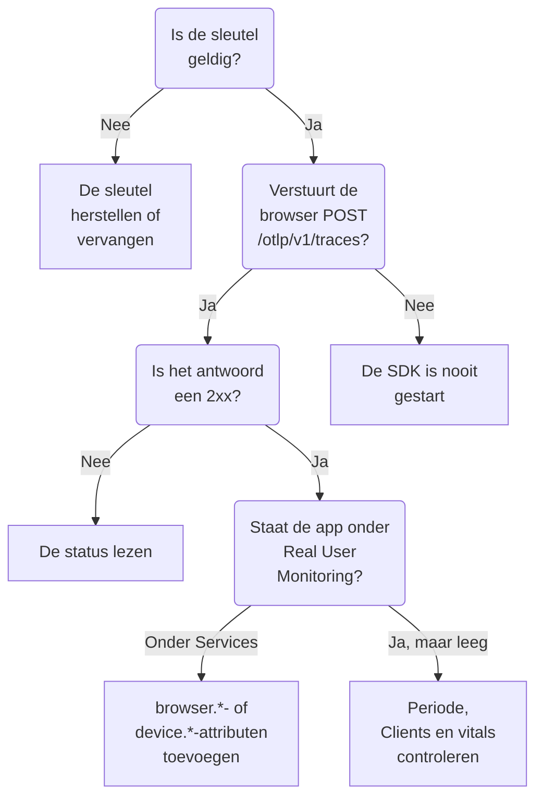

# RUM-probleemoplossing

Wanneer een RUM-applicatie ontbreekt, leeg is of **Verbinding verbroken** toont, loop je deze pagina in volgorde door. Elke controle sluit een deel van de weg tussen je app en OneUptime uit, in de volgorde waarin deze problemen meestal optreden.

:::cards
- [De sleutel controleren](#de-sleutel-controleren): De snelste controle, en al het andere hangt ervan af.
- [Controleren wat de browser verlaat](#controleren-wat-de-browser-verlaat): Het exportverzoek in de ontwikkelaarstools van je browser.
- [Controleren waar de telemetrie terechtkomt](#controleren-waar-de-telemetrie-terechtkomt): Een RUM-applicatie of een backend-service.
- [Problemen met sessieherhaling](#problemen-met-sessieherhaling): Een aparte pijplijn, met een eigen pagina.
:::

## Waar RUM-telemetrie stopt

Telemetrie passeert drie controles op weg naar een RUM-applicatie. Zoek de eerste die faalt:



## De sleutel controleren

Controleer eerst de sleutel. Het is de snelste controle, en niets daarna werkt zonder een sleutel die OneUptime accepteert:

```bash
curl -i https://oneuptime.com/otlp/v1/validate \
  -H "x-oneuptime-token: YOUR_TELEMETRY_INGESTION_TOKEN"
```

| Antwoord | Wat het betekent |
| --- | --- |
| `200` met `"valid": true` | OneUptime accepteert de sleutel. Het antwoord geeft ook het `keyType` en het `projectId`. Ga door naar de volgende controle. |
| `401` met `"valid": false` | De sleutel ontbreekt, is onbekend, ingetrokken, uitgeschakeld of verlopen, en de `message` zegt welke. Maak een actieve sleutel aan onder **Projectinstellingen → Telemetrie & APM → Ingestiesleutels**. |

Een web-app heeft een **Browser**-sleutel nodig, en een mobiele app een **Server**-sleutel: zie [Browserconfiguratie](/docs/rum/browser-setup) en [Mobiele configuratie](/docs/rum/mobile-setup). Ook de exportendpoints weigeren een verkeerde sleutel met `401`, zoals de OTLP-specificatie voorschrijft, dus een nette SDK logt de weigering in plaats van het opnieuw te proberen. Die regel valt in de browserconsole makkelijk weg, en deze controle geeft direct antwoord.

## Controleren wat de browser verlaat

Open de ontwikkelaarstools van je browser op de pagina van de app, kies het tabblad Netwerk en filter op `otlp`. Je zoekt `POST /otlp/v1/traces` met een `2xx`-status als antwoord.

### Geen verzoek

De SDK is nooit gestart. Het is bijna altijd een van deze oorzaken:

- `telemetry.ts` is niet de eerste import van je app, of je bundler heeft het weggelaten. De instrumentaties passen `fetch` en `XMLHttpRequest` aan, dus een verzoek dat vóór die aanpassing wordt gedaan, wordt niet getracet, en een bestand dat de bundler heeft weggelaten voert niets uit.
- De batchprocessor heeft nog niet geëxporteerd. `BatchSpanProcessor` wacht een paar seconden om een batch te vullen, dus wacht even, of ga naar een andere pagina, voordat je concludeert dat er niets wordt verstuurd.
- Een omgevingsvariabele bij het bouwen is `undefined` gebleven, en de URL van de exporter is kapot. Log de URL één keer bij het opstarten.

### De browser blokkeert het verzoek

- **Een Content Security Policy-fout in de console.** Het beleid van je pagina staat OneUptime nog niet toe. Voeg het toe aan je bestaande `connect-src`-richtlijn, of gebruik je eigen host als je OneUptime zelf host:

  ```text
  connect-src 'self' https://oneuptime.com;
  ```

- **Een CORS-fout.** De OTLP-endpoints accepteren verzoeken van elke origin en staan de header `x-oneuptime-token` toe, dus een echte CORS-fout betekent bijna altijd dat het verzoek OneUptime nooit heeft bereikt: zoek naar een bedrijfsproxy, een adblocker of een typfout in de host. Controleer de verzoek-URL op het tabblad Netwerk.

### Het verzoek krijgt een foutstatus

**`401`.** De sleutel is onbekend, ingetrokken of verlopen. Voer de [sleutelcontrole](#de-sleutel-controleren) uit en gebruik daarna een actieve sleutel.

**`404`.** De URL is verkeerd. De trace-exporter heeft het volledige pad nodig, `/otlp/v1/traces`. Een veelgemaakte fout is het basisadres (`https://oneuptime.com/otlp`) geven aan een exporter die de volledige URL verwacht, of de volledige URL aan een exporter die het pad zelf toevoegt en uitkomt op `/otlp/v1/traces/v1/traces`.

**`413`.** De batch was groter dan een proxy toestaat. De eigen ingress van OneUptime accepteert tot 4 MB op `/otlp`, maar een proxy die je voor OneUptime zet kan strenger zijn — ingress-nginx stelt `proxy-body-size` bijvoorbeeld standaard in op 1 MB — dus als je er een hebt, verhoog dan ook diens limiet voor `/otlp`. Hoe dan ook verkleint een kleinere `maxExportBatchSize` op de `BatchSpanProcessor` elke export:

```ts
new BatchSpanProcessor(exporter, { maxExportBatchSize: 100 });
```

Een browser verstuurt zelden zulke grote batches, tenzij spans grote attributen meedragen, zoals een volledige stacktrace of een response-body. Die inkorten is de betere oplossing.

**`422`.** OneUptime heeft de sleutel hier geweigerd, en de melding zegt waarom. `Origin https://app.example.com is not allowed for this browser ingestion key.` betekent dat de exacte origin van de pagina, met haar schema en eventuele poort, ontbreekt in de **Toegestane origins** van de sleutel. `This telemetry ingestion key has been disabled.` betekent dat iemand de sleutel heeft uitgeschakeld.

**`429`.** De **Requests Per Minute Limit** van de sleutel is op: `Too many telemetry requests for this ingestion key. Please retry later.` Een Browser-sleutel staat 6000 verzoeken per minuut toe voor al je bezoekers samen, tenzij je een eigen limiet op de sleutel instelt.

**`403` met een HTML-pagina, of een lege body.** OneUptime beantwoordt elke weigering in JSON, dus deze kwam van iets ervoor, meestal een web application firewall op je eigen domein, als je OneUptime daardoorheen leidt. De firewall parseert OTLP/JSON en vergelijkt elk span-attribuut met zijn injectieregels, dus een URL met een querystring op een span is genoeg om te blokkeren, en het firewalllog noemt de regel. Sluit de OTLP-payload alleen op de OTLP-paden uit van inspectie: [Je OpenTelemetry-verzoeken worden ook geblokkeerd](/docs/rum/session-replay-troubleshooting#je-opentelemetry-verzoeken-worden-ook-geblokkeerd) laat zien hoe, en behandelt ook de herhalingsrecorder achter dezelfde firewall.

## Controleren waar de telemetrie terechtkomt

Het verzoek werkt, maar de app verschijnt onder **Producten → Services** in plaats van onder **Producten → Bronnen → Real User Monitoring**. Dit is de meest gemelde situatie, en de oorzaak is bijna altijd een resource zonder clientattributen. OneUptime archiveert een batch alleen als RUM wanneer de resource een van deze meedraagt:

| Soort | Attributen |
| --- | --- |
| Browser | `browser.platform`, `browser.language` of een niet-lege `browser.brands` |
| Mobiel | `device.id` of `device.model.identifier`, of `device.manufacturer` op een resource zonder hostidentiteit (`host.name`, `host.id` of `k8s.node.name`) |

Een `service.name` alleen maakt een backend-service aan. De OpenTelemetry-browser-SDK voegt geen `browser.*`-attributen toe, tenzij je de browser-resourcedetector toevoegt of ze zelf instelt: zie [Browserconfiguratie](/docs/rum/browser-setup).

Om te zien wat je echt verstuurt, open je het OTLP-verzoek op het tabblad Netwerk en bekijk je de payload: `resourceSpans[0].resource.attributes` is de lijst die het bepaalt. Als er geen `browser.*`-attribuut is, voegt de SDK het niet toe, wat de documentatie ervan ook zegt.

Voeg de attributen toe, en de volgende batch maakt de RUM-applicatie aan. De service die eerst is aangemaakt, wordt geen RUM-applicatie, want het zijn aparte records, dus verwijder hem onder **Producten → Services** zodra de RUM-telemetrie binnenkomt.

> [!NOTE]
> Een resource waarvan het enige clientattribuut `device.manufacturer` is, en die ook een hostidentiteit heeft, wordt gelezen als een machine en niet als een telefoon, omdat de inventaris van een host de fabrikant met hetzelfde attribuut meldt. Voeg `device.id` of `device.model.identifier` toe, en de batch wordt gearchiveerd als mobiele RUM, wat hij verder ook meedraagt.

## De applicatie is leeg

De applicatie bestaat, maar de pagina's ervan tonen niets.

- **Controleer de periode.** Het overzicht toont standaard het laatste uur, dus een testbatch van vanochtend valt erbuiten.
- **Wacht een paar minuten.** Ingestie loopt via een wachtrij, en **Laatst gezien** wordt om de paar minuten bijgewerkt in plaats van bij elke batch.
- **Controleer het project.** Een sleutel schrijft naar zijn eigen project, dus telemetrie die met de sleutel van een ander project is verstuurd, staat daar en niet hier.

## De pagina Clients is leeg

De pagina **Clients** toont `browser.platform` op het web en `device.model.identifier` op mobiel. Twee redenen waarom ze leeg blijft terwijl al het andere werkt:

- **Safari en Firefox.** `browserDetector` leest de UA Client Hints-API, die alleen Chromium-browsers hebben. Op de andere stelt hij `browser.language` in, wat genoeg is om de telemetrie als RUM te archiveren, maar geen `browser.platform`. Stel `browser.platform` zelf in om die clients te laten verschijnen.
- **Een mobiele SDK die alleen `device.manufacturer` instelt.** Dat archiveert de telemetrie als mobiele RUM, maar de pagina **Clients** heeft `device.model.identifier` nodig.

## Core Web Vitals toont «No web vitals reported yet»

De kaart vult zich alleen met metrieken die je app verstuurt, dus traces alleen vullen haar nooit. Controleer of je metrieken exporteert, of de namen ervan bij de namen horen die OneUptime leest en of ze op de pagina **Metrieken** van de applicatie verschijnen. [De kaart zegt «No web vitals reported yet»](/docs/rum/web-vitals#probleemoplossing) loopt elke controle door, inclusief waarden die verloren gaan wanneer een bezoeker het tabblad sluit voor de volgende export.

## De status zegt Verbinding verbroken terwijl mensen de app gebruiken

Een applicatie gaat naar **Verbinding verbroken** na 15 minuten zonder telemetrie. Als mensen de app gebruiken:

- **Een sampler gooit misschien alles weg.** Controleer of je geen sampler hebt ingesteld die altijd uit staat, of een heel lage verhouding.
- **De app verstuurt misschien alleen telemetrie bij bepaalde interacties**, en niemand heeft die in die tijd gebruikt.
- **De sleutel is misschien ingetrokken of uitgeschakeld** na de uitrol: voer de [sleutelcontrole](#de-sleutel-controleren) opnieuw uit.

Een interne app of een app met weinig verkeer zonder bezoekers 's nachts is echt niet verbonden. Dat is geen storing.

## Problemen met sessieherhaling

Sessieherhaling is een aparte pijplijn met eigen problemen: het recorderscript, lijsten met toegestane origins, toestemming, de Content Security Policy en maskering. [Probleemoplossing voor sessieherhaling](/docs/rum/session-replay-troubleshooting) behandelt ze. Begin daar, en begin met het inschakelen van de diagnostiek van de recorder, want de meeste fouten ervan zijn bewust stil:

```js
localStorage.setItem("oneuptime.sessionReplay.debug", "true");
// then reload the page
```

De pagina **Gezondheid** van de applicatie, in de sectie **Sessieherhaling**, en het paneel **Test your installation** op **Replay Policy** controleren de sleutel, de lijsten met toegestane origins en het beleid vanaf de serverkant, en zeggen waarom er niets binnenkomt. De browserconsole geeft je de helft die de server niet kan zien.

Met het standaardbeleid verstuurt een recorder ongeveer elke 15 seconden een chunk terwijl de gebruiker met de pagina bezig is. Een inactief tabblad heeft niets te versturen, dus klik eerst of beweeg de muis; als er daarna geen chunk-verzoek is, gaat er iets mis. Als de app alleen _On error or frustration_ uploadt, is stilte te verwachten tot er iets misgaat. Roep `OneUptimeReplay.captureSession()` aan om een upload te forceren en het pad toch te testen.

De twee pijplijnen staan los van elkaar. Er is geen werkende RUM-applicatie nodig om de recorder te laden, en een werkende recorder betekent niet dat RUM-telemetrie binnenkomt: elk van beide kan los van de ander falen.

## Kom je er nog niet uit?

Verzamel dit voordat je om hulp vraagt. Het scheelt een heen-en-weer:

- De lijst `resource.attributes` uit de payload van een echt OTLP-verzoek.
- De HTTP-status van dat verzoek.
- De exacte `service.name` die je verstuurt, en of het project een applicatie of een service met die naam heeft.
- Of `/otlp/v1/validate` `200` antwoordt voor de sleutel in de uitgerolde build.

Schrijf daarna naar support@oneuptime.com of open een issue op [GitHub](https://github.com/OneUptime/oneuptime).

## Volgende stappen

:::cards
- [Browserconfiguratie](/docs/rum/browser-setup): De configuratie waar deze controles van uitgaan, stap voor stap.
- [Mobiele configuratie](/docs/rum/mobile-setup): De sleutel en attributen die een mobiele app nodig heeft.
- [Applicaties beheren](/docs/rum/applications): Namen, labels, bewaring en status.
- [Probleemoplossing voor sessieherhaling](/docs/rum/session-replay-troubleshooting): Elke code van de recorder, en wat je eraan doet.
:::
