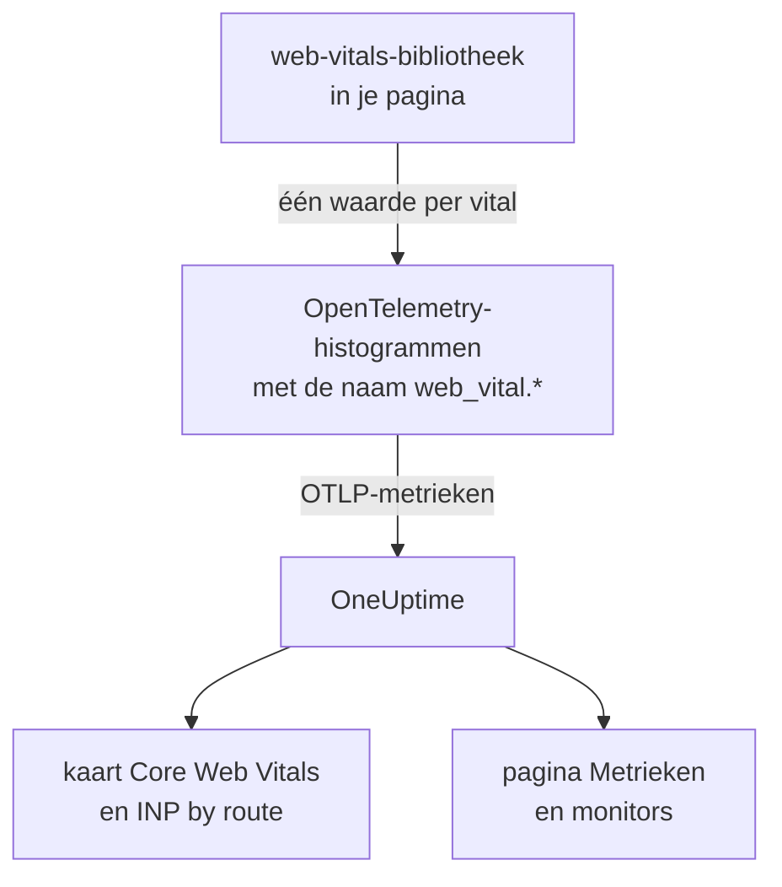
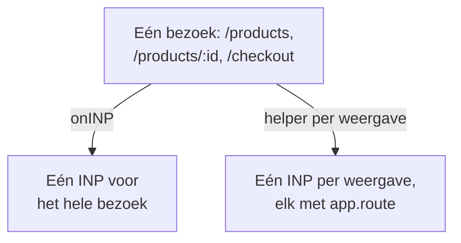

# Core Web Vitals

De kaart **Core Web Vitals** in het overzicht van een RUM-applicatie toont LCP, INP, CLS, FCP en TTFB, elk beoordeeld tegen de grenzen van Google. OneUptime meet geen van deze waarden zelf: de kaart vult zich alleen met metrieken die je browserinstrumentatie meldt, en deze pagina laat zien hoe je ze verstuurt.

:::cards
- [Versturen](#versturen-vanuit-je-app): De waarden van de web-vitals-bibliotheek als OpenTelemetry-metrieken doorsturen.
- [Namen die OneUptime leest](#metrieknamen-die-oneuptime-herkent): De metrieknamen waaronder elke vital kan binnenkomen.
- [Single-page-apps](#single-page-apps): INP voor elke weergave, niet één waarde per paginalading.
- [Meldingen voor een vital](#meldingen-voor-een-vital): Kant-en-klare monitors voor slechte vitals.
:::

## Zo werkt het

De bibliotheek [`web-vitals`](https://github.com/GoogleChrome/web-vitals) meet elke vital in de pagina; het is dezelfde bibliotheek die de eigen tools van Chrome gebruiken. Je code legt elke waarde vast in een OpenTelemetry-histogram, en de metriekpipeline van de browser exporteert hem naar OneUptime.



OpenTelemetry heeft nog geen definitieve naamgevingsconventie voor web vitals, dus OneUptime zoekt elke vital onder meerdere namen en gebruikt de eerste met gegevens. Gebruik de namen `web_vital.*` voor nieuwe instrumentatie.

## Voordat je begint

- Een web-app die is ingesteld zoals in [Browserconfiguratie](/docs/rum/browser-setup), met de metriekpipeline: de `MeterProvider` uit [Logs en metrieken toevoegen](/docs/rum/browser-setup#logs-en-metrieken-toevoegen) is wat deze waarden exporteert.

## Versturen vanuit je app

:::steps
### De bibliotheek installeren

```bash
npm install web-vitals
```

### Elke vital vastleggen in een histogram

Maak `src/web-vitals.ts` aan. Elke vital is een histogram, zodat de pagina **Metrieken** later percentielen kan berekenen, met bucketgrenzen op de goed- en slecht-grenzen van Google.

```ts title="src/web-vitals.ts"
// Import after ./telemetry
import { metrics } from "@opentelemetry/api";
import { onCLS, onFCP, onINP, onLCP, onTTFB, type Metric } from "web-vitals";

const meter = metrics.getMeter("web-vitals");

// Histograms, so the Metrics tab can compute percentiles later. The bucket
// edges sit on each vital's good / poor limits: a percentile is read from
// the buckets, and the defaults are far too coarse for these ranges.
const buckets = (...edges: number[]) => ({ advice: { explicitBucketBoundaries: edges } });

const lcp = meter.createHistogram("web_vital.lcp", { unit: "ms", ...buckets(0, 1000, 1500, 2000, 2500, 3000, 3500, 4000, 5000, 7500, 10000) });
const inp = meter.createHistogram("web_vital.inp", { unit: "ms", ...buckets(0, 50, 100, 150, 200, 250, 300, 400, 500, 750, 1000, 2000) });
const fcp = meter.createHistogram("web_vital.fcp", { unit: "ms", ...buckets(0, 600, 1200, 1800, 2400, 3000, 4000, 6000, 10000) });
const ttfb = meter.createHistogram("web_vital.ttfb", { unit: "ms", ...buckets(0, 200, 400, 600, 800, 1200, 1800, 2500, 4000) });
const cls = meter.createHistogram("web_vital.cls", { unit: "1", ...buckets(0, 0.025, 0.05, 0.1, 0.15, 0.2, 0.25, 0.4, 0.6, 1) });

function record(
  histogram: { record: (v: number, a?: Record<string, string>) => void },
) {
  return (metric: Metric): void => {
    histogram.record(metric.value, {
      // Keep attributes low-cardinality. Never put a full URL or a user id here.
      "web_vital.rating": metric.rating,
    });
  };
}

onLCP(record(lcp));
onINP(record(inp));
onCLS(record(cls));
onFCP(record(fcp));
onTTFB(record(ttfb));
```

### Het na je telemetrie-instelling importeren

```ts
import "./telemetry";
import "./web-vitals";
```

### De pagina Metrieken controleren

Laad een paar pagina's en zoek dan op de pagina **Metrieken** van de applicatie naar `web_vital.lcp`. Zodra de metrieken daar staan, vult de kaart **Core Web Vitals** zich voor het bereik dat je kiest.
:::

## De laatste waarden versturen voordat de pagina sluit

`onINP` en `onCLS` melden wanneer de pagina verborgen wordt, niet tijdens het bezoek. Met het exportinterval van 30 seconden uit [Browserconfiguratie](/docs/rum/browser-setup) kan een bezoeker die het tabblad direct na de laatste waarde sluit, vertrekken voordat die is geëxporteerd. Is volledigheid belangrijk, verkort dan `exportIntervalMillis`, of bewaar de `MeterProvider` die je in `telemetry.ts` hebt gebouwd en leeg hem wanneer de pagina verborgen wordt:

```ts
// In telemetry.ts, export the provider you created:
export const meterProvider = new MeterProvider({ /* ... */ });

// Anywhere after setup:
import { meterProvider } from "./telemetry";

document.addEventListener("visibilitychange", () => {
  if (document.visibilityState === "hidden") {
    void meterProvider.forceFlush();
  }
});
```

## Metrieknamen die OneUptime herkent

OneUptime probeert de namen in deze volgorde, en de eerste met gegevens in het geselecteerde bereik wint.

| Vital | Metrieknamen, een ervan | Eenheid |
| --- | --- | --- |
| LCP: Largest Contentful Paint | `web_vital.lcp`, `browser.largest_contentful_paint`, `largest_contentful_paint`, `web.vitals.lcp` | ms |
| INP: Interaction to Next Paint | `web_vital.inp`, `browser.interaction_to_next_paint`, `interaction_to_next_paint`, `web.vitals.inp` | ms |
| CLS: Cumulative Layout Shift | `web_vital.cls`, `browser.cumulative_layout_shift`, `cumulative_layout_shift`, `web.vitals.cls` | score |
| FCP: First Contentful Paint | `web_vital.fcp`, `browser.first_contentful_paint`, `first_contentful_paint`, `web.vitals.fcp` | ms |
| TTFB: Time to First Byte | `web_vital.ttfb`, `browser.time_to_first_byte`, `time_to_first_byte`, `web.vitals.ttfb` | ms |

De andere namen bestaan zodat een app die al volgens een communityconventie verstuurt, zonder wijzigingen verschijnt.

## Beoordelingsgrenzen

De kaart beoordeelt elke waarde met de gepubliceerde Core Web Vitals-grenzen van Google:

| Vital | **Good** | **Needs work** | **Poor** |
| --- | --- | --- | --- |
| LCP | onder 2500 ms | 2500 tot 4000 ms | 4000 ms of meer |
| INP | onder 200 ms | 200 tot 500 ms | 500 ms of meer |
| CLS | onder 0,1 | 0,1 tot 0,25 | 0,25 of meer |
| FCP | onder 1800 ms | 1800 tot 3000 ms | 3000 ms of meer |
| TTFB | onder 800 ms | 800 tot 1800 ms | 1800 ms of meer |

De kaart toont het **gemiddelde** over het geselecteerde bereik, niet het 75e percentiel dat de veldtools van Google melden. Dat is met opzet: OneUptime leest de percentielen van een histogram uit de buckets, dus een percentiel is maar zo nauwkeurig als de buckets, terwijl het gemiddelde uit de exacte som en het aantal van het histogram komt. Met de standaardbuckets van OpenTelemetry (`0, 5, 10, 25, 50, …`) valt elke CLS-waarde in de eerste bucket, en een 75e percentiel zou 2,5 aangeven voor een pagina die nauwelijks beweegt.

> [!TIP]
> Lees de kaart als een trend. Voor het 75e percentiel leg je vast met de bucketgrenzen hierboven en zet je de metriek daarna op de pagina **Metrieken** in een grafiek met de aggregatie **P75**. Een metriekmonitor biedt dezelfde keuze.

## Single-page-apps

`onINP` meet INP zoals de browser het definieert: **één waarde per paginalading**. Een single-page-app laadt één keer en wisselt daarna van route met `history.pushState`, dus een bezoek aan `/products`, `/products/42` en `/checkout` levert één INP op voor het hele bezoek. De interacties van alle weergaven concurreren om dat ene getal, en een route-attribuut erop noemt de pagina die zichtbaar was toen het werd gemeld, niet de pagina die traag was.



Om INP per weergave te zien, meet je het per weergave: elke routewissel beëindigt de huidige weergave en begint een nieuwe, en elke weergave meldt haar eigen INP. De helper hieronder doet dat met de Event Timing API van de browser, dezelfde gegevens die `onINP` gebruikt, en regelt het deel dat makkelijk misgaat: de klik die een navigatie **veroorzaakte**, wordt pas afgeleverd nadat de route al is gewisseld, maar hoort bij de pagina waarop werd geklikt.

```ts title="src/inp-per-route.ts"
// INP for each view of a single-page app.
type Report = (inpMs: number, route: string) => void;

interface View {
  route: string;
  path: string; // the URL path it was opened for
  start: number; // performance.now() when the view began
  latencies: Map<number, number>; // interactionId -> its slowest entry
}

// Long enough for the click that navigated to be delivered: its entry
// arrives after the next paint, i.e. after the route has changed.
const SETTLE_MS = 1000;

let views: Array<View> = [];
let report: Report = () => {};

// The path, plus the hash when a hash router keeps the route there.
const currentPath = (): string =>
  location.pathname + (location.hash.startsWith("#/") ? location.hash : "");

function close(view: View): void {
  if (!views.includes(view)) return; // already reported
  views = views.filter((v) => v !== view);

  const sorted = [...view.latencies.values()].sort((a, b) => b - a);
  if (sorted.length === 0) return; // nobody interacted: no INP, not 0

  // web-vitals' p98: skip one outlier for every 50 interactions.
  report(sorted[Math.min(sorted.length - 1, Math.floor(sorted.length / 50))]!, view.route);
}

function record(entries: PerformanceEntryList): void {
  for (const entry of entries as Array<PerformanceEventTiming & { interactionId?: number }>) {
    if (!entry.interactionId) continue; // hovers, scrolls: not interactions

    // The view the interaction STARTED in, so the click that navigated
    // counts towards the page it was clicked on.
    const view = [...views].reverse().find((v) => entry.startTime >= v.start);
    if (!view) continue;

    const slowest = view.latencies.get(entry.interactionId) ?? 0;
    view.latencies.set(entry.interactionId, Math.max(slowest, entry.duration));
  }
}

export function observeInpPerRoute(route: string, onReport: Report): void {
  if (typeof PerformanceObserver === "undefined" || !PerformanceObserver.supportedEntryTypes?.includes("event")) return;

  report = onReport;
  views = [{ route, path: currentPath(), start: 0, latencies: new Map() }];

  const observer = new PerformanceObserver((list) => record(list.getEntries()));
  observer.observe({ type: "event", durationThreshold: 40, buffered: true } as PerformanceObserverInit);

  // The tab may never come back: report every view now, then keep
  // measuring the current route as a fresh view.
  document.addEventListener("visibilitychange", () => {
    if (document.visibilityState !== "hidden") return;
    record(observer.takeRecords());
    const current = views[views.length - 1]?.route ?? route;
    [...views].forEach(close);
    views = [{ route: current, path: currentPath(), start: performance.now(), latencies: new Map() }];
  });
}

// Call after every navigation, with the route PATTERN ("/products/:id").
// Safe to call when nothing changed (a router's initial navigation, a
// query-string update): the view only ends when the path does.
export function startView(route: string): void {
  const closing = views[views.length - 1];
  if (!closing || closing.path === currentPath()) return;

  views.push({ route, path: currentPath(), start: performance.now(), latencies: new Map() });
  setTimeout(() => close(closing), SETTLE_MS);
}
```

Beide functies krijgen het **patroon** van de route, nooit de URL: `/products/42` en `/products/7` moeten één route zijn, anders wordt elk product een eigen reeks. Gebruik het patroon van je router als die er een heeft; voeg anders de ID's zelf samen:

```ts
// "/products/42" -> "/products/:id", also for UUIDs.
export const toRoutePattern = (path: string): string =>
  path.replace(/\/(\d+|[0-9a-f]{8}-[0-9a-f-]{27})(?=\/|$)/gi, "/:id");
```

Leg vast wat de helper meldt in hetzelfde histogram `web_vital.inp`, met de route als `app.route`, en **verwijder `onINP`** uit het snippet hierboven: met beide zou elke interactie dubbel worden geteld.

```ts
// src/web-vitals.ts, in place of onINP(record(inp))
import { observeInpPerRoute } from "./inp-per-route";

observeInpPerRoute(toRoutePattern(location.pathname), (inpMs, route) => {
  inp.record(inpMs, {
    "app.route": route,
    "web_vital.rating": inpMs <= 200 ? "good" : inpMs <= 500 ? "needs-improvement" : "poor",
  });
});
```

Roep daarna `startView` aan waar je router een afgeronde navigatie meldt. Een aanroep wordt genegeerd als het URL-pad niet is veranderd, dus een router die ook de eerste lading of een wijziging van de querystring meldt, splitst de weergave niet:

:::tabs
@tab Vue Router
```ts
router.afterEach((to) => startView(to.matched[to.matched.length - 1]?.path ?? toRoutePattern(to.path)));
```
@tab React Router
```tsx
// In a component that stays mounted inside the router
const { pathname } = useLocation();
useEffect(() => startView(toRoutePattern(pathname)), [pathname]);
```
:::

Wat je krijgt:

- **INP by route** in het overzicht, traagste eerst, op basis van `app.route`; OneUptime leest ook het OpenTelemetry-attribuut `url.template`.
- Een routefilter voor meldingen: filter een metriekmonitor op `web_vital.inp` op `app.route` om één flow, zoals `/checkout`, apart te bewaken.
- De INP voor de hele app op de kaart **Core Web Vitals** blijft werken: het is dezelfde metriek, nu met één waarde per weergave in plaats van één per paginalading.

Chromium-browsers melden de interactie-ID's die dit nodig heeft. Safari meldt er geen, en daarom meldt `onINP` daar ook niets. De experimentele Soft Navigations API van Chrome wil dit zelf gaan doen, maar is niet algemeen beschikbaar; deze helper werkt vandaag al.

> [!NOTE]
> De recorder van [Sessieherhaling](/docs/telemetry/session-replay) meet INP al per weergave, zonder code: elke opname toont een INP-rij voor elke route waarop de gebruiker iets deed, met het trage element en hoe de tijd verdeeld was over invoervertraging, verwerking en presentatie.

## De kardinaliteit onder controle houden

Metriekattributen vermenigvuldigen zich. `web_vital.rating` heeft drie mogelijke waarden, en dat is prima, en een attribuut voor route of paginatype is meestal de moeite waard:

```ts
histogram.record(metric.value, {
  "web_vital.rating": metric.rating,
  "app.route": routePattern, // "/product/:id" — the PATTERN, not "/product/8842"
});
```

De concrete URL vastleggen in plaats van het routepatroon maakt één tijdreeks per productpagina, waardoor de pagina **Metrieken** traag en de opslagrekening hoog wordt. Hetzelfde geldt voor gebruikers-ID's, sessie-ID's en schermformaten.

## Meldingen voor een vital

De pagina **Recommendations** van de applicatie biedt voor elke vital een kant-en-klare monitor. Elke monitor leest het vijfminutengemiddelde van zijn metriek en gaat af wanneer dat de slecht-grens van Google bereikt:

| Aanbeveling | Metriek | Gaat af bij | Ernst |
| --- | --- | --- | --- |
| **Poor Largest Contentful Paint** | `web_vital.lcp` | 4000 ms | **Kritiek** |
| **Poor Interaction to Next Paint** | `web_vital.inp` | 500 ms | **Kritiek** |
| **Poor Cumulative Layout Shift** | `web_vital.cls` | 0,25 | **Kritiek** |
| **Slow First Contentful Paint** | `web_vital.fcp` | 3000 ms | **Warning** |
| **Slow Time to First Byte** | `web_vital.ttfb` | 1800 ms | **Warning** |

Deze monitors lezen alleen de namen `web_vital.*`. Verstuurt je app een vital onder een andere naam, pas dan de metriek van de aangemaakte monitor aan. Om voor één route te melden, voeg je een filter `app.route` aan de monitor toe. Je kunt ook een eigen monitor bouwen op elk van deze metrieken: zie [Metrics-monitor](/docs/monitor/metrics-monitor).

## Probleemoplossing

:::details De kaart zegt 'No web vitals reported yet'
De kaart vult zich alleen met metrieken die je app verstuurt. Controleer op volgorde:

1. Of je überhaupt een metriekpipeline hebt: traces alleen vullen deze kaart nooit.
2. Of de metrieknamen bij de namen horen die OneUptime leest: zie [Metrieknamen die OneUptime herkent](#metrieknamen-die-oneuptime-herkent).
3. Of de metrieken op de pagina **Metrieken** van de applicatie staan. Zo ja, dan werkt de export en ligt het probleem bij de naam of het tijdsbereik.
4. Of INP en CLS worden gemeld wanneer de pagina verborgen wordt, zodat een kort bezoek kan eindigen vóór de volgende export: zie [De laatste waarden versturen voordat de pagina sluit](#de-laatste-waarden-versturen-voordat-de-pagina-sluit).

Helpt niets hiervan, dan controleert [RUM-probleemoplossing](/docs/rum/troubleshooting) de hele pipeline.
:::

:::details INP wordt gemeld, maar niet per route
De kaart **INP by route** heeft het attribuut `app.route`, of `url.template`, op `web_vital.inp` nodig. Leg het routepatroon bij elke waarde vast zoals in [Single-page-apps](#single-page-apps).
:::

:::details De waarden wijken af van het rapport van Google
De kaart toont het gemiddelde over het bereik dat je hebt gekozen, en Google meldt het 75e percentiel van zijn eigen bezoekers. Zet de **P75** op de pagina **Metrieken** in een grafiek om gelijke dingen te vergelijken.
:::

## Volgende stappen

:::cards
- [Browserconfiguratie](/docs/rum/browser-setup): De pipeline voor traces, logs en metrieken waarover deze vitals reizen.
- [Metrics-monitor](/docs/monitor/metrics-monitor): Melden op elke vital, voor de hele app of één route.
- [Sessieherhaling](/docs/telemetry/session-replay): INP per weergave zien in opnames, zonder code.
- [RUM-probleemoplossing](/docs/rum/troubleshooting): Elke controle, in de volgorde waarin problemen meestal optreden.
:::
