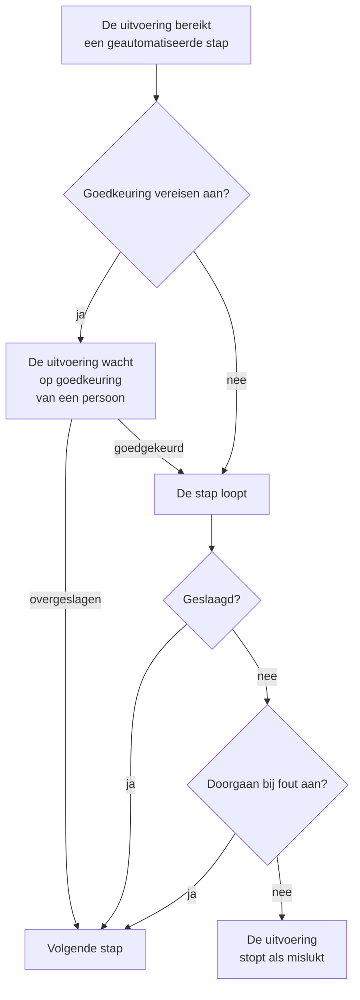

# Een runbook schrijven

U schrijft een runbook als een geordende lijst stappen op de pagina **Stappen** ervan. Deze pagina laat zien hoe u een runbook maakt, hoe u elk van de zeven staptypen instelt en hoe fouten en goedkeuringen het verloop van een uitvoering veranderen.

:::cards
- [Een runbook maken](#een-runbook-maken): Van een leeg runbook naar opgeslagen stappen.
- [Staptypen](#staptypen): Manual, JavaScript, HTTP request, Bash, SSH, kubectl en AI.
- [Foutafhandeling en goedkeuringen](#foutafhandeling-en-goedkeuringen): Wat er gebeurt wanneer een stap mislukt of op goedkeuring wacht.
- [Een uitgewerkt voorbeeld](#een-uitgewerkt-voorbeeld): Een database-failover in vijf stappen.
:::

## Voordat u begint

- **Een rol die runbooks schrijft.** Project Owner, Project Admin en Runbook Admin maken runbooks en slaan de stappen op. Met gedetailleerde machtigingen hebt u **Create Runbook** en **Edit Runbook** nodig. Zie [Machtigingen](/docs/runbooks/configuration#machtigingen).
- **Een Runner, voor Bash-, SSH- en kubectl-stappen.** Deze stappen lopen op een [Runner](/docs/runbooks/agents) in uw eigen infrastructuur, nooit op de OneUptime Worker. Installeer er eerst een. Een stap die geen Runner kiest, loopt op de [standaard-Runner van het project](/docs/runbooks/agents#de-standaard-runner-van-het-project), als u er een hebt ingesteld; anders loopt een JavaScript-stap op een [globale Runner](/docs/runbooks/agents#globale-runners).
- **Een geheime variabele, voor SSH- en kubectl-stappen.** De sleutel, het wachtwoord of de kubeconfig waarmee een stap zich aanmeldt, is een geheime [runbookvariabele](/docs/runbooks/variables). Project Owner en Project Admin maken variabelen aan, en Runbook Admin kiest ze in de stappen die hij schrijft. Een kubectl-stap kan in plaats daarvan de eigen toegang van de Runner gebruiken.
- **Een LLM-provider, voor AI-stappen.** Zie [LLM-providers](/docs/ai/llm-provider).

## Een runbook maken

:::steps
### Runbooks openen

Open **Producten → Runbooks**. Runbooks staat in de groep **Dashboards & automatisering**.

### Het runbook maken

Klik op **Runbook aanmaken**, voer een **Naam** in en eventueel een **Beschrijving** van waar het runbook voor dient. Onder **Meer velden** staan de schakelaar **Ingeschakeld**, standaard aan, en **Labels**. Het nieuwe runbook opent op zijn pagina **Stappen**.

### Stappen toevoegen

Kies onder **Begin met uw runbook** het type van de eerste stap; onder de laatste stap biedt **Nog een stap toevoegen** dezelfde zeven typen. Elke stap opent met zijn **Titel** en wat zijn type nodig heeft; de rest, zoals zijn **Beschrijving** en de time-outs, is ingeklapt onder **Meer velden**. Zodra het runbook een stap heeft, voegt **Stap toevoegen** bovenaan de kaart een Manual-stap toe.

### De stappen ordenen

Stappen lopen **op volgorde**. Sleep een stap aan de greep links in de kop om de volgorde te wijzigen; met het toetsenbord zet u de focus op de greep, drukt u op Spatie, verplaatst u de stap met de pijltjestoetsen en drukt u opnieuw op Spatie.

### De stappen opslaan

Klik op **Stappen opslaan**. Tot u dat doet, toont de editor **Niet-opgeslagen wijzigingen**. Na het opslaan ziet u **Opgeslagen**, en is het runbook klaar om te [uitvoeren](/docs/runbooks/running).
:::

## Opbouw van een stap

Elke stap heeft deze velden. Een geautomatiseerde stap toont zijn **Titel** en de instellingen van zijn type, en klapt de rest in onder **Meer velden**, dat zegt wat daarvan is ingesteld:

| Veld | Doel |
| --- | --- |
| **Titel** | Een kort label, zichtbaar in de stappenlijst en in elke uitvoering. |
| **Beschrijving** | Optionele context voor wie reageert, in Markdown, onder **Meer velden**. Bij een Manual-stap zijn dit de **Instructies** die die persoon leest en volgt, getoond onder de titel. |
| **Doorgaan bij fout** | Alleen geautomatiseerde stappen. Als dit aan staat, stopt een mislukte stap de uitvoering niet: de volgende stap loopt toch. |
| **Goedkeuring vereisen** | Alleen geautomatiseerde stappen. Als dit aan staat, stopt de uitvoering vóór deze stap tot iemand hem goedkeurt, en voert hem pas dan uit. De schakelaar heet **Goedkeuring vereisen voordat deze stap wordt uitgevoerd**, en de kop van de stap toont **Goedkeuring nodig**. |
| Typespecifieke instellingen | Het script, de URL, de Runner, een geheime variabele of de prompt. Zie [Staptypen](#staptypen). |

## Staptypen

| Type | Loopt op | Heeft nodig |
| --- | --- | --- |
| [Manual](#manual) | Een persoon | Niets |
| [JavaScript](#javascript) | Een Runner | Een Runner |
| [HTTP request](#http-request) | De OneUptime Worker | Niets |
| [Bash](#bash) | Een Runner | Een Runner |
| [SSH](#ssh) | Een Runner | Een Runner en een geheime variabele om mee aan te melden |
| [kubectl](#kubectl) | Een Runner | Een Runner, en een kubeconfig-variabele of de eigen toegang van de Runner |
| [AI](#ai) | De OneUptime Worker | Een LLM-provider |

In elke geautomatiseerde stap hieronder bevat **Meer velden** van de stap eerst zijn **Runner**, voor een stap die op een Runner loopt, dan **Goedkeuring vereisen** en **Doorgaan bij fout**, dan de eigen instellingen van de stap - de headers van een HTTP-aanroep, de poort en de wachtwoordzin van de sleutel van een SSH-stap, de provider en de contextschakelaars van een AI-stap - en als laatste de **Beschrijving** en de time-outs. Ingeklapt noemt het de Runner van de stap, zodat u ziet waar een stap loopt zonder hem te openen.

### Manual

Een checklistpunt voor een persoon: de **Instructies** zeggen wat er gedaan of gecontroleerd moet worden. De uitvoering pauzeert wanneer ze een Manual-stap bereikt en blijft in `WaitingForManualStep` (**Wacht op u**) tot iemand op **Markeer als voltooid** of **Overslaan** klikt. Een uitvoering die op een persoon wacht, verloopt nooit. Een Manual-stap heeft geen goedkeuringsschakelaar: hij stopt de uitvoering al voor een persoon.

Gebruik dit voor wat alleen een mens kan controleren of doen: "Bevestig in het dashboard van de load balancer dat het verkeer naar de secundaire regio is verplaatst."

### JavaScript

Een stukje JavaScript, uitgevoerd in een `isolated-vm`-sandbox op een [runbook-agent](/docs/runbooks/agents), niet op de OneUptime Worker: op een van uw eigen, of op een [globale Runner](/docs/runbooks/agents#globale-runners) als de stap er geen kiest.

| Veld | Wat het doet | Standaard |
| --- | --- | --- |
| **Runner** | Onder **Meer velden**. De Runner die de stap uitvoert: **Globale Runner**, of een van uw eigen. Alleen de Runner die u kiest, mag de taak oppakken; elke globale Runner mag een stap op **Globale Runner** oppakken. | De [standaard-Runner van het project](/docs/runbooks/agents#de-standaard-runner-van-het-project), als u er een hebt ingesteld; anders **Globale Runner**, als er een is |
| **Script** | Het JavaScript dat wordt uitgevoerd. Geef met `return` een waarde terug om die vast te leggen; elke regel van `console.log` wordt ook vastgelegd. Een gegooide fout laat de stap mislukken. | — |
| **Uitvoeringstime-out** | Hoe lang de Runner het stukje laat lopen voordat hij de sandbox afbreekt. Een globale Runner laat het hooguit 5 minuten lopen. | 30 seconden |
| **Time-out voor oppakken** | Hoe lang de Worker wacht tot de Runner de taak oppakt. | 2 minuten |

```javascript
const start = Date.now();
// ... your logic ...
console.log("replica lag checked");
return { durationMs: Date.now() - start };
```

De sandbox heeft 128 MB geheugen en geen toegang tot het bestandssysteem of processen. Hij kan HTTP-verzoeken doen met `axios`, maar alleen naar openbare adressen: een verzoek naar een privénetwerk, naar de host van de Runner zelf of naar een metadata-endpoint van een cloud wordt geweigerd. Gebruik een [Bash](#bash)-stap met `curl` om een dienst in uw netwerk te bereiken.

### HTTP request

Een uitgaande HTTP-aanroep, gedaan door de OneUptime Worker. Er is geen Runner nodig.

| Veld | Wat het doet | Standaard |
| --- | --- | --- |
| **Methode** | `GET`, `POST`, `PUT`, `PATCH`, `DELETE` of `HEAD`. | `GET` |
| **URL** | Het endpoint dat wordt aangeroepen. | Leeg |
| **Headers (JSON)** | Onder **Meer velden**. Een JSON-object, zoals `{ "Authorization": "Bearer ..." }`. Headers die geen geldige JSON zijn, laten de stap mislukken. | Geen |
| **Body** | Getoond voor `POST`, `PUT`, `PATCH` en `DELETE`. Verzonden als JSON wanneer het als JSON te lezen is, anders als tekst. | Geen |
| **Time-out van verzoek** | Hoe lang op het antwoord van het endpoint wordt gewacht voordat de stap mislukt. | 30 seconden |

De stap slaagt bij een `2xx`- of `3xx`-antwoord en mislukt bij al het andere, met `HTTP <status>` als fout. Doorverwijzingen worden niet gevolgd. De status, headers en body van het antwoord worden vastgelegd, tot 50 KB.

> [!NOTE]
> De Worker roept nooit loopback- of link-local-adressen aan, zoals een metadata-endpoint van een cloud. In OneUptime Cloud roept hij alleen openbare adressen aan. Een zelf gehoste OneUptime bereikt ook privénetwerken, tenzij `DATA_SOURCE_BLOCK_PRIVATE_ADDRESSES` `true` is. Gebruik een [Bash](#bash)-stap met `curl` om vanuit OneUptime Cloud een dienst in uw netwerk aan te roepen.

Handig voor: een PagerDuty-incident openen, naar een Slack-webhook posten, de openbare API van uw cloudprovider of uw eigen API aanroepen.

### Bash

Een bashscript, uitgevoerd met `bash -c <script>` op een [runbook-agent](/docs/runbooks/agents) in uw eigen infrastructuur. Bash loopt nooit op de OneUptime Worker.

| Veld | Wat het doet | Standaard |
| --- | --- | --- |
| **Runner** | Onder **Meer velden**. De Runner die de stap uitvoert. Alleen die Runner mag de taak oppakken. Globale Runners voeren alleen JavaScript-stappen uit. | De standaard-Runner van het project, als u er een hebt ingesteld |
| **Bash-script** | Het script. De uitvoer (stdout en stderr) wordt tot 50 KB vastgelegd, en een exitcode anders dan nul laat de stap mislukken. | — |
| **Uitvoeringstime-out** | Hoe lang de Runner het script laat lopen voordat hij het met `SIGKILL` stopt. Verhoog dit voor stappen die terecht minuten duren. | 30 seconden |
| **Time-out voor oppakken** | Hoe lang de Worker wacht tot de Runner de taak oppakt. | 2 minuten |

Het script loopt in de container van de Runner, met de tools die de image meebrengt, zoals `curl`, `wget` en de `ssh`-client, en met de netwerktoegang van de host waarop het draait. Bijvoorbeeld om een dienst te controleren die alleen uw netwerk bereikt:

```bash
set -euo pipefail
HTTP_CODE=$(curl -s -o /tmp/resp.txt -w "%{http_code}" "http://payments.internal:8080/health")
echo "HTTP $HTTP_CODE"
cat /tmp/resp.txt
if [[ "$HTTP_CODE" != "200" ]]; then
  echo "Health check failed"
  exit 1
fi
```

Is de gekozen Runner offline wanneer de uitvoering deze stap bereikt, dan wacht de stap tot de **claim timeout** (standaard 2 minuten) en mislukt dan door een time-out. Voeg een agent toe onder **Runbooks → Runbook-agenten** voordat u op een Bash-stap vertrouwt.

> [!TIP]
> Houd wachtwoorden en tokens uit het script. Sla ze op als geheime [runbookvariabelen](/docs/runbooks/variables) en schrijf `{{global.variables.NAME}}` waar de waarde moet komen: de Runner krijgt het script met de waarde ingevuld, en de uitvoer van de stap toont `[REDACTED]` op die plek.

### SSH

Meld u via SSH aan op een machine en voer daar een bash-script uit. De Runner opent de verbinding, dus de machine hoeft alleen bereikbaar te zijn vanaf de Runner, en de sleutel of het wachtwoord waarmee de stap zich aanmeldt, is een geheime [runbookvariabele](/docs/runbooks/variables), die nooit in de stap staat.

| Veld | Wat het doet |
| --- | --- |
| **Runner** | Onder **Meer velden**. De Runner die de verbinding opent. Hij moet de machine via het netwerk kunnen bereiken. Een stap die er geen kiest, loopt op de standaard-Runner van het project. |
| **SSH naar** | De gebruiker en de machine, zoals u ze na `ssh` zou schrijven: `deploy@10.0.4.21`. |
| **Aanmelden met** | De geheime variabele die de privésleutel of het wachtwoord bevat; de waarde zegt welke het is. Alleen geheime variabelen worden aangeboden, en de stap meldt het wanneer zijn Runner de gekozen variabele niet mag gebruiken. |
| **Bash-script** | Loopt met `bash` op de machine, als de gebruiker waarmee de stap zich aanmeldt. De uitvoer wordt tot 50 KB vastgelegd, en een exitcode anders dan nul laat de stap mislukken. |
| **Poort** | Onder **Meer velden**. 22 als het leeg blijft. |
| **Wachtwoordzin van de sleutel** | Onder **Meer velden**. De geheime variabele die de wachtwoordzin bevat van een sleutel die er een heeft. |
| **Uitvoeringstime-out** | Omvat verbinden, aanmelden en het script uitvoeren samen, zodat een vastgelopen script de stap niet open kan houden. Standaard 30 seconden. |
| **Time-out voor oppakken** | Hoe lang de Worker wacht tot de Runner de taak oppakt. Standaard 2 minuten. |

Bijvoorbeeld om een dienst te herstarten en te tonen dat hij weer draait:

```bash
sudo systemctl restart nginx
systemctl status nginx --no-pager
```

### kubectl

Voer kubectl-opdrachten uit op een cluster. Het script loopt met bash op de Runner, die `kubectl` meelevert, met `KUBECONFIG` dat naar het cluster wijst: elke kubectl-opdracht werkt, en ook elke bash eromheen.

| Veld | Wat het doet |
| --- | --- |
| **Runner** | Onder **Meer velden**. De Runner die kubectl uitvoert. Hij moet de API-server van het cluster kunnen bereiken. Een stap die er geen kiest, loopt op de standaard-Runner van het project. |
| **Kubeconfig** | De geheime variabele die de kubeconfig van het cluster bevat, of **De eigen toegang van de Runner**: de eigen kubeconfig van de Runner, of zijn serviceaccount als hij in het cluster draait. De Runner schrijft een kubeconfig naar een bestand dat alleen hij kan lezen, en verwijdert het als het script eindigt. |
| **Script** | De kubectl-opdrachten. De uitvoer wordt tot 50 KB vastgelegd, en een exitcode anders dan nul laat de stap mislukken. |
| **Uitvoeringstime-out** | Hoe lang de Runner het script laat lopen voordat hij het met `SIGKILL` stopt. Standaard 30 seconden. |
| **Time-out voor oppakken** | Hoe lang de Worker wacht tot de Runner de taak oppakt. Standaard 2 minuten. |

Bijvoorbeeld om een deployment te herstarten en te wachten tot de nieuwe pods klaar zijn:

```bash
kubectl rollout restart deployment/checkout-api --namespace checkout
kubectl rollout status deployment/checkout-api --namespace checkout --timeout=120s
```

**Voorbeelden — klik om in te voegen**, onder elk script, vult veelgebruikte scripts zoals deze in. Geef de gebruiker van de kubeconfig alleen wat uw scripts doen: een Role in de namespaces waarin ze werken, met de verbs die ze gebruiken. Als de API-server een opdracht weigert, staat de eigen melding van kubectl in de uitvoer van de stap, zodat een machtigingsfout u vertelt welke role binding u moet uitbreiden.

### AI

Laat AI halverwege de uitvoering iets analyseren, samenvatten of beslissen. Het antwoord wordt de uitvoer van de stap op de uitvoering. AI-stappen lopen op de OneUptime Worker; er is geen Runner nodig.

| Veld | Wat het doet |
| --- | --- |
| **Prompt** | Wat de AI moet doen. Bijvoorbeeld: "Bekijk de uitvoer van de vorige stappen en zeg of het veilig is om met het herstel door te gaan." |
| **LLM-provider** | Optioneel. **Projectstandaard** gebruikt de standaardprovider van het project. Leg een provider vast wanneer de stap een bepaald model nodig heeft, zoals een zelf gehost model voor gegevens die uw netwerk niet mogen verlaten. Zie [LLM-providers](/docs/ai/llm-provider). |
| **Context van vorige stap opnemen** | Als dit aan staat, ziet de AI alles over de stappen die vóór deze stap liepen: titel, type, status, uitvoer en foutmeldingen. Hij krijgt tot 4.000 tekens van de uitvoer van elke stap. |
| **Triggercontext opnemen** | Als dit aan staat, ziet de AI wat de uitvoering startte: het gekoppelde incident, de waarschuwing of het geplande onderhoudsevenement (beschrijving, ernst, huidige status, getroffen monitoren, grondoorzaak, statustijdlijn en openbare notities), of wie het runbook met de hand startte. |

Om een mens erbij te houden, zet u **Goedkeuring vereisen** aan op de stap na een AI-stap: de AI analyseert, iemand leest het antwoord, en de herstelstap loopt pas zodra die persoon hem goedkeurt.

**Wat de AI nooit ziet.** Het antwoord van een AI-stap wordt als stapuitvoer op de uitvoering opgeslagen, en uitvoeringen zijn leesbaar voor iedereen met leesrechten op runbooks, een breder publiek dan dat van het incident. Daarom laat de triggercontext **privé interne notities** en **kanaalberichten uit Slack en Microsoft Teams** weg. De uitvoer van eerdere stappen wordt doorzocht op geheimen (tokens, sleutels, inloggegevens), die worden afgeschermd voordat ze naar het model gaan. Ingesloten afbeeldingen en lange gecodeerde gegevens, zoals een schermafbeelding die in de beschrijving van een incident is geplakt, worden ook weggelaten, met een korte notitie op hun plaats.

AI-stappen worden gemeten en gefactureerd zoals elke andere AI-functie. De stap mislukt, met een melding die zegt waarom, wanneer hij geen prompt heeft, wanneer AI-functies voor het project uit staan, wanneer er geen LLM-provider beschikbaar is of wanneer de vastgelegde provider niet meer beschikbaar is voor het project. Zet **Doorgaan bij fout** aan als de rest van het runbook toch moet lopen.

## Foutafhandeling en goedkeuringen



Standaard stopt een mislukte stap de uitvoering en markeert die als `Failed`, met de fout van de stap als reden. Met **Doorgaan bij fout** aan wordt de fout vastgelegd en loopt de volgende stap, wat past bij runbooks van het type "probeer deze drie dingen en waarschuw dan".

**Goedkeuring vereisen** geldt voordat een stap loopt, wat er ook eerder gebeurde: de uitvoering wacht tot iemand op **Goedkeuren en uitvoeren** klikt, en de stap loopt, of op **Overslaan**, en hij loopt nooit. Zet het aan voor de stap die iets verandert - de herstart, de failover, het afschalen - zodat een persoon eerst bekijkt wat de stappen ervoor hebben gevonden. De goedkeuring hoort bij de stap, dus wie de stap verplaatst, verplaatst haar mee.

:::note
Via de API en Terraform is de schakelaar het veld `requireApprovalBeforeRunning` van een stap. Het veld `requireApproval` van een stap, dat runbooks schreven voordat goedkeuringen naar de stap verhuisden die ze bewaken, werkt nog steeds en betekent wat het betekende: een goedkeuring na die stap. OneUptime leest het als een goedkeuring vóór de volgende stap of, na de laatste stap, als een Manual-stap aan het eind, met de titel **Approve the result**.
:::

## Opslaan en bewerken

Wijzigingen in de stappen gaan in wanneer u op **Stappen opslaan** klikt. Elke uitvoering werkt met de momentopname van het moment waarop ze startte, dus lopende uitvoeringen houden de stappen waarmee ze begonnen, en bewerken herschrijft nooit de geschiedenis van eerdere uitvoeringen.

## Een uitgewerkt voorbeeld

Een runbook voor "DB primary unreachable":

| # | Type | Wat het doet |
| --- | --- | --- |
| 1 | JavaScript | De huidige primary-host uit uw configuratiedienst ophalen en loggen. |
| 2 | Manual | "Bevestig dat de replicatievertraging op de secundaire onder de 5 seconden ligt." |
| 3 | HTTP request | `POST` naar de API van uw failover-orchestrator. |
| 4 | Manual | "Controleer dat schrijfacties nu naar de nieuwe primary gaan." |
| 5 | HTTP request | `POST` van een sein-veilig-bericht naar een Slack-webhook. |

Wie reageert, ziet stap 1 lopen, vinkt stap 2 af, ziet stap 3 lopen, vinkt stap 4 af, en de uitvoering eindigt met stap 5. De uitvoer van elke stap wordt vastgelegd voor de postmortem.

## Volgende stappen

:::cards
- [Een runbook uitvoeren](/docs/runbooks/running): Een uitvoering starten, en de stappen voltooien, goedkeuren of overslaan.
- [Runbook-regels](/docs/runbooks/rules): Dit runbook automatisch starten bij overeenkomende incidenten.
- [Runbook-agenten](/docs/runbooks/agents): De Runner installeren die uw scriptstappen nodig hebben.
- [Runbook-variabelen](/docs/runbooks/variables): Hosts, sleutels, wachtwoorden en kubeconfigs uit uw stappen houden.
:::
