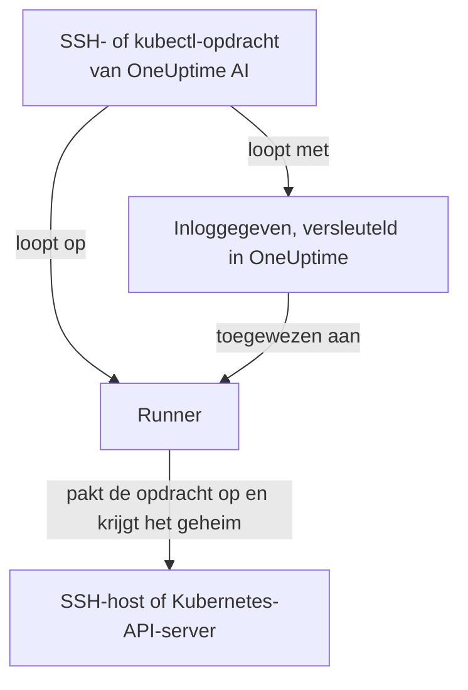

# AI-toegang

AI-toegang is hoe de eigen opdrachten van OneUptime AI iets bereiken dat **niet** de eigen host van een Runner is — een server via SSH, of de API-server van een Kubernetes-cluster dat het Kubernetes-agentchart niet draait. Elke toegang is een inloggegeven: die toegang als beheerd object, versleuteld opgeslagen, toegewezen aan bepaalde Runners en door OneUptime AI gekozen in plaats van in een opdracht geschreven. Runbookstappen gebruiken ze niet: een SSH- of kubectl-stap meldt zich aan met een geheime [runbookvariabele](/docs/runbooks/variables).

Beheer ze onder **Runbooks → Runbook-agenten → AI-toegang**.

:::cards
- [Een inloggegeven maken](#een-inloggegeven-maken): De toegang en de Runners die het mogen gebruiken.
- [Minimale rechten aan de andere kant](#minimale-rechten-aan-de-andere-kant): Beperken wat de sleutel of het token kan doen.
- [Runners die de opdrachten van OneUptime AI uitvoeren](#runners-die-de-opdrachten-van-oneuptime-ai-uitvoeren): Wie zo'n Runner een SSH-inloggegeven mag geven.
:::

## Hoe een inloggegeven wordt gebruikt

OneUptime AI voert een SSH-opdracht uit met een van de SSH-inloggegevens die zijn toegewezen aan de Runner waarop hij loopt, en een kubectl-opdracht voor een cluster dat het Kubernetes-agentchart niet draait met het Kubernetes-inloggegeven dat aan dat cluster is gekoppeld, zoals [AI SRE](/docs/ai/ai-sre) laat zien. Wanneer de Runner de opdracht oppakt, controleert OneUptime of het inloggegeven aan hem is toegewezen, ontsleutelt het geheim en geeft het alleen in het antwoord op dat oppakken. Het geheim wordt nooit op de job opgeslagen en is nooit via de API leesbaar.

## Voordat u begint

- **Een rol die inloggegevens beheert.** Project Owner en Project Admin, of iedereen met de machtiging **Create Runbook Credential**. De rol Runbook Admin bevat die niet. Een SSH-inloggegeven toewijzen aan een Runner die de opdrachten van OneUptime AI uitvoert, vereist ook **Read Runbook Credential**; zie [Runners die de opdrachten van OneUptime AI uitvoeren](#runners-die-de-opdrachten-van-oneuptime-ai-uitvoeren).
- **Een abonnement dat ze bevat.** In OneUptime Cloud vereisen runbook-inloggegevens het abonnement **Growth** of hoger.
- **Een [Runner](/docs/runbooks/agents)** die de host of de API-server van het cluster via het netwerk bereikt.

## Een inloggegeven maken

:::steps
### AI-toegang openen

Open **Runbooks → Runbook-agenten → AI-toegang** en klik op **Credential aanmaken**.

### Een naam en type kiezen

Voer in de stap **Credential** een **Naam** in, zoals `prod-cluster`, een optionele **Beschrijving** en het **Type**: **SSH** of **Kubernetes**. Het type kan later niet worden gewijzigd; maak in plaats daarvan een nieuw inloggegeven.

### De toegang invoeren

:::tabs
@tab SSH
Voer onder **SSH-host** de **Hostnaam**, de **Poort** (22 als u die leeg laat) en de **Gebruikersnaam** in. Kies onder **SSH-authenticatie** bij **Aanmelden met**: een **Privésleutel**, de betere keuze als u kunt kiezen, en plak dan de **Private Key (PEM)**, met de bijbehorende **Private Key Passphrase** als die er is; of een **Wachtwoord**, voor een host zonder sleuteltoegang, en voer dan het **Wachtwoord** in.
@tab Kubernetes
Voer onder **Kubernetes** de **API Server URL** in, zoals `https://10.0.0.1:6443`, het **Service Account Token** en het **CA Certificate (PEM)**, zodat de Runner de API-server kan verifiëren. Laat de CA alleen leeg als de API-server een certificaat toont dat de Runner al vertrouwt.
:::

### Aan Runners toewijzen

Kies in de stap **Runbook-agenten** de Runners die het inloggegeven mogen gebruiken en klik dan op **Credential aanmaken**. Een inloggegeven dat aan geen enkele Runner is toegewezen, kan door geen enkele opdracht worden gebruikt.

### OneUptime AI het laten gebruiken

OneUptime AI voert zijn SSH-opdrachten uit op de Runner die een regel voor automatisch herstel ervoor kiest, met een van de SSH-inloggegevens die eraan zijn toegewezen. Een Kubernetes-inloggegeven wordt gebruikt zodra het, met een van zijn Runners, aan een cluster is gekoppeld: zie [AI SRE](/docs/ai/ai-sre).
:::

## Wat er wordt opgeslagen

| Type | Velden |
| --- | --- |
| SSH | Hostnaam, poort (standaard 22), gebruikersnaam, en een PEM-privésleutel (met optionele wachtwoordzin) of een wachtwoord. |
| Kubernetes | URL van de API-server, een serviceaccounttoken en het CA-certificaat van het cluster. |

## Geheime waarden zijn alleen schrijfbaar

Privésleutels, wachtwoordzinnen, wachtwoorden en serviceaccounttokens worden versleuteld opgeslagen en de API **geeft ze nooit terug**: niet aan het dashboard, niet aan een workflow, niet aan een export. De tabel kan u laten zien wat een inloggegeven *is* zonder ooit te laten zien wat het bevat.

Er is dus geen "bekijken" voor een geheime waarde, alleen "vervangen": een waarde opnieuw invoeren is de manier om hem te vervangen. Bent u het origineel kwijt, geef dan op het doelsysteem een nieuwe sleutel uit en werk het inloggegeven bij.

## Een inloggegeven aan Runners toewijzen

Een inloggegeven is alleen bruikbaar voor de Runners waaraan u het toewijst. Een opdracht die een inloggegeven noemt dat niet aan zijn Runner is toegewezen, **mislukt in plaats van te lopen** — een Runner die stilletjes niets doet, ziet er precies zo uit als een die werkte.

De toewijzing is de toegangsgrens, dus houd haar smal: een Runner die alleen ooit één cluster herstart, heeft de SSH-sleutel van uw databasehosts niet nodig.

### Runners die de opdrachten van OneUptime AI uitvoeren

Een Runner voert de opdrachten van OneUptime AI uit zodra hij ervoor is gekozen: als Runner van een regel voor automatisch herstel, of voor de AI-toegang van een Kubernetes-cluster. Op zo'n Runner kiest OneUptime AI uit de SSH-inloggegevens die aan de Runner zijn toegewezen voor de opdrachten die het daar uitvoert. Een SSH-inloggegeven bereikt zo'n Runner dus alleen via iemand die runbook-inloggegevens mag lezen (**Read Runbook Credential**, of een Project Owner of Project Admin), wat er ook als eerste wordt opgeslagen:

- **Het inloggegeven toewijzen.** Een SSH-inloggegeven met zo'n Runner maken, of zo'n Runner aan een inloggegeven toevoegen, vereist die machtiging. Zonder de machtiging wordt het opslaan geweigerd en wordt de Runner genoemd: wijs het inloggegeven toe aan Runners die geen AI-herstelopdrachten uitvoeren, of vraag iemand met de machtiging om het toe te wijzen.
- **De Runner kiezen.** Een Runner met SSH-inloggegevens kiezen voor de opdrachten van OneUptime AI - als Runner van een regel, of voor een cluster - vereist dezelfde machtiging, de eerste keer dat hij wordt gekozen.

Runners van een inloggegeven verwijderen, een inloggegeven opslaan met de Runners die het al heeft, en Kubernetes-inloggegevens vragen niets extra's: de kubectl-opdrachten van OneUptime AI lopen met het inloggegeven dat aan hun cluster is gekoppeld. Toewijzingen van inloggegevens en het kiezen van een Runner door iemand zonder die machtiging worden in een project één voor één opgeslagen, zodat de twee hun controles niet samen kunnen doorstaan; een opslag die binnenkomt terwijl een andere bezig is, wacht daarop, en als dat te lang duurt, wordt hij geweigerd met *Try again in a moment*. Sla opnieuw op. Een Runner opslaan, bijvoorbeeld als je zijn beschrijving wijzigt, wacht nooit.

De stappen van een workflow handelen als Project Admin, maar krijgen het leesrecht op runbook-inloggegevens van een Project Admin niet geleend: een stap heeft het alleen als de persoon die de stappen van de workflow het laatst opsloeg het heeft. Zie [Wat workflowstappen mogen](/docs/workflows/configuration#wat-workflowstappen-mogen).

## Minimale rechten aan de andere kant

OneUptime kan niet beperken wat uw inloggegeven op het doelsysteem mag doen: dat is de taak van het doelsysteem, en het is de moeite waard:

- **SSH** — kies een sleutel boven een wachtwoord, geef de gebruiker alleen de opdrachten die hij nodig heeft (een afgedwongen opdracht of een beperkte shell waar dat kan) en hergebruik niet de persoonlijke sleutel van een beheerder.
- **Kubernetes** — koppel het serviceaccount aan een Role die alleen toestaat wat u OneUptime AI laat doen, in de namespaces waarin het mag handelen. Een serviceaccount dat alleen mag lezen, laat OneUptime AI onderzoeken en weigert elke oplossing.

## Wie ze kan zien

Inloggegevens maken, bewerken en verwijderen vereist de machtigingen voor runbook-inloggegevens (of Project Owner/Admin). Een inloggegeven lezen toont alleen de niet-geheime velden.

Let op: de **agentsleutel** van een Runner staat gelijk aan de inloggegevens die aan die Runner zijn toegewezen: alles wat de sleutel heeft, kan als die Runner werk oppakken en inloggegevens ontvangen. Daarom zijn agentsleutels alleen leesbaar voor Project Owners, Project Admins en Runbook Admins: behandel ze zoals u de inloggegevens zelf zou behandelen.

## Volgende stappen

:::cards
- [Runbook-variabelen](/docs/runbooks/variables): De geheimen waarmee SSH- en kubectl-stappen zich aanmelden.
- [Runbook-agenten](/docs/runbooks/agents): De Runner installeren waaraan een inloggegeven wordt toegewezen.
- [Runbook-configuratie & veiligheid](/docs/runbooks/configuration): Machtigingen en beveiliging voor de hele runbook-stack.
:::
