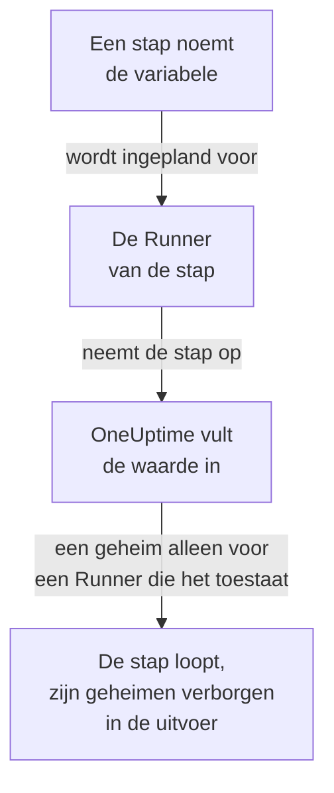

# Runbook-variabelen

Een runbookvariabele is een waarde die uw stappen bij naam gebruiken in plaats van die zelf te bevatten: een host, een namespace of een URL, of een geheim zoals een SSH-sleutel, een wachtwoord, een kubeconfig of een API-token. Wijzig de waarde één keer, en elke stap die haar noemt gebruikt de nieuwe bij de volgende uitvoering. Een geheim is versleuteld, wordt nooit meer getoond en wordt verborgen in wat stappen afdrukken.

:::cards
- [Een variabele aanmaken](#een-variabele-aanmaken): Een gewone waarde, of een geheim en de Runners die het mogen gebruiken.
- [Een variabele in een stap gebruiken](#een-variabele-in-een-stap-gebruiken): In een script of een HTTP-verzoek, of als aanmelding van een SSH-stap en kubeconfig van een kubectl-stap.
- [Wie een geheim ontvangt](#wie-een-geheim-ontvangt): Uw Runners, globale Runners als u dat toestaat, en OneUptime voor een HTTP-verzoekstap.
:::

## Hoe een variabele een stap bereikt



Een stap bevat de naam van de variabele, nooit de waarde. Wanneer de Runner van de stap haar opneemt, vult OneUptime de waarde in - in het script, in de machine en de aanmelding van een SSH-stap, of in de kubeconfig van een kubectl-stap - en geeft die alleen aan die Runner. Een stap die een variabele noemt die hij niet mag hebben, mislukt met de reden, in plaats van te lopen met de naam op de plek van de waarde.

Bash-, JavaScript-, SSH-, kubectl- en HTTP-verzoekstappen gebruiken variabelen. AI-stappen vullen ze niet in. Een HTTP-verzoekstap verstuurt OneUptime zelf, zonder Runner, dus de stap krijgt elke variabele die hij noemt, ook geheimen, en verbergt ze in het antwoord dat hij vastlegt.

## Globale variabelen en runbookvariabelen

| | Globale variabelen | De eigen variabelen van een runbook |
| --- | --- | --- |
| Beheerd onder | **Runbooks → Instellingen → Globale variabelen** | **Instellingen → Variabelen** van het runbook |
| Gebruikt door | Elk runbook in het project | Alleen de stappen van dat runbook |
| In een stap geschreven als | `{{global.variables.NAME}}` | `{{local.variables.NAME}}` |

Een naam komt één keer voor, ongeacht hoofdletters, onder de globale variabelen van het project, en één keer onder de eigen variabelen van een runbook. Een variabele van een runbook mag een naam delen met een globale: elk wordt op zijn eigen manier geschreven.

## Voordat u begint

- **Een rol die variabelen beheert.** Project Owner en Project Admin, of de machtiging **Create Runbook Variable**. Runbook Admin leest variabelen, om ze te kiezen in de stappen die hij schrijft, maar wijzigt ze niet.
- **Een abonnement dat ze bevat.** Op OneUptime Cloud hebben runbookvariabelen het abonnement **Growth** of hoger nodig.

## Een variabele aanmaken

:::steps
### De variabelen openen

Open **Runbooks → Instellingen → Globale variabelen**, of **Instellingen → Variabelen** van een runbook, en klik op **Variabele aanmaken**.

### Haar een naam en een waarde geven

Voer in de stap **Variabele** een **Naam** in: letters, cijfers, koppeltekens en underscores, tot 100 tekens, zoals `PROD_DB_SSH_KEY`. **Geheim** staat aan het begin aan: plak de sleutel, het wachtwoord, het token of de kubeconfig in **Geheime waarde** en klik op **Volgende**. Voor een waarde die iedereen mag lezen, zoals een host, zet u **Geheim** uit, voert u haar in bij **Waarde** en klikt u op **Variabele aanmaken**. Een optionele **Beschrijving** wacht onder **Meer velden**.

### Kiezen wie een geheim mag gebruiken

Kies in de stap **Wie het mag gebruiken** uw Runners onder **Je Runners die het mogen gebruiken**. Op een server met [globale Runners](/docs/runbooks/agents#globale-runners) laat **Globale Runners mogen het gebruiken** ook de stappen van dit project die op een globale Runner lopen het geheim gebruiken: de schakelaar staat aan het begin aan zolang het project globale Runners gebruikt. Een geheim heeft het een of het ander nodig. Klik op **Variabele aanmaken**.
:::

Of een variabele een geheim is, kan later niet worden gewijzigd. Verwijder haar in plaats daarvan en maak haar opnieuw aan met dezelfde naam: stappen noemen variabelen bij naam, dus ze blijven werken. De in-cluster Runner van een cluster, die het Kubernetes-agentchart installeert, krijgt nooit een geheim.

## Geheime waarden zijn alleen-schrijven

De waarde van een geheim is versleuteld opgeslagen en de API **geeft haar nooit terug**: niet aan het dashboard, niet aan een workflow en niet aan een export. De lijst toont **Geheim** waar een gewone variabele haar waarde toont, en de kolom **Runbook-agenten** zegt welke Runners elk geheim krijgen. Om haar te wijzigen klikt u in haar rij op **Waarde vervangen**: de nieuwe waarde wordt versleuteld, de oude is voorgoed weg, en stappen krijgen de nieuwe bij hun volgende uitvoering.

Wanneer een stap een geheim afdrukt dat hij heeft gekregen, vervangt de Runner het door `[REDACTED]` voordat de uitvoer zijn host verlaat, en OneUptime doet dat nog eens voordat het de uitvoer opslaat. Een regel van een privésleutel, of het token in een kubeconfig, wordt ook verborgen. Naar een geheim van minder dan 4 tekens wordt niet gezocht.

## Een variabele in een stap gebruiken

:::tabs
@tab In een script
Schrijf de verwijzing waar de waarde moet komen, in een Bash-, JavaScript-, SSH- of kubectl-script:

```bash
curl -s -X POST \
  -H "Authorization: Bearer {{global.variables.CDN_API_TOKEN}}" \
  "https://api.cdn.example.com/v1/purge"
```
@tab In een HTTP-verzoek
Schrijf de verwijzing in de URL, de headers of de body van een [HTTP-verzoekstap](/docs/runbooks/authoring#http-request):

```json
{ "Authorization": "Bearer {{global.variables.API_TOKEN}}" }
```
@tab SSH-aanmelding
Een [SSH-stap](/docs/runbooks/authoring#ssh) kiest onder **Aanmelden met** de geheime variabele die zijn privésleutel of wachtwoord bevat, en onder **Meer velden → Wachtwoordzin van de sleutel** de wachtwoordzin van zijn sleutel. De waarde zegt of het een sleutel of een wachtwoord is.
@tab Kubeconfig
Een [kubectl-stap](/docs/runbooks/authoring#kubectl) kiest onder **Kubeconfig** de geheime variabele die de kubeconfig van het cluster bevat, of **De eigen toegang van de Runner** om die van de Runner te gebruiken.
:::

Op de pagina **Stappen** van een runbook tonen elk script en elk HTTP-verzoek onder **Variabelen — klik om te kopiëren** de variabelen die hun stap kan gebruiken, en de editor meldt wanneer een stap een variabele noemt die er niet is, of een geheim dat zijn Runner niet mag gebruiken.

## Wie een geheim ontvangt

| Wie de stap uitvoert | Een gewone variabele | Een geheim |
| --- | --- | --- |
| Een van uw Runners | Altijd | Als het geheim hem vermeldt onder **Je Runners die het mogen gebruiken** |
| Een globale Runner | Altijd | Als **Globale Runners mogen het gebruiken** aan staat, voor een stap van het eigen project van het geheim |
| OneUptime zelf, voor een HTTP-verzoekstap | Altijd | Altijd |

Een stap die een geheim noemt dat zijn Runner niet mag gebruiken, mislukt, met de naam van het geheim en wat er moet veranderen, en er wordt niets overgedragen.

## Runbookgeheimen en inloggegevens werden variabelen

Runbookvariabelen namen de plaats in van runbookgeheimen, en van de inloggegevens die SSH- en Kubernetes-stappen noemden. Toen OneUptime werd bijgewerkt, werd wat elk project had één keer verplaatst, zodat elk runbook loopt zoals voorheen:

- elk runbookgeheim werd een geheime globale variabele met dezelfde naam, dezelfde waarde, dezelfde Runners en dezelfde schakelaar voor globale Runners;
- `{{runbookSecrets.NAME}}` in een script werd herschreven naar `{{global.variables.NAME}}`, en de oude schrijfwijze leest nog steeds de globale variabele `NAME`;
- alle inloggegevens die een stap noemde, werden geheime globale variabelen met dezelfde Runners, naar ze vernoemd: `<name>-ssh-key` (en `<name>-ssh-key-passphrase`, voor een sleutel die er een had), `<name>-ssh-password` of `<name>-kubeconfig`;
- elke SSH-stap die inloggegevens noemde, meldt zich ermee aan op zijn machine en voert zijn opdracht uit als zijn script, en elke Kubernetes-stap werd een kubectl-stap die de `kubectl patch` uitvoert die zijn actie deed, zonder meer toegang nodig te hebben dan de stap had.

Een Runner die ouder is dan deze release (14.0.79), kan geen kubectl-script uitvoeren: hij laat een kubectl-stap mislukken en zegt dat de Runner moet worden bijgewerkt. Elke Kubernetes-stap die zo is omgezet, behield eerst zijn inloggegevens en zijn actie naast zijn script, voor zo'n Runner; ze verdwenen met de runbook-inloggegevens, dus elke kubectl-stap heeft een Runner van 14.0.79 of later nodig.

Runbook-inloggegevens zijn sindsdien verwijderd, en een stap die er nog een noemde, werd eerst op dezelfde manier omgezet. Een stap die inloggegevens noemt, loopt niet meer, en zijn pagina met stappen biedt **Omzetten in een scriptstap** aan; een opslag via de API of Terraform die een stap er een geeft, wordt geweigerd. Zie [Runbook-inloggegevens zijn verwijderd](/docs/installation/upgrading#runbook-inloggegevens-zijn-verwijderd).

## Volgende stappen

:::cards
- [Een runbook schrijven](/docs/runbooks/authoring): Schrijf de SSH- en kubectl-stappen die een variabele gebruiken.
- [Runbook-agenten](/docs/runbooks/agents): Installeer de Runner aan wie een geheim wordt overgedragen.
- [Runbookconfiguratie en veiligheid](/docs/runbooks/configuration): Machtigingen en beveiliging voor de hele runbookstack.
:::
