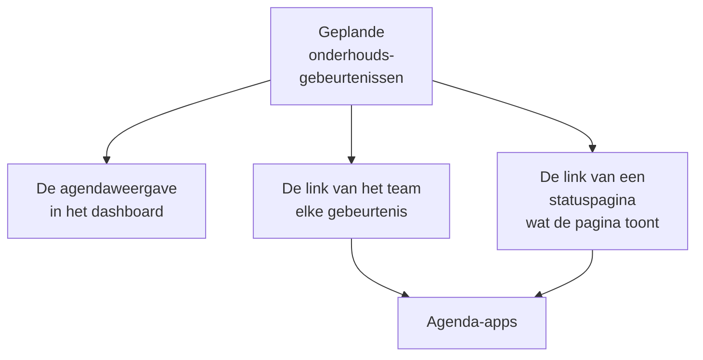

# Onderhoudsagenda

De onderhoudsagenda toont je gepland onderhoud per datum: als agenda in het dashboard, in de eigen agenda-apps van je team via een geheime link en in de agenda's van de mensen die je statuspagina's volgen. Deze pagina legt de agendaweergave uit, de agendalink van het team, de agenda van een statuspagina en wat elke agenda-afspraak bevat.

:::cards
- [De agendaweergave](#de-agendaweergave): Elke gebeurtenis op een maand, een week of een dag, in de kleur van haar status.
- [De agendalink van het team](#de-agendalink-van-het-team): Elke gebeurtenis van het project in Google Agenda, Outlook of Apple Agenda.
- [De agenda van een statuspagina](#de-agenda-van-een-statuspagina): Wat een statuspagina toont, in de agenda's van haar bezoekers.
- [Wat een agenda-afspraak bevat](#wat-een-agenda-afspraak-bevat): De titel, het tijdvak, de status en een link terug.
:::



## De agendaweergave

Open **Geplande onderhoud → Alle gebeurtenissen**. Rechts in de filterbalk wisselen **Lijst** en **Agenda** tussen de tabel met gebeurtenissen en een agenda ervan. Je browser onthoudt de keuze, zodat de pagina de volgende keer met de agenda opent.

- De agenda opent op deze maand, met vandaag gemarkeerd. **Maand**, **Week** en **Dag** bepalen hoeveel hij toont; blader met de pijlen en ga terug met **Vandaag**. De tijden staan in je eigen tijdzone.
- Elke gebeurtenis is een blok in de kleur van haar status, en de kleuren van de statussen staan onder de agenda. Klik op een gebeurtenis om haar te openen.
- De filters boven de agenda werken zoals in de lijst: kies een status, een label of een eigenaar om alleen die gebeurtenissen te zien.
- Een dag die nog moet komen toont een **+** als je naar zijn week wijst. Die opent **Geplande onderhoudsgebeurtenis aanmaken** met **Begint op** op die dag, op het uur dat het formulier vandaag zou kiezen. Je ziet hem alleen als je gebeurtenissen mag aanmaken.
- Eén weergave toont tot 500 gebeurtenissen. Een drukkere maand meldt dat: beperk hem met de filters, of kijk naar een week.

## De agendalink van het team

**Abonneren op agenda**, onder de agenda of in het menu **⋯** van de lijst, opent de agendalink van het project: één geheime iCalendar-link (`.ics`) die elke geplande onderhoudsgebeurtenis van het project in Google Agenda, Outlook, Apple Agenda of elke app zet die zich via een URL op een agenda abonneert.

:::steps
### Publiceer de link

Klik op **Link publiceren**. Een project heeft één link voor het hele team, dus dit is maar één keer nodig.

### Voeg hem toe aan je agenda-app

**Google Agenda** opent Google Agenda, dat vraagt of de agenda moet worden toegevoegd. **Apple Agenda / Outlook** opent de link in de agenda-app van je computer of telefoon. **Link kopiëren** kopieert hem voor elke andere app.

### Controleer of het werkt

Het paneel **Status** zegt wanneer een agenda-app de link voor het laatst las, en welke. Een nieuwe link toont **Wacht op eerste synchronisatie** tot een app hem leest.
:::

De link ziet er zo uit:

```text
https://<your host>/api/scheduled-maintenance-calendar/project/<token>/maintenance.ics
```

> [!WARNING]
> Iedereen met de link ziet elke geplande onderhoudsgebeurtenis van het project, zonder in te loggen. Behandel hem als een wachtwoord en genereer hem opnieuw als hij per ongeluk is gedeeld.

### Wie de link kan zien

De link toont elke gebeurtenis van het project, dus het dialoogvenster toont hem alleen aan mensen die elke gebeurtenis mogen lezen. Wie door zijn rol beperkt is tot sommige gebeurtenissen, op label of tot de gebeurtenissen die hij bezit, krijgt in plaats daarvan te horen waarom.

| Actie | Wie het kan doen |
| --- | --- |
| De link kopiëren | Iedereen die elke geplande onderhoudsgebeurtenis van het project mag lezen |
| **Link publiceren** | Iedereen die ook geplande onderhoudsgebeurtenissen mag aanmaken |
| **Link opnieuw genereren**, **Link uitschakelen** | Iedereen die ook geplande onderhoudsgebeurtenissen mag bewerken |

### De link beheren

**Link opnieuw genereren** en **Link uitschakelen** staan in het menu **⋯** bovenaan het dialoogvenster.

| Actie | Wat er gebeurt |
| --- | --- |
| **Link opnieuw genereren** | Maakt een nieuwe link. 30 dagen lang levert de oude een lege agenda, zodat de apps die hem hebben hun kopie leegmaken; daarna wordt hij niet meer gevonden. Abonneer je opnieuw met de nieuwe link. |
| **Link uitschakelen** | Houdt de link, maar hij levert een lege agenda tot **Link inschakelen**. |

De agenda bevat elke gebeurtenis van 90 dagen terug tot een jaar vooruit, tot 1.000 gebeurtenissen.

## De agenda van een statuspagina

De mensen die een statuspagina volgen, kunnen het geplande onderhoud ervan in hun eigen agenda zetten. Op de pagina met geplande gebeurtenissen van de statuspagina biedt **Abonneren op agenda** Google Agenda, de agenda-app van hun apparaat of de link om te kopiëren. De link is het adres van de pagina gevolgd door `/maintenance.ics`, zoals `https://status.example.com/maintenance.ics`.

- **Wat erin staat.** Precies wat de pagina toont: de gebeurtenissen binnen de geschiedenisperiode van de pagina, elke gebeurtenis die nog moet beginnen en elke die bezig is, zolang **Zichtbaar op statuspagina** aan staat. Wat elke gebeurtenis raakt, wordt genoemd zoals de pagina haar resources noemt, nooit met de eigen namen van je monitoren.
- **Een privépagina.** Een agenda-app kan niet inloggen, dus een privépagina biedt geen **Abonneren op agenda**, en haar link levert een lege agenda die zegt dat de pagina privé is.
- **Eén gebeurtenis.** **Toevoegen aan agenda** op de pagina van een gebeurtenis voegt alleen die gebeurtenis toe: Google Agenda opent met haar ingevuld, of ze wordt gedownload als een bestand dat de agenda-app van het apparaat opent. Het werkt ook op een privépagina, voor een bezoeker die is ingelogd, en wordt niet meer aangeboden zodra de gebeurtenis voorbij is.

## Wat een agenda-afspraak bevat

Elke agenda, die van het team en die van een statuspagina, schrijft een gebeurtenis op dezelfde manier.

| Onderdeel | Wat het bevat |
| --- | --- |
| Titel | De titel van de gebeurtenis |
| Begin en einde | Het geplande tijdvak, in UTC; de agenda-app toont het in je eigen tijdzone |
| Beschrijving | De beschrijving als platte tekst, de status, wat ze raakt en een link naar de gebeurtenis; de link van het team noemt ook haar statuspagina's |
| Status | Geannuleerd als de gebeurtenis is afgeblazen: voltooid zonder ooit bezig te zijn geweest |
| Vrij of bezet | Vrij, zodat een onderhoudsvenster nooit je beschikbaarheid blokkeert |
| Categorieën | Haar labels; de agenda van een statuspagina toont ze alleen als de pagina labels toont |

Een gebeurtenis die in OneUptime wordt bewerkt, wordt ter plekke bijgewerkt in elke agenda die haar heeft, en een die wordt verwijderd of van een statuspagina wordt gehaald, verdwijnt bij de volgende verversing uit de agenda.

## Hoe vaak agenda's verversen

Agenda-apps lezen een geabonneerde link volgens hun eigen schema. Google Agenda doet dat om de paar uur, soms maar één keer per dag; Apple Agenda en Outlook meestal elk uur. OneUptime bewaart een agenda hooguit vijf minuten, dus de wachttijd die je ziet is die van de agenda-app. De stappen voor elke app staan op [Agendafeeds](/docs/on-call/calendar-feeds#abonneren-in-je-agenda-app), die voor diensten op dezelfde manier werken.

## Probleemoplossing

:::details De agenda-app toont geen nieuwe gebeurtenissen meer
De link is opnieuw gegenereerd of uitgeschakeld: open **Abonneren op agenda** om de status te zien. Op een opnieuw gegenereerde link moet je je opnieuw abonneren met de nieuwe link; een uitgeschakelde link komt terug met **Link inschakelen**.
:::

:::details Google Agenda kan de link niet toevoegen
Google Agenda leest de link vanaf de servers van Google, dus de OneUptime-server moet vanaf internet bereikbaar zijn. Zie [Agendafeeds](/docs/on-call/calendar-feeds#probleemoplossing) voor een server die je zelf host.
:::

:::details Een gebeurtenis ontbreekt in de agenda van een statuspagina
De agenda van de pagina bevat wat de pagina toont. Controleer of de gebeurtenis de pagina noemt, of **Zichtbaar op statuspagina** aan staat in haar **Instellingen** en of ze binnen de geschiedenisperiode van de pagina is begonnen.
:::

## Volgende stappen

:::cards
- [Onderhoudsgebeurtenissen maken](/docs/scheduled-maintenance/creating-events): Het formulier, veld voor veld, en wat er daarna gebeurt.
- [Abonnees en aankondigingen](/docs/status-pages/subscribers#geplande-onderhoudsgebeurtenissen): Wat de abonnees van een statuspagina over onderhoud te horen krijgen.
- [Agendafeeds](/docs/on-call/calendar-feeds): Hetzelfde soort link, voor diensten.
:::
