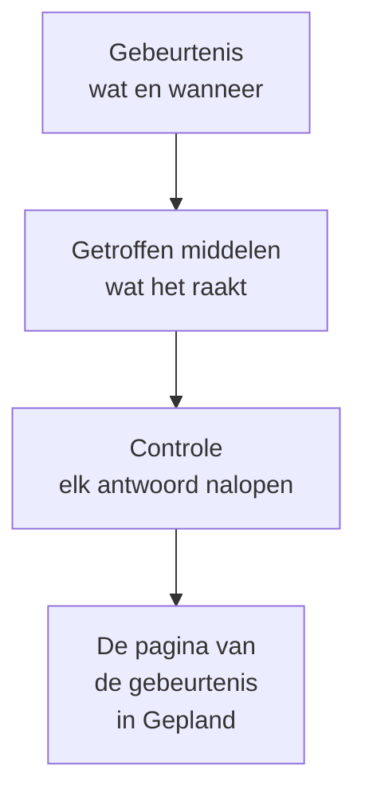

# Onderhoudsgebeurtenissen maken

Plan onderhoud in twee korte stappen: zeg wat er gebeurt en wanneer, en daarna wat het raakt en wie ervan moet horen. Alleen de titel hoeft getypt te worden; al het andere begint met een redelijke standaardwaarde. Deze pagina loopt het formulier door, laat zien wat er gebeurt op het moment dat je een gebeurtenis maakt, hoe je haar later wijzigt en hoe je gebeurtenissen vanuit code maakt.

:::cards
- [Een gebeurtenis maken](#een-gebeurtenis-maken): Twee stappen en een controle.
- [Wat er gebeurt als je haar maakt](#wat-er-gebeurt-als-je-haar-maakt): Haar nummer, regels, eigenaren en de eerste berichten.
- [Een gebeurtenis later wijzigen](#een-gebeurtenis-later-wijzigen): Haar venster, resources, statuspagina's en notities.
- [Gebeurtenissen vanuit code maken](#gebeurtenissen-vanuit-code-maken): De API, Terraform, workflows en chat.
:::

## Hoe het werkt

Het formulier stelt twee vragen, één per stap, en toont daarna alles in een controle voordat het de gebeurtenis maakt. De gebeurtenis begint in je geplande status, en haar pagina gaat open.



## Voordat je begint

- **Je rol.** Een gebeurtenis maken vraagt **Projecteigenaar**, **Projectbeheerder**, **Projectlid**, **Onderhoudsbeheerder** of **Onderhoudslid**, of een aangepaste rol met **Create Scheduled Maintenance**.
- **Je statuspagina's.** Om klanten te informeren heb je een statuspagina nodig die geplande onderhoudsgebeurtenissen toont. Zie [Statuspagina's – Overzicht](/docs/status-pages/index).

## Een gebeurtenis maken

:::steps
### Het formulier openen

Ga naar **Geplande onderhoud → Alle gebeurtenissen** en klik op **Geplande onderhoudsgebeurtenis aanmaken**. Het formulier opent op de eerste stap, **Gebeurtenis**.

### Zeggen wat er gebeurt en wanneer

Typ een **Titel** en voeg een **Beschrijving** toe als dat helpt: die is in Markdown en verschijnt op je statuspagina's. **Begint op** staat al op het volgende hele uur van je klok, en **Eindigt op** een uur later; wijzig ze alleen als ze niet kloppen. Als je **Begint op** verschuift, schuift **Eindigt op** mee, zodat het venster zijn lengte houdt. **Eigenaren** en **Labels** wachten ingeklapt onder **Meer velden**.

### Kiezen wat het raakt

Klik op **Volgende** om bij **Getroffen middelen** te komen. Kies de **Monitoren** die het werk raakt. Zodra je er een kiest, verschijnt eronder **Monitorstatus wijzigen naar**: de status waarnaar de monitoren gaan wanneer de gebeurtenis begint. Kies daarna eventuele **Andere getroffen resources**, zoals hosts, clusters, databases, netwerklocaties of services.

### Kiezen wie ervan hoort

Kies de statuspagina's onder **Gebeurtenis weergeven op deze statuspagina's**. **Meldingen aan abonnees**, ingeklapt, zegt in één regel wie bericht krijgt en wanneer; open het om **Wanneer de gebeurtenis wordt gepland**, **Wanneer de gebeurtenis begint**, **Wanneer de gebeurtenis eindigt** of **Herinneringen vóór de gebeurtenis** te wijzigen.

### Haar maken

Klik op **Volgende** om de controle te zien, loop die na en klik dan op **Geplande onderhoudsgebeurtenis aanmaken**. De pagina van de gebeurtenis gaat open.
:::

Er wordt niets verstuurd tot je een statuspagina kiest: een gebeurtenis die op geen enkele statuspagina staat, informeert geen enkele abonnee.

## De velden van het formulier

| Veld                                 | Stap               | Begint als                      | Wat het doet                                                                     |
| ------------------------------------ | ------------------ | ------------------------------- | -------------------------------------------------------------------------------- |
| **Titel**                            | **Gebeurtenis**    | Leeg, en verplicht              | Geeft de gebeurtenis overal een naam, ook op je statuspagina's.                  |
| **Beschrijving**                     | **Gebeurtenis**    | Leeg                            | Legt het werk uit aan je klanten, in Markdown.                                   |
| **Begint op**                        | **Gebeurtenis**    | Het volgende hele uur           | Wanneer de gebeurtenis vanzelf begint.                                           |
| **Eindigt op**                       | **Gebeurtenis**    | Een uur na **Begint op**        | Wanneer de gebeurtenis vanzelf eindigt. Moet na **Begint op** liggen.            |
| **Eigenaren**                        | **Gebeurtenis**    | Niemand                         | Personen en teams van wie de gebeurtenis is en die erover bericht krijgen.       |
| **Labels**                           | **Gebeurtenis**    | Geen                            | Labels waarop regels en filters kunnen letten.                                   |
| **Monitoren**                        | **Getroffen middelen** | Geen                        | De monitoren die niet worden gecontroleerd zolang de gebeurtenis loopt.          |
| **Monitorstatus wijzigen naar**      | **Getroffen middelen** | Geen wijziging              | De status die deze monitoren tijdens de gebeurtenis tonen. Wordt gevraagd zodra er een monitor is gekozen. |
| **Andere getroffen resources**       | **Getroffen middelen** | Geen                        | Hosts, clusters, databases, netwerklocaties, services en meer.                   |
| **Gebeurtenis weergeven op deze statuspagina's** | **Getroffen middelen** | Geen           | De statuspagina's die de gebeurtenis tonen en hun abonnees informeren.           |
| **Meldingen aan abonnees**           | **Getroffen middelen** | Alle drie de momenten aan, geen herinneringen | Wanneer de abonnees van die pagina's bericht krijgen.  |

Twee dingen vullen het formulier onderweg voor je in:

- **Gekoppelde resources.** Wanneer je een monitor kiest, worden de hosts, clusters, services en andere resources waaraan hij gekoppeld is toegevoegd onder **Andere getroffen resources**, en een regel onder het veld noemt ze. Verwijder wat je niet wilt.
- **Voorgestelde statuspagina's.** Onder **Gebeurtenis weergeven op deze statuspagina's** worden de pagina's voorgesteld die je monitoren tonen: klik op de naam van een pagina om haar toe te voegen, of op **Alles toevoegen**. Er wordt niets voor je gekozen. Zie [Geplande onderhoudsgebeurtenissen](/docs/status-pages/subscribers#geplande-onderhoudsgebeurtenissen).

## Beginnen vanaf een resource of een sjabloon

Op het tabblad **Geplande onderhoud** van een host, een Kubernetes-, Proxmox-, Ceph- of Docker Swarm-cluster, een Docker- of Podman-host, een vCenter, een opslagarray, een IoT-vloot, een database, een service of een netwerklocatie opent **Geplande onderhoudsgebeurtenis aanmaken** hetzelfde formulier met die resource al gekozen onder **Andere getroffen resources**, en het tabblad toont de gebeurtenissen die haar raken. Het tabblad van een inventarisitem kiest de host, de service of het Kubernetes-cluster waarnaar het item verwijst.

**Maken op basis van sjabloon**, naast de knop om te maken, vraagt je **Selecteer sjabloon voor geplande onderhoud** en opent dan het formulier, ingevuld vanuit het sjabloon. Zie [Sjablonen en terugkerende gebeurtenissen](/docs/scheduled-maintenance/templates).

## Wat er gebeurt als je haar maakt

Op het moment dat je op **Geplande onderhoudsgebeurtenis aanmaken** klikt, werkt OneUptime deze stappen af, in deze volgorde:

1. **Ze krijgt een nummer en een status.** Het nummer komt uit een teller per project en wordt met je voorvoegsel getoond (`SM-42`). De gebeurtenis begint in je geplande status, welke status een verzoek ook noemt.
2. **Je chattools horen ervan.** De Slack- en Microsoft Teams-regels onder **Werkruimte** plaatsen haar in hun kanalen, en een regel kan een kanaal voor de gebeurtenis aanmaken. Haar feed legt vast dat ze is aangemaakt.
3. **Haar statustijdlijn begint.** De eerste rij van haar **Statustijdlijn** is je geplande status.
4. **Eigenaren en labels worden toegevoegd**: die je hebt gekozen, en daarna die van de passende eigenaars- en labelregels.
5. **Runbook-regels starten** de runbooks die bij de gebeurtenis passen.
6. **Herinneringen worden ingepland**, wanneer een herinneringsregel past, voor haar eigenaren.

Binnen een minuut krijgen de abonnees van haar statuspagina's bericht dat ze gepland is, tenzij je **Wanneer de gebeurtenis wordt gepland** hebt uitgezet. De workflowtrigger **On Create Scheduled Maintenance Event** start elke workflow die erop is gebouwd, en haar eigenaren horen ervan als ze die melding hebben aangezet: zie [Meldingsinstellingen](/docs/notifications/notification-settings).

## Een gebeurtenis later wijzigen

Alles uit het formulier kun je op de pagina's van de gebeurtenis wijzigen, behalve de drie abonneemomenten, die één keer worden vastgelegd, bij het maken van de gebeurtenis.

| Om te wijzigen                              | Ga naar                                                                        |
| ------------------------------------------- | ------------------------------------------------------------------------------ |
| De titel, het venster of de labels          | **Bewerken** op de kaart **Maintenance Details** van haar **Overzicht**, stap **Gebeurtenis** |
| De statuspagina's of de herinneringen       | Hetzelfde **Bewerken**, stap **Statuspagina's**                                 |
| De monitoren, hun status of andere resources | **Bewerken** op de kaart **Getroffen resources**                              |
| De beschrijving                             | **Beschrijving** in haar zijmenu                                               |
| De eigenaren                                | **Eigenaren** in haar zijmenu                                                  |

**Monitorstatus wijzigen naar** kun je wijzigen tot de gebeurtenis begint. Daarna toont de kaart de waarde alleen-lezen, omdat de monitoren al in die status staan. Een wijziging voegt aan de **Gepland Onderhoud Feed** een vermelding toe die noemt wat ze veranderde; opslaan zonder wijziging voegt er geen toe.

## Notities plaatsen terwijl het werk loopt

- **Openbare notities** zijn updates voor je klanten: ze verschijnen op de statuspagina's van de gebeurtenis, en elk ervan kan hun abonnees informeren met **Notify status page subscribers**.
- **Privénotities** zijn alleen voor je team.

Schrijf er een op de pagina **Openbare notities** of **Privénotities** van de gebeurtenis, of via het menu **Acties** van de **Gepland Onderhoud Feed** met **Add Public Note** of **Privénotitie toevoegen**. Hetzelfde menu start een runbook met **Execute Runbook**. Een notitiesjabloon vult tekst in die je team vaak schrijft: zie [Onderhoudsregels en instellingen](/docs/scheduled-maintenance/settings#notitiesjablonen).

## Gebeurtenissen vanuit code maken

Het gebeurtenismodel heeft een standaard-API, dus `POST /api/scheduled-maintenance` maakt een gebeurtenis aan. Verifieer je met een API-sleutel uit **Projectinstellingen → Geavanceerd → API-sleutels**, meegestuurd in de header `apikey`; de sleutel bepaalt het project.

```bash
curl -X POST https://oneuptime.com/api/scheduled-maintenance \
  -H "apikey: $ONEUPTIME_API_KEY" \
  -H "Content-Type: application/json" \
  -d '{
    "data": {
      "title": "Database upgrade",
      "description": "Writes pause for a few minutes while the primary restarts.",
      "startsAt": "2030-06-01T02:00:00Z",
      "endsAt": "2030-06-01T04:00:00Z"
    }
  }'
```

| Veld                                                  | Opmerkingen                                                                               |
| ----------------------------------------------------- | ----------------------------------------------------------------------------------------- |
| `title`, `startsAt`, `endsAt`                          | Verplicht, zoals in het formulier.                                                        |
| `monitors`, `statusPages`, `labels`                   | De monitoren, statuspagina's en labels van de gebeurtenis, allemaal uit het project van de API-sleutel. |
| `changeMonitorStatusToId`                             | De monitorstatus waarnaar haar monitoren gaan wanneer ze begint.                          |
| `currentScheduledMaintenanceStateId`                  | Wordt genegeerd: elke gebeurtenis begint in je geplande status.                           |
| `shouldStatusPageSubscribersBeNotifiedOnEventCreated` | De schakelaar **Wanneer de gebeurtenis wordt gepland**. De andere twee momenten hebben eigen velden. |

Dezelfde gebeurtenis als code is de Terraform-resource `oneuptime_scheduled_maintenance_event`: zie [Voorbeelden](/docs/terraform/examples#gepland-onderhoud). Een workflow maakt er een met zijn stap **Create One Scheduled Maintenance Event**, en `/oneuptime maintenance` opent het formulier in Slack: zie [Slack](/docs/workspace-connections/slack#incidenten-en-onderhoud-aanmaken-vanuit-slack).

## Probleemoplossing

:::details Eindigt op moet na Begint op liggen
Het venster moet op volgorde staan: de gebeurtenis eindigt nadat ze begint. Verschuif eerst **Begint op**, want **Eindigt op** volgt die, en stel daarna **Eindigt op** in.
:::

:::details Monitorstatus wijzigen naar ontbreekt in het formulier
Het wordt pas gevraagd als de gebeurtenis een monitor heeft. Kies er een onder **Monitoren**, en het verschijnt er direct onder.
:::

:::details Monitorstatus wijzigen naar kan niet meer worden gewijzigd
De gebeurtenis is begonnen, en haar monitoren staan al in die status. De status geldt vanaf het begin van de gebeurtenis tot haar einde.
:::

## Volgende stappen

:::cards
- [Onderhoudsstatussen](/docs/scheduled-maintenance/states): Wat een gebeurtenis start en beëindigt, en hoe je haar met de hand verder zet.
- [Sjablonen en terugkerende gebeurtenissen](/docs/scheduled-maintenance/templates): De antwoorden van het formulier voor de volgende keer bewaren.
- [Abonnees en aankondigingen](/docs/status-pages/subscribers#geplande-onderhoudsgebeurtenissen): Precies wie bericht krijgt, en wanneer.
- [Onderhoudsregels en instellingen](/docs/scheduled-maintenance/settings): Eigenaren, labels en herinneringen automatisch toevoegen.
:::
