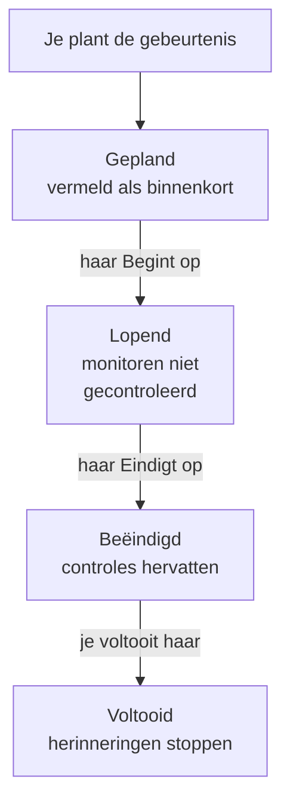

# Geplande onderhoud – Overzicht

Een geplande onderhoudsgebeurtenis kondigt gepland werk aan voordat het begint: een database-upgrade, een netwerkwijziging, een verhuizing naar nieuwe servers. OneUptime start en beëindigt de gebeurtenis op tijd, controleert de betrokken monitoren niet zolang het werk loopt en toont haar op je statuspagina's, zodat geplande downtime nooit op een storing lijkt. Deze pagina legt uit hoe een gebeurtenis verloopt, waar alles in het dashboard staat en wat een gebeurtenis verandert in de rest van OneUptime.

:::cards
- [Hoe een gebeurtenis verloopt](#hoe-een-gebeurtenis-verloopt): Van gepland tot voltooid, grotendeels vanzelf.
- [Waar gebeurtenissen vandaan komen](#waar-gebeurtenissen-vandaan-komen): Het formulier, sjablonen, een planning, formulieren, chat en code.
- [Wat een gebeurtenis beïnvloedt](#wat-een-gebeurtenis-beïnvloedt): Monitoren, statuspagina's, abonnees en waarschuwingen.
- [De pagina's van een gebeurtenis](#de-paginas-van-een-gebeurtenis): Haar overzicht, tijdlijn, notities en instellingen.
:::

## Hoe een gebeurtenis verloopt

Elke gebeurtenis heeft een gepland tijdvenster, haar **Begint op** en **Eindigt op**, en loopt je lijst met onderhoudsstatussen van boven naar beneden af. Een taak die elke minuut draait, zet haar aan beide kanten van het venster door, dus je plant het werk één keer en OneUptime doet de rest.

Een nieuwe gebeurtenis begint in **Gepland**. Op haar **Begint op** gaat ze naar **Lopend**: OneUptime controleert haar monitoren niet meer en toont ze, als je een status voor ze hebt gekozen, in die status. Op haar **Eindigt op** gaat ze naar **Beëindigd**: de controles hervatten en elke monitor gaat terug naar 'operationeel'. **Voltooid** is de laatste stap, en niets zet die vanzelf: een persoon, een chatknop of de API markeert het werk als goedgekeurd, wat ook de herinneringen aan de eigenaren stopt.

Je kunt een gebeurtenis eerder starten of beëindigen, of eigen statussen tussen deze vier toevoegen. Zie [Onderhoudsstatussen](/docs/scheduled-maintenance/states).

## Onderhoud en aankondigingen

Beide informeren de bezoekers van je statuspagina's. Gebruik een onderhoudsgebeurtenis voor werk met een begin en een einde, en een aankondiging voor al het andere dat ze moeten lezen.

|                              | Gepland onderhoud                                                       | Aankondiging                                   |
| ---------------------------- | ----------------------------------------------------------------------- | ---------------------------------------------- |
| **Wat het is**               | Gepland werk, met een tijdvenster                                       | Een bericht voor de bezoekers van je statuspagina's |
| **De monitoren**             | Niet gecontroleerd zolang het loopt, en getoond in de status die je kiest | Ongewijzigd                                  |
| **Hoe het verdergaat**       | Op tijd door je onderhoudsstatussen                                     | Ze wordt getoond vanaf haar begintijd tot haar eindtijd, als ze die heeft |
| **Wanneer abonnees bericht krijgen** | Wanneer het wordt gepland, begint en eindigt, en vóór het begin als je dat vraagt | Eén keer, wanneer ze getoond begint te worden |
| **Nummers in een nieuw project** | `SM-42`                                                             | Geen                                           |

Aankondigingen worden behandeld in [Abonnees en aankondigingen](/docs/status-pages/subscribers#aankondigingen).

## Waar gebeurtenissen vandaan komen

- **Het formulier.** Klik op **Geplande onderhoudsgebeurtenis aanmaken** in de lijst met gebeurtenissen, of op het tabblad **Geplande onderhoud** van een host, een cluster, een service, een netwerklocatie of een andere resource, die deze resource voor je selecteert. Zie [Onderhoudsgebeurtenissen maken](/docs/scheduled-maintenance/creating-events).
- **Een sjabloon.** **Maken op basis van sjabloon** vult het formulier in vanuit een sjabloon dat je hebt opgeslagen voor terugkerend werk. Zie [Sjablonen en terugkerende gebeurtenissen](/docs/scheduled-maintenance/templates).
- **Een planning.** Een terugkerend sjabloon maakt volgens een planning een nieuwe gebeurtenis aan, bijvoorbeeld elke week of elke maand, zonder dat iemand het formulier opent.
- **Een formulier.** Een formulier waarvan de inzendingen onderhoudsgebeurtenissen aanmaken, maakt van een wijzigingsverzoek een gebeurtenis. Zie [Wat een inzending aanmaakt](/docs/forms/on-submit#hoe-een-inzending-een-geplande-onderhoudsgebeurtenis-wordt).
- **Chat.** `/oneuptime maintenance` in Slack, of `maintenance` getypt naar de OneUptime-bot in Microsoft Teams, opent het formulier in je chattool. Zie [Slack](/docs/workspace-connections/slack#incidenten-en-onderhoud-aanmaken-vanuit-slack).
- **Code.** De API op `/api/scheduled-maintenance`, de Terraform-resource `oneuptime_scheduled_maintenance_event` en de stap **Create One Scheduled Maintenance Event** van een workflow.

## Waar het onderhoud in het dashboard staat

Open **Geplande onderhoud** via het menu **Producten** in de bovenste balk. De lijst met gebeurtenissen staat op `/dashboard/{projectId}/scheduled-maintenance-events`, en het zijmenu bevat alles over onderhoud:

| Sectie        | Wat je daar doet                                                                                                           |
| ------------- | -------------------------------------------------------------------------------------------------------------------------- |
| **Overzicht** | **Alle gebeurtenissen** en **Lopende gebeurtenissen**, waarvan de badge de gebeurtenissen telt die nu lopen.                |
| **Agenda** | **Onderhoudsagenda**: elke gebeurtenis op een maand, een week of een dag, naast de agenda's van buiten het project die je toevoegt. |
| **Werkruimte** | **Slack** en **Microsoft Teams**, afhankelijk van wat het project heeft gekoppeld, of **Slack of Teams koppelen** als het geen van beide heeft. |
| **Regels**    | **Eigenaarsregels**, **Runbook-regels**, **Labelregels**, **Reminder Rules**.                                               |
| **Instellingen** | **Status gebeurtenis**, **Gebeurtenis-sjablonen**, **Notitie-sjablonen**, **Aangepaste velden**, **Metingen**, **Agenda-instellingen**, **Nummering**. |

**Overzicht** en **Agenda** zijn open; **Werkruimte**, **Regels**, **Instellingen** en **Ontwikkelaars** zijn eerst ingeklapt, en een sectie gaat vanzelf open wanneer je op een van haar pagina's bent. **Ontwikkelaars** bevat **Terraform**, **API** en **AI-assistenten**, om onderhoud vanuit code te beheren. Alles over onderhoud staat hier, niet in de **Projectinstellingen**.

De lijst toont **Nummer van geplande onderhoud**, **Titel**, **Huidige staat**, **Getroffen middelen**, **Weergegeven op statuspagina**, **Begint op**, **Duur**, **Eindigt op**, **Labels** en **Eigenaren**. Selecteer gebeurtenissen om er meerdere tegelijk te bewerken: **Markeren als {{state}}**, **Status wijzigen**, **Aan mij toewijzen**, **Add Owner**, **Remove Owner**, **Add Labels**, **Remove Labels** of **Verwijderen**. Het menu **⋯** aan het eind van de rij van elke gebeurtenis doet hetzelfde voor alleen die gebeurtenis: de stappen **Markeren als {{state}}** zolang de gebeurtenis ze kan zetten, **Status wijzigen**, **Aan mij toewijzen** totdat je de eigenaar bent, en **Add Owner**.

**Onderhoudsagenda**, in het onderdeel **Agenda**, toont dezelfde gebeurtenissen op een maand, een week of een dag, en kan er agenda's van buiten het project naast tonen. Zie [Onderhoudsagenda](/docs/scheduled-maintenance/calendar).

## Wat een gebeurtenis beïnvloedt

Zolang een gebeurtenis loopt, behandelt OneUptime de storing die ze plant als verwacht:

- **Haar monitoren worden niet gecontroleerd.** Elke monitor onder **Monitoren** wordt niet meer gecontroleerd, en zijn pagina's tonen **Deze monitor is uitgeschakeld**. Als je een **Monitorstatus wijzigen naar** hebt gekozen, tonen de monitoren die status, ook op je statuspagina's. Wanneer de gebeurtenis eindigt of wordt verwijderd, hervatten de controles en gaat elke monitor terug naar 'operationeel', tenzij een andere lopende gebeurtenis hem nog vasthoudt.
- **Haar andere resources blijven stil.** Een telemetriemonitor die veel hosts, clusters, databases of services bewaakt, elk met een eigen reeks, maakt geen incident of waarschuwing aan voor een reeks waarvan de resource door de gebeurtenis wordt gedekt, terwijl de andere reeksen blijven waarschuwen.
- **Netwerklocaties en SLO's houden zich in.** Een netwerklocatie die de gebeurtenis dekt, rekent haar geplande storing niet meer aan de locaties erboven toe, en de verbruikssnelheidsregels van een SLO activeren niets zolang een van zijn monitoren in onderhoud is. Zie [Netwerklocaties](/docs/monitor/network-sites#gepland-onderhoud-voor-netwerklocaties) en [Waarschuwingen en incidenten voor verbruikssnelheid](/docs/slo/burn-rate-alerts#gepland-onderhoud).
- **Je statuspagina's tonen haar.** De gebeurtenis verschijnt op de statuspagina's die je hebt gekozen, eerst als binnenkort, dan als lopend, dan als voorbij, zolang **Zichtbaar op statuspagina** in haar **Instellingen** aanstaat.
- **Abonnees horen ervan.** Standaard krijgen de abonnees van die pagina's bericht wanneer ze wordt gepland, wanneer ze begint en wanneer ze eindigt, en een herinnering vóór het begin als je herinneringen instelt. Zie [Geplande onderhoudsgebeurtenissen](/docs/status-pages/subscribers#geplande-onderhoudsgebeurtenissen).
- **Je team hoort ervan.** Haar eigenaren krijgen bericht zoals hun [meldingsinstellingen](/docs/notifications/notification-settings) zeggen, en de Slack- en Microsoft Teams-regels onder **Werkruimte** plaatsen haar in je kanalen.

## De pagina's van een gebeurtenis

Open een gebeurtenis uit de lijst om haar pagina's te zien. Haar zijmenu bevat:

| Sectie van het zijmenu | Pagina's                                                                                 |
| ----------------- | --------------------------------------------------------------------------------------------- |
| **Overzicht** | **Overzicht**, **Statustijdlijn**, **Beschrijving**, **Runbooks** |
| **Team** | **Eigenaren** |
| **Meldingen**     | **Meldingslogboeken** en **AI-logboeken**: elk bericht dat over de gebeurtenis is verstuurd, en wat AI ervoor deed |
| **Notities**      | **Privénotities** en **Openbare notities**                                                     |
| **Ontwikkelaars** | **Terraform**, **API** en **AI-assistenten**: de gebeurtenis beheerd vanuit code              |
| **Geavanceerd**   | **Aangepaste velden**, **Instellingen**, **Auditlogboeken**, **Gebeurtenis verwijderen**       |

**Overzicht**, **Team** en **Notities** zijn open; de andere secties blijven ingeklapt tot je erop klikt.

- **Overzicht** — de kop toont het nummer, de titel en de status van de gebeurtenis, hoe lang het nog duurt tot ze begint of hoe lang ze al loopt, wie haar eigenaren zijn, op welke statuspagina's ze verschijnt en wie haar heeft aangemaakt, en de knoppen die haar verder zetten. Daaronder tonen **Begint**, **Eindigt** en **Duur** het geplande venster in je tijdzone. De **Gepland Onderhoud Feed** legt alles vast wat er met de gebeurtenis is gebeurd, naast de kaarten **Maintenance Details** en **Getroffen resources**, en de kaarten **Metingen** en **Aangepaste velden** als je project die heeft.
- **Statustijdlijn** — elke status waarin de gebeurtenis heeft gestaan, wanneer en hoe lang. Zie [Onderhoudsstatussen](/docs/scheduled-maintenance/states#de-statustijdlijn).
- **Openbare notities** — updates voor je statuspagina's en hun abonnees. **Privénotities** zijn alleen voor je team.
- **Instellingen** — **Zichtbaar op statuspagina**, dat de gebeurtenis op haar statuspagina's toont of verbergt, en **Herinneringen sturen**, dat haar eigenaren herinnert tot ze voltooid is. Elke schakelaar slaat op zodra je hem omzet.

## Probleemoplossing

:::details Een gebeurtenis is niet op haar Begint op begonnen
De taak die gebeurtenissen start, draait elke minuut, dus wacht een minuut. Als de kop **Start te laat** toont, heeft de gebeurtenis haar begin met meer dan twee minuten gemist: start haar met de knop in de kop, die alles doet wat de taak doet, en open haar **Statustijdlijn** om te zien waar ze stond.
:::

:::details Een monitor werd tijdens het onderhoud nog gecontroleerd
Alleen de monitoren die de gebeurtenis onder **Monitoren** noemt, worden niet meer gecontroleerd, en alleen zolang de gebeurtenis loopt. Een monitor van een host of service die de gebeurtenis onder **Andere getroffen resources** noemt, wordt nog steeds gecontroleerd. Bewerk de kaart **Getroffen resources** van de gebeurtenis om de monitor toe te voegen.
:::

:::details De gebeurtenis staat niet op mijn statuspagina
Controleer of de gebeurtenis de pagina noemt onder **Gebeurtenis weergeven op deze statuspagina's** en of **Zichtbaar op statuspagina** aanstaat in de **Instellingen** van de gebeurtenis. Controleer daarna de statuspagina zelf: die moet geplande onderhoudsgebeurtenissen tonen, en een gebeurtenis die langer geleden begon dan het geschiedenisvenster van de pagina, 14 dagen tenzij je dat hebt gewijzigd, wordt niet meer vermeld.
:::

## Volgende stappen

:::cards
- [Onderhoudsgebeurtenissen maken](/docs/scheduled-maintenance/creating-events): Het formulier, veld voor veld, en wat er daarna gebeurt.
- [Onderhoudsstatussen](/docs/scheduled-maintenance/states): Wat een gebeurtenis start en beëindigt, en eigen statussen.
- [Sjablonen en terugkerende gebeurtenissen](/docs/scheduled-maintenance/templates): Een gebeurtenis hergebruiken, of haar elke week plannen.
- [Onderhoudsregels en instellingen](/docs/scheduled-maintenance/settings): Eigenaren, labels, runbooks en herinneringen, automatisch.
:::
