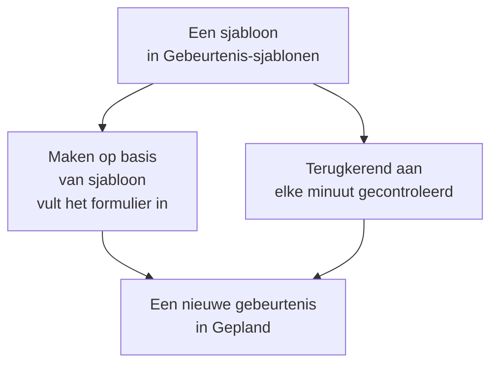

# Sjablonen en terugkerende gebeurtenissen

Een sjabloon voor gepland onderhoud bewaart een gebeurtenis die je vaak plant: haar titel en beschrijving, de monitoren die ze pauzeert, de statuspagina's waarop ze verschijnt en wie bericht krijgt. Gebruik er een om het formulier met één klik in te vullen, of maak het terugkerend, zodat OneUptime de gebeurtenis voor je plant, elke week, elke maand of met elke tussenpoos die je kiest.

:::cards
- [Een sjabloon maken](#een-sjabloon-maken): De stappen van het formulier, met een naam vooraan en een planning aan het eind.
- [Een sjabloon gebruiken](#een-sjabloon-gebruiken): Een nieuwe gebeurtenis ermee invullen.
- [Terugkerende gebeurtenissen](#terugkerende-gebeurtenissen): Laat OneUptime de gebeurtenis zelf plannen.
- [Een sjabloon wijzigen of stoppen](#een-sjabloon-wijzigen-of-stoppen): Bewerken, de planning pauzeren of verwijderen.
:::

## Hoe het werkt

Een sjabloon is een vertrekpunt. Een gebeurtenis die ermee is gemaakt, is een kopie met eigen waarden: als je het sjabloon later wijzigt, veranderen alleen de gebeurtenissen die daarna worden gemaakt.

## Voordat je begint

- **Je abonnement.** In OneUptime Cloud vragen sjablonen het abonnement **Growth** of hoger.
- **Je rol.** Een sjabloon maken vraagt **Projecteigenaar**, **Projectbeheerder**, **Projectlid**, **Onderhoudsbeheerder** of **Onderhoudslid**, of een aangepaste rol die sjablonen voor gepland onderhoud mag maken.

## Een sjabloon maken

:::steps
### De sjablonen openen

Ga naar **Geplande onderhoud → Instellingen → Gebeurtenis-sjablonen**. **Instellingen** is in het zijmenu eerst ingeklapt: klap het eerst uit. Klik op **Gepland Onderhoud Sjabloon aanmaken**.

### Het sjabloon een naam geven

Geef het onder **Sjablooninformatie** een **Sjabloonnaam** en een **Sjabloonbeschrijving**, zodat je team weet wanneer het te gebruiken. Beide zijn verplicht.

### De gebeurtenis beschrijven

Vul onder **Gebeurtenis** de **Titel** en de **Beschrijving** in waarmee elke gebeurtenis ervan begint. **Eigenaren** en **Labels** wachten onder **Meer velden**.

### Kiezen wat het raakt

Kies onder **Getroffen middelen** de **Monitoren**, de **Monitorstatus wijzigen naar** voor hen, eventuele **Andere getroffen resources**, de statuspagina's onder **Gebeurtenis weergeven op deze statuspagina's** en de **Meldingen aan abonnees**.

### Beslissen of het terugkeert

Laat onder **Terugkerend** de schakelaar **Terugkerende gebeurtenis** uit voor een sjabloon dat je met de hand gebruikt, of zet hem aan en vul de planning in. Klik op **Volgende** om de controle na te lopen en maak dan het sjabloon.
:::

Een sjabloon vraagt om **Monitorstatus wijzigen naar**, ook als het geen monitoren noemt: de status geldt ook voor de monitoren die je toevoegt wanneer je er een gebeurtenis mee plant. Onder **Andere getroffen resources** neemt een sjabloon hosts, Kubernetes-clusters, Docker-hosts, Podman-hosts en services aan.

## Wat een sjabloon invult

| Deel van de gebeurtenis                           | Maken op basis van sjabloon          | Een terugkerende gebeurtenis    |
| ------------------------------------------------- | ------------------------------------ | ------------------------------- |
| **Titel** en **Beschrijving**                     | Ingevuld, en je kunt ze wijzigen     | Gekopieerd                      |
| **Monitoren** en **Monitorstatus wijzigen naar**  | Ingevuld                             | Gekopieerd                      |
| **Andere getroffen resources**                    | Ingevuld                             | Gekopieerd                      |
| De statuspagina's en **Meldingen aan abonnees**   | Ingevuld                             | Gekopieerd                      |
| **Eigenaren** en **Labels**                       | Ingevuld                             | Gekopieerd                      |
| **Begint op** en **Eindigt op**                   | Het volgende hele uur, voor een uur  | Berekend uit de planning        |

## Een sjabloon gebruiken

:::steps
### Het sjabloon kiezen

Klik op **Geplande onderhoud → Alle gebeurtenissen** op **Maken op basis van sjabloon** en kies een sjabloon onder **Selecteer sjabloon voor geplande onderhoud**.

### Het formulier nalopen

Klik op **Maken op basis van sjabloon**. Het formulier opent met de antwoorden van het sjabloon al ingevuld. Stel het venster in en wijzig wat deze gebeurtenis nodig heeft.

### De gebeurtenis maken

Loop de stappen door met **Volgende** en klik dan in de controle op **Geplande onderhoudsgebeurtenis aanmaken**.
:::

Als het project nog geen sjabloon heeft, zegt **Maken op basis van sjabloon** dat en verwijst het naar **Gebeurtenis-sjablonen**.

## Terugkerende gebeurtenissen

Een terugkerend sjabloon maakt de gebeurtenis volgens een planning aan. Je legt vast wanneer de eerste gebeurtenis wordt gemaakt, wanneer ze begint en wanneer ze eindigt; elke volgende gebeurtenis houdt dezelfde afstanden, één interval later.

| Veld                                     | Wat het betekent                                                                                    |
| ---------------------------------------- | --------------------------------------------------------------------------------------------------- |
| **Terugkerende gebeurtenis**             | Zet de planning aan.                                                                                |
| **Eerste gebeurtenis gepland op**        | Wanneer OneUptime de eerste gebeurtenis maakt, en dus wanneer haar abonnees horen dat ze gepland is. |
| **Eerste gebeurtenis begint om**         | Wanneer de eerste gebeurtenis begint.                                                               |
| **Eerste gebeurtenis eindigt om**        | Wanneer de eerste gebeurtenis eindigt.                                                              |
| **Hoe vaak wilt u dat deze gebeurtenis zich herhaalt?** | Een getal en een eenheid: uren, dagen, weken, maanden of jaren.                      |

Bijvoorbeeld een wekelijks venster waarvan de eerste gebeurtenis op een maandag wordt gemaakt voor de zaterdag erna:

| Gebeurtenis  | Gemaakt            | Begint             | Eindigt            |
| ------------ | ------------------ | ------------------ | ------------------ |
| De eerste    | `2030-06-03 09:00` | `2030-06-08 02:00` | `2030-06-08 04:00` |
| De tweede    | `2030-06-10 09:00` | `2030-06-15 02:00` | `2030-06-15 04:00` |

Zet **Eerste gebeurtenis gepland op** zo ver vóór het begin als je wilt dat je klanten van het werk horen. Alle drie de tijden moeten in de toekomst liggen wanneer je het sjabloon maakt, de gebeurtenis moet worden gemaakt voordat ze begint en eindigt, en ze moet beginnen voordat ze eindigt; het formulier zegt welke regel een tijd overtreedt.

Een taak controleert de terugkerende sjablonen elke minuut. Wanneer de volgende tijd van een sjabloon aanbreekt, schuift ze die tijd één interval op en maakt ze de gebeurtenis. De sjabloonlijst toont die tijd in haar kolom **Terugkerende gebeurtenis**, en **Nee** voor een sjabloon dat niet terugkeert. Een gebeurtenis die door de planning is gemaakt, is als elke andere: haar regels draaien, haar eigenaren worden toegevoegd en haar abonnees horen dat ze gepland is.

## Een sjabloon wijzigen of stoppen

Open een sjabloon uit de lijst om de pagina ervan te zien:

- **Sjabloondetails voor geplande onderhoud** toont waarmee nieuwe gebeurtenissen beginnen. Het **Bewerken** ervan loopt door **Sjablooninformatie**, **Gebeurtenis**, **Statuspagina's** en **Terugkerend**.
- **Getroffen resources** bevat de **Monitoren**, hun **Monitorstatus wijzigen naar** en de **Andere getroffen resources**, met een eigen **Bewerken**.
- **Eigenaren** toont de personen en teams van wie elke gebeurtenis is die ermee wordt gepland.

Wijzigingen gelden voor de gebeurtenissen die worden gemaakt nadat je ze opslaat; gebeurtenissen die al bestaan, houden hun eigen waarden. Om een planning te stoppen, zet je **Terugkerende gebeurtenis** uit in **Bewerken**, of verwijder je het sjabloon. Een uitgezet sjabloon houdt zijn planning: zet je het weer aan, dan gaat het verder op de volgende tijd van de planning en slaat het de tijden over waarin het uit stond. Als je een sjabloon verwijdert, blijven de gebeurtenissen die het heeft gemaakt bestaan.

## Probleemoplossing

:::details Bij het maken van een terugkerend sjabloon staat er dat een tijd in de toekomst moet liggen
Alle drie de eerste tijden moeten bij het maken na het huidige moment liggen. Schuif ze naar voren: de planning gaat daarna verder vanaf de eerste gebeurtenis.
:::

:::details Een terugkerend sjabloon heeft geen gebeurtenis gemaakt
Controleer of **Terugkerende gebeurtenis** nog aanstaat, en kijk naar de tijd in de kolom **Terugkerende gebeurtenis** van de lijst: de gebeurtenis wordt dan gemaakt, niet op haar begin. De taak draait elke minuut, dus wacht een minuut.
:::

:::details Een gebeurtenis van een sjabloon mist een resource die ik had gekozen
Onder **Andere getroffen resources** neemt een sjabloon hosts, Kubernetes-clusters, Docker-hosts, Podman-hosts en services aan. Voeg andere soorten resources aan de gebeurtenis zelf toe, met **Bewerken** op haar kaart **Getroffen resources**.
:::

## Volgende stappen

:::cards
- [Onderhoudsgebeurtenissen maken](/docs/scheduled-maintenance/creating-events): Het formulier dat een sjabloon invult.
- [Onderhoudsstatussen](/docs/scheduled-maintenance/states): Hoe elke gebeurtenis verdergaat zodra ze is gemaakt.
- [Onderhoudsregels en instellingen](/docs/scheduled-maintenance/settings): Elke nieuwe gebeurtenis automatisch eigenaren en labels geven.
- [Geplande onderhoud – Overzicht](/docs/scheduled-maintenance/index): Waar sjablonen passen in de rest van het onderhoud.
:::
