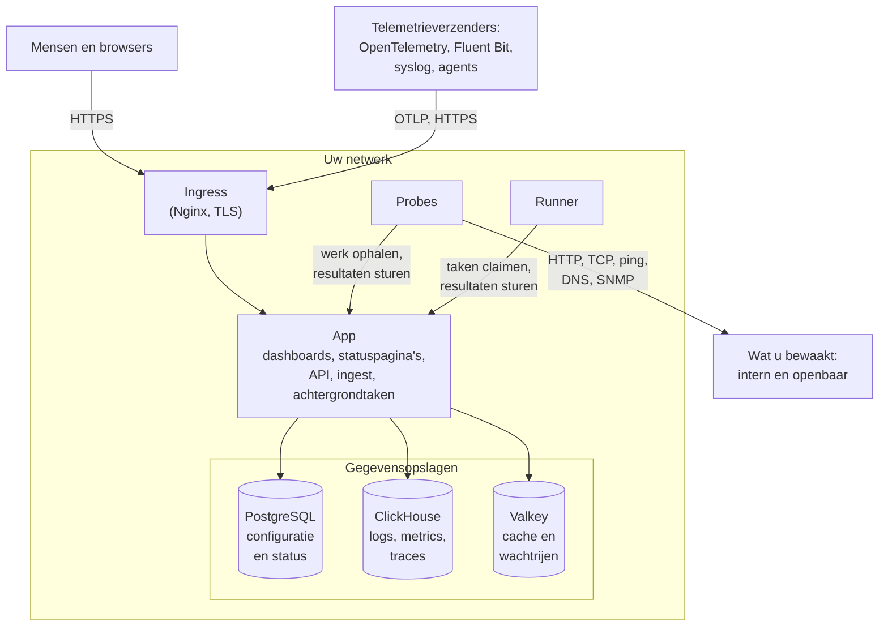

# Architectuur

Een zelf gehoste OneUptime-installatie bestaat uit een handvol containers: één ingress waar elk verzoek binnenkomt, één app-image dat het werk doet, probes die de controles van uw monitors uitvoeren en drie gegevensopslagen. Deze pagina laat zien hoe ze in elkaar passen, wat elk onderdeel doet en welke verbindingen uw netwerk oversteken.

## Wat dit laat zien

- Mensen bereiken OneUptime via de **ingress**, die TLS afhandelt en elk verzoek naar de app stuurt: het Dashboard, statuspagina's, de API en elk ingest-eindpunt waar telemetrie naartoe wordt gestuurd.
- De **app** leest en schrijft zijn status in PostgreSQL, bewaart telemetrie in ClickHouse en gebruikt Valkey (de BSD-gelicentieerde fork van Redis 7.2) als cache en voor de wachtrijen die zijn achtergrondtaken afwerken.
- **Probes** kunnen binnen uw cluster draaien (aanbevolen) en/of elders in uw netwerk. Ze kunnen het volgende bewaken:
  - Interne/privé-services achter uw firewall.
  - Externe/openbare bronnen op internet.
- Proberesultaten worden naar de app gestuurd, in Valkey in de wachtrij gezet en door de achtergrondtaken in uw gegevensopslagen verwerkt. Een probe elders in uw netwerk bereikt de app via de ingress, op uw OneUptime-URL.
- Telemetrie (metrics, traces, logs en meer) wordt door dezelfde app opgenomen en in ClickHouse opgeslagen.

> [!NOTE]
> Als u een externe PostgreSQL, Valkey (of Redis) of ClickHouse gebruikt in plaats van de meegeleverde, maakt de app in plaats daarvan verbinding met uw externe eindpunten. De logische stroom blijft hetzelfde.

## De onderdelen

| Onderdeel | Docker Compose-service | Helm-chart | Wat het doet |
| --- | --- | --- | --- |
| Ingress | `ingress` | `nginx` | Handelt TLS af, bedient uw hostnaam en de domeinen van uw statuspagina's en stuurt elk verzoek naar de app. |
| App | `app` | `app` | Het Dashboard, statuspagina's, de API- en ingest-eindpunten en, tenzij u ze afsplitst, de achtergrondtaken. |
| Worker | Onderdeel van `app` | `worker` (standaard uit) | De achtergrondtaken, in eigen pods, zodat zware wachtrijverwerking nooit concurreert met API-verzoeken. |
| Telemetry writer | Onderdeel van `app` | `telemetryWriter` (standaard uit) | Een laag van vaste grootte die elke ClickHouse-insert uitvoert, zodat de inserts begrensd blijven hoe ver de workers ook schalen. |
| Probe | `probe-1` | `probes` | Voert monitorcontroles uit en stuurt de resultaten terug. Elke meegeleverde probe is een globale probe die alle projecten kunnen gebruiken. |
| Runner | `runner` | `runner` | De eigen Runner van de instantie, die AI-codecorrecties voor elk project kan uitvoeren. Runbook-stappen draaien op [Runners](/docs/runbooks/agents) die u installeert waar ze moeten draaien. |
| PostgreSQL | `postgres` | `postgresql`, of `postgresOperator.cnpg` | Projecten, monitors, incidenten, gebruikers en elke andere instelling en status. |
| ClickHouse | `clickhouse` | `clickhouse`, of `clickhouseOperator.altinity` | Logs, metrics, traces, exceptions, profielen en monitorlogs. |
| Valkey | `valkey` | `valkey` | De cache, de takenwachtrijen en kortlevende status zoals openstaande push-ontvangstbewijzen. |

Alle rollen van de app zijn hetzelfde image: Docker Compose draait ze in één `app`-container, en de Helm-chart kan de worker en de telemetry writer als eigen deployments draaien. Hoe u elke laag dimensioneert, leest u in [Dimensionering en capaciteitsplanning](/docs/installation/sizing).

## Verbindingen uit uw netwerk

De app maakt alleen verbinding naar buiten voor wat u inschakelt. Elk van deze verbindingen is optioneel, en voor elk is er een pagina die de exacte adressen noemt die u moet toestaan:

| Uitgaande verbinding | Gebruikt voor | Meer lezen |
| --- | --- | --- |
| E-mail (SMTP, of de API van SendGrid) | Meldingen en uitnodigingen | [SMTP](/docs/emails/smtp) |
| Twilio | Sms en telefoongesprekken | [Twilio-integratie](/docs/self-hosted/twilio-integration) |
| De push-relay van OneUptime, of Expo | Mobiele pushmeldingen | [Pushmeldingen](/docs/self-hosted/push-notifications) |
| Slack en Microsoft Teams | Meldingen en acties in de werkruimte | [Slack-integratie](/docs/self-hosted/slack-integration) |
| Een LLM-provider, zoals OpenAI, Anthropic, Microsoft Foundry of een model dat u zelf draait | OneUptime AI | [LLM-providers](/docs/ai/llm-provider) |
| `oneuptime.com` | Een Enterprise-licentie online activeren | [Enterprise Edition](/docs/self-hosted/enterprise) |

Verbindingen in de andere richting – SendGrid dat inkomende e-mail aflevert, Slack en Microsoft Teams die terugbellen – vereisen dat de ingress vanaf internet bereikbaar is. Welke privéadressen de app en de probes mogen bereiken, bepaalt u zelf: zie [Toegang tot privénetwerk](/docs/self-hosted/private-network-access).

## Volgende stappen

:::cards
- [Docker Compose](/docs/installation/docker-compose): Installeer alle onderdelen op één machine.
- [Dimensionering en capaciteitsplanning](/docs/installation/sizing): Hoeveel CPU, geheugen en schijfruimte elke laag nodig heeft.
- [Eigen probes](/docs/probe/custom-probe): Draai een probe binnen een ander netwerk.
- [Enterprise Edition](/docs/self-hosted/enterprise): Wat de Enterprise-images toevoegen en hoe licenties werken.
:::
