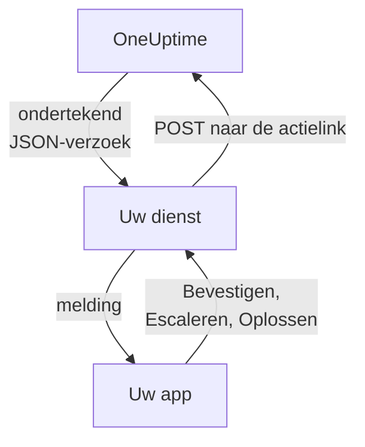

# Aangepaste meldingskanalen

Een aangepast kanaal stuurt oproepen van de bereikbaarheidsdienst naar een dienst die u zelf beheert: de eigen app van uw bedrijf, een pagersysteem of een gateway die controleert wat uw netwerk verlaat. U voegt het één keer toe, voor de hele server, en iedereen kan er zonder iets in te stellen via worden opgeroepen. In het Admin Dashboard heten ze **Custom Channels**.

> [!NOTE]
> Aangepaste kanalen maken deel uit van de [Enterprise Edition van OneUptime](/docs/self-hosted/enterprise) en vereisen een Enterprise-licentie die ze omvat. De Community Edition heeft geen pagina **Custom Channels** en stuurt niets naar een kanaal. Zie [Zonder licentie](#zonder-licentie).

:::cards
- [Een kanaal toevoegen](#een-kanaal-toevoegen): Een naam, een URL en een ondertekeningsgeheim.
- [Wat uw dienst ontvangt](#wat-uw-dienst-ontvangt): Eén ondertekend JSON-verzoek per persoon per oproep.
- [Op een oproep reageren](#op-een-oproep-reageren): Bevestigen, escaleren of oplossen vanuit uw eigen app.
- [Aflevering en nieuwe pogingen](#aflevering-en-nieuwe-pogingen): Wat er gebeurt als uw dienst niet bereikbaar is.
- [Andere meldingen](#andere-meldingen): Meldingen voor eigenaren, notities en diensten, voor wie ze wil.
- [Zonder licentie](#zonder-licentie): Wat stopt en wat bewaard blijft.
:::

## Hoe het werkt



Wanneer een bereikbaarheidsbeleid iemand oproept en diens bereikbaarheidsregel het kanaal gebruikt, stuurt OneUptime een verzoek naar de URL van het kanaal. Daarin staat voor wie de oproep is (naam en e-mailadres) en waar die over gaat, en het bevat links die uw dienst aanroept wanneer de persoon de oproep in uw app bevestigt, escaleert of oplost.

## Een kanaal toevoegen

1. Open in het Admin Dashboard **Instellingen**, dan **Custom Channels**, en kies **Add**.
2. Vul bij de stap **Channel** in:
   - **Naam**: wat mensen zien in hun meldingsmethoden en bereikbaarheidsregels, bijvoorbeeld `CorpoApp`.
   - **Webhook URL**: waar OneUptime elke oproep naartoe stuurt. Die mag in uw privénetwerk liggen.
   - **Signing Secret**: OneUptime maakt er een voor u. Kopieer het naar uw dienst, die er elk verzoek mee controleert. U kunt het opnieuw zien door het kanaal te bewerken.
3. Sla bij de stap **Delivery** op en kies daarna **Send test** om uw dienst een [testverzoek](#testverzoeken) te sturen.

Bij de stap **Delivery** staat **Page everyone through this channel** aan. OneUptime voegt het kanaal dan toe aan de bereikbaarheidsregels van iedereen in elk project, en aan de regels van iedereen die later aan een project deelneemt, en gebruikt het om iemand van dienst te bereiken die geen regel heeft voor wat er afging. Zet het uit om mensen het kanaal zelf aan hun regels te laten toevoegen.

Mensen zien het kanaal onder **Gebruikersinstellingen**, dan **Meldingsmethoden**, dan **Custom Channels**, met een knop **Send test**, en kiezen het in hun bereikbaarheidsregels als `Custom Channel: CorpoApp`. Ze stellen niets in: uw dienst krijgt te horen voor wie elke oproep is.

Om te stoppen met versturen zonder iemands regels te wijzigen, bewerkt u het kanaal en zet u **Aan** uit. Oproepen die er anders heen waren gegaan, worden in het bereikbaarheidslogboek vastgelegd als niet verstuurd. Een kanaal verwijderen verwijdert elke bereikbaarheidsregel die het gebruikt.

## Wat uw dienst ontvangt

Elke oproep is een `POST`-verzoek met een JSON-body:

| Header | Wat erin staat |
| --- | --- |
| `Content-Type` | `application/json` |
| `X-OneUptime-Event` | De gebeurtenis, zoals `on-call.incident.created` |
| `X-OneUptime-Signature` | `sha256=` en de hexadecimale HMAC-SHA256 van de onbewerkte body, gemaakt met het ondertekeningsgeheim van het kanaal |

```json title="An incident page"
{
  "version": 1,
  "event": "on-call.incident.created",
  "notificationId": "5f2c8a1e-6b1d-4c3a-9e7f-2a4b6c8d0e1f",
  "sentAt": "2026-10-27T03:14:15.000Z",
  "channel": { "id": "0b7e…", "name": "CorpoApp" },
  "title": "New Incident INC-42: API latency high",
  "message": "A new incident has been created: INC-42 (API latency high) in Agency A. Click to view details.",
  "project": { "id": "8d1f…", "name": "Agency A" },
  "team": { "id": "2c9a…", "name": "SRE" },
  "user": { "id": "4e6b…", "name": "Jane Tan", "email": "jane@example.com" },
  "recordType": "incident",
  "record": {
    "id": "9a3c…",
    "number": "INC-42",
    "title": "API latency high",
    "description": "p95 latency above 2 seconds for 5 minutes.",
    "severity": "Critical",
    "state": "Created",
    "url": "https://oneuptime.example.com/dashboard/8d1f…/incidents/9a3c…"
  },
  "onCallPolicy": { "id": "1d4e…", "name": "Primary" },
  "escalationRule": { "id": "7b2f…", "name": "Level 1" },
  "isPageAgain": false,
  "actions": {
    "acknowledge": "https://oneuptime.example.com/api/custom-notification-channel/page/5f2c…/acknowledge?token=…",
    "escalate": "https://oneuptime.example.com/api/custom-notification-channel/page/5f2c…/escalate?token=…",
    "resolve": "https://oneuptime.example.com/api/custom-notification-channel/page/5f2c…/resolve?token=…"
  }
}
```

| Veld | Wat het is |
| --- | --- |
| `version` | `1`. Aan deze versie worden alleen velden toegevoegd. |
| `event` | `on-call.incident.created`, `on-call.alert.created`, `on-call.incidentEpisode.created`, `on-call.alertEpisode.created`, `notification` voor [andere meldingen](#andere-meldingen), of `test` |
| `notificationId` | Eén per persoon per oproep. Gebruik het om een verzoek te negeren dat u al hebt afgehandeld. |
| `title`, `message` | Klaar om te tonen, zoals een pushmelding ze zou tonen |
| `user` | Voor wie de oproep is. Zoek het account in uw app op `email` of `id`. |
| `team` | Het team via welk de persoon werd opgeroepen, of `null` als die rechtstreeks werd opgeroepen |
| `recordType`, `record` | Waar de oproep over gaat: een `incident`, `alert`, `incidentEpisode` of `alertEpisode` |
| `onCallPolicy`, `escalationRule` | Het beleid en het niveau dat de persoon opriep |
| `isPageAgain` | `true` als het item een tijd geleden is bevestigd en nog steeds niet is opgelost |
| `actions` | De links die uw dienst aanroept om [op de oproep te reageren](#op-een-oproep-reageren) |

Een oproep aan meerdere personen is één verzoek per persoon, elk met de eigen links van die persoon, zodat OneUptime weet wie heeft gereageerd. Titel, bericht en beschrijving samen zijn beperkt tot 16.384 tekens; een langere beschrijving wordt ingekort en eindigt met "… (truncated — see OneUptime for the full text)".

### De handtekening controleren

Bereken de HMAC van de onbewerkte body van het verzoek, voordat u die parseert, en vergelijk hem met de header:

```javascript title="Node.js"
const crypto = require("crypto");

function isFromOneUptime(rawBody, signatureHeader, secret) {
  const expected =
    "sha256=" + crypto.createHmac("sha256", secret).update(rawBody).digest("hex");
  const received = String(signatureHeader || "");

  return (
    received.length === expected.length &&
    crypto.timingSafeEqual(Buffer.from(received), Buffer.from(expected))
  );
}
```

## Op een oproep reageren

Wanneer de persoon in uw app op een knop drukt, stuurt uw dienst een `POST`-verzoek naar de bijbehorende link in `actions`. Er is geen API-sleutel nodig: elke link bevat een token voor die ene oproep, 7 dagen geldig, en de actie wordt vastgelegd als uitgevoerd door de persoon die werd opgeroepen.

| Actie | Wat het doet |
| --- | --- |
| `acknowledge` | Bevestigt de oproep van de persoon, en daarmee het incident, de waarschuwing of de episode |
| `escalate` | De persoon kan het niet aannemen: roept nu het volgende niveau van het bereikbaarheidsbeleid op en stopt met het oproepen van deze persoon |
| `resolve` | Lost het incident, de waarschuwing of de episode op, als de eigen machtigingen van de persoon dat toestaan |

```bash title="Acknowledge a page"
curl -X POST "https://oneuptime.example.com/api/custom-notification-channel/page/5f2c…/acknowledge?token=…"
```

Het antwoord zegt wat er is gebeurd, in woorden die uw app zo kan tonen:

```json title="The answer"
{
  "action": "acknowledge",
  "result": "acknowledged",
  "message": "Acknowledged."
}
```

`result` is een van `acknowledged`, `alreadyAcknowledged`, `escalated`, `notEscalated`, `resolved` en `alreadyResolved`. Een verlopen of verkeerde link wordt geweigerd met een 4xx-status en een bericht.

## Andere meldingen

Oproepen zijn niet de enige meldingen die mensen krijgen: OneUptime laat hen ook weten wanneer een incident waarvan ze eigenaar zijn van status verandert, wanneer er een notitie wordt geplaatst, wanneer hun bereikbaarheidsdienst begint, en meer. Ieder kiest waar elk daarvan heen gaat onder **Gebruikersinstellingen > Meldingsinstellingen**, waar een kolom **Custom Channels** staat zolang er een kanaal aan staat. Die staat voor iedereen uit totdat men hem zelf aanzet.

Een melding gaat naar elk kanaal dat aan staat, als één verzoek per kanaal, met `event` op `notification`:

```json title="A notification"
{
  "version": 1,
  "event": "notification",
  "notificationId": null,
  "sentAt": "2026-10-27T03:20:00.000Z",
  "channel": { "id": "0b7e…", "name": "CorpoApp" },
  "title": "Incident INC-42 acknowledged",
  "message": "Incident INC-42 (API latency high) was acknowledged in Agency A.",
  "project": { "id": "8d1f…", "name": "Agency A" },
  "team": null,
  "user": { "id": "4e6b…", "name": "Jane Tan", "email": "jane@example.com" },
  "recordType": null,
  "record": null,
  "onCallPolicy": null,
  "escalationRule": null,
  "isPageAgain": false,
  "actions": null,
  "notificationType": "Send incident state changed notification when I am the owner of the incident",
  "url": "https://oneuptime.example.com/dashboard/8d1f…/incidents/9a3c…"
}
```

`title` en `message` zijn wat de pushmelding van de persoon zou zeggen. `notificationType` noemt de instelling waarvoor de melding is verstuurd, en `url` linkt naar waar het over gaat, of is `null`. Er valt niets op te reageren, dus `actions` is `null`.

## Aflevering en nieuwe pogingen

Een verzoek telt als afgeleverd wanneer uw dienst binnen 10 seconden antwoordt met een 2xx-status. Een verzoek waarop hij niet antwoordde, of antwoordde met 408, 429 of een 5xx-status, wordt opnieuw verstuurd na 1 seconde en na nog eens 4 seconden: drie pogingen in totaal. Bij elke andere 4xx-status wordt het niet opnieuw verstuurd.

De uitkomst van elke poging staat in het bereikbaarheidslogboek van de persoon, met de naam van het kanaal en de status waarmee uw dienst antwoordde, nooit de URL. Een oproep die niet wordt afgeleverd, stopt het bereikbaarheidsbeleid niet: als niemand bevestigt, escaleert het zoals gewoonlijk. Houd verderop in uw regels een e-mail- of sms-regel als uw dienst de enige manier is om mensen te bereiken.

## Testverzoeken

**Send test**, op de pagina in het Admin Dashboard of bij iemands meldingsmethoden, stuurt een verzoek met `event` op `test`, de persoon die erop drukte als `user`, en `notificationId`, `record` en `actions` op `null`. Gebruik het om uw dienst uit te proberen voordat er een echte oproep binnenkomt.

## Zonder licentie

Aangepaste kanalen werken tijdens de proefperiode van 14 dagen van de Enterprise Edition en de respijtperiode van 30 dagen nadat een licentie is verlopen. Daarna, of met een licentie die ze niet omvat:

- **Er wordt niets naar een aangepast kanaal gestuurd.** Een oproep die naar een kanaal zou zijn gegaan, wordt in het bereikbaarheidslogboek van de persoon vastgelegd als niet verstuurd, en een test ook.
- **Kanalen worden niet meer aangeboden.** Ze verdwijnen uit de meldingsmethoden, bereikbaarheidsregels en meldingsinstellingen van mensen, en gereedheid en de terugval tellen ze niet meer mee.
- **De pagina is alleen-lezen.** U kunt kanalen zien en verwijderen, maar niet toevoegen of wijzigen, en niemand kan een regel of een meldingsinstelling op een kanaal richten.
- **Er wordt niets verwijderd.** De kanalen, en de bereikbaarheidsregels en instellingen die ze gebruiken, blijven bewaard.

Alles werkt weer zodra een licentie is geactiveerd, zonder herstart. Wie zich bij een project heeft aangesloten terwijl aangepaste kanalen waren gestopt, krijgt in zijn regels geen kanaal dat iedereen oproept: hij kan het zelf toevoegen.
