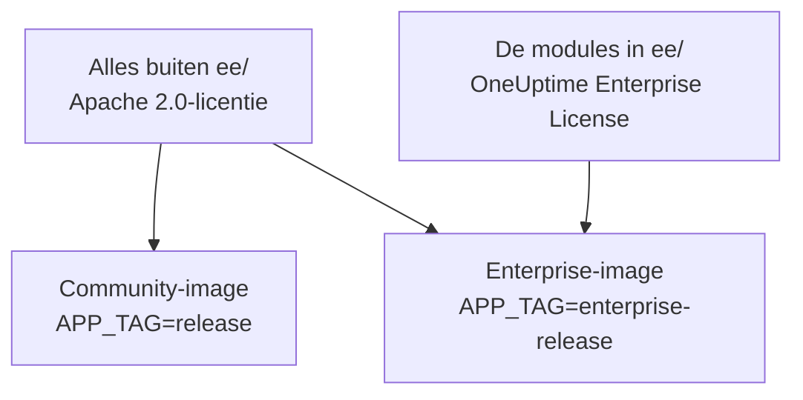
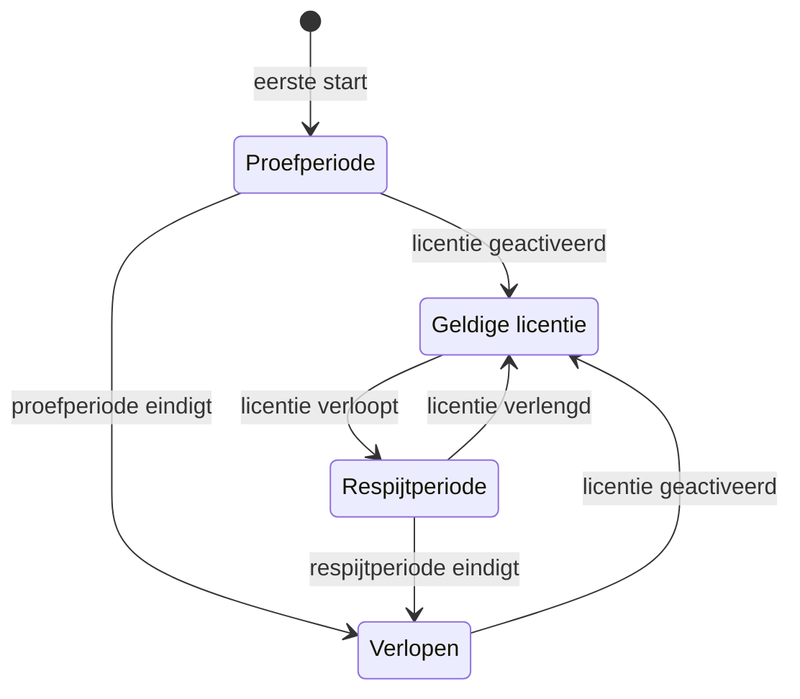

# Enterprise Edition

OneUptime wordt gebouwd vanuit één repository en wordt geleverd in twee edities:

- **Community Edition**: het hele platform voor monitoring, incidenten en observability, inclusief single sign-on met SAML en OpenID Connect, open source onder de Apache 2.0-licentie en gratis zelf te hosten op elke schaal.
- **Enterprise Edition**: de Community Edition plus de enterprisemodules in de map [`ee/`](https://github.com/OneUptime/oneuptime/tree/master/ee) van de repository. Die modules voegen SCIM-provisioning toe, plus functies voor governance en instantiebeheer. Ze vallen onder de [OneUptime Enterprise License](https://github.com/OneUptime/oneuptime/blob/master/ee/LICENSE), en productiegebruik vereist een Enterprise-licentie voor uw aantal gebruikers.

De twee edities zijn afzonderlijke containerimages. De Community-image bevat geen code uit `ee/`. OneUptime Cloud draait de Enterprise Edition, en in de cloud bepaalt uw abonnement welke van deze functies u krijgt.



> [!NOTE]
> **Single sign-on zit in elke editie.** Aanmelden met SAML en OIDC voor projecten en statuspagina's, globale SSO en "Require SSO for login" horen bij de Community Edition, en geen enkele licentiestatus schakelt ze uit.

Deze pagina beschrijft wat elke editie bevat, hoe u de Enterprise Edition draait, hoe licenties werken en wat er gebeurt als u van editie wisselt.

:::cards
- [De edities vergelijken](#wat-elke-editie-bevat): Wat de Enterprise Edition toevoegt.
- [De Enterprise-image draaien](#de-enterprise-edition-draaien): Eén instelling, op Kubernetes of Docker Compose.
- [Een licentie activeren](#licenties): Online met een sleutel, of offline met een ondertekend token.
- [Als een licentie afloopt](#als-een-licentie-verloopt-of-ontbreekt): Wat stopt, wat nooit stopt en hoe het terugkomt.
:::

## Wat elke editie bevat

| Functie | Community | Enterprise | OneUptime Cloud |
| --- | --- | --- | --- |
| Monitoring, alerts, incidenten, piketdienst, statuspagina's, logs, metrics, traces, exceptions, dashboards, workflows, AI-functies, API en Terraform | Ja | Ja | Elk abonnement |
| Aanmelden met wachtwoord, tweefactorauthenticatie, teams, rollen en API-sleutels | Ja | Ja | Elk abonnement |
| [SAML-SSO en OpenID Connect](/docs/identity/sso) voor aanmelden bij projecten | Ja | Ja | Abonnement Scale en hoger |
| SAML-SSO en OpenID Connect voor aanmelden bij privé-statuspagina's | Ja | Ja | Abonnement Scale en hoger |
| [Globale SSO en OIDC (voor de hele instantie)](/docs/identity/global-sso) | Ja | Ja | Niet van toepassing |
| [SCIM-provisioning](/docs/identity/scim) voor projecten en statuspagina's | Nee | Ja | Abonnement Scale en hoger |
| Instellingen voor team-compliance | Nee | Ja | Abonnement Scale en hoger |
| Auditlogboeken | Nee | Ja | Abonnement Enterprise |
| Bewaar-overschrijvingen: bewaartermijn per telemetrietype (logs, traces, metrics, profielen, met regels per logernst en tracestatus) en bewaartermijn per service en per resource | Nee | Ja | Abonnement Scale en hoger |
| **Health**-dashboards van het beheer: overzicht van de instantie, achtergrondwachtrijen, instantielogs, PostgreSQL, Valkey, ClickHouse-cluster, diagnoselogs en telemetrie-inname | Nee | Ja | Niet van toepassing |
| **Query Console** van het beheer | Nee | Ja | Niet beschikbaar |
| Health-alerts voor PostgreSQL en Valkey (Redis) | Nee | Ja | Niet van toepassing |
| Capaciteitsweergave van ClickHouse, capaciteitsalerts en automatisch opschonen van de schijf | Ja | Ja | Niet van toepassing |
| Migratiestatus, supportbundel en globale probes in het Admin-dashboard | Ja | Ja | Niet van toepassing |
| Beheer van de Enterprise-licentie, de plaatsen en de instanties | Nee | Ja | Niet van toepassing |

Single sign-on omvat "Require SSO for login" voor projecten, privé-statuspagina's en de hele instantie, in beide edities.

Elke editie heeft de standaardbewaartermijn van het project voor telemetrie, op **Projectinstellingen > Telemetrie & APM > Gegevensbewaring**. Bewaar-overschrijvingen zijn wat de Enterprise Edition daarbovenop toevoegt.

Op OneUptime Cloud kan een betaalde functie altijd worden uitgeschakeld, in elk abonnement. Een bewaar-overschrijving die een proefperiode (of een overstap naar een lager abonnement) heeft laten staan, blijft gelden voor nieuwe telemetrie, dus onder het abonnement Scale tonen de bewaarpagina's haar onder de upgradekaart met een knop **Overschrijving verwijderen**. Verwijderen werkt in elk abonnement; er opnieuw een instellen vereist het abonnement Scale. Telemetrie die al is opgeslagen, houdt de bewaartermijn waarmee ze is opgeslagen. Op dezelfde manier toont **Projectinstellingen > Beveiliging > SSO** de schakelaar **SSO vereisen voor inloggen** onder zijn upgradekaart zolang het project nog SSO vereist, zodat hij kan worden uitgezet.

Rijen met "Niet van toepassing" zijn functies voor instantiebeheer. Op OneUptime Cloud beheert OneUptime de instantie voor u.

## De Enterprise Edition draaien

Beide edities gebruiken dezelfde configuratie, dezelfde databases en dezelfde gegevens. Van editie wisselen verandert de image die u draait, en verder niets. In geen van beide richtingen is een migratie nodig.

:::tabs
@tab Kubernetes
Stel het imagetype in uw `values.yaml` in:

```yaml title="values.yaml"
image:
  type: enterprise-edition
```

Upgrade daarna zoals gewoonlijk:

```bash
helm upgrade my-oneuptime oneuptime/oneuptime -f values.yaml
```

De chart haalt dan de `enterprise-`-variant van elke imagetag op, bijvoorbeeld `oneuptime/app:enterprise-release`, of `enterprise-<version>` als u `image.tag` vastzet. Stel `image.type: community-edition` (de standaard) in om de Community Edition te draaien.
@tab Docker Compose
Stel `APP_TAG` in uw `config.env` in:

```bash title="config.env"
APP_TAG=enterprise-release
```

Gebruik `enterprise-<version>` om een release vast te zetten. Haal daarna de images op en herstart:

```bash
npm run update
```

Om terug te gaan naar de Community Edition stelt u `APP_TAG=release` **en** `IS_ENTERPRISE_EDITION=false` in. Zolang `IS_ENTERPRISE_EDITION=true` is ingesteld, zet `npm run update` `APP_TAG` terug op `enterprise-release`, en weigert de Community-image te starten.
:::

### `IS_ENTERPRISE_EDITION` is verouderd

De image die u draait, bepaalt de editie. `IS_ENTERPRISE_EDITION` schakelt geen enterprisefuncties meer in en wordt in een toekomstige release verwijderd. U kunt de variabele ongezet laten.

`IS_ENTERPRISE_EDITION=true` instellen op de Community-image schakelt **geen** enterprisefuncties in. De App **weigert in plaats daarvan te starten**, zodat een upgrade die op de Community-image uitkomt nooit ongemerkt SCIM-provisioning (inclusief deprovisioning) en auditlogging kan stoppen. De fout vertelt u wat u moet instellen: `APP_TAG=enterprise-<version>` om de Enterprise Edition te houden, of `IS_ENTERPRISE_EDITION=false` om de Community Edition te draaien. Met Helm kan dit niet gebeuren: de chart leidt de variabele af van `image.type`.

`ONEUPTIME_EDITION=community` laat de Enterprise-image draaien als de Community Edition. Dat is handig om een downgrade uit te proberen voordat u hem uitvoert. De Enterprise-image stelt `ONEUPTIME_EDITION=enterprise` zelf in; overschrijf die met niets anders dan `community`.

## Licenties

Het bestand [`LICENSE`](https://github.com/OneUptime/oneuptime/blob/master/LICENSE) in de hoofdmap van de repository legt vast welke licentie wat dekt: alles in de map `ee/` valt onder de [OneUptime Enterprise License](https://github.com/OneUptime/oneuptime/blob/master/ee/LICENSE), componenten van derden houden de licenties waaronder hun eigenaars ze leveren, en al het andere valt onder de Apache 2.0-licentie.

Een nieuwe installatie van de Enterprise Edition draait als **proefperiode van 14 dagen**, geteld vanaf de eerste keer dat de installatie de Enterprise Edition start. De proefperiode is bedoeld voor evaluatie: productiegebruik van de Enterprise Edition vereist een abonnement onder de OneUptime Enterprise License. Activeer een licentie voordat de proefperiode afloopt: daarna stoppen SCIM, auditlogging en bewaar-overschrijvingen, en wordt de enterpriseconfiguratie alleen-lezen (zie [Als een licentie verloopt of ontbreekt](#als-een-licentie-verloopt-of-ontbreekt)). Neem voor een licentie contact op met [sales@oneuptime.com](mailto:sales@oneuptime.com).

De licentie wordt beheerd vanuit het **editielabel**, dat hoofdbeheerders zien in de kop van het Admin-dashboard en in de voettekst van het Dashboard. Het toont de licentiestatus, het gebruik van plaatsen en, voor hoofdbeheerders, de instantie-ID.

### Online activeren (licentiesleutel)

:::steps
1. Meld u aan als hoofdbeheerder en open het editielabel.
2. Voer uw licentiesleutel in en valideer hem.
:::

De installatie controleert de sleutel bij OneUptime en slaat de licentie op die ze ontvangt. Daarna houdt ze de licentie actueel met een dagelijkse synchronisatie. Gebruik **Refresh license** in het editielabel om wijzigingen, zoals extra plaatsen of een verlenging, meteen op te halen.

Online activeren vereist uitgaand HTTPS van de OneUptime-server naar `https://oneuptime.com`. Bereikt de server het internet alleen via een relay, stel dan `ENTERPRISE_LICENSE_SERVER_URL` in op het `https://`-adres van de relay. De relay moet `/api/enterprise-license/` doorsturen naar oneuptime.com.

### Offline activeren (afgeschermde installaties)

Een installatie zonder route naar het internet kan een **ondertekend licentietoken** gebruiken in plaats van een sleutel:

:::steps
1. Meld u aan als hoofdbeheerder, open het editielabel en noteer de **instantie-ID**.
2. Vraag OneUptime ([sales@oneuptime.com](mailto:sales@oneuptime.com)) om een offline licentietoken voor die instantie-ID.
3. Plak het token in het tokenveld van het editielabel en activeer het.
:::

De installatie verifieert het token zelf, tegen de ondertekeningssleutels van OneUptime die in uw release zijn ingebouwd. Ze neemt nooit contact op met OneUptime. Een token dat voor een instantie-ID is uitgegeven, wordt door elke andere installatie geweigerd, en een token dat voor geen enkele instantie-ID is uitgegeven (zoals het token dat een online geactiveerde installatie ontvangt), wordt ook geweigerd. Om te verlengen of plaatsen toe te voegen, activeert u een nieuw token voordat het huidige verloopt.

> [!IMPORTANT]
> **Offline activeren vereist een release die de licentie-ondertekeningssleutel van OneUptime vertrouwt.** Bevat uw release die sleutel nog niet, dan mislukt de activering met "this build does not trust the key that signed this token". Activeer in dat geval online, of upgrade naar een release die de sleutel bevat.

### Wat de dagelijkse licentiesynchronisatie verstuurt

Een online geactiveerde installatie stuurt OneUptime één keer per dag een rapport. Het bevat:

- de licentiesleutel;
- de instantie-ID (een willekeurige ID die de installatie genereert) en de hostnaam waarmee de installatie is geconfigureerd (`HOST`);
- de OneUptime-versie die de installatie draait;
- het aantal gebruikers van de installatie;
- een **SHA-256-hash** van het e-mailadres van elke gebruiker, in kleine letters. OneUptime gebruikt de hashes om iemand met accounts op meerdere van uw installaties als één plaats te tellen. De e-mailadressen van gewone gebruikers worden nooit onversleuteld verstuurd;
- de e-mailadressen van de **hoofdbeheerders** van de installatie, zodat OneUptime contact met u kan opnemen over verlengingen en limieten voor plaatsen.

Het antwoord bevat de licentie zoals OneUptime die die dag kent: bedrijfsnaam, vervaldatum, limiet voor plaatsen, het gecombineerde aantal gebruikers over uw installaties en de installaties die op de licentie zijn geregistreerd. Andere replica's van de installatie nemen een wijziging binnen ongeveer een minuut over.

Wanneer u de licentie activeert of vernieuwt, stuurt de installatie alleen de licentiesleutel, de instantie-ID, de hostnaam en de versie.

Verder wordt er niets verstuurd. Geen monitoringgegevens, telemetrie, logs of configuratie verlaten de installatie. De Community Edition stuurt hier niets van, en een offline geactiveerde installatie evenmin.

### Als een licentie verloopt of ontbreekt

Elke enterprisefunctie werkt tijdens de proefperiode van 14 dagen en gedurende 30 dagen nadat een licentie is verlopen (de respijtperiode). Het editielabel waarschuwt voordat een van beide eindigt. Daarna **stoppen SCIM, auditlogging en bewaar-overschrijvingen** totdat een licentie wordt geactiveerd, net als op de Community Edition, en wordt de enterpriseconfiguratie alleen-lezen. Single sign-on is geen enterprisefunctie: aanmelden met SAML en OIDC, globale SSO en "Require SSO for login" werken in elke licentiestatus hetzelfde.



| Status | Wat er gebeurt |
| --- | --- |
| **Geldige licentie** | Elke enterprisefunctie werkt. Boven het gelicentieerde aantal plaatsen kunnen geen nieuwe gebruikers worden toegevoegd. Bestaande gebruikers worden nooit verwijderd. |
| **Proefperiode of respijtperiode** (de eerste 14 dagen van een installatie zonder licentie, of 30 dagen nadat een licentie is verlopen), of een installatie met een licentie waarvan de vervaldatum nooit is vastgelegd | Elke enterprisefunctie werkt, en het editielabel toont een waarschuwing. Tijdens de respijtperiode na het verlopen blijft de limiet voor plaatsen gelden. Een installatie met een licentie zonder vastgelegde vervaldatum doorloopt dezelfde proefperiode van 14 dagen als een installatie zonder licentie, en de limiet voor plaatsen wordt niet afgedwongen, omdat het licentierecord dat ze bewaart al onvolledig is. |
| **Na de proefperiode of respijtperiode** (verlopen, ontbrekende of ongeldige licentie, of een licentie die de functie niet bevat) | SCIM-provisioning, auditlogging en bewaar-overschrijvingen **stoppen** (zie hieronder). De enterpriseconfiguratie wordt **alleen-lezen**: u kunt haar bekijken en verwijderen, maar niet aanmaken of wijzigen. Eén wijziging werkt altijd, zodat u op een incident kunt reageren: een SCIM-bearertoken vervangen. De SCIM-instellingspagina's bieden haar aan terwijl al het andere alleen-lezen is: **Bearer-token opnieuw instellen** op een SCIM-configuratie, dat het nieuwe token één keer toont. Via de API stuurt u alleen `bearerToken` (minstens 32 tekens). Auditlogging kan niet worden ingeschakeld of uitgebreid. De enterprise Health-dashboards en de Query Console zijn vergrendeld. De limiet voor plaatsen wordt niet langer afgedwongen. |

Wat stopt als een licentie afloopt:

- **SCIM-provisioning stopt.** De SCIM-verzoeken van uw identiteitsprovider worden geweigerd, inclusief deprovisioning, en SCIM-teamvergrendelingen worden opgeheven, zodat teams die door SCIM-pushgroepen worden beheerd met de hand kunnen worden bewerkt.
- **Auditlogging registreert niets meer.** Auditlogboeken die tot dan toe zijn vastgelegd, blijven bewaard.
- **Bewaar-overschrijvingen gelden niet meer.** Nieuwe telemetrie wordt bewaard volgens de standaardbewaartermijn van het project. Telemetrie die al is opgeslagen, houdt de bewaartermijn waarmee ze is geschreven. Via de API kunt u een overschrijving nog wel wissen, maar niet instellen.

Wat **niet** stopt:

- **Single sign-on.** Aanmelden met SAML en OIDC voor projecten, privé-statuspagina's, de hele instantie (globale SSO) en de mobiele apps, en "Require SSO for login", horen bij elke editie. Een verlopen licentie verandert daar niets aan, en de configuratie van single sign-on blijft bewerkbaar.
- **De kernmonitoring wordt nooit geraakt**: monitors, alerts, incidenten, piketdienst, statuspagina's en telemetrie blijven allemaal werken.
- **Hoofdbeheerders kunnen zich altijd aanmelden met hun wachtwoord.**
- **Er wordt niets verwijderd.** SCIM-configuratie, auditlogboeken en bewaar-overschrijvingen blijven zoals ze zijn.

**Alles werkt weer zodra een licentie is geactiveerd**, zonder herstart: SCIM-provisioning, auditlogging en bewaar-overschrijvingen komen terug met de configuratie die u hebt. OneUptime schakelt ze alleen uit als het weet dat de licentie is verlopen. Zolang het de licentiestatus niet kan lezen, bijvoorbeeld een moment terwijl de server start, blijven SCIM, auditlogging en bewaar-overschrijvingen aan.

> [!WARNING]
> **Als uw identiteitsprovider gebruikers via SCIM deprovisioneert, activeer dan een licentie voordat de proefperiode of de respijtperiode eindigt.** Daarna deprovisioneert SCIM de mensen die u bij uw identiteitsprovider verwijdert niet meer: hun OneUptime-accounts blijven bestaan, en tenzij "Require SSO for login" voor hen geldt, kan iedereen die de e-mailinbox van zo'n account nog kan bereiken een wachtwoord instellen en zich aanmelden. Laat u de licentie verlopen, verwijder die gebruikers dan zelf in OneUptime.

## Overstappen van Enterprise naar Community

Uw configuratie blijft in de database. Terugwisselen naar de Enterprise-image herstelt alles zoals het was, zolang de installatie een geldige licentie heeft of nog in haar proefperiode of respijtperiode zit. Single sign-on verandert niet: aanmelden met SAML en OIDC, globale SSO en "Require SSO for login" werken op beide images hetzelfde. Op de Community-image:

- **SCIM stopt.** De provisioning-endpoints bestaan niet meer, dus SCIM-aanroepen die de IdP doet, mislukken. Dat geldt ook voor SCIM-deprovisioning.
- **SCIM-teamvergrendelingen worden opgeheven**, zodat teams die door SCIM-pushgroepen werden beheerd met de hand kunnen worden bewerkt. Bij het opstarten logt de server bij welke projecten de SCIM-teamvergrendelingen zijn opgeheven.
- **Auditlogging stopt.** Auditlogboeken die tot dan toe zijn vastgelegd, blijven bewaard, maar de pagina's met auditlogboeken tonen een upgradeprompt.
- **Bewaar-overschrijvingen gelden niet meer.** Nieuwe telemetrie wordt bewaard volgens de standaardbewaartermijn van het project, en de bewaarkaarten op **Projectinstellingen > Telemetrie & APM > Gegevensbewaring** en op de instellingenpagina van elke service en elke resource tonen een upgradeprompt. De overschrijvingen blijven in de database en gelden weer als u terugwisselt.
- **Enterprise-instellingspagina's tonen een upgradeprompt.** Via de API kunt u de enterpriseconfiguratie nog lezen en verwijderen en een SCIM-bearertoken opnieuw instellen, maar niets anders aanmaken of wijzigen. Auditlogging kan niet worden ingeschakeld.
- **De enterprise Health-dashboards, de Query Console en de Health-alerts voor PostgreSQL en Valkey stoppen.** Capaciteitsbewaking en opschoning van ClickHouse, de migratiestatus en de supportbundel blijven werken.

> [!CAUTION]
> **Controleer wie toegang heeft voordat u een installatie waarvan de identiteitsprovider gebruikers via SCIM deprovisioneert overzet naar de Community-image.** Zonder SCIM houden de mensen die u bij uw identiteitsprovider verwijdert hun OneUptime-accounts, en tenzij "Require SSO for login" voor hen geldt, kan iedereen die de e-mailinbox van zo'n account nog kan bereiken een wachtwoord instellen en zich aanmelden. Verwijder die gebruikers eerst.

## Problemen oplossen

:::details De App weigert te starten na een upgrade
`IS_ENTERPRISE_EDITION=true` is ingesteld op de Community-image. Stel `APP_TAG=enterprise-<version>` in om de Enterprise Edition te houden, of `IS_ENTERPRISE_EDITION=false` om de Community Edition te draaien, en voer daarna `npm run update` opnieuw uit.
:::

:::details Offline activeren mislukt met "this build does not trust the key that signed this token"
Uw release is gebouwd voordat ze de licentie-ondertekeningssleutel van OneUptime vertrouwde. Activeer online, of upgrade naar een release die de sleutel bevat.
:::

:::details De SCIM-verzoeken van uw identiteitsprovider worden geweigerd
Op de Enterprise-image is de licentie verlopen: activeer er een, en de provisioning werkt weer zonder herstart. Op de Community-image bestaan de SCIM-endpoints helemaal niet.
:::

## Volgende stappen

:::cards
- [Upgraden](/docs/installation/upgrading): Overstappen op een nieuwe release, en tussen de images van de edities.
- [SSO](/docs/identity/sso): Single sign-on, in elke editie.
- [Globale SSO](/docs/identity/global-sso): Eén identiteitsprovider voor de hele instantie.
- [SCIM](/docs/identity/scim): Gebruikers en teams aanleveren vanuit uw identiteitsprovider.
:::
