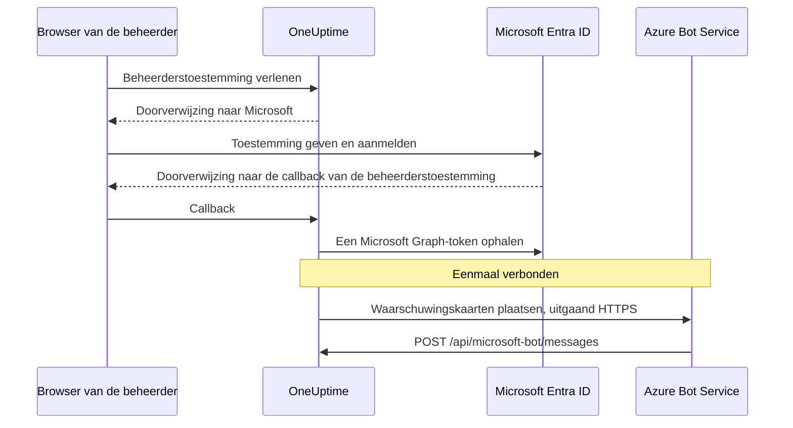

# Microsoft Teams-integratie

Verbind je zelfgehoste OneUptime met Microsoft Teams. Je registreert een app in Microsoft Entra ID, maakt er een Azure Bot voor, geeft OneUptime de inloggegevens van de app en installeert het Teams-app-pakket dat je server genereert. Daarna plaatst OneUptime waarschuwingen en incidenten in je kanalen en chats, en handelt je team ze af vanuit Teams.

Deze pagina is voor wie de OneUptime-server beheert. Zodra Teams verbonden is, stel je meldingsregels per project in: zie [Microsoft Teams](/docs/workspace-connections/microsoft-teams).

:::cards
- [De integratie instellen](#de-integratie-instellen): Negen stappen, van de Azure-portal tot je eerste team.
- [Omgevingsvariabelen](#omgevingsvariabelen): De drie waarden die OneUptime uit de app-registratie nodig heeft.
- [Netwerktoegang](#netwerktoegang): Het bot-endpoint dat Microsoft moet kunnen bereiken.
- [Probleemoplossing](#probleemoplossing): Onbereikbare endpoints, ontbrekende installaties en mislukte verbindingen.
:::

## Hoe het werkt

OneUptime gebruikt een Azure Bot voor de Teams-integratie. Het verkeer gaat twee kanten op, en die twee richtingen zijn onafhankelijk: OneUptime roept Microsoft aan om berichten te plaatsen, en Azure Bot Service roept je server aan wanneer iemand op een knop drukt, de bot een bericht stuurt of hem aan een chat toevoegt.



Een Incoming Webhook of een Teams-werkstroom-URL vervangt het berichten-endpoint van deze bot niet.

Videogesprekken (een Teams-vergadering voor een incident) gebruiken deze bot niet: ze hebben een eigen app-registratie nodig, beschreven in [Videogesprekken](/docs/workspace-connections/video-calls#koppelen-met-één-klik-op-een-zelf-gehoste-server).

## Voordat je begint

- Een Azure-abonnement, voor de Azure Bot-resource.
- Een account dat app-registraties kan maken in Microsoft Entra ID, en een Microsoft 365-beheerder die beheerderstoestemming verleent.
- Een openbare HTTPS-hostnaam voor OneUptime die Azure Bot Service kan bereiken. Zie [Netwerktoegang](#netwerktoegang).
- Toegang tot de serverconfiguratie: `config.env` bij Docker Compose, of je Helm-values bij Kubernetes.
- Om een project te verbinden: de rol **Project Owner**, **Project Admin** of **Project Member** in dat project.

## De integratie instellen

:::steps
### Stap 1: Maak de Azure-app-registratie

Open in de [Azure-portal](https://portal.azure.com) **App registrations** en kies **New registration**. Vul het formulier in:

- **Name:** oneuptime
- **Supported account types:** Accounts in this organizational directory only (Single tenant)
- **Redirect URI:** Web - `https://your-oneuptime-domain.com/api/microsoft-teams/auth`

Kies **Register** en voeg daarna een tweede Web-omleidings-URI toe, `https://your-oneuptime-domain.com/api/microsoft-teams/admin-consent/callback`. Noteer de **Application (client) ID** en de **Directory (tenant) ID**: je hebt ze allebei later nodig.

> [!NOTE]
> **Waarom één tenant:** een zelfgehoste OneUptime-installatie bedient één organisatie, en de bot ervan is geregistreerd voor de ene tenant die je instelt in `MICROSOFT_TEAMS_APP_TENANT_ID` (stap 6). De app als multitenant registreren breidt dat niet uit en introduceert een manier om te falen: gast- / B2B-gebruikers van wie de eigen Microsoft-tenant verschilt van de jouwe, bereiken de bot met hun eigen tenant-ID, en die kan OneUptime niet aan je project koppelen. Heb je al een multitenant-app geregistreerd, dan blijft die werken; zorg alleen dat `MICROSOFT_TEAMS_APP_TENANT_ID` je eigen tenant is, en houd er rekening mee dat gastaccounts een account in je tenant nodig hebben om de bot te gebruiken.

### Stap 2: Stel de app-machtigingen in

Open in je app-registratie **API permissions**, kies **Add a permission** en kies **Microsoft Graph**.

**Gedelegeerde machtigingen toevoegen** (wanneer de app namens een aangemelde gebruiker handelt):

- **User.Read** - Nodig om tijdens de OAuth-flow de profielgegevens van de geverifieerde gebruiker op te halen (weergavenaam, e-mail)
- **Team.ReadBasic.All** - Nodig om de teams op te sommen waarvan de gebruiker lid is, wanneer die kiest welk team verbonden wordt
- **Channel.ReadBasic.All** - Nodig om kanaalgegevens te lezen en de kanalen van teams op te sommen voor het afleveren van meldingen
- **ChannelMessage.Send** - Nodig om meldingen over waarschuwingen en incidenten naar Teams-kanalen te sturen

**Toepassingsmachtigingen toevoegen** (wanneer de app als zichzelf handelt, zonder aangemelde gebruiker):

- **Team.ReadBasic.All** - Nodig om alle teams in de organisatie op te sommen zodra beheerderstoestemming is verleend
- **Channel.ReadBasic.All** - Nodig om te controleren of kanalen bestaan en hun details op te halen
- **TeamsAppInstallation.ReadForTeam.All** - Nodig voor diagnose. Hiermee leest OneUptime welk app-pakket werkelijk in een team is geïnstalleerd en vergelijkt het dat met de client-ID van deze installatie, zodat een mislukte verzending je kan vertellen *welke* van de mogelijke oorzaken het is. Zonder deze machtiging kan OneUptime "niet geïnstalleerd" niet onderscheiden van "geïnstalleerd, maar het pakket van iemand anders", en meldt het alleen wat Microsoft zei. Dat is de belangrijkste reden dat het debuggen van deze integratie dagen kost in plaats van minuten. Verleen hem.
- **Chat.ReadBasic.WhereInstalled** - Optioneel. Hiermee leest OneUptime de naam van elke chat waarin de OneUptime-app zit. Zonder deze machtiging verleent elke chat dat via de manifestmachtiging **ChatSettings.Read.Chat** (hieronder), die een chat die met een ouder manifest is toegevoegd pas heeft nadat de app daarin is bijgewerkt.

`ChannelMessage.Send` is alleen een gedelegeerde machtiging; er bestaat geen variant als toepassingsmachtiging in de [naslag van Microsoft Graph-machtigingen](https://learn.microsoft.com/en-us/graph/permissions-reference#channelmessagesend). Laat hem in de lijst met gedelegeerde machtigingen hierboven staan.

Kies daarna **Grant admin consent** voor je organisatie.

De bot zelf gebruikt machtigingen voor resourcespecifieke toestemming (RSC) die in het Teams-app-manifest zijn gedefinieerd. Die worden verleend wanneer de app in een team of chat wordt geïnstalleerd of bijgewerkt, niet in Entra ID:

- **ChannelMessage.Send.Group** - Hiermee kan de bot berichten naar teamkanalen sturen
- **ChannelMessage.Read.Group** - Hiermee kan de bot kanaalberichten lezen voor interactieve opdrachten
- **Channel.Create.Group** - Hiermee kan de bot kanalen maken wanneer dat nodig is
- **ChatMessage.Read.Chat** - Hiermee kan de bot berichten lezen in chats waaraan hij is toegevoegd (voor interactieve opdrachten)
- **ChatMember.Read.Chat** - Hiermee kan de bot de leden lezen van chats waaraan hij is toegevoegd (om chats in OneUptime een naam te geven)
- **ChatSettings.Read.Chat** - Hiermee leest OneUptime de naam van groepschats waaraan de app is toegevoegd. Teams stuurt de naam van een groepschat niet betrouwbaar naar de bot, dus zonder deze machtiging wordt een groepschat met een naam vermeld met de namen van de leden
- **TeamsAppInstallation.Read.Group** - Hiermee bevestigt OneUptime dat de app is geïnstalleerd in een team waarin het gaat posten

Heb je het app-manifest geüpload voordat deze machtigingen bestonden, download het dan opnieuw via **Projectinstellingen > Werkruimte > Microsoft Teams** en upload het naar Teams als update van de OneUptime-app. Teams verleent de team- en chatmachtigingen wanneer de app in dat team of die chat wordt geïnstalleerd of bijgewerkt, dus accepteer de update in elk team en elke chat die de app al heeft. Zie voor chats [Een groepschat wordt vermeld met de namen van de leden](#een-groepschat-wordt-vermeld-met-de-namen-van-de-leden).

### Stap 3: Maak een clientgeheim

Open in je app-registratie **Certificates & secrets** en kies **New client secret**. Voeg een beschrijving toe, kies een vervaltermijn (24 maanden is een verstandige keuze) en kies **Add**. Kopieer de waarde van het geheim meteen: Azure toont die maar één keer.

> [!IMPORTANT]
> Kopieer de **Value** van het geheim, niet de **Secret ID**. De waarde is de langere tekenreeks.

### Stap 4: Maak een Bot Service

Maak in de Azure-portal een **Azure Bot**-resource:

- **Bot handle:** oneuptime-bot
- **Subscription** en **Resource group:** die van jou
- **Pricing tier:** F0 (Free) is genoeg om te testen
- **Type of App:** Single Tenant, met de bestaande app-registratie: de **Application (client) ID** en de **Directory (tenant) ID** ervan uit stap 1

Kies **Review + create** en daarna **Create**. Open na de implementatie van de bot de pagina **Configuration**, stel **Messaging endpoint** in op `https://your-oneuptime-domain.com/api/microsoft-bot/messages` en sla op.

**Controleer het endpoint voordat je verdergaat.** Azure Bot Service roept deze URL aan vanaf het openbare internet, dus test hem vanaf een plek buiten je netwerk: niet vanuit het cluster, en niet via een VPN die de host ziet terwijl Azure dat niet kan:

```bash
curl -sS -i https://your-oneuptime-domain.com/api/microsoft-bot/messages
```

Gebruik `-i` in plaats van alleen naar de statuscode te kijken: bij een 404 is **de body het enige dat je vertelt wie hem heeft gegenereerd**, en dat onderscheid is de hele diagnose.

- **405** is correct en betekent dat je klaar bent. Het endpoint accepteert alleen POST, dus een GET krijgt `405 Method Not Allowed`, met `Allow: POST` en een beschrijving van het endpoint. Het bereiken ervan is precies wat je test.
- **Een 404 met de JSON-body `{"message":"Page not found - /api/microsoft-bot/messages"}`** komt van OneUptime, dus het verzoek is *wel* aangekomen. Ofwel is deze installatie ouder dan het 405-antwoord hierboven (oudere versies bedienden deze route alleen voor POST, dus een GET kwam terecht in de algemene "not found"-handler), ofwel herschrijft iets vóór OneUptime het pad en haalt het het voorvoegsel `/api` weg voordat de app het ziet (een Kubernetes-ingress met `rewrite-target: /` is de gebruikelijke boosdoener).
- **Een 404 met een HTML-foutpagina** van nginx, je ingress of een load balancer betekent het omgekeerde: het verzoek heeft OneUptime nooit bereikt, en wat ervoor staat routeert `/api` niet naar de app.
- **Een TLS-fout, een time-out of een geweigerde verbinding** betekent dat Azure er ook niet bij kan. Zie [de probleemoplossing voor het berichten-endpoint](#kaartknoppen-zeggen-unable-to-reach-app-en-chats-verschijnen-nooit) verderop.

### Stap 5: Voeg het Microsoft Teams-kanaal toe aan de bot

Open in je Azure Bot-resource **Channels** en voeg **Microsoft Teams** toe. Houd de standaard berichtopties aan, tenzij je specifieke eisen hebt, en sla op. Zonder dit kanaal wordt de bot nooit ingericht in Teams-gesprekken.

### Stap 6: Stel de omgevingsvariabelen van OneUptime in

Geef OneUptime de inloggegevens van de app:

:::tabs
@tab Docker Compose
```bash title="config.env"
MICROSOFT_TEAMS_APP_CLIENT_ID=YOUR_TEAMS_APP_CLIENT_ID
MICROSOFT_TEAMS_APP_CLIENT_SECRET=YOUR_TEAMS_APP_CLIENT_SECRET
MICROSOFT_TEAMS_APP_TENANT_ID=YOUR_MICROSOFT_TENANT_ID
```

Pas de wijziging toe met `npm run start`, dat de containers opnieuw aanmaakt. `docker compose restart` leest `config.env` niet opnieuw in.
@tab Kubernetes
```yaml title="values.yaml"
microsoftTeamsApp:
  clientId: YOUR_TEAMS_APP_CLIENT_ID
  clientSecret: YOUR_TEAMS_APP_CLIENT_SECRET
  tenantId: YOUR_MICROSOFT_TENANT_ID
```

Wil je de waarden in een Kubernetes-Secret bewaren dat je zelf beheert, stel dan in plaats daarvan `microsoftTeamsApp.existingSecret` in: de `name` ervan en de sleutels `clientIdKey`, `clientSecretKey` en `tenantIdKey`. Pas de wijziging toe met `helm upgrade`.
:::

Zodra OneUptime weer draait, toont **Projectinstellingen > Werkruimte > Microsoft Teams** de kaart **Beheerderstoestemming verlenen** in plaats van de installatiehandleiding.

### Stap 7: Verleen beheerderstoestemming in OneUptime

Open **Projectinstellingen > Werkruimte > Microsoft Teams** en kies **Beheerderstoestemming verlenen**. Meld je bij Microsoft aan als Microsoft 365-beheerder en accepteer de machtigingen. Microsoft stuurt je terug naar dezelfde pagina, en de kaart toont **Admin Consent Completed**: het project is nu verbonden met je tenant.

Kies daarna **Connect my account with Microsoft Teams** om je eigen account te koppelen. Andere projectleden doen hetzelfde via **Gebruikersinstellingen > Werkruimte > Microsoft Teams**.

### Stap 8: Upload het Teams-app-manifest

Na de beheerderstoestemming toont **Projectinstellingen > Werkruimte > Microsoft Teams** de kaart **Action Required: Install This Deployment's App on Microsoft Teams**. Kies **App-manifest-zip downloaden**: het pakket bevat de bot-ID van deze installatie.

Open in Microsoft Teams **Apps > Manage your apps**, kies **Upload an app**, daarna **Upload a custom app**, en kies de zip die je hebt gedownload.

> [!WARNING]
> Installeer voor een zelfgehoste installatie niet "OneUptime" uit de Microsoft Teams-store. De store-app wijst naar de bot van OneUptime Cloud, dus Teams accepteert hem en weigert daarna elk bericht dat deze installatie stuurt.

### Stap 9: Voeg OneUptime toe aan elk team (verplicht)

Het manifest uploaden installeert de app voor **jou**. Het geeft de bot **geen** toegang tot de kanalen van welk team dan ook. Microsoft accepteert alleen berichten in een team waaraan de app is toegevoegd, dus je moet dit doen voor elk team waarin je meldingen wilt:

1. Klik in Microsoft Teams op "..." naast de **teamnaam** (niet de kanaalnaam)
2. Kies **Manage team** > **Apps** > **More apps**
3. Zoek **OneUptime** en klik op **Add**

Opmerkingen:

- OneUptime voor jezelf installeren, of aan een chat toevoegen, is een **andere** installatie. Met geen van beide kan het in de kanalen van een team posten.
- **Privékanalen** hebben de app nodig in het kanaal zelf: open het kanaal > "..." > **Manage channel** > **Apps** > **Add an app**. Een installatie op teamniveau dekt privékanalen niet.
- **Gedeelde kanalen** kunnen helemaal geen meldingen ontvangen: Microsoft Teams ondersteunt geen bots in gedeelde kanalen. OneUptime verbergt ze in de kanaalkiezer.
- Is **Manage team > Apps > More apps** leeg of uitgegrijsd, dan blokkeert je Teams-beleid voor app-instellingen aangepaste apps. Los dat op in het Teams-beheercentrum, onder **Teams apps > Manage apps** en **Setup policies**.
:::

## Omgevingsvariabelen

| Docker Compose (`config.env`) | Helm (`values.yaml`) | Waarde |
| --- | --- | --- |
| `MICROSOFT_TEAMS_APP_CLIENT_ID` | `microsoftTeamsApp.clientId` | De **Application (client) ID**. Dit is ook de bot-ID in het Teams-app-pakket, dus het moet een GUID zijn. |
| `MICROSOFT_TEAMS_APP_CLIENT_SECRET` | `microsoftTeamsApp.clientSecret` | De **Value** van het clientgeheim, niet de ID ervan. |
| `MICROSOFT_TEAMS_APP_TENANT_ID` | `microsoftTeamsApp.tenantId` | De **Directory (tenant) ID**. De bot verifieert zich als single-tenant-app in deze tenant. |
| `HOST` | `host` | Je openbare hostnaam. De omleidings-URI's, het berichten-endpoint en het Teams-app-pakket worden ermee opgebouwd. |
| `HTTP_PROTOCOL` | `httpProtocol` | `https`. Azure Bot Service roept alleen HTTPS-endpoints aan. |

Alle drie de waarden `MICROSOFT_TEAMS_APP_*` zijn verplicht:

- Zonder de client-ID toont de Microsoft Teams-pagina de installatiehandleiding in plaats van **Beheerderstoestemming verlenen**.
- Zonder de client-ID of het geheim eindigt verbinden met **"Microsoft Teams is niet ingesteld op deze OneUptime-server."**
- Zonder de tenant-ID kan de bot zich niet verifiëren, dus posten en het bot-endpoint mislukken.

## Netwerktoegang

Microsoft vereist een [openbaar bereikbaar HTTPS-endpoint voor een zelfgehoste bot](https://learn.microsoft.com/en-us/azure/bot-service/bot-service-resources-faq-security?view=azure-bot-service-4.0). Een privé-IP-adres, een interne DNS-naam of de VPN-verbinding van een medewerker geeft Azure Bot Service geen toegang tot OneUptime.

| Richting | Bestemming | Doel |
| --- | --- | --- |
| Van OneUptime naar Microsoft | HTTPS via TCP 443 naar Microsoft Graph, Microsoft-identiteit en de Bot Framework-services | Tokens uitwisselen, teams en kanalen opzoeken en meldingen afleveren |
| Van Microsoft naar OneUptime | `POST /api/microsoft-bot/messages` | Botberichten, installatiegebeurtenissen in gesprekken en kaartacties |
| Van de browser van de gebruiker naar OneUptime | `/api/microsoft-teams/auth` en `/api/microsoft-teams/admin-consent/callback` | Doorverwijzingen voor aanmelden en beheerderstoestemming |

De doorverwijzingen van de app-registratie naar `/api/microsoft-teams/auth` en `/api/microsoft-teams/admin-consent/callback` keren terug via de browser van de gebruiker. Die browser moet OneUptime kunnen bereiken, bijvoorbeeld via je bedrijfsnetwerk of VPN. Botberichten en kaartacties komen van de servers van Microsoft en hebben een eigen bereikbare ingress nodig. Uitgaande aflevering van waarschuwingen alleen bewijst geen inkomende connectiviteit.

### Het bot-endpoint publiceren vanuit een privé-implementatie

```mermaid title="Het bot-endpoint publiceren vanuit een privé-implementatie"
flowchart LR
    Azure["Azure Bot Service"] -->|HTTPS 443| GW["Openbare gateway"]
    GW -->|"POST /api/microsoft-bot/messages"| ING["OneUptime-ingress"]
    Users["Medewerkers op de VPN"] --> ING
    ING --> App["OneUptime-app"]
```

:::steps
1. Laat de openbare DNS van je OneUptime-hostnaam wijzen naar een reverse proxy of load balancer die aan het internet hangt. Sta inkomend TCP 443 toe en lever een openbaar vertrouwd TLS-certificaat met de volledige keten.
2. Verbind de gateway met de privé-ingress van OneUptime, direct of via je eigen site-to-site-VPN / privéverbinding, en sta de servicepoort van de oorsprong toe. Een Kubernetes-`ClusterIP`-service heeft een bereikbare ingress of een andere route vanaf de gateway nodig. Houd databases en andere interne services privé.
3. Publiceer `/api/microsoft-bot/messages` via die gateway en stel het **Messaging endpoint** van de Azure Bot uit stap 4 in op de volledige openbare HTTPS-URL. Behoud de methode, het voorvoegsel `/api`, de querystring, de body en de header `Authorization`. Behoud de openbare `Host` en stel vertrouwde forwarding-headers in voor de openbare host en het HTTPS-schema. Voeg aan deze route geen doorverwijzingen, browser-SSO, CAPTCHA of proxy-aanmelding toe; de Bot Framework-adapter van OneUptime moet het verzoek ontvangen en verifiëren.
4. Houd andere routes zo nodig privé. Met split DNS kunnen medewerkers dezelfde hostnaam via het bedrijfsnetwerk of de VPN naar de privé-ingress laten verwijzen. Die ingress moet ook HTTPS leveren met een certificaat dat geldig is voor de hostnaam, en de browserdoorverwijzingen uit de tabel hierboven toestaan. Beperk de toegang tot de oorsprong tot de gateway en de geautoriseerde interne clients.
5. Stel `HOST=oneuptime.example.com` en `HTTP_PROTOCOL=https` in de `config.env` van Docker Compose in, of `host: oneuptime.example.com` en `httpProtocol: https` in de Helm-values. Vervang het voorbeeld door je domein, pas de update van de implementatie toe en wacht tot de app opnieuw is gestart. Deze waarden genereren URL's; ze richten geen DNS, TLS of netwerktoegang in. Verandert de hostnaam, werk dan het Azure Bot-endpoint en de doorverwijzingen van de app-registratie bij, en download en upload het Teams-manifest opnieuw.
:::

De [instellingen voor toegang tot privénetwerken](/docs/self-hosted/private-network-access) van OneUptime regelen uitgaande verzoeken naar interne services. `ALLOW_PRIVATE_NETWORK_WEBHOOKS` inschakelen maakt het bot-endpoint niet bereikbaar voor Microsoft.

### Uitgaande toegang en IP-beperkingen

Sta DNS-resolutie en uitgaand HTTPS toe vanaf de OneUptime-app. Gebruik `graph.microsoft.com`, `login.microsoftonline.com`, de authenticatie- en kanaal-endpoints van Bot Framework, en de connectorservice-URL die voor een gesprek wordt meegegeven. De fallback-connector van de commerciële cloud is `https://smba.trafficmanager.net/teams/`; de service-URL's van gesprekken kunnen afwijken. Volg de [firewallrichtlijnen van Microsoft](https://learn.microsoft.com/en-us/azure/bot-service/bot-service-resources-faq-security?view=azure-bot-service-4.0) en bekijk geblokkeerd verkeer tijdens het testen; dit is geen volledige lijst van hostnamen.

Microsoft ondersteunt geen vaste IP-toestaanlijsten voor inkomend Bot Framework-verkeer, omdat de bronadressen ervan veranderen. De IP-bereiken voor media van Teams-clients beschrijven niet waar botwebhooks vandaan komen. Houd de Bot Framework-verificatie ingeschakeld in plaats van een bron-IP als bewijs van identiteit te behandelen.

### Testen en implementaties zonder inkomende toegang

Gebruik stap 4 om openbare DNS, TLS en routering te controleren van buiten je netwerk en je VPN. Verbind daarna Teams, stuur een testmelding, stuur de bot een bericht en druk op een knop van een kaart. Bevestig de actie in OneUptime en vergelijk de afleverdiagnostiek van Microsoft met de logboeken van de gateway en de app. Een bereikbare GET-route of een afgeleverde melding bewijst op zichzelf geen geverifieerde inkomende bot-POST.

Voor ontwikkeling beschrijft de [Microsoft-handleiding voor het lokaal testen van Teams-bots](https://learn.microsoft.com/en-us/microsoftteams/platform/bots/how-to/authentication/add-authentication#testing-the-bot-locally-in-teams) hoe je een lokale service via een tunnel openstelt. Stuur door naar een proxy die het bot-endpoint toestaat en gebruik `/api/microsoft-bot/messages`, in plaats van het voorbeeldpad `/api/messages` van Microsoft. Werk de ingestelde hostnaam en het Azure Bot-endpoint bij telkens wanneer de openbare URL van de tunnel verandert, stop de tunnel na het testen en gebruik in productie een stabiele ingress. Ook een tunnel opent inkomende toegang.

> [!WARNING]
> Als beleid inkomende connectiviteit verbiedt, kan de volledige Teams-botintegratie niet werken: opdrachten, kaartacties en het ontdekken van gesprekken hangen ervan af dat Microsoft OneUptime bereikt. Azure Bot Private Endpoint lost deze eis niet op. De [instructies van Microsoft voor netwerkisolatie](https://learn.microsoft.com/en-us/azure/bot-service/dl-network-isolation-how-to?view=azure-bot-service-4.0) beschrijven Direct Line-isolatie en vermelden dat het uitschakelen van openbare netwerktoegang de Teams-kanalen ontregelt. Een volledig losgekoppelde installatie kan Teams niet gebruiken.

## Probleemoplossing

Begin met deze controles:

- De app-registratie heeft de machtigingen hierboven, en beheerderstoestemming is verleend.
- De omleidings-URI's komen exact overeen (vervang `your-oneuptime-domain.com` door je echte domein).
- De omgevingsvariabelen zijn ingesteld, en OneUptime is opnieuw gestart nadat je ze hebt ingesteld.
- Het berichten-endpoint van de bot is bereikbaar vanaf het internet, en de bot heeft het Microsoft Teams-kanaal.
- Het Teams-app-pakket dat je hebt geüpload, is het pakket dat van deze installatie is gedownload.

### Kaartknoppen zeggen "Unable to reach app" en chats verschijnen nooit

Deze symptomen betekenen meestal dat **Azure Bot Service geen geverifieerde activiteiten kan afleveren bij je berichten-endpoint**. Controleer de routering, de botverificatie en de projectconfiguratie.

Het verwarrende is dat waarschuwingskaarten Teams nog steeds bereiken, waardoor de integratie bijna gezond lijkt. Dat is ze niet: de twee richtingen zijn onafhankelijk, en er werkt er maar één:

| Richting | Hoe het reist | Moet Azure jou bereiken? |
| --- | --- | --- |
| OneUptime plaatst een waarschuwingskaart in een kanaal | OneUptime roept Microsoft aan en verifieert zich met je clientgeheim | **Nee** |
| Je drukt op een knop op die kaart | Azure Bot Service doet een POST naar `/api/microsoft-bot/messages` | **Ja** |
| Je stuurt de bot `help` | Azure Bot Service doet een POST naar `/api/microsoft-bot/messages` | **Ja** |
| Een chat wordt geregistreerd in **Microsoft Teams Chats** | Azure Bot Service POST een botactiviteit naar `/api/microsoft-bot/messages` | **Ja** |

Een waarschuwing die aankomt, bewijst dus die uitgaande verzending; ze bewijst niet elke Graph-machtiging of het inkomende bot-endpoint. Interactieve functies vereisen dat inkomende botactiviteiten met succes worden verwerkt.

OneUptime registreert chats op basis van botactiviteiten, zoals de installatie van de app, het toevoegen van de bot aan het gesprek of een bericht aan de bot in die chat. Ze komen allemaal binnen via hetzelfde inkomende endpoint. Een lege lijst **Microsoft Teams Chats** nadat je de app hebt toegevoegd en een bericht hebt gestuurd, betekent dat er voor dat project geen chat is geregistreerd; controleer inkomende verzoeken, verificatiefouten en de koppeling tussen tenant en project. Klikken op **Refresh Chats** leest de chats die OneUptime heeft opgeslagen opnieuw in, en leest de naam van elke opgeslagen groepschat opnieuw bij Microsoft.

**Spoor het in deze volgorde op:**

1. **Zoek naar de POST, niet naar de 404's.** Hier gaan de meeste onderzoeken de mist in:

   ```bash
   grep 'POST /api/microsoft-bot/messages' <your access log>
   ```

   Zijn er geen POST-regels, controleer dan of het juiste toegangslogboek verzoeken vastlegt, en controleer daarna het in Azure ingestelde endpoint en het netwerkpad. Komen er wel POST's binnen, bekijk dan hun antwoorden en de verificatie- of projectkoppelingsfouten van OneUptime. `GET`-regels die 404 teruggeven, zijn een aparte controle; zie de opmerking hieronder.

2. **Roep het endpoint aan van buiten je netwerk,** zoals in stap 4, met `curl -i` om de body te zien. Een `405` bewijst dat de route actief is en bereikbaar vanaf de plek waar je het commando uitvoerde. Een TLS-fout, een time-out of een geweigerde verbinding is je antwoord.

3. **Controleer de certificaatketen.** Azure vereist HTTPS met een openbaar vertrouwd certificaat dat met de volledige keten wordt geleverd. Een zelfondertekend certificaat, een interne CA of een ontbrekend tussencertificaat laat de TLS-handshake mislukken voordat OneUptime het verzoek ziet, dus je toegangslogboek blijft leeg en het lijkt alsof Azure het nooit heeft geprobeerd:

   ```bash
   openssl s_client -connect your-oneuptime-domain.com:443 -servername your-oneuptime-domain.com -verify_return_error </dev/null
   ```

4. **Controleer of de host openbaar resolvebaar is.** Een privé-DNS-naam, een split-horizon-record of een ingress die alleen intern is, bereiken jou en je VPN, maar blijven onzichtbaar voor Azure. Resolve hem vanaf een netwerk zonder toegang tot het jouwe.

5. **Bevestig het endpoint in de Azure Bot-resource**: het moet exact overeenkomen met deze installatie, inclusief schema en pad: `https://your-oneuptime-domain.com/api/microsoft-bot/messages`.

**Een 404 op `GET /api/microsoft-bot/messages` is niet de fout, en ook geen bewijs dat Azure je niet kon bereiken.** Het endpoint heeft altijd alleen POST geaccepteerd, dus in versies van vóór deze kwam een GET uit de browser terecht in de algemene "not found"-handler van OneUptime en kwam terug als `{"message":"Page not found - /api/microsoft-bot/messages"}`. Dat lijkt op een ontbrekende route en heeft meer dan één beheerder op zoek gestuurd naar een regressie die er niet was; maar kijk wat het eigenlijk bewijst: OneUptime genereerde dat antwoord, dus het verzoek bereikte de app. Het is 58 bytes, daarom staat het in een toegangslogboek als `"GET /api/microsoft-bot/messages HTTP/1.1" 404 58`.

Deze versie beantwoordt een GET met `405 Method Not Allowed` en een beschrijving van zichzelf, dus het onderscheid hoeft niet meer uitgelegd te worden. Zit je nog op een oudere versie, beoordeel een 404 dan op de body: JSON van OneUptime betekent dat het verzoek aankwam; een HTML-foutpagina van je proxy betekent dat het niet aankwam.

### Een groepschat wordt vermeld met de namen van de leden

Teams stuurt de naam van een groepschat niet betrouwbaar naar de bot, dus OneUptime leest hem bij Microsoft Graph. Daarvoor is de manifestmachtiging **ChatSettings.Read.Chat** nodig, die elke chat verleent wanneer de OneUptime-app daarin wordt geïnstalleerd of bijgewerkt. Chats waaraan de app met een ouder manifest is toegevoegd, hebben die niet, en **Refresh Chats** markeert ze. Los het op een van deze twee manieren op:

1. Download het manifest opnieuw via **Projectinstellingen > Werkruimte > Microsoft Teams**, upload het naar Teams als update van de OneUptime-app, accepteer de update in elk van die chats en klik daarna op **Refresh Chats**.
   - Teams accepteert de upload alleen als update wanneer de versie hoger is dan de geïnstalleerde. Release-images stellen die in vanuit `APP_VERSION`. Een build zonder `APP_VERSION` gebruikt een vaste terugvalwaarde die alleen verandert wanneer OneUptime het manifest wijzigt; zegt Teams dat het pakket niet nieuwer is, verhoog dan de `version` van het manifest voordat je het uploadt.
   - Staat je tenant chatmachtigingen alleen toe voor vooraf goedgekeurde apps, voeg dan eerst **ChatSettings.Read.Chat** toe aan het voorafgoedkeuringsbeleid van OneUptime (bijvoorbeeld `Update-MgBetaTeamAppPreapproval -TeamsAppId <app id> -ResourceSpecificApplicationPermissionsAllowedForChats @('ChatMember.Read.Chat','ChatMessage.Read.Chat','ChatSettings.Read.Chat')`), anders kan de bijgewerkte app niet aan chats worden toegevoegd.
2. Of verleen de app-registratie de toepassingsmachtiging **Chat.ReadBasic.WhereInstalled** (stap 2) met beheerderstoestemming en klik daarna op **Refresh Chats**. Dat dekt in één keer elke chat waarin de app zit, zonder chat voor chat bij te werken. OneUptime blijft zijn huidige Microsoft Graph-token gebruiken tot dat verloopt, dus een net verleende machtiging kan tot een uur nodig hebben om effect te hebben.

Een groepschat die in Teams geen naam heeft, wordt bewust vermeld met de namen van de leden. Een chat die in Teams een nieuwe naam krijgt, neemt die nieuwe naam over de volgende keer dat iemand op **Refresh Chats** klikt.

### De botconfiguratie van deze installatie controleren

```bash
curl -sS https://your-oneuptime-domain.com/api/microsoft-bot/test | jq
```

Dit meldt wat OneUptime lokaal kan zien: of `MICROSOFT_TEAMS_APP_CLIENT_ID` en `MICROSOFT_TEAMS_APP_CLIENT_SECRET` zijn ingesteld, het berichten-endpoint dat deze installatie verwacht en, het nuttigst, de **bot-ID** die je Teams-app-pakket moet bevatten.

Het leest omgevingsvariabelen en verder niets. Het roept Azure niet aan, dus het kan je niet vertellen of de Azure Bot-resource bestaat, of het berichten-endpoint ervan hierheen wijst, of het Teams-kanaal is ingeschakeld, of het geheim nog geldig is of dat Azure je kan bereiken. Het antwoord zegt dat zelf, door op te sommen wat het wel en niet heeft gecontroleerd, zodat het nooit voor groen licht wordt aangezien.

De enige beslissende controle die het mogelijk maakt: vergelijk de `botId` die het teruggeeft met de bot-ID van de OneUptime-app die in Teams is geïnstalleerd. Komen ze niet overeen, dan kan dat pakket geen berichten van deze installatie ontvangen; zie stap 8.

### "The OneUptime app is not installed in the Microsoft Teams team ..."

OneUptime heeft het bij Microsoft Graph gecontroleerd en de app ontbreekt echt in dat team (of, voor een privékanaal, in dat kanaal). Voer **stap 9** hierboven uit. OneUptime kan met de Graph-toepassingsmachtigingen elk kanaal in je tenant opsommen, maar kan alleen *posten* in teams waarvan de app lid is.

### "Microsoft Teams refused the message ... because the OneUptime bot is not a member of that conversation"

Microsoft weigerde de post (in eigen woorden `BotNotInConversationRoster`) en OneUptime kon **niet** bevestigen dat de app ontbreekt, dus ga daar niet van uit. Loop de oorzaken in de volgorde hieronder na; de eerste twee zien er vanuit Teams precies zo uit als een correcte installatie.

1. **De app in het team is een ander pakket.** Een pictogram met de naam "OneUptime" zien onder **Manage team > Apps** is niet genoeg: het gaat erom of de bot-ID van dat pakket de `MICROSOFT_TEAMS_APP_CLIENT_ID` van *deze* installatie is. De openbare OneUptime-app uit de Teams-store wijst naar de bot van OneUptime Cloud en accepteert nooit posts van je zelfgehoste installatie. Alleen het manifest dat via **Projectinstellingen > Werkruimte > Microsoft Teams** (stap 8) is gedownload, is voor je installatie gemaakt. Twijfel je, verwijder de app dan uit het team, upload je eigen manifest opnieuw en voeg dat toe.
2. **De Azure Bot heeft geen Microsoft Teams-kanaal.** Voer **stap 5** uit. Zonder dat kanaal wordt de bot nooit ingericht in Teams-gesprekken, dus staat hij in de ledenlijst van geen enkel kanaal, ook al installeert de app zonder problemen en ziet de app-lijst er goed uit.
3. **De app is voor jou of in een chat geïnstalleerd, maar niet in het team.** Voer **stap 9** uit.
4. **Het kanaal is privé.** Een installatie op teamniveau dekt privékanalen niet; zie de opmerkingen bij stap 9.

Verleen **TeamsAppInstallation.ReadForTeam.All** (stap 2), zodat OneUptime je vertelt welke van deze het is in plaats van ze op te sommen.

### Meldingen werken in het ene team, maar niet in het andere

Installatie gebeurt per team. OneUptime aan één team toevoegen doet niets voor een ander team, en de integratie verbinden ook niet: dat verleent tenantbrede Graph-*leestoegang*, en daarom kan de kanaalkiezer je kanalen tonen uit teams waarin de bot niet kan posten. Voer **stap 9** uit in elk team waarin je meldingen wilt.

### "Testregel" werkt, maar echte meldingen komen nooit aan

Controleer welke bestemmingen de regel werkelijk heeft ingeschakeld. Een regel test alleen waarvoor hij is ingesteld: met **Create Microsoft Teams Channel** aan maakt de test een kanaal en post daarin, wat bewijst dat de bot kan posten *in het team waarin dat kanaal is gemaakt*, en niets over enig ander team. **Projectinstellingen > Meldingen > Meldingslogboeken** legt elke testverzending vast, inclusief de exacte fout van Microsoft als er een mislukt.

### "Sorry, I couldn't find your project configuration"

De Microsoft-tenant waar de botactiviteit vandaan kwam, is niet de tenant die met een OneUptime-project is verbonden. Controleer de tenant-ID in je serverlogboeken:

```bash
grep "Project auth not found for tenant ID" <your app logs>
```

Vergelijk die met de tenant die voor het project is opgeslagen:

```sql
SELECT "projectId", "workspaceProjectId"
FROM "WorkspaceProjectAuthToken"
WHERE "workspaceType" = 'MicrosoftTeams';
```

Komen ze niet overeen, dan is de gebruiker die de bot berichten stuurt aangemeld bij een andere Microsoft-tenant (vaak een gast- / B2B-account waarvan de eigen tenant niet de jouwe is). Vraag die gebruiker een account uit de verbonden tenant te gebruiken, of de bot met @ te noemen in een kanaal van het verbonden team in plaats van in een 1:1-chat.

### "This Microsoft 365 organization is connected to more than one OneUptime project"

Twee of meer OneUptime-projecten hebben dezelfde Microsoft-tenant verbonden. Een botbericht bevat alleen een tenant-ID, dus OneUptime kan niet weten welk project je bedoelt en weigert in plaats van te gokken. Koppel Microsoft Teams los van alle projecten op één na.

### "Microsoft Teams App Client ID must be a valid GUID"

**App-manifest-zip downloaden** weigert een pakket te maken wanneer `MICROSOFT_TEAMS_APP_CLIENT_ID` geen GUID is, omdat Teams er een vereist voor de app- en bot-ID. Kopieer de **Application (client) ID** opnieuw van de overzichtspagina van de app-registratie, stel die in en pas de configuratie toe.

### Het verbinden is niet afgerond

Wanneer Microsoft je terugstuurt en de verbinding niet tot stand is gekomen (bij het verlenen van beheerderstoestemming of bij het aanmelden met Microsoft), toont de Microsoft Teams-pagina waar je begon (**Projectinstellingen > Werkruimte > Microsoft Teams**, of je eigen **Gebruikersinstellingen > Werkruimte > Microsoft Teams** als je je account verbond) **Microsoft Teams is niet verbonden**, met een zin in je eigen taal die zegt waarom. De rest van de pagina laadt gewoon, dus je kunt het daar meteen opnieuw proberen. De pagina toont nooit wat Microsoft zelf antwoordde (bijvoorbeeld een `AADSTS`-code): dat staat in het serverlogboek van OneUptime, samen met de reden.

| De pagina zegt | Wat te doen |
| --- | --- |
| **"Deze verbindingslink is ongeldig, verlopen of al gebruikt. Begin opnieuw."** | De link werkt één keer, 15 minuten lang, in de browser die hem startte. Begin opnieuw vanaf de Microsoft Teams-pagina en rond binnen 15 minuten af, in dezelfde browser. |
| **"Je hebt geen toestemming om dit project met Microsoft Teams te verbinden."** | Beheerderstoestemming verlenen voor het project vereist **Project Owner**, **Project Admin** of **Project Member**. Dat wordt opnieuw gecontroleerd wanneer Microsoft je terugstuurt. |
| **"Je bent geen lid meer van dit project."** | Om je eigen Microsoft-account te verbinden, moet je lid van het project zijn wanneer Microsoft je terugstuurt. |
| **"Je bent aangemeld bij een andere Microsoft 365-organisatie dan die waarvoor deze verbinding bedoeld is."** | Meld je aan met een account uit de Microsoft 365-organisatie die beheerderstoestemming heeft verleend, of waarmee het project is verbonden. |
| **"Je Microsoft 365-organisatie heeft nog geen teams."** | Maak een team aan in Microsoft Teams en verleen daarna opnieuw beheerderstoestemming. |
| **"De verbinding is geannuleerd, dus er is niets gewijzigd."** | Er is bij Microsoft geen toestemming verleend. Begin opnieuw en accepteer die. |
| **"Microsoft Teams is niet ingesteld op deze OneUptime-server."** | Stel de client-ID en het geheim van de Microsoft Teams-app in (zie [stap 6](#stap-6-stel-de-omgevingsvariabelen-van-oneuptime-in)) en start OneUptime opnieuw. |
| **"OneUptime kon het verbinden niet afronden. Probeer het opnieuw."** | Microsoft antwoordde met een fout, of een verzoek of schrijfactie mislukte tijdens het afronden. Het serverlogboek van OneUptime zegt welke. Probeer het opnieuw; blijft het gebeuren, controleer dan het logboek en de instellingen van de app-registratie. |

We willen deze integratie verbeteren, dus feedback is welkom via [hello@oneuptime.com](mailto:hello@oneuptime.com).

## Volgende stappen

:::cards
- [Microsoft Teams](/docs/workspace-connections/microsoft-teams): Maak meldingsregels en samenvattingen voor het project.
- [Slack-integratie](/docs/self-hosted/slack-integration): Stel ook de Slack-app op je server in.
- [Toegang tot privénetwerk](/docs/self-hosted/private-network-access): Laat werkstromen en webhooks interne tools bereiken.
:::
