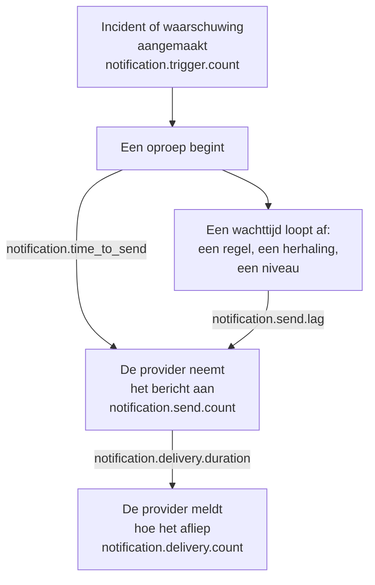

# Metrics voor de bezorging van meldingen

OneUptime legt vast hoe de meldingen verlopen die het verstuurt: hoeveel incidenten en waarschuwingen erom vragen, of elk bericht zijn provider heeft bereikt, hoe lang het duurde voordat een oproep van de bereikbaarheidsdienst vertrok, en of die de telefoon heeft bereikt. Stuur de eigen telemetrie van OneUptime naar een OneUptime-project, of naar een willekeurige OpenTelemetry-backend, om bezorgdoelen vast te leggen voor de mensen die uw installatie bedient en te controleren of u die haalt.

:::cards
- [Inschakelen](#inschakelen): Twee instellingen, en zonder die wordt niets vastgelegd.
- [De metrics](#de-metrics): Zeven metrics, van de aanleiding tot de telefoon.
- [Hoe een oproep wordt getimed](#hoe-een-oproep-wordt-getimed): Waar de verzendtijd en de verzendvertraging vanaf tellen.
- [SLO's om mee te beginnen](#slos-om-mee-te-beginnen): Vier doelen, query voor query.
:::

## Zo werkt het



Elk bericht telt mee in `notification.send.count`, op elk kanaal, niet alleen oproepen. De twee tijden, `notification.time_to_send` en `notification.send.lag`, gelden alleen voor oproepen.

## Inschakelen

Er wordt niets vastgelegd totdat OneUptime een OpenTelemetry-exporter heeft: zonder exporter kosten de metrics niets en worden ze nergens bewaard. Richt hem op een OneUptime-project, met een Server-[ingestiesleutel](/docs/telemetry/ingestion-keys) van dat project, of op een willekeurige backend die OTLP via HTTP aanneemt.

:::tabs
@tab Kubernetes
```yaml
openTelemetryExporter:
  endpoint: https://oneuptime.example.com/otlp
  headers: x-oneuptime-token=YOUR_INGESTION_KEY
```
De deployments `app` en `worker` versturen ze: laat `app.disableTelemetryCollection` en `worker.disableTelemetryCollection` op `false` staan, hun standaardwaarde.
@tab Docker Compose
```bash
OPENTELEMETRY_EXPORTER_OTLP_ENDPOINT=https://oneuptime.example.com/otlp
OPENTELEMETRY_EXPORTER_OTLP_HEADERS=x-oneuptime-token=YOUR_INGESTION_KEY
DISABLE_TELEMETRY_FOR_APP=false
```
Stel ze in `config.env` in en voer daarna `npm start` uit. `DISABLE_TELEMETRY_FOR_APP` is standaard `true`, en dan wordt er niets verstuurd.
:::

OneUptime heeft zowel het endpoint als de headers nodig: zonder header verstuurt het niets. Schrijf elke header als `name=value` en scheid meerdere met `;`. Een waarde mag `=` bevatten. OneUptime voegt zelf `/v1/metrics` aan het endpoint toe, en dezelfde instellingen versturen ook de eigen traces en logs. Elke metric verschijnt zodra OneUptime hem voor het eerst vastlegt: `notification.send.count` bij het eerste verstuurde bericht.

### Delta's naar een OneUptime-project sturen

OneUptime verstuurt tellers en histogrammen zoals OpenTelemetry dat standaard doet: elk punt bevat het lopende totaal sinds dat serverproces is gestart. De metriekverkenner telt de punten in elke stap van een grafiek op, dus hij leest de aantallen en percentielen van een tijdsbereik alleen exact uit delta's, punten die bevatten wat er sinds het vorige is gebeurd. Als de metrics naar een OneUptime-project gaan, stuur dan delta's:

:::tabs
@tab Kubernetes
```yaml
extraEnv:
  - name: OTEL_EXPORTER_OTLP_METRICS_TEMPORALITY_PREFERENCE
    value: delta
```
De eigen lijst van een service vervangt die van de hele chart: als u `app.extraEnv` of `worker.extraEnv` instelt, voeg hem daar dan ook toe.
@tab Docker Compose
```yaml title="docker-compose.override.yml"
services:
  app:
    environment:
      OTEL_EXPORTER_OTLP_METRICS_TEMPORALITY_PREFERENCE: delta
```
Maak het bestand aan naast `docker-compose.yml`, of voeg dit toe aan het bestand dat u al hebt, en voer daarna `npm start` uit.
:::

Dit geldt voor elke metric die OneUptime over zichzelf verstuurt. Een backend die lopende totalen zelf verwerkt, zoals Prometheus, heeft geen wijziging nodig.

## De metrics

| Metric | Type | Eenheid | Waar hij antwoord op geeft |
| --- | --- | --- | --- |
| `notification.trigger.count` | Teller | `1` | Hoeveel records om meldingen vroegen |
| `notification.send.count` | Teller | `1` | Hoe elk bericht verliep dat aan een provider werd overgedragen |
| `notification.send.duration` | Histogram | `ms` | Hoe lang de provider erover deed om het aan te nemen |
| `notification.time_to_send` | Histogram | `ms` | Hoe lang na de aanleiding een oproep zijn provider bereikte |
| `notification.send.lag` | Histogram | `ms` | Hoe lang nadat hij verschuldigd was een later verstuurde melding zijn provider bereikte |
| `notification.delivery.count` | Teller | `1` | Hoe de berichten afliepen die de providers aannamen |
| `notification.delivery.duration` | Histogram | `ms` | Hoe lang nadat de provider het aannam een bericht afliep |

Elk attribuut bevat een van een paar vaste waarden, nooit een project, een persoon, een telefoonnummer of een record. De enige uitzondering zijn de ID en de naam van een aangepast kanaal: een installatie heeft er een handvol van, en ze uit elkaar houden is juist de bedoeling.

### Records die mensen een melding sturen

`notification.trigger.count` telt elk incident, elke waarschuwing, elke incidentepisode en elke waarschuwingsepisode op het moment dat die wordt aangemaakt.

| Attribuut | Waarden |
| --- | --- |
| `notification.trigger.type` | `incident`, `alert`, `incident_episode`, `alert_episode` |
| `notification.trigger.source` | `automatic` als OneUptime het aanmaakte, vanuit een monitor of een regel; `manual` als een persoon of de API het deed |
| `monitor.type` | Het type van de monitor die een incident of een waarschuwing aanmaakte, zoals `Incoming Request`, `Logs` of `Metrics`; weggelaten als geen monitor dat deed |

### Berichten die aan een provider worden overgedragen

`notification.send.count` telt elk bericht dat aan een provider wordt overgedragen, en `notification.send.duration` meet de aanroep van de provider. Beide dragen deze attributen:

| Attribuut | Waarden |
| --- | --- |
| `notification.channel` | `email`, `sms`, `call`, `whatsapp`, `telegram`, `push`, `webhook`, `slack`, `microsoft_teams`, `mattermost`, `custom_channel` |
| `notification.provider` | `twilio`, `sms_and_call_gateway`, `smtp`, `sendgrid`, `amazon_ses`, `mailgun`, `postmark`, `resend`, `microsoft_graph`, `expo`, `push_relay`, `web_push`, `meta_whatsapp`, `telegram_bot_api`, `slack`, `microsoft_teams`, `mattermost`, `webhook`, `custom_channel`, of `none` als er aan geen enkele iets werd overgedragen |
| `notification.provider.config` | `global` voor het eigen account en de eigen instellingen van de installatie; `project` voor het eigen Twilio-account, de SMTP-server, de webhook of de werkruimteverbinding van een project, waarvan het project de fouten moet oplossen |
| `notification.on_call_page` | `true` voor een melding van een oproep, anders `false` |
| `outcome` | `success`, `failure` of `not_sent`, zoals hieronder |
| `notification.destination` | Slack, Microsoft Teams en Mattermost: `direct_message` naar één persoon, `channel` voor een bericht in een kanaal of een Teams-groepschat, `incoming_webhook` voor een inkomende webhook, zoals die van een abonnee van een statuspagina. Webhooks: `status_page_subscriber` voor de eigen webhook van een abonnee van een statuspagina. Ontbreekt bij de webhook van een persoon en bij alle andere kanalen |
| `notification.custom_channel.id`, `notification.custom_channel.name` | Alleen aangepaste kanalen: de ID van het kanaal, en de naam ingekort tot 100 tekens |

- `success`: de provider heeft het bericht aangenomen.
- `failure`: de provider heeft het geweigerd of was niet bereikbaar, of het versturen is mislukt. Een chatkanaal dat niet werd gevonden, is een mislukking zonder duur.
- `not_sent`: bewust niet verstuurd. Het project heeft het kanaal uitgeschakeld, heeft te weinig tegoed of is geblokkeerd, push is uitgeschakeld op deze server, of een aangepast kanaal is uitgeschakeld, verwijderd of valt niet onder de licentie. Een slagingspercentage laat deze weg: dit zijn instellingen die hun werk doen, geen platform dat faalt.

Een bericht naar de eigen webhook van een abonnee van een statuspagina telt één keer, hoe vaak het ook is geprobeerd: `success` als het endpoint antwoordde met een 2xx-status, en `failure` als het antwoordde met een andere status, niet bereikbaar was of het adres niet is toegestaan.

### Wat de telefoon bereikte

`notification.delivery.count` telt hoe elk bericht afliep dat een provider aannam, zoals de provider dat later meldt, één keer per bericht. `notification.delivery.duration` meet hoe lang nadat de provider het aannam. Beide dragen `notification.channel`, `notification.provider`, `notification.provider.config`, `notification.on_call_page` en `outcome`, de eindstatus:

| Kanaal | Provider | `outcome` | Duur |
| --- | --- | --- | --- |
| `sms` | `twilio` | `delivered`, `undelivered`, `failed` | Tot Twilio de status meldt |
| `call` | `twilio` | `answered`, `not_answered`, `failed` | Tot het gesprek werd opgenomen, of anders tot het eindigde |
| `push` | `expo`, `push_relay` | `delivered`, `undelivered`, `failed` | Niet getimed: een ontvangstbewijs zegt of Apple of Google de push heeft aangenomen, niet wanneer |
| `whatsapp` | `meta_whatsapp` | `delivered`, `failed` | Tot Meta de status meldt |

Een gesprek dat onbeantwoord bleef, in gesprek was of werd geweigerd, is `not_answered`. Een push naar een app die er niet meer is, is `undelivered`, en een gelezen WhatsApp-bericht telt als bezorgd. `notification.provider.config` is alleen `project` voor sms-berichten en gesprekken via het eigen Twilio-account van een project.

Statussen komen alleen binnen waar de provider ze kan melden:

- Sms-berichten en gesprekken: via Twilio, als Twilio uw server kan bereiken op de `HOST` ervan (zie [Twilio-integratie](/docs/self-hosted/twilio-integration#3-configureer-netwerktoegang)). De sms- en belgateway meldt er geen.
- WhatsApp: als de webhook van Meta voor uw installatie is ingesteld.
- Push: uit de ontvangstbewijzen van Expo, die OneUptime ongeveer 15 minuten na de push leest, ook via de push-relay. De installatie die de push verstuurde, telt hem.
- E-mail, Telegram, webhooks, chat en aangepaste kanalen melden geen eindstatus.

## Hoe een oproep wordt getimed

### Verzendtijd

`notification.time_to_send` loopt van de aanleiding van een oproep tot het moment dat de provider de melding aanneemt. Hij timet alleen de meldingen die verschuldigd zijn als de oproep begint: de personen van de eerste escalatieregel, volgens hun bereikbaarheidsregels die nergens op wachten, en elk niveau waar de oproep meteen naartoe gaat omdat hij niemand bereikte. Wachttijden die de bereikbaarheidsconfiguratie vraagt, zijn geen vertraging van het platform, dus die blijven buiten beschouwing: ze staan in de [verzendvertraging](#verzendvertraging). Alleen meldingen die hun provider aannam, worden getimed; een mislukking is te zien in `notification.send.count`.

| Attribuut | Waarden |
| --- | --- |
| `notification.channel` | Zoals bij `notification.send.count` |
| `notification.page.start` | Waar de tijd vanaf loopt, zoals hieronder |
| `notification.trigger.type` | Het record waarvoor de oproep is: `incident`, `alert`, `incident_episode`, `alert_episode` |
| `notification.custom_channel.id`, `notification.custom_channel.name` | Alleen aangepaste kanalen |

| `notification.page.start` | De tijd loopt vanaf |
| --- | --- |
| `monitor_data_received` | Wanneer OneUptime de gegevens ontving die de monitor deden afgaan: een inkomend verzoek, het rapport van een serveragent, een inkomende e-mail, de controle van een probe, een SNMP-trap of een poll van een netwerkapparaat. Inclusief de tijd die de gegevens in de wachtrij wachtten om te worden beoordeeld. |
| `record_created` | Wanneer het incident, de waarschuwing of de episode werd aangemaakt: door een telemetriemonitor, een regel of een persoon, en bij een controle op afwezigheid, zoals een heartbeat die stopte. |
| `page_started` | Wanneer een oproep later begon: een persoon, een workflow of een regel die nu overeenkomt startte hem, of het is een directe oproep. Voor een oproep die zijn bereikbaarheidsregel of OneUptime AI vasthield, wanneer de pauze afliep, of wanneer hij begon als dat eerder was. Voor een nieuwe oproep, wanneer de time-out na bevestiging afliep. Zo is een worker die een van beide te laat oppakte te zien in de tijd. |

Bij een inkomend verzoek loopt de tijd vanaf het laatste verzoek dat het endpoint ontving, dus die kan iets te kort uitvallen.

### Verzendvertraging

`notification.send.lag` loopt van het moment dat een later verstuurde melding verschuldigd was tot het moment dat de provider hem aanneemt. Twee workers versturen ze, elk één keer per minuut, dus een worker die op schema ligt laat tot ongeveer een minuut zien, en een worker die achterloopt laat zien hoeveel.

| `notification.schedule` | Verschuldigd wanneer |
| --- | --- |
| `rule_wait` | De bereikbaarheidsregel van een persoon die wacht, zoals "bel me na 10 minuten": zo lang nadat de persoon werd opgeroepen. Nooit voordat de worker de regels van die persoon het laatst doorliep, dus een regel die later is toegevoegd of gewijzigd, is vanaf dan verschuldigd. |
| `repeat` | Een push die wordt herhaald tot iemand bevestigt: telkens als het interval afloopt. |
| `escalation` | Een later escalatieniveau: als het niveau ervoor zijn wachttijd heeft afgerond, of meteen als een persoon de oproep doorgeeft. |
| `policy_repeat` | Het beleid dat opnieuw begint bij het eerste niveau: als de wachttijd van het laatste niveau is afgelopen. |

Hij draagt ook `notification.channel`, `notification.trigger.type` en, voor aangepaste kanalen, `notification.custom_channel.id` en `notification.custom_channel.name`. Een melding die verschuldigd is als de oproep begint, staat er nooit in, ook niet als een worker de oproep te laat startte, na een pauze of als nieuwe oproep: die staat in de verzendtijd.

### Buckets van de histogrammen

Elk histogram heeft eigen bucketgrenzen, in milliseconden, zo gekozen dat een doel bij een grens kan worden afgelezen:

| Histogram | Bucketgrenzen, in milliseconden |
| --- | --- |
| `notification.send.duration` | `5, 10, 25, 50, 100, 250, 500, 1000, 2500, 5000, 10000, 30000, 60000, 120000` |
| `notification.time_to_send` | `250, 500, 1000, 2000, 5000, 10000, 15000, 30000, 60000, 120000, 300000, 600000, 1800000, 3600000` |
| `notification.send.lag` | `1000, 5000, 10000, 15000, 30000, 45000, 60000, 75000, 90000, 120000, 180000, 300000, 600000, 1800000, 3600000` |
| `notification.delivery.duration` | `500, 1000, 2000, 5000, 10000, 15000, 30000, 60000, 120000, 300000, 600000, 1800000, 3600000, 14400000, 86400000` |

Een percentiel wordt uit de buckets berekend, en getekend als het midden van de bucket waarin het valt. Vergelijk het dus met de grens van een bucket: een P95 van `notification.time_to_send` op of onder 30000 betekent dat 95% van de oproepen 30 seconden of minder duurde.

## SLO's om mee te beginnen

Vier doelen die de meeste installaties kunnen beloven, elk opgebouwd uit een of twee query's in de metriekverkenner van het project dat de metrics ontvangt. Ze lezen een tijdsbereik exact af zodra de metrics als delta's binnenkomen: zie [Delta's naar een OneUptime-project sturen](#deltas-naar-een-oneuptime-project-sturen).

### Er een opbouwen in de metriekverkenner

:::steps
1. Open de [Metriekverkenner](/docs/telemetry/metrics-explorer) van het project, en klik op de eerste metric van het doel. De query daarvan is `a`.
2. Kies de aggregatie onder **Aggregate by**. Open daarna **Filters & grouping**, en voeg elk van de voorwaarden toe onder **Filter by attributes**.
3. Voor een tweede query klikt u op **Metriek toevoegen**, en stelt u `b` op dezelfde manier in.
4. Voor een formule klikt u op **Formule toevoegen**, en schrijft u die in **Formule**.
5. Om te horen wanneer het doel wordt gemist, klikt u op **Acties → Monitor maken vanuit deze weergave**, en laat u waarschuwen als de waarde het doel overschrijdt: zie [Metrics-monitor](/docs/monitor/metrics-monitor).
:::

Om een doel over 30 dagen te volgen met een foutenbudget, koppelt u die monitor aan een [SLO](/docs/slo/introduction): die telt de tijd waarin het doel werd gemist.

### Sms-berichten van de bereikbaarheidsdienst bereiken Twilio

Hoogstens 1% van de sms-berichten van de bereikbaarheidsdienst die via het eigen Twilio-account van de installatie worden verstuurd, mislukt, dus 99% wordt aangenomen.

| Query | Metric | Aggregatie | Voorwaarden |
| --- | --- | --- | --- |
| `a` | `notification.send.count` | **Som** | `notification.channel = sms`, `notification.on_call_page = true`, `notification.provider.config = global`, `outcome != not_sent` |
| `b` | `notification.send.count` | **Som** | Dezelfde, met `outcome = failure` |

De formule `$b / $a * 100` is het aandeel dat mislukte, en het doel wordt gehaald zolang dat op of onder 1 blijft. Een stap zonder mislukking tekent geen punt, omdat `b` er daar geen heeft. `outcome != not_sent` laat weg wat de eigen instellingen van de projecten tegenhielden, en `global` de eigen Twilio-accounts van de projecten. Op een installatie die sms-berichten via haar eigen sms- en belgateway verstuurt, meten dezelfde query's de gateway. Voor een ander kanaal wijzigt u `sms`: `call`, `push` of `email`.

### Oproepen vertrekken binnen 30 seconden

95% van de oproepen bereikt zijn provider binnen 30 seconden na de aanleiding.

| Query | Metric | Aggregatie | Voorwaarden |
| --- | --- | --- | --- |
| `a` | `notification.time_to_send` | **P95** | `notification.page.start != page_started` |

Het doel wordt gehaald zolang `a` op of onder 30000 blijft. Oproepen die later zijn gestart, worden getimed vanaf hun start of het moment dat ze verschuldigd waren, niet vanaf een aanleiding, dus die blijven buiten beschouwing. Groepeer op `notification.page.start` om de wachtrij van de monitors (`monitor_data_received`) los van de rest te zien, of op `notification.channel` om een traag kanaal te vinden.

### Later verstuurde meldingen vertrekken binnen 90 seconden

99% van de meldingen die na een wachttijd worden verstuurd, bereikt zijn provider binnen 90 seconden nadat ze verschuldigd waren.

| Query | Metric | Aggregatie | Voorwaarden |
| --- | --- | --- | --- |
| `a` | `notification.send.lag` | **P99** | — |

Het doel wordt gehaald zolang `a` op of onder 90000 blijft. Groepeer op `notification.schedule` om te zien welke worker achterliep: `rule_wait` en `repeat` horen bij de ene worker, `escalation` en `policy_repeat` bij de andere.

### Sms-berichten van de bereikbaarheidsdienst bereiken de telefoon

Hoogstens 5% van de sms-berichten van de bereikbaarheidsdienst die Twilio voor het eigen account van de installatie aannam, wordt niet bezorgd.

| Query | Metric | Aggregatie | Voorwaarden |
| --- | --- | --- | --- |
| `a` | `notification.delivery.count` | **Som** | `notification.channel = sms`, `notification.on_call_page = true`, `notification.provider.config = global` |
| `b` | `notification.delivery.count` | **Som** | Dezelfde, met `outcome != delivered` |

De formule `$b / $a * 100` is het aandeel dat niet werd bezorgd. Providers en uitgeschakelde telefoons bepalen een deel ervan, dus stel het doel in op basis van wat u over een paar weken ziet. Gebruik voor gesprekken `call` en `outcome != answered`. Twilio moet uw server kunnen bereiken: zie [Wat de telefoon bereikte](#wat-de-telefoon-bereikte).

## Problemen oplossen

:::details Er komen geen metrics van meldingen binnen
Controleer of `OPENTELEMETRY_EXPORTER_OTLP_ENDPOINT` en `OPENTELEMETRY_EXPORTER_OTLP_HEADERS` allebei zijn ingesteld, en in Docker Compose of `DISABLE_TELEMETRY_FOR_APP` op `false` staat, en start OneUptime daarna opnieuw. Bij het starten logt OneUptime een waarschuwing als het een header niet kan lezen, of als het niets verstuurt. Een metric verschijnt pas als er iets is vastgelegd, dus verstuur eerst een melding.
:::

:::details Een aantal groeit alleen maar, of een percentiel beweegt nauwelijks
De metrics komen binnen als lopende totalen. Stuur delta's: zie [Delta's naar een OneUptime-project sturen](#deltas-naar-een-oneuptime-project-sturen).
:::

:::details Er komen geen eindstatussen binnen
Eindstatussen komen van de providers, later, en alleen waar ze die kunnen melden: zie [Wat de telefoon bereikte](#wat-de-telefoon-bereikte). Op een installatie die Twilio niet kan bereiken, worden sms-berichten en gesprekken als verstuurd geteld, maar nooit als bezorgd.
:::

## Volgende stappen

:::cards
- [Metriekverkenner](/docs/telemetry/metrics-explorer): Elke metric in een grafiek zetten, combineren en vergelijken.
- [Metrics-monitor](/docs/monitor/metrics-monitor): Waarschuwen als een doel wordt gemist.
- [Twilio-integratie](/docs/self-hosted/twilio-integration): Twilio laten melden wat de telefoon bereikte.
- [Escalatieregels](/docs/on-call/escalation-rules): De wachttijden waar de verzendvertraging vanaf telt.
:::
