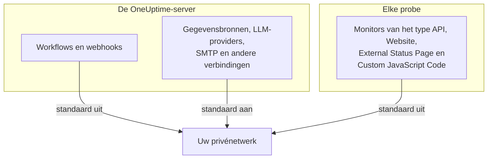

# Toegang tot privénetwerk

OneUptime weigert bepaalde uitgaande verzoeken naar hosts die naar een privé-, loopback- of link-local-bereik worden omgezet. Als u ooit een workflow op een interne tool hebt gericht, hebt u deze melding gezien:

> Webhook URL resolves to a private, loopback, or link-local address and is not allowed

Voor het gehoste product is die standaard juist: daar kan iedereen zich aanmelden en is het doel van een webhook niet-vertrouwde invoer. Op een zelf gehoste instantie staat hij iets gewoons in de weg: een waarschuwing plaatsen in een zelf gehoste Mattermost, Jira of ticketsysteem dat alleen in uw eigen netwerk bestaat.

Deze pagina legt uit hoe u dat bewust en beperkt toestaat. Drie schakelaars bepalen het, elk voor een eigen soort verbinding, en ze worden op verschillende machines ingesteld:

| Wat u intern wilt bereiken | Waar de instelling staat | Standaard bij een zelf gehoste installatie |
| --- | --- | --- |
| Workflows, projectwebhooks, gebruikerswebhooks voor de dienst | De omgeving van de **API-server** | Privéadressen geweigerd |
| Gegevensbronnen, LLM-providers, SMTP-servers, OIDC-discovery en andere verbindingen | De omgeving van de **API-server** | Privéadressen toegestaan |
| **Monitors** van het type API, Website, External Status Page en Custom JavaScript Code | De eigen omgeving van de **probe** | Privéadressen geweigerd |



Netwerkeigen monitortypen zoals Ping, Port, SSL-certificaat, DNS, DNSSEC, SNMP / Netwerkapparaat, SQL-query, Databasegezondheid, Synthetic en Network Path gebruiken hun eigen transport. De instelling op deze pagina regelt de HTTP-transporten die willekeurige antwoordinhoud naar een project terugsturen: monitors van het type API, Website, External Status Page en Custom JavaScript Code.

:::cards
- [Webhooks en workflows](#webhooks-en-workflows): Laat een webhook in uw netwerk posten.
- [Andere uitgaande verbindingen](#andere-uitgaande-verbindingen): Gegevensbronnen, LLM-providers en mailservers.
- [Probes en monitors](#probes-en-monitors): Laat een probe privésites controleren.
- [Controleren of het werkt](#controleren-of-het-werkt): Lees welke schakelaar een weigering noemt.
:::

## Wat geblokkeerd is en wat vrijgegeven kan worden

Geblokkeerde doelen vallen in twee niveaus.

| Niveau | Bereiken | Kan het worden toegestaan? |
| --- | --- | --- |
| **Privé** | RFC-1918 (`10.0.0.0/8`, `172.16.0.0/12`, `192.168.0.0/16`), CGNAT (`100.64.0.0/10`), IPv6 unique-local (`fc00::/7`) en site-local (`fec0::/10`) | Ja |
| **Verboden** | Loopback (`127.0.0.0/8`, `::1`), het niet-gespecificeerde adres, link-local (`169.254.0.0/16`, `fe80::/10`), multicast, gereserveerd, broadcast, en de namen `localhost` en `metadata.google.internal` | Alleen door de exacte host of CIDR in de allowlist voor webhooks te noemen. Nooit voor monitors. |

Het cloudmetadata-eindpunt `169.254.169.254` zit niet voor niets in het verboden niveau. Op een cloud-VM geeft het de IAM-inloggegevens van de instantie aan alles wat vanaf de machine een HTTP-verzoek kan doen, dus geen algemene instelling zal het ooit openen.

IPv6-schrijfwijzen die een IPv4-doel in zich dragen – IPv4-mapped (`::ffff:10.0.0.5`), NAT64, 6to4, Teredo – worden ingedeeld naar het IPv4-adres dat ze bereiken, dus ze kunnen niet worden gebruikt om een verboden adres langs een toestemming voor het privéniveau te smokkelen.

## Webhooks en workflows

Deze bestemmingen vallen eronder, omdat het doel een URL is die een geauthenticeerd lid van uw project heeft geschreven:

- **API**-componenten in workflows (GET / POST / PUT / PATCH / DELETE)
- HTTP-verzoeken van de workflowcomponent **Custom JavaScript**
- Webhookmeldingen van projecten (incidenten, waarschuwingen, monitors, dienst, gepland onderhoud, gebeurtenissen van statuspagina's)
- **Gebruikerswebhooks** voor de dienst

**Niet** gedekt, en dat blijft zo: **webhooks van abonnees van statuspagina's**. Elke bezoeker van een openbare statuspagina kan er een registreren, dus die bestemming versoepelen zou iedereen op internet uw server in uw privénetwerk laten POSTen. Dit is niet instelbaar.

Uitgaande verbindingen die geen webhooks zijn – externe gegevensbronnen, LLM-providers, SMTP-servers (de SMTP-instellingen van een project en de workflowcomponent **Email**), SMTP-OAuth-tokeneindpunten, OIDC-discovery en HTTP-stappen in runbooks – worden apart geregeld, door `DATA_SOURCE_BLOCK_PRIVATE_ADDRESSES`, en staan privébereiken bij zelf gehoste installaties al toe. Zie [Andere uitgaande verbindingen](#andere-uitgaande-verbindingen).

### De API-server instellen

Stel een of beide van deze variabelen in op de API-server en start hem opnieuw. Ze staan standaard uit, dus een instantie die geen van beide instelt, gedraagt zich precies zoals voorheen.

| Variabele | Helm-waarde | Wat ze toestaat |
| --- | --- | --- |
| `ALLOW_PRIVATE_NETWORK_WEBHOOKS` | `webhooks.allowPrivateNetwork` | Het hele privéniveau, wanneer ingesteld op `true`. |
| `PRIVATE_NETWORK_WEBHOOK_ALLOWLIST` | `webhooks.privateNetworkAllowlist` | De hosts en CIDR's die ze noemt, ongeacht hun niveau. |

:::tabs
@tab Docker Compose
```bash title="config.env"
ALLOW_PRIVATE_NETWORK_WEBHOOKS=true
PRIVATE_NETWORK_WEBHOOK_ALLOWLIST=mattermost.internal,*.svc.cluster.local,10.20.0.0/16
```
@tab Kubernetes
```yaml title="values.yaml"
webhooks:
  allowPrivateNetwork: true
  privateNetworkAllowlist: "mattermost.internal,10.20.0.0/16"
```
:::

Onder Docker Compose bevat `config.env` een regel `ALLOW_PRIVATE_NETWORK_WEBHOOKS=false`: pas die aan in plaats van een tweede toe te voegen en voer daarna `npm run start` uit. Onder Kubernetes upgradet u de release.

Items in de allowlist kunnen worden gescheiden door komma's, spaties of nieuwe regels, en elk item kan zijn:

- een hostnaam – `mattermost.internal`
- een jokerteken – `*.svc.cluster.local` (komt overeen met subdomeinen, niet met het kale achtervoegsel)
- een IPv4- of IPv6-adres – `10.20.30.40`, `fd00::1`
- een CIDR – `10.20.0.0/16`, `fd12:3456::/32`

Een schema, poort, pad of gebruikersinformatie in een item wordt verwijderd, dus de webhook-URL plakken die u al hebt, werkt.

Een hostnaam die in de allowlist staat, wordt vertrouwd **zonder DNS-controle** – dat is precies waarom u hem noemt, want hij hoort te verwijzen naar iets wat de blokkeerlijst zou weigeren. Een adresitem wordt vergeleken met de letterlijke waarde in de URL en met elk adres dat DNS ervoor teruggeeft.

> [!CAUTION]
> **Zet nooit `169.254.169.254`, of een bereik dat het bevat, in de allowlist.** Op een cloud-VM geeft dat elk projectlid de IAM-inloggegevens van uw instantie.

## Andere uitgaande verbindingen

Een tweede beveiliging dekt uitgaande verbindingen waarvan een projectlid het doel kiest, maar die geen webhooks zijn:

- externe gegevensbronnen (PostgreSQL-, MySQL-, SQL Server-, ClickHouse-, Elasticsearch- en REST-API-verbindingen), verbindingen voor beveiligingsgebeurtenissen zoals Splunk, en threat-intelfeeds
- LLM-providers, inclusief een zelf gehoste Ollama of vLLM
- SMTP-servers – de SMTP-instellingen van een project en de workflowcomponent **Email** – en OAuth-token-URL's voor SMTP en workflows
- OIDC-discovery voor single sign-on
- de verificatie van eigen domeinen van statuspagina's en dashboards
- HTTP-stappen in runbooks
- de URL van de Grafana OnCall-API waaruit een import leest (**Projectinstellingen** > **Basis** > **Importeren uit een andere tool**)

Deze beveiliging werkt andersom dan de webhookinstellingen. Bij een zelf gehoste installatie **staat** ze het privéniveau standaard **toe**, omdat de database, mailserver of modelserver waarmee deze verbindingen maken meestal in uw eigen netwerk staat. Het verboden niveau – loopback, link-local en het cloudmetadata-eindpunt – wordt hoe dan ook geweigerd, en er bestaat geen allowlist voor.

`DATA_SOURCE_BLOCK_PRIVATE_ADDRESSES` maakt haar strenger. Stel de variabele in op `true` om het privéniveau ook voor deze verbindingen te weigeren, bijvoorbeeld wanneer de projecten op uw instantie toebehoren aan mensen die uw interne netwerk niet mogen bereiken:

:::tabs
@tab Docker Compose
```bash title="config.env"
DATA_SOURCE_BLOCK_PRIVATE_ADDRESSES=true
```
@tab Kubernetes
```yaml title="values.yaml"
outboundConnections:
  blockPrivateNetwork: true
```
:::

Deze instelling geldt niet voor een globale LLM-provider, die een beheerder instelt in plaats van een project (met de variabelen `GLOBAL_LLM_PROVIDER_*`, de waarde `vllm.globalProvider` van de Helm-chart, of in het Admin-dashboard onder **Instellingen** > **Globale LLM-providers**): zo'n provider kan nog steeds privéadressen bereiken, al blijven loopback en link-local ook voor hem geweigerd.

Alleen de exacte waarde `true` zet haar aan. Op een instantie met `BILLING_ENABLED=true` staat ze altijd aan, wat u ook instelt. Ze verandert niet welke doelen de webhookinstellingen hierboven of de probe-instelling hieronder toestaan; elke poort wordt apart ingesteld. Wel verandert ze hoe weigeringen luiden, ook voor webhooks en workflowverzoeken: staat ze aan, dan wordt een geweigerde hostnaam gemeld zonder te zeggen waarnaar hij werd omgezet (zie [Controleren of het werkt](#controleren-of-het-werkt)).

Onder Docker Compose bevat `config.env` een regel `DATA_SOURCE_BLOCK_PRIVATE_ADDRESSES=false` (voeg hem toe als uw `config.env` ouder is). Zet die regel op `true` in plaats van een tweede toe te voegen en voer daarna `npm run start` uit, zodat de containers met de nieuwe waarde opnieuw worden aangemaakt; `docker compose restart` leest `config.env` niet opnieuw. Onder Kubernetes stelt u haar in in uw values-bestand en upgradet u de release; de chart geeft haar door aan de pods van de app en de worker.

Staat ze aan, dan wordt een geweigerde hostnaam gemeld zonder te zeggen waarnaar hij werd omgezet, bijvoorbeeld _"LLM provider host ollama.internal could not be reached."_ Een naam die helemaal niet wordt omgezet, krijgt dezelfde melding, zodat projectleden met deze velden niet kunnen achterhalen welke interne namen bestaan. Een adres dat als IP is ingevoerd, wordt nog steeds samen met de reden genoemd, bijvoorbeeld _"LLM provider host 10.0.4.12 is not allowed: private network address."_ Met `LOG_LEVEL=DEBUG` logt de app het adres waarnaar elke geweigerde naam werd omgezet.

## Probes en monitors

Vier monitortypen zijn betrokken: **API**, **Website**, **External Status Page** en **Custom JavaScript Code**. Op een standaardprobe kunnen ze openbare HTTP(S)-doelen bereiken, maar ze weigeren privéadresruimte. Monitors van het type API, Website en External Status Page valideren en pinnen DNS-resultaten voor elke verbinding en valideren elke omleiding opnieuw; Custom JavaScript Code past hetzelfde adresbeleid toe in de brug van zijn sandbox.

De schakelaar wordt gelezen door het **probeproces uit zijn eigen omgeving**, niet uit die van de API-server, en elke probe leest hem: de probes die met Docker Compose worden meegeleverd, de probes die de Helm-chart uitrolt en elke [eigen probe](/docs/probe/custom-probe) die u zelf draait. Wie een probe uitrolt, beheert de omgeving ervan en weet welk netwerk die probe kan zien – een eigen probe is meestal een andere machine, vaak beheerd door iemand anders, en hij leest nooit de configuratie van de API-server.

:::tabs
@tab Docker Compose
`config.env` bevat al een regel `PROBE_ALLOW_PRIVATE_NETWORK_MONITORS=false`: zet die regel op `true` in plaats van een tweede toe te voegen, want wanneer een variabele twee keer voorkomt, wint de latere regel. Voer daarna `npm run start` uit, wat de containers met de nieuwe waarde opnieuw aanmaakt; `docker compose restart` leest `config.env` niet opnieuw. Elke meegeleverde probe leest die ene regel, dus hij geldt voor `probe-1` en, waar uw stack een tweede probe draait, voor `probe-2`.

```bash title="config.env"
PROBE_ALLOW_PRIVATE_NETWORK_MONITORS=true
```
@tab Kubernetes
Stel hem per probe in uw values-bestand in en upgrade de release. Elk item onder `probes:` is een aparte probe, dus stel hem in op elke probe die privéadressen moet bereiken:

```yaml title="values.yaml"
probes:
  one:
    allowPrivateNetworkMonitors: true
```
:::

Op een eigen probe stelt u `PROBE_ALLOW_PRIVATE_NETWORK_MONITORS=true` in de eigen omgeving van die probe in en start u hem opnieuw. De waarde moet precies `true` zijn; al het andere, zoals `TRUE` of `1`, laat de schakelaar uit, en de probe zegt dat in een waarschuwing bij het opstarten, ongeacht de waarde van `LOG_LEVEL`.

De meegeleverde probes zijn **globale probes**: ze registreren zich met de `REGISTER_PROBE_KEY` van de instantie, en elk project op de instantie kan ze kiezen. De schakelaar aanzetten voor een meegeleverde probe laat dus monitors uit **elk project op de instantie** via die probe privéadressen bereiken. Dat is meestal wat een installatie voor één team wil. Waar projecten dat bereik niet mogen delen – gescheiden teams of klanten die u host –, laat u hem uit op de meegeleverde probes en rolt u in plaats daarvan in elk netwerk een privé- (eigen) probe uit, alleen daar aangezet.

Er is één uitzondering. Een probe die zich registreert met `REGISTER_PROBE_KEY` en `BILLING_ENABLED=true` in zijn eigen omgeving heeft – een globale probe van het gehoste product met open aanmelding, waar iedereen zich kan aanmelden en alle projecten de globale probes delen – blijft ook met de schakelaar aan alleen openbaar, en logt bij het opstarten een waarschuwing dat hij hem negeert. De probes die met Docker Compose en de Helm-chart worden meegeleverd, krijgen de `BILLING_ENABLED` van de instantie automatisch; geef hem aan elke andere `REGISTER_PROBE_KEY`-probe die u voor zo'n instantie draait. Een probe kan op geen andere manier weten dat hij globaal is, dus een globale probe die in het Admin-dashboard is aangemaakt en met `PROBE_ID` en `PROBE_KEY` draait, volgt de schakelaar net als een privéprobe: zet hem daar niet aan als projecten het netwerk van die probe niet mogen delen. Een privéprobe volgt de schakelaar op elke instantie.

Elke probe logt bij het opstarten zijn effectieve beleid voor privénetwerken: of het bewaken van privénetwerken aan of uit staat, en waarom. Een waarde die wordt genegeerd, en een globale probe die de schakelaar voor elk project openzet, worden op elk `LOG_LEVEL` als waarschuwingen gelogd. De gewone regel aan of uit, en de JSON "Probe environment" die dezelfde beslissing vastlegt onder `privateNetworkMonitors`, worden gelogd bij `LOG_LEVEL=INFO`, de standaard van de Helm-chart; Docker Compose wordt geleverd met `LOG_LEVEL=ERROR`, dus stel daar `LOG_LEVEL=INFO` in om ze te zien. Controleer eerst dat log wanneer een monitor op een probe die u net hebt gewijzigd nog steeds wordt geweigerd.

Aanzetten opent loopback, link-local en het cloudmetadata-eindpunt **niet**. Die blijven op elke probe geweigerd, wat vooral telt voor probes die draaien in een netwerk dat niet van de auteur van de monitor is.

> [!WARNING]
> Laat hem uit op probes die u namens andere mensen beheert.

## Controleren of het werkt

Voer de workflow of monitor opnieuw uit. Wordt hij nog steeds geweigerd, dan noemt de foutmelding welke poort dicht is:

- _"...points to a private network address and is not allowed. Self-hosted instances can allow this by setting `ALLOW_PRIVATE_NETWORK_WEBHOOKS`..."_ – de instelling van de API-server ontbreekt.
- _"...private network address... Set PROBE_ALLOW_PRIVATE_NETWORK_MONITORS=true on the probe running this monitor to allow it."_ – een privé- (eigen) probe heeft de monitor uitgevoerd, en zijn schakelaar staat uit. Let op: dit stelt u in op de probe, niet op de API-server.
- _"...private network address... Set PROBE_ALLOW_PRIVATE_NETWORK_MONITORS=true on the probe running this monitor to allow it (probes.<name>.allowPrivateNetworkMonitors in the Helm chart). This is a global probe, so that allows it for every project on this instance; otherwise, select a private probe deployed on that network."_ – een meegeleverde (globale) probe heeft de monitor uitgevoerd, en zijn schakelaar staat uit. Zet hem voor die probe aan zoals hierboven beschreven als elk project op de instantie dat netwerk mag bereiken; kies anders een privéprobe voor de monitor.
- _"...Global probes cannot monitor private network addresses. Deploy and select a private probe for this target."_ – een globale probe met `BILLING_ENABLED=true` in zijn omgeving heeft de monitor uitgevoerd. Automatisch geregistreerde globale probes blijven daar alleen openbaar, wat hun schakelaar ook zegt; rol een privéprobe uit binnen het netwerk van het doel en kies die voor de monitor.
- _"Monitor target host ... could not be reached."_ – een monitor van het type API, Website of External Status Page waarvan het doel een **hostnaam** is, meldt dit zowel wanneer de naam naar een geweigerd adres wordt omgezet als wanneer DNS mislukt, zodat een monitor niet kan worden gebruikt om in kaart te brengen welke interne namen bestaan. De foutdetails die erbij worden getoond, noemen in beide gevallen `PROBE_ALLOW_PRIVATE_NETWORK_MONITORS`; ze zeggen niet welk geval zich voordeed. Wijst de naam naar een privéadres, controleer dan in het opstartlog van de probe zijn beleid voor privénetwerken; staat het uit, dan is de oplossing dezelfde als bij de meldingen hierboven. Met `LOG_LEVEL=DEBUG` logt de probe ook de exacte reden voor elke geweigerde naam.
- _"Request URL could not be reached."_ – dezelfde regel voor een monitor van het type **Custom JavaScript Code**: een script dat een **hostnaam** opvraagt, krijgt dit zowel wanneer de naam naar een geweigerd adres wordt omgezet als wanneer DNS mislukt. Met `LOG_LEVEL=DEBUG` logt de probe de exacte reden.
- _"Webhook URL could not be reached."_ of, vanuit een workflow, _"Request URL could not be reached."_ – de instantie draait met `DATA_SOURCE_BLOCK_PRIVATE_ADDRESSES=true` (of `BILLING_ENABLED=true`), dus een geweigerde **hostnaam** wordt niet verklaard: hij werd naar een geweigerd adres omgezet of helemaal niet. Met `LOG_LEVEL=DEBUG` logt de app of de worker welke van de twee, en het adres.
- _"...points to a private, loopback, or link-local address and is not allowed."_ – het doel zit in het verboden niveau. Noem voor een webhook de exacte host of CIDR in `PRIVATE_NETWORK_WEBHOOK_ALLOWLIST` als u hem echt nodig hebt. Voor een monitor is er geen uitzondering.
- _"...hostname could not be resolved via DNS."_ – de container kan de naam niet omzetten. Controleer of hij een netwerk deelt met het doel.

## Beveiligingsnotities

Dit openzetten verandert echt wat uw OneUptime-instantie kan worden gemaakt te bereiken, dus het loont om er bewust mee om te gaan:

- **Geef de voorkeur aan de allowlist boven de algemene schakelaar.** `mattermost.internal` noemen is een veel kleinere toestemming dan elk RFC-1918-adres openzetten.
- **Wie een workflow of een monitor van het type API, Website, External Status Page of Custom JavaScript Code kan maken, kan alles bereiken wat u hebt toegestaan.** Behandel het lidmaatschap van die projecten daarnaar.
- **De antwoordtekst komt terug.** Een API-component in een workflow geeft de status, headers en body terug in het workflowlog, dus een toegestane host is leesbaar, niet alleen beschrijfbaar.
- **Omleidingen worden nooit gevolgd** bij webhookverzoeken, dus een toegestane openbare host kan de server niet met een tweede sprong naar een interne host doorsturen.
- **Beperk waar mogelijk per probe in plaats van voor de hele instantie.** Een probe die binnen één netwerk is uitgerold, is een smallere toestemming dan het uitgaande verkeer van de API-server openzetten.

## Volgende stappen

:::cards
- [Eigen probes](/docs/probe/custom-probe): Draai een probe binnen het netwerk dat hij moet controleren.
- [Workflowconfiguratie](/docs/workflows/configuration): Wat workflowstappen kunnen bereiken en doen.
- [LLM-providers](/docs/ai/llm-provider): Verbind OneUptime AI met een model in uw netwerk.
- [Architectuur](/docs/self-hosted/architecture): Welk deel van een zelf gehoste installatie welke verbinding maakt.
:::
