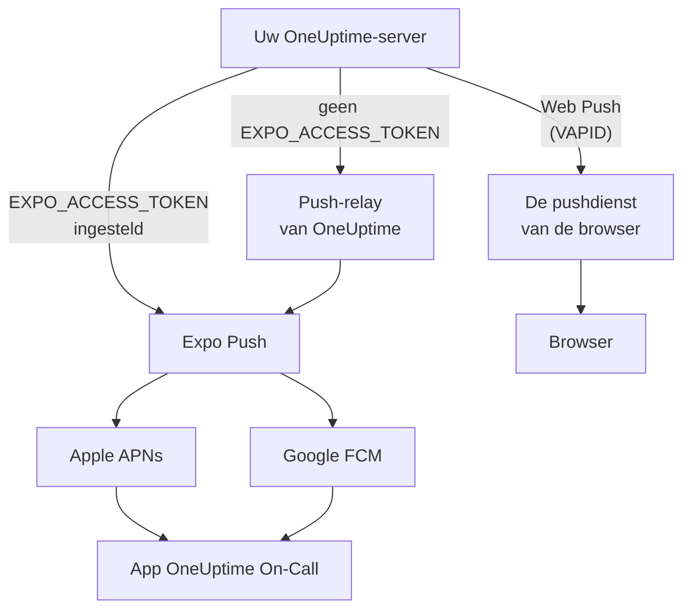

# Pushmeldingen

OneUptime waarschuwt mensen op hun telefoon via de mobiele app **OneUptime On-Call**, en in hun browser via Web Push. Mobiele pushes lopen via **Expo Push**: een zelf gehoste instantie stuurt ze standaard via de push-relay van OneUptime, en heeft dus uitgaande netwerktoegang tot de relay nodig en geen eigen inloggegevens voor Expo, Apple of Google.

:::cards
- [Kies hoe pushes worden verstuurd](#zelf-gehoste-inrichting): De push-relay, of uw eigen Expo-toegangstoken.
- [Open de firewall](#netwerktoegang): De adressen die uw server en de apparaten van uw mensen bereiken.
- [Laat het klinken in de stille modus](#kritieke-dienstmeldingen-stille-modus-doorbreken): Laat dienstmeldingen klinken op een gedempte telefoon.
- [Los pushes op die nooit aankomen](#problemen-oplossen): Wat elke fout van Expo betekent.
- [Zet push uit](#push-uitzetten-voor-de-hele-server): Verstuur niets via Expo, de relay of browsers.
:::

## Hoe het werkt



De mobiele app van OneUptime registreert een Expo-pushtoken bij de backend. De backend verstuurt meldingen via de push-relay van OneUptime, of rechtstreeks naar Expo wanneer `EXPO_ACCESS_TOKEN` is ingesteld. Expo stuurt de berichten door naar Apple APNs of Google FCM voor aflevering op het apparaat.

Web Push-meldingen gebruiken nog steeds VAPID-sleutels en het Web Push-protocol.

## Zelf gehoste inrichting

Met de officiële mobiele app en de standaardrelay heeft de server geen Expo-inloggegevens nodig. Voor rechtstreekse aflevering via Expo stelt u `EXPO_ACCESS_TOKEN` in met inloggegevens die passen bij het Expo-project van uw app. Web Push vereist `VAPID_PUBLIC_KEY`, `VAPID_PRIVATE_KEY` en `VAPID_SUBJECT`.

| Variabele | Helm-waarde | Standaard | Wat het doet |
| --- | --- | --- | --- |
| `PUSH_NOTIFICATION_RELAY_URL` | `pushNotification.relayUrl` | `https://oneuptime.com/api/notification/push-relay/send` | Waar mobiele pushes heen gaan zolang `EXPO_ACCESS_TOKEN` niet is ingesteld. |
| `EXPO_ACCESS_TOKEN` | `expo.accessToken` | Leeg | Stuurt mobiele pushes rechtstreeks naar Expo, met het token van uw Expo-project. |
| `PUSH_NOTIFICATION_RELAY_SERVER_ENABLED` | `pushNotification.relayServerEnabled` | Leeg | Stuurt mobiele pushes van andere OneUptime-servers door, met het `EXPO_ACCESS_TOKEN` van deze server. Leeg betekent uit, tenzij `BILLING_ENABLED` `true` is. |
| `VAPID_PUBLIC_KEY` | `vapid.publicKey` | Leeg | De openbare helft van het sleutelpaar waarmee browsers zich abonneren. |
| `VAPID_PRIVATE_KEY` | `vapid.privateKey` | Leeg | De privéhelft, die elke Web Push ondertekent. |
| `VAPID_SUBJECT` | `vapid.subject` | `mailto:support@oneuptime.com` | Een contactadres waarop de pushdiensten van browsers u kunnen bereiken. |

Genereer één keer een VAPID-sleutelpaar met `npx web-push generate-vapid-keys`, en bewaar het: browsers die zich met een sleutelpaar hebben geabonneerd, ontvangen geen pushes meer wanneer het verandert.

:::tabs
@tab Docker Compose
```bash title="config.env"
VAPID_PUBLIC_KEY=your-public-key
VAPID_PRIVATE_KEY=your-private-key
VAPID_SUBJECT=mailto:oncall@example.com
# Leave unset to send mobile pushes through the push relay.
EXPO_ACCESS_TOKEN=
```
@tab Kubernetes
```yaml title="values.yaml"
vapid:
  publicKey: your-public-key
  privateKey: your-private-key
  subject: mailto:oncall@example.com
# Leave empty to send mobile pushes through the push relay.
expo:
  accessToken:
```

:::details De privésleutel in een Secret bewaren
`vapid.privateKey` bewaart de privésleutel in de values van de release, die Helm bij elke revisie opslaat. Om hem daarbuiten te houden, zet u hem in een Kubernetes-Secret in de namespace van OneUptime, onder `privateKey`, en geeft u in plaats daarvan dat Secret op:

```bash
kubectl create secret generic oneuptime-vapid \
  --namespace oneuptime \
  --from-literal=privateKey=your-private-key
```

```yaml title="values.yaml"
vapid:
  publicKey: your-public-key
  existingSecret:
    name: oneuptime-vapid
  subject: mailto:oncall@example.com
```

Stel `vapid.privateKey` of `vapid.existingSecret.name` in, niet allebei: de chart weigert die twee samen. Staat de privésleutel in uw Secret onder een andere sleutel, geef die sleutel dan op in `vapid.existingSecret.privateKeyKey`. De openbare sleutel blijft in `vapid.publicKey`: elke browser krijgt hem.
:::
:::

## Netwerktoegang

| Richting | Bestemming | Protocol / poort | Wanneer nodig |
| --- | --- | --- | --- |
| OneUptime → standaard push-relay | `https://oneuptime.com/api/notification/push-relay/send`, `https://oneuptime.com/api/notification/push-relay/receipts` | HTTPS / TCP 443 | Mobiele push wanneer `EXPO_ACCESS_TOKEN` niet is ingesteld. |
| OneUptime → Expo | `https://exp.host/--/api/v2/push/send`, `https://exp.host/--/api/v2/push/getReceipts` | HTTPS / TCP 443 | Rechtstreekse mobiele push wanneer `EXPO_ACCESS_TOKEN` is ingesteld. |
| OneUptime → pushdienst van de browser | Het HTTPS-eindpunt uit het pushabonnement van de browser | HTTPS / normaal TCP 443 | Web Push. |
| Mobiele app of browser → OneUptime | Uw OneUptime-hostnaam | HTTPS / TCP 443 | Aanmelden, het apparaat registreren en meldingslinks openen. |

Als u `PUSH_NOTIFICATION_RELAY_URL` wijzigt, sta dan de hostnaam van de bestemming en de ingestelde poort toe. Een eigen relay moet de relay-API van OneUptime implementeren. Deze standaardwaarden en de keuze tussen relay en rechtstreekse aflevering zijn vastgelegd in [de configuratie van OneUptime](https://github.com/OneUptime/oneuptime/blob/master/config.example.env) en [de pushservice](https://github.com/OneUptime/oneuptime/blob/master/packages/Common/Server/Services/PushNotificationService.ts). Rechtstreekse verzoeken aan Expo gebruiken het eindpunt dat in [de verzendhandleiding van Expo](https://docs.expo.dev/push-notifications/sending-notifications/) staat. OneUptime leest afleverbewijzen bij de relay op hetzelfde adres, met `/receipts` in plaats van `/send`. Een relay zonder die route levert pushes nog steeds af; een apparaat waarvan de app is verwijderd, valt dan pas op wanneer een latere push ernaar wordt geweigerd.

Een zelf gehoste OneUptime-server stuurt pushes van andere servers alleen door met `PUSH_NOTIFICATION_RELAY_SERVER_ENABLED=true` en een eigen `EXPO_ACCESS_TOKEN`; zonder deze instelling antwoordt hij op dat adres met 404. Zet de instelling alleen aan op de server waarlangs uw andere OneUptime-servers versturen, en laat alleen die servers dat adres bereiken.

Sta voor Web Push de werkelijke hosts van de abonnementseindpunten toe voor de browsers die uw team gebruikt. OneUptime accepteert `fcm.googleapis.com`, `android.googleapis.com`, `push.services.mozilla.com`, `notify.windows.com` en `push.apple.com`, inclusief hun subdomeinen. Typische voorbeelden zijn `updates.push.services.mozilla.com` en `web.push.apple.com`. Het [pushabonnement van de browser](https://developer.mozilla.org/en-US/docs/Web/API/PushSubscription) levert de bestemming; alleen Expo of de relay van OneUptime toestaan maakt Web Push niet mogelijk.

Sta DNS-resolutie en uitgaand TLS toe vanuit het OneUptime-proces dat meldingen verstuurt. Zijn trust store moet het certificaat van de bestemming valideren, en proxy's moeten API-verzoeken doorlaten zonder interactieve authenticatie. Pushproviders roepen geen webhook aan op uw OneUptime-server, dus de server kan privé blijven wanneer de apparaten van gebruikers er via een VPN of een andere privéverbinding bij kunnen. Een server zonder toegang tot zijn relay of externe pushdiensten kan deze meldingen niet afleveren.

De connectiviteit van apparaten is een aparte vereiste. iOS-apparaten hebben toegang tot APNs nodig, meestal TCP 5223 met TCP 443 als terugvaloptie; de bestemmingsbereiken staan in [de actuele netwerkvereisten van Apple](https://support.apple.com/en-us/102266). Android-apparaten hebben toegang tot FCM nodig op TCP 5228–5230 en 443; gebruik [de actuele richtlijnen van Google voor hosts en firewalls](https://firebase.google.com/docs/cloud-messaging/network-configuration). Deze apparaatpoorten hoeven op OneUptime niet inkomend te worden geopend, en de serverkant gebruikt de relay of Expo in plaats van rechtstreeks verbinding te maken met APNs/FCM.

:::steps
1. Controleer DNS en HTTPS vanaf de container of pod die meldingen verstuurt naar de bestemming van uw afleverwijze: de relay, Expo of de pushdienst van een browser.
2. Stuur een test vanuit **Gebruikersinstellingen > Meldingsmethoden > Push Notifications** met **Testmelding**, en controleer of hij op een geregistreerd apparaat aankomt. Test voor Web Push elke browser afzonderlijk.
3. Controleer fouten van de relay, Expo of Web Push in de logs van OneUptime; een geslaagde indiening bij de API alleen bevestigt de aflevering op het apparaat niet.
:::

Bij mobiele pushes leest OneUptime ook het afleverbewijs van Expo, ongeveer 15 minuten na elke push: een push die het apparaat nooit heeft bereikt, staat dan als niet afgeleverd in het pushlog en, bij een dienstmelding, op de tijdlijn van de dienst.

## Push uitzetten voor de hele server

Als er niets via Expo, de push-relay of de pushdienst van een browser uw netwerk mag verlaten, kan een hoofdbeheerder push uitzetten in **Admin Dashboard > Instellingen > Push Notifications**: zet **Send push notifications** uit en bevestig.

Zolang push uit staat:

- Er wordt niets naar telefoons of browsers gepusht, in geen enkel project.
- Er kan geen apparaat worden geregistreerd. Het tabblad **Push Notifications** onder **Gebruikersinstellingen > Meldingsmethoden** meldt iedereen dat push uit staat, en bereikbaarheidsregels bieden geen pushapparaten aan.
- Een melding via een pushregel wordt niet verstuurd. In het bereikbaarheidslogboek van de persoon staat `Push notification not sent: Push notifications are turned off on this server.`
- Gereedheid telt pushapparaten als onbruikbaar, en de terugval slaat ze over. Wie als enige geverifieerde methode een pushapparaat heeft, wordt als onbereikbaar getoond.

Om mensen op hun telefoon te blijven bereiken, voegt u een [aangepast kanaal](/docs/self-hosted/custom-notification-channels) toe voor uw eigen app of gateway. Elke OneUptime-server leest de schakelaar binnen 10 seconden na een wijziging opnieuw. Wanneer push weer aan gaat, worden apparaten opnieuw geregistreerd vanuit de mobiele app bij de volgende start, of vanuit de browser.

## Kritieke dienstmeldingen (stille modus doorbreken)

Standaard volgt een pushmelding het toestel: een telefoon op stil blijft stil, en Niet storen houdt de melding tegen. Voor iemand die dienst heeft, is dat om 3 uur 's nachts de verkeerde standaard, dus biedt de mobiele app een instelling per apparaat – **Settings > Notifications > Critical On-Call Alerts** – waarmee *alleen dienstmeldingen* door beide heen geluid maken.

Het bereik is bewust smal. Alleen meldingen die een meldingsregel voor de dienst maakt, komen in aanmerking. Abonnementen van eigenaren, berichten over geplaatste notities, statuswijzigingen en monitormeldingen worden nooit opgeschaald, wat deze instelling ook zegt.

```mermaid title="Wanneer een dienstmelding door de stille modus heen klinkt"
flowchart TB
    Page["Een dienstmelding"]
    Rule{"Staat de bereikbaarheidsregel<br/>op ‘Kritieke waarschuwing’?"}
    Device{"Critical On-Call Alerts<br/>aan voor dit apparaat?"}
    OS{"Staat het systeem van de telefoon<br/>kritieke meldingen toe?"}
    Loud["Speelt een geluid ondanks<br/>stille modus en Niet storen"]
    Quiet["Stil afgeleverd,<br/>zoals elke andere push"]
    Page --> Rule
    Rule -->|"ja"| Device
    Rule -->|"nee"| Quiet
    Device -->|"ja"| OS
    Device -->|"nee"| Quiet
    OS -->|"ja"| Loud
    OS -->|"nee"| Quiet
```

Om de stille modus te doorbreken, moeten vier dingen allemaal waar zijn. Ontbreekt er één, dan wordt de melding toch afgeleverd – alleen stil.

1. **De persoon heeft het voor dat apparaat aangezet.** Per apparaat opgeslagen, standaard uit, in `UserPush.isCriticalAlertEnabled`. De telefoon en de tablet van iemand zijn afzonderlijke keuzes. Versies van de app nieuwer dan 1.6.0 melden het opnieuw telkens wanneer ze worden geopend, als uit zolang de instellingen van de telefoon zelf geen kritieke meldingen toestaan, zodat de apparatenlijst toont wat de telefoon echt zal doen.
2. **De bereikbaarheidsregel die de melding stuurde, vraagt erom.** Onder **Gebruikersinstellingen > Bereikbaarheidsregels** staat elke regel die een telefoon waarschuwt op ‘Kritieke waarschuwing’, de standaard, of op ‘Normaal’, dat de geluidsinstellingen van de telefoon volgt – zo kan iemand gewekt worden voor een kritiek incident en stil gewaarschuwd voor een klein incident. Per regel opgeslagen in `UserNotificationRule.pushNotificationLevel`.
3. **De server markeert de melding als kritiek.** Hij stuurt de kritieke geluidspayload van APNs plus `interruptionLevel: critical` voor iOS, en richt zich voor Android op een kritiek meldingskanaal: `oncall_critical`, of het eigen kanaal van het gekozen alarm (zie [Het alarmgeluid kiezen](#het-alarmgeluid-kiezen)).
4. **Het besturingssysteem staat het toe**, en daar verschillen de twee platforms.

:::tabs
@tab iOS
Kritieke meldingen op iOS vereisen de entitlement `com.apple.developer.usernotifications.critical-alerts`, die Apple per ontwikkelaarsaccount op aanvraag verleent aan apps die mensen over dringende gebeurtenissen informeren. Vraag hem aan via [het aanvraagformulier voor Critical Alerts van Apple](https://developer.apple.com/contact/request/notifications-critical-alerts-entitlement/).

De officiële app **OneUptime On-Call** in de App Store heeft de entitlement vanaf **versie 1.5.0**. Eerdere versies hebben hem niet, en iOS biedt ze nooit kritieke meldingen aan; werk de app dus bij voordat u de instelling aanzet.

Als u de app zelf bouwt, is de entitlement optioneel. Een provisioningprofiel kan geen entitlement dragen die het team niet is verleend, en een build die er een declareert die hij niet kan dragen, **kan niet worden ondertekend**. Alleen het profiel `production` in `packages/MobileApp/eas.json` zet hem aan, omdat Apple hem heeft verleend aan het team dat de officiële app publiceert. Een fork die met een eigen Apple-team ondertekent, moet die `env`-regel verwijderen tot Apple de entitlement ook aan dat team verleent. Zet hem daarna aan bij het bouwen:

```bash
EXPO_IOS_CRITICAL_ALERTS_ENTITLEMENT=true npx expo prebuild
```

of voeg `EXPO_IOS_CRITICAL_ALERTS_ENTITLEMENT: "true"` toe aan het `env`-blok van het buildprofiel in `packages/MobileApp/eas.json`.

Zet op het apparaat **Settings > Notifications > Critical On-Call Alerts** in de app aan, en sta kritieke meldingen toe wanneer iOS erom vraagt. iOS voegt pas een schakelaar **Critical Alerts** voor de app toe onder **Settings > Notifications > OneUptime On-Call** in de iOS-instellingen nadat de app om de toestemming heeft gevraagd, dus die schakelaar is er niet voordat u de instelling in de app aanzet. Als u de vraag weigert, kunt u kritieke meldingen later toestaan met die schakelaar in de iOS-instellingen.

Bij een build zonder de entitlement toont iOS geen vraag en geen schakelaar, en zegt het instellingenscherm van de app dat deze versie van de app geen kritieke meldingen kan ontvangen. Het stuurt de persoon niet op zoek naar een schakelaar die iOS niet toont.
@tab Android
Android kent geen goedkeuringsstap van de leverancier, maar het omzeilen van Niet storen verleent de gebruiker op een systeemscherm in plaats van via een vraag in de app. Wanneer iemand de instelling aanzet, opent de app voor diegene **Settings > Notifications > Do Not Disturb access** en controleert opnieuw bij terugkomst.

Er spelen twee mechanismen, en ze dekken verschillende gevallen:

- Elk kritiek meldingskanaal – `oncall_critical` en dat van elk alarmgeluid – vraagt `bypassDnd` aan, wat Niet storen dekt en de hierboven beschreven toegang nodig heeft.
- Dezelfde kanalen gebruiken de audiostroom **wekker**, die hoorbaar is op een telefoon waarvan de beltoon alleen gedempt is. Die helft heeft helemaal geen toestemming nodig.

Android bevriest de instellingen van een kanaal wanneer het kanaal voor het eerst wordt aangemaakt, dus ze kunnen niet worden gewijzigd door een app-update – alleen door een nieuwe kanaal-id uit te brengen.
:::

Om te controleren of het werkt, stuurt u vanuit **Gebruikersinstellingen > Meldingsmethoden > Push Notifications** een testmelding naar het apparaat. Wanneer het apparaat kritieke meldingen heeft ingeschakeld, wordt ook de test als kritieke melding verstuurd – zet de telefoon dus eerst op stil, dan hoort u of een echte melding u zou bereiken. Dezelfde lijst toont of elk apparaat kritieke meldingen aan heeft en, voor een telefoon waarbij dat niet zo is, hoe u ze aanzet.

### Het alarmgeluid kiezen

Een kritieke melding speelt het eigen geluid van de telefoon voor kritieke meldingen af, tenzij de persoon een ander kiest. In de app biedt **Settings > Notifications > Alarm sound**, zichtbaar zodra Critical On-Call Alerts aan staat, vijf luidere alarmen die gemaakt zijn om mensen te wekken: Klaxon, Siren, Digital alarm, Smoke alarm en Rising alarm, dat zacht begint en steeds harder wordt. Elk ervan kan worden afgespeeld voordat het wordt gekozen. De keuze hoort bij het apparaat en wordt opgeslagen in `UserPush.criticalAlertSound`, en ook de testmelding speelt hem af.

- **iOS**: de melding noemt het geluid, en iOS speelt het vanuit de app af door de stille modus heen, op het volume dat op hetzelfde scherm is gekozen: 25%, 50%, 75% of 100%, de standaard. Het volume wordt opgeslagen in `UserPush.criticalAlertVolume`.
- **Android**: elk alarm heeft een eigen meldingskanaal (`oncall_critical_klaxon`, `oncall_critical_siren` enzovoort), omdat Android het geluid van een kanaal vastlegt wanneer het kanaal wordt aangemaakt. De server stuurt de melding op het kanaal van het gekozen alarm, en die klinkt op het wekkervolume van de telefoon.

Een apparaat houdt het systeemgeluid tot er een versie van de app op draait die de keuze biedt, zodat een oudere app nooit een alarm krijgt dat hij niet heeft.

### Een melding herhalen tot bevestiging

Een pushregel kan zijn melding opnieuw sturen tot iemand die bevestigt. Stel **Herhalen tot bevestiging** in onder **Gebruikersinstellingen > Bereikbaarheidsregels** wanneer u een pushregel toevoegt, of wijzig het later in de rij van de regel: elke minuut, of elke 2, 3, 5, 10, 15 of 30 minuten. De melding wordt met die tussenpoos opnieuw verstuurd, maximaal 10 keer extra, en stopt zodra het incident, de waarschuwing of de episode is bevestigd. Per regel opgeslagen in `UserNotificationRule.repeatEveryMinutes`, waarbij 0, de standaard, de melding één keer stuurt.

## Problemen oplossen

### Pushmeldingen komen niet aan

- Zorg dat de mobiele app is gebouwd met EAS Build (Expo Go ondersteunt geen pushmeldingen)
- Controleer of het apparaat is geregistreerd in de tabel `UserPush` van uw database
- Controleer de serverlogs van OneUptime op fouten van de Expo Push API
- Bevestig dat het apparaat een actieve internetverbinding heeft en meldingen mag ontvangen
- Controleer **Gebruikersinstellingen > Meldingsmethoden > Push Notifications**: een apparaat gemarkeerd als **Ontvangt geen meldingen** ontvangt ze niet meer en moet opnieuw worden geregistreerd (zie hieronder)

### Geen schakelaar voor Critical Alerts in de iOS-instellingen

- Werk OneUptime On-Call bij via de App Store. Versies vóór 1.5.0 zijn gebouwd zonder de entitlement voor kritieke meldingen van Apple, en iOS toont voor die versies helemaal geen schakelaar Critical Alerts
- Zet **Settings > Notifications > Critical On-Call Alerts** in de app aan. iOS voegt de schakelaar pas aan zijn eigen instellingen toe nadat de app om de toestemming heeft gevraagd, en de app vraagt erom wanneer deze instelling wordt aangezet
- Meldingsregels voor de dienst of pushapparaten verwijderen en opnieuw toevoegen verandert hier niets aan. De instelling hoort bij de app op het apparaat, niet bij een regel

### Kritieke meldingen doorbreken de stille modus niet

- Controleer of de schakelaar aan staat voor **dat** apparaat – de instelling geldt per apparaat, en een herinstallatie of een nieuwe telefoon die vanaf nul is ingericht, maakt een nieuwe apparaatregistratie aan (een telefoon die uit een back-up van de oude is ingericht, neemt de registratie van de oude telefoon over zodra die geen meldingen meer ontvangt, met de instelling die de app had)
- Controleer de bereikbaarheidsregel voor die ernst onder **Gebruikersinstellingen > Bereikbaarheidsregels**: een pushregel op ‘Normaal’ volgt de geluidsinstellingen van de telefoon, wat de schakelaar van het apparaat ook zegt
- **iOS**: controleer of de build de entitlement voor kritieke meldingen van Apple draagt (zie hierboven), en of Critical Alerts is toegestaan onder iOS Settings > Notifications > OneUptime On-Call
- **Android**: controleer of de app toegang tot Niet storen heeft onder Settings > Notifications > Do Not Disturb access
- **Android**: als u een alarmgeluid hebt gekozen, moet ook het eigen meldingskanaal van dat geluid Niet storen mogen doorbreken; het scherm Alarm sound van de app zegt wanneer dat niet zo is
- Het instellingenscherm zegt welke hiervan ontbreekt; het leest de huidige status terug van het besturingssysteem in plaats van te vertrouwen op wat de app het laatst heeft gevraagd, en vertelt de server wat het aantreft

### Pushes gemarkeerd als "niet afgeleverd"

Dat Expo een push accepteert, betekent niet dat hij het apparaat heeft bereikt: Apple of Google kunnen hem nog weigeren. OneUptime leest het afleverbewijs van elke mobiele push ongeveer 15 minuten na het versturen, via de push-relay wanneer `EXPO_ACCESS_TOKEN` niet is ingesteld. Meldt het bewijs een fout, dan veranderen het pushlog en de tijdlijn van de dienst van de melding van verstuurd in **Push notification not delivered**, met de foutcode van Expo:

- `DeviceNotRegistered`: de mobiele app is van het apparaat verwijderd, of het pushtoken is niet meer geldig. Zie de volgende sectie.
- `MessageRateExceeded`: er zijn in korte tijd te veel meldingen naar het apparaat gestuurd. Latere pushes ernaar worden gewoon verstuurd.
- `MessageTooBig`: de melding was groter dan pushdiensten accepteren. OneUptime kort meldingen in zodat ze passen, dus dit zou niet moeten gebeuren; meld het als het toch gebeurt.
- `InvalidCredentials` of `MismatchSenderId`: de pushinloggegevens van het Expo-project dat de push verstuurde, zijn niet geldig. Met `EXPO_ACCESS_TOKEN` controleert u de pushinloggegevens van uw Expo-project; met de standaardrelay neemt u contact op met de support van OneUptime.

Wanneer Expo een push direct weigert, geeft het pushlog de reden meteen. Via de push-relay werkt dat ook: de relay geeft de foutcode van Expo door in plaats van met een serverfout te antwoorden.

### "DeviceNotRegistered"-fouten in de logs

Expo meldt `DeviceNotRegistered` wanneer de mobiele app van het apparaat is verwijderd of het pushtoken van het apparaat niet meer geldig is. Meestal staat dat in het afleverbewijs van een push, dat OneUptime ongeveer 15 minuten na de push leest, en soms weigert Expo de push direct. In beide gevallen stopt OneUptime met versturen naar dat apparaat. Het wordt gemarkeerd als niet meer ontvangend in plaats van verwijderd, dus de meldingsregels blijven, en het pushlog en de tijdlijn van de dienst van de melding die niet aankwam, zeggen waarom. **Gebruikersinstellingen > Meldingsmethoden > Push Notifications** toont het als **Ontvangt geen meldingen**. De andere apparaten en meldingsmethoden van de eigenaar worden nog steeds gewaarschuwd.

Om het apparaat terug te halen, opent u er de mobiele app op terwijl u bent aangemeld. De app registreert zich opnieuw, wat zijn pushtoken bij Expo vernieuwt, en het apparaat ontvangt weer meldingen met zijn regels. Is de app verwijderd, installeer hem dan opnieuw en meld u aan. Een bewijs voor een push die is verstuurd voordat de app zich opnieuw registreerde, markeert het apparaat niet. Wanneer een actuele mobiele app op een nieuwe telefoon wordt ingericht uit een back-up van de oude, geeft hij OneUptime het pushtoken door dat hij eerder had; ontvangt het apparaat van de oude telefoon geen meldingen meer, dan neemt de nieuwe telefoon het met zijn regels over.

Via de push-relay (geen `EXPO_ACCESS_TOKEN`) werkt dit hetzelfde: de relay meldt `DeviceNotRegistered` wanneer hij een push verstuurt, en leest de afleverbewijzen waar uw instantie naar vraagt.

Helpt niets hiervan, neem dan contact met ons op via [hello@oneuptime.com](mailto:hello@oneuptime.com) met de fouten uit uw OneUptime-logs.

## Volgende stappen

:::cards
- [Mobiele apps](/docs/mobile-desktop-apps/index): Installeer de app OneUptime On-Call en meld u aan.
- [Problemen met de mobiele app oplossen](/docs/mobile-desktop-apps/faq-troubleshooting): Los aanmeld- en meldingsproblemen op de telefoon op.
- [Escalatieregels](/docs/on-call/escalation-rules): Bepaal wie wordt gewaarschuwd, en wanneer.
- [Toegang tot privénetwerk](/docs/self-hosted/private-network-access): Wat uw server in uw eigen netwerk mag bereiken.
:::
