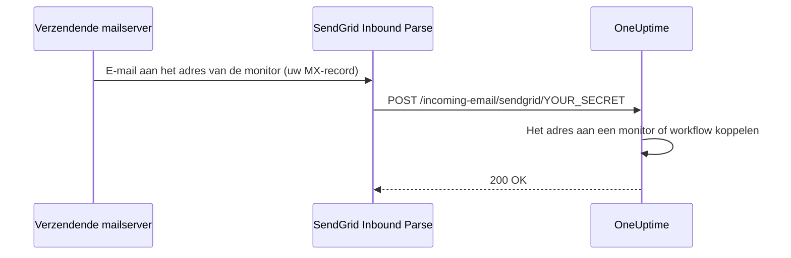

# SendGrid inkomende e-mail

Met de **Incoming Email Monitor** van OneUptime kunt u waarschuwingen aanmaken en oplossen op basis van e-mails die naar unieke, monitorspecifieke e-mailadressen worden gestuurd. Dat is handig om oudere systemen, waarschuwingstools of elke dienst die e-mail kan versturen te koppelen.

Dezelfde inrichting laat ook workflows e-mail ontvangen: een workflow met de trigger **Incoming Email** krijgt een eigen adres op hetzelfde domein, en elke e-mail naar dat adres start de workflow. Zie [Triggers](/docs/workflows/triggers#incoming-email).

Deze handleiding legt uit hoe u SendGrid Inbound Parse instelt om inkomende e-mails door te sturen naar uw zelf gehoste OneUptime-instantie. OneUptime Cloud heeft hier niets van nodig: de adressen werken daar direct.

:::cards
- [Voordat u begint](#vereisten): Een SendGrid-account, een domein en een openbaar HTTPS-adres.
- [Instellen](#instructies-voor-het-instellen): Zeven stappen, van het MX-record tot een testmail.
- [Omgevingsvariabelen](#overzicht-van-omgevingsvariabelen): De drie instellingen en hun standaardwaarden.
- [Problemen oplossen](#problemen-oplossen): E-mails die nooit aankomen en webhooks die mislukken.
:::

## Hoe het werkt



1. U maakt in OneUptime een **Incoming Email Monitor** aan
2. OneUptime genereert een uniek e-mailadres voor die monitor (bijv. `monitor-abc123@inbound.yourdomain.com`)
3. Wanneer er een e-mail naar dat adres wordt gestuurd, ontvangt SendGrid die en stuurt hem via een webhook door naar OneUptime
4. OneUptime beoordeelt de e-mail aan de hand van uw ingestelde criteria om waarschuwingen aan te maken of op te lossen

## Vereisten

- Een SendGrid-account met toegang tot Inbound Parse
- Een domein dat u beheert, met toegang tot de DNS-instellingen
- Een openbaar HTTPS-eindpunt dat SendGrid-webhooks doorstuurt naar uw OneUptime-instantie

## Netwerktoegang

Bij Inbound Parse legt SendGrid de verbinding met OneUptime. Alleen uitgaande internettoegang vanuit OneUptime toestaan is niet genoeg.

| Richting | Bestemming | Protocol / poort | Doel |
| --- | --- | --- | --- |
| SendGrid → OneUptime | `https://your-oneuptime-domain.com/incoming-email/sendgrid/YOUR_SECRET` | HTTPS / TCP 443 | De geparste e-mail afleveren als multipart-POST. |
| Verzendende mailservers → SendGrid | `mx.sendgrid.net`, gekozen via het openbare MX-record van uw inkomende domein | SMTP / TCP 25 | E-mail bij SendGrid ontvangen; deze verbinding gaat niet naar uw OneUptime-server. |
| OneUptime → SendGrid, alleen als het verzenden van e-mail via de SendGrid-provider apart is ingesteld | `api.sendgrid.com` | HTTPS / TCP 443 | Meldingsmails verzenden via de Mail Send API. |

Publiceer DNS voor de hostnaam van de webhook en lever een certificaat dat openbare clients vertrouwen. Een privé-OneUptime-implementatie kan alleen het webhookpad openstellen via een openbare reverse proxy of gateway die OneUptime intern bereikt. Behoud het pad, het secret, het content-type en de multipart-body van het verzoek, en laat de POST door zonder interactieve aanmelding of browserchallenge. De OneUptime-server heeft geen inkomende SMTP-listener nodig. Zie [het instellen van Inbound Parse bij SendGrid](https://www.twilio.com/docs/sendgrid/for-developers/parsing-email/setting-up-the-inbound-parse-webhook).

Stel `INBOUND_EMAIL_WEBHOOK_SECRET` in op een sterke willekeurige waarde en vervang `YOUR_SECRET` in de URL door die waarde. De route vereist het laatste padsegment. OneUptime controleert de waarde ervan wanneer het secret is ingesteld; een lege variabele schakelt die controle uit. Houd de volledige URL en de e-mailadressen van de monitors geheim, ook in proxylogs. OneUptime valideert momenteel geen ondertekende Inbound Parse-headers van SendGrid en geen OAuth-tokens. Hebt u die mechanismen nodig, stel dan een gateway in die ze valideert voordat hij doorstuurt naar OneUptime, volgens [de documentatie van SendGrid over webhookbeveiliging](https://www.twilio.com/docs/sendgrid/for-developers/parsing-email/securing-your-parse-webhooks).

SendGrid biedt geen betrouwbare lijst met statische bron-IP's voor Inbound Parse. De IP's waarvandaan SendGrid e-mail verstuurt en de adressen die voor `mx.sendgrid.net` worden opgelost, zijn geen allowlist voor de webhook. Volg [de firewallrichtlijnen van SendGrid](https://support.sendgrid.com/hc/en-us/articles/44375457225371-How-to-Configure-Firewall-Settings-for-SendGrid-Webhook-and-Inbound-Parse-IPs) in plaats van een huidig DNS-resultaat vast te leggen.

Inbound Parse staat los van het verzenden van uitgaande e-mail. Om monitormails te ontvangen hoeft OneUptime de SendGrid-API niet aan te roepen. Kiest u SendGrid ook voor het verzenden van meldingen, sta dan DNS-resolutie en uitgaand HTTPS naar `api.sendgrid.com` toe; [Mail Send](https://www.twilio.com/docs/sendgrid/api-reference/mail-send/mail-send) heeft voor het indienen geen inkomende callback nodig. Gebruikt u in plaats daarvan SMTP, sta dan de SMTP-server en poort toe die in OneUptime zijn ingesteld.

## Instructies voor het instellen

:::steps
### Kies uw domein voor inkomende e-mail

Kies een subdomein dat alleen dient om e-mail voor OneUptime te ontvangen, zoals `inbound.yourdomain.com`, `email.yourdomain.com` of `monitor.yourdomain.com`. Het wordt alleen gebruikt voor e-mail aan OneUptime-monitors en -workflows, dus er staat geen mailbox van u op.

### Laat het MX-record ervan naar SendGrid wijzen

Voeg een MX-record toe dat de e-mail voor het subdomein naar SendGrid leidt:

| Type | Host/Naam | Prioriteit | Waarde |
| --- | --- | --- | --- |
| MX | inbound | 10 | mx.sendgrid.net |

Is uw domein `example.com` en gebruikt u `inbound.example.com`, dan luidt het record:

```text
inbound.example.com.  IN  MX  10  mx.sendgrid.net.
```

Het kan tot 48 uur duren voordat DNS-wijzigingen zijn doorgevoerd, maar meestal is dat binnen enkele uren gebeurd.

### Verifieer het domein in SendGrid

Het ontvangende domein moet horen bij een van uw [geverifieerde domeinen in SendGrid](https://www.twilio.com/docs/sendgrid/ui/account-and-settings/inbound-parse). Ga in het [SendGrid-dashboard](https://app.sendgrid.com) naar **Settings** > **Sender Authentication**, klik op **Authenticate Your Domain** en voeg de gevraagde DNS-records toe (CNAME-records voor DKIM).

### Voeg de Inbound Parse-webhook toe

Ga in het SendGrid-dashboard naar **Settings** > **Inbound Parse** en klik op **Add Host & URL**. Vul het formulier in zoals hieronder en klik dan op **Add**:

| Veld | Waarde |
| --- | --- |
| **Receiving Domain** | Uw inkomende subdomein (bijv. `inbound.yourdomain.com`) |
| **Destination URL** | `https://your-oneuptime-domain.com/incoming-email/sendgrid/YOUR_SECRET` |
| **Check incoming emails for spam** | Optioneel – inschakelen als u dat wilt |
| **Send raw, full MIME message** | Niet aanvinken (niet nodig) |
| **POST the raw, full MIME message** | Niet aanvinken (niet nodig) |

### Stel OneUptime in

Stel de variabelen voor inkomende e-mail in, met hetzelfde secret als in de Destination URL:

:::tabs
@tab Docker Compose
```bash title="config.env"
INBOUND_EMAIL_PROVIDER=SendGrid
INBOUND_EMAIL_DOMAIN=inbound.yourdomain.com
INBOUND_EMAIL_WEBHOOK_SECRET=replace-with-a-strong-random-secret
```
@tab Kubernetes
```yaml title="values.yaml"
inboundEmail:
  provider: "SendGrid"
  domain: "inbound.yourdomain.com"
  webhookSecret: "replace-with-a-strong-random-secret"
```
:::

Pas ze daarna toe: voer onder Docker Compose `npm run start` uit, wat de containers met de nieuwe waarden opnieuw aanmaakt, of upgrade onder Kubernetes de Helm-release.

### Maak een Incoming Email-monitor aan

[Maak een Incoming Email-monitor aan](/docs/monitor/incoming-email-monitor#een-monitor-voor-inkomende-e-mail-maken). De pagina **Overzicht** ervan toont het adres, zoals `monitor-abc123def456@inbound.yourdomain.com`, en de criteria bepalen welke e-mails een waarschuwing aanmaken en welke die oplossen.

Workflows gebruiken hetzelfde domein. Voeg de trigger **Incoming Email** aan een workflow toe en klik erop: het adres (`workflow-…@inbound.yourdomain.com`) staat boven aan de instellingen. Zolang de variabelen voor inkomende e-mail hierboven niet zijn ingesteld, meldt de trigger dat de server niet is ingericht om e-mail te ontvangen.

### Stuur een testmail

Stuur een e-mail naar het adres van de monitor, met een onderwerp dat overeenkomt met de criteria. Het overzicht van de monitor toont de e-mail, en er wordt een waarschuwing aangemaakt wanneer de criteria overeenkomen.
:::

## Overzicht van omgevingsvariabelen

| Variabele | Helm-waarde | Beschrijving | Vereist | Standaard |
| --- | --- | --- | --- | --- |
| `INBOUND_EMAIL_PROVIDER` | `inboundEmail.provider` | De provider voor inkomende e-mail. SendGrid is de enige. | Nee | `SendGrid` |
| `INBOUND_EMAIL_DOMAIN` | `inboundEmail.domain` | Het subdomein dat is ingesteld voor inkomende e-mail. Inkomende e-mail staat uit tot het is ingesteld. | Ja | Leeg |
| `INBOUND_EMAIL_WEBHOOK_SECRET` | `inboundEmail.webhookSecret` | Secret dat wordt vergeleken met het laatste segment van de webhook-URL: `/incoming-email/sendgrid/YOUR_SECRET`. Stel het in voor openbare eindpunten; een lege waarde schakelt de validatie uit. | Aanbevolen | Leeg |

Waarop een Incoming Email-monitor kan controleren – het onderwerp, de afzender, de inhoud, de ontvanger en of een e-mail op tijd is aangekomen – staat in [Beschikbare filtertypen](/docs/monitor/incoming-email-monitor#beschikbare-filtertypen).

## Problemen oplossen

:::details E-mails worden niet ontvangen
1. **Controleer de DNS-doorvoering:** `dig MX inbound.yourdomain.com` moet `mx.sendgrid.net` teruggeven.
2. **Controleer de Inbound Parse-instellingen in SendGrid:** controleer in het SendGrid-dashboard, onder **Settings** > **Inbound Parse**, uw domein en de webhook-URL.
3. **Controleer de logs van OneUptime:** zoek in de logs van de OneUptime-service `app` naar webhookverzoeken voor inkomende e-mail en naar fouten. SendGrid bewaart geen gedetailleerde logs voor Inbound Parse, dus deze logs zijn het verslag van wat er is aangekomen.
:::

:::details Webhooks mislukken
1. **Controleer de openbare webhookroute:** de volledige URL, inclusief het secret, moet OneUptime vanaf internet bereiken. De URL zonder het laatste secret-segment komt niet overeen met de route.
2. **Controleer de firewallregels:** sta HTTPS POST-verzoeken naar het webhookpad toe zonder aanmeldingsdoorverwijzingen of browserchallenges, en gebruik de verzend-IP's van SendGrid niet als allowlist voor de bron van de webhook.
3. **Controleer het SSL-certificaat:** gebruik voor de hostnaam van de webhook een geldig, openbaar vertrouwd certificaat en lever de certificaatketen mee.
:::

:::details De monitor maakt geen waarschuwingen aan
1. **Controleer de criteria:** controleer of uw criteria voor het aanmaken van waarschuwingen overeenkomen met de inhoud van de e-mail, en test eerst met exacte tekenreeksen voordat u patronen gebruikt.
2. **Controleer de monitor:** zorg dat hij niet is uitgeschakeld en dat zijn type Incoming Email is.
3. **Bekijk het overzicht van de monitor:** controleer of de e-mail is ontvangen en verwerkt, en lees in de evaluatielogs hoe de criteria overeenkwamen.
:::

:::details De trigger meldt dat de server niet is ingericht om e-mail te ontvangen
`INBOUND_EMAIL_DOMAIN` is leeg op de server. Stel de variabele in, pas de wijziging toe en open de trigger van de workflow opnieuw.
:::

## Beste beveiligingspraktijken

1. **Gebruik HTTPS:** gebruik altijd HTTPS voor uw webhookeindpunt
2. **Webhook-secret:** stel `INBOUND_EMAIL_WEBHOOK_SECRET` in en neem het op in uw webhook-URL (bijv. `/incoming-email/sendgrid/your-secret`) voor extra validatie
3. **Domeinverificatie:** verifieer uw domein in SendGrid voor betere e-mailbeveiliging
4. **Beperk de toegang:** maak alleen monitors aan voor vertrouwde e-mailbronnen
5. **Bewaak de logs:** controleer de logs van inkomende e-mail regelmatig op verdachte activiteit

## Volgende stappen

:::cards
- [Incoming Email Monitor](/docs/monitor/incoming-email-monitor): Criteria, adresformaten en voorbeelden.
- [Workflowtriggers](/docs/workflows/triggers): Start een workflow vanuit een e-mail.
- [Toegang tot privénetwerk](/docs/self-hosted/private-network-access): Wat uw server in uw eigen netwerk mag bereiken.
- [Architectuur](/docs/self-hosted/architecture): Waar de webhook binnenkomt in een zelf gehoste installatie.
:::
