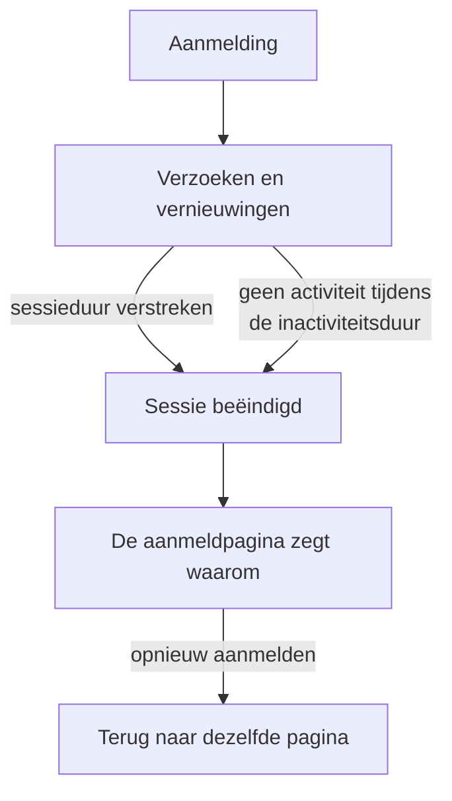

# Sessieduur

Kies hoe lang mensen bij OneUptime aangemeld blijven voordat ze zich opnieuw aanmelden: een vaste tijd na hun aanmelding, een tijd zonder gebruik, of beide. Het geldt voor elke aanmelding bij het dashboard, het Admin Dashboard en de mobiele app, met een wachtwoord, een passkey, aanmelden met Microsoft of single sign-on. SSO-aanmeldingen kunnen een eigen duur hebben.

> [!NOTE]
> Sessieduur is onderdeel van de [OneUptime Enterprise Edition](/docs/self-hosted/enterprise). De Community Edition heeft geen pagina **Sessieduur**, en elke aanmelding duurt zoals [Geen limiet](#geen-limiet) beschrijft.

:::cards
- [Een sessieduur instellen](#een-sessieduur-instellen): Twee instellingen in het Admin Dashboard.
- [Hoe een sessie eindigt](#hoe-een-sessie-eindigt): Wat de server telt, en wanneer.
- [SSO-aanmeldingen](#sso-aanmeldingen): Een eigen duur voor single sign-on.
- [Wat geen aanmelding is](#wat-geen-aanmelding-is): API-sleutels, MCP-verbindingen en lezers van statuspagina's.
:::

## Geen limiet

Zolang u geen duur instelt, heeft een aanmelding er geen. Het toegangstoken ervan is 15 minuten geldig en wordt op de achtergrond vernieuwd met een vernieuwingstoken, dat 30 dagen geldig is en bij elk gebruik opnieuw begint. Wie OneUptime minstens eens per 30 dagen opent, blijft aangemeld; wie dat niet doet, meldt zich opnieuw aan.

## Een sessieduur instellen

:::steps
### Sessieduur openen
Open in het Admin Dashboard **Instellingen** en daarna **Sessieduur** in het zijmenu.

### De duur kiezen
- **Mensen afmelden na**: hoe lang een aanmelding duurt vanaf het moment dat iemand zich aanmeldt, hoe actief diegene ook is.
- **Mensen afmelden na inactiviteit van**: hoe lang iemand in OneUptime niet mag klikken, typen of scrollen.

Elke keuze wordt opgeslagen zodra u die maakt.

### Bevestigen wie wordt afgemeld
Een kortere duur geldt voor iedereen die nu is aangemeld. Als die mensen meteen afmeldt, laat OneUptime eerst weten hoeveel, en of u erbij hoort. Selecteer **Opslaan en afmelden** om door te gaan.
:::

| Instelling | Keuzes | Standaard |
| --- | --- | --- |
| **Mensen afmelden na** | 1 uur tot 90 dagen | **Geen limiet** |
| **Mensen afmelden na inactiviteit van** | 15 minuten tot 14 dagen | 30 dagen, het langste dat er is |

Via de API accepteert `sessionLengthInMinutes` elk geheel aantal minuten van 15 tot 525600 (een jaar) en `sessionIdleTimeoutInMinutes` van 15 tot 43200 (30 dagen), in de globale configuratie van de server. Leeg is de standaard.

## Hoe een sessie eindigt

- De server telt beide duren vanuit de sessie zelf: wanneer die is aangemeld, en wanneer de persoon ervan het laatst actief was. Hij controleert ze bij elk verzoek, elke vernieuwing en elke live-update, en laat het afmelden nooit aan de browser over.
- De inactiviteitsduur telt vanaf de laatste klik, toetsaanslag of scrollbeweging in een willekeurig tabblad van het dashboard of het Admin Dashboard. Een tabblad dat open blijft staan, houdt een sessie niet in leven.
- De mobiele app telt als actief elke keer dat die wordt gebruikt.
- Als een sessie eindigt, gaat de browser naar de aanmeldpagina, die zegt waarom. Na opnieuw aanmelden komt de persoon terug op de pagina waar die was.

| Wijziging | Wat er gebeurt met de mensen die nu zijn aangemeld |
| --- | --- |
| Een kortere sessieduur of inactiviteitsduur | Iedereen die eroverheen is, wordt meteen afgemeld, de anderen wanneer ze die bereiken |
| Een langere, of geen | Niemand wordt afgemeld, en sessies duren langer vanaf hun volgende vernieuwing |

## SSO-aanmeldingen

Aanmeldingen via single sign-on volgen dezelfde twee instellingen. Om ze een eigen duur te geven, opent u **Meer instellingen** op de pagina **Sessieduur** en zet u **Aparte duur voor SSO-aanmeldingen** aan. De twee instellingen daaronder gelden dan voor aanmeldingen via de SAML- of OpenID Connect-provider van een project, of via de eigen [globale SSO](/docs/identity/global-sso) van de server, en de twee bovenaan de pagina voor elke andere aanmelding.

Een project dat SSO vereist, laat een sessie bovendien alleen toe zolang de SSO-aanmelding ervan duurt, en die is nooit langer dan de duur die SSO-aanmeldingen volgen.

Via de API is de schakelaar `useSeparateSsoSessionLengths`, en de duur van SSO-aanmeldingen is `ssoSessionLengthInMinutes` en `ssoSessionIdleTimeoutInMinutes`, met dezelfde bereiken.

## Wat geen aanmelding is

- **API-sleutels** houden de vervaldatum die u ze geeft.
- **MCP-verbindingen**, AI-assistenten die met OAuth zijn verbonden, houden hun eigen levensduur. In een project dat SSO vereist, duurt een verbinding nooit langer dan de SSO-aanmelding waarmee die is goedgekeurd.
- **Privé-statuspagina's** hebben een eigen duur voor hun lezers: zie [Privégebruikers](/docs/status-pages/index#privégebruikers).

## Zonder licentie

Na de proefperiode of de respijtperiode, zonder geldige licentie of met een licentie die sessieduur niet bevat, kan de duur niet worden ingesteld of gewijzigd. De al ingestelde duur blijft mensen afmelden, en u kunt die nog steeds verwijderen. Met de image van de Community Edition geldt geen duur: de waarden blijven in de database staan en gelden weer wanneer u terugschakelt.

## Volgende stappen

:::cards
- [SSO](/docs/identity/sso): Mensen aanmelden met uw identiteitsprovider.
- [Globale SSO](/docs/identity/global-sso): Eén identiteitsprovider voor de hele server.
- [Enterprise Edition](/docs/self-hosted/enterprise): Wat de Enterprise Edition toevoegt, en de licentie ervan.
:::
