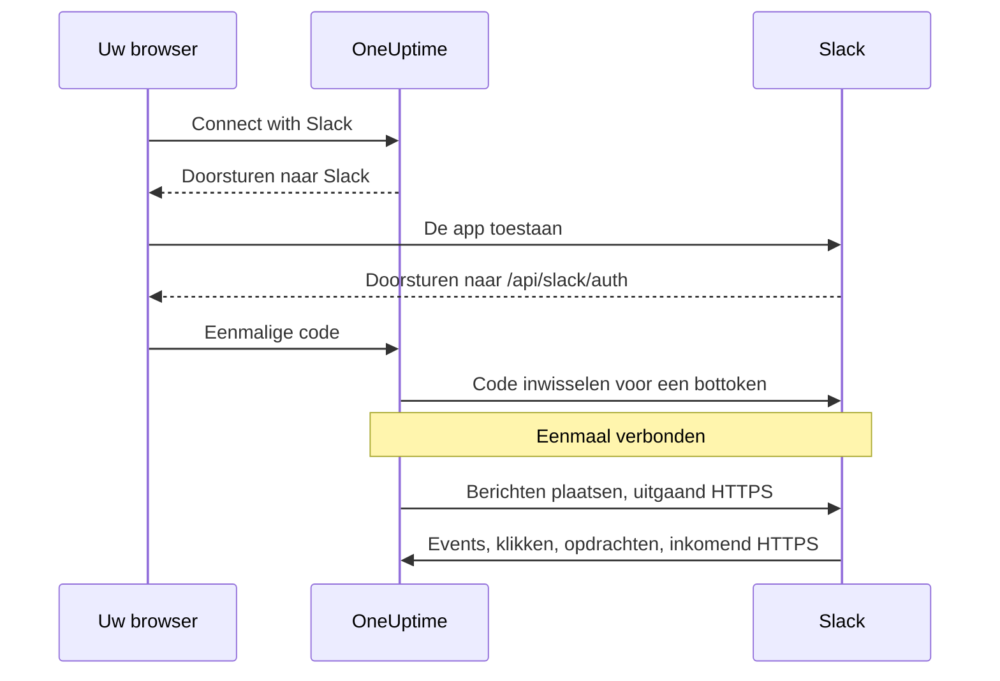

# Slack-integratie

Verbind uw zelf gehoste OneUptime met Slack. U maakt een Slack-app aan vanuit het manifest dat uw server genereert, geeft OneUptime de inloggegevens van de app en verbindt elk project met een werkruimte. OneUptime plaatst daarna incidenten, meldingen en gepland onderhoud in uw kanalen, en uw team handelt ze vanuit Slack af.

Deze pagina is bedoeld voor wie de OneUptime-server beheert. Zodra Slack verbonden is, stelt u meldingsregels per project in: zie [Slack](/docs/workspace-connections/slack).

:::cards
- [De Slack-app instellen](#de-slack-app-instellen): Maak de app aan vanuit uw manifest en verbind een project.
- [Omgevingsvariabelen](#omgevingsvariabelen): De drie waarden die OneUptime van de app nodig heeft.
- [Netwerktoegang](#netwerktoegang-voor-zelf-gehoste-installaties): De callbacks die Slack moet kunnen bereiken.
- [Probleemoplossing](#probleemoplossing): Wat de meldingen op de Slack-pagina betekenen, en wat u kunt doen.
:::

## Hoe het werkt

De Slack-app is van uzelf: hij is geïnstalleerd in uw werkruimte en praat alleen met uw server. Het verkeer gaat twee kanten op, en elke richting heeft eigen netwerktoegang nodig.



- **Uitgaand**: OneUptime roept de Web API van Slack aan om berichten te plaatsen, kanalen aan te maken en afbeeldingen te uploaden.
- **Inkomend**: Slack roept vier routes op uw server aan voor events, klikken op knoppen, menu's en slash-opdrachten. Elk verzoek is ondertekend met het signing secret van de app. OneUptime weigert een verzoek waarvan de handtekening niet klopt of waarvan de tijdstempel meer dan vijf minuten oud is.

## Voordat u begint

- Een Slack-werkruimte waarin u apps kunt aanmaken en installeren.
- Een openbare HTTPS-hostnaam voor OneUptime die Slack kan bereiken. Zie [Netwerktoegang](#netwerktoegang-voor-zelf-gehoste-installaties).
- Toegang tot de configuratie van de server: `config.env` bij Docker Compose, of uw Helm-values bij Kubernetes.
- Om een project te verbinden, de rol **Project Owner**, **Project Admin** of **Project Member** in dat project.

## De Slack-app instellen

:::steps
### Stel de openbare URL in

OneUptime bouwt het app-manifest en elke callback-URL op uit `HOST` en `HTTP_PROTOCOL`. Stel ze in op de hostnaam die Slack zal aanroepen, via HTTPS:

:::tabs
@tab Docker Compose
```bash title="config.env"
HOST=oneuptime.example.com
HTTP_PROTOCOL=https
```
@tab Kubernetes
```yaml title="values.yaml"
host: oneuptime.example.com
httpProtocol: https
```
:::

Deze waarden genereren alleen URL's. Ze maken geen DNS-records, certificaten of firewallregels aan.

### Kopieer het app-manifest

Open **Projectinstellingen > Werkruimte > Slack**. Zolang Slack niet op de server is ingesteld, toont de pagina **Integrating Slack with your OneUptime Project** met het manifest dat voor uw hostnaam is gegenereerd. Het wordt ook geserveerd op `https://oneuptime.example.com/api/slack/app-manifest`.

Controleer of elke URL in het manifest met uw openbare hostnaam begint. Is dat niet zo, corrigeer dan eerst `HOST` en `HTTP_PROTOCOL` en pas de wijziging toe.

### Maak de Slack-app aan

Maak op [api.slack.com/apps](https://api.slack.com/apps) een nieuwe app aan vanuit een manifest, kies uw werkruimte en plak het manifest. Gebruik altijd het manifest dat uw eigen server genereert, zodat de URL's ervan bij uw hostnaam passen.

### Kopieer de inloggegevens van de app

Kopieer op de pagina **Basic Information** van de app, onder **App Credentials**, de **Client ID**, het **Client Secret** en het **Signing Secret**.

### Voeg de inloggegevens toe aan OneUptime

:::tabs
@tab Docker Compose
```bash title="config.env"
SLACK_APP_CLIENT_ID=YOUR_SLACK_APP_CLIENT_ID
SLACK_APP_CLIENT_SECRET=YOUR_SLACK_APP_CLIENT_SECRET
SLACK_APP_SIGNING_SECRET=YOUR_SLACK_APP_SIGNING_SECRET
```
@tab Kubernetes
```yaml title="values.yaml"
slackApp:
  clientId: "YOUR_SLACK_APP_CLIENT_ID"
  clientSecret: "YOUR_SLACK_APP_CLIENT_SECRET"
  signingSecret: "YOUR_SLACK_APP_SIGNING_SECRET"
```

Om de waarden in een Kubernetes-Secret te bewaren dat u zelf beheert, stelt u in plaats daarvan `slackApp.existingSecret` in: de `name` ervan, en de sleutels `clientIdKey`, `clientSecretKey` en `signingSecretKey`.
:::

### Pas de configuratie toe

:::tabs
@tab Docker Compose
```bash
npm run start
```

Dit maakt de containers opnieuw aan met de nieuwe `config.env`. `docker compose restart` leest die niet opnieuw in.
@tab Kubernetes
```bash
helm upgrade my-oneuptime oneuptime/oneuptime -f values.yaml
```
:::

Zodra OneUptime weer draait, toont **Projectinstellingen > Werkruimte > Slack** een knop **Connect with Slack** in plaats van het manifest.

### Verifieer de request-URL voor events

Verifieer in de **Event Subscriptions** van de Slack-app de request-URL. OneUptime beantwoordt de challenge van Slack pas als het signing secret is ingesteld; probeer het dus opnieuw als het mislukte terwijl u de app aanmaakte.

### Verbind het project

Kies in **Projectinstellingen > Werkruimte > Slack** de optie **Connect with Slack** en sta de app toe in Slack. Slack stuurt u terug naar dezelfde pagina, die nu uw werkruimte noemt.

### Verbind uw eigen Slack-account

Knoppen, formulieren en opdrachten handelen als de OneUptime-gebruiker die is gekoppeld aan het Slack-account dat ze gebruikt. Iedereen opent **Gebruikersinstellingen > Werkruimte > Slack** en kiest **Connect my account with Slack**. Wie geen account heeft verbonden, krijgt van de app een direct bericht met het verzoek dat te doen.
:::

## Omgevingsvariabelen

| Docker Compose (`config.env`) | Helm (`values.yaml`) | Verplicht | Waarde |
| --- | --- | --- | --- |
| `SLACK_APP_CLIENT_ID` | `slackApp.clientId` | Ja | De **Client ID** van de app. Zonder deze toont de Slack-pagina de installatiehandleiding in plaats van **Connect with Slack**. |
| `SLACK_APP_CLIENT_SECRET` | `slackApp.clientSecret` | Ja | Het **Client Secret** van de app, waarmee de code die Slack teruggeeft wordt ingewisseld voor een token. |
| `SLACK_APP_SIGNING_SECRET` | `slackApp.signingSecret` | Ja | Het **Signing Secret** van de app. Elk verzoek van Slack wordt ermee gecontroleerd. |
| `HOST` | `host` | Ja | Uw openbare hostnaam, zonder het schema. |
| `HTTP_PROTOCOL` | `httpProtocol` | Ja | `https`. Slack roept alleen HTTPS-URL's aan. |

## Wat de app kan

Het manifest stelt deze functies in. Elke functie bereikt uw server via de getoonde route en werkt dus alleen als Slack die route kan bereiken.

| Functie | Wat ze doet | Route |
| --- | --- | --- |
| `/incident` en de snelkoppeling **Create New Incident** | Een incident melden vanuit Slack | `POST /api/slack/interactive` |
| `/maintenance` en de snelkoppeling **Create Scheduled Event** | Onderhoud plannen vanuit Slack | `POST /api/slack/interactive` |
| `/oneuptime` | OneUptime AI vragen stellen over uw logs, traces, metrics, incidenten en monitors | `POST /api/slack/command` |
| Knoppen en formulieren in OneUptime-berichten | Bevestigen, oplossen, een notitie toevoegen, de status wijzigen, een on-callbeleid uitvoeren | `POST /api/slack/interactive` en `POST /api/slack/options-load` |
| Events | Vermeldingen, berichten, reacties en pins, bijvoorbeeld om een bericht als notitie op te slaan | `POST /api/slack/events` |

### Afbeeldingen in berichten

Beschrijvingen van incidenten en meldingen kunnen screenshots bevatten, bijvoorbeeld die van een synthetische monitor (zie [Synthetische monitors](/docs/monitor/incident-alert-templating#synthetische-monitors)). OneUptime toont ze in Slack-berichten door elk ervan als privébestand naar uw werkruimte te uploaden, en daarvoor is de botscope `files:write` nodig. Het gegenereerde manifest bevat die.

Hebt u uw Slack-app aangemaakt vanuit een ouder manifest, voeg dan `files:write` toe onder **OAuth & Permissions > Bot Token Scopes** (of werk de app bij vanuit het huidige manifest). Kies daarna opnieuw **Connect with Slack** in **Projectinstellingen > Werkruimte > Slack**, zodat de nieuwe scope wordt toegekend. Tot dan wordt elk screenshot getoond als de alternatieve tekst ervan.

## Netwerktoegang voor zelf gehoste installaties

### Verkeersrichting en endpoints

| Verkeer | Benodigde toegang |
| --- | --- |
| OneUptime naar Slack | DNS en uitgaand HTTPS via TCP 443 naar `slack.com` voor Web API-aanroepen en de uitwisseling van het OAuth-token; `hooks.slack.com` voor antwoord-URL's van opdrachten en meldingen via incoming webhooks, als die worden gebruikt |
| Slack naar OneUptime | Openbaar HTTPS via TCP 443 naar de vier POST-routes hieronder, voor de volledige integratie |
| Browser van de gebruiker naar OneUptime | Toegang tot het dashboard en OAuth-omleidingen naar `/api/slack/auth/:projectId/:userId` en `/api/slack/auth/:projectId/:userId/user`; deze kunnen via de VPN van de gebruiker bereikbaar blijven |

De uitgaande domeinen beschrijven de Slack-integratie van OneUptime, geen volledige allowlist voor Slack-clients of elke Slack-functie. Een Slack-*incoming webhook* wordt door Slack gehost: OneUptime stuurt ernaartoe, dus het is geen inkomend endpoint op uw server. Zie de [handleiding voor incoming webhooks](https://docs.slack.dev/messaging/sending-messages-using-incoming-webhooks/) van Slack.

Stuur deze callbacks via de ingress door naar OneUptime:

| Methode en pad | Doel |
| --- | --- |
| `POST /api/slack/events` | Verificatie van de Events API, reacties, pins, vermeldingen en berichten |
| `POST /api/slack/interactive` | Knoppen, snelkoppelingen, ingediende modals, `/incident` en `/maintenance` |
| `POST /api/slack/options-load` | Verzoeken om opties van interactieve menu's |
| `POST /api/slack/command` | Opdracht `/oneuptime` |

OAuth is een [omleiding in de browser, gevolgd door een tokenuitwisseling op de server](https://docs.slack.dev/authentication/installing-with-oauth/). Het manifest registreert `/api/slack/auth` als voorvoegsel van de omleidings-URL, en OneUptime voegt de paden voor project en gebruiker toe wanneer het de autorisatie start. Toegang vanuit de browser alleen laat Slack geen events of klikken op knoppen bezorgen.

### Privé-installaties en beveiliging van callbacks

```mermaid title="De Slack-callbacks publiceren vanuit een privé-installatie"
flowchart LR
    Slack["Slack"] -->|HTTPS 443| GW["Openbare gateway"]
    GW -->|"/api/slack/* alleen POST"| ING["OneUptime-ingress"]
    Users["Medewerkers via VPN"] --> ING
    ING --> App["OneUptime-app"]
```

Gebruik openbare DNS en een gateway met een publiek vertrouwd HTTPS-certificaat, een volledige certificaatketen en een privéroute naar uw OneUptime-ingress. Sta inkomend TCP 443 naar de gateway toe en stuur alleen de vier callbackroutes hierboven door. Een privé-`ClusterIP`, een interne DNS-naam of de VPN-verbinding van een medewerker is voor Slack niet bereikbaar. Met split-DNS kunnen het dashboard en de OAuth-routes onder dezelfde hostnaam privé blijven.

Genereer het manifest opnieuw en werk de Slack-app bij na een wijziging van de hostnaam.

Behoud via de gateway:

- de methode, het pad, de querystring en de oorspronkelijke body;
- `Content-Type`, `X-Slack-Signature` en `X-Slack-Request-Timestamp`;
- de openbare host en het HTTPS-schema, via vertrouwde proxyheaders.

Zonder de callbackroutes uit van browser-SSO, CAPTCHA en aanmeldpagina's van de proxy, en behoud de controles van OneUptime op het signing secret en de tijdstempel. Houd de klok van de server gesynchroniseerd: een verzoek dat meer dan vijf minuten afwijkt, wordt geweigerd. Slack documenteert de [verificatie van de handtekening van verzoeken](https://docs.slack.dev/authentication/verifying-requests-from-slack/); een controle op het bron-IP vervangt die niet.

### Toegang controleren en de beperkingen begrijpen

:::steps
1. Verifieer in de **Event Subscriptions** van de Slack-app de request-URL. Slack stuurt een [POST-challenge en controleert TLS](https://docs.slack.dev/apis/events-api/using-http-request-urls/).
2. Stuur een testmelding, voer een slash-opdracht uit, klik op een knop in een incidentbericht en activeer een event waarop u bent geabonneerd.
3. Controleer de logs van de gateway en van OneUptime op mislukte bezorgingen, zonder geheimen te loggen.
:::

Slack verwacht snelle bevestigingen, waaronder [een antwoord binnen drie seconden bij interacties](https://docs.slack.dev/interactivity/handling-user-interaction/). Een GET in de browser of een geslaagd uitgaand bericht verifieert deze POST-callbacks niet.

> [!WARNING]
> Als alle inkomende verbindingen verboden zijn, kan een al geautoriseerde app nog steeds berichten sturen via uitgaand HTTPS, maar events, knoppen, snelkoppelingen en opdrachten werken niet. Het manifest van OneUptime gebruikt HTTP-callbacks en schakelt Socket Mode uit; Socket Mode van Slack inschakelen is geen ondersteunde vervanging voor deze routes.

De [instellingen voor toegang tot privénetwerken](/docs/self-hosted/private-network-access) regelen uitgaande verzoeken naar privébestemmingen. Ze stellen geen callbacks open voor Slack.

## Probleemoplossing

### Het verbinden is niet voltooid

Als Slack u terugstuurt en de verbinding niet tot stand is gekomen, toont de Slack-pagina waarvandaan u begon (**Projectinstellingen > Werkruimte > Slack**, of uw eigen **Gebruikersinstellingen > Werkruimte > Slack** als u uw account verbond) **Slack is niet verbonden**, met één zin in uw taal die zegt waarom. De rest van de pagina laadt zoals gewoonlijk, zodat u daar meteen opnieuw kunt verbinden. Wat Slack zelf antwoordde, toont ze nooit: dat staat met de reden in het log van de OneUptime-server.

| De pagina zegt | Wat u doet |
| --- | --- |
| **"Deze verbindingslink is ongeldig, verlopen of al gebruikt. Begin opnieuw."** | De link werkt één keer, 15 minuten lang, in de browser die hem startte. Begin opnieuw vanaf de Slack-pagina en rond het in Slack binnen 15 minuten af, in dezelfde browser. |
| **"Je hebt geen toestemming om dit project met Slack te verbinden."** | OneUptime in Slack installeren vereist **Project Owner**, **Project Admin** of **Project Member**. Dat wordt opnieuw gecontroleerd wanneer Slack u terugstuurt, dus een rol die u intussen is afgenomen, beëindigt de verbinding ook hier. |
| **"Je bent geen lid meer van dit project."** | Om uw eigen Slack-account te verbinden, moet u lid van het project zijn wanneer Slack u terugstuurt. |
| **"Dit project is nog niet verbonden met een Slack-werkruimte."** | Installeer OneUptime eerst in Slack vanuit **Projectinstellingen > Werkruimte > Slack** en verbind daarna uw eigen account. |
| **"Je bent aangemeld bij een andere Slack-werkruimte dan die waarmee dit project verbonden is."** | Verbind uw account terwijl u bent aangemeld bij de Slack-werkruimte waarin het project is geïnstalleerd. |
| **"De verbinding is geannuleerd, dus er is niets gewijzigd."** | Het verzoek is in Slack niet toegestaan. Begin opnieuw en sta het toe. |
| **"Slack is niet ingesteld op deze OneUptime-server."** | Stel `SLACK_APP_CLIENT_ID` en `SLACK_APP_CLIENT_SECRET` in (zie [Omgevingsvariabelen](#omgevingsvariabelen)) en start OneUptime opnieuw. |
| **"OneUptime kon het verbinden niet afronden. Probeer het opnieuw."** | Slack antwoordde met een fout, of een verzoek of een schrijfactie mislukte bij het afronden. Het log van de OneUptime-server zegt welke. Probeer het opnieuw; blijft het gebeuren, controleer dan het log en de instellingen van de Slack-app. |

### Andere problemen

:::details Slack kan de request-URL voor events niet verifiëren
OneUptime beantwoordt de challenge van Slack alleen als `SLACK_APP_SIGNING_SECRET` is ingesteld en het verzoek aankomt. Stel het signing secret in, pas de configuratie toe en probeer de verificatie opnieuw. Mislukt die nog steeds, controleer dan of `POST /api/slack/events` vanaf internet bereikbaar is met een publiek vertrouwd certificaat.
:::

:::details Knoppen en slash-opdrachten doen niets, maar meldingen komen aan
Meldingen zijn uitgaand en werken dus zonder inkomende toegang. Knoppen, snelkoppelingen en opdrachten zijn inkomend: controleer of Slack `POST /api/slack/interactive` en `POST /api/slack/command` kan bereiken, en of de gateway de body en de headers `X-Slack-Signature` en `X-Slack-Request-Timestamp` behoudt.
:::

:::details De app zegt dat mijn Slack-account niet met OneUptime is verbonden
Knoppen, formulieren en opdrachten hebben uw Slack-account nodig, gekoppeld aan uw OneUptime-gebruiker. Open **Gebruikersinstellingen > Werkruimte > Slack** en kies **Connect my account with Slack**. Bent u uit het project verwijderd, dan zegt de app dat in plaats daarvan, en worden acties vanuit Slack geweigerd.
:::

:::details Screenshots verschijnen als tekst
De Slack-app mist de scope `files:write`. Zie [Afbeeldingen in berichten](#afbeeldingen-in-berichten).
:::

## Volgende stappen

:::cards
- [Slack](/docs/workspace-connections/slack): Maak meldingsregels en samenvattingen voor het project.
- [Microsoft Teams-integratie](/docs/self-hosted/microsoft-teams-integration): Stel ook de Teams-bot op uw server in.
- [Toegang tot privénetwerk](/docs/self-hosted/private-network-access): Laat workflows en webhooks interne tools bereiken.
:::
