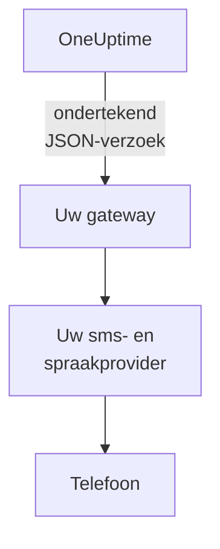

# Sms- en belgateway

OneUptime kan zijn sms-berichten en oproepen versturen via een gateway die u zelf beheert, in plaats van via Twilio. Gebruik die wanneer uw regels eisen dat elk bericht via uw eigen sms- en spraakprovider gaat, of via een systeem dat het controleert voordat het uw netwerk verlaat. OneUptime stuurt elke sms en elke oproep als een ondertekend JSON-verzoek naar uw gateway, en uw gateway levert die af.

:::cards
- [De gateway instellen](#de-gateway-instellen): Een URL, en een ondertekeningsgeheim dat voor u wordt gemaakt.
- [Wat uw gateway ontvangt](#wat-uw-gateway-ontvangt): Eén ondertekend JSON-verzoek per sms of oproep.
- [Oproepen in andere talen](#oproepen-in-andere-talen): Elke oproep spreken in de taal waarin de persoon OneUptime gebruikt.
- [Op een melding reageren](#op-een-melding-reageren): Bevestigen, escaleren of oplossen vanuit een oproep of een antwoord.
- [Aflevering en nieuwe pogingen](#aflevering-en-nieuwe-pogingen): Wat er gebeurt als uw gateway onbereikbaar is.
:::

## Hoe het werkt



De gateway neemt de plaats in van het eigen Twilio-account van de server, voor alles wat daarlangs zou gaan: dienstmeldingen, meldingen, verificatiecodes en sms-berichten aan abonnees van statuspagina's. Projecten die op de kaart **Twilio-configuratie** onder **Projectinstellingen > Meldingen > Meldingskanalen** een eigen Twilio-configuratie toevoegen, versturen nog steeds via die configuratie. De sms- en belschakelaars van elk project, en het saldo waar facturering aan staat, worden net zo gecontroleerd als bij Twilio.

## De gateway instellen

:::steps
1. Ga in het Admin Dashboard naar **Instellingen > Oproep en sms** en klik op **Edit Provider** op de kaart **SMS and Call Provider**.
2. Kies **Your own gateway** en voer de **Gateway URL** in. De gateway mag in uw privénetwerk staan.
3. Sla op. OneUptime maakt een ondertekeningsgeheim voor u. Kopieer het van de kaart naar uw gateway.
4. Klik op **Gateway controleren**. Uw gateway hoort te antwoorden met een 2xx-status en niets te versturen.
:::

Om het geheim te vervangen, maakt u **Ondertekeningsgeheim** onder **Meer velden** leeg en slaat u op: OneUptime maakt een nieuw geheim. Om terug te gaan naar Twilio, kiest u **Twilio** en slaat u op.

## Wat uw gateway ontvangt

Elke sms en elke oproep is één `POST`-verzoek met een JSON-body en deze headers:

| Header | Waarde |
| --- | --- |
| `Content-Type` | `application/json` |
| `X-OneUptime-Event` | `sms`, `call` of `test` |
| `X-OneUptime-Signature` | `sha256=` gevolgd door de HMAC-SHA256 van de body in hex, met het ondertekeningsgeheim als sleutel |
| `User-Agent` | `OneUptime-CallAndSmsGateway/1.0` |

```json title="An on-call page by SMS"
{
  "version": 1,
  "event": "sms",
  "id": "7c5b0d0e-3e5f-4d1a-9a4f-2b8e6c1d9f00",
  "sentAt": "2026-10-27T09:30:00.000Z",
  "to": "+15551234567",
  "message": "OneUptime: A new alert has been created. Alert #42: Database is down…",
  "isSensitive": false,
  "project": {
    "id": "0f6b8c3a-1d2e-4f5a-8b9c-0d1e2f3a4b5c",
    "name": "Production"
  },
  "actions": {
    "acknowledge": "https://oneuptime.example.com/api/custom-notification-channel/page/5f2c…/acknowledge?token=…",
    "escalate": "https://oneuptime.example.com/api/custom-notification-channel/page/5f2c…/escalate?token=…",
    "resolve": "https://oneuptime.example.com/api/custom-notification-channel/page/5f2c…/resolve?token=…"
  },
  "inLanguage": null
}
```

| Veld | Wat het is |
| --- | --- |
| `version` | Altijd `1` voor deze vorm. Er worden alleen ooit velden aan toegevoegd. |
| `event` | `sms`, `call` of `test`, zoals in `X-OneUptime-Event`. |
| `id` | Uniek voor dit bericht, en hetzelfde bij elke poging om het af te leveren: gebruik het om een bericht te negeren dat u al hebt verstuurd. |
| `sentAt` | Wanneer OneUptime het verstuurde, in ISO 8601. |
| `to` | Het telefoonnummer, in E.164-notatie. `null` bij een test. |
| `message` | De sms, of wat de oproep zegt. Een sms is maximaal 1.600 tekens, en de tekst van een oproep maximaal 16.384. Een langere tekst wordt ingekort en eindigt met een opmerking dat de rest in OneUptime staat. |
| `isSensitive` | `true` voor een verificatiecode. Houd het bericht, en dat in `inLanguage`, buiten uw eigen logs. |
| `project` | Het `id` en de `name` van het project, of `null` als geen project het verstuurde. |
| `actions` | Bij een dienstmelding de links die erop reageren. Anders `null`. |
| `inLanguage` | Bij een oproep aan iemand die OneUptime in een andere taal dan het Engels gebruikt: `language`, de code van die taal, en `message`, wat de oproep in die taal zegt. Anders `null`, en bij elke sms, die al in de taal van de persoon is. Zie [Oproepen in andere talen](#oproepen-in-andere-talen). |

Een oproep wordt beschreven, niet als script uitgeschreven: `message` is wat hij zegt, zonder het "druk op 1 om te bevestigen" van Twilio. Bied de acties op uw eigen manier aan, bijvoorbeeld via toetsaanslagen, en roep de bijbehorende link aan.

### Oproepen in andere talen

Een oproep aan iemand die OneUptime in een andere taal gebruikt, bevat zijn woorden twee keer: in het Engels, in `message`, zoals elke oproep, en in de taal van de persoon, in `inLanguage`. Uw gateway kiest de stem, dus OneUptime kan niet weten welke talen hij spreekt. Heeft uw gateway een stem van `inLanguage.language`, laat die stem dan `inLanguage.message` uitspreken. Heeft hij er geen, spreek dan in plaats daarvan `message` in het Engels uit. Geef de woorden van de ene taal nooit aan de stem van een andere taal: ze zouden niet worden begrepen. Een gateway die alleen `message` leest, blijft werken zoals voorheen en spreekt Engels.

```json title="A call to someone who reads German"
{
  "event": "call",
  "message": "This is a call from OneUptime. Your verification code is 4  8  2  9  1  3. …",
  "isSensitive": true,
  "inLanguage": {
    "language": "de",
    "message": "Dies ist ein Anruf von OneUptime. Ihr Bestätigungscode lautet 4  8  2  9  1  3. …"
  }
}
```

De code van de taal is een BCP 47-tag, een van de talen waarin OneUptime is geschreven: `de`, `fr`, `es`, `it`, `pt`, `nl`, `da`, `no`, `sv`, `ru`, `ja`, `ko`, `zh-CN`, `zh-TW`, `hi`, `fa` en `ar`. `es` is het Spaans van Spanje, `pt` het Portugees van Brazilië, `no` Noors Bokmål, `ar` modern standaard-Arabisch, en beide Chinese codes zijn Mandarijn, in vereenvoudigde en in traditionele karakters. Perzisch hoort erbij: Twilio heeft geen Perzische stem, dus via Twilio is een oproep aan iemand die OneUptime in het Perzisch gebruikt in het Engels, maar uw gateway heeft er misschien wel een. Een verificatiecode wordt cijfer voor cijfer geschreven, met twee spaties tussen de cijfers: laat uw stem de cijfers een voor een en langzaam voorlezen, niet als een getal.

### De handtekening controleren

Bereken de HMAC van de ruwe body van het verzoek, voordat u die parseert, en vergelijk die met de header. De controle is dezelfde als voor een [aangepast kanaal](/docs/self-hosted/custom-notification-channels#de-handtekening-controleren), dus één verificatiefunctie dient voor beide:

```javascript title="Node.js"
const crypto = require("crypto");

function isFromOneUptime(rawBody, signatureHeader, secret) {
  const expected =
    "sha256=" + crypto.createHmac("sha256", secret).update(rawBody).digest("hex");
  const received = String(signatureHeader || "");

  return (
    received.length === expected.length &&
    crypto.timingSafeEqual(Buffer.from(received), Buffer.from(expected))
  );
}
```

## Op een melding reageren

Wanneer de persoon reageert tijdens een oproep of met een antwoord, stuurt uw gateway een `POST`-verzoek naar de bijbehorende link in `actions`. De links werken zoals die van een aangepast kanaal: ze hebben geen API-sleutel nodig, elke link draagt een token voor alleen die ene melding dat 7 dagen geldig is, en de actie wordt vastgelegd als uitgevoerd door de persoon die werd opgeroepen. Zie [Op een oproep reageren](/docs/self-hosted/custom-notification-channels#op-een-oproep-reageren) voor elke actie en het antwoord.

```bash title="Acknowledge a page"
curl -X POST "https://oneuptime.example.com/api/custom-notification-channel/page/5f2c…/acknowledge?token=…"
```

## Aflevering en nieuwe pogingen

Een verzoek telt als afgeleverd wanneer uw gateway binnen 10 seconden antwoordt met een 2xx-status. Een verzoek waarop hij niet antwoordde, of waarop hij antwoordde met 408, 429 of een 5xx-status, wordt opnieuw verstuurd na 1 seconde en na nog eens 4 seconden: drie pogingen in totaal. Bij elke andere 4xx-status wordt het niet opnieuw verstuurd.

In het sms- of oproeplogboek, en bij een dienstmelding in het bereikbaarheidslogboek van de persoon, staat `Sent to the SMS and call gateway (HTTP 200).` of waarom het bericht niet werd afgeleverd, nooit de URL. OneUptime komt niet te weten of het bericht de telefoon heeft bereikt, dus een sms staat als verstuurd zodra uw gateway hem accepteert, en het nummer waarvandaan hij vertrok blijft leeg.

## Testverzoeken

**Gateway controleren** verstuurt een verzoek met `event` op `test`, en `to`, `project`, `actions` en `inLanguage` op `null`. Beantwoord het met een 2xx-status en verstuur niets.

## Volgende stappen

:::cards
- [Aangepaste meldingskanalen](/docs/self-hosted/custom-notification-channels): Mensen oproepen via uw eigen app.
- [Pushmeldingen](/docs/self-hosted/push-notifications): Push uitzetten voor de hele server.
- [Twilio-integratie](/docs/self-hosted/twilio-integration): In plaats daarvan via Twilio versturen.
- [Toegang tot privénetwerk](/docs/self-hosted/private-network-access): Wat uw server op uw eigen netwerk mag bereiken.
- [Metrics voor de bezorging van meldingen](/docs/self-hosted/notification-delivery-metrics): De berichten tellen die uw gateway accepteert en weigert.
:::
