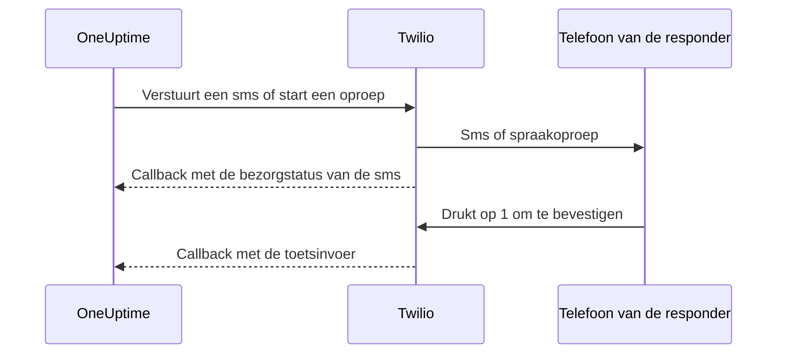

# Twilio-integratie

Een zelf gehoste OneUptime verstuurt sms- en spraakmeldingen via uw eigen Twilio-account, en u betaalt Twilio rechtstreeks. U slaat de Twilio-inloggegevens op in het dashboard van OneUptime, niet in omgevingsvariabelen: de bezorging van meldingen leest de opgeslagen configuratie, en de Helm-chart heeft geen waarden voor Twilio-inloggegevens.

> [!NOTE]
> Een oude migratie importeerde `TWILIO_ACCOUNT_SID`, `TWILIO_AUTH_TOKEN` en `TWILIO_PHONE_NUMBER`; die variabelen wijzigen is niet de manier om de inloggegevens van een bestaande installatie bij te werken.

:::cards
- [Bereid uw Twilio-account voor](#1-bereid-uw-twilio-account-voor): Inloggegevens, een telefoonnummer en de limieten van het account.
- [Sla de inloggegevens op](#2-sla-de-inloggegevens-op-in-oneuptime): Voor één project, of voor de hele installatie.
- [Configureer netwerktoegang](#3-configureer-netwerktoegang): Wat Twilio op uw server moet kunnen bereiken, en wanneer.
- [Verifieer telefoonnummers](#5-telefoonnummers-van-teamleden-verifiëren): Hoe de nummers van teamleden worden geverifieerd.
:::

## 1. Bereid uw Twilio-account voor

:::steps
### Kopieer uw inloggegevens

Open de [Twilio Console](https://console.twilio.com/) en kopieer uw **Account SID** en **Auth Token**.

### Neem een telefoonnummer

Neem een Twilio-telefoonnummer met de sms- en/of spraakmogelijkheden die u nodig hebt. Gebruik voor afzender- en ontvangernummers het formaat E.164, met de landcode.

### Controleer de limieten van het account

Controleer het saldo van het account, de toestemmingen voor bestemmingslanden en de geldende vereisten voor afzenderregistratie. Proefaccounts hebben beperkingen voor ontvangers, regio's en meer, waardoor echte meldingen van OneUptime kunnen mislukken; lees vóór het testen de [documentatie van Twilio over accounts en de proefperiode](https://www.twilio.com/docs/usage/tutorials/how-to-use-your-free-trial-account). Gebruik voor productie een opgewaardeerd account.
:::

## 2. Sla de inloggegevens op in OneUptime

Sla de inloggegevens op voor één project, of eenmalig voor de hele installatie:

| | Projectconfiguratie | Configuratie voor de hele installatie |
| --- | --- | --- |
| Waar | De kaart **Twilio-configuratie** onder **Projectinstellingen > Meldingen > Meldingsinstellingen** | **Admin Dashboard > Instellingen > Oproep en sms** |
| Wie kan het instellen | **Project Owner**, **Project Admin**, of **Create Call and SMS** in een aangepaste rol | Een master-admin |
| Gebruikt voor | Sms en oproepen naar de leden van het project zolang het de projectstandaard is, de statuspagina's waaraan het is toegewezen en het beleid voor inkomende oproepen dat het gebruikt | Sms en oproepen naar de leden van elk project dat geen standaardconfiguratie heeft |

Zo voegt u een projectconfiguratie toe:

:::steps
1. Ga naar **Projectinstellingen > Meldingen > Meldingsinstellingen**.
2. Kies in **Twilio-configuratie** de knop **Twilio-configuratie aanmaken**.
3. Vul een naam, **Twilio Account SID**, **Twilio Auth Token** en **Twilio primair telefoonnummer** in. Vul eventueel door komma's gescheiden **Twilio secundaire telefoonnummers** in voor andere landen.
4. **Instellen als projectstandaard** staat aan voor de eerste configuratie van het project, zodat de sms en oproepen naar de leden van het project, inclusief on-call-meldingen, er meteen na het opslaan via lopen. Zet het uit als dit account alleen voor statuspagina's of inkomende oproepen is. Een latere configuratie begint met de schakelaar uit: zet hem aan, of kies **Instellen als projectstandaard** in het rijmenu van de configuratie, om die berichten ernaartoe te verplaatsen. Een API-verzoek dat `isProjectDefault` weglaat, wordt op dezelfde manier behandeld.
5. Sla op. Slechts één configuratie kan de projectstandaard zijn. Statuspagina's gebruiken de configuratie die expliciet aan elke statuspagina is toegewezen.

> [!IMPORTANT]
> **SMS** en **Telefoonoproepen** staan in elk project eerst uit, en zolang ze uit staan kan niemand in het project er een telefoonnummer voor toevoegen. Een projecteigenaar, een **Billing Admin** of iemand met **Manage Billing** zet ze aan in de kaart **Meldingskanalen** op dezelfde pagina.
:::

Voor een standaard voor de hele installatie kan een beheerder in plaats daarvan **Admin Dashboard > Instellingen > Oproep en sms** openen, de Twilio-inloggegevens en telefoonnummers bewerken en opslaan. Meldingen aan leden gebruiken deze globale configuratie wanneer hun project geen standaard heeft. Houd het Auth Token geheim.

## 3. Configureer netwerktoegang

Versturen werkt met alleen uitgaande toegang. Bezorgupdates, bevestigen met het toetsenblok en inkomende oproepen hebben nodig dat Twilio uw server kan bereiken.

Een privé-installatie heeft DNS-resolutie en uitgaand HTTPS via TCP 443 naar Twilio nodig om sms en oproepen in te dienen. Twilio raadt aan uitgaand HTTPS naar `*.twilio.com` toe te staan, omdat de API-adressen dynamisch zijn; zie [Twilio-IP-adressen](https://help.twilio.com/articles/115015934048-All-About-Twilio-IP-Addresses). Pas dit toe op het uitgaande verkeer van de workload van de OneUptime-applicatie, inclusief Kubernetes-NetworkPolicies en externe firewalls.

Inkomende toegang hangt af van de functie:

| Functie | Moet Twilio OneUptime bereiken? |
| --- | --- |
| Sms indienen | Nee. Updates van de bezorgstatus hebben wel een callback nodig. |
| Een eenvoudige spraakoproep als test | Nee. OneUptime levert de gesproken instructies mee met het uitgaande API-verzoek. |
| Op 1 drukken om een on-call-melding te bevestigen | Ja. Twilio stuurt de toetsinvoer naar OneUptime. |
| Beleid voor inkomende oproepen | Ja. Twilio vraagt de oproepinstructies op en meldt de resultaten van het kiezen. |

Dit zijn de externe paden, via de Nginx-gateway van OneUptime. De placeholders verschillen per melding:

| Methode | Pad | Doel |
| --- | --- | --- |
| POST | `/notification/sms/status-callback/:smsLogId/:token` | Bezorgstatus van de sms |
| POST | `/api/user-notification-log-timeline/call/gather-input/:itemId?token=...` | Bevestigen met het toetsenblok |
| POST | `/notification/incoming-call/voice` | Optionele instructies voor inkomende oproepen |
| POST | `/notification/incoming-call/dial-status/:callLogId/:callLogItemId` | Optionele resultaten van het routeren van inkomende oproepen |

OneUptime maakt de URL's voor sms en bevestiging automatisch aan. Vervang hun tokens niet door een vaste webhook-URL. Volg voor inkomende oproepen [het beleid voor inkomende oproepen](/docs/on-call/incoming-call-policy), dat de webhook van het nummer configureert wanneer u een nummer koppelt.

Twilio vereist [openbaar bereikbare webhook-URL's](https://www.twilio.com/docs/usage/webhooks/webhooks-overview). Gebruik een openbaar vertrouwd TLS-certificaat en behoud via proxy's de oorspronkelijke host, het protocol, het pad, de queryparameters, de body en de header `X-Twilio-Signature`. De handlers voor inkomende oproepen valideren de handtekeningen van Twilio; sms-bezorging gebruikt een URL-token per bericht, en bevestigen met het toetsenblok een ondertekend querytoken. Stel tokens niet bloot in gedeelde logs of schermafbeeldingen. Zie [Twilio-webhookbeveiliging](https://www.twilio.com/docs/usage/webhooks/webhooks-security).

### Callbacks publiceren vanuit een privé-installatie

:::steps
1. Publiceer DNS voor uw OneUptime-hostnaam, bijvoorbeeld `oneuptime.example.com`, wijzend naar een vanaf internet bereikbare reverse proxy of load balancer. Sta inkomend TCP 443 toe en configureer een openbaar vertrouwd certificaat met de volledige keten. Een privé-IP, alleen intern DNS of de VPN-verbinding van een beheerder geven Twilio geen verbinding.
2. Geef die gateway een netwerkroute naar de privé-ingress van OneUptime, rechtstreeks of via uw eigen site-to-site-VPN of private link. Sta de upstream-poort van de dienst toe. Een Kubernetes-dienst van het type `ClusterIP` heeft een bereikbare ingress of een andere route vanaf de gateway nodig. Houd databases en andere interne diensten privé.
3. Publiceer alleen de callbackpaden uit de tabel hierboven die u gebruikt. Stuur ze door via de Nginx-gateway van OneUptime, die het externe voorvoegsel `/notification` op de applicatie afbeeldt. Behoud `/api` op de route voor bevestigen met het toetsenblok. Behoud de HTTP-methode en de verzoekgegevens; stuur niet door naar een andere URL. Behoud de openbare `Host` en stel op uw proxy vertrouwde forwarding-headers in voor de openbare host en het HTTPS-schema.
4. Zonder deze routes uit van browser-SSO, CAPTCHA en aanmeldpagina's van de proxy. Laat de callback-authenticatie van OneUptime aanstaan. Beperk de toegang tot de privé-oorsprong tot de gateway en geautoriseerde interne clients.
5. Stel `HOST=oneuptime.example.com` en `HTTP_PROTOCOL=https` in de `config.env` van Docker Compose in, of `host: oneuptime.example.com` en `httpProtocol: https` in de Helm-values. Pas de wijziging van de installatie toe en wacht tot de applicatie opnieuw is gestart. Deze instellingen maken URL's aan; ze maken geen DNS, certificaten of firewallregels aan. OneUptime heeft geen aparte instelling voor een hostnaam voor Twilio-callbacks. Verandert de hostnaam, werk dan ook de webhook van bestaande Twilio-telefoonnummers bij.
:::

Het dashboard kan op een privé-ingress blijven: met split DNS lossen medewerkers dezelfde hostnaam via het bedrijfsnetwerk of de VPN op naar die ingress, terwijl Twilio hem oplost naar de gateway. Bied op beide wegen een certificaat aan dat geldig is voor die hostnaam. De [instellingen voor toegang tot privénetwerken](/docs/self-hosted/private-network-access) van OneUptime regelen uitgaande verzoeken naar interne diensten; `ALLOW_PRIVATE_NETWORK_WEBHOOKS` publiceert geen inkomend endpoint.

### IP-beperkingen en installaties zonder inkomende toegang

De gewone bronadressen van de webhooks van Twilio veranderen, dus gebruik geen SIP- of media-IP-bereiken als allowlist voor callbacks. In aanmerking komende Twilio-edities bieden [Static Proxy for Webhooks](https://www.twilio.com/docs/iam/twilio-editions/twilio-static-proxy). Controleer of uw editie in aanmerking komt en welke producten worden ondersteund, en configureer uw firewall met de bereiken die Twilio nu publiceert; blijf de callbacks valideren, ook als u het gebruikt.

> [!WARNING]
> Als beleid inkomende verbindingen verbiedt, kunnen sms indienen en eenvoudig ingebouwd spraak afspelen werken met uitgaand HTTPS. Updates van sms-bezorging, bevestigen met het toetsenblok en het routeren van inkomende oproepen werken niet zonder bereikbare callbacks. Een volledig afgesloten installatie kan Twilio niet gebruiken.

Voor ontwikkeling beschrijft de [handleiding voor het testen van webhooks](https://www.twilio.com/docs/usage/webhooks/webhook-testing) van Twilio het gebruik van een openbare tunnel: stuur die door naar een proxy die alleen de nodige routes toestaat, configureer de resulterende hostnaam zoals hierboven en stop de tunnel na het testen. Ook een tunnel opent inkomende toegang.

## 4. Test aflevering en callbacks afzonderlijk

:::steps
1. Controleer van buiten uw bedrijfsnetwerk en VPN dat de callback-hostnaam naar de openbare gateway oplost en een geldig TLS-certificaat aanbiedt. Een GET vanuit de browser test deze POST-callbacks niet.
2. Gebruik **Test-sms verzenden** en **Testoproep verzenden** op de Twilio-configuratie van het project. Bevestig de ontvangst op de bestemmingstelefoon. Beide vereisen toestemming om Twilio-configuraties toe te voegen: **Project Owner**, **Project Admin**, of **Create Call and SMS** en **Read Call and SMS** in een aangepaste rol.
3. Stel voor de gebruiker een geverifieerd sms- of oproepcontact en meldingsregels in en activeer daarna een gecontroleerde on-call-melding. Druk op 1 en controleer de bevestiging in OneUptime. Gebruikt u beleid voor inkomende oproepen, bel dan het geconfigureerde nummer en controleer de routering en het oproeplogboek.
4. Controleer de bezorgstatus van de sms in OneUptime en in de berichtlogboeken van Twilio. Een geaccepteerde verzending bewijst geen bezorging; [Twilio meldt latere statuswijzigingen via callbacks](https://www.twilio.com/docs/messaging/guides/track-outbound-message-status).
:::

| Symptoom | Waar u kijkt |
| --- | --- |
| Er wordt niets verzonden | Inloggegevens, de mogelijkheden van het nummer, beperkingen van het account en de uitgaande verbinding. |
| De sms of oproep komt aan, maar de status of de bevestiging wordt niet bijgewerkt | De callback-URL en de logs van de openbare ingress. De [uitleg van Twilio over HTTP-ophaalfouten](https://www.twilio.com/docs/api/errors/11200) helpt bij onbereikbare callbacks, TLS-problemen en HTTP-fouten. |

Een geslaagde testoproep alleen bewijst niet dat callbacks bereikbaar zijn.

## 5. Telefoonnummers van teamleden verifiëren

Een telefoonnummer toevoegen voor sms of oproepen verstuurt meteen de verificatiecode, en het verificatievenster opent. Het laat zien wanneer de code is verstuurd en tot wanneer hij geldig is, en verstuurt op verzoek een nieuwe code, hooguit één keer per minuut. Vóór het verifiëren hoeft niets opnieuw te worden verstuurd.

Als er geen code kan worden verstuurd, zegt het venster waarom, in plaats van te beweren dat er een is verstuurd: bijvoorbeeld dat er geen Twilio-account is ingesteld, zolang er geen standaardconfiguratie van het project en geen configuratie voor de hele installatie hierboven bestaat. Een nummer waarvan de eerste code niet kan worden verstuurd, wordt niet toegevoegd, en het formulier toont de reden, zoals dat Twilio een bestemmingsland weigert.

Een nummer dat voor sms is geverifieerd, is ook voor oproepen geverifieerd, zonder tweede code. Verifiëren via een oproep verifieert sms niet, omdat een nummer dat oproepen aanneemt, zoals een vaste lijn, niet altijd sms'jes kan ontvangen. Als Twilio een code accepteert die nooit aankomt, toont het sms-logboek van het project de bezorgstatus.

## Volgende stappen

:::cards
- [Beleid voor inkomende oproepen](/docs/on-call/incoming-call-policy): Bellers via een Twilio-nummer uw on-call-engineers laten bereiken.
- [Escalatieregels](/docs/on-call/escalation-rules): Bepalen wie op elk niveau wordt opgeroepen, per sms, oproep of een andere methode.
- [SMTP](/docs/emails/smtp): Ook e-mail via uw eigen mailserver versturen.
- [Toegang tot privénetwerken](/docs/self-hosted/private-network-access): Workflows en webhooks interne tools laten bereiken.
:::
