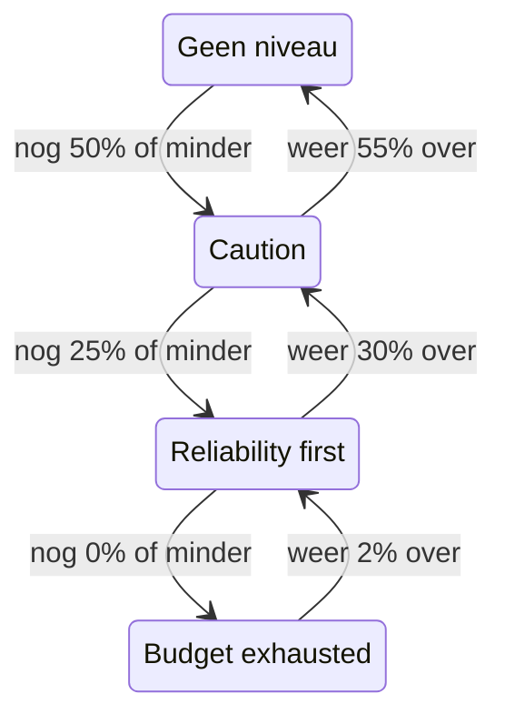

# Foutbudgetbeleid

Een foutbudgetbeleid legt vast wat uw team heeft afgesproken te doen terwijl het foutbudget van een SLO opraakt, zoals riskante wijzigingen nakijken zodra de helft op is, of releases bevriezen zodra alles op is. OneUptime zet de SLO in het niveau van het beleid dat zijn budget heeft bereikt, toont de afspraak van het team voor dat niveau op de pagina's van de SLO, en kan een waarschuwing geven of een incident melden wanneer de SLO een niveau binnengaat. Het is de praktijk van het foutbudgetbeleid uit het [Google SRE Workbook](https://sre.google/workbook/error-budget-policy/).

:::cards
- [Hoe niveaus werken](#hoe-niveaus-werken): Welk niveau geldt, en wanneer de SLO het verlaat.
- [Een beleid instellen](#een-beleid-instellen): Begin met het aanbevolen beleid of schrijf uw eigen niveaus.
- [Waarschuwingen en incidenten](#waarschuwingen-en-incidenten): Waarschuw uw team wanneer de SLO een niveau binnengaat.
- [Het niveau via de API lezen](#het-niveau-via-de-api-lezen): Controleer het niveau vanuit CI en scripts.
:::

## Hoe niveaus werken

Een beleid is een reeks niveaus. Elk niveau heeft drie velden:

| Veld | Wat het bevat |
| --- | --- |
| **Naam** | Hoe het team het niveau noemt, bijvoorbeeld "Reliability first". |
| **Budget Left Threshold (%)** | Het deel van het resterende foutbudget waarop of waaronder het niveau geldt. Van 0 tot 100, decimalen toegestaan. Elk niveau van een SLO heeft een eigen drempel. |
| **What We Do** | Wat het team heeft afgesproken te doen zolang de SLO in het niveau zit, in Markdown. Verplicht, tot 10.000 tekens. |

Een niveau geldt zolang het resterende budget op of onder zijn drempel ligt, dus een niveau op 0% is het niveau van een opgebruikt budget. Als meerdere niveaus gelden, zit de SLO in het niveau met de laagste drempel: het ernstigste. Als er geen geldt, zit de SLO in geen enkel niveau. Met niveaus op 50%, 25% en 0% zit een SLO met nog 30% van zijn budget in het niveau van 50%, en een SLO met nog 10% in het niveau van 25%.

### Een niveau binnengaan en verlaten

Het niveau volgt het resterende budget zoals de status van de SLO dat doet:

- Een niveau binnengaan gebeurt meteen: de evaluatie die het budget op of onder de drempel van een niveau vindt, zet de SLO in dat niveau. Een budget dat in één keer onder meerdere drempels zakt, gaat direct naar het ernstigste niveau.
- Een niveau verlaten voor een minder ernstig niveau wacht tot het budget duidelijk terug is. Een niveau op 0% wordt verlaten zodra er weer 2% van het budget over is. Elk ander niveau wordt verlaten zodra het budget 5 punten boven zijn drempel ligt.

Een niveau op 0% beweegt dus mee met de status **Budget uitgeput**, en een niveau op de risicodrempel van de SLO met **Risico**: zie [Statuswijzigingen en de risicodrempel](/docs/slo/error-budget#statuswijzigingen-en-de-risicodrempel). Een rollend venster dat rond een drempel schommelt, laat het niveau niet heen en weer springen.



## Een beleid instellen

U hebt toestemming nodig om niveaus van het foutbudgetbeleid van SLO's aan te maken.

:::steps
### Error Budget Policy openen

Open de SLO en ga naar **Error Budget Policy** in de sectie **Regels** van het zijmenu. De pagina toont de niveaus van de SLO, elk met zijn naam, het resterende budget waarop het geldt en wat het team doet.

### Beginnen met het aanbevolen beleid

Zolang de SLO geen niveaus heeft, biedt de pagina **Use the recommended policy** aan. Klik erop, controleer de drie niveaus die worden getoond en bevestig. Pas daarna de tekst van elk niveau aan tot de eigen afspraak van uw team.

### Of zelf een niveau toevoegen

Klik op **SLO Error Budget Policy Tier aanmaken**. Vul een **Naam** en een **Budget Left Threshold (%)** in, en schrijf de afspraak van het team in **What We Do**.

### Kiezen wat het niveau geeft

Een niveau legt de afspraak vast en toont die. Om ook iemand te waarschuwen wanneer de SLO het niveau binnengaat, opent u de ingeklapte instellingen voor waarschuwing en incident en zet u een waarschuwing, een incident of beide aan. Beide staan standaard uit. Zie [Waarschuwingen en incidenten](#waarschuwingen-en-incidenten).
:::

Een niveau toevoegen, bewerken of verwijderen werkt meteen: OneUptime evalueert de SLO binnen ongeveer een minuut opnieuw. Ligt het budget al op of onder de drempel van een niveau, dan komt de SLO in dat niveau, en geeft het niveau wat het moet geven. Een niveau uitzetten of verwijderen lost op wat het gaf, en de SLO gaat naar het niveau waarin zijn budget ligt. De waarschuwing of het incident van een niveau uitzetten lost die waarschuwing of dat incident op.

### Het aanbevolen beleid

**Use the recommended policy** voegt drie niveaus toe, op de helft van het budget, een kwart en nul, met deze Engelse tekst:

| Niveau | Geldt bij | Wat het team doet |
| --- | --- | --- |
| **Caution** | Nog 50% of minder over | Half of the error budget is spent. Review risky changes before they ship, and find out what has been spending the budget. |
| **Reliability first** | Nog 25% of minder over | Reliability comes first. Only reliability improvements and critical fixes ship until the budget recovers. |
| **Budget exhausted** | Nog 0% of minder over | The error budget is spent. Freeze non-critical releases: only fixes for this SLO's reliability and security fixes ship until the budget is back. |

Geen van hen geeft een waarschuwing of meldt een incident totdat u dat aanzet. Alleen de niveaus die de SLO niet heeft, worden toegevoegd: een niveau met dezelfde naam, of met dezelfde drempel, telt als aanwezig, of het nu aan of uit staat. Er twee keer om vragen, vanuit een tweede tabblad of via de API, voegt dus niets dubbel toe. Elk niveau dat zo wordt toegevoegd, wordt in de auditlogboeken van de SLO vastgelegd als toegevoegd door u.

## Waar het niveau verschijnt

- Het **Overzicht** van de SLO toont het niveau waarin hij zit en wat het team daar heeft afgesproken, zodat iedereen die de SLO opent de afspraak ziet die nu geldt.
- De grafiek **Burn-down van foutbudget** tekent een lijn met label op de drempel van elk niveau, naast die van de risicodrempel.
- De **Feed** van de SLO plaatst elke niveauwijziging: het niveau dat de SLO verliet en het niveau waarin hij kwam, het resterende budget en wat het team in het nieuwe niveau heeft afgesproken.
- De **Auditlogboeken** van de SLO leggen elke niveauwijziging vast als een wijziging die OneUptime zelf heeft gedaan, en tonen die dus alleen met **Systeemgebeurtenissen opslaan** aan: zie [Auditlogboeken aanzetten](/docs/slo/feed-and-audit-logs#auditlogboeken-aanzetten). Het toevoegen, bewerken en verwijderen van een niveau wordt vastgelegd op naam van de persoon die het deed.
- De lees-API van de SLO geeft het niveau terug: zie [Het niveau via de API lezen](#het-niveau-via-de-api-lezen).

## Waarschuwingen en incidenten

Elk niveau kan een waarschuwing geven, een incident melden of beide wanneer de SLO het binnengaat. Ze hebben de opties van de waarschuwing en het incident van een regel voor verbruikssnelheid: ernst, bereikbaarheidsbeleid, sjablonen voor titel, beschrijving en herstelnotities, privacy, automatisch oplossen, labels, eigenaar-teams en -gebruikers, en de eigenaren van de SLO als eigenaren toevoegen. Zie [Wat een regel meldt](/docs/slo/burn-rate-alerts#wat-een-regel-meldt). Beide staan standaard uit, dus een niveau waarschuwt niemand totdat u er een aanzet.

- Een ernstiger niveau binnengaan lost op wat het vorige niveau gaf, wat de instelling voor automatisch oplossen ervan ook zegt, omdat het nieuwe niveau het vervangt. Zo zijn hooguit de waarschuwing en het incident van één niveau tegelijk open, en horen ze bij het niveau waarin de SLO zit.
- Herstellen naar een minder ernstig niveau, of uit elk niveau, lost ze op als automatisch oplossen voor het niveau aan staat, wat standaard zo is. Met automatisch oplossen uit blijven ze open totdat iemand ze oplost.
- Er is geen onderdrukking van nieuwe meldingen. Een niveau geeft pas weer iets nadat de SLO het duidelijk heeft verlaten en het opnieuw is binnengegaan, dus het kan niet flapperen. Lost iemand met de hand op wat het gaf terwijl de SLO nog in het niveau zit, dan blijft dat opgelost.
- Zolang een monitor van de SLO in gepland onderhoud is, geven niveaus niets. Het niveau zelf verandert wel, en wat open is, wordt nog steeds opgelost. Zit de SLO nog in het niveau als het onderhoud eindigt, dan geeft het niveau dan wat het moet geven.

Net als bij een regel voor verbruikssnelheid vermeldt een waarschuwing of incident dat een niveau geeft de SLO onder **Getroffen resources**, en een incident verschijnt nooit op statuspagina's. De feed van de SLO plaatst elk ervan, en wanneer het wordt opgelost.

### Wat ze zeggen

De titel, de beschrijving en de herstelnotities van een niveau accepteren sjabloonvariabelen, net als die van een regel: zie [Wat elke waarschuwing en elk incident zegt](/docs/slo/burn-rate-alerts#wat-elke-waarschuwing-en-elk-incident-zegt). De velden van een niveau bieden de variabelen van de SLO en zijn budget aan, en drie van het niveau zelf: `{{sloName}}`, `{{sloId}}`, `{{sloLink}}`, `{{sloStatus}}`, `{{policyTier}}`, `{{policyTierThresholdPercentage}}`, `{{policyTierWhatWeDo}}`, `{{targetPercentage}}`, `{{currentSliPercentage}}`, `{{errorBudgetRemainingPercentage}}`, `{{errorBudgetRemaining}}`, `{{errorBudgetRemainingMinutes}}` en `{{windowDescription}}`. De eigen variabelen van een regel, zoals `{{ruleName}}` en de verbruikssnelheden, worden niet aangeboden en blijven leeg in de sjablonen van een niveau.

De drie niveauvariabelen werken ook in de sjablonen van regels voor verbruikssnelheid:

| Variabele | Wat ze bevat |
| --- | --- |
| `{{policyTier}}` | De naam van het niveau waarin de SLO na de evaluatie zit, of `None` als hij in geen enkel niveau zit. |
| `{{policyTierThresholdPercentage}}` | De drempel van dat niveau, zoals `25`. Leeg als de SLO in geen enkel niveau zit. |
| `{{policyTierWhatWeDo}}` | Wat het team in dat niveau heeft afgesproken. Leeg als de SLO in geen enkel niveau zit. |

Een niveau waarvan de titel leeg blijft, gebruikt de ingebouwde titel:

```text
SLO error budget policy: {{sloName}} — {{policyTier}}
```

De ingebouwde beschrijving noemt het niveau, zet het resterende budget af tegen de drempel van het niveau en zegt wat het team daarin heeft afgesproken.

## Als het budget niet wordt gemeten

- Een SLO die **Gepauzeerd** of **Verkeerd geconfigureerd** is, meet geen budget, dus zijn niveau blijft waar het was, en wat het niveau gaf, blijft open totdat er weer wordt gemeten. Regels voor verbruikssnelheid lossen dan juist op wat ze open hebben.
- De evaluatie van de SLO uitzetten, of de SLO archiveren, lost op wat zijn niveaus gaven. Het niveau waarin de SLO zit, blijft zoals het was.
- De SLO verwijderen verwijdert zijn niveaus en lost op wat ze gaven.

## Het niveau via de API lezen

De eigen lees-API van de SLO geeft het niveau terug waarin hij zit, zodat een CI-taak of een script het kan controleren voordat het iets doet, bijvoorbeeld voor een release. Alle drie de velden zijn leeg zolang de SLO in geen enkel niveau zit:

| Veld | Wat het bevat |
| --- | --- |
| `currentErrorBudgetPolicyTierId` | De ID van het niveau. |
| `currentErrorBudgetPolicyTierName` | De naam van het niveau. |
| `currentErrorBudgetPolicyTierEnteredAt` | Wanneer de SLO het niveau binnenging. |

Ze worden gelezen met de eigen leestoestemming van de SLO, dezelfde die zijn budget ook nodig heeft. Bijvoorbeeld met een [API-sleutel](/docs/api-reference/api-reference) van het project:

```bash
curl -X POST 'https://oneuptime.com/api/service-level-objective/<slo-id>/get-item' \
  -H "ApiKey: $ONEUPTIME_API_KEY" \
  -H 'Content-Type: application/json' \
  -d '{ "select": { "name": true, "errorBudgetRemainingPercentage": true, "currentErrorBudgetPolicyTierName": true, "currentErrorBudgetPolicyTierEnteredAt": true } }'
```

De niveaus zelf zijn een eigen resource, `/api/service-level-objective-error-budget-policy-tier`, met de verzoeken om op te sommen, te lezen, aan te maken, te wijzigen en te verwijderen die elke resource heeft. Nog twee verzoeken dienen het aanbevolen beleid. Beide nemen `{ "serviceLevelObjectiveId": "..." }` aan en antwoorden met de niveaus in `tiers`:

| Verzoek | Wat het doet |
| --- | --- |
| `POST /api/service-level-objective-error-budget-policy-tier/recommended-policy` | Somt de aanbevolen niveaus op die de SLO mist. Het schrijft niets. |
| `POST /api/service-level-objective-error-budget-policy-tier/recommended-policy/add` | Voegt ze toe en somt op wat het heeft toegevoegd. Opnieuw vragen voegt niets toe. |

## Machtigingen

| Machtiging | Laat een rol |
| --- | --- |
| **Read SLO Error Budget Policy Tier** | De niveaus van een SLO zien. |
| **Create SLO Error Budget Policy Tier** | Niveaus toevoegen, met de hand of met **Use the recommended policy**. |
| **Edit SLO Error Budget Policy Tier** | Niveaus wijzigen, en ze aan- of uitzetten. |
| **Delete SLO Error Budget Policy Tier** | Niveaus verwijderen. |

Deze machtigingen staan in de SLO-groep van een rol. De rollen Project Owner en Project Admin hebben ze allemaal, en de rollen Project Member en Viewer kunnen niveaus lezen.

## Nog niet beschikbaar

Sommige onderdelen van een foutbudgetbeleid zijn nog niet beschikbaar: een implementatiepoort die releases zelf tegenhoudt (een CI-taak kan in plaats daarvan het niveau via de API lezen), workflowtriggers en meldingen in Slack of Microsoft Teams per niveau, een beleid dat meerdere SLO's delen, een niveau bevestigen of er een uitzondering op maken, en niveaus die de looptijd van het budget volgen in plaats van het resterende budget.

## Volgende stappen

:::cards
- [Foutbudgetten](/docs/slo/error-budget): Wat het budget is, en hoe de status het volgt.
- [Waarschuwingen en incidenten voor verbruikssnelheid](/docs/slo/burn-rate-alerts): Waarschuw uw team wanneer het budget te snel opbrandt.
- [SLO-feed en auditlogboeken](/docs/slo/feed-and-audit-logs): Elke niveauwijziging en wat de niveaus gaven.
:::
