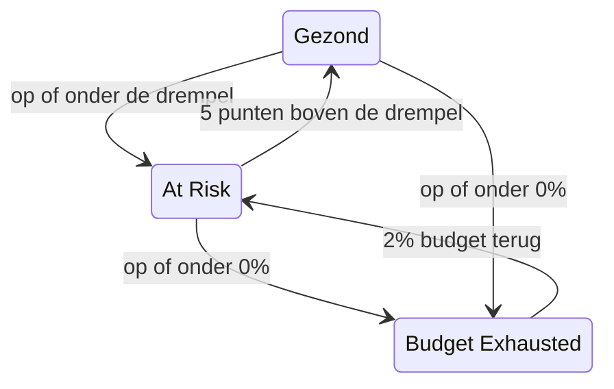

# Foutbudgetten

Het foutbudget is de downtime die het doel van een SLO toestaat. Een doel van 99,9% betekent niet "nooit uitvallen": het betekent "u mag tot 43 minuten per 30 dagen uit de lucht zijn, dus besteed die goed". Deze pagina legt uit hoe OneUptime het budget telt, hoelang het meegaat, hoe het terugkomt en wie ervan hoort.

:::cards
- [Hoe het budget wordt berekend](#hoe-het-budget-wordt-berekend): De formule en het budget van gangbare doelen.
- [Looptijd van het budget](#looptijd-van-het-budget): Hoelang het budget meegaat in het huidige tempo.
- [Hoe het budget herstelt](#hoe-het-budget-herstelt): Voortschrijdende vensters en kalendermaanden.
- [Meldingen aan eigenaren](#meldingen-aan-eigenaren): Wie het hoort als het budget krap wordt.
:::

## Hoe het budget wordt berekend

Het totale budget is het deel van het venster dat uw doel niet belooft:

```text
total budget = (100% − target) × window length
```

| Doel | Venster van 7 dagen | Venster van 28 dagen | Venster van 30 dagen | Venster van 90 dagen |
| --- | --- | --- | --- | --- |
| 99% | 1h 40m 48s | 6h 43m 12s | 7h 12m | 21h 36m |
| 99.5% | 50m 24s | 3h 21m 36s | 3h 36m | 10h 48m |
| 99.9% | 10m 5s | 40m 19s | 43m 12s | 2h 9m 36s |
| 99.95% | 5m 2s | 20m 10s | 21m 36s | 1h 4m 48s |
| 99.99% | 1m 0s | 4m 2s | 4m 19s | 12m 58s |

De pagina **Instellingen** van de SLO toont het budget dat zijn doel toestaat naast het doel, bijvoorbeeld "43m 12s downtime per venster van 30 dagen".

### Het budget van een SLO met meerdere monitoren

In de modus **Any Monitor Down** is het budget `(100% − target) × window`, ongeacht hoeveel monitoren de SLO meet: het venster is één tijdlijn.

In de modus **Monitor Seconds Average** wordt het budget geteld in monitorseconden, opgeteld over de monitoren, dus het groeit met het aantal monitoren: een SLO met drie monitoren op 99,9% over 30 dagen heeft ongeveer 129 minuten budget in plaats van 43. De percentages (SLI, resterend budget, verbruikssnelheid) betekenen hetzelfde; alleen de duren veranderen.

### Het budget van een kalendermaand

Een SLO met een kalendermaand heeft vanaf de eerste dag het budget van de hele maand: een SLO van 99,9% in een maand van 31 dagen heeft op de 1e al zijn 44m 38s. Het budget wordt niet naar rato van het verstreken deel van de maand berekend, dus een storing van een minuut op de ochtend van de 1e kost een minuut van het maandbudget.

## Resterend budget

Naarmate downtime oploopt, toont het **Overzicht** het resterende budget in zijn tegel **Error budget left**:

- als percentage van het totaal, dat ook de status van de SLO bepaalt en de balk vult. De balk heeft een markering op de risicodrempel van de SLO;
- als duur, bijvoorbeeld "31m 4s left of 43m 12s".

Als het budget op is, toont de tegel **No budget left**. Als downtime het overschrijdt, toont de tegel **Budget exceeded** en de overschrijding als tijd, bijvoorbeeld "4d 23m over budget · 5m 47s allowed": de SLO heeft alle 5 minuten en 47 seconden van zijn budget gebruikt, en nog 4 dagen en 23 minuten meer. De balk blijft leeg en rood.

Het resterende budget wordt voor berekeningen en geschiedenisgrafieken als getal met teken opgeslagen, dus daar verschijnt een overschreden budget als negatief percentage. Een sterk negatief percentage betekent dat de overschrijding groot is ten opzichte van het budget; het is niet het deel van de tijd dat de dienst uit de lucht was.

Welke seconden als downtime tellen, bepalen de downtime-statussen van de SLO en, voor een SLO met meerdere monitoren, zijn modus voor meerdere monitoren, allebei onder **Instellingen** → **Downtime Calculation**. Zie [SLO's – Overzicht](/docs/slo/introduction).

## Looptijd van het budget

De tegel **Budget runway** op het **Overzicht** beantwoordt "als dit zo doorgaat, wanneer is het budget op?". Hij deelt het resterende budget door de verbruikssnelheid van de laatste 60 minuten:

```text
runway = budget left ÷ (burn rate × (100% − target))
```

| De tegel toont | Wat het betekent |
| --- | --- |
| Een duur, zoals **~2d 5h** | In het huidige tempo is het budget over ongeveer zo lang op. Oranje, en rood bij een dag of minder. **Under 1m** betekent minder dan een minuut. |
| **Not burning** | In de laatste 60 minuten is geen budget uitgegeven. |
| **Sustainable** | Alleen voortschrijdende vensters: de looptijd is minstens één volledig venster, dus het budget wordt niet sneller uitgegeven dan oude downtime uit het venster valt. In dit tempo raakt het niet op. |
| **Lasts until reset** | Alleen kalendermaanden: het budget wordt aan het begin van de volgende maand teruggezet voordat het op is. |
| **Overspent** | Het budget is al op. De tegel zegt met hoeveel het is overschreden. |

Voor SLO's met een kalendermaand zegt de tegel ook wanneer het budget wordt teruggezet.

De looptijd is een rechtlijnige projectie. In een voortschrijdend venster geeft oude downtime die uit het venster valt budget terug, wat de projectie negeert: lees haar als de minimale tijd die u nog hebt. Ze wordt niet getoond vóór de eerste evaluatie, en ook niet voor SLO's in de modus **Monitor Seconds Average**, waarvan het budget in monitorseconden en niet in kloktijd wordt geteld.

## Verbranding van het foutbudget

De grafiek **Error budget burn-down** op het **Overzicht** zet het resterende budget, als percentage, uit over het huidige compliancevenster:

- Een lijn op 0% geeft aan waar het budget op is, en een stippellijn geeft de risicodrempel van de SLO aan.
- Voor SLO's met een kalendermaand loopt een vage lijn gelijkmatig af van een vol budget aan het begin van de maand tot een leeg budget bij het terugzetten. Onder die lijn geeft de maand haar budget te snel uit.
- Bij elke evaluatie, elke 5 minuten, wordt een punt vastgelegd, dus de grafiek van een nieuwe SLO blijft leeg tot zijn eerste evaluatie.
- Sleep over de grafiek om in te zoomen op een deel van het venster. Dubbelklik, of klik op **Reset zoom**, om weer het hele venster te zien.

**Open metrics** opent de pagina **Metrieken** van de SLO, waarvan het tabblad **Error Budget History** tot 400 dagen teruggaat. Zie [SLO-metrics en -dashboards](/docs/slo/metrics).

## Hoe het budget herstelt

Hoe het budget terugkomt, hangt af van het venstertype van de SLO:

:::tabs
@tab Rolling
Een voortschrijdend venster kijkt altijd even ver terug vanaf nu, dus downtime valt er uiteindelijk uit: een storing telt precies één venster nadat ze gebeurde niet meer mee. Een storing van 30 minuten op 1 juni valt op 1 juli uit de berekening van een SLO van 30 dagen, en het budget komt geleidelijk terug, naarmate elke seconde downtime het venster verlaat, niet in één keer.

Herstel wordt dus verdiend, niet ingepland. Blijven er kleine storingen komen, dan valt oude downtime eruit terwijl nieuwe erin komt, en blijft het budget staan in plaats van te herstellen.
@tab Calendar Month
Een SLO met een kalendermaand wordt om middernacht op de eerste van elke maand teruggezet, in zijn tijdzone. Het hele budget komt in één keer terug en de vorige maand wordt afgesloten. Niets gaat over van de ene maand naar de andere, in geen enkele richting: een slechte maand schaadt de volgende niet, en een goede maand geeft haar geen extra ruimte.
:::

### Jonge SLO's

Een SLO met een voortschrijdend venster die jonger is dan zijn venster, wordt gemeten over de gegevens die er tot nu toe zijn, en zijn totale budget groeit mee: een SLO van 30 dagen die een week geleden is aangemaakt, heeft voorlopig een budget van 7 dagen. Tot het venster vol is, toont het **Overzicht** hoe vol het is, met een indicator **Window 23% full** en dezelfde opmerking in de tegel **Error budget left**. Verwacht dat de cijfers tot rust komen naarmate het venster zich vult.

## Statuswijzigingen en de risicodrempel

Het resterende budget bepaalt de status van de SLO:

| Status | Wanneer |
| --- | --- |
| **Gezond** | Er is meer budget over dan de risicodrempel. |
| **At Risk** | Het resterende budget zit op de risicodrempel of eronder: standaard 20%. |
| **Budget Exhausted** | Het resterende budget is nul of lager. |

Stel de risicodrempel in onder **Instellingen** → **Objective**.

Voortschrijdende vensters herstellen seconde voor seconde, dus een SLO vlak bij een grens zou heen en weer kunnen springen tussen twee statussen. Zodat elke statuswijziging iets betekent, verlaat een SLO een status pas als hij duidelijk over de grens is:



Met de standaarddrempel van 20% wordt een SLO in gevaar weer gezond bij 25% resterend budget, en gaat een SLO met een uitgeput budget terug naar in gevaar bij 2%. Elke statuswijziging verschijnt in de **Feed** van de SLO, met de SLI, het budget en de verbruikssnelheid die haar verklaren.

## Meldingen aan eigenaren

Als een SLO naar **At Risk** of **Budget Exhausted** gaat, informeert OneUptime zijn eigenaren:

- De eigenaren zijn de gebruikers en teamleden op de pagina **Eigenaren** van de SLO die nog lid van het project zijn. Een SLO zonder eigenaren informeert in plaats daarvan de projecteigenaren.
- Elke eigenaar krijgt standaard een e-mail, en de melding via elk ander kanaal dat hij aanzet voor **SLO status changed** onder **Gebruikersinstellingen** → **Meldingsinstellingen** → **Bewaking**.
- Het onderwerp van de e-mail noemt de status en de SLO, bijvoorbeeld `[SLO At Risk] API Availability`.

Zodat een SLO vlak bij een grens niet blijft melden, krijgen zijn eigenaren hoogstens één melding per uur. Een overgang naar **Budget Exhausted** wordt altijd verstuurd, ook binnen dat uur.

> [!TIP]
> Meldingen aan eigenaren laten de verantwoordelijken van een SLO weten dat zijn budget in de problemen zit. Om uw dienstdoende team via escalatiebeleid op te roepen, gebruikt u [Waarschuwingen en incidenten voor verbruikssnelheid](/docs/slo/burn-rate-alerts). Een regel voor verbruikssnelheid kan de eigenaren van de SLO ook toevoegen aan elke waarschuwing en elk incident dat hij aanmaakt.

## Volgende stappen

:::cards
- [Waarschuwingen en incidenten voor verbruikssnelheid](/docs/slo/burn-rate-alerts): Waarschuw uw team als het budget te snel opraakt.
- [SLO-metrics en -dashboards](/docs/slo/metrics): Zet het budget in een grafiek over de tijd.
- [SLO's – Overzicht](/docs/slo/introduction): Doelen, vensters en downtime-statussen.
:::
