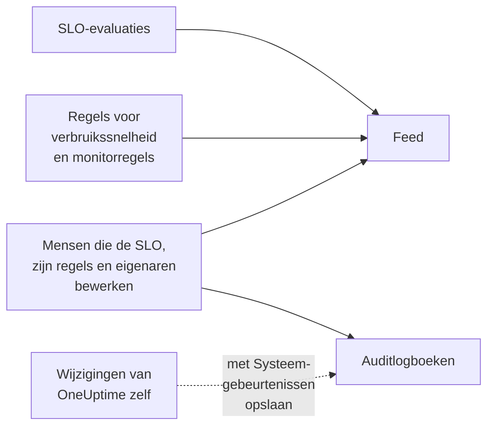

# SLO-feed en auditlogboeken

Een SLO houdt twee verslagen van zijn geschiedenis bij, en ze beantwoorden verschillende vragen. De **Feed** beantwoordt "wat is er met deze SLO gebeurd?", geschreven voor de mensen die ervoor zorgen. De **Auditlogboeken** beantwoorden "wie heeft wat precies gewijzigd?", veld voor veld, voor controles en compliance.

## Feed of auditlogboeken?

| | **Feed** | **Auditlogboeken** |
| --- | --- | --- |
| Beantwoordt | Wat er met de SLO is gebeurd | Wie wat heeft gewijzigd, en wanneer |
| Legt vast | Statuswijzigingen, waarschuwingen en incidenten voor verbruikssnelheid, en wijzigingen aan de SLO, zijn regels, monitoren en eigenaren | Elke wijziging die mensen aan de SLO, zijn regels voor verbruikssnelheid, monitorregels en eigenaren hebben gedaan, met de oude en de nieuwe waarde |
| Bevat het werk van OneUptime zelf | Ja: evaluaties en monitorregels die monitoren koppelen | Alleen met **Systeemgebeurtenissen opslaan** aan |
| Abonnementen | Elk abonnement | Het Enterprise-abonnement op OneUptime Cloud, of de Enterprise Edition op een zelfgehoste installatie |
| Bewaard | Drie jaar op OneUptime Cloud | Standaard 7 dagen, tot 180 |

## De feed van de SLO

De feed staat op de pagina **Feed** van de SLO, en de nieuwste items onder **Recent activity** op het **Overzicht** van de SLO. Items linken naar de SLO, de monitoren, de waarschuwingen en de incidenten die ze noemen, en de meeste hebben een sectie **More Information** met de cijfers of de oude en nieuwe waarden.

| Gebeurtenis | Gepubliceerd als |
| --- | --- |
| SLO aangemaakt | De SLO wordt aangemaakt. Noemt zijn doel, compliancevenster, SLI, risicodrempel, beschrijving en de standaardregels voor verbruikssnelheid waarmee hij begon. |
| SLO bijgewerkt | De naam, de beschrijving, de labels, het doel, het compliancevenster, de tijdzone, de risicodrempel, de modus voor meerdere monitoren of de downtime-statussen veranderen. Toont elke oude en nieuwe waarde. |
| SLO ingeschakeld of uitgeschakeld | De evaluatie wordt aan- of uitgezet. |
| SLO gearchiveerd of hersteld | De SLO wordt gearchiveerd of uit het archief gehaald. |
| Status gewijzigd | Een evaluatie brengt de SLO naar een nieuwe status. Toont de SLI, het foutbudget, de verbruikssnelheid en de risicodrempel die haar verklaren, en de reden bij **Gepauzeerd** of **Misconfigured**. |
| Waarschuwing voor verbruikssnelheid gegeven | Een regel voor verbruikssnelheid maakt een waarschuwing aan. Linkt ernaar en toont de verbruikssnelheden die haar deden afgaan. |
| Incident voor verbruikssnelheid gemeld | Een regel voor verbruikssnelheid meldt een incident. Linkt ernaar en toont de verbruikssnelheden die het deden afgaan. |
| Waarschuwing of incident voor verbruikssnelheid opgelost | De waarschuwing of het incident van een regel wordt gesloten: automatisch opgelost, of met de hand terwijl automatisch oplossen uit stond. |
| Regel voor verbruikssnelheid toegevoegd, gewijzigd of verwijderd | Iemand maakt een regel voor verbruikssnelheid aan, bewerkt of verwijdert hem. De standaardregels van een nieuwe SLO staan in plaats daarvan in zijn item "SLO aangemaakt". |
| Monitorregel toegevoegd, gewijzigd of verwijderd | Iemand maakt een monitorregel aan, bewerkt of verwijdert hem. Een opslag die niets wezenlijks verandert, wordt niet gepubliceerd. |
| Monitoren gekoppeld of ontkoppeld | Monitoren worden aan de SLO toegevoegd of eruit verwijderd, met de hand of door een monitorregel. Lange lijsten noemen de eerste monitoren "en nog N". |
| Eigenaar toegevoegd of verwijderd | Een gebruiker of team wordt aan de eigenaren van de SLO toegevoegd of eruit verwijderd. |
| Labelregel toegepast | Een labelregel heeft labels aan de SLO gekoppeld, bij het aanmaken of toen iemand de regel uitvoerde. Noemt de regels die van toepassing waren. Zie [Label- en eigenaarsregels](/docs/slo/label-and-owner-rules). |
| Eigenaarsregel toegepast | Een eigenaarsregel heeft eigenaren aan de SLO toegevoegd. Noemt de regels die van toepassing waren; elke eigenaar die hij toevoegde, krijgt ook een eigen item "Eigenaar toegevoegd". |

Een paar details:

- Items zeggen wie een wijziging deed als het een persoon was. Wijzigingen die OneUptime zelf doet, zoals een evaluatie of een monitorregel die een monitor koppelt, en wijzigingen via de API of een automatisering hebben geen gebruiker.
- Een waarschuwing of incident dat een regel weer oppakt omdat het nog open was, wordt niet twee keer gepubliceerd.
- Bij een privé-waarschuwing of -incident laat het item de titel, het nummer en de link weg, omdat iedereen die de SLO kan lezen ook zijn feed kan lezen. Het zegt nog wel dat er een privérecord is aangemaakt, en toont de verbruikssnelheden die het deden afgaan.
- Niemand kan feeditems bewerken of verwijderen. Op OneUptime Cloud worden items die ouder zijn dan drie jaar verwijderd.

## Auditlogboeken

De pagina **Auditlogboeken** van de SLO toont wijzigingen aan:

- de SLO zelf: zijn gegevens, instellingen, labels, monitoren en archivering;
- zijn regels voor verbruikssnelheid;
- zijn monitorregels;
- zijn eigenaarsgebruikers en eigenaarsteams.

Wijzigingen aan regels en eigenaren worden vastgelegd bij de regel of de eigenaar en samengebracht bij de SLO, zodat zijn pagina de hele geschiedenis op één plek toont, en elke vermelding linkt naar de pagina waar ze bij hoort. Gerelateerde items zoals labels en monitoren worden met hun naam vastgelegd, niet alleen met hun ID.

Twee dingen blijven erbuiten:

- **Evaluatieresultaten.** De SLI, het foutbudget, de verbruikssnelheid, de status en de evaluatietijden veranderen om de paar minuten. Hun geschiedenis staat op het **Overzicht**, de pagina **Metrieken** en de **Feed**.
- **Wijzigingen die OneUptime zelf doet**, zoals een monitorregel die een monitor koppelt of ontkoppelt, tenzij **Systeemgebeurtenissen opslaan** voor het project aan staat. De **Feed** legt het koppelen en ontkoppelen van monitoren hoe dan ook vast.

### Auditlogboeken aanzetten

Auditlogboeken zijn een Enterprise-functie: ze vereisen het **Enterprise**-abonnement op OneUptime Cloud, of de Enterprise Edition op een zelfgehoste installatie. Bij andere abonnementen legt de pagina **Auditlogboeken** van de SLO uit hoe u die krijgt. Op een zelfgehoste installatie stopt het auditlogboek met vastleggen zonder geldige licentie (na de proefperiode van 14 dagen, of 30 dagen nadat een licentie verloopt), en gaat het verder zodra een licentie wordt geactiveerd (zie [When a license expires or is missing](/docs/self-hosted/enterprise#when-a-license-expires-or-is-missing)). De pagina's **Auditlogboeken** zeggen het als er niet wordt vastgelegd.

Auditlogboeken staan ook in elk project standaard uit. Om ze aan te zetten:

:::steps
### De instellingen van de auditlogboeken openen

Ga naar **Projectinstellingen**, open **Auditlogboeken** in het zijmenu en klik op **Instellingen**.

### De instellingen bewerken

Klik op **Edit Audit Log Settings** en zet **Auditlogboeken inschakelen** aan.

### Kiezen wat u bewaart

Stel **Bewaring (dagen)** in, van 7 (de standaard) tot 180, en zet **Systeemgebeurtenissen opslaan** aan om ook de wijzigingen vast te leggen die OneUptime zelf doet. Sla op. De wijziging gaat binnen ongeveer een minuut in.
:::

Zolang het auditlogboek uit staat, toont de pagina **Auditlogboeken** van de SLO **Audit logging is off**, met een link om het aan te zetten. Vermeldingen die zijn vastgelegd voordat het werd uitgezet, blijven zichtbaar. Het volledige auditlogboek van het project, voor elke resource, staat onder **Projectinstellingen** → **Auditlogboeken** → **Auditlogboeken**.

## Volgende stappen

:::cards
- [SLO's – Overzicht](/docs/slo/introduction): Elke pagina die een SLO heeft.
- [Monitoren en monitorregels](/docs/slo/monitor-rules): Wat monitoren koppelt en ontkoppelt.
- [Waarschuwingen en incidenten voor verbruikssnelheid](/docs/slo/burn-rate-alerts): Wat de waarschuwingen en incidenten in de feed geeft en oplost.
- [Label- en eigenaarsregels](/docs/slo/label-and-owner-rules): Wat automatisch labels en eigenaren toevoegt.
:::
