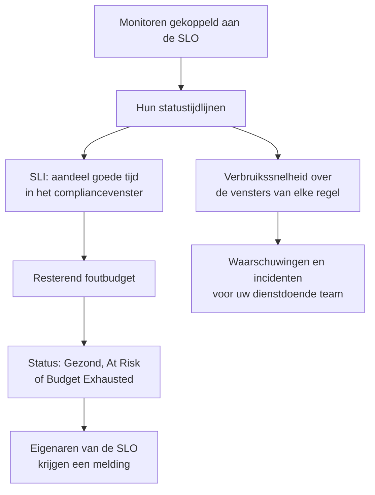

# SLO's – Overzicht

Een service level objective (SLO) is een betrouwbaarheidsdoel voor wat u bewaakt, zoals "99,9% van de tijd beschikbaar over een voortschrijdende periode van 30 dagen". OneUptime meet elke SLO elke 5 minuten tegen zijn doel, zodat u in plaats van "werkt het nu?" kunt antwoorden op "zijn we betrouwbaar genoeg geweest, over een periode die voor onze gebruikers telt, en hoeveel ruimte voor fouten hebben we nog?".

:::cards
- [Een SLO aanmaken](#een-slo-aanmaken): Een naam en een doel. Al het andere begint met een standaardwaarde.
- [Monitoren en monitorregels](/docs/slo/monitor-rules): Kies de monitoren die een SLO meet.
- [Foutbudgetten](/docs/slo/error-budget): Hoeveel downtime een doel toestaat en hoe het budget herstelt.
- [Waarschuwingen en incidenten voor verbruikssnelheid](/docs/slo/burn-rate-alerts): Waarschuw uw team als het budget te snel opraakt.
:::

## Zo werkt het

Een SLO leest de statustijdlijnen van de monitoren die eraan gekoppeld zijn: dezelfde gegevens die uw statuspagina's tonen. Daaruit berekent OneUptime welk deel van het compliancevenster goede tijd was, hoeveel van het foutbudget over is en hoe snel het opraakt.

## Belangrijke begrippen

| Begrip | Betekenis |
| --- | --- |
| **SLI** (service level indicator) | De meting: het percentage van het compliancevenster waarin de monitoren van de SLO beschikbaar waren. |
| **SLO** (service level objective) | Een doel voor de SLI, bijvoorbeeld "minstens 99,9% over de laatste 30 dagen". |
| **Foutbudget** | De downtime die het doel toestaat: `(100% − target) × window`. Bij 99,9% over 30 dagen is dat 43 minuten en 12 seconden. |
| **Verbruikssnelheid** | Hoe snel het budget wordt uitgegeven, vergeleken met een gelijkmatig tempo. Bij een verbruikssnelheid van 1 is het budget precies aan het eind van het venster op. |

Een foutbudget maakt betrouwbaarheid tot iets wat u kunt uitgeven. Is er veel over, release dan sneller en neem risico's; is er weinig over, rem dan af en investeer in stabiliteit. De SLO geeft dat gesprek een getal dat iedereen ziet.

## Een SLO aanmaken

U hebt een rol nodig die SLO's mag aanmaken: Project Owner, Project Admin of een aangepaste rol met de machtiging Create Service Level Objective.

:::steps
### SLO's openen

Open **SLOs** via het menu **Producten** in de bovenbalk. Het staat in de eerste groep, naast monitoren en incidenten. Klik op **Service Level Objective aanmaken**.

### Een naam en een doel geven

Vul een **Naam** in, bijvoorbeeld "API Availability", en een **Target (%)**: het deel van de tijd dat de monitoren beschikbaar moeten zijn. Het doel begint op `99.9`. Het moet groter zijn dan 0 en hoogstens 99,999, omdat een doel van 100% geen foutbudget overlaat om te volgen.

### De standaardwaarden onder Meer velden controleren

**Meer velden** is ingeklapt, met een regel die zegt wat de standaardwaarden doen: de SLO wordt gemeten over een voortschrijdend venster van 30 dagen en komt in gevaar zodra er minder dan 20% van het foutbudget over is. Klap het uit om een van de velden in de tabel hieronder te wijzigen.

### De SLO opslaan

Klik op **Service Level Objective aanmaken**. OneUptime opent de nieuwe SLO. Het **Overzicht** toont **Choose what this SLO measures**, omdat een nieuwe SLO nog geen monitoren heeft.

### Monitoren koppelen

Klik op **Create a monitor rule** om elke overeenkomende monitor te koppelen, nu en later, of op **Add monitors** om ze met de hand te kiezen. Zie [Monitoren en monitorregels](/docs/slo/monitor-rules).

### De eerste cijfers zien binnenkomen

OneUptime evalueert ingeschakelde SLO's elke 5 minuten. De SLI, het foutbudget en de verbruiksgrafiek verschijnen na de eerste evaluatie die monitoren heeft om te meten.
:::

De velden onder **Meer velden**:

| Veld | Wat u instelt | Standaard |
| --- | --- | --- |
| **Beschrijving** | Waar de SLO voor dient. | Leeg |
| **Risicodrempel (%)** | Het deel van het resterende foutbudget waarbij de SLO naar **At Risk** gaat. Een geheel getal van 0 tot 100. | 20 |
| **Window Type** | **Rolling**: de laatste N dagen, die herstellen naarmate oude downtime uit het venster valt. **Calendar Month**: elke maand op zichzelf, teruggezet op de 1e. | **Rolling** |
| **Window (Days)** | Alleen voortschrijdende vensters: hoeveel dagen terug te kijken, van 1 tot 366. Gebruikelijk is 28 of 30. | 30 |
| **Tijdzone** | Alleen kalendermaanden: de tijdzone waarin elke maand begint en eindigt. | UTC |
| **Labels** | Labels om SLO's te ordenen en te filteren. | Geen |

Alles wat bepaalt hoe de SLO meet, begint met een standaardwaarde die u later wijzigt:

| Instelling | Een nieuwe SLO begint met | Waar te wijzigen |
| --- | --- | --- |
| Monitoren | Geen | **Monitoren** of **Monitor Rules** |
| Downtime-statussen | Alle niet-operationele statussen van het project | **Instellingen** → **Downtime Calculation** |
| Modus voor meerdere monitoren | **Any Monitor Down** | **Instellingen** → **Downtime Calculation** |
| Evaluatie | Aan | **Instellingen** → **Evaluatie** |
| Regels voor verbruikssnelheid | Een regel **Fast burn** en een regel **Slow burn**, afgestemd op het venster | **Burn Rate Rules** |

## Waaruit een SLO bestaat

| Onderdeel | Wat het bepaalt |
| --- | --- |
| Monitoren | Waar de SLI vandaan komt. Koppel ze met de hand of met monitorregels: zie [Monitoren en monitorregels](/docs/slo/monitor-rules). |
| Doel | Het deel goede tijd dat de SLO belooft, groter dan 0 en hoogstens 99,999. |
| Compliancevenster | De periode waarover de SLI en het budget worden gemeten: een voortschrijdend venster van 1 tot 366 dagen, of een kalendermaand. |
| Risicodrempel | Het deel van het resterende budget waarbij de SLO naar **At Risk** gaat. |
| Downtime-statussen | Welke monitorstatussen als downtime tellen. |
| Modus voor meerdere monitoren | Hoe de downtime van meerdere monitoren wordt gecombineerd. |

### Welke statussen als downtime tellen

Elke SLO heeft een eigen lijst monitorstatussen die als downtime tellen. Een nieuwe SLO begint met alle statussen van het project die niet als operationeel zijn gemarkeerd, zoals Degraded en Offline, net als uw statuspagina's. Wijzig de lijst onder **Instellingen** → **Downtime Calculation**. Laat hem leeg om alle niet-operationele statussen te tellen, ook statussen die later aan het project worden toegevoegd.

> [!TIP]
> Meet dezelfde monitoren op twee manieren met twee SLO's: een strikte beschikbaarheids-SLO waarin zowel Degraded als Offline tellen, en een ruimere SLO voor volledige uitval waarin alleen Offline telt.

### Compliancevensters

| Venstertype | Hoe het werkt |
| --- | --- |
| **Rolling** | Kijkt vanaf nu een vast aantal dagen terug. Oude downtime valt uit het venster, dus het budget komt geleidelijk terug. |
| **Calendar Month** | Meet vanaf de eerste van de maand, in de tijdzone van de SLO (standaard UTC). Het hele budget komt aan het begin van elke maand terug. |

### Meerdere monitoren in één SLO

Als een SLO meer dan één monitor meet, bepaalt de **Multi Monitor Mode** hoe hun downtime wordt gecombineerd. Een nieuwe SLO gebruikt **Any Monitor Down**.

| Modus | Hoe downtime telt | Gebruik als |
| --- | --- | --- |
| **Any Monitor Down** | Elk moment waarop minstens één monitor uitvalt, telt als downtime voor de hele SLO. Overlappende uitval telt één keer. | De monitoren samen één dienst vormen: valt er één uit, dan merken gebruikers het. |
| **Monitor Seconds Average** | De downtime van elke monitor telt apart, gemiddeld over alle bewaakte tijd: SLI = 1 − (seconden uitval van alle monitoren ÷ bewaakte seconden van alle monitoren). | De monitoren een vloot van vergelijkbare resources zijn en gedeeltelijke impact gedeeltelijk moet tellen. |

Stel dat monitor A van 10:00 tot 11:00 uitvalt terwijl monitor B beschikbaar blijft. **Any Monitor Down** registreert 60 minuten downtime; **Monitor Seconds Average** registreert het equivalent van 30 minuten, omdat een van de twee monitoren een uur uitviel. In die modus wordt ook het budget in monitorseconden geteld: zie [Foutbudgetten](/docs/slo/error-budget).

## Status van de SLO

OneUptime geeft elke geëvalueerde SLO een status:

| Status | Wat het betekent |
| --- | --- |
| **Gezond** | Er is meer budget over dan de risicodrempel. |
| **At Risk** | Het resterende budget is gedaald tot de risicodrempel of lager: standaard 20%. |
| **Budget Exhausted** | Het budget is helemaal op, of overschreden. |
| **Misconfigured** | De SLO kan niet worden gemeten: hij heeft geen monitoren, zijn monitoren bestaan niet meer of hebben in zijn venster nog geen status geregistreerd, of zijn doel valt buiten het bereik. |
| **Gepauzeerd** | Alle monitoren die hij meet, zijn gearchiveerd of hebben actieve bewaking uitgeschakeld, met de hand, door een handmatig incident of door gepland onderhoud. Hij gaat vanzelf verder zodra een van die monitoren weer wordt bewaakt. |

Een uitgeschakelde of gearchiveerde SLO wordt niet geëvalueerd, dus zijn status blijft zoals hij was; de SLO-lijst toont in plaats daarvan een badge **Uitgeschakeld** of **Gearchiveerd**. De eigenaren van een SLO krijgen een melding als de status verandert in **At Risk** of **Budget Exhausted**: zie [Foutbudgetten](/docs/slo/error-budget).

## De SLO-lijst

De pagina **SLOs** toont elke niet-gearchiveerde SLO, met status, SLI, resterend budget, verbruikssnelheid, doel, venster, monitoren, labels en eigenaren.

- De tegels boven de lijst tellen SLO's per status: **Gezond**, **At Risk**, **Budget Exhausted**, **Misconfigured**, **Gepauzeerd** en **Uitgeschakeld**. Klik op een tegel om alleen die SLO's te zien, en nog eens om alle te zien.
- Selecteer SLO's om in één keer labels en eigenaren toe te voegen of te verwijderen, ze te archiveren of ze te verwijderen.
- De sectie **Instellingen** van het zijmenu bevat **Labelregels** en **Eigenaarsregels**, die nieuwe SLO's labelen en eigenaren geven: zie [Label- en eigenaarsregels](/docs/slo/label-and-owner-rules).
- De sectie **Geavanceerd** van het zijmenu bevat **Gearchiveerd**, de lijst met gearchiveerde SLO's.

## De pagina's van een SLO

Open een SLO om zijn pagina's in het zijmenu te zien:

| Pagina | Wat hij toont |
| --- | --- |
| **Overzicht** | De status, de kerncijfers, de verbranding van het foutbudget, recente activiteit, open waarschuwingen en incidenten en de regels voor verbruikssnelheid. |
| **Metrieken** | De `oneuptime.slo.*`-metrics van de SLO, zijn foutbudgetgeschiedenis op lange termijn en de metrics van de incidenten en waarschuwingen die hem raken. Zie [SLO-metrics en -dashboards](/docs/slo/metrics). |
| **Incidenten** | De incidenten die zijn regels voor verbruikssnelheid hebben gemeld. De badge telt de open incidenten. |
| **Waarschuwingen** | De waarschuwingen die zijn regels voor verbruikssnelheid hebben gegeven. De badge telt de open waarschuwingen. |
| **Feed** | Wat er met de SLO is gebeurd, als tijdlijn. Zie [SLO-feed en auditlogboeken](/docs/slo/feed-and-audit-logs). |
| **Monitoren** | De monitoren die hij meet, en of elke monitor door een persoon of een regel is gekoppeld. |
| **Monitor Rules** | De regels die overeenkomende monitoren koppelen. |
| **Burn Rate Rules** | De regels die waarschuwingen geven en incidenten melden als het budget te snel opraakt. |
| **Eigenaren** | De gebruikers en teams die over zijn statuswijzigingen horen. |
| **Instellingen** | Het doel, de complianceperiode, de downtimeberekening, de evaluatieschakelaar en de archiefkaart. |
| **Auditlogboeken** | Wie de SLO, zijn regels en zijn eigenaren heeft gewijzigd, en wanneer. |
| **Delete SLO** | Verwijdert de SLO definitief en lost de open waarschuwingen en incidenten voor verbruikssnelheid op. |

**Monitoren**, **Monitor Rules** en **Burn Rate Rules** staan in een sectie **Configuratie**, en **Eigenaren**, **Instellingen**, **Auditlogboeken** en **Delete SLO** in een sectie **Management**. Beide beginnen ingeklapt, net als een sectie **Ontwikkelaars** om de SLO vanuit code te beheren: klik op de titel van een sectie om hem te openen.

Als iets een SLO verhindert te meten, zegt een banner bovenaan elk van zijn pagina's wat er mis is en linkt hij naar de pagina die het oplost: zie [Problemen oplossen](#problemen-oplossen).

### Het overzicht

Het **Overzicht** beantwoordt "zitten we binnen het budget?", van boven naar beneden:

- **De samenvatting**: de status, een zin over wat die betekent en de beschrijving. Ernaast staan **Vernieuwen** en wanneer de SLO voor het laatst is geëvalueerd. Daaronder staan het doel, het **Compliance window** (met een vulindicator zolang een jong voortschrijdend venster zich vult: zie [Jonge SLO's en de vulindicator van het venster](#jonge-slos-en-de-vulindicator-van-het-venster)), het aantal monitoren en de eigenaren.
- **De kerncijfers**:
  - **SLI**: het deel goede tijd in het venster, en hoeveel het boven of onder het doel zit.
  - **Error budget left**: een percentage, een duur zoals "12m 30s left of 43m 12s" en een balk met een markering op de risicodrempel. Als het budget is overschreden, toont het **Budget exceeded** en met hoeveel.
  - **Burn rate**: hoe snel het budget wordt uitgegeven over de laatste 60 minuten, de periode die de standaardregel voor snel verbruik gebruikt. Wordt oranje boven 1× en rood, met **Rule threshold reached**, bij de laagste drempel van de ingeschakelde regels voor verbruikssnelheid van de SLO.
  - **Budget runway**: hoelang het budget in dit tempo meegaat. Zie [Foutbudgetten](/docs/slo/error-budget#looptijd-van-het-budget).
- **Error budget burn-down**: het resterende budget over het huidige venster. Zie [Foutbudgetten](/docs/slo/error-budget#verbranding-van-het-foutbudget).
- **Recent activity**: de nieuwste items in de feed van de SLO.
- **SLO Details**: de naam, de beschrijving en de labels, de enige instellingen die op het overzicht worden bewerkt.
- **Open alerts & incidents**: wat de regels voor verbruikssnelheid op dit moment open hebben.
- **Burn rate rules**: de drempel van elke ingeschakelde regel naast de huidige verbruikssnelheid, en wat de regel meldt.

### Instellingen

De pagina **Instellingen** brengt samen hoe een SLO meet, één kaart per onderdeel:

| Kaart | Wat u wijzigt | Goed om te weten |
| --- | --- | --- |
| **Objective** | **Target (%)** en **Risicodrempel (%)**, met **Edit Objective**. | Toont de downtime die het doel toestaat, bijvoorbeeld "43m 12s downtime per venster van 30 dagen". |
| **Compliance Period** | **Window Type**, **Window (Days)** en **Tijdzone**, met **Edit Period**. | Regels voor verbruikssnelheid houden hun drempels als het venster verandert, dus controleer ze daarna. |
| **Downtime Calculation** | **Multi Monitor Mode** en **Downtime-monitorstatussen**, met **Edit Downtime Calculation**. | Zonder statussen tellen alle niet-operationele statussen, ook statussen die later worden toegevoegd. |
| **Evaluatie** | De schakelaar **Dit SLO evalueren**, die opslaat zodra u hem omzet. | Uitzetten vraagt om bevestiging, omdat het ook de open waarschuwingen en incidenten voor verbruikssnelheid van de SLO oplost. |
| **Archive SLO** | **Archiveren** of **Uit archief halen**. | Zie [Een SLO archiveren](#een-slo-archiveren). |

Na een wijziging van het doel, de periode of de downtimeberekening evalueert OneUptime de SLO opnieuw bij de volgende uitvoering.

## Een SLO archiveren

Archiveer een SLO die u niet meer meet maar wilt bewaren, zoals een uitgefaseerde dienst of het doel van vorig jaar. Archiveer hem via **Instellingen** → **Archive SLO**, of selecteer SLO's in de lijst en kies **Archiveren**.

Een gearchiveerde SLO:

- is verborgen in de SLO-lijst, de statustegels ervan en de SLO-kiezers en -lijsten van dashboards;
- wordt niet geëvalueerd: zijn cijfers blijven zoals bij de laatste evaluatie, zijn regels voor verbruikssnelheid gaan niet af en hij stuurt geen metrics;
- krijgt zijn open waarschuwingen en incidenten voor verbruikssnelheid opgelost;
- behoudt zijn instellingen, geschiedenis, regels en eigenaren. Zijn monitorregels houden zijn monitorlijst bij, zodat hij met de juiste monitoren verdergaat.

Gearchiveerde SLO's staan op de pagina **Gearchiveerd**, onder **Geavanceerd** in het zijmenu van de SLO-lijst. Selecteer ze daar en kies **Uit archief halen** om ze terug te halen: ze worden bij de volgende uitvoering opnieuw geëvalueerd, met de SLI en het budget herberekend uit de geschiedenis van hun monitoren.

Archiveren en evaluatie uitzetten zijn aparte schakelaars. Een SLO die uitgeschakeld was voordat hij werd gearchiveerd, blijft uitgeschakeld als u hem uit het archief haalt: zet hem weer aan met **Evaluatie aanzetten** in zijn banner, of met **Dit SLO evalueren** onder **Instellingen** → **Evaluatie**.

| U wilt | Doe dit |
| --- | --- |
| Een tijdje stoppen met meten en hem in de lijst houden | Zet de evaluatie uit |
| Hem uitfaseren maar zijn geschiedenis en instellingen bewaren | Archiveer hem |
| Hem voorgoed weghalen | Verwijder hem |

## SLO's in waarschuwingen, incidenten en monitoren

Elke waarschuwing en elk incident dat een regel voor verbruikssnelheid aanmaakt, is gekoppeld aan zijn SLO:

- De pagina van de waarschuwing of het incident toont de SLO onder **Getroffen resources**, met een link ernaartoe.
- De lijsten van waarschuwingen en incidenten tonen de SLO bij de getroffen resources, en het filter **Getroffen resources** beperkt een lijst tot één SLO.
- De pagina's **Waarschuwingen** en **Incidenten** van de SLO tonen ze, en hun badges in het zijmenu tellen de open items.

OneUptime legt deze koppeling als een regel de waarschuwing of het incident aanmaakt; u kunt hem niet met de hand toevoegen, en het bewerken van de waarschuwing of het incident haalt hem nooit weg.

Het zijmenu van een monitor heeft ook een pagina **SLOs**: de SLO's die die monitor meten, zodat u weet welke doelen ervan afhangen voordat u hem pauzeert of wijzigt.

## Jonge SLO's en de vulindicator van het venster

Een SLO met een voortschrijdend venster die jonger is dan zijn venster, wordt gemeten over de gegevens die er tot nu toe zijn: een SLO van 30 dagen die gisteren is aangemaakt, heeft één dag aan gegevens. Zijn foutbudget begint klein en groeit naarmate het venster zich vult, dus zijn eerste cijfers schommelen meer dan later.

Zolang dat zo is, zegt het **Overzicht** het: de samenvatting toont een indicator **Window 23% full** (**Window under 1% full** op de eerste dag), en de tegel **Error budget left** herhaalt het onder zijn getal. Beide verdwijnen als het venster vol is. SLO's met een kalendermaand tonen ze nooit, omdat hun budget vanaf de eerste dag de hele maand dekt, en SLO's in de modus **Monitor Seconds Average** ook niet, omdat hun budget over de monitoren heen wordt geteld.

## Problemen oplossen

Een banner bovenaan de pagina's van de SLO zegt wat hem verhindert te meten:

| Banner | Wat het betekent | Wat te doen |
| --- | --- | --- |
| **No monitors attached** | De SLO heeft geen monitoren, dus er valt niets te meten. | Koppel monitoren of maak een monitorregel. |
| **Waiting for SLO evaluation** | Er zijn monitoren gekoppeld, maar de laatste evaluatie had geen statusgegevens van ze. | Controleer of de monitoren worden gecontroleerd. De cijfers verschijnen na de volgende evaluatie met gegevens. |
| **Measurement is paused** | Alle monitoren die hij meet, zijn gearchiveerd of hebben actieve bewaking uitgeschakeld. | Zet de bewaking van minstens één monitor weer aan, of wacht tot het onderhoud voorbij is. |
| **The target is out of range** | Het doel is niet groter dan 0 en kleiner dan 100. | Stel een doel zoals 99,9 in onder **Instellingen** → **Objective**. |
| **This SLO is disabled** | De evaluatie staat uit. | Klik op **Evaluatie aanzetten**. |
| **This SLO is archived** | De SLO is gearchiveerd. | Haal hem uit het archief onder **Instellingen**. |
| **Not evaluated yet** | De SLO is net aangemaakt. | Wacht op de eerste evaluatie, hooguit een paar minuten. |

## Volgende stappen

:::cards
- [Monitoren en monitorregels](/docs/slo/monitor-rules): Koppel monitoren met de hand of met regels.
- [Foutbudgetten](/docs/slo/error-budget): De budgetberekening, de looptijd en hoe het budget terugkomt.
- [Waarschuwingen en incidenten voor verbruikssnelheid](/docs/slo/burn-rate-alerts): Waarschuw uw dienstdoende team als het budget te snel opraakt.
- [SLO-metrics en -dashboards](/docs/slo/metrics): Zet SLO's in grafieken en bouw een SLO-dashboard.
:::
