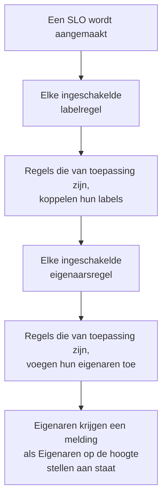

# Label- en eigenaarsregels

Labelregels en eigenaarsregels ordenen uw SLO's voor u. Een **labelregel** koppelt labels aan elke nieuwe SLO waarop hij van toepassing is, en een **eigenaarsregel** voegt er eigenaarsgebruikers en -teams aan toe, zodat een nieuwe checkout-SLO het label _Checkout_ krijgt en van het checkoutteam is, zonder dat iemand eraan hoeft te denken. Beide werken zoals de label- en eigenaarsregels van elk ander product: zie [Label- en eigenaarsregels](/docs/configuration/label-and-owner-rules) voor wat ze gemeen hebben.

## Zo werkt het

Regels worden uitgevoerd als een SLO wordt aangemaakt, vanuit het dashboard of via de API. Labelregels gaan eerst, zodat een eigenaarsregel kan letten op een label dat een labelregel net heeft gekoppeld.

Beide soorten gelden voor het hele project. U vindt ze in het zijmenu van de SLO-lijst, onder **Instellingen**: **Labelregels** en **Eigenaarsregels**. De sectie **Instellingen** begint ingeklapt; klik op de titel om haar te openen.

## Een regel maken

:::steps
### De regellijst openen

Open **SLOs**, dan **Instellingen** → **Labelregels** of **Instellingen** → **Eigenaarsregels** in het zijmenu, en klik op **SLO Label Rule aanmaken** of **SLO Owner Rule aanmaken**.

### Kiezen waarop de regel van toepassing is

Klik in de stap **Overeenkomst** op **Voorwaarde toevoegen** voor elke voorwaarde waaraan een SLO moet voldoen (zie [Overeenkomstcriteria](#overeenkomstcriteria)). Kies bij twee of meer **Voldoet aan alle** of **Voldoet aan één**. Een regel zonder voorwaarden is van toepassing op elke nieuwe SLO.

### Kiezen wat de regel toevoegt

De tweede stap van een labelregel is **Labels**, waar u de **Toe te voegen labels** kiest. Die van een eigenaarsregel is **Eigenaren**, waar u de **Eigenaren** kiest die worden toegevoegd — mensen en teams, gekozen uit één lijst met **Eigenaar toevoegen**. Een regel moet minstens één label of eigenaar toevoegen.

### De naam en de ingeklapte velden controleren

De **Naam** wordt ingevuld op basis van wat u kiest, zoals _Checkout, Production toevoegen_ of _Checkout team als eigenaren toevoegen_, en volgt uw keuzes tot u zelf een naam typt. **Meer velden** bevat de optionele **Beschrijving** en, bij een eigenaarsregel, **Eigenaren op de hoogte stellen**.

### De regel opslaan

Klik in de laatste stap nog eens op **SLO Label Rule aanmaken** of **SLO Owner Rule aanmaken**. De regel begint ingeschakeld.
:::

**Eigenaren op de hoogte stellen** (onder **Meer velden**) staat standaard aan: de eigenaren die een eigenaarsregel toevoegt, krijgen dezelfde melding "u bent als eigenaar toegevoegd" als een eigenaar die met de hand is toegevoegd. Zet het uit om eigenaren stil toe te voegen.

Om een regel te pauzeren zonder hem te verwijderen, zet u **Ingeschakeld** uit in zijn bewerkformulier. Het bewerkformulier eist nooit labels of eigenaren: een oudere regel die niets toevoegt, kan nog steeds worden hernoemd, uitgezet of verwijderd, en de lijst markeert hem met **Voegt niets toe**.

Als een regel op een SLO van toepassing is:

- Een labelregel koppelt elk label uit **Toe te voegen labels**. Labels die de SLO al heeft, worden niet twee keer toegevoegd, en als meerdere regels van toepassing zijn, krijgt de SLO al hun labels.
- Een eigenaarsregel voegt elke gebruiker en elk team van de regel als eigenaar toe. Eigenaren die de SLO al heeft, worden overgeslagen, en als meerdere regels van toepassing zijn, krijgt de SLO al hun eigenaren. Een gebruiker die geen lid van het project meer is, of een team uit een ander project, wordt nooit toegevoegd; de andere eigenaren van de regel wel.

De eigenaren van een SLO zijn de mensen die over zijn statuswijzigingen horen: zie [Foutbudgetten](/docs/slo/error-budget).

## Overeenkomstcriteria

Elke voorwaarde vergelijkt één veld van de SLO:

| Veld | Vergeleken met | Operatoren |
| --- | --- | --- |
| **SLO-labels** | De labels van de SLO. | **Heeft een van**, **Heeft alle**, **Heeft geen van** |
| **SLO-naam** | De naam van de SLO. | **Bevat**, **Bevat niet**, **Is gelijk aan**, **Is niet gelijk aan**, **Begint met**, **Eindigt met**, **Komt overeen met patroon**, **Komt niet overeen met patroon** |
| **SLO-beschrijving** | De beschrijving van de SLO. | Dezelfde als bij **SLO-naam** |

Een nieuwe voorwaarde op de naam of de beschrijving begint op **Bevat**. Een patroon is een reguliere expressie, zoals `^checkout-.*`, of een jokerteken `*`, zoals `*checkout*`, en negeert hoofdletters. Een patroon dat geen van beide is, zoals `checkout-(01`, wordt bij het opslaan geweigerd, in plaats van stilletjes nergens op van toepassing te zijn.

| U wilt | Voorwaarden |
| --- | --- |
| Elke SLO van de checkoutdienst | **SLO-naam** bevat `checkout` |
| Elke productie-SLO | **SLO-labels** heeft een van _Production_ |
| Checkout-SLO's, maar niet die van staging | **Voldoet aan alle**: **SLO-naam** bevat `checkout`, en **SLO-labels** heeft geen van _Staging_ |

## Wanneer regels worden uitgevoerd

- **Als een SLO wordt aangemaakt**, vanuit het dashboard of via de API: elke ingeschakelde labelregel, dan elke ingeschakelde eigenaarsregel.
- **Als u een regel uitvoert** met **Run Now**: zie hieronder.

Een SLO bewerken past de regels niet opnieuw toe, en een regel verwijdert nooit iets: geen labels of eigenaren die iemand met de hand heeft toegevoegd, en ook niet die hij zelf heeft toegevoegd. Een uitgeschakelde regel doet niets.

## Een regel uitvoeren op bestaande SLO's

Een regel die u vandaag schrijft, geldt voor de SLO's die daarna worden aangemaakt. Om hem toe te passen op de SLO's die u al hebt, klikt u op **Run Now** in de rij van de regel, of op **Bekijken** en dan op **Run Now** op de eigen pagina van de regel. U kunt ook meerdere regels selecteren en ze uitvoeren via de bulkacties van de tabel.

Een uitvoering controleert elke SLO in het project, ook de gearchiveerde, en meldt op hoeveel hij van toepassing was en hoeveel hij heeft gewijzigd. Eigenaren die een uitvoering toevoegt, krijgen alleen een melding als u dat in het uitvoeringsdialoogvenster kiest en de regel **Eigenaren op de hoogte stellen** aan heeft. Zie [Regels uitvoeren op bestaande resources](/docs/configuration/run-rules-now).

Labelregels kunnen ook tussen projecten worden gekopieerd: zie [Labelregels importeren en exporteren](/docs/configuration/label-rule-import-export).

## Geschiedenis

Telkens als een regel een SLO wijzigt, legt de **Feed** van de SLO vast welke regels dat deden. Elke eigenaar die een regel toevoegt, krijgt ook een eigen feeditem "als eigenaar toegevoegd", zodat de feed zegt wie er is toegevoegd en waarom. Zie [SLO-feed en auditlogboeken](/docs/slo/feed-and-audit-logs).

## Machtigingen

| Om | Hebt u nodig |
| --- | --- |
| Met labelregels te werken | **Create SLO Label Rule**, **Edit SLO Label Rule**, **Delete SLO Label Rule** of **Read SLO Label Rule** |
| Met eigenaarsregels te werken | **Create SLO Owner Rule**, **Edit SLO Owner Rule**, **Delete SLO Owner Rule** of **Read SLO Owner Rule** |
| Een labelregel uit te voeren | **Edit SLO Label Rule** en **Edit Service Level Objective** |
| Een eigenaarsregel uit te voeren | **Edit SLO Owner Rule**, **Edit Service Level Objective**, **Create SLO User Owner** en **Create SLO Team Owner** |

Deze machtigingen staan in de SLO-groep van een rol, en de rollen Project Owner en Project Admin hebben ze allemaal. Een uitvoering wijzigt elke SLO in het project, dus een machtiging die beperkt is tot sommige labels, of tot de SLO's waarvan u eigenaar bent, is niet genoeg om een regel uit te voeren.

## Volgende stappen

:::cards
- [Label- en eigenaarsregels](/docs/configuration/label-and-owner-rules): Hoe de label- en eigenaarsregels van elk product werken.
- [Regels uitvoeren op bestaande resources](/docs/configuration/run-rules-now): Hoe Run Now werkt voor elk soort regel.
- [SLO's – Overzicht](/docs/slo/introduction): Elke pagina die een SLO heeft, en de SLO-lijst.
:::
