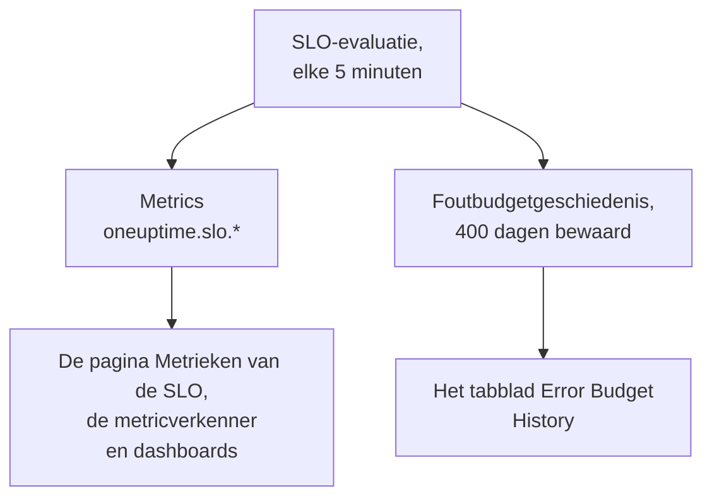

# SLO-metrics en -dashboards

Telkens als OneUptime een SLO evalueert, elke 5 minuten, schrijft het de resultaten weg als metrics met de naam `oneuptime.slo.*`. Ze staan in dezelfde metricopslag als de metrics van uw monitoren, dus u kunt een SLO in een grafiek zetten op zijn pagina **Metrieken**, hem openen in de metricverkenner en hem op elk dashboard zetten, gefilterd en gegroepeerd zoals elke andere reeks.

:::cards
- [De metrics](#de-metrics): Zes reeksen, hun eenheden en hoe u ze aggregeert.
- [De pagina Metrieken](#de-pagina-metrieken): De grafieken, de geschiedenis en de incident- en waarschuwingsmetrics van een SLO.
- [SLO's op dashboards](#slos-op-dashboards): De SLO-widget en het sjabloon SLO Dashboard.
:::

## Zo werkt het

## De metrics

| Metric | Eenheid | Aggregatie | Wat erin staat |
| --- | --- | --- | --- |
| `oneuptime.slo.sli.percent` | `%` | Avg | De SLI over het compliancevenster van de SLO: het deel van de gemeten tijd dat goed was. |
| `oneuptime.slo.target.percent` | `%` | Avg | Het doel van de SLO, bij elke evaluatie meegestuurd zodat een grafiek het over de SLI kan tekenen. |
| `oneuptime.slo.error.budget.remaining.percent` | `%` | Avg | Deel van het foutbudget dat in het venster nog niet is uitgegeven. Negatief zodra het budget is overschreden. |
| `oneuptime.slo.error.budget.remaining.seconds` | `seconds` | Avg | Downtime die de SLO nog kan opvangen voordat hij wordt geschonden. Negatief zodra het budget is overschreden. |
| `oneuptime.slo.burn.rate` | `x` | Max | Hoe snel het budget wordt uitgegeven, over de laatste 60 minuten. 1x geeft het budget precies over het venster uit. |
| `oneuptime.slo.status` | — | Max | De status van de SLO bij elke evaluatie: `0` is Gezond, `1` is At Risk, `2` is Budget Exhausted. |

De aggregatie is hoe de grafieken van de SLO zelf en het sjabloon SLO Dashboard de punten combineren die in één grafiekinterval vallen. Percentages en duren worden gemiddeld. Verbruikssnelheid en status nemen het maximum, zodat een korte verbruikspiek of een kort uitstapje naar Budget Exhausted niet wordt weggemiddeld.

Voor een SLO in de modus **Monitor Seconds Average** telt `oneuptime.slo.error.budget.remaining.seconds` monitorseconden, opgeteld over zijn monitoren, net als zijn foutbudget: zie [Foutbudgetten](/docs/slo/error-budget).

### Wanneer er geen punt wordt geschreven

- Een uitgeschakelde of gearchiveerde SLO wordt niet geëvalueerd, dus hij stuurt niets.
- Een SLO die **Gepauzeerd** of **Misconfigured** is, meet niets, dus hij stuurt alleen `oneuptime.slo.target.percent`, wat configuratie is en geen meting. Zijn grafieken voor SLI, budget, verbruikssnelheid en status tonen een gat.
- Een waarde die geen echt getal is, zoals een verbruikssnelheid over een venster zonder gegevens, wordt overgeslagen en nooit als 0 geschreven.

### Attributen

Elk punt draagt deze attributen:

| Attribuut | Waarde |
| --- | --- |
| `sloId` | ID van de SLO. De eigen pagina's van de SLO filteren erop, dus het hernoemen van een SLO splitst zijn grafieken nooit. |
| `sloName` | Naam van de SLO toen het punt werd geschreven. |
| `projectId` | ID van het project. |
| `oneuptime.label.<key>` | Eén attribuut per label van de SLO. Een label met de naam `Tier 1` wordt `oneuptime.label.tier_1` = `true`, en een label met de naam `product:checkout` wordt `oneuptime.label.product` = `checkout`. Sleutels staan in kleine letters, met spaties en leestekens omgezet in `_`. |

De reeksen horen bij de SLO, niet bij een van zijn monitoren, en tellen niet als telemetriegebruik.

Incident- en waarschuwingsmetrics dragen twee bijbehorende attributen, `serviceLevelObjectiveIds` en `serviceLevelObjectiveNames`: door komma's gescheiden lijsten van de SLO's die het incident of de waarschuwing raakt.

### Bewaartermijn

`oneuptime.slo.*`-metrics worden even lang bewaard als monitormetrics: standaard **30 dagen**. Op een zelfgehoste installatie kan een hoofdbeheerder dat wijzigen met **Monitor Metric Retention (Days)** in de instellingen voor **Gegevensbewaring** van het Admin Dashboard.

Dit beperkt het tabblad **Error Budget History** van de pagina **Metrieken** van de SLO niet. Die geschiedenis wordt apart opgeslagen en 400 dagen bewaard.

## De pagina Metrieken

De pagina **Metrieken** van een SLO heeft vier tabbladen:

| Tabblad | Wat het toont |
| --- | --- |
| **SLO Metrics** | De `oneuptime.slo.*`-reeksen in drie kaarten die één tijdsbereik delen, standaard de afgelopen dag: **Objective** (de SLI met het doel erover, en het resterende budget), **Burn** (verbruikssnelheid en resterende budgettijd) en **Status**. |
| **Error Budget History** | De SLI, het resterende budget en de verbruikssnelheid over de geschiedenis op lange termijn, met lijnen op het doel, op de grenzen voor risico en uitputting, en op de drempel van elke ingeschakelde regel voor verbruikssnelheid. |
| **Incidentmetrieken** | Het aantal, de tijd tot bevestiging, de tijd tot oplossing en de duur van de incidenten die deze SLO raken, standaard de afgelopen week. Incidenten die zijn regels voor verbruikssnelheid hebben gemeld, tellen mee. |
| **Waarschuwingsmetrieken** | Hetzelfde voor waarschuwingen. Waarschuwingen die zijn regels voor verbruikssnelheid hebben gegeven, tellen mee. |

De tabbladen **SLO Metrics**, **Incidentmetrieken** en **Waarschuwingsmetrieken** lezen de metricopslag, waarvoor toestemming nodig is om telemetrie te lezen. Een aangepaste rol die SLO's maar geen telemetrie mag lezen, ziet die tabbladen leeg, terwijl **Error Budget History** blijft werken.

## SLO's op dashboards

### Elke SLO-metric in een grafiek zetten

:::steps
#### Een grafiek toevoegen

Voeg in de bewerkmodus van een dashboard een grafiek- of waardewidget toe en kies een van de `oneuptime.slo.*`-metrics.

#### Groeperen of filteren

Groepeer op `sloName` en `sloId` voor één lijn per SLO; `sloId` houdt twee SLO's met dezelfde naam uit elkaar. Of filter op `sloName`, of op een `oneuptime.label.*`-attribuut.

#### De aggregatie kiezen

Gebruik de aggregatie uit de tabel hierboven: Avg voor de percentages en duren, Max voor verbruikssnelheid en status.
:::

### De SLO-widget

De [SLO-widget](/docs/dashboards/widgets#slo) toont de SLI, het resterende budget of de verbruikssnelheid van één SLO als tegel of grafiek. Hij krijgt zijn SLO op een van twee manieren:

| Instelling | Hoe hij zich gedraagt |
| --- | --- |
| **Service Level Objective** | Zet de widget vast op één SLO. De kiezer toont SLO's die niet gearchiveerd zijn. |
| **Follow SLO Variable** | Toont de SLO die in een dashboardvariabele is gekozen: een variabele **Telemetry Attribute** op de sleutel `sloName`. Wordt genegeerd zolang een SLO is vastgezet. |

Op een [openbaar dashboard](/docs/dashboards/sharing) laat een widget die een variabele volgt kijkers elke niet-gearchiveerde SLO van het project op naam kiezen. Een vastgezette widget toont alleen zijn eigen SLO, en blijft de laatste cijfers tonen van een SLO die later wordt gearchiveerd.

### Het sjabloon SLO Dashboard

Kies bij het aanmaken van een dashboard het sjabloon **SLO Dashboard** voor een kant-en-klaar bord met elke SLO van het project, in drie banden:

1. **Service Level Objectives**: een lijst van elke niet-gearchiveerde SLO, met zijn status, SLI tegenover het doel, budgetbalk en verbruikssnelheid, en een telling van SLO's per status. Ingeschakelde SLO's komen eerst, die met het minste budget voorop; een uitgeschakelde SLO komt als laatste als **Uitgeschakeld**, met zijn laatste cijfers grijs.
2. **Error Budget & Burn Rate**: de tegels **Lowest Error Budget Remaining**, **Least Error Budget Time Left** en **Peak Burn Rate**, en de grafieken **Error Budget Remaining by SLO** en **Burn Rate by SLO** met één lijn per SLO, gegroepeerd op `sloName` en `sloId`.
3. **Selected SLO**: de tegels **SLI**, **Error Budget Remaining** en **Burn Rate** en de grafieken **SLI History**, **Error Budget History** en **Burn Rate History** van één SLO.

Eén SLO-variabele in de werkbalk bepaalt de reikwijdte van het hele bord. Het is een variabele Telemetry Attribute op `sloName`, dus de opties zijn de SLO-namen die in de metrics voorkomen. Een SLO kiezen beperkt de lijst tot die SLO, beperkt de grafieken en tegels van de band en vult de widgets van **Selected SLO**, die de variabele volgen. Tot u er een kiest, vragen ze u een SLO in de werkbalk te kiezen.

## Problemen oplossen

:::details Een SLO ontbreekt in de SLO-kiezer van de werkbalk
De kiezer toont de SLO-namen die de afgelopen dag zijn verstuurd. Een nieuwe SLO verschijnt na zijn eerste evaluatie; een SLO die **Gepauzeerd** of **Misconfigured** is, blijft kiesbaar omdat hij zijn doel nog verstuurt; een uitgeschakelde of gearchiveerde SLO verdwijnt ongeveer een dag na zijn laatste punt.
:::

:::details Een naam kiezen toont twee SLO's
Twee SLO's hebben die naam. De lijst en de grafieken tonen ze allebei, en de widgets van **Selected SLO** zeggen dat de naam dubbelzinnig is. Geef SLO's verschillende namen.
:::

:::details Het tabblad SLO Metrics is leeg
Uw rol mag geen telemetrie lezen, of de SLO is nog niet geëvalueerd. **Error Budget History** leest de SLO zelf en blijft werken.
:::

## Volgende stappen

:::cards
- [Dashboard-widgets](/docs/dashboards/widgets): Elke widget, de SLO-widget inbegrepen.
- [Dashboard-variabelen](/docs/dashboards/variables): Bepaal de reikwijdte van een heel bord met één kiezer.
- [Foutbudgetten](/docs/slo/error-budget): Wat de budgetcijfers betekenen.
:::
