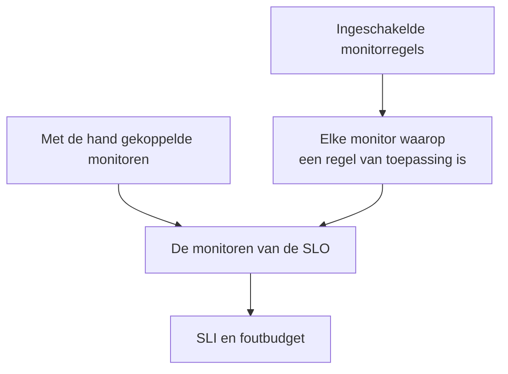

# Monitoren en monitorregels

Een SLO meet de beschikbaarheid van de monitoren die eraan gekoppeld zijn. Koppel ze met de hand, laat monitorregels elke overeenkomende monitor koppelen, of doe allebei. Deze pagina behandelt de pagina's **Monitoren** en **Monitor Rules** van een SLO, die allebei onder **Configuratie** in zijn zijmenu staan.

:::cards
- [Monitoren met de hand kiezen](#monitoren-met-de-hand-koppelen): Het beste voor een kleine, vaste set.
- [Monitoren met een regel koppelen](#monitoren-met-een-regel-koppelen): "Elke monitor met het label Production", voor u bijgehouden.
- [Overeenkomstcriteria](#overeenkomstcriteria): De velden en operatoren waarop een regel kan letten.
:::

## Welke monitoren een SLO meet

Een SLO meet de vereniging van de monitoren die u met de hand hebt gekoppeld en elke monitor waarop minstens een van zijn ingeschakelde monitorregels van toepassing is.

Een nieuwe SLO heeft geen monitoren, omdat het aanmaakformulier er niet om vraagt. Zolang hij er geen heeft, kan hij niet worden geëvalueerd: zijn pagina's tonen **No monitors attached**, en zijn **Overzicht** biedt beide manieren om monitoren te koppelen.

## Monitoren met de hand koppelen

U hebt toestemming nodig om de SLO te bewerken.

:::steps
### De pagina Monitoren openen

Open de SLO en ga naar **Monitoren**.

### De monitoren kiezen

Klik op **Add Monitors** en kies monitoren uit het project. Alleen monitoren die nog niet gekoppeld zijn, staan in de lijst.

### De lijst opslaan

Klik op **Add Monitors**. De monitoren verschijnen in de lijst met de bron **Manual** en tellen vanaf de volgende evaluatie mee voor de SLI.
:::

Om een monitor uit de SLO te halen, klikt u op **Verwijderen** in zijn rij. De monitor zelf verandert niet; hij telt alleen niet meer mee voor de SLI en het foutbudget van de SLO.

De pagina **Monitoren** toont voor elke monitor:

| Kolom | Wat hij toont |
| --- | --- |
| **Huidige status** | De huidige status van de monitor, of **Gearchiveerd**, **Uitgeschakeld**, **Sondes niet ingeschakeld**, **Sondes losgekoppeld** of **Onbekend** als hij niet wordt gecontroleerd of nog niets heeft gemeld. |
| **Bron** | **Rule** als een van de monitorregels van de SLO hem heeft gekoppeld, **Manual** als iemand hem met de hand heeft gekoppeld. |
| **Labels** | De labels van de monitor. |

## Monitoren met een regel koppelen

Een monitorregel beschrijft de monitoren die een SLO moet meten, zoals "elke monitor met het label Production" of "elke monitor waarvan de naam begint met api-". Elke overeenkomende monitor wordt gekoppeld, nu en telkens als monitoren worden aangemaakt of veranderen, zodat niemand hoeft te onthouden welke monitor iemand volgende maand toevoegt.

:::steps
### Monitor Rules openen

Open de SLO, ga naar **Monitor Rules** en klik op **SLO Monitor Rule aanmaken**.

### De regel een naam geven

Vul onder **Basisinformatie** een **Naam** in en eventueel een **Beschrijving** van waarom deze monitoren bij deze SLO horen.

### Kiezen waarop hij van toepassing is

Klik onder **Overeenkomstcriteria** op **Voorwaarde toevoegen**, kies een veld en een operator, en vul de waarde in of kies hem. Kies bij twee of meer voorwaarden **Voldoet aan alle** of **Voldoet aan één**. Een monitorregel heeft minstens één voorwaarde nodig.

### De regel opslaan

Klik op **SLO Monitor Rule aanmaken**. De regel begint ingeschakeld en de monitoren van de SLO worden meteen opnieuw beoordeeld: elke overeenkomende monitor wordt gekoppeld met de bron **Rule**.
:::

De regeltabel toont voor elke regel de naam, de overeenkomstcriteria in gewone taal en of hij is ingeschakeld. Om een regel te pauzeren, zet u **Ingeschakeld** uit in zijn bewerkformulier. **View Monitors** opent de pagina **Monitoren** van de SLO.

### Overeenkomstcriteria

Elke voorwaarde vergelijkt één veld van een monitor:

| Veld | Vergeleken met | Operatoren |
| --- | --- | --- |
| **Monitorlabels** | De labels van de monitor. | **Heeft een van**, **Heeft alle**, **Heeft geen van** |
| **Monitortype** | Het type van de monitor, gekozen uit de lijst met typen. | **Is gelijk aan**, **Is niet gelijk aan** |
| **Monitornaam** | De naam van de monitor. | **Bevat**, **Bevat niet**, **Is gelijk aan**, **Is niet gelijk aan**, **Begint met**, **Eindigt met**, **Komt overeen met patroon**, **Komt niet overeen met patroon** |
| **Monitorbeschrijving** | De beschrijving van de monitor. | Dezelfde als bij **Monitornaam** |

Een patroon is een reguliere expressie, zoals `^api-.*`, of een jokerteken `*`, zoals `*checkout*`, en negeert hoofdletters. Een patroon dat geen van beide is, zoals `api-(01`, wordt bij het opslaan geweigerd, in plaats van stilletjes nergens op van toepassing te zijn. Om elke monitor in het project te koppelen, voegt u een voorwaarde toe op **Monitornaam** die overeenkomt met het patroon `.*`.

| U wilt | Voorwaarden |
| --- | --- |
| Elke productiemonitor | **Monitorlabels** heeft een van _Production_ |
| Elke API-monitor | **Monitortype** is gelijk aan _API_ |
| Elke monitor behalve handmatige | **Monitortype** is niet gelijk aan _Manual_ |
| Elke monitor waarvan de naam begint met api- | **Monitornaam** komt overeen met patroon `^api-` |
| De checkoutmonitoren, maar niet die van staging | **Voldoet aan alle**: **Monitornaam** komt overeen met patroon `*checkout*`, en **Monitorlabels** heeft geen van _Staging_ |

### Wanneer regels worden uitgevoerd

- Als u een regel aanmaakt, bewerkt, aan- of uitzet of verwijdert, worden de monitoren van de SLO meteen opnieuw beoordeeld.
- Als een monitor wordt aangemaakt, of zijn labels, naam of beschrijving veranderen, controleert elke monitorregel in het project hem, inclusief de labels die uw monitorlabelregels hem geven.
- Als een label wordt verwijderd, worden de SLO's waarvan de regels het gebruikten opnieuw beoordeeld.
- Regels houden de monitorlijst van een SLO bij, ook terwijl de SLO is uitgeschakeld of gearchiveerd, zodat hij met de juiste monitoren verdergaat.

Regels synchroniseren opnieuw bij elke opslag, dus **Run Now** is er om in te halen wat de SLO heeft gemist. Het staat in elke rij, op de eigen pagina van de regel (**Bekijken**) en in de bulkacties van de tabel. Een regel uitvoeren beoordeelt alle ingeschakelde monitorregels van de SLO samen opnieuw, en daarna zegt het dialoogvenster hoeveel monitoren zijn gekoppeld en ontkoppeld. Voor het uitvoeren van een regel hebt u toestemming nodig om SLO-monitorregels te bewerken. Zie [Regels uitvoeren op bestaande resources](/docs/configuration/run-rules-now).

### Welke monitoren bij een regel horen

- Een monitor blijft gekoppeld zolang een ingeschakelde regel erop van toepassing is, en wordt ontkoppeld zodra dat voor geen enkele regel meer geldt.
- Een regel uitzetten of verwijderen ontkoppelt alleen de monitoren waarop geen andere ingeschakelde regel nog van toepassing is.
- Regels ontkoppelen alleen monitoren die een regel heeft gekoppeld. Een met de hand gekoppelde monitor wordt nooit overgenomen door een regel die er toevallig op van toepassing is, en niet ontkoppeld als dat niet meer zo is. Zijn bron blijft **Manual**.

## Met de hand kiezen terwijl regels aan staan

Zolang minstens één regel is ingeschakeld, beheren de regels de monitoren van de SLO:

- monitoren kunnen niet met de hand worden toegevoegd: **Add Monitors** is uitgeschakeld, en een banner zegt **This SLO's monitors are managed by its monitor rules**, met een link **Manage Monitor Rules**;
- monitoren die een regel heeft gekoppeld, kunnen niet met de hand worden verwijderd, omdat de regel ze opnieuw zou koppelen: hun knop **Verwijderen** is geblokkeerd en de tooltip legt uit waarom;
- monitoren die met de hand zijn gekoppeld voordat regels werden aangezet, kunnen nog steeds worden verwijderd.

Dat geldt ook voor de API. Zet alle regels uit om de monitoren weer zelf te kiezen.

## De SLO's waarvoor een monitor telt

De pagina van een monitor toont de SLO's die hem meten: open de monitor en ga naar **SLOs** in zijn zijmenu. Kijk daar voordat u een monitor pauzeert of wijzigt, om te zien welke doelen ervan afhangen. Gearchiveerde SLO's staan er niet bij, omdat ze niet worden geëvalueerd.

## Overstappen van Auto-Add Monitors With Labels

Eerdere versies hadden een instelling **Auto-Add Monitors With Labels** op het SLO-formulier. Bij de upgrade krijgt elke SLO die haar gebruikte een ingeschakelde monitorregel met de naam **Auto-add monitors with labels** die op dezelfde labels let, zodat hij precies dezelfde monitoren blijft meten. Het veld `monitorLabels` van de SLO-API is verouderd: gebruik in plaats daarvan SLO-monitorregels.

:::details Wat als iets de oude instelling nog opslaat?
Een dashboardtabblad dat vóór de upgrade is geopend, of een API-client of workflow die voor de vorige versie is geschreven, kan de oude instelling nog opslaan. Zodat een SLO op die manier niet stilletjes monitoren verliest:

- **Een SLO zonder monitorregels** maakt van de opgeslagen labels een regel **Auto-add monitors with labels**, en zijn monitoren worden meteen opnieuw beoordeeld. Een lege lijst opslaan ontkoppelt de monitoren die de instelling had gekoppeld, zoals vroeger.
- **Een SLO die monitorregels heeft**, aan of uit, negeert labels die via de oude instelling zijn opgeslagen, omdat zijn regels bepalen wat hij meet.
- **De eerste monitorregel aanmaken** voor een SLO waarvan de monitoren door de oude instelling waren gekoppeld, zet eerst de instelling om in een regel, zodat de nieuwe regel ernaast komt in plaats van haar te vervangen.

Een omgezette regel die u verwijdert, blijft verwijderd, tenzij de monitoren ervan daarna nog gekoppeld zijn, bijvoorbeeld omdat een server die nog de vorige versie draait ze tijdens de upgrade opnieuw heeft gekoppeld: de volgende monitorwijziging of de volgende nieuwe regel zet de labels dan weer om. Verwijder die regel opnieuw als de upgrade klaar is.
:::

## Geschiedenis

Elke koppeling en ontkoppeling, en elke regel die wordt aangemaakt, bewerkt of verwijderd, verschijnt in de **Feed** van de SLO. Regelwijzigingen worden ook vastgelegd in zijn **Auditlogboeken**. Zie [SLO-feed en auditlogboeken](/docs/slo/feed-and-audit-logs).

## Problemen oplossen

:::details Add Monitors is uitgeschakeld
Minstens een van de monitorregels van de SLO is ingeschakeld, dus de regels beheren zijn monitoren. Wijzig de regels, of zet ze allemaal uit om monitoren met de hand te kiezen.
:::

:::details De knop Verwijderen van een monitor is geblokkeerd
Een monitorregel heeft die monitor gekoppeld en zou hem opnieuw koppelen. Wijzig de regel die erop van toepassing is, of zet hem uit.
:::

:::details Een monitor waarop een regel van toepassing zou moeten zijn, is niet gekoppeld
Controleer of de regel is ingeschakeld en of aan elke voorwaarde is voldaan bij **Voldoet aan alle**. Labels die een monitorlabelregel toevoegt, tellen ook mee. Klik op **Run Now** bij de regel om de SLO opnieuw te synchroniseren.
:::

:::details Een regel opslaan mislukt met een patroonfout
De waarde is geen reguliere expressie en geen jokerteken `*`, bijvoorbeeld door een niet-gesloten haakje. Verbeter het patroon, of gebruik **Bevat**.
:::

## Volgende stappen

:::cards
- [SLO's – Overzicht](/docs/slo/introduction): Hoe de downtime van meerdere monitoren wordt gecombineerd.
- [Foutbudgetten](/docs/slo/error-budget): Wat de downtime van monitoren verbruikt.
- [Regels uitvoeren op bestaande resources](/docs/configuration/run-rules-now): Hoe Run Now werkt voor elk soort regel.
:::
