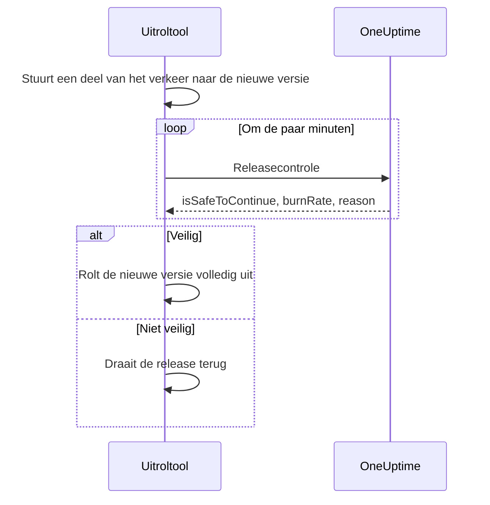

# Releasecontroles

Een releasecontrole vraagt een SLO "is het veilig om deze release verder uit te rollen?" terwijl de release wordt uitgerold, en antwoordt op basis van hoe snel de SLO zijn foutbudget de afgelopen minuten heeft verbruikt. Argo Rollouts, Flagger of een implementatiepipeline stelt die vraag terwijl een canary verkeer krijgt, en draait de release bij een nee terug. OneUptime implementeert zelf niets: uw uitroltool blijft de uitrol doen, en OneUptime vertelt hem hoe de release ervoor staat.

:::cards
- [De controle aanroepen](#de-controle-aanroepen): Eén verzoek met een API-sleutel, en wat het antwoord bevat.
- [Argo Rollouts](#argo-rollouts): Een analyse die de uitrol afbreekt.
- [Flagger](#flagger): Een webhook die de canary stopzet.
- [GitHub Actions](#github-actions): Een stap die na een implementatie terugdraait.
:::

## Zo werkt het

De [implementatiepoort](/docs/slo/error-budget-policy#implementatiepoort) antwoordt vóór een release, op basis van het foutbudget van het hele compliancevenster. Een release die iets kapotmaakt, heeft in zijn eerste tien minuten bijna niets van het budget van een maand verbruikt, dus de releasecontrole leest wat de release verandert: de verbruikssnelheid over de laatste paar minuten.



De controle antwoordt met een van drie oordelen:

| Oordeel | Wanneer | `isSafeToContinue` |
| --- | --- | --- |
| `Pass` | Het venster verbruikte het foutbudget met `maxBurnRate` of langzamer. | `true` |
| `Fail` | Het verbruikte sneller, of het foutbudgetbeleid van de SLO bevriest implementaties. | `false` |
| `NotEnoughData` | Het venster had minder aanvragen dan `minimumRequestCount`, of de monitoren van de SLO registreerden er geen status in. Te weinig om de release veilig te noemen. | `false` |

Bij een verbruikssnelheid van 1 haalde het venster precies het doel van de SLO, dus met de standaardwaarde `1` voor `maxBurnRate` faalt een release die het slechter doet dan het doel.

Wat de controle leest, hangt af van wat de SLO meet:

- Een [SLO voor aanvragen](/docs/slo/request-slos) wordt beoordeeld op de aanvragen van zijn services in het venster, gelezen uit hun spans zodra die binnenkomen. Voeg `serviceVersion` toe om alleen de aanvragen van de nieuwe versie te beoordelen: OneUptime vergelijkt die waarde met het resource-attribuut `service.version` van de spans, dat een OpenTelemetry-SDK instelt vanuit `OTEL_RESOURCE_ATTRIBUTES=service.version=1.4.2`. Zo wordt de canary beoordeeld op zijn eigen aanvragen, zonder dat die van de oude versie het beeld verdunnen.
- Een SLO voor monitorbeschikbaarheid wordt beoordeeld op de statustijdlijnen van zijn monitoren over het venster. `minimumRequestCount` geldt er niet voor, en een controle met `serviceVersion` wordt geweigerd: monitoren hebben geen versies.

## Voordat u begint

U hebt een SLO nodig die meet wat de release raakt. Een SLO voor aanvragen van de service die u uitbrengt, beoordeelt een canary het best, omdat hij de eigen aanvragen van die service leest.

## Een releasecontrole instellen

:::steps
### De uitrol een sleutel geven

Maak een [API-sleutel](/docs/api-reference/api-reference) van het project aan waarvan de rol SLO's mag lezen, en bewaar hem als geheim van uw uitroltool of pipeline.

### De ID van de SLO kopiëren

Open de SLO en kopieer zijn ID uit het adres: `/slos/<slo-id>`.

### De controle één keer met de hand aanroepen

Voer het verzoek onder [De controle aanroepen](#de-controle-aanroepen) uit met de sleutel en de ID. Het antwoord bevat `isSafeToContinue` en een `reason`.

### De controle aan uw uitrol toevoegen

Roep de controle aan vanuit [Argo Rollouts](#argo-rollouts), [Flagger](#flagger) of [GitHub Actions](#github-actions), en draai de release terug als `isSafeToContinue` `false` is.
:::

## De controle aanroepen

De controle is een `GET` of `POST` op het adres `release-check` van de SLO. Stuur de opties mee in de querystring, of als JSON-body met `POST`:

```bash
curl -sS "https://oneuptime.com/api/service-level-objective/<slo-id>/release-check?windowInMinutes=10&serviceVersion=1.4.2" \
  -H "ApiKey: $ONEUPTIME_API_KEY"
```

Het antwoord begint met het oordeel en zegt daarna waaruit het is afgeleid:

```json
{
  "isSafeToContinue": false,
  "verdict": "Fail",
  "reason": "The last 10 minutes burned the error budget at 3.2x, faster than the 1x this check allows (SLI 99.68% against the 99.9% target).",
  "sloId": "<slo-id>",
  "sloName": "Checkout requests",
  "sliType": "Request Success",
  "targetPercentage": 99.9,
  "windowInMinutes": 10,
  "maxBurnRate": 1,
  "burnRate": 3.2,
  "sliPercentage": 99.68,
  "deploymentsAllowed": true,
  "errorBudgetPolicyTier": null,
  "sloStatus": "Healthy",
  "checkedAt": "2026-11-15T12:00:00.000Z",
  "goodRequestCount": 2492,
  "totalRequestCount": 2500,
  "minimumRequestCount": 1,
  "serviceVersion": "1.4.2"
}
```

De opties:

| Optie | Standaard | Wat ze doet |
| --- | --- | --- |
| `windowInMinutes` | `10` | Hoe ver de controle terugkijkt, in hele minuten van 1 tot 360. |
| `maxBurnRate` | `1` | De hoogste verbruikssnelheid die nog slaagt. Met `2` mag het venster het budget twee keer zo snel verbruiken als het doel toestaat. |
| `minimumRequestCount` | `1` | SLO's voor aanvragen: het kleinste aantal aanvragen waarover de controle oordeelt. Met `0` slaagt een venster zonder aanvragen. |
| `serviceVersion` | Geen | SLO's voor aanvragen: beoordeel alleen de aanvragen waarvan de spans deze `service.version` dragen. |
| `includeDeploymentGate` | `true` | Laat de controle mislukken zolang het foutbudgetbeleid van de SLO implementaties bevriest. Met `false` beslist alleen de verbruikssnelheid. |
| `failWithStatusCode` | `false` | Beantwoord een nee met HTTP-status 412 in plaats van 200, voor tools die alleen de statuscode lezen. |

De velden van het antwoord:

| Veld | Wat het bevat |
| --- | --- |
| `isSafeToContinue` | `true` om met de uitrol door te gaan, `false` om hem terug te draaien. |
| `verdict` | `Pass`, `Fail` of `NotEnoughData`. |
| `reason` | Eén zin voor het logboek van de uitrol, die zegt wat er is gemeten en waarom de controle zo antwoordde. |
| `burnRate` en `sliPercentage` | Hoe snel het venster het foutbudget verbruikte, en de SLI over het venster. |
| `goodRequestCount` en `totalRequestCount` | SLO's voor aanvragen: de aanvragen in het venster, en hoeveel daarvan goed waren. |
| `deploymentsAllowed` en `errorBudgetPolicyTier` | Of het foutbudgetbeleid van de SLO implementaties toestaat, en in welk niveau de SLO zit. |
| `checkedAt` | Wanneer de controle is gemeten. |

Een SLO die niet kan worden gemeten – een SLO voor aanvragen zonder services, een SLO voor latentie zonder drempel, een SLO voor monitorbeschikbaarheid zonder monitoren – krijgt als antwoord HTTP 400 en wat er moet worden opgelost, zodat een uitrol stopt op een duidelijke fout in plaats van op een gok. Gebruik op een zelfgehoste installatie het eigen adres van die installatie in plaats van oneuptime.com.

## Argo Rollouts

Een analyse met een metriek van het type `web` roept de controle aan bij elke stap van een canary, en Argo Rollouts breekt de uitrol af en schaalt de canary af als de controle mislukt. Bewaar eerst de API-sleutel als geheim:

```bash
kubectl create secret generic oneuptime --from-literal=api-key="$ONEUPTIME_API_KEY"
```

Voeg daarna het sjabloon toe, en voer het uit na de eerste stap van de canary:

:::tabs
@tab AnalysisTemplate
```yaml title="oneuptime-release-check.yaml"
apiVersion: argoproj.io/v1alpha1
kind: AnalysisTemplate
metadata:
  name: oneuptime-release-check
spec:
  args:
    - name: version
    - name: api-key
      valueFrom:
        secretKeyRef:
          name: oneuptime
          key: api-key
  metrics:
    - name: slo-burn-rate
      interval: 2m
      count: 5
      failureLimit: 0
      successCondition: result == true
      provider:
        web:
          url: "https://oneuptime.com/api/service-level-objective/<slo-id>/release-check?windowInMinutes=10&serviceVersion={{args.version}}"
          headers:
            - key: ApiKey
              value: "{{args.api-key}}"
          jsonPath: "{$.isSafeToContinue}"
```
@tab Rollout
```yaml title="rollout.yaml"
apiVersion: argoproj.io/v1alpha1
kind: Rollout
metadata:
  name: checkout
spec:
  strategy:
    canary:
      steps:
        - setWeight: 10
        - analysis:
            templates:
              - templateName: oneuptime-release-check
            args:
              - name: version
                value: "1.4.2"
        - setWeight: 50
        - pause: { duration: 10m }
```
:::

De analyse vraagt het vijf keer, met telkens twee minuten ertussen, en het eerste nee breekt de uitrol af. Geef dezelfde versie door die de pods van de canary instellen in `OTEL_RESOURCE_ATTRIBUTES`. Als de canary bij zijn eerste gewicht misschien geen verkeer krijgt, voeg dan `&minimumRequestCount=0` toe aan het adres; anders laat een stille canary de analyse mislukken met `NotEnoughData`.

## Flagger

Flagger roept bij elke stap van zijn analyse een webhook van het type `rollout` aan, en zet de canary stop en draait hem terug als de webhook blijft mislukken. De webhooks van Flagger sturen geen headers mee, dus roep de controle aan via de load tester van Flagger, die voor de webhook een commando uitvoert:

```yaml title="canary.yaml"
apiVersion: flagger.app/v1beta1
kind: Canary
metadata:
  name: checkout
spec:
  analysis:
    interval: 1m
    threshold: 2
    maxWeight: 50
    stepWeight: 10
    webhooks:
      - name: oneuptime-release-check
        type: rollout
        url: http://flagger-loadtester.test/
        timeout: 30s
        metadata:
          type: bash
          cmd: "curl -sSf -H \"ApiKey: $ONEUPTIME_API_KEY\" 'https://oneuptime.com/api/service-level-objective/<slo-id>/release-check?windowInMinutes=5&failWithStatusCode=true'"
```

Met `failWithStatusCode=true` is een nee een HTTP 412, dus `curl -f` stopt met een fout en de webhook mislukt. Geef de load tester de sleutel als `ONEUPTIME_API_KEY` in zijn omgeving, uit een Kubernetes-secret. Zodra `threshold` controles zijn mislukt, draait Flagger de canary terug.

## GitHub Actions

Een pipeline die in één keer implementeert, kan de release toch in de gaten houden: implementeer, roep de controle een paar keer aan, en draai terug als die nee zegt.

```yaml title=".github/workflows/deploy.yml"
name: Deploy
on:
  push:
    branches: [main]

jobs:
  deploy:
    runs-on: ubuntu-latest
    steps:
      - uses: actions/checkout@v4
      - name: Deploy
        run: ./deploy.sh
      - name: Watch the release against the SLO
        env:
          ONEUPTIME_API_KEY: ${{ secrets.ONEUPTIME_API_KEY }}
          SLO_ID: <slo-id>
          VERSION: ${{ github.sha }}
        run: |
          for attempt in 1 2 3 4 5; do
            sleep 120
            CHECK=$(curl -sS "https://oneuptime.com/api/service-level-objective/$SLO_ID/release-check?windowInMinutes=10&serviceVersion=$VERSION" \
              -H "ApiKey: $ONEUPTIME_API_KEY")
            echo "$CHECK" | jq -r '.reason'
            if [ "$(echo "$CHECK" | jq -r '.isSafeToContinue')" != "true" ]; then
              exit 1
            fi
          done
      - name: Roll back
        if: failure()
        run: ./rollback.sh
```

De stap mislukt bij een nee, en bij elk antwoord zonder `isSafeToContinue: true` – een verkeerde ID, een sleutel die de SLO niet kan lezen, helemaal geen antwoord – zodat de pipeline nooit doorgaat op een antwoord dat hij niet heeft gekregen. Stel `service.version` bij het starten van de service in op de commit (`${{ github.sha }}`), zodat de controle alleen de nieuwe versie beoordeelt.

## Volgende stappen

:::cards
- [SLO's voor aanvragen en latentie](/docs/slo/request-slos): Meet de aanvragen van een service, de SLI die een canary het best beoordeelt.
- [Foutbudgetbeleid](/docs/slo/error-budget-policy): Bevries implementaties zolang het budget laag is.
- [Waarschuwingen en incidenten voor verbruikssnelheid](/docs/slo/burn-rate-alerts): Waarschuw uw team als het budget te snel opraakt.
:::
