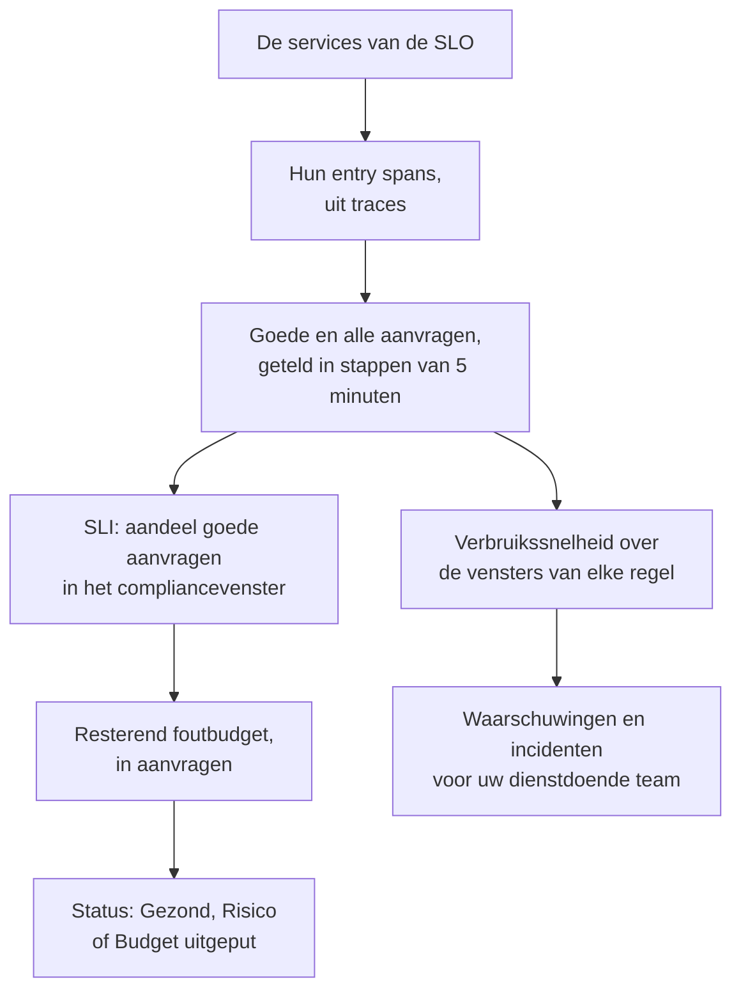

# SLO's voor aanvragen en latentie

Een SLO voor aanvragen meet wat uw gebruikers van een service krijgen: het deel van zijn aanvragen dat slaagt, of dat snel genoeg wordt afgehandeld. OneUptime telt ze uit de traces die uw services al sturen, dus u hoeft geen monitor in te stellen: kies de services en een doel, en OneUptime meet ze elke 5 minuten.

:::cards
- [Een SLO voor aanvragen aanmaken](#een-slo-voor-aanvragen-aanmaken): De services, een drempel voor latentie en een doel.
- [Alleen sommige aanvragen tellen](#alleen-sommige-aanvragen-tellen): Eén endpoint, of elke aanvraag behalve gezondheidscontroles.
- [SLO's op basis van een metriek](#slos-op-basis-van-een-metriek): Een teller of een histogram, voor services die geen traces sturen.
- [Hoe aanvragen worden geteld](#hoe-aanvragen-worden-geteld): Welke spans meetellen, en wanneer.
- [Releasecontroles](/docs/slo/release-checks): Draai een release terug die het foutbudget opbrandt.
:::

## Succes en latentie van aanvragen

| Wat het meet | Een aanvraag is slecht als | Het foutbudget telt |
| --- | --- | --- |
| **Succes van aanvragen** | De span van de aanvraag de status `Error` heeft. Een span zonder status telt als goed, zoals OpenTelemetry het bedoelt. | Mislukte aanvragen |
| **Latentie van aanvragen** | De aanvraag langer duurde dan de **Latentiedrempel (ms)** van de SLO, ongeacht de status. | Trage aanvragen |

De SLI is het deel goede aanvragen in het compliancevenster, en het foutbudget bestaat uit de slechte aanvragen die het doel toestaat: bij 99,9% één op elke 1.000. Een SLO voor latentie telt een aanvraag die snel mislukte als goed, dus meet een belangrijke service op beide manieren: met één SLO die bewaakt dat hij werkt, en één die bewaakt dat hij snel is.

## Zo werkt het

Een aanvraag is een entry span van een van de services van de SLO: de span waar een aanvraag of een bericht de service binnenkomt, zoals de lijst [Traces](/docs/telemetry/traces-explorer#traces-en-spans) ze standaard toont. Een aanvraag die door twee services van de SLO gaat, telt in elk van beide één keer.

Verder werkt een SLO voor aanvragen zoals elke andere SLO. Zijn status, regels voor verbruikssnelheid, foutbudgetbeleid, eigenaren en meldingen werken hetzelfde, alleen staat zijn foutbudget in aanvragen in plaats van in minuten.

## Voordat u begint

- De services sturen traces naar OneUptime: zie [OpenTelemetry](/docs/telemetry/open-telemetry). Elke service staat in de [servicecatalogus](/docs/telemetry/services) onder zijn `service.name`.
- Een rol die SLO's mag aanmaken: Projecteigenaar, Projectbeheerder of een aangepaste rol met de machtiging Create Service Level Objective.

## Een SLO voor aanvragen aanmaken

:::steps
### SLO's openen

Open **SLOs** via het menu **Producten** in de bovenbalk en klik op **Serviceniveaudoelstelling aanmaken**.

### Kiezen wat de SLO meet

Kies onder **Wat het meet** de optie **Succes van aanvragen** of **Latentie van aanvragen**, en daarna de **Services** waarvan de SLO de aanvragen telt. Stel voor **Latentie van aanvragen** ook de **Latentiedrempel (ms)** in, bijvoorbeeld `300`: een aanvraag die binnen die tijd wordt afgehandeld, telt als snel genoeg. Om alleen sommige van hun aanvragen te tellen, vult u een **Aanvraagfilter** in: zie [Alleen sommige aanvragen tellen](#alleen-sommige-aanvragen-tellen). Klik op **Volgende**.

### Een naam en een doel geven

Vul een **Naam** in, bijvoorbeeld "Checkout requests", en een **Doel (%)**: het deel van de aanvragen dat goed moet zijn. Klik op **Serviceniveaudoelstelling aanmaken**.

### De eerste cijfers zien binnenkomen

De eerste evaluatie, binnen 5 minuten, telt de aanvragen van de laatste 6 uur, zodat de SLO meteen cijfers heeft. De evaluaties daarna tellen ook oudere aanvragen, totdat het hele compliancevenster gedekt is.
:::

De eigen pagina **SLOs** van een service toont de SLO's die hem meten, en zijn **Serviceniveaudoelstelling aanmaken** opent hetzelfde formulier met de service al gekozen. Om later te wijzigen wat een SLO meet, welke services hij telt, wat zijn drempel is of wat zijn filter is, opent u zijn **Instellingen** en klikt u op **Bewerken wat het meet**.

## Alleen sommige aanvragen tellen

Een SLO voor aanvragen telt elke aanvraag van zijn services. Een **Aanvraagfilter** telt alleen de aanvragen die ertoe doen, zoals het checkout-endpoint, of laat er een paar weg, zoals gezondheidscontroles die de SLI beter zouden laten lijken dan wat gebruikers krijgen. Schrijf het als een tracezoekopdracht, in dezelfde [zoeksyntaxis](/docs/telemetry/search-syntax#waarden-laten-overeenkomen) als de traceverkenner:

| Aanvraagfilter | Telt |
| --- | --- |
| `@http.route:/checkout*` | Aanvragen waarvan de route met `/checkout` begint. |
| `-@http.route:/health` | Elke aanvraag behalve gezondheidscontroles. |
| `@http.request.method:[POST, PUT]` | POST- en PUT-aanvragen. |
| `name:"POST /checkout"` | Aanvragen waarvan de span `POST /checkout` heet. |

Elke term moet overeenkomen, dus `@http.route:/checkout* -@http.route:/checkout/health` telt de checkout-aanvragen behalve hun gezondheidscontrole. Een term met `@` is een attribuut van de span van de aanvraag, en `name:` is de naam van de span. Vrije tekst en de andere velden van de verkenner, zoals `status:` en `duration:`, zijn hier geen filters: de SLO bepaalt al welke aanvragen slecht of traag zijn. Een filter bevat maximaal 10 termen in 500 tekens.

Het **Overzicht** toont het filter onder de services van de SLO, en **Instellingen** toont het onder **Wat het meet**. Als u het wijzigt, worden de aanvragen van de SLO opnieuw vanaf het begin geteld.

## SLO's op basis van een metriek

Als uw services hun aanvragen al als metrieken tellen, of geen traces sturen, meet de SLO dan in plaats daarvan op basis van een teller of een histogram. Kies onder **Wat het meet** de optie **Metriek** en de **Services** die de metriek sturen, en vul daarna in de stap **Metriek** het volgende in:

| Veld | Wat u invult |
| --- | --- |
| **Metriek** | De naam van de metriek, gekozen uit de metrieken van uw project of getypt, zoals `http_requests_total` of `http.server.request.duration`. |
| **Goede gebeurtenissen** | **Een teller, op basis van een voorwaarde** of **Een histogram, op basis van een waarde**. |
| **Goed wanneer** | Voor een teller: de gebeurtenissen die goed zijn, als zoekopdracht op zijn attributen, zoals `@http.response.status_code:<500`. |
| **Goed tot en met** | Voor een histogram: de waarde die een goede waarneming niet overschrijdt, in de eigen eenheid van de metriek, zoals `0.3` voor 300 ms bij een histogram in seconden. Gebruik een van de bucketgrenzen ervan. |
| **Metriekfilter** | Optioneel: de reeksen die meetellen, zoals `-@http.route:/health`. |

De gebeurtenissen van een teller zijn wat hij in elke stap van 5 minuten groeide, zoals `increase()` van Prometheus een teller leest: een teller die herstart, telt weer vanaf nul, en cumulatieve tellers en deltatellers tellen allebei mee. De gebeurtenissen van een histogram zijn de waarnemingen ervan, en de goede zijn die in de buckets tot en met die waarde. Alleen de eigen punten van de metriek tellen mee, van de services van de SLO: een gauge met dezelfde naam telt niet mee. Een SLO op een gauge, wat elke cloudmetriek is, zegt dat op zijn pagina, en de metriekkiezer ook: meet een cloudmetriek met een metriekmonitor en een SLO van de beschikbaarheid van die monitor.

Verder werkt een SLO voor een metriek zoals een SLO voor aanvragen, met zijn foutbudget, regels voor verbruikssnelheid en releasecontroles in gebeurtenissen. Als u de metriek wijzigt, worden de gebeurtenissen ervan opnieuw vanaf het begin geteld.

## Hoe aanvragen worden geteld

OneUptime telt de goede aanvragen en alle aanvragen van elke SLO in stappen van 5 minuten en bewaart die tellingen, zodat de SLO zijn venster uit zijn eigen tellingen leest in plaats van telkens uit elke span:

- Een stap wordt 2 minuten na zijn einde geteld, zodat spans die laat binnenkomen er nog in vallen, en de volgende evaluatie telt de laatste twee stappen opnieuw voor spans die nog later binnenkomen.
- Een nieuwe SLO begint met de laatste 6 uur. Elke evaluatie daarna telt tot een dag aan oudere aanvragen, de nieuwste eerst, totdat het venster gedekt is.
- Alleen aanvragen die nog binnen uw [bewaartermijn voor telemetrie](/docs/telemetry/data-retention#hoe-lang-telemetrie-wordt-bewaard) vallen, kunnen worden geteld. Getelde stappen worden 400 dagen bewaard, langer dan elk compliancevenster, dus een venster dat langer is dan de bewaartermijn vult zich naarmate de SLO ouder wordt.
- Als u wijzigt wat de SLO meet, zijn services, zijn latentiedrempel of zijn aanvraagfilter, worden zijn aanvragen opnieuw vanaf het begin geteld. Een langer compliancevenster wordt gevuld door verder terug te tellen.

Zolang de tellingen maar een deel van het compliancevenster dekken, zegt het **Overzicht** dat met een indicator **Venster 23% gevuld**, en de tegel **Foutbudget over** herhaalt het onder zijn getal. Beide verdwijnen zodra de tellingen het hele venster dekken.

## Het foutbudget in aanvragen

Het budget bestaat uit de slechte aanvragen die het doel toestaat onder de aanvragen die in het venster zijn geteld, dus het groeit mee met het verkeer: bij 99,9% staat een venster van 2.000.000 aanvragen 2.000 mislukte aanvragen toe. Op het **Overzicht**:

- **Foutbudget over** zegt hoeveel slechte aanvragen er nog over zijn van het totaal, of hoeveel aanvragen de SLO boven het budget zit.
- **Resterende looptijd van budget** zegt hoelang het budget meegaat bij de huidige verbruikssnelheid, zolang het verkeer blijft zoals het was.
- De samenvatting telt de services van de SLO, en een SLO voor latentie toont zijn drempel onder zijn doel.

Waarschuwingen voor verbruikssnelheid, meldingen en de feed noemen het budget ook in aanvragen. De metriek `oneuptime.slo.error.budget.remaining.seconds` wordt voor een SLO voor aanvragen niet verstuurd; zet in plaats daarvan `oneuptime.slo.error.budget.remaining.percent` in een grafiek.

Een SLO voor aanvragen krijgt dezelfde regels **Fast burn**, **Slow burn** en **Slow leak** als elke nieuwe SLO. In een rustig uur met een handvol aanvragen kan één fout al een hoge verbruikssnelheid geven, dus een regel kan vensters met te weinig aanvragen negeren: stel het **Minimaal aantal aanvragen** van de regel in, en de regel slaat een lang venster met minder aanvragen dan dat aantal over.

## Problemen oplossen

:::details De SLO toont Wachten op aanvragen
Geen van zijn services heeft in het venster al een aanvraag afgehandeld. Controleer of de services traces naar OneUptime sturen en of hun spans entry spans bevatten: een service waarvan alle spans interne spans zijn, heeft geen aanvragen om te tellen. Heeft de SLO een **Aanvraagfilter**, zoek er dan mee in de [traceverkenner](/docs/telemetry/traces-explorer): een filter dat daar geen enkele aanvraag vindt, laat de SLO niets over om te tellen.
:::

:::details De SLI veranderde nadat ik de services had gewijzigd
Als u wijzigt wat de SLO meet, zijn services, zijn latentiedrempel of zijn aanvraagfilter, worden zijn aanvragen opnieuw geteld, te beginnen met de laatste 6 uur, dus de SLI en het budget beginnen vanaf daar opnieuw. De indicator **Venster 23% gevuld** laat zien hoeveel van het venster tot nu toe is geteld.
:::

## Volgende stappen

:::cards
- [Releasecontroles](/docs/slo/release-checks): Laat Argo Rollouts, Flagger of een pipeline een release terugdraaien die het budget opbrandt.
- [Waarschuwingen en incidenten voor verbruikssnelheid](/docs/slo/burn-rate-alerts): Waarschuw uw team als het budget te snel opraakt.
- [Foutbudgetbeleid](/docs/slo/error-budget-policy): Spreek af wat het team doet terwijl het budget opraakt.
:::
