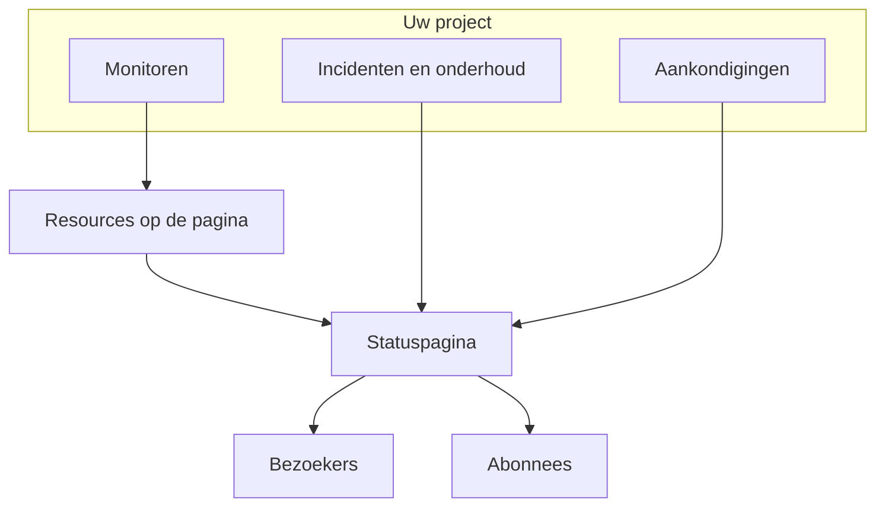

# Statuspagina's – Overzicht

Een statuspagina is het publieke gezicht van alles wat u monitort: één URL die uw klanten kunnen openen in plaats van u te mailen met de vraag of het probleem alleen bij hen ligt. Ze toont de huidige status van de services die u wilt laten zien, de incidenten waaraan u werkt, het onderhoud dat u hebt gepland en elke aankondiging die u bovenaan wilt vastzetten.

Als er om 2 uur 's nachts iets kapotgaat, is de statuspagina het eerste waarnaar uw supportwachtrij verwijst. Het is ook de plek van waaruit uw abonnees bericht krijgen, dus het loont om haar in te richten voordat u haar nodig hebt, niet midden in de storing.

:::cards
- [Een statuspagina aanmaken](#een-statuspagina-aanmaken): Twee velden om te beginnen, al het andere later.
- [Kiezen wat ze toont](#kiezen-wat-er-op-de-pagina-komt): Incidenten, episoden, aankondigingen, onderhoud en uptime, op één kaart.
- [Bepalen wie haar mag zien](#beperken-wie-de-pagina-mag-zien): Iedereen met de link, alleen mensen die inloggen of iedereen met het wachtwoord.
- [Een statuspagina archiveren](#een-statuspagina-archiveren): Een pagina offline halen zonder haar te verwijderen.
:::

## Hoe het werkt

Statuspagina's staan onder **Statuspagina's**, in het menu **Producten** in de bovenste balk, bij de essentiële onderdelen. Alles op deze pagina geldt per statuspagina: een project kan er zoveel hebben als het wil — een openbare voor klanten, een privé voor een intern publiek, een per regio voor een specifieke markt.

De pagina toont de monitoren die u erop zet als resources. Incidenten en gepland onderhoud komen via die monitoren op de pagina, en aankondigingen worden er rechtstreeks op geplaatst. Bezoekers lezen de pagina, en abonnees krijgen bericht van elke wijziging via de kanalen die ze hebben gekozen.

## In het kort

- **Aangemaakt met twee velden.** Een nieuwe statuspagina vraagt alleen om **Naam** en **Beschrijving**. Resources, huisstijl en domeinen stelt u daarna in.
- **Resources zijn wat bezoekers zien.** Elke rij op de pagina is een **Statuspagina Bron**: een monitor (of monitorgroep) met een eigen weergavenaam, tooltip en uptime-opties. Groepen verdelen een lange pagina in secties en kunnen worden genest.
- **Vanaf dag één een voorbeeld-URL.** Elke statuspagina krijgt een voorbeeldlink, zodat u haar kunt bekijken voordat er een aangepast domein is.
- **Routes voor bezoekers hangen af van instellingen.** Incidenten, episoden, aankondigingen en geplande gebeurtenissen verschijnen alleen zolang hun schakelaar in **Wat uw statuspagina toont** (onder **Geavanceerde instellingen**) aan staat, en de abonneerpagina alleen zolang **Abonneepagina weergeven** aan staat.
- **Wie haar mag zien is één keuze.** Iedereen met de link, alleen mensen die inloggen (privégebruikers, SSO via SAML of OIDC) of iedereen met het wachtwoord, op het scherm **Toegang** van de pagina, met een optionele IP-toelatingslijst onder **Meer instellingen**.
- **Abonnees krijgen automatisch bericht.** Abonnees via e-mail, SMS, Slack, Microsoft Teams en webhook kunnen een pagina volgen, elk kanaal achter een eigen schakelaar.

## Kernbegrippen

| Begrip | Wat het betekent |
| --- | --- |
| **Statuspagina** | Eén openbare (of privé) pagina, met een eigen huisstijl, domeinen, resources en abonnees. Het model `StatusPage`. |
| **Resource** | Eén rij die bezoekers zien: een monitor of monitorgroep die op de pagina staat met een weergavenaam en uptime-opties. |
| **Groep** | Een sectie met een naam die resources bevat. Groepen worden in groepen genest, en elk niveau vat de status samen van alles wat eronder valt. |
| **Aankondiging** | Een bericht dat u op een of meer statuspagina's plaatst, met een begintijd en een optionele eindtijd. |
| **Abonnee** | Iemand (of iets) die de pagina volgt via e-mail, SMS, Slack, Microsoft Teams of een webhook. |
| **Aangepast domein** | Een domein van uzelf, `status.example.com`, dat met een CNAME-record naar de pagina verwijst. OneUptime geeft er gratis een SSL-certificaat voor uit en vernieuwt het. |
| **Privégebruiker** | Een account dat kan inloggen op een privé-statuspagina. Los van de gebruikers van uw OneUptime-project. |

## Een statuspagina aanmaken

:::steps
### Het aanmaakformulier openen

Open **Statuspagina's → Alle statuspagina's** en klik op **Statuspagina maken**.

### De pagina een naam geven

Vul in het venster **Nieuw aanmaken: Statuspagina** de **Naam** in (verplicht, minstens twee tekens) en, als u wilt, de **Beschrijving**, en klik op **Statuspagina maken**.

Dat is het hele formulier. De lijst waarnaar u terugkeert toont **Naam**, **Beschrijving**, **Labels** en **Eigenaren**, en kan worden gefilterd op **Statuspagina-ID**, **Naam** en **Beschrijving**.

### De nieuwe pagina openen

Open de nieuwe pagina en u komt op haar scherm **Overzicht**, met twee kaarten: **Status Page Preview URL**, met een link naar de pagina zelf, en **Statuspaginadetails**, waar u de naam, de beschrijving en de labels die u net hebt ingesteld kunt bewerken. Als het project aangepaste velden voor statuspagina's heeft, volgt er een kaart **Aangepaste velden**.
:::

Een pagina die met de API of met Terraform wordt aangemaakt, valt onder dezelfde abonnementen als de instellingen hieronder. Op OneUptime Cloud wordt het aanmaken van een pagina met een ingeschakelde instelling die uw abonnement niet bevat (bijvoorbeeld privé, een verborgen lijst, aangepaste HTML, CSS of JavaScript, e-mailrapporten, abonnees via SMS, Slack, Microsoft Teams of webhook, een IP-toelatingslijst) geweigerd met `402 Payment Required`, en de melding noemt het abonnement. Het abonnement van elke instelling staat hieronder bij die instelling. Instellingen die op hun standaardwaarde blijven staan, zoals dit formulier ze laat, werken op elk abonnement.

Daarna, ongeveer in volgorde van nut:

- Voeg resources toe zodat de pagina iets toont: zie [Statuspagina – bronnen en groepen](/docs/status-pages/resources-and-groups).
- Stel de paginatitel, het favicon, het logo en de omslagafbeelding in en koppel daarna een aangepast domein: zie [Statuspagina – branding en domeinen](/docs/status-pages/branding-and-domains).
- Bepaal via welke kanalen mensen zich kunnen abonneren: zie [Abonnees en aankondigingen](/docs/status-pages/subscribers).
- Stem onder **Geavanceerde instellingen** af wat er op de pagina verschijnt.

## Waar alles staat

Zodra u een statuspagina hebt geopend, is haar eigen linkermenu in negen secties ingedeeld. Gebruik het als kaart voor de rest van dit deel van de documentatie.

| Sectie | Wat erin staat |
| --- | --- |
| **Basis** | **Overzicht**, **Aankondigingen**, **Eigenaren**. |
| **Middelen** | Eén scherm **Middelen** (de groepen links, de monitoren van de geselecteerde groep rechts) en **Monitor Rules**. |
| **Abonnees** | **E-mail-abonnees**, **SMS-abonnees**, **Slack-abonnees**, **MS Teams-abonnees**, **Webhook-abonnees**, **Abonneeinstellingen**. |
| **Meldingslogboeken** | **Meldingslogboeken**: wat er naar abonnees is verzonden. |
| **Huisstijl** | **Huisstijl** (logo, titel, favicon, links, voettekst, kleuren en talen, op één pagina), **Aangepaste domeinen**, **HTML, CSS & JavaScript**. |
| **Beveiliging** | **Toegang** (wie de pagina mag zien), **Privégebruikers**, **SSO**, **OIDC**, **SCIM**. |
| **AI** | **MCP**. |
| **Ontwikkelaars** | **Terraform**, **API**, **AI-assistenten**: de pagina als code. |
| **Geavanceerd** | **Ingesloten status**, **Rapporten**, **Aangepaste velden**, **Geavanceerde instellingen**, **Auditlogboeken**, **Statuspagina verwijderen**. |

Alleen **Basis** en **Middelen**, wat de pagina toont, beginnen open. Alle andere secties beginnen ingeklapt, net als de weinig gebruikte secties van elk menu in OneUptime: klik op de titel van een sectie om haar pagina's te tonen. Een sectie gaat vanzelf open wanneer u op een van haar pagina's bent, zoals **Geavanceerde instellingen** of **E-mail-abonnees**.

Twee eigenaardigheden in de naamgeving die u moet kennen voordat u gaat zoeken:

- Het item **Middelen** heet alleen **Middelen** wanneer het project monitorgroepen heeft ingeschakeld. Anders heet het **Monitoren**. In beide gevallen is het hetzelfde scherm.
- Er is geen aparte groepenpagina. Groepen en resources zijn samengevoegd, en het oude pad `/groups` leidt nu door naar het resourcescherm.

Buiten een specifieke pagina toont de sectie **Statuspagina's** zelf **Alle statuspagina's**, en een sectie **Meer** bevat **Aankondigingen**. Een ingeklapte sectie **Instellingen** bevat **Aankondigings-sjablonen**, **Abonnee-sjablonen**, **Aangepaste velden**, **Eigenaarsregels** en **Labelregels**, die voor het hele project gelden en door alle statuspagina's worden gedeeld. Een ingeklapte sectie **Geavanceerd** bevat **Gearchiveerd**: de statuspagina's die u offline hebt gehaald (zie [Een statuspagina archiveren](#een-statuspagina-archiveren)).

**Labelregels** en **Eigenaarsregels** geven nieuwe statuspagina's labels en wijzen er eigenaren aan toe. Een regel heeft twee stappen (**Overeenkomst**, de voorwaarden waaraan een statuspagina moet voldoen, en daarna **Labels** of **Eigenaren**, wat de regel toevoegt) en de **Naam** wordt ingevuld op basis van wat u kiest. Een nieuwe regel moet minstens één label of eigenaar toevoegen; bij bewerken wordt daar nooit op aangedrongen, en de lijst markeert een oude regel die niets toevoegt met **Voegt niets toe**. Zie [Label- en eigenaarsregels](/docs/configuration/label-and-owner-rules).

## Wat bezoekers zien

De openbare pagina is een eigen applicatie, met een kleine set routes:

- `/`: het **Overzicht**.
- `/incidents` en `/incidents/:id`: de lijst met incidenten en één incident.
- `/announcements` en `/announcements/:id`.
- `/scheduled-events` en `/scheduled-events/:id`.
- `/subscribe/email`, `/subscribe/sms`, `/subscribe/slack`, `/subscribe/microsoft-teams`, `/subscribe/webhooks`.
- `/confirm-subscription/:id`, `/update-subscription/:id` en `/unsubscribe/:token`: de links in de berichten die abonnees krijgen.
- `/rss`: de feed.
- `/login`, `/sso` en `/master-password`: alleen relevant op een privépagina.

De navigatiebalk bovenaan toont altijd **Overzicht**; de rest verschijnt alleen wanneer het aan staat. **Incidenten**, **Aankondigingen** en **Geplande gebeurtenissen** hebben elk hun eigen schakelaar nodig; **Abonneren** heeft zowel **Abonneepagina weergeven** als minstens één ingeschakeld abonnementskanaal nodig. Een privépagina heeft ook een item **Uitloggen**.

Eén incident, episode, aankondiging of geplande gebeurtenis opent alleen als de pagina die zou tonen, ongeacht de geschiedenisperiode: een privé-incident of -episode, een die verborgen is op statuspagina's, een geplande gebeurtenis die verborgen is op statuspagina's of een aankondiging die voor later is gepland, wordt ook via de link niet gevonden.

### De overzichtspagina

Het overzicht is de pagina die de meeste bezoekers zien. Van boven naar beneden toont het:

1. **Lopende aankondigingen**: aankondigingen waarvan de begintijd is verstreken en de eindtijd niet.
2. **Een banner met de algemene status**: één regel die samenvat of alle resources getroffen zijn of slechts enkele.
3. **Een totaal uptimepercentage**, als u het hebt ingeschakeld: aan het einde van de banner met de algemene status, zolang alle resources operationeel zijn. Standaard uit.
4. **Resourcegroepen**, elk met hun resources, hun huidige status en hun balken met uptimegeschiedenis.
5. **Actieve incidenten**, met actieve episoden.
6. **Geplande onderhoudsgebeurtenissen**.

Een nieuw aangemaakte pagina zonder inhoud toont een lege staat die u vraagt resources toe te voegen vanuit het dashboard, het teken om naar het scherm **Middelen** te gaan.

Het overzicht dat een bezoeker ziet is hooguit 15 seconden oud, en alles wat u van de pagina haalt, verdwijnt er binnen een seconde van: een incident, episode of geplande gebeurtenis die u verbergt op statuspagina's, privé maakt, tot andere pagina's beperkt of verwijdert, een aankondiging die u beëindigt, uitstelt of verwijdert, een openbare notitie die u verwijdert, en een resource, groep of monitor die u van de pagina haalt of verwijdert. Andere wijzigingen, zoals een nieuwe titel, verschijnen binnen die 15 seconden.

Wat een incident op deze pagina zet en wat het eraf haalt, leest u in [Incidentstatussen en ernstniveaus](/docs/incidents/states-and-severities).

## Kiezen wat er op de pagina komt

Wat bezoekers zien, stelt u in op één kaart: **Wat uw statuspagina toont**, onder **Statuspagina's → uw pagina → Geavanceerd → Geavanceerde instellingen**. Ze heeft een rij voor elke lijst die de pagina kan tonen, daarna **Uptimegeschiedenis** (met het totale uptimepercentage en de statussen die als downtime tellen) en de regel "Powered by OneUptime". Er is geen bewerkknop: een schakelaar wordt opgeslagen zodra u hem omzet, een aantal dagen wanneer u het vak verlaat of op Enter drukt, en een keuze uit een lijst zodra u die maakt.

- **Incidenten weergeven** (`showIncidentsOnStatusPage`): standaard aan. Daaronder bepaalt **De laatste … dagen weergeven** (`showIncidentHistoryInDays`, standaard 14) hoe ver de incidentenlijst teruggaat, en **Incidentlabels weergeven** (`showIncidentLabelsOnStatusPage`) staat standaard uit.
- **Alleen incidenten tonen die tot deze pagina zijn beperkt** (`onlyShowScopedIncidents`): ook in de incidentenrij, standaard uit. Zet het aan en de pagina toont, en meldt aan haar abonnees, alleen de incidenten die met **Beperken tot deze statuspagina's** tot haar zijn beperkt. Incidenten die tot geen enkele pagina zijn beperkt, ook die welke een monitor, Slack, Microsoft Teams, de API of AI zelf opent, komen er nooit op totdat iemand de pagina eraan toevoegt. Het bepaalt ook welke incidenten hun episoden op de pagina brengen, daarom blijft het beschikbaar wanneer **Incidenten weergeven** uit staat. Voor pagina's die monitoren delen maar verschillende doelgroepen bedienen, zie [Eén statuspagina per doelgroep](/docs/status-pages/one-status-page-per-audience).
- **Episoden weergeven** (`showEpisodesOnStatusPage`): standaard aan, met **De laatste … dagen weergeven** (`showEpisodeHistoryInDays`, standaard 14) en **Episodelabels weergeven** (`showEpisodeLabelsOnStatusPage`, standaard uit). Episoden zijn een eigen model met eigen endpoints, geen weergave van incidenten.
- **Aankondigingen weergeven** (`showAnnouncementsOnStatusPage`): standaard aan, met **De laatste … dagen weergeven** (`showAnnouncementHistoryInDays`, standaard 14).
- **Geplande onderhoudsgebeurtenissen weergeven** (`showScheduledMaintenanceEventsOnStatusPage`): standaard aan, met **De laatste … dagen weergeven** (`showScheduledEventHistoryInDays`, standaard 14) en **Gebeurtenislabels weergeven** (`showScheduledEventLabelsOnStatusPage`, standaard uit).
- **Uptimegeschiedenis**: alles over de uptime van de pagina, in één rij:
  - **De laatste … dagen weergeven** (`showUptimeHistoryInDays`) is de lengte van de uptimebalk naast elke resource. Het is standaard 90 en moet tussen 1 en 90 liggen. Elke optie **Uptime % weergeven** en **Statusgeschiedenisgrafiek weergeven** van een resource of groep leest dit getal, net als het totale uptimepercentage.
  - **Totaal uptimepercentage weergeven** (`showOverallUptimePercentOnStatusPage`): standaard uit. Zet het aan en de banner met de algemene status eindigt met een uptimepercentage voor de hele pagina, het gemiddelde van haar resources en groepen, zolang alles operationeel is. Zolang het aan staat, kiest **Precisie** (`overallUptimePercentPrecision`) hoeveel decimalen het toont: `99%`, `99.9%`, `99.99%` (de standaard) of `99.999%`. Elke resource en elke groep heeft een eigen precisie.
  - **Telt als downtime** (`downtimeMonitorStatuses`): de monitorstatussen waarvan de tijd telt tegen elk uptimepercentage van de pagina: dat van elke resource, van elke groep en het totaal. Elke status is een label in zijn eigen kleur. Voeg er een toe uit de lijst of verwijder er een met het bijbehorende **×**, en de wijziging wordt meteen opgeslagen. Een nieuwe statuspagina begint met alle statussen van het project die niet operationeel zijn. Er blijft altijd minstens één status over: de laatste kan niet worden verwijderd, omdat zonder statussen elke uptime op de pagina 100% zou tonen.
- **'Powered By OneUptime'-branding weergeven**: standaard aan, dus de voettekst voor bezoekers zegt "Powered by OneUptime". Zet het uit om de regel te verbergen. De kolom slaat het omgekeerd op, als `hidePoweredByOneUptimeBranding`.

**Een uitgeschakelde lijst** verdwijnt van de pagina, samen met haar item in de navigatiebalk als ze dat heeft; haar openbare endpoint weigert het verzoek, en de abonnees van de pagina krijgen geen bericht over dat soort gebeurtenis. Haar rij toont dan alleen nog haar schakelaar: hoe ver een verborgen lijst teruggaat, en of ze labels toont, verandert niets.

**Abonnementen.** Op OneUptime Cloud toont een instelling die uw abonnement niet kan wijzigen, ernaast het abonnement dat ze nodig heeft. De vier lijstschakelaars, de drie labelschakelaars en de geschiedenis van episoden hebben **Growth** nodig; het totale uptimepercentage tonen en de regel "Powered by OneUptime" verbergen hebben **Scale** nodig. De andere geschiedenisperiodes, **Uptimegeschiedenis**, **Precisie**, **Telt als downtime** en **Alleen incidenten tonen die tot deze pagina zijn beperkt** kunnen op elk abonnement worden gewijzigd, en elk ervan wordt afzonderlijk opgeslagen: een pagina waarvan het totale uptimepercentage al aan staat, kan de precisie ervan op elk abonnement wijzigen. Een instelling terugzetten naar hoe ze op een nieuwe pagina staat (een lijst weer tonen, de labels of het totale uptimepercentage verbergen, de regel "Powered by OneUptime" tonen, de geschiedenis van episoden terugzetten naar 14 dagen) werkt op elk abonnement, dus niets wat een proefperiode heeft gewijzigd blijft zo bij gebrek aan abonnement: de schakelaar vermeldt dat hij nog terug kan, en welk abonnement nodig is om hem opnieuw te wijzigen.

Of de pagina een item **Abonneren** toont (**Abonneepagina weergeven**, `showSubscriberPageOnStatusPage`, standaard aan) en via welke kanalen bezoekers zich kunnen abonneren, stelt u niet op dit scherm in: beide staan op de kaart **Kanalen** onder **Abonnees → Abonneeinstellingen** (zie [Abonnementskanalen](/docs/status-pages/subscribers#abonnementskanalen)).

Onder de kaart staan **Statuspagina exporteren als JSON**, dat de eigen instellingen van de statuspagina downloadt naar een bestand dat u opnieuw kunt importeren, en **Archive status page** (zie [Een statuspagina archiveren](#een-statuspagina-archiveren)). Het totale uptimepercentage en de downtimestatussen waren hier vroeger twee eigen kaarten, elk achter een knop **Bewerken**; nu zijn het rijen van de kaart.

**Waar de kleuren staan.** De kleuren van de uptimebalken staan hier niet: de **Standaard balkkleur** en de kleurregels voor de balken staan onder **Meer instellingen** in **Statuspagina's → uw pagina → Huisstijl → Huisstijl**. Er bestaat nergens een instelling voor een thema of een merkkleur; alles wat verder gaat dan die bedieningselementen doet u met **Aangepaste CSS**.

## Vooraf bekijken voordat u live gaat

Het scherm **Overzicht** van elke statuspagina heeft een kaart **Status Page Preview URL** met een directe link naar de pagina. Gebruik die terwijl u nog resources toevoegt en voordat er een aangepast domein is.

Achter de schermen heeft elke openbare route een voorbeeldtweeling onder `/status-page/{statusPageId}/...`: een voorbeeldoverzicht, een voorbeeldlijst met incidenten, een voorbeeldabonneerpagina enzovoort. Een URL of schermafbeelding uit het voorbeeld in het dashboard komt daardoor niet overeen met wat een klant ziet zodra er een aangepast domein is gekoppeld, dus controleer elke link die u in een runbook of e-mail plakt.

## Beperken wie de pagina mag zien

Niet elke statuspagina is voor het publiek. Wie een pagina mag zien is één keuze, de eerste kaart van **Statuspagina's → uw pagina → Beveiliging → Toegang**, **Wie deze statuspagina kan zien**:

- **Iedereen met de link**: de pagina is openbaar. Elke nieuwe statuspagina begint hier.
- **Alleen mensen die inloggen**: bezoekers komen op `/login` terecht en loggen in als privégebruiker, of via uw SSO- of OIDC-provider (zie hieronder). Onder de keuze toont de kaart welke aanmelding voor de pagina is ingesteld (hoeveel privégebruikers ze heeft en of SSO en OIDC aan staan, elk met een link naar het bijbehorende scherm) en waarschuwt ze, zolang dit de keuze is, wanneer nog niemand kan inloggen.
- **Iedereen met het wachtwoord**: bezoekers komen op `/master-password` terecht en ontgrendelen de pagina met een wachtwoord dat u met hen deelt. Niemand heeft een account nodig. Bij deze keuze wordt in hetzelfde dialoogvenster om het wachtwoord gevraagd als de pagina er nog geen heeft; heeft ze er al een, dan kunt u het houden of een ander invoeren. Daarna vervangt **Wachtwoord wijzigen** onder de keuze het. Het wachtwoord wordt als hash opgeslagen en kan niet opnieuw worden getoond, en wie het oude heeft ingevoerd, kan de pagina nog tot 7 dagen zien.

Een optie kiezen vraagt om bevestiging, met wat er voor bezoekers verandert, en wordt meteen opgeslagen. Er is geen bewerkknop.

**Afbeeldingen.** Een afbeelding in wat de pagina toont (een openbare notitie, een aankondiging, een beschrijving) opent op een eigen lang, onraadbaar adres dat zonder inloggen werkt, zodat ook de e-mails aan uw abonnees haar kunnen tonen. De pagina zelf blijft om de aanmelding of het wachtwoord vragen.

**Wat er wordt opgeslagen.** De keuze bestaat uit drie kolommen, die de API en Terraform lezen en schrijven zoals voorheen: `isPublicStatusPage`, `enableMasterPassword` en `masterPassword`. Bezoekers wordt alleen om het wachtwoord gevraagd op een pagina die niet openbaar is, met `enableMasterPassword` aan en een ingesteld wachtwoord; een privépagina met de schakelaar aan maar zonder wachtwoord is een inlogpagina. Kiezen voor **Iedereen met de link** zet ook `enableMasterPassword` uit, omdat een openbare pagina er nooit om vraagt. Het scherm **Toegang** schrijft alleen de kolommen die een keuze wijzigt.

**Abonnementen.** Op OneUptime Cloud heeft het privé maken van een pagina het abonnement **Growth** nodig: op een lager abonnement tonen de twee privé-opties het abonnement dat ze nodig hebben en kunnen ze niet worden gekozen. Haar weer openbaar maken (**Iedereen met de link**) werkt op elk abonnement, dus een pagina die aan het einde van een proefperiode, of na een overstap naar een lager abonnement, privé is gebleven, kan altijd weer worden opengezet; het dialoogvenster vermeldt dat haar opnieuw privé maken **Growth** nodig heeft. Overstappen van **Alleen mensen die inloggen** naar **Iedereen met het wachtwoord** werkt op elk abonnement, net als **Wachtwoord wijzigen**.

### Privégebruikers

Voeg de mensen die mogen inloggen toe onder **Statuspagina's → uw pagina → Beveiliging → Privégebruikers**. Er is een actie **In bulk toevoegen**: plak een lijst e-mailadressen en elk adres krijgt een uitnodigingsmail. Privégebruikers hebben hun eigen proces voor een vergeten wachtwoord en het opnieuw instellen ervan, los van de accounts in uw OneUptime-project.

**Privégebruikers en het wachtwoord tellen niet op.** Zolang **Iedereen met het wachtwoord** de keuze is, kunnen privégebruikers niet inloggen (ook zij voeren het wachtwoord in), en het scherm **Privégebruikers** vermeldt dat, met een link terug naar **Toegang**.

### SSO en OIDC

Voor een privépagina die aan uw identiteitsprovider is gekoppeld, stelt **Statuspagina's → uw pagina → Beveiliging → SSO** SAML in: u voert de aanmeldings-URL, de uitgever en het x509-certificaat in, en de ondertekenings- en digestmethoden worden ingevuld onder **Meer velden**. **Statuspagina's → uw pagina → Beveiliging → OIDC** stelt OpenID Connect in: u voert de uitgever, de client-ID en het secret in, en de discovery-URL, de scopes en de claimnamen worden ingevuld onder **Meer velden**. **SCIM** richt privégebruikers automatisch in vanuit de IdP. Op OneUptime Cloud hebben alle drie het abonnement Scale of hoger nodig. In een zelfgehoste installatie maken SSO en OIDC deel uit van elke editie, en SCIM heeft de [Enterprise Edition](/docs/self-hosted/enterprise) nodig.

De SSO- of OIDC-provider van een statuspagina uitschakelen of verwijderen meldt de privégebruikers af die erdoor zijn ingelogd: hun sessies eindigen bij hun volgende verzoek, en de provider weer inschakelen brengt ze niet terug; ze loggen er opnieuw mee in. Een nieuw certificaat of clientsecret, andere URL's of een nieuwe naam houden iedereen ingelogd. Op een pagina die SSO vereist, sluit het uitschakelen van haar laatste provider iedereen buiten totdat u er weer een inschakelt of **SSO vereisen voor inloggen** uitzet; om naar een andere provider over te stappen, stelt u de nieuwe in en test u die voordat u de oude uitschakelt.

Onder de providers bevat de kaart **SSO-instellingen** de schakelaar **SSO vereisen voor inloggen** (`requireSsoForLogin`, standaard uit), die wordt opgeslagen zodra u hem omzet. Inschakelen vraagt eerst om bevestiging, omdat privégebruikers vanaf dan niet meer met e-mail en wachtwoord kunnen inloggen: alleen de mensen die uw SSO- of OIDC-provider binnenlaat, kunnen de pagina zien. Test SSO met de link op dat scherm voordat u het inschakelt. Het telt alleen zolang **Alleen mensen die inloggen** de keuze is, en het scherm **Toegang** toont het als **SSO verplicht** onder die keuze. Zolang het aan staat, wordt ook een privégebruiker die met e-mail en wachtwoord heeft ingelogd bij zijn volgende verzoek afgemeld: alleen sessies die een SSO- of OIDC-provider heeft gestart, tellen. Op OneUptime Cloud heeft inschakelen het abonnement **Scale** nodig, en uitschakelen werkt op elk abonnement. Een pagina die na het einde van een Scale-proefperiode, of na een overstap naar een lager abonnement, nog SSO vereist, blijft dat doen totdat iemand het uitzet: haar pagina's **SSO** en **OIDC** tonen de schakelaar daarvoor onder het abonnementsaanbod.

### IP-toelatingslijst

Onder **Meer instellingen** van **Toegang** beperkt de sectie **IP-toelatingslijst** (de kolom `ipWhitelist`) een pagina tot bekende netwerken. Ze geldt ongeacht het publiek van de pagina: een bezoeker vanaf elk ander adres wordt geweigerd, ook met het wachtwoord of een account als privégebruiker. Voer één item per regel in: een IPv4- of IPv6-adres, of een IPv4-bereik zoals `10.0.0.0/8`; een regel die geen van beide is, wordt bij het opslaan geweigerd. Laat haar leeg om alle adressen toe te staan. Zolang de lijst geldt, toont de ingeklapte kop **Meer instellingen** de **IP-toelatingslijst** met het aantal items erin. Op OneUptime Cloud heeft wijzigen het abonnement **Scale** nodig; leegmaken werkt op elk abonnement.

## De insluitbare badge en de RSS-feed

Twee manieren om de status ergens anders te tonen dan op de pagina zelf.

**Ingesloten statusbadge.** Zet onder **Statuspagina's → uw pagina → Geavanceerd → Ingesloten status** de optie **Ingesloten statusbadge inschakelen** aan (`enableEmbeddedOverallStatus`, standaard uit) en klik daarna op **Token opnieuw genereren** in de kaart **Beveiligingstoken** om de badge zijn token te geven (`embeddedOverallStatusToken`). De badge wordt geserveerd vanaf `/api/status-page/badge/<status-page-id>?token=<token>`, en het scherm toont hem in **Badge-voorbeeld** met fragmenten om te kopiëren, zodat u de huidige algemene status in uw documentatie, de voettekst van uw app of een marketingpagina kunt zetten.

**RSS-feed.** Elke statuspagina serveert `/rss`: een feed met de titel "{paginatitel} Updates", met de **Paginatitel** die onder **Huisstijl** is ingesteld, of de naam van de pagina als ze er geen heeft, en waarvan de items beginnen met `Incident: `, `Announcement: ` en `Scheduled Maintenance: `. Handig voor wie uw updates liever in een feedlezer of een chatbot binnenhaalt dan zich per e-mail te abonneren.

Als u de gegevens liever zelf ophaalt: de statuspagina steunt op openbare lees-endpoints voor het overzicht, de incidenten, de geplande onderhoudsgebeurtenissen, de aankondigingen en de episoden; zie [Publieke API](/docs/status-pages/public-api).

## Een statuspagina archiveren

Archiveer een statuspagina om haar offline te halen zonder haar te verwijderen. Een gearchiveerde statuspagina:

- **Is offline.** Haar URL, haar aangepaste domeinen, haar ingesloten badge, haar publieke API en haar MCP-server antwoorden alsof de pagina niet bestaat ("Status Page not found"), zodat een bezoeker een gearchiveerde pagina niet kan onderscheiden van een die nooit heeft bestaan. Ook de voorbeeldlink in het dashboard werkt niet meer.
- **Stuurt haar abonnees niets.** Geen meldingen over incidenten, episoden, onderhoud of aankondigingen, geen rapporten en geen abonnementsbevestigingen. Niemand kan zich erop abonneren.
- **Verdwijnt uit de lijst met statuspagina's.** U vindt haar onder **Statuspagina's → Geavanceerd → Gearchiveerd**.
- **Bewaart alles.** Haar resources, groepen, huisstijl, domeinen, privégebruikers en abonnees blijven bewaard, dus uit het archief halen zet de pagina precies zoals ze was weer online.

Om een statuspagina te archiveren, opent u haar en gaat u naar **Geavanceerd → Geavanceerde instellingen → Archive status page**. Om er meerdere te archiveren, selecteert u ze in de lijst **Statuspagina's** en kiest u **Archiveren**. Om er een terug te halen, opent u **Statuspagina's → Geavanceerd → Gearchiveerd**, selecteert u haar en kiest u **Uit archief halen**, of opent u haar en klikt u op **Uit archief halen** in de banner bovenaan haar pagina's.

## Volgende stappen

:::cards
- [Statuspagina – bronnen en groepen](/docs/status-pages/resources-and-groups): Monitoren op de pagina zetten en in secties ordenen.
- [Statuspagina – branding en domeinen](/docs/status-pages/branding-and-domains): Uw logo en kleuren, en de pagina op uw eigen domein.
- [Abonnees en aankondigingen](/docs/status-pages/subscribers): De vijf abonnementskanalen en het plaatsen van aankondigingen.
- [Eén statuspagina per doelgroep](/docs/status-pages/one-status-page-per-audience): Een pagina per klant, locatie of regio, en welke pagina's bericht krijgen over elk incident.
:::
