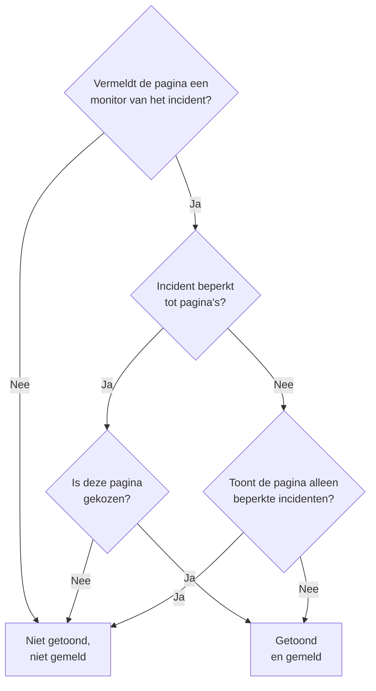

# Eén statuspagina per doelgroep

Verschillende mensen hebben ander nieuws nodig. Een klant wil niets horen over de storing van een andere klant, en het personeel van de ene locatie wil geen e-mail telkens wanneer een andere locatie haar netwerk kwijtraakt. In OneUptime is de eenheid van doelgroep de statuspagina: elke pagina heeft haar eigen abonnees, haar eigen huisstijl en haar eigen privacy. Geef elke doelgroep dus een eigen pagina, en bepaal per incident welke pagina's ervan horen.

Gedeelde infrastructuur maakte dat lastig. Een incident bereikt een statuspagina via zijn monitoren, dus een monitor die door tien locatiepagina's werd gedeeld, vertelde alle tien de locaties over een storing die er twee trof. De enige oplossing was een pagina, of een monitor, voor elke combinatie van locaties. Deze pagina behandelt de instellingen die dat oplossen:

- **Beperken tot deze statuspagina's** op een incident, zodat het alleen wordt getoond en gemeld op de pagina's die u kiest.
- **Alleen incidenten tonen die tot deze pagina zijn beperkt** op een statuspagina, zodat een incident dat nog niemand heeft beperkt geen van deze pagina's bereikt totdat iemand beslist. Dat geldt ook voor de incidenten die een monitor, Slack, Microsoft Teams, de API of AI zelf opent.
- Een register van welke pagina's te horen kregen dat een incident is aangemaakt, zodat een pagina die u later toevoegt één keer bericht krijgt en de andere niet opnieuw.
- Een samenvatting **Wordt geïnformeerd** die laat zien wie van een incident hoort voordat u het meldt of een openbare notitie plaatst, en **Voorbeeld**, dat laat zien wat de abonnees van elke pagina krijgen.

:::cards
- [Inrichten](#eén-pagina-per-doelgroep-inrichten): Een pagina per doelgroep, en de schakelaar die onbeperkte incidenten van die pagina's weghoudt.
- [Een incident beperken](#een-incident-beperken-tot-statuspaginas): Kies de pagina's bij het melden, of later.
- [Pagina's toevoegen of verwijderen](#statuspaginas-toevoegen-en-verwijderen): Wie bericht krijgt over een pagina die u toevoegt, en wat het verwijderen van een pagina terugdraait.
- [Wat elk bericht bevat](#wat-elk-bericht-bevat): De waarden die elke pagina krijgt, en wat ze elke doelgroep vertellen.
:::

## Wanneer gebruiken

- **Een managed service provider** met een statuspagina per klant, op monitoren die de klanten delen.
- **Een organisatie met locaties, fabrieken of regio's**, elk met eigen personeel dat bericht moet krijgen.
- **Interne IT** met een pagina per afdeling of gebouw.

Als uw doelgroep het prima vindt om zelf te kiezen, kan één pagina genoeg zijn: laat abonnees de resources kiezen die hen interesseren (zie [Abonnees en aankondigingen](/docs/status-pages/subscribers)). Gebruik een pagina per doelgroep wanneer u de keuze voor hen maakt, per incident, of wanneer de ene doelgroep de incidenten van een andere helemaal niet mag zien.

## Hoe een incident een statuspagina bereikt

Een incident bereikt een statuspagina via zijn monitoren. Een pagina toont een incident, en brengt haar abonnees ervan op de hoogte, wanneer een van de resources van de pagina een van de monitoren van het incident is, rechtstreeks of via een monitorgroep op de pagina. Twee instellingen beperken dat:

- **Beperken tot deze statuspagina's** op het incident (`statusPages`). Leeg gelaten bereikt het incident elke pagina die zijn monitoren vermeldt, zoals altijd. Met gekozen pagina's bereikt het alleen de gekozen pagina's **onder** de pagina's die zijn monitoren vermelden.
- **Alleen incidenten tonen die tot deze pagina zijn beperkt** op de statuspagina (`onlyShowScopedIncidents`, standaard uit). Met deze instelling aan toont de pagina nooit een incident dat niet tot specifieke statuspagina's is beperkt, en brengt ze niemand daarvan op de hoogte.



Voor een pagina die een van de monitoren van het incident vermeldt:

| Het incident is | Pagina met **Alleen incidenten tonen die tot deze pagina zijn beperkt** uit | Pagina met de instelling aan |
| --- | --- | --- |
| Tot geen enkele statuspagina beperkt | Getoond en gemeld | Niet getoond, niet gemeld |
| Beperkt tot statuspagina's, en deze pagina is gekozen | Getoond en gemeld | Getoond en gemeld |
| Beperkt tot statuspagina's, maar niet tot deze | Niet getoond, niet gemeld | Niet getoond, niet gemeld |

Een pagina die geen van de monitoren van het incident vermeldt, toont het nooit, wat u ook kiest, en een incident zonder monitoren meldt het aan geen enkele abonnee van een statuspagina. De gebruikelijke regels gelden daarbovenop nog steeds: het incident moet **Zichtbaar op statuspagina** zijn en niet privé, de pagina moet **Incidenten weergeven** aan hebben, en een abonnee die alleen bepaalde resources of gebeurtenistypen heeft gekozen, krijgt alleen wat hij heeft gekozen.

Dezelfde regels bepalen alles wat ervan afhangt welke pagina's een incident bereikt:

- de incidentenlijsten, het overzicht en de eigen pagina van het incident op de openbare statuspagina, en de [Publieke API](/docs/status-pages/public-api) van de statuspagina;
- de berichten via e-mail, SMS, Slack, Microsoft Teams en webhook die worden verzonden wanneer het incident wordt aangemaakt, van status verandert, een openbare notitie krijgt of een postmortem krijgt;
- de aantallen incidenten in gemailde statuspaginarapporten, die alleen de incidenten tellen die de pagina toont.

Een incidentepisode bereikt een pagina wanneer minstens een van haar incidenten dat doet. Haar meldingen gaan naar elke pagina die haar incidenten bereiken, en haar pagina op een statuspagina die geen van hen bereikt, wordt niet gevonden. Een privé-incident bereikt geen enkele pagina, dus het brengt zijn episode er nooit op, en een privé-episode wordt op geen enkele pagina getoond.

## Eén pagina per doelgroep inrichten

:::steps
### Een statuspagina maken voor elke doelgroep

Maak één pagina per doelgroep, bijvoorbeeld `Site 01` tot en met `Site 10`. Maak ze privé als de doelgroep intern is (zie [Beperken wie de pagina mag zien](/docs/status-pages/index#beperken-wie-de-pagina-mag-zien)). Abonnees van een privépagina kunnen zich nog steeds afmelden zonder in te loggen, via de link in elk bericht (zie [Een abonnement beheren en opzeggen](/docs/status-pages/subscribers#een-abonnement-beheren-en-opzeggen)). Geef ze labels zoals `Region East`, zodat de kiezer met één klik elke pagina met een label kan toevoegen.

### De gedeelde monitor op elke pagina zetten

Voeg de gedeelde monitor als resource aan elke pagina toe (zie [Statuspagina – bronnen en groepen](/docs/status-pages/resources-and-groups)). Een regel onder **Middelen → Monitor Rules** kan dat voor u doen op basis van de labels van de monitor.

### Alleen incidenten tonen die tot deze pagina zijn beperkt aanzetten

Zet het op elk van die pagina's aan. Het staat op de kaart **Wat uw statuspagina toont** onder **Statuspagina's → uw pagina → Geavanceerd → Geavanceerde instellingen**, onder **Incidenten weergeven**, en wordt opgeslagen op het moment dat u het omzet. Vanaf dan bereikt niets de pagina van een locatie tenzij iemand haar kiest.

### De abonnees van elke doelgroep toevoegen

Gebruik voor personeel **In bulk toevoegen** onder **E-mail-abonnees**, en geef de voorkeur aan het eigen adres van elke persoon boven een mailinglijst zoals `site03-all@`: iedereen op de lijst kan haar voor iedereen erop afmelden. Als een abonnee die u hebt toegevoegd zich afmeldt, krijgen de eigenaren van de pagina en degene die hem heeft toegevoegd een e-mail (zie [Gedeelde adressen en mailinglijsten](/docs/status-pages/subscribers#gedeelde-adressen-en-mailinglijsten)).

### Responders statuspagina's laten lezen

De kiezer toont alleen de statuspagina's die de persoon kan lezen, en de incidentrollen kunnen geen statuspagina's lezen. Geef responders de rol **Status Page Viewer** naast hun incidentrol; die kan worden beperkt tot pagina's met bepaalde labels. Zonder die rol is de kiezer leeg.

### Bepalen wat elk bericht zegt

Definieer onder **Incidenten → Instellingen → Aangepaste velden** de aangepaste incidentvelden die uw team elke keer invult, bijvoorbeeld `Impact` (een keuzelijst), `Expected Resolution` (een datum en tijd) en `Acknowledgement` (een ja/nee-schakelaar). Sleep ze in de **Volgorde** waarin u ze gevraagd en vermeld wilt hebben, en zet **Tonen bij aanmaken** aan zodat het meldformulier erom vraagt, **Verplicht bij aanmaken** waar een antwoord onmisbaar is, en **Opnemen in meldingen aan abonnees** voor de velden die elke doelgroep mag lezen. Die staan dan in de standaard-e-mail van elke pagina. Zie [Aangepaste velden](/docs/incidents/settings#aangepaste-velden).

### De e-mail van elke pagina een eigen huisstijl geven (optioneel)

Geef op het abonnement **Scale** elke pagina een **Aangepaste SMTP-configuratie** en koppel aangepaste sjablonen voor de incidentgebeurtenissen; die kunnen elk veld plaatsen met `{{incident.customFields.<key>}}`. Terwijl u een sjabloon schrijft, toont **Live voorbeeld** eronder het sjabloon ingevuld met voorbeeldwaarden. Zie [Wat een aangepast sjabloon nodig heeft](/docs/status-pages/subscribers#wat-een-aangepast-sjabloon-nodig-heeft), en [Wat elk bericht bevat](#wat-elk-bericht-bevat) voordat u `{{affectedStatusPages}}` gebruikt.

### Incident-sjablonen met gekozen pagina's opslaan (optioneel)

Een sjabloon `Region East outage` kan de pagina's van de oostelijke locaties bevatten, en standaardantwoorden voor de aangepaste velden.

### De e-mail van elke pagina controleren vóór de eerste storing

Start **Incident melden** met de gedeelde monitor en twee van de locatiepagina's gekozen, en open in de samenvatting vóór het verzenden **Voorbeeld**, naast **Ja**: het toont de e-mail die de abonnees van elke pagina zouden krijgen, en welk sjabloon het gebruikt en waarom. **Test naar mij sturen** stuurt er een naar uw eigen inbox. Niemand anders krijgt iets totdat u het incident meldt, dus verlaat het formulier zonder het te verzenden wanneer u klaar bent. Zie [Wie er bericht krijgt](#wie-er-bericht-krijgt).
:::

## Een incident beperken tot statuspagina's

### Bij het melden

Op **Incidenten → Alle incidenten → Incident melden** heeft de stap **Getroffen middelen** het veld **Beperken tot deze statuspagina's** onder **Meer velden**, na de monitoren en de andere resources. De voorbeeldtekst, **Elke statuspagina die de monitoren vermeldt**, is wat leeg laten betekent. Kies pagina's op naam, of open het tabblad **Labels** van de kiezer en kies een label om elke pagina met dat label toe te voegen.

Het formulier waarschuwt u:

- wanneer een gekozen pagina geen van de monitoren van het incident vermeldt, of er helemaal geen monitor is gekoppeld. Het incident wordt dan niet op die pagina getoond en meldt niets aan haar abonnees;
- wanneer u ook **Monitorstatus wijzigen naar** instelt, direct onder de monitoren in dezelfde stap. Zie [De monitorstatus wordt gedeeld](#de-monitorstatus-wordt-gedeeld);
- wanneer u ook **Privé-incident** aanvinkt, onder **Meer velden** in de stap **Incidentdetails**. Privé-incidenten zijn verborgen op alle statuspagina's, ook op de pagina's die u hebt gekozen.

De stap **Details**, direct na **Getroffen middelen**, vraagt naar de aangepaste incidentvelden die zijn gemarkeerd met **Tonen bij aanmaken** (zie [Een incident melden](/docs/incidents/declaring-incidents)). De antwoorden gaan naar elke pagina die het incident bereikt: waarden van aangepaste velden horen bij het incident, niet bij een statuspagina.

**Maken op basis van sjabloon** vult het veld in vanuit het sjabloon. De pagina's van een sjabloon worden ingesteld in de stap **Getroffen middelen** wanneer u het maakt, en daarna op de kaart **Bereik van statuspagina's** ervan (**Incidenten → Instellingen → Incident-sjablonen**). Net als bij de andere sjabloonvelden wint een lijst die u zelf instelt. De pagina's van een sjabloon worden ook ingevuld voor een responder die geen statuspagina's kan lezen: wie het sjabloon heeft ingericht, heeft ze gekozen voor iedereen die ermee meldt.

### Wie er bericht krijgt

Onder **Statuspagina-abonnees op de hoogte stellen**, direct onder de kiezer in **Meer velden** van de stap **Getroffen middelen**, en nogmaals in de samenvatting vóór het verzenden, toont het formulier wie het incident gaat bereiken:

> Wordt geïnformeerd:
>
> - Site 03 (tot 41 via e-mail)
> - Site 07 (tot 18 via e-mail)

Daaronder, onder **Niet geïnformeerd:**, staan de pagina's die de monitoren vermelden maar geen bericht krijgen, en waarom: het is niet een van de pagina's waartoe het incident is beperkt, het is een pagina die alleen incidenten toont die tot haar zijn beperkt, of het is een pagina die geen incidenten toont.

Wanneer niemand bericht krijgt, toont de samenvatting niets: het incident heeft geen monitoren, geen statuspagina vermeldt ze, de pagina's hebben nog geen abonnees, **Statuspagina-abonnees op de hoogte stellen** staat uit, of het incident is privé. Ze waarschuwt alleen wanneer het bereik van statuspagina's de reden is, en noemt de pagina's die ze weglaat: het incident is niet beperkt en de pagina's die zijn monitoren vermelden tonen alleen incidenten die tot hen zijn beperkt, het is beperkt tot andere pagina's, of de pagina's waartoe het is beperkt vermelden geen van zijn monitoren. In de samenvatting leest **Statuspagina-abonnees op de hoogte stellen** **Ja** of **Nee** zoals elk ander vakje, met **Voorbeeld** naast **Ja**; het wordt niet aangeboden zolang het vakje uit staat, het incident privé is of er geen monitor is gekoppeld.

Dezelfde samenvatting verschijnt onder **Statuspagina-abonnees op de hoogte stellen** wanneer u een notitie schrijft op de pagina **Openbare notities** van het incident, voor het incident zoals het er nu voor staat. Daar zegt ze ook wanneer het incident verborgen is op statuspagina's, omdat er dan niets wordt verzonden.

De aantallen zijn "tot". Ze tellen per kanaal de bevestigde abonnees van elke pagina die zich niet hebben afgemeld, en een abonnee die alleen bepaalde resources of gebeurtenistypen heeft gekozen, krijgt dit bericht mogelijk niet. Pagina's die u niet kunt lezen, worden niet genoemd. Ze worden geteld als "andere statuspagina's waartoe u geen toegang hebt".

**Voorbeeld**, naast **Ja** in de samenvatting en naast het selectievakje van de notitie, toont wat ze gaan krijgen: kies een pagina om haar e-mail te zien zoals haar abonnees die ontvangen, met het onderwerp, en welk sjabloon ze gebruikt en waarom, bijvoorbeeld dat het aangepaste sjabloon van een pagina niet wordt gebruikt omdat de pagina geen **Aangepaste SMTP-configuratie** heeft. **Test naar mij sturen** stuurt de e-mail van de pagina naar het e-mailadres van uw account, en naar niemand anders. Pagina's die u niet kunt lezen, worden geteld maar krijgen geen voorbeeld. Zie [Een voorbeeld van de e-mail bekijken voordat die wordt verzonden](/docs/status-pages/subscribers#een-voorbeeld-van-de-e-mail-bekijken-voordat-die-wordt-verzonden).

### Na het melden

Open het incident en ga naar **Geavanceerd → Instellingen**. De kaart **Bereik van statuspagina's** toont de pagina's waartoe het incident is beperkt, en **Bereik van statuspagina's bewerken** wijzigt ze. Het **Overzicht** van het incident toont dezelfde lijst als **Bereik van statuspagina's**, alleen-lezen, met een link **Wijzigen in Instellingen**.

Op **Incidenten → Alle incidenten** vindt het filter **Statuspagina** de incidenten die zijn beperkt tot de pagina's die u kiest, of de incidenten die tot geen enkele pagina zijn beperkt.

### Via de API

`statusPages` is een lijst met statuspagina-id's, op `POST /api/incident` en bij updates van een incident, en op incident-sjablonen. Elke pagina moet tot het project van het incident behoren; een pagina uit een ander project wordt geweigerd. Elke pagina die u toevoegt, moet ook een pagina zijn die u kunt lezen, zoals in de kiezer, anders wordt het verzoek geweigerd. Pagina's die het incident of sjabloon al heeft, blijven behouden, of u ze nu kunt lezen of niet, en een pagina van een incident-sjabloon die u kunt lezen, kan worden gekozen wanneer u een incident meldt. Daaruit volgen nog twee kolommen, en geen van beide is aan u om in te stellen:

- `isScopedToStatusPages` wordt afgeleid uit `statusPages`. Wat u ervoor meestuurt, wordt genegeerd.
- `statusPagesNotifiedOnCreation` is het register van de pagina's die te horen kregen dat het incident is aangemaakt. Zie [Statuspagina's toevoegen](#statuspaginas-toevoegen).

Roep het doelgroep-endpoint aan om te zien wie een incident zou bereiken zonder iets te verzenden:

```bash
curl -X POST https://oneuptime.com/api/incident/subscriber-audience \
  -H "apikey: $ONEUPTIME_API_KEY" \
  -H "Content-Type: application/json" \
  -d '{
    "monitorIds": ["<monitor-id>"],
    "statusPageIds": ["<status-page-id>"]
  }'
```

Stuur in plaats daarvan `{"incidentId": "<incident-id>"}` voor een incident dat al bestaat. Het antwoord vermeldt elke pagina die bericht krijgt met een aantal per kanaal (`email`, `sms`, `slack`, `microsoftTeams`, `webhook`), de pagina's die buiten de boot vallen en waarom, en `hiddenStatusPageCount` voor de pagina's die de aanroeper niet kan lezen. Het geeft nooit een adres terug.

## Incidenten die nog niemand heeft beperkt

Monitorcriteria, Slack, Microsoft Teams, de API en AI kunnen allemaal zelf een incident openen, en geen van hen weet welke locaties een storing op een gedeelde monitor treft. Zo'n incident is tot geen enkele pagina beperkt, dus elke pagina die de monitor vermeldt, zou het binnen ongeveer een minuut tonen en haar abonnees op de hoogte stellen. Een e-mail die eenmaal naar een abonnee is verzonden, valt niet meer terug te halen.

**Alleen incidenten tonen die tot deze pagina zijn beperkt** voorkomt dat. Een pagina met deze instelling aan negeert elk onbeperkt incident. Het incident wordt nog steeds geopend, de on-call-beleidsregels roepen de responders nog steeds op, en de eigenaren krijgen nog steeds bericht, maar geen van deze pagina's hoort ervan. Een responder zoekt dan uit wie er getroffen is en voegt die pagina's toe op het tabblad **Instellingen** van het incident, met **De melding dat het incident is aangemaakt naar nieuw toegevoegde pagina's sturen** aangevinkt. Hun abonnees krijgen binnen ongeveer een minuut bericht.

## Statuspagina's toevoegen en verwijderen

### Statuspagina's toevoegen

De abonnees van een pagina horen één keer dat een incident is aangemaakt. Wanneer u pagina's toevoegt op de kaart **Bereik van statuspagina's**, biedt het bewerkformulier daarom **De melding dat het incident is aangemaakt naar nieuw toegevoegde pagina's sturen** aan, standaard aangevinkt:

- Aangevinkt wordt de melding 'aangemaakt' van het incident opnieuw in de wachtrij gezet, en gaat ze alleen naar de pagina's die nog geen bericht kregen. Het incident houdt een register bij van de pagina's die bericht kregen, zodat de andere haar niet twee keer horen.
- Uitgevinkt beginnen de toegevoegde pagina's het incident te tonen, en horen ze vanaf nu alles, maar krijgen ze niet te horen dat het is aangemaakt.

Het selectievakje verschijnt alleen wanneer aanvinken iets zou verzenden: minstens één pagina die u toevoegt, heeft nog geen bericht gekregen, en het incident is gemeld met **Statuspagina-abonnees op de hoogte stellen** aan, is zichtbaar op statuspagina's en is niet privé. Een paar gevallen worden voor u afgehandeld:

- **De melding staat nog in de wachtrij, of wordt op dit moment verzonden.** Een verzending in de wachtrij leest de pagina's wanneer ze uitgaat, en een lopende verzending leest ze opnieuw wanneer ze klaar is en brengt dan de intussen toegevoegde pagina's op de hoogte. Er is dus geen selectievakje: de pagina's die u toevoegt, krijgen hoe dan ook bericht. (Als die verzending mislukt, horen de intussen toegevoegde pagina's bij de pagina's waarnaar haar **Opnieuw proberen** verzendt.)
- **Elke pagina die u toevoegt, heeft al bericht gekregen**, bijvoorbeeld een pagina die u verwijderde en weer toevoegt, of een incident dat elke locatie bereikte en nu tot twee ervan wordt beperkt. Niemand krijgt opnieuw bericht, dus er is geen selectievakje.
- **Het incident is nooit aangekondigd.** Wanneer het werd gepubliceerd zonder **Abonnees laten weten dat dit incident is aangemaakt**, of zonder monitoren werd gemeld, kreeg niemand bericht. Het selectievakje aanvinken brengt alleen de pagina's die u toevoegt op de hoogte, niet de pagina's waartoe het al was beperkt.
- **Het incident is gemeld voordat deze functie werd uitgebracht.** De melding 'aangemaakt' ervan ging naar elke pagina die zijn monitoren vermeldde, en van die pagina's is geen register. Pagina's toevoegen verstuurt haar niet opnieuw, dus het selectievakje wordt niet aangeboden.
- **Het incident is verborgen.** Er wordt niets verzonden zolang het verborgen is. Wanneer u **Zichtbaar op statuspagina** weer aanzet, biedt de kaart **Incidentinstellingen** **Abonnees laten weten dat dit incident is aangemaakt** aan voor de pagina's in het bereik die nooit bericht kregen, zoals de pagina's die zijn toegevoegd terwijl het verborgen was.

Een pagina die later is toegevoegd, hoort wat er daarna gebeurt: latere openbare notities, statuswijzigingen en de postmortem. Ze krijgt de notities en statuswijzigingen niet die zijn verzonden voordat ze werd toegevoegd. Als ze moet bijpraten, plaats dan een openbare notitie.

Hetzelfde register zorgt ervoor dat **Opnieuw proberen** bij een mislukte melding 'aangemaakt' verdergaat waar ze stopte: pagina's die al bericht kregen, worden overgeslagen. Een pagina telt pas als op de hoogte gebracht wanneer al haar abonnees het bericht is toegestuurd; een pagina waar een bericht mislukte, of waar de verzending halverwege stopte, krijgt het opnieuw volledig. Het register wordt bijgewerkt naarmate elke pagina klaar is, dus dit geldt ook voor een verzending die werd onderbroken. Het wordt per pagina bijgehouden, niet per abonnee: de abonnees van een pagina waar de verzending halverwege stopte en die het bericht al hadden gekregen, krijgen het een tweede keer.

Om in plaats daarvan opnieuw te beginnen, bijvoorbeeld na het corrigeren van een sjabloon of een SMTP-instelling, vinkt u **Opnieuw naar elke statuspagina verzenden, ook naar de al bereikte pagina's** aan in de bevestiging van **Opnieuw proberen**: de knop wordt **Opnieuw naar alle pagina's verzenden**, het register wordt geleegd, en elke pagina die het incident nu bereikt, krijgt de melding opnieuw. Na een melding die volledig is verzonden, biedt de **Meldingsstatus abonnee** op het **Overzicht** van het incident **Opnieuw verzenden** aan, dat hetzelfde doet. Beide bevestigingen vermelden de pagina's die de melding nu zou bereiken, of zeggen dat ze niemand zou bereiken; de gewone bevestiging van **Opnieuw proberen** vermeldt de al bereikte pagina's als niet opnieuw verzonden, omdat ze die overslaat. Geen van beide wordt aangeboden voor een melding die is overgeslagen, of die nog in de wachtrij staat of wordt verzonden, en ook niet aan iemand die het incident niet mag bewerken.

Stuur via de API `"miscDataProps": {"notifyAddedStatusPagesOfIncidentCreated": true}` mee met de update die `statusPages` wijzigt. Zelf `subscriberNotificationStatusOnIncidentCreated` terugzetten op `Pending` verstuurt de melding 'aangemaakt' nog steeds opnieuw naar elke pagina die het incident bereikt, zoals altijd: het register wordt daarbij geleegd. Na een mislukking gaat de melding in plaats daarvan verder waar de mislukte verzending stopte. Om haar ook na een mislukking naar elke pagina te sturen, voegt u `"miscDataProps": {"resendIncidentCreatedToAllStatusPages": true}` aan die update toe. Dat verzoek wordt geweigerd voor een melding die is overgeslagen, of die in de wachtrij staat of wordt verzonden.

`shouldStatusPageSubscribersBeNotifiedOnIncidentCreated` schrijven hoort daar niet bij. Het wordt gekozen wanneer het incident wordt gemeld, en geen enkele projectrol kan het daarna via de API wijzigen. Een workflow, die als het systeem schrijft, en de hoofdbeheerder van een instantie kunnen dat wel, maar dat slaat alleen de nieuwe waarde op. Het ongewijzigd terugschrijven, zoals een workflow doet die het hele incident kopieert, verstuurt niets opnieuw, en het later aanzetten verstuurt niet de melding 'aangemaakt' zonder welke het incident werd gemeld. Uitgezet voordat die melding is verzonden, wordt ze overgeslagen.

### Statuspagina's verwijderen

Een pagina verwijderen draait niets terug. De pagina toont het incident niet meer, en haar abonnees horen er niets meer over, zelfs niet dat het is opgelost. Wanneer u een pagina verwijdert die al bericht had gekregen over het incident, waarschuwt het bewerkformulier u en stelt het een afsluitende openbare notitie voor. Plaats die notitie eerst, terwijl de pagina nog in de lijst staat, en verwijder daarna de pagina.

De hele lijst leegmaken is iets anders dan pagina's verwijderen: het incident is dan helemaal niet meer beperkt. Het wordt weer getoond op, en gemeld aan, elke pagina die zijn monitoren vermeldt, behalve de pagina's die alleen incidenten tonen die tot hen zijn beperkt. Ook daarvoor waarschuwt het formulier u.

### Wanneer een gekozen statuspagina wordt verwijderd

Een statuspagina verwijderen haalt haar weg uit elk incident dat tot haar was beperkt. Een incident waarvan de gekozen pagina's allemaal zijn verwijderd, blijft beperkt, tot niets: het is verborgen op elke statuspagina in plaats van getoond op elke pagina die zijn monitoren vermeldt. De kaart **Bereik van statuspagina's** zegt dat. Kies andere pagina's, of maak de lijst leeg, om het weer te tonen.

Incident-sjablonen werken op dezelfde manier. Een sjabloon waarvan de pagina's allemaal zijn verwijderd, blijft beperkt: een incident dat een [formulier](/docs/forms/on-submit#het-incidentsjabloon) of de stap **Create One Incident** van een workflow op basis ervan meldt, is verborgen op elke statuspagina, de kaart **Bereik van statuspagina's** van het sjabloon waarschuwt u, en **Incident melden** begint zonder gekozen pagina en vraagt u de pagina's te kiezen waarvoor het incident bedoeld is. Kies andere pagina's in het sjabloon, of sla de lijst leeg op om de incidenten die ermee worden gemeld niet langer te beperken.

## Eén e-mail per persoon

Voor een incident dat tot specifieke statuspagina's is beperkt, krijgt een e-mailadres of telefoonnummer dat op meer dan één van die pagina's is aangemeld één e-mail of sms per verzending, niet één per pagina. Pagina's worden op naamvolgorde afgelopen, dus het sjabloon, de huisstijl en de afmeldlink van de eerste pagina zijn wat die persoon krijgt.

Webhook-, Slack- en Microsoft Teams-berichten worden nooit samengevoegd. Hun payloads noemen de statuspagina waarvoor ze bedoeld zijn, en een integratie die per pagina luistert, moet elke pagina zien.

Dit geldt alleen binnen één verzending. Iemand die op `Site 03` en `Site 05` is aangemeld en de e-mail 'aangemaakt' via `Site 03` heeft gekregen, krijgt hem opnieuw wanneer `Site 05` later wordt toegevoegd. Een incident dat tot geen enkele pagina is beperkt, verstuurt één bericht per abonnement, zoals altijd.

## Wat elk bericht bevat

Elke pagina die het incident bereikt, krijgt dezelfde waarden: ze horen bij het incident, niet bij een statuspagina.

- **Aangepaste velden in de standaardberichten.** Aangepaste incidentvelden met **Opnemen in meldingen aan abonnees** aan worden vermeld in de berichten over aanmaken, statuswijziging, openbare notitie en postmortem van elke pagina, in hun **Volgorde**: e-mail, Slack, Microsoft Teams en webhooks, maar niet SMS. Dit vereist niet het abonnement Scale en ook geen aangepaste SMTP. Zie [Aangepaste incidentvelden in meldingen](/docs/status-pages/subscribers#aangepaste-incidentvelden-in-meldingen).
- **Updates.** Alleen een aangepast veld wijzigen brengt niemand op de hoogte. De volgende openbare notitie of statuswijziging bevat de huidige waarden, dus om de locaties te laten weten dat `Expected Resolution` is verschoven, wijzigt u het veld en plaatst u daarna een openbare notitie.
- **Notitiesjablonen.** Een notitiesjabloon kiezen vult tijdelijke aanduidingen zoals `{{incident.title}}` en `{{incident.customFields.<key>}}` in met de huidige waarden van het incident, en u kunt de notitie nog bewerken voordat u haar plaatst. Zie [Notitiesjablonen](/docs/incidents/settings#notitiesjablonen).
- **De namen van de andere doelgroepen.** `{{affectedStatusPages}}` in een aangepast abonneesjabloon, en `{{incident.affectedStatusPages}}` in een notitiesjabloon, vermelden de pagina's die het incident bereikt, en iedereen naar wie het bericht gaat, leest de lijst: de abonnees van `Site 03` leren dat ook `Site 07` is getroffen. Tussen locaties van één organisatie kan dat precies zijn wat u wilt. Tussen klanten vertelt het de ene klant over de andere, dus laat beide weg uit de sjablonen en notities die die pagina's krijgen.

## Hoe dit verschilt van gepland onderhoud

Geplande onderhoudsgebeurtenissen hebben ook een lijst **Statuspagina's**, maar die werkt anders:

- **Gepland onderhoud vervangt.** De gebeurtenis wordt getoond op precies de pagina's in haar lijst, of die haar monitoren nu vermelden of niet.
- **Een incident beperkt.** Zijn lijst kiest alleen uit de pagina's die zijn monitoren al vermelden. Een pagina kiezen die geen ervan vermeldt, doet niets, en het formulier zegt dat. Zet eerst de monitor op die pagina.

Zo zet een verkeerde keuze een incident niet op een pagina over iets heel anders. Het betekent ook dat een incident zonder monitoren geen enkele statuspagina bereikt, hoeveel u er ook kiest.

## De monitorstatus wordt gedeeld

Een monitor heeft één status, en elke statuspagina die de monitor vermeldt, toont die. Een incident beperken verandert dat niet. Als het incident **Monitorstatus wijzigen naar** instelt, of de monitor zelf uitvalt, wordt de monitor rood op elke pagina die hem vermeldt, ook op pagina's waartoe het incident niet is beperkt en op pagina's die alleen incidenten tonen die tot hen zijn beperkt. Het meldformulier waarschuwt u wanneer u een statuswijziging combineert met gekozen pagina's.

**Wanneer elke locatie een eigen status nodig heeft, geef elke locatie dan een handmatige monitor.** Maak een [Handmatige monitor](/docs/monitor/manual-monitor) per locatie, bijvoorbeeld `Site 03 network`, en vermeld die alleen op de pagina van die locatie. Koppel de handmatige monitoren van de getroffen locaties aan het incident, met **Monitorstatus wijzigen naar** als u wilt dat hun status verandert, en laat de gedeelde monitor voor de pagina's die hem moeten zien. Het incident bereikt dan precies de locaties waarvan het de monitoren bevat, en een statuswijziging verschijnt alleen op hun pagina's.

## Wat er wordt vastgelegd

- **De incidentfeed.** De vermelding 'aangemaakt' van een beperkt incident noemt de pagina's waartoe het is beperkt. Elke wijziging van de lijst voegt een vermelding toe met de toegevoegde en verwijderde pagina's, en of de toegevoegde pagina's de melding 'aangemaakt' krijgen.
- **Elke abonneemelding.** De vermelding **Abonneemelding verzonden** in de incidentfeed heeft een paneel **More Information** dat elke pagina toont waarnaar de verzending ging: hoeveel berichten er per kanaal zijn verzonden en hoeveel er zijn mislukt, en het onderwerp waarmee de e-mail ervan uitging. Het toont ook de pagina's die de verzending oversloeg en waarom (al op de hoogte gebracht, of toont geen incidenten), de pagina's die het bereik buitensloot, en of e-mail en sms één keer per adres zijn verzonden. Wanneer de verzending waarden van aangepaste velden in een bericht zette, eindigt het paneel daarmee, onder **Custom fields sent**.
- **De status van de melding.** Het statusbericht van elke melding zegt voor elke pagina hoeveel berichten er per kanaal zijn verzonden en hoeveel er zijn mislukt, en na een mislukking wat **Opnieuw proberen** gaat doen. Een verzending die halverwege werd onderbroken, omdat haar server herstartte of niet meer reageerde, wordt als mislukt gemarkeerd met een bericht dat begint met `Interrupted:`, in plaats van in uitvoering te blijven. Zie [Controleren wat er is verzonden](/docs/status-pages/subscribers#controleren-wat-er-is-verzonden).
- **Meldingslogboeken** op elke statuspagina tonen elk bericht dat die pagina heeft verzonden.

Zie [Incidentnotities, eigenaren en feed](/docs/incidents/notes-owners-and-feed) voor de feed zelf.

## Machtigingen

- **Een statuspagina kiezen vereist leestoegang tot die pagina.** Statuspagina's worden gelezen onder de statuspaginarollen, niet onder de incidentrollen, en een statuspagina kan per label worden afgeschermd. Geef responders **Status Page Viewer**, desgewenst beperkt tot labels. Zonder die rol is de kiezer leeg, en weigert de API een pagina die de aanroeper niet kan lezen, bij incidenten en bij incident-sjablonen.
- **Pagina's die de bewerker niet kan zien, blijven behouden.** Een bewerker die slechts enkele pagina's van een incident kan lezen, ziet alleen die in de kiezer, en opslaan behoudt de pagina's die hij niet kan zien.
- **De pagina's waartoe een incident is beperkt, horen bij het incident.** Net als de monitoren ervan ziet iedereen die het incident kan lezen hun namen, op de kaart **Bereik van statuspagina's**, op het overzicht en in de incidentfeed, of hij die statuspagina's nu kan lezen of niet.
- **Wat een verzending bereikte, hoort ook bij het incident.** Zodra een melding is verzonden, noemen het statusbericht en de feedvermelding ervan elke statuspagina waarnaar ze ging, met wat er op elke pagina is verzonden en wat er is mislukt, en iedereen die het incident kan lezen, ziet ze, of hij die statuspagina's nu kan lezen of niet. Alleen de samenvatting en het voorbeeld hieronder, die vooruitkijken, blijven bij de pagina's die de persoon kan lezen.
- **De doelgroepsamenvatting** staat open voor de rollen die een incident kunnen melden of bewerken of er een openbare notitie op kunnen plaatsen. Ze noemt alleen de pagina's die de persoon kan lezen. Andere pagina's die het incident op de hoogte gaat brengen, worden geteld als "andere statuspagina's waartoe u geen toegang hebt", en ze toont nooit adressen.
- **Voorbeeld** staat open voor dezelfde rollen, en toont alleen voorbeelden van de pagina's die de persoon kan lezen, hooguit zestig keer per tien minuten. Net als de samenvatting toont het nooit een adres. **Test naar mij sturen** stuurt alleen naar het e-mailadres van het account van de persoon, zodra dat is geverifieerd, hooguit tien keer per 15 minuten.
- **Een melding opnieuw verzenden** vereist de machtiging om het incident te bewerken, voor de melding 'aangemaakt' ervan, en zowel de machtiging om openbare notities te bewerken als de machtiging om openbare notities te plaatsen die abonnees op de hoogte stellen, voor een notitie — en hetzelfde geldt voor abonnees laten weten dat een notitie is bewerkt. Geen van beide wordt geaccepteerd zolang die melding wordt verzonden.

## Een zelfgehoste server bijwerken

De workers die abonneemeldingen versturen, zijn wat een incident bij de pagina's houdt waartoe het is beperkt. Terwijl een update naar een versie met deze functie wordt uitgerold, verstuurt een worker die nog op de vorige versie draait de meldingen die hij oppakt zoals altijd: naar elke statuspagina die de monitoren van het incident vermeldt, ook naar pagina's die alleen incidenten tonen die tot hen zijn beperkt. Laat de worker-deployment dus eerst volledig uitrollen, of schaal de oude workers naar nul, voordat iemand een incident tot statuspagina's beperkt of **Alleen incidenten tonen die tot deze pagina zijn beperkt** aanzet. Met Helm voert `migrate.hook: true` ook de databasemigraties uit voordat er een nieuwe pod start.

## Volgende stappen

:::cards
- [Abonnees en aankondigingen](/docs/status-pages/subscribers): De abonneekanalen, en wat elke gebeurtenis verstuurt.
- [Een incident melden](/docs/incidents/declaring-incidents): Het meldformulier, stap voor stap.
- [Incidentstatussen en ernstniveaus](/docs/incidents/states-and-severities): Wat een incident verder van een statuspagina weghoudt.
- [Handmatige monitor](/docs/monitor/manual-monitor): Monitoren waarvan u zelf de status instelt.
:::
