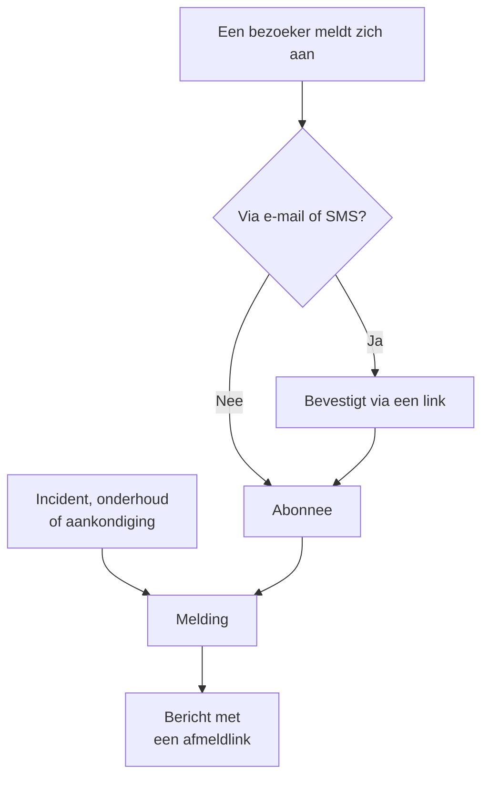

# Abonnees en aankondigingen

Een statuspagina is een plek waar mensen naartoe gaan. Abonnees zijn de mensen die dat liever niet hoeven te doen: ze geven u één keer een e-mailadres, een telefoonnummer, een Slack-webhook of een HTTP-endpoint, en daarna komen uw updates naar hen toe.

Aankondigingen zijn de andere helft van hetzelfde werk. Een monitor kan uw bezoekers vertellen dat de checkout 500-fouten geeft; geen enkele monitor kan hun vertellen dat u zaterdag databases migreert, dat een externe leverancier een slechte dag heeft of dat het incident waarover ze gisteren lazen helemaal is afgerond. Aankondigingen zijn het vrije-tekstkanaal voor alles wat uw controles niet kunnen zien, en ze gaan naar dezelfde lijst met abonnees.

Deze pagina behandelt beide: de vijf abonnementskanalen en hoe bezoekers zich aanmelden, waarover abonnees bericht kunnen kiezen te krijgen, de stromen voor dubbele opt-in en afmelden, het e-mailrapport dat abonnees elke maand kunnen krijgen, en hoe aankondigingen worden geschreven, gepland en als sjabloon worden opgeslagen.

:::cards
- [Abonnementskanalen](#abonnementskanalen): De kanalen waarop bezoekers zich kunnen aanmelden, en de pagina waarop ze dat doen.
- [Wat abonnees te horen krijgen](#waarover-abonnees-bericht-krijgen): Aankondigingen, onderhoud, incidenten en episoden, en de bewerkingen daarvan.
- [Controleren wat er is verzonden](#controleren-wat-er-is-verzonden): De status van elke melding, en Opnieuw proberen en Opnieuw verzenden.
- [Aankondigingen](#aankondigingen): Een bericht plaatsen op een of meer statuspagina's.
:::

## Hoe het werkt



Elke statuspagina heeft haar eigen abonnees. Een bezoeker meldt zich aan op de pagina **Abonneren** van de statuspagina, waar een e-mailadres of telefoonnummer eerst met een link bevestigt voordat het iets ontvangt, of uw team voegt de bezoeker toe in het dashboard. Vanaf dan meldt elk incident, elke geplande onderhoudsgebeurtenis en elke aankondiging die de pagina bereikt het aan haar abonnees, elk via het kanaal waarmee ze zich hebben aangemeld, en elk bericht bevat de link waarmee het abonnement wordt opgezegd.

## Abonnementskanalen

Een statuspagina ondersteunt vijf kanalen. Die, en de pagina waarop bezoekers zich aanmelden, worden op één plek ingeschakeld: de kaart **Kanalen** onder **Statuspagina's → uw pagina → Abonnees → Abonneeinstellingen**. Elke schakelaar wordt opgeslagen zodra u hem omzet:

- **Abonneepagina weergeven** (`showSubscriberPageOnStatusPage`) — standaard aan. Zet het item **Abonneren** in de navigatiebalk van de statuspagina, waar bezoekers zich aanmelden via de kanalen hieronder.
- **E-mail** (`enableEmailSubscribers`) — standaard aan. Al het andere staat uit totdat u het aanzet.
- **SMS** (`enableSmsSubscribers`) — standaard uit. Op OneUptime Cloud wordt elke SMS betaald uit het SMS- en belsaldo van het project, tenzij de pagina een eigen **Twilio-configuratie** heeft (zie [hieronder](#e-mailvoettekst-eigen-smtp-en-twilio)). Inschakelen vereist ook dat **SMS** voor het project aan staat, in de kaart **Meldingskanalen** onder **Projectinstellingen > Meldingen > Meldingsinstellingen**, wat een projecteigenaar, een **Factureringsbeheerder** of iemand met **Manage Billing** kan doen.
- **Slack** (`enableSlackSubscribers`) — standaard uit.
- **Microsoft Teams** (`enableMicrosoftTeamsSubscribers`) — standaard uit.
- **Webhook** (`enableWebhookSubscribers`) — standaard uit.

De schakelaars bepalen hoe bezoekers zich zelf kunnen aanmelden, en de statuspagina weigert een aanmelding via een kanaal dat uit staat. Ze houden geen meldingen tegen: abonnees die uw team in het dashboard, met de API of via een workflow toevoegt, krijgen updates ongeacht welke kanalen aan staan.

Op OneUptime Cloud staat bij een schakelaar die uw abonnement niet bevat de naam van het abonnement: **Growth** voor **SMS** en **Abonneepagina weergeven**, **Scale** voor **Slack**, **Microsoft Teams** en **Webhook**. Een kanaal uitzetten werkt op elk abonnement, dus een kanaal dat tijdens een proefperiode is aangezet, kan altijd weer uit; de schakelaar vermeldt dat eronder.

Elk kanaal heeft ook een eigen lijst in het zijmenu van de statuspagina, onder **Abonnees**: **E-mail-abonnees**, **SMS-abonnees**, **Slack-abonnees**, **Microsoft Teams-abonnees** en **Webhook-abonnees**. Daar ziet u wie er is aangemeld, voegt u iemand handmatig toe met **Abonnee toevoegen** of laat u voor uzelf een **Interne notitie** (`internalNote`) achter bij een bepaalde abonnee, die alleen uw team ziet. Zolang een kanaal uit staat, vermeldt de bovenkant van de lijst dat, met de schakelaar van het kanaal er direct bij, zodat u het kunt aanzetten zonder de lijst te verlaten.

**Eén schakelaar is niet genoeg.** Het item **Abonneren** in de navigatiebalk van de statuspagina verschijnt alleen wanneer **Abonneepagina weergeven** aan staat *en* minstens één kanaal aan staat. Als u **E-mail** aanzet maar **Abonneepagina weergeven** uit laat, kunnen bezoekers het formulier niet bereiken.

**Een agenda in plaats daarvan.** Bezoekers die uw gepland onderhoud alleen in hun eigen agenda willen, hoeven zich niet te abonneren: **Abonneren op agenda** op de pagina **Geplande gebeurtenissen** voegt het toe aan Google Agenda, Apple Agenda of Outlook, en de agenda houdt zichzelf bij. Er wordt niets verstuurd, het hangt niet af van de kanalen hierboven, en een privépagina biedt het niet aan. Zie [Onderhoudsagenda](/docs/scheduled-maintenance/calendar#de-agenda-van-een-statuspagina).

## Alle meldingen uitzetten

De eerste kaart op **Abonneeinstellingen**, **Meldingen**, bevat **Meldingen naar abonnees sturen** (`sendSubscriberNotifications`), standaard aan, die wordt opgeslagen zodra u hem omzet. Staat hij uit, dan stuurt de statuspagina haar abonnees niets: geen melding over een incident, episode, gepland onderhoud of aankondiging, geen notitie of postmortem en geen e-mailrapport, wat haar kanalen en gebeurtenistypen ook zeggen. Haar abonnees blijven bewaard, en bezoekers kunnen zich nog steeds abonneren zolang de pagina **Abonneren** en een kanaal aan staan; een nieuwe e-mailabonnee krijgt nog steeds de e-mail die het abonnement bevestigt. Er wordt niets achtergehouden om later te verzenden: zet u hem weer aan, dan vertelt de pagina haar abonnees over wat er vanaf dat moment gebeurt.

Zolang hij uit staat, vermeldt de bovenkant van elke abonneelijst dat, met een link terug naar **Abonneeinstellingen**. De samenvatting van wie er bericht krijgt, bij een incident of een openbare notitie, noemt de pagina als een pagina die geen meldingen naar haar abonnees stuurt, en het statusbericht van een melding en de vermelding ervan in de feed zeggen waarom de pagina is overgeslagen. Het werkt op elk abonnement. Een testrapport dat naar een adres wordt gestuurd dat u invoert, wordt nog steeds verzonden.

## Wie zich kan abonneren

De kaart **Wie zich kan abonneren**, ook op **Abonneeinstellingen**, beperkt de meldingen van een pagina tot de mensen voor wie de pagina bedoeld is:

- **Alleen privégebruikers kunnen zich abonneren** (`limitSubscribersToPrivateUsers`), standaard uit, wordt opgeslagen zodra u hem omzet. Staat hij aan, dan kunnen alleen de [privégebruikers](/docs/status-pages/index#privégebruikers) van de pagina, of ze nu handmatig zijn toegevoegd, met SSO zijn ingelogd of door SCIM zijn ingericht, zich abonneren, via e-mail en met het adres waarmee ze inloggen. De pagina **Abonneren** vult dat adres in, laat het niet wijzigen en biedt geen ander kanaal aan. Uw team kan alleen het adres van een privégebruiker toevoegen, en geen SMS-, Slack-, Microsoft Teams- of webhookabonnee. Een abonnee wiens adres nu niet van een privégebruiker van de pagina is, of het nu een abonnee is die is toegevoegd voordat u hem aanzette of een lezer die sindsdien handmatig of door SCIM is verwijderd, krijgt niets en wordt niet meegeteld. Op een openbare pagina logt niemand in, dus zolang hij daar aan staat, kan alleen uw team abonnees toevoegen.
- **Toegestane e-maildomeinen** (`allowedSubscriberEmailDomains`) bevat de domeinen waarop het adres van een e-mailabonnee mag liggen, één per regel, zoals `acme.com`. Een adres op een subdomein komt ook overeen (`eu.acme.com` voor `acme.com`), maar niet een adres dat alleen op dezelfde letters eindigt (`evilacme.com`). Aanmeldingen en toevoegingen op elk ander domein worden geweigerd, en een e-mailabonnee die al op een ander domein zit, krijgt niets. Laat het veld leeg om elk domein toe te staan. SMS-, Slack-, Microsoft Teams- en webhookabonnees hebben geen domein en worden er niet door beïnvloed. Typ de lijst en kies **Domeinen opslaan**: een item dat geen domein is, wordt genoemd voordat er iets wordt opgeslagen, en de lijst wordt in kleine letters opgeslagen, één domein per regel, tot 100 domeinen.

Geen van beide instellingen verwijdert een abonnee, en ze uitzetten stuurt weer naar iedereen. Op OneUptime Cloud heeft het aanzetten van een van beide het abonnement **Scale** nodig; ze uitzetten werkt op elk abonnement. Zelf gehost hoort het inschakelen bij de Enterprise Edition: in de Community Edition blijven beperkingen die al aan staan gelden en kunnen ze alleen worden uitgeschakeld.

## Wat een bezoeker op de pagina Abonneren ziet

De pagina **Abonneren** heeft een submenu met één tabblad per ingeschakeld kanaal; met maar één kanaal aan is er geen submenu, alleen het formulier van dat kanaal. Elk tabblad vraagt om het minimum dat het nodig heeft:

| Tabblad | Adres | Kop | Wat het vraagt |
| --- | --- | --- | --- |
| **E-mail** | `/subscribe/email` | **Abonneren via e-mail** | **Uw e-mailadres**, met het voorbeeld `subscriber@company.com`. |
| **SMS** | `/subscribe/sms` | **Abonneren via SMS** | **Uw telefoonnummer**, met het voorbeeld `+11234567890`. |
| **Slack** | `/subscribe/slack` | **Abonneren via Slack** | **Slack-werkruimtenaam** (gebruikt voor validatie) en **URL van inkomende Slack-webhook**, met het voorbeeld `https://hooks.slack.com/services/...`. |
| **MS Teams** | `/subscribe/microsoft-teams` | **Abonneren via Microsoft Teams** | **Naam Microsoft Teams-werkruimte** en **URL van inkomende Microsoft Teams-webhook**, met het voorbeeld `https://outlook.office.com/webhook/...`. |
| **Webhooks** | `/subscribe/webhooks` | **Abonneren via webhook** | **Webhook-URL**, met het voorbeeld `https://example.com/webhook`. Bij elke gebeurtenis op de statuspagina wordt er een JSON-`POST`-verzoek naartoe gestuurd. |

De verzendknop heet **Abonneren**. Een aanmelding via Slack, Microsoft Teams of webhook toont *U bent succesvol geabonneerd.* Een aanmelding via SMS toont *We hebben een sms naar dit telefoonnummer gestuurd. Open de link erin om uw abonnement te bevestigen.* Een aanmelding via e-mail meldt dat er een bevestigingslink is verzonden en dat u de spammap moet controleren als die niet aankomt (zie [Dubbele opt-in bij e-mail](#dubbele-opt-in-bij-e-mail)). De tabbladen **E-mail**, **SMS**, **Slack** en **MS Teams** hebben ook de splitsing **Nieuw abonnement** / **Bestaand abonnement beheren**, zodat iemand die al is aangemeld bij zijn voorkeuren kan komen zonder naar een oud bericht te zoeken.

## Limieten voor aanmeldingen en links

Elke aanmelding stuurt haar contact meteen een bericht, een bevestigingsmail, een SMS, een Slack- of Microsoft Teams-bericht of een webhook-aanroep, en **Beheerlink verzenden** doet dat ook. Zodat niemand een statuspagina kan gebruiken om berichten te sturen naar mensen die er niet om hebben gevraagd, of om de SMS-kosten van uw project op te drijven, zijn beide beperkt per netwerk van elke bezoeker en per contact. De limieten liggen ver boven wat mensen doen: een heel kantoor kan zich tijdens een incident samen aanmelden.

| Wat beperkt is | Limiet |
| --- | --- |
| Aanmeldingen vanaf één netwerk | 60 in 15 minuten |
| Aanmeldingen en beheerlinks via SMS vanaf één netwerk, samen | 10 in 15 minuten |
| Beheerlinks die vanaf één netwerk worden aangevraagd | 30 in 15 minuten |
| Aanmeldingen van één e-mailadres, telefoonnummer, Slack- of Microsoft Teams-kanaal of webhook, op alle statuspagina's samen | 10 in een uur |
| Beheerlinks voor één e-mailadres of telefoonnummer op alle statuspagina's samen, of voor één Slack- of Microsoft Teams-werkruimtenaam op één statuspagina | 5 in een uur |

Boven een limiet antwoordt de API `429` met een `Retry-After`-header, in seconden, en krijgt de bezoeker te horen dat er te veel aanmeldingen of links vanaf zijn netwerk, of voor dat contact, zijn geweest en dat hij het later opnieuw moet proberen. Er wordt niets aangemaakt of verzonden, en uw project merkt er niets van: er wordt geen abonnee toegevoegd, en er wordt geen bericht verzonden of betaald. De limieten voor beheerlinks tellen elke aanvraag, of er nu een abonnement overeenkomt of niet, zodat ze niet te gebruiken zijn om uit te vinden wie geabonneerd is. Een e-mailadres wordt geteld hoe het ook geschreven is, in hoofdletters, met een `+tag` of, voor Gmail, met punten, en een telefoonnummer hoe het ook getypt is. Een aanmelding noemt één contact, een e-mailadres, een telefoonnummer, een Slack- of Microsoft Teams-kanaal of een webhook: een lijst met adressen, of een tweede contact, wordt geweigerd.

Elke limiet per netwerk telt ook de adressen van één IPv6 /64 samen, met tien keer haar getal. De vensters zijn vast, niet glijdend. Als de rate limiter niet bereikbaar is, gaan aanmeldingen en beheerlinks via e-mail, Slack, Microsoft Teams en webhook ongeteld door, en die via SMS worden met `503` geweigerd tot hij terug is, omdat elke SMS betaald wordt. Een abonnement wijzigen of opzeggen via de eigen link is nooit beperkt.

**Eén abonnement per contact.** Een statuspagina neemt elk e-mailadres, telefoonnummer en webhookadres één keer aan, webhooks van Slack en Microsoft Teams inbegrepen. Een e-mailadres is hetzelfde in hoofdletters, een telefoonnummer hoe het ook wordt ingetypt (`+14155550100`, `14155550100` en `0014155550100` zijn één nummer), en een webhookadres of de host nu in hoofdletters staat, met de standaardpoort of een fragment, of met letters in procentcodering. Een bezoeker die een contact opnieuw aanmeldt, hoort dat het al geabonneerd is, of, zolang het abonnement op bevestiging wacht, dat de link om het te bevestigen is verstuurd, en er wordt niets verstuurd. Voegt uw team het opnieuw toe, of wijzigt het een abonnee naar dat contact, dan wordt dat geweigerd, net als het weer aanzetten van een opgezegd abonnement terwijl een ander abonnement dat contact heeft. Abonnees van daarvoor blijven bestaan: waar één nummer onder twee schrijfwijzen is geabonneerd, verwijdert u het abonnement dat u niet nodig hebt.

**Wat uw team verstuurt, telt ook.** Niets beperkt hoe snel uw team abonnees toevoegt, in het dashboard, in bulk, via de API of met een workflow. Maar het bericht dat een toegevoegde abonnee krijgt, de e-mail die om bevestiging vraagt of het bericht dat zegt dat die geabonneerd is, telt mee voor de 10 aanmeldingen per uur van dat contact, en daarboven wordt die toevoeging met `429` geweigerd. Een abonnee die zonder bericht wordt toegevoegd, wordt nooit geteld: **Nu abonneren** voor een e-mailadres, of **Een welkomstbericht sturen** uitgeschakeld voor de andere kanalen. Als de rate limiter niet bereikbaar is, gaan de toevoegingen van uw team ongeteld door.

Een privégebruiker die op de aanmeldpagina van de statuspagina een link vraagt om het wachtwoord opnieuw in te stellen, is op dezelfde manier beperkt: 5 resetmails naar één adres in een uur, op alle statuspagina's samen, en 30 vanaf één netwerk in 15 minuten. Een uitnodiging, voor een privéstatuspagina of voor een project, wordt ook per adres geteld: 10 naar één adres in een uur, beide soorten samen.

Op een zelf gehoste installatie wijzigen deze omgevingsvariabelen van de OneUptime-app de limieten:

| Variabele | Standaard | Wat ze instelt |
| --- | --- | --- |
| `PUBLIC_MESSAGE_RATE_LIMIT_WINDOW_SECONDS` | `900` | Het venster van de limieten per netwerk, in seconden. |
| `PUBLIC_MESSAGE_RATE_LIMIT_PER_CONTACT_WINDOW_SECONDS` | `3600` | Het venster van de limieten per contact, in seconden. |
| `PUBLIC_MESSAGE_RATE_LIMIT_STATUS_PAGE_SIGN_UPS_PER_IP` | `60` | Aanmeldingen vanaf één adres per venster. |
| `PUBLIC_MESSAGE_RATE_LIMIT_TEXT_MESSAGES_PER_IP` | `10` | Aanmeldingen en beheerlinks via SMS vanaf één adres per venster, samen. |
| `PUBLIC_MESSAGE_RATE_LIMIT_STATUS_PAGE_MANAGE_LINKS_PER_IP` | `30` | Beheerlinks die vanaf één adres per venster worden aangevraagd. |
| `PUBLIC_MESSAGE_RATE_LIMIT_STATUS_PAGE_SIGN_UPS_PER_CONTACT` | `10` | Aanmeldingen van één contact per venster. |
| `PUBLIC_MESSAGE_RATE_LIMIT_STATUS_PAGE_MANAGE_LINKS_PER_CONTACT` | `5` | Beheerlinks voor één contact per venster. |
| `PUBLIC_MESSAGE_RATE_LIMIT_STATUS_PAGE_PASSWORD_RESETS_PER_IP` | `30` | Wachtwoordresets van privégebruikers die vanaf één adres per venster worden aangevraagd. |
| `PUBLIC_MESSAGE_RATE_LIMIT_STATUS_PAGE_PASSWORD_RESETS_PER_CONTACT` | `5` | Resetmails van privégebruikers naar één adres per venster. |
| `PUBLIC_MESSAGE_RATE_LIMIT_INVITATIONS_PER_CONTACT` | `10` | Uitnodigingen naar één adres per venster, voor privéstatuspagina's en projecten samen. |

Noch `config.env` noch de waarden van de Helm-chart geven ze door: voeg ze zelf toe aan de omgeving van de container `app`, met `app.extraEnv`, of de chartbrede `extraEnv`, in de Helm-chart, of in een `docker-compose.override.yml` voor Docker Compose. `TRUSTED_PROXY_HOPS` bepaalt welk adres de limieten per netwerk tellen.

## Abonnees zelf resources en gebeurtenistypen laten kiezen

Standaard krijgt een abonnee alles op de pagina. Twee schakelaars in de kaart **Keuzes voor abonnees** op **Abonneeinstellingen** veranderen dat, en elk wordt opgeslagen zodra u hem omzet:

- **Abonnees toestaan resources te kiezen** (`allowSubscribersToChooseResources`) — standaard uit. Zet het aan en het aanmeldformulier krijgt een schakelaar **Abonneren op alle bronnen**; zet die uit en **Selecteer bronnen om op te abonneren** verschijnt, zodat de bezoeker afzonderlijke resources kan kiezen.
- **Abonnees toestaan gebeurtenistypen te kiezen** (`allowSubscribersToChooseEventTypes`) — standaard uit. Dezelfde vorm: een schakelaar **Abonneren op alle gebeurtenistypen**, en **Selecteer gebeurtenistypen om op te abonneren** eronder wanneer die uit staat.

Met een van beide aan blijft het aanmeldformulier één pagina. Onder waarheen de updates moeten (het e-mailadres, het telefoonnummer, de werkruimte of de webhook) komt **Voorkeuren**, ingeklapt tot één regel die zegt wat de bezoeker gaat krijgen. Elke resource en elk soort gebeurtenis is al gekozen, dus de regel begint als "U ontvangt alle updates van deze statuspagina.", en een bezoeker die alles wil, drukt op **Abonneren** zonder het te openen. Ieder ander opent **Voorkeuren** en beperkt de resources of gebeurtenistypen; weer ingeklapt volgt de regel wat er is gekozen ("U ontvangt alleen updates over de bronnen die u hebt gekozen."). Met beide uit is er geen **Voorkeuren**: het formulier is waarheen de updates moeten, en dan **Abonneren**.

De pagina **Abonnement bijwerken** (zie hieronder) toont dezelfde keuzes opengeklapt, want die wijzigen is waarvoor een abonnee daar komt.

De gebeurtenistypen zijn `Incident`, `Announcement` en `Scheduled Event`.

**Een monitorgroep staat voor elke monitor erin.** Een resource op de pagina is een monitor of een monitorgroep, en een abonnee die een monitorgroep kiest, krijgt bericht over incidenten, geplande onderhoudsgebeurtenissen (inclusief hun notities) en aankondigingen voor elke monitor in de groep, precies alsof die monitor was gekozen, en zo toont de statuspagina ze ook. Wie alleen andere resources heeft gekozen, krijgt geen bericht, en wie een monitor en de groep die hem bevat heeft gekozen, krijgt één melding, niet twee.

De keuzes komen in het record van de abonnee terecht als **Is Subscribed to All Resources** (`isSubscribedToAllResources`, standaard true), **Is Subscribed to All Event Types** (`isSubscribedToAllEventTypes`, standaard true), **Subscribed to Resources** en **Subscribed to Event Types**.

**Een abonnee kiest uit de resources van de eigen pagina.** **Subscribed to Resources** noemt resources van de eigen statuspagina van de abonnee, wie het ook schrijft: een bezoeker op de pagina, een teamgenoot in het dashboard, een API-sleutel of een workflow. Een bezoeker kiest uit wat de pagina hem toont, dus een resource waarvan de monitor is gearchiveerd, en die de pagina verbergt, kan hij niet kiezen. Een resource van een andere statuspagina, of een die de pagina voor een bezoeker verbergt, wordt geweigerd met de `400` die het veld en de ID noemt, net als een ID die nergens mee overeenkomt. Een wijziging vraagt alleen naar de resources die ze toevoegt, dus een abonnement houdt een resource die het al noemt, zoals een waarvan de monitor werd gearchiveerd nadat hij was gekozen. Een abonnee krijgt alleen via resources van de eigen pagina bericht over een gebeurtenis.

Handig voor: een pagina die meerdere producten dekt. Een klant die alleen uw API gebruikt, wil geen melding telkens wanneer de marketingsite hapert — laat hem de lijst zelf beperken in plaats van toe te kijken hoe hij zich helemaal afmeldt.

**Tijdzones abonnee** staat onder **Meer instellingen** op hetzelfde scherm (zie [hieronder](#e-mailvoettekst-eigen-smtp-en-twilio)).

## Dubbele opt-in bij e-mail

E-mailabonnees bevestigen altijd. Wanneer een abonnee met een e-mailadres wordt aangemaakt en niet al bevestigd werd aangemaakt, wordt **Is Subscription Confirmed** (`isSubscriptionConfirmed`) op `false` gezet en wordt er een **Subscription Confirmation Token** van 32 willekeurige tekens gegenereerd. OneUptime mailt dan een bevestigingslink in de vorm `{statusPageUrl}/confirm-subscription/{statusPageSubscriberId}?verification-token={token}`. De bezoeker komt op een pagina **Abonnement bevestigen** en ziet, zodra die is afgerond, *Abonnement succesvol bevestigd*.

Abonnees via Slack, Microsoft Teams en webhook slaan dit over, en SMS-abonnees die uw team toevoegt ook — ze worden aangemaakt met `isSubscriptionConfirmed` al op `true`. Voegt uw team onder **E-mail-abonnees** een e-mailabonnee toe, dan beslist **Bij het toevoegen**: **Nu abonneren** (de standaard: bevestigd, en er wordt niets verstuurd), **Nu abonneren en het laten weten** (bevestigd, en de e-mail dat ze geabonneerd zijn gaat eruit) of **Eerst om bevestiging vragen** (ze krijgen de bevestigingslink, zoals bij een aanmelding). **In bulk toevoegen** vraagt hetzelfde.

**Ook aanmeldingen via SMS worden bevestigd.** Een bezoeker die zich via SMS aanmeldt, krijgt één bericht: de bevestigingslink. Er wordt niets anders naar het nummer gestuurd tot de link is geopend, en het openen ervan stuurt per SMS het bericht dat ze geabonneerd zijn, met de link die het abonnement opzegt. Tot dan staat de abonnee op **Wacht op bevestiging**, en het SMS-logboek toont de link met de code vervangen door `[redacted]`. SMS-abonnees van daarvoor zijn al bevestigd.

**Een bevestigingslink werkt 24 uur.** De e-mail en de sms zeggen het. Later geopend bevestigt hij niets: de pagina **Abonnement bevestigen** zegt *Deze link om uw abonnement te bevestigen is verlopen of ongeldig. Een link werkt 24 uur nadat hij is verzonden. Abonneer opnieuw om een nieuwe te krijgen.* en biedt **Opnieuw abonneren** aan, en de API antwoordt `400`. De abonnee blijft onbevestigd, krijgt niets en staat in zijn lijst als **Link verlopen** in plaats van **Wacht op bevestiging**.

**Opnieuw aanmelden.** Zolang de link werkt, verstuurt het opnieuw aanmelden van hetzelfde e-mailadres of telefoonnummer op die statuspagina niets meer: de bezoeker hoort dat er al een link is verstuurd, en de API antwoordt `429` met een `Retry-After`-header. Een contact krijgt dus hoogstens één bevestigingslink per dag van een statuspagina, hoe vaak het ook wordt aangemeld. Is de link verlopen, dan houdt het abonnement zijn contact niet meer vast: een nieuwe aanmelding, of uw team dat het contact toevoegt, vervangt het, en een aanmelding krijgt een nieuwe link. Wie een contact als eerste aanmeldt, kan de eigenaar niet tegenhouden om zich te abonneren: de link gaat naar de eigenaar, en een dag later kan die een eigen link krijgen. Links die vóór deze wijziging zijn verstuurd, werken ook 24 uur na hun aanmelding.

**Onbevestigd betekent stil.** De query die abonnees voor een melding ophaalt, filtert op `isUnsubscribed: false` en `isSubscriptionConfirmed: true`. Een e-mailadres dat nooit op de link heeft geklikt, blijft in uw lijst **E-mail-abonnees** staan en ontvangt niets. Als iemand zweert dat hij is aangemeld maar niets ontvangt, controleer dan eerst die kolom.

Er is geen schakelaar om de e-mailbevestiging uit te zetten — die is onvoorwaardelijk voor iedereen die zich via de statuspagina aanmeldt. Een aparte kolom per abonnee, **Send You Have Subscribed Message** (`sendYouHaveSubscribedMessage`, standaard true), bepaalt de e-mail "u bent geabonneerd" die wordt verstuurd zodra een abonnee is bevestigd. In het dashboard stelt **Bij het toevoegen** haar in voor een e-mailabonnee, en **Een welkomstbericht sturen**, onder **Meer velden**, voor de andere kanalen.

## Een abonnement beheren en opzeggen

Elk bericht dat een abonnee krijgt, bevat een afmeldlink in de vorm `{statusPageUrl}/unsubscribe/{statusPageSubscriberId}-{token}`: onderaan een e-mail, in de tekst van een SMS, Slack- of Microsoft Teams-bericht, en als `unsubscribeUrl` in de payload van een webhook. Het token is een willekeurig geheim dat bij dat ene abonnement hoort, dus de link werkt zonder inloggen. Dat geldt ook voor een privé-statuspagina, waar al het andere een ingelogde bezoeker vereist.

Een SMS bevat dezelfde link, van een openbare statuspagina net als van een privé-statuspagina, en hetzelfde geldt voor de `{{unsubscribeUrl}}` van een aangepast SMS-sjabloon. Een link met alleen de ID van de abonnee zou korter zijn, maar elk projectlid dat de abonnee kan zien, kan diens ID lezen, dus zo'n link zou hem het abonnement laten wijzigen.

Het SMS-logboek (het tabblad **SMS** van **Meldingslogboeken**, op de statuspagina en in de projectinstellingen) bewaart de tekst van elke SMS, en meer projectleden kunnen dat lezen dan er abonnees kunnen beheren. Daarom toont het logboek een afmeld- of beheerlink waarin het token is vervangen door `[redacted]`, bijvoorbeeld `{statusPageUrl}/unsubscribe/{statusPageSubscriberId}-[redacted]`. Alleen de telefoon van de abonnee zelf krijgt de werkende link. Ook de API geeft het token van een nieuwe abonnee nooit terug, zelfs niet in het antwoord op het verzoek dat hem aanmaakte.

**De link openen verandert niets.** De pagina toont de naam en het logo van de statuspagina en het abonnement waarbij de link hoort: een volledig e-mailadres, een telefoonnummer waarvan alleen de laatste vier cijfers zichtbaar zijn, de naam van een Slack- of Microsoft Teams-werkruimte, of de host van een webhook. Ze vraagt *Wilt u geen meldingen meer ontvangen van deze statuspagina?* en alleen een druk op **Afmelden** zegt het abonnement op, zodat mailscanners en linkvoorbeelden die elke link in een bericht openen niemand kunnen afmelden. Verder wordt er niets van de pagina getoond, en geen van haar aangepaste JavaScript wordt uitgevoerd. Twee keer bevestigen, of de link van een al opgezegd abonnement openen, meldt alleen dat het is opgezegd. Op een openbare statuspagina linkt de afmeldpagina ook naar de pagina **Abonnement bijwerken** van de abonnee, om in plaats daarvan te kiezen welke meldingen hij ontvangt.

Ook de pagina **Abonnement bijwerken**, `{statusPageUrl}/update-subscription/{statusPageSubscriberId}-{token}`, opent alleen met het token van het abonnement: de ID van de abonnee alleen opent niets. Ze heeft als titel **Abonnement bijwerken** en vertelt de bezoeker dat hij daar zijn voorkeuren kan bijwerken of zich kan afmelden. Ze bevat:

- De keuzelijsten voor resources en gebeurtenistypen die de pagina toestaat.
- Een schakelaar **Afmelden**, beschreven als afmelden voor alle resources. Die schrijft **Is afgemeld** (`isUnsubscribed`, standaard false).
- Een verzendknop met **Abonnement bijwerken**; opslaan toont *Uw wijzigingen zijn opgeslagen.*

Op een privé-statuspagina vereist ze een ingelogde bezoeker, net als de rest van de pagina. Net als de afmeldpagina voert ze geen van de aangepaste JavaScript van de pagina uit, en toont ze de standaardkoptekst en -footer in plaats van aangepaste koptekst- of footer-HTML. Wie de link kwijt is, gebruikt **Bestaand abonnement beheren** op de pagina **Abonneren** en drukt op **Beheerlink verzenden**. De link gaat naar het abonnement zelf — het e-mailadres, het telefoonnummer of het Slack- of Microsoft Teams-kanaal —, nooit naar een adres uit het verzoek, en de pagina antwoordt hetzelfde of er nu een abonnement overeenkwam of niet, zodat ze niet kan worden gebruikt om uit te zoeken wie er is aangemeld. Dat bericht linkt naar de pagina **Abonnement bijwerken**, en geeft een aangepast sjabloon beide links: `manageSubscriptionUrl` en `unsubscribeUrl`.

De endpoints achter dit alles zijn `POST .../subscribe/:statusPageId`, `POST .../manage-subscription/:statusPageId`, `POST .../get-subscription/:statusPageId/:subscriberId/:token`, `PUT .../update-subscription/:statusPageId/:subscriberId/:token`, en `GET` en `POST .../unsubscribe/:statusPageId/:subscriberId/:token`. De afmeld-`GET` beschrijft alleen de link. De `POST` zegt het abonnement op, wat de body ook is, inclusief de body `List-Unsubscribe=One-Click` van een afmeldverzoek met één klik. Elk endpoint dat een token krijgt, geeft hetzelfde antwoord voor een ontbrekend of verkeerd token, een verwijderde abonnee en een abonnee van een andere statuspagina, zodat geen ervan kan worden gebruikt om uit te zoeken wie er is aangemeld.

Afmelden zet een vlag om in plaats van een rij te verwijderen, dus het record blijft in de kanaallijst staan met **Is afgemeld** ingesteld — handig als u later moet uitleggen waarom een bepaald adres geen mail meer ontving. Het legt ook **Uitgeschreven op** (`unsubscribedAt`) vast, wie het abonnement ook heeft opgezegd: de abonnee via de link of de pagina **Abonnement bijwerken**, of een teamgenoot in het dashboard of via de API. Om er meerdere tegelijk af te melden, selecteert u ze in een abonneelijst en kiest u **Afmelden** onder **Bulkacties**. Elke abonneelijst heeft een kolom en een filter **Uitgeschreven op**. De **Status** van een abonnee weer op **Geabonneerd** zetten wist het. Abonnementen die zijn opgezegd voordat OneUptime dit vastlegde, hebben geen datum.

Een link met alleen de ID van de abonnee opent niets meer. Een link **Abonnement bijwerken** in een ouder bericht, `{statusPageUrl}/update-subscription/{statusPageSubscriberId}`, opent een pagina die zegt dat de link is verlopen, met **Nieuwe link aanvragen**, dat naar de pagina **Abonneren** leidt. Heel oude berichten bevatten `/api/status-page-subscriber/unsubscribe/{statusPageSubscriberId}`, die vroeger afmeldde zodra hij werd geopend. Die verandert niets meer: hij leidt naar de afmeldpagina, die zegt dat de link verouderd is en dat de link uit een recent bericht moet worden gebruikt.

### Gedeelde adressen en mailinglijsten

Iedereen die een mailbox kan lezen, kan die afmelden. Voor een adres dat iemand zelf heeft aangemeld, is dat precies de bedoeling. Voor een adres dat uw team heeft toegevoegd, zoals de mailinglijst van een locatie, bijvoorbeeld `site03-all@`, betekent het dat één lezer iedereen op de lijst van de pagina kan halen vóór de volgende storing. Dus:

- **Voeg mensen waar mogelijk toe met hun eigen adres.** Het formulier **In bulk toevoegen** en het formulier voor e-mailabonnees zeggen dat, in de beschrijving van het e-mailveld.
- **Het team krijgt bericht.** Een abonnee die uw team heeft toegevoegd, is er een die is toegevoegd vanuit het dashboard, met een API-sleutel (de REST API, Terraform, een script) of door een workflow; de API leest dat als **Is Added By Team** (`isAddedByTeam`). Wanneer zo'n abonnee zich afmeldt, via de link of de pagina **Abonnement bijwerken**, krijgen de eigenaren van de statuspagina (haar eigenaar-gebruikers en de leden van haar eigenaar-teams) elk één e-mail die de abonnee noemt, met een link naar de abonneelijst van de pagina. De teamgenoot die de abonnee heeft toegevoegd, krijgt die ook, als het een teamgenoot was. Een pagina zonder eigenaren mailt alleen die teamgenoot, dus een abonnee die een API-sleutel of een workflow aan een pagina zonder eigenaren heeft toegevoegd, wordt niet gemeld. Mensen die zich zelf op de statuspagina hebben aangemeld, worden nooit gemeld. Abonnees die een API-sleutel of een workflow heeft toegevoegd voordat OneUptime dit vastlegde, zijn niet te onderscheiden van aanmeldingen en worden evenmin gemeld.
- **De abonneelijsten tonen het.** Boven elke lijst noemt een melding de door uw team toegevoegde abonnees die zich in de afgelopen 30 dagen hebben afgemeld.

De afmeldpagina waarschuwt de lezer van zo'n abonnement voordat hij bevestigt: als het een gedeeld adres is, stopt afmelden de meldingen voor iedereen die ze ontvangt, en krijgt het team bericht.

## Waarover abonnees bericht krijgen

Abonnees krijgen bericht over de drie gebeurtenistypen hierboven, maar elke bron heeft een eigen schakelaar, zodat er niets per ongeluk wordt verzonden.

### Meldingen bij aankondigingen

De aankondiging zelf heeft **Should subscribers be notified?** (`shouldStatusPageSubscribersBeNotified`), op het aanmaakformulier zichtbaar als het selectievakje **Statuspagina-abonnees op de hoogte stellen** onder **Schema & meldingen**, en standaard aan. Abonnees krijgen één keer bericht, wanneer de aankondiging zichtbaar wordt, dus dit wordt bepaald bij het aanmaken van de aankondiging; een bewerking kan het niet wijzigen. Een workflow die het later schrijft, slaat het alleen op: het ongewijzigd terugschrijven verstuurt de aankondiging nooit opnieuw, het aanzetten verstuurt haar niet, en het uitzetten voordat de melding is verzonden, slaat de melding over. Als de aankondiging monitoren noemt onder **Getroffen monitoren**, wordt de melding tot die monitoren beperkt: op een pagina waar abonnees resources kiezen, gaat ze naar de abonnees van die monitoren, van de monitorgroepen die ze bevatten en van alle resources. Laat het leeg en alle abonnees krijgen bericht. Op een statuspagina die geen van die monitoren vermeldt, niet rechtstreeks en niet via een groep, is de aankondiging voor iedereen die die pagina leest, dus krijgt elke abonnee daar die aankondigingen ontvangt bericht.

### Geplande onderhoudsgebeurtenissen

Een geplande onderhoudsgebeurtenis heeft een eigen set kolommen voor abonnees: **Should subscribers be notified when event is created?**, **Should subscribers be notified when event is changed to ongoing?**, **Should subscribers be notified when event is changed to ended?**, plus **Subscriber notifications before the event** en **Next subscriber notification before the event at?** voor vooraankondigingen. **Statuspagina's** op de gebeurtenis bepaalt op welke pagina's ze verschijnt, **Should be visible on status page?** bepaalt of ze überhaupt verschijnt, en **Publiceren op statuspagina op**, als ze er een heeft, vanaf wanneer: tot dan staat ze op geen van die pagina's, en hun abonnees krijgen op dat moment bericht dat ze gepland is in plaats van wanneer ze wordt gemaakt.

**Geplande onderhoudsgebeurtenis aanmaken** loopt door twee stappen en dan een controle, zoals **Incident melden** dat doet:

1. **Gebeurtenis** — **Titel**, **Beschrijving**, **Begint op** en **Eindigt op**. Een nieuwe gebeurtenis begint op het volgende hele uur van uw klok en duurt een uur; wijzig de tijden alleen als ze niet kloppen. **Begint op** verplaatsen verplaatst **Eindigt op** mee, zodat het venster zijn lengte houdt, en de gebeurtenis moet eindigen nadat ze begint. **Eigenaren** en **Labels** wachten onder **Meer velden**.
2. **Getroffen middelen** — eerst **Monitoren**, en direct daaronder **Monitorstatus wijzigen naar** zodra er een monitor is gekozen: de monitoren gaan naar die status wanneer de gebeurtenis begint, en weer naar operationeel wanneer ze eindigt. Dan **Andere getroffen resources**: de hosts, clusters, containerhosts, databases, IoT-vloten, netwerklocaties en services die het onderhoud raakt. Dan **Gebeurtenis weergeven op deze statuspagina's**, en dan **Meldingen aan abonnees**, ingeklapt tot één regel die zegt wat er gaat gebeuren. Standaard staat er "Getoond op haar statuspagina's zodra ze is opgeslagen. Abonnees van de statuspagina's van de gebeurtenis krijgen een melding wanneer deze wordt gepland, wanneer deze begint en wanneer deze eindigt." Klap het open om onder **Publiceren op statuspagina's** te kiezen wanneer de gebeurtenis wordt gepubliceerd, en om **Wanneer de gebeurtenis wordt gepland**, **Wanneer de gebeurtenis begint**, **Wanneer de gebeurtenis eindigt** en **Herinneringen vóór de gebeurtenis** te wijzigen; de regel volgt wat u kiest, en de controlestap toont haar ook.

Vanaf het tabblad **Geplande onderhoud** van een host, een Kubernetes-, Proxmox-, Ceph- of Docker Swarm-cluster, een Docker- of Podman-host, een vCenter, een storage-array, een IoT-vloot, een database, een service of een netwerklocatie opent **Geplande onderhoudsgebeurtenis aanmaken** (en **Maken op basis van sjabloon**) hetzelfde formulier met die resource al gekozen onder **Andere getroffen resources**, en de kruimelpaden leiden terug naar dat tabblad. Het tabblad **Geplande onderhoud** van een inventarisitem kiest de host, de service of het Kubernetes-cluster waarnaar het item verwijst, en de kruimelpaden leiden terug via het tabblad van die resource.

Alleen de titel hoeft te worden getypt: al het andere heeft een standaardwaarde, dus **Volgende** loopt door de andere stappen zonder iets te vragen, en **Geplande onderhoudsgebeurtenis aanmaken** staat op de controle aan het einde. Niemand krijgt bericht totdat u een statuspagina kiest. De drie instellingen **Wanneer de gebeurtenis…** worden gekozen bij het aanmaken van de gebeurtenis, en een workflow die **Wanneer de gebeurtenis wordt gepland** later schrijft, slaat het alleen op: ongewijzigd teruggeschreven of aangezet verstuurt het niets, en uitgezet voordat de melding 'gepland' is verzonden, wordt die melding overgeslagen. De knop **Bewerken** op de kaart **Maintenance Details** van de gebeurtenis wijzigt de titel, het venster en de labels (**Gebeurtenis**) en de statuspagina's, wanneer ze wordt gepubliceerd en de herinneringen (**Statuspagina's**). De knop **Bewerken** op de kaart **Getroffen resources** vraagt het op dezelfde manier als het formulier: **Monitoren**, dan **Monitorstatus wijzigen naar** zodra er een monitor is, dan **Andere getroffen resources**, en de kaart toont de status onder de monitoren. Iedereen die de gebeurtenis kan bewerken, kan de monitorstatus wijzigen totdat de gebeurtenis begint. Wanneer ze begint — op haar begintijd, of wanneer iemand haar handmatig, vanuit Slack of Microsoft Teams of via de API naar een lopende status zet —, gaan haar monitoren naar de status die ze op dat moment heeft, en dat geldt ook voor monitoren die worden toegevoegd terwijl ze loopt. Haar van **Scheduled** rechtstreeks naar een eigen status tussen **Ongoing** en **Ended** zetten, zoals "Verifying", start haar op dezelfde manier: haar monitoren gaan naar haar status, zoals ze in **Ongoing** zouden doen, en gaan weer naar operationeel wanneer ze eindigt. Vanaf dan kan de status niet meer worden gewijzigd: de **Bewerken** van de kaart toont hem alleen-lezen, met "De gebeurtenis is begonnen, dus dit kan niet meer worden gewijzigd.", en de API weigert een wijziging met "Change Monitor Status to can no longer be changed: this event has already started." De status terugschrijven die de gebeurtenis al heeft, wordt nog steeds geaccepteerd. Sjablonen voor gepland onderhoud (**Instellingen → Gebeurtenis-sjablonen**) gebruiken dezelfde stappen, met de naam van het sjabloon vooraan en het terugkerende schema aan het einde. Een sjabloon vraagt om **Monitorstatus wijzigen naar**, of het nu monitoren noemt of niet, omdat zijn status ook geldt voor de monitoren die worden gekozen wanneer er op basis ervan een gebeurtenis wordt gepland. De kaart **Getroffen resources** van een bestaand sjabloon vraagt het op dezelfde manier en toont de status die het sjabloon kiest, of **Monitoren behouden hun status.** wanneer het er geen kiest; iedereen die het sjabloon kan bewerken, kan het daar wijzigen.

**Welke statuspagina's?** Zodra de gebeurtenis monitoren noemt, worden de statuspagina's die ze tonen voorgesteld onder **Gebeurtenis weergeven op deze statuspagina's**: "Statuspagina's die de getroffen monitoren tonen:" gevolgd door de naam van elke pagina. Klik op een naam om die pagina toe te voegen, of op **Alles toevoegen** om ze allemaal toe te voegen. Een pagina telt mee wanneer ze een van de monitoren vermeldt, rechtstreeks of via een monitorgroep. Alleen de statuspagina's die u kunt zien worden voorgesteld, en gearchiveerde pagina's en pagina's die geen geplande onderhoudsgebeurtenissen tonen, blijven weg. Er wordt niets voor u gekozen: een statuspagina die u kiest, toont de gebeurtenis en brengt met de standaardmeldingen haar abonnees op de hoogte, dus die keuze blijft bij u. De stap **Statuspagina's** van de **Bewerken** van de gebeurtenis en de formulieren van een sjabloon voor gepland onderhoud stellen op dezelfde manier voor, op basis van de monitoren van de gebeurtenis of het sjabloon.

**Eigen statussen.** Een gebeurtenis loopt in **Ongoing** en in elke eigen status tussen **Ongoing** en **Ended** — een stap "Verifying", bijvoorbeeld. Een eigen status vóór **Ongoing** is nog niet begonnen, en een status na **Ended** — "Reviewing" — is voorbij. Alles wat vraagt of een gebeurtenis loopt, past deze ene regel toe. Zo'n gebeurtenis staat als lopend op haar statuspagina's — op het overzicht, op de eigen pagina van de gebeurtenis en in de RSS-feed — en in de lijsten **Ongoing** onder **Geplande onderhoud** en **Start**, hun menubadges en de tegel **Lopend onderhoud** op **Start**, en de Microsoft Teams-app vermeldt haar als lopend onderhoud. Haar monitoren blijven in onderhoud, de netwerklocaties en telemetriereeksen die ze dekt blijven gedempt, en SLO-burn-rate-waarschuwingen op haar monitoren worden tegengehouden. Op haar **Eindigt op** wordt ze beëindigd zoals een lopende gebeurtenis, en haar abonnees krijgen bericht als **Wanneer de gebeurtenis eindigt** aan staat. Haar van **Ongoing** of "Verifying" rechtstreeks naar een eigen status na **Ended** zetten, beëindigt haar zoals **Ended** dat doet: haar monitoren gaan weer naar operationeel, en de kop van de gebeurtenis toont hoe lang ze duurde. Haar van **Ongoing** naar "Verifying" zetten, of van **Ended** naar "Reviewing", start of beëindigt niets opnieuw. De plaats van een status is zijn plaats in de lijst op de pagina **Status gebeurtenis**, onder **Geplande onderhoud → Instellingen**.

**Wachten op de start, voorbij en voltooid.** Dezelfde plaats bepaalt de rest. Een gebeurtenis wacht op haar **Begint op** in **Scheduled** en in elke eigen status tussen **Scheduled** en **Ongoing** — een stap "Confirmed", bijvoorbeeld. Op haar begintijd start ze vanaf daar zoals ze vanaf **Scheduled** start: ze gaat naar **Ongoing**, haar monitoren gaan naar haar **Monitorstatus wijzigen naar**, haar eigenaren krijgen bericht en haar abonnees ook als **Wanneer de gebeurtenis begint** aan staat. Tot dan staat ze tussen de komende gebeurtenissen — op het overzicht, de pagina met geplande gebeurtenissen en de RSS-feed van haar statuspagina's, en wanneer iemand de Microsoft Teams-app om gepland onderhoud vraagt —, en de herinneringen vóór de gebeurtenis gaan nog steeds naar haar abonnees. Haar feed en de tijdlijn van haar statuspagina tonen zo'n status met de klok die ze voor **Scheduled** tonen. Een eigen status vóór **Scheduled** — een "Draft" of een goedkeuringsstap — is ook nog niet begonnen, maar wacht op een persoon: niets start daar een gebeurtenis op haar tijd, en ze staat niet bij de komende. Een gebeurtenis is voorbij in **Ended**, in **Completed** en in elke eigen status na **Ended**, en het **Overzicht** van de gebeurtenis behandelt haar overal als voorbij — haar kop, haar kaart **Metingen** en de tijdlijn die het toont. Ze is voltooid in **Completed** en in elke eigen status daarna — "Archived": dat is wat de herinneringen aan haar eigenaren stopt (**Remind until event is Completed**), waarvoor Slack en Microsoft Teams **Mark as Complete** weigeren, en wat haar feed en de tijdlijn van haar statuspagina als afgerond markeren. In **Ended**, of in "Reviewing" tussen **Ended** en **Completed**, is ze voorbij maar nog niet voltooid.

**Netwerklocaties volgen elke statuswijziging.** De netwerklocaties die een gebeurtenis dekt, tellen haar geplande storing niet mee tegen de locaties boven hen zolang ze loopt. Elke statuswijziging van de gebeurtenis berekent hun status meteen opnieuw, in beide richtingen — ook wanneer ze teruggaat, zoals gebeurt wanneer de vermelding van de status waarin ze staat uit haar **Statustijdlijn** wordt verwijderd: teruggezet van "Verifying" naar **Scheduled** stopt ze meteen met dempen in plaats van bij de volgende controleronde, die nog steeds elke vijf minuten draait als vangnet.

**Wat de feed vastlegt bij een bewerking.** Een bewerking voegt een vermelding **Scheduled Maintenance was updated.** toe aan de **Gepland Onderhoud Feed** van de gebeurtenis — ook geplaatst in haar Slack- en Microsoft Teams-kanalen — met een regel voor elk ding dat is gewijzigd: de titel, **Begint op**, **Eindigt op**, **Publiceren op statuspagina op**, de beschrijving, de herinneringen vóór de gebeurtenis, wat de gebeurtenis raakt, **Monitorstatus wijzigen naar**, de statuspagina's waarop ze wordt getoond en haar labels, elk met de nieuwe waarde. Een waarde die wordt opgeslagen zoals ze was, krijgt geen regel, dus de kaart **Maintenance Details** opslaan zonder iets te wijzigen — die stuurt elke keer de titel, het venster, de labels, de statuspagina's en de herinneringen mee — of een API-client, een workflow of Terraform die de gebeurtenis ongewijzigd terugschrijft, voegt helemaal geen vermelding toe. Een tijd is dezelfde wanneer hij hetzelfde moment aanduidt, hoe hij ook is geschreven — een tijd zonder tijdzone is UTC, zoals hij wordt opgeslagen —, en de herinneringen, de statuspagina's, de getroffen resources en de labels zijn in elke volgorde dezelfde verzameling. Alle herinneringen, statuspagina's of labels weghalen wordt vastgelegd als "No reminders before the event.", "Not shown on any status page." of "All labels removed.", en de laatste getroffen resource naast de monitoren weghalen — de laatste host, cluster of service, bijvoorbeeld — als "No other affected resources.". De herinneringsregel van de gebeurtenis wordt alleen opnieuw gekoppeld, en het wachten op haar volgende herinnering begint alleen opnieuw, wanneer haar labels veranderen of haar schakelaar **Herinneringen sturen** wordt omgezet. Een herinneringsregel (**Geplande onderhoud → Regels → Reminder Rules**) met **Terwijl het bezig is** telt de eerste herinnering vanaf de start van de gebeurtenis, dus **Begint op** naar een andere tijd verplaatsen verplaatst die herinnering mee zolang de start nog moet komen; de herinneringen van een regel die herinnert voordat de gebeurtenis begint, blijven waar ze zijn. De feed van een monitor legt een bewerking van zijn naam, beschrijving en labels op dezelfde manier vast.

Als een gebeurtenis wordt aangemaakt met **Wanneer de gebeurtenis wordt gepland** uit (onder **Meldingen aan abonnees** in de stap **Getroffen middelen** van het aanmaakformulier), beginnen nieuwe openbare notities erop met **Notify status page subscribers** uit, met een regel onder het selectievakje die uitlegt waarom. Dat geldt op de pagina **Openbare notities** van de gebeurtenis en in **Add Public Note** in de **Gepland Onderhoud Feed**, die dezelfde notitie-editor opent. Notities die zonder expliciete keuze worden geplaatst, volgen dezelfde instelling **Wanneer de gebeurtenis wordt gepland**: notities uit Slack en Microsoft Teams, workflows en API-verzoeken die `shouldStatusPageSubscribersBeNotifiedOnNoteCreated` weglaten. Een expliciete `true` of `false` blijft altijd behouden. **Wanneer de gebeurtenis wordt gepland** zet alleen de aankondiging uit die wordt verzonden wanneer de gebeurtenis wordt aangemaakt. Herinneringen (**Subscriber notifications before the event**, ingesteld met **Herinneringen vóór de gebeurtenis** op het aanmaakformulier) en de meldingen die **Wanneer de gebeurtenis begint** en **Wanneer de gebeurtenis eindigt** instellen, zijn aparte instellingen en worden nog steeds verzonden. Als abonnees op die manier al van de gebeurtenis hebben gehoord, bijvoorbeeld via een herinnering of de melding dat ze loopt, vink dan het vakje aan om hen over de notitie te informeren.

Het venster **Gepland onderhoud markeren als `<state name>`**, geopend met de knoppen bovenaan de pagina **Overzicht** van de gebeurtenis, heeft één selectievakje **Statuspagina-abonnees op de hoogte stellen** dat zowel de statuswijziging als de **Openbare notitie** van het venster dekt (ingeklapt onder **Openbare notitie toevoegen**). Op een gebeurtenis die is aangemaakt met **Wanneer de gebeurtenis wordt gepland** aan, begint het aan, zoals voorheen. Op een gebeurtenis die met die instelling uit is aangemaakt, begint het uit, met dezelfde regel eronder, behalve in twee gevallen waarin het aan begint, in lijn met wat de automatische statuswijziging zou aankondigen:

- U zet de gebeurtenis in haar lopende status, of van een status waarin ze nog niet is begonnen naar een eigen status tussen **Ongoing** en **Ended** (ze begint), en **Wanneer de gebeurtenis begint** staat aan.
- U zet de gebeurtenis in een beëindigde of voltooide status, of van een status waarin ze loopt naar een eigen status na **Ended** (ze eindigt), en **Wanneer de gebeurtenis eindigt** staat aan.

**Een notitie die met een statuswijziging wordt verzonden, is het enige bericht.** Schrijf een **Openbare notitie** in dat venster (of in de bulkactie **Status wijzigen**) met **Statuspagina-abonnees op de hoogte stellen** aan, en abonnees krijgen de notitie, op elk kanaal, in plaats van een apart bericht over de statuswijziging: één bericht, niet twee. De statuswijziging toont **Verzonden meldingen**, en het statusbericht ervan zegt dat de notitie het meenam. De notitie wordt geplaatst zodra de statuswijziging is opgeslagen: ze volgt de wijziging in de feed van de gebeurtenis en in Slack en Microsoft Teams, en een statuswijziging die niet wordt opgeslagen, plaatst geen notitie en brengt niemand op de hoogte. Een notitie met alleen spaties wordt niet geplaatst, en abonnees krijgen het bericht over de statuswijziging. Met het vakje uit brengen noch de statuswijziging noch de notitie iemand op de hoogte. Via de API gaat de notitie mee met de statuswijziging in `"miscDataProps": {"publicNote": "..."}` op `POST /api/scheduled-maintenance-state-timeline`, en `shouldStatusPageSubscribersBeNotified` beslist voor beide (weggelaten meldt de statuswijziging wel en de notitie niet). Incidenten werken op dezelfde manier; zie [Incidentstatussen en ernstniveaus](/docs/incidents/states-and-severities#statuspagina-abonnees-informeren-over-een-statuswijziging).

**De notitie noemt de nieuwe status.** Omdat ze het enige bericht is, zegt een notitie die met een statuswijziging wordt verzonden wat de gebeurtenis nu is, op elk kanaal, zoals het bericht over de statuswijziging dat deed: het onderwerp van de e-mail is `[Ongoing Scheduled Maintenance] <title>` en de details tonen een rij **Status**, de SMS zegt `Maintenance <title> on <status page> is Ongoing.`, Slack- en Microsoft Teams-berichten bevatten een regel `**Status:** Ongoing`, en de payload `ScheduledMaintenanceNoteCreated` van de webhook bevat `scheduledMaintenanceState` in `data`. Een notitie die los wordt geplaatst, leest zoals altijd. Voor het plaatsen van de notitie is **Create Scheduled Maintenance Status Page Note** nodig (de ingebouwde rollen voor gepland onderhoud en voor het project hebben dat): wie het niet heeft, krijgt **Openbare notitie toevoegen** niet aangeboden, en een statuswijziging die zo iemand met een notitie verstuurt, wordt geweigerd, zodat de gebeurtenis haar status houdt in plaats van te veranderen zonder dat iemand bericht krijgt.

Het handmatige formulier op de pagina **Statustijdlijn** van de gebeurtenis en de bulkactie **Status wijzigen** in de lijst met gepland onderhoud kijken niet naar deze instellingen: hun selectievakje **Statuspagina-abonnees op de hoogte stellen** begint altijd aan.

Gebeurtenissen die op basis van een sjabloon worden aangemaakt, nemen **Wanneer de gebeurtenis wordt gepland** over van het sjabloon, samen met de andere abonnee-instellingen. **Maken op basis van sjabloon** vult het aanmaakformulier in met de waarden van het sjabloon, en terugkerende gebeurtenissen die een sjabloon onder **Instellingen → Gebeurtenis-sjablonen** plant, nemen ze over.

### Incidenten

`Incident` is het derde gebeurtenistype. Wat een incident überhaupt op een statuspagina brengt — welke resources het raakt en welke statussen het zichtbaar houden — staat in [Incidentstatussen en ernstniveaus](/docs/incidents/states-and-severities). Openbare notities op een incident dat zonder melding aan abonnees is gemeld, beginnen met **Statuspagina-abonnees op de hoogte stellen** uit; zie [Incidentnotities, eigenaren en feed](/docs/incidents/notes-owners-and-feed#een-openbare-notitie-plaatsen).

De berichten van een incident — aangemaakt, status gewijzigd, openbare notitie en postmortem — gaan naar de abonnees van elke statuspagina die een van zijn monitoren vermeldt. Twee instellingen beperken dat. **Beperken tot deze statuspagina's** op het incident houdt het bij de pagina's die u daaruit kiest, en **Alleen incidenten tonen die tot deze pagina zijn beperkt** op een statuspagina weert elk incident dat niet tot die pagina is beperkt. Voor een incident dat tot specifieke pagina's is beperkt, krijgt een e-mailadres of telefoonnummer dat op meerdere daarvan is aangemeld één e-mail of sms per verzending, niet één per pagina; webhook-, Slack- en Microsoft Teams-berichten worden nooit samengevoegd. Het meldformulier en de pagina **Openbare notities** tonen wie er bericht krijgt voordat er iets wordt verzonden. Zie [Eén statuspagina per doelgroep](/docs/status-pages/one-status-page-per-audience).

#### De postmortem

Abonnees krijgen één keer bericht over de postmortem van een incident, wanneer die wordt gepubliceerd: de eerste keer dat de statuspagina hem toont. De statuspagina toont een postmortem wanneer **Publiceren op statuspagina** aan staat en de postmortem een notitie heeft; de bijlagen ervan worden met de notitie getoond, nooit zonder. Publiceren aanzetten boven een geschreven notitie publiceert hem dus, en de notitie schrijven van een postmortem die aan staat ook. **Abonnees op de hoogte stellen**, op hetzelfde formulier, bepaalt of ze überhaupt bericht krijgen. Daarna:

- **Opnieuw opslaan brengt niemand op de hoogte.** Het formulier **Postmortem-notitie bewerken** stuurt bij elke keer opslaan de hele postmortem mee, en een API-client, Terraform of een workflow kan het hele incident terugschrijven; wat al was gepubliceerd, is geen nieuws.
- **Een gepubliceerde postmortem bewerken brengt ook niemand op de hoogte.** De statuspagina toont de nieuwe notitie meteen, en de incidentfeed legt het één keer vast, als **Postmortem Note updated**, maar abonnees hebben al bericht gekregen. Witruimte rond de notitie telt niet als wijziging.
- **Hem van de statuspagina halen brengt niemand op de hoogte, en hem opnieuw publiceren brengt hen opnieuw op de hoogte**: ze zagen hem verdwijnen. De notitie van een gepubliceerde postmortem leegmaken haalt hem ook van de statuspagina.
- **Een postmortem die aan staat zonder notitie toont niets**, dus niemand krijgt bericht totdat de notitie is geschreven.
- **Een postmortem die wordt gepubliceerd terwijl het incident verborgen is, wordt verzonden wanneer het incident zichtbaar wordt.** De statuspagina toont een postmortem alleen bij een incident dat ze toont — **Zichtbaar op statuspagina** aan, en het incident niet privé —, dus niemand krijgt bericht zolang het incident verborgen is, en de status van de melding luidt **Nog niet verzonden: incident verborgen op statuspagina's**. **Zichtbaar op statuspagina** aanzetten verstuurt hem, één keer (voor een privé-incident samen met **Privé-incident** uitzetten), en de schakelaar op de pagina **Instellingen** van het incident vertelt u dat voordat u opslaat. Het incident verbergen en weer tonen verstuurt niets meer, en een incident tonen waarvan de postmortem al is verzonden, of niet is gepubliceerd, verstuurt niets. Een postmortem die een eerdere release op deze manier oversloeg, wordt op dezelfde manier verzonden als het incident nog verborgen was toen u bijwerkte; een postmortem waarvan het incident sindsdien zichtbaar is gemaakt, blijft onverzonden, omdat de statuspagina hem sindsdien heeft getoond.
- **Abonnees op de hoogte stellen wordt gelezen wanneer de melding uitgaat.** Een postmortem die met deze optie uit is gepubliceerd, wordt niet aangekondigd, en de optie daarna aanzetten verstuurt niet de melding zonder welke hij werd gepubliceerd.

De status van de melding staat op de pagina **Postmortem** van het incident; een mislukte melding biedt **Opnieuw proberen** (zie [Opnieuw proberen en opnieuw verzenden](#opnieuw-proberen-en-opnieuw-verzenden)). Via de API publiceert het schrijven van `showPostmortemOnStatusPage` als `true` boven een geschreven `postmortemNote` hem, ook wanneer het verzoek het hele incident terugschrijft, inclusief de meldingsstatus zoals die is, en een verborgen incident zichtbaar maken — `isVisibleOnStatusPage` als `true` schrijven, en `isPrivate` als `false` voor een privé-incident — verstuurt een postmortem die daarop wacht. `subscriberNotificationStatusOnPostmortemPublished` als `Pending` schrijven verstuurt hem opnieuw. Een melding die al wacht of wordt verzonden, wordt niet nog eens in de wachtrij gezet, en een postmortem die werd gepubliceerd terwijl er een werd voorbereid, wordt nog steeds één keer aangekondigd. Het automatische AI-concept voor de postmortem wordt nooit geschreven in een postmortem die aan staat, dus een niet-beoordeeld concept bereikt nooit abonnees.

#### Een voorbeeld van de e-mail bekijken voordat die wordt verzonden

**Voorbeeld** is een kleine link naast de waarde waarvan het een voorbeeld toont: naast **Ja** onder **Statuspagina-abonnees op de hoogte stellen** in de laatste stap van **Nieuw incident melden**, en naast het selectievakje **Statuspagina-abonnees op de hoogte stellen** terwijl u een openbare notitie schrijft. Het opent **Voorbeeld van de melding**, dat de e-mail toont die de abonnees van elke statuspagina krijgen, opgebouwd en weergegeven door dezelfde code, hetzelfde sjabloon en dezelfde instellingen waarmee de melding wordt verzonden, dus wat u ziet is wat zij ontvangen:

- kies een statuspagina om haar e-mail te zien, met het onderwerp en de aantallen "tot" per kanaal;
- een regel zegt welk sjabloon wordt gebruikt en waarom, bijvoorbeeld dat het aangepaste sjabloon van de pagina niet wordt gebruikt omdat de pagina geen **Aangepaste SMTP-configuratie** heeft;
- wanneer er niets wordt verzonden (geen monitoren, een privé- of verborgen incident, **Statuspagina-abonnees op de hoogte stellen** uit, of geen statuspagina die het incident toont), zegt het dat in plaats van een e-mail te tonen.

Alleen de statuspagina's die u kunt zien, krijgen een voorbeeld; de andere worden geteld. De e-mail wordt getoond in een afgeschermd kader dat geen scripts uitvoert. De afmeldlink erin is een voorbeeld, omdat de e-mail van elke abonnee een eigen link bevat.

**Test naar mij sturen** stuurt de e-mail van de getoonde pagina naar het e-mailadres van uw account, met `[Test]` aan het begin van het onderwerp, via de **Aangepaste SMTP-configuratie** van de pagina als ze die heeft. Het stuurt nooit naar een ander adres, vereist dat het e-mailadres van uw account is geverifieerd, en elke persoon kan tien testmails per 15 minuten versturen.

#### Aangepaste incidentvelden in meldingen

Aangepaste incidentvelden met **Opnemen in meldingen aan abonnees** aan (onder **Incidenten → Instellingen → Aangepaste velden**) gaan mee met de berichten van het incident — aangemaakt, status gewijzigd, openbare notitie geplaatst of bijgewerkt, en postmortem. Dit werkt op elk abonnement dat aangepaste velden heeft; het vereist geen aangepast sjabloon en geen aangepaste SMTP.

- **E-mail** zet ze in het detailvak, onder de eigen rijen van het incident, in de **Volgorde** van de velden. Een veld waarvoor het incident geen waarde heeft, wordt weggelaten. Een ja/nee-veld leest **Ja** of **Nee**, een datum is de gekozen dag (dezelfde dag voor elke ontvanger, waar die ook is, voor een datum die in een tijdzone van UTC−10:59 tot UTC+13 is gekozen), een datum en tijd wordt getoond in de abonneetijdzones van de statuspagina, lange tekst behoudt zijn regels, en rich text wordt opgemaakt getoond, met dezelfde linkregels als notities. De ingesloten afbeeldingen ervan worden zichtbaar gemaakt voor de mensen naar wie het wordt verzonden, wanneer het eerste bericht dat het bevat wordt verzonden.
- **Slack** en **Microsoft Teams** zetten ze op dezelfde manier, één per regel.
- **Webhook**-payloads bevatten ze in `data.customFields`, met de **Sjabloonvariabele** van elk veld als sleutel: `{ "name": ..., "type": ..., "value": ... }`, met de waarde zoals opgeslagen (`null` wanneer het incident er geen heeft). Sleutels veranderen niet wanneer een veld wordt hernoemd.
- **SMS** laat ze weg. Een sms wordt per segment gefactureerd en de standaardtekst zit al bijna aan één; een aangepast SMS-sjabloon kan elk veld plaatsen met `{{incident.customFields.<key>}}`.
- Meldingen van een **Incidentepisode** bevatten geen aangepaste velden: een episode groepeert incidenten die elk hun eigen waarden hebben. De eigen meldingen van elk lid-incident bevatten zijn velden.

De vermelding **Abonneemelding verzonden** in de incidentfeed toont onder **Custom fields sent** de waarden die elke verzending in een bericht heeft gezet. Abonnees staan meestal buiten uw team, dus zet de instelling alleen aan voor velden die veilig met hen kunnen worden gedeeld.

De sectie **Meldingslogboeken** in het zijmenu van de statuspagina (`{id}/notification-logs`) is waar u naartoe gaat wanneer u moet zien wat de pagina werkelijk heeft verzonden.

### Incidentepisoden

Een incidentepisode legt in `shouldStatusPageSubscribersBeNotifiedOnEpisodeCreated` vast of abonnees bericht kregen dat ze is aangemaakt. Episoden die met de knop **Episode aanmaken** of door **Groeperingsregels** zijn aangemaakt, hebben het aan; een API-verzoek kan er een aanmaken met de waarde `false`.

Op een episode die met de waarde `false` is aangemaakt, beginnen nieuwe openbare notities met **Notify status page subscribers** uit, met een regel eronder die uitlegt waarom, op de pagina **Openbare notities** van de episode en in **Add Public Note** in de **Episodefeed**, die dezelfde notitie-editor opent. U kunt het vakje nog steeds aanvinken. Notities die zonder expliciete keuze worden geplaatst, volgen dezelfde instelling: Slack-notities, workflows en API-verzoeken die `shouldStatusPageSubscribersBeNotifiedOnNoteCreated` weglaten. Een expliciete `true` of `false` blijft altijd behouden. Alleen deze instelling telt. Een privé-episode krijgt helemaal geen openbare notities: zie [Privé-incidenten krijgen alleen privénotities](/docs/incidents/notes-owners-and-feed#privé-incidenten-krijgen-alleen-privénotities).

Dit geldt alleen voor openbare notities. De statuswijzigingen van de episode (**Bevestigen**, **Oplossen** en automatisch oplossen) melden het nog steeds aan abonnees, omdat noch het statuswijzigingsvenster van de episode noch het formulier op haar pagina **Statustijdlijn** een selectievakje **Statuspagina-abonnees op de hoogte stellen** heeft.

Een episode die in een latere status wordt aangemaakt — met **Initiële status** op het formulier **Episode aanmaken**, of een status die via de API wordt meegestuurd — wordt één keer aangekondigd, door haar melding van aanmaak: haar eerste status wordt nooit apart als statuswijziging verzonden, welke status het ook is, en een episode die is aangemaakt met `shouldStatusPageSubscribersBeNotifiedOnEpisodeCreated` op `false` kondigt hem helemaal niet aan. De eerste rij van haar statustijdlijn legt die melding vast als overgeslagen, met de reden.

### Abonnees laten weten dat er iets is bewerkt

Abonnees krijgen één keer bericht over een aankondiging of een openbare notitie, wanneer die wordt geplaatst. Haar daarna bewerken verandert wat de statuspagina toont, maar brengt niemand op de hoogte, tenzij u daar bij die bewerking om vraagt.

Het bewerkformulier van een aankondiging, en van een openbare notitie op een incident, een geplande onderhoudsgebeurtenis of een incidentepisode, heeft een selectievakje **Abonnees op de hoogte stellen van deze update**. Het begint elke keer uitgevinkt, zodat een tikfout verbeteren stil blijft; vink het aan wanneer de wijziging ertoe doet — een nieuw onderhoudsvenster, een herziene impact, een gecorrigeerde update voor klanten. Het staat niet op de aanmaakformulieren, die hun eigen keuze **Statuspagina-abonnees op de hoogte stellen** hebben. Bij een aankondiging staat het in de stap **Aankondiging**, direct onder de beschrijving.

Wanneer u opslaat met het vakje aangevinkt, krijgen abonnees de bewerkte inhoud gemarkeerd als update in plaats van als nieuw bericht:

- **E-mail** gebruikt een eigen sjabloon — bijvoorbeeld het onderwerp `[Announcement Updated] <title>` en de kop `Announcement Updated: <title>`, of **Updated Note** in het detailvak van een notitie-e-mail.
- **SMS**, **Slack** en **Microsoft Teams** zeggen dat de aankondiging of notitie is bijgewerkt.
- **Webhook**-abonnees ontvangen `AnnouncementUpdated`, `IncidentNoteUpdated`, `ScheduledMaintenanceNoteUpdated` of `EpisodeNoteUpdated` als het `eventType`, met de nieuwste inhoud in `data`.

De update gaat naar dezelfde mensen die het origineel vandaag zou bereiken: dezelfde kanaalschakelaars, dezelfde voorkeuren voor resources en gebeurtenistypen, en dezelfde zichtbaarheidscontroles (een verborgen incident of een pagina met **Aankondigingen weergeven** uit verstuurt nog steeds niets).

Twee gevallen versturen bewust niets, en leggen vast waarom:

- **De oorspronkelijke melding is nog niet verzonden.** Als een aankondiging of notitie nog wacht om te worden aangekondigd, leest die melding het item wanneer ze wordt verzonden en bevat ze uw bewerking al, dus een apart bericht 'bijgewerkt' zou mensen alleen verwarren. Als het origineel op dat moment wordt verzonden, wacht de update in plaats daarvan en gaat ze uit zodra het origineel klaar is: die verzending las het item vóór uw bewerking, dus abonnees hebben mogelijk de tekst van daarvoor gekregen.
- **De aankondiging is voor later gepland.** Totdat **Aankondiging beginnen weer te geven om** is verstreken, staat ze op geen enkele statuspagina, en wie bericht krijgt wanneer ze live gaat, ziet de bewerkte versie.

Het bewerkte item toont een **Meldingsstatus update** naast de oorspronkelijke, met dezelfde statussen (**Sending Soon**, **Verzonden meldingen**, **Mislukt** enzovoort). **Opnieuw proberen** bij een mislukte updatemelding verstuurt de update opnieuw, nooit het oorspronkelijke bericht 'geplaatst'. Elke statuspagina kan deze berichten aanpassen met de sjabloongebeurtenistypen **Subscriber Announcement Updated**, **Subscriber Incident Note Updated**, **Subscriber Scheduled Maintenance Note Updated** en **Subscriber Episode Note Updated**; zonder aangepast sjabloon wordt de ingebouwde update-tekst gebruikt.

Stuur via de API de keuze mee naast de velden die u wijzigt, in `miscDataProps`:

```json
{
  "data": {
    "description": "The maintenance now starts on Sunday at 02:00 UTC."
  },
  "miscDataProps": {
    "notifySubscribersOfUpdate": true
  }
}
```

als body van `PUT /api/status-page-announcement/<announcement-id>` (of `incident-public-note`, `scheduled-maintenance-public-note`, `incident-episode-public-note`). Laat `miscDataProps` weg en de bewerking blijft stil, zoals voorheen.

## Controleren wat er is verzonden

Elke abonneemelding heeft een eigen status, naast datgene waarover ze gaat. Voor een incident is dat de melding 'aangemaakt' op het **Overzicht** van het incident, elke rij van de **Statustijdlijn**, elke openbare notitie en de **Postmortem**. Geplande onderhoudsgebeurtenissen en aankondigingen tonen die van hen op dezelfde manier, en incidentepisoden bij hun openbare notities. Klik op de status om het bericht te lezen, dat zegt wat er is gebeurd. Openbare notities tonen de status als een badge met een eigen formulering:

| Status | Bij een openbare notitie | Wat het betekent |
| --- | --- | --- |
| **Sending Soon** | **Notifying subscribers soon** | In de wachtrij. De taak die haar verstuurt, draait elke minuut. |
| **Notifications Being Sent** | **Notifying subscribers** | De taak werkt de abonnees af. |
| **Verzonden meldingen** | **Subscribers notified** | Ze is verzonden. Zie hieronder wat dat betekent. |
| **Mislukt** | **Notification failed** | Niet elke abonnee heeft haar gekregen, of de verzending is gestopt. Het bericht zegt wat er is verzonden en wat **Opnieuw proberen** doet. |
| **Notifications skipped.** | **Subscribers not notified** | Er hoefde niets te worden verzonden, bijvoorbeeld omdat het incident verborgen is op statuspagina's. Het bericht zegt waarom. |

### Hoe een verzending wordt geteld

De meldingen van incidenten en incidentepisoden — aangemaakt, status gewijzigd, openbare notitie geplaatst of bijgewerkt, en postmortem — worden per bericht geteld:

- **Een bericht telt als verzonden** zodra de mailserver of de sms-provider het heeft aangenomen, of zodra het Slack-, Microsoft Teams- of webhook-endpoint heeft geantwoord. "Verzonden" is zo ver als OneUptime kan zien: een mailserver kan een e-mail later alsnog weigeren.
- **Een bericht telt als mislukt** wanneer het wordt geweigerd, wanneer het verzenden een fout geeft, of wanneer er binnen 4 minuten geen antwoord komt. Eén mislukking maakt de melding **Mislukt**; de andere abonnees krijgen haar nog steeds.
- **Elke abonnee wordt bereikt.** De abonnees van een statuspagina worden per 10.000 gelezen tot de laatste, met 20 berichten tegelijk onderweg. Een melding start 20 minuten na haar begin geen nieuwe berichten meer: de statuspagina's en abonnees die ze tegen die tijd niet heeft bereikt, worden als niet verzonden vermeld, en ze wordt als **Mislukt** gemarkeerd.
- **De aantallen worden per statuspagina vastgelegd.** Het statusbericht vermeldt voor elke statuspagina hoeveel berichten er per kanaal zijn verzonden en mislukt, bijvoorbeeld `Site 03: 41 email sent. Site 07: 16 email, 2 SMS sent; 2 email failed.` De vermelding **Abonneemelding verzonden** in de feed van het incident toont dezelfde aantallen met het onderwerp waarmee de e-mail van elke pagina is verzonden. **Meldingslogboeken** op elke statuspagina toont elk bericht.

Meldingen van gepland onderhoud en aankondigingen worden nog niet zo geteld. Hun berichten worden aan de verzenders overgedragen zonder op een antwoord te wachten, dus **Verzonden meldingen** betekent dat ze zijn overgedragen, en één verzending bereikt hooguit 10.000 abonnees van elke statuspagina.

### Onderbroken verzendingen

Een verzending waarvan de server halverwege herstart of niet meer reageert, kan niet afronden, en niets anders zou haar afhandelen. Daarom wordt een melding die na 40 minuten nog op **Notifications Being Sent** staat, langer dan een verzending mag duren, als **Mislukt** gemarkeerd, met een bericht dat begint met `Interrupted:` en zegt wat **Opnieuw proberen** gaat doen. Dit geldt voor elke melding hierboven, inclusief gepland onderhoud en aankondigingen. De controle draait elke 5 minuten.

### Opnieuw proberen en opnieuw verzenden

**Opnieuw proberen** wordt aangeboden bij een melding die **Mislukt** is. Het zet de melding terug in de wachtrij, en de volgende run van de verzendtaak, binnen een minuut, verstuurt haar opnieuw. Bij een incident wordt opnieuw verzenden ook aangeboden nadat een melding is verzonden: **Melding opnieuw verzenden** bij een openbare notitie, en **Opnieuw verzenden** bij de melding 'aangemaakt' van het incident, op het **Overzicht**. Beide vragen eerst om bevestiging, met de statuspagina's die ze nu zouden bereiken en een aantal "tot" per kanaal. Geen van beide wordt aangeboden bij een melding die is overgeslagen, of zolang er een in de wachtrij staat of wordt verzonden. Zie [Incidentnotities, eigenaren en feed](/docs/incidents/notes-owners-and-feed#wanneer-een-openbare-notitie-abonnees-echt-bereikt).

Een melding die opnieuw wordt verzonden, gaat uit zoals de zaken er op dat moment voor staan: naar de statuspagina's die ze dan bereikt, en naar hun abonnees van dat moment. Voor een incident betekent dat dat de pagina's die sindsdien aan het bereik zijn toegevoegd of eruit zijn verwijderd meetellen, net als de mensen die zich sindsdien hebben aangemeld of afgemeld.

**De voortgang wordt per statuspagina bijgehouden, niet per abonnee.**

- **De melding 'aangemaakt' van het incident** legt elke statuspagina vast zodra al haar abonnees de melding hebben gekregen, en **Opnieuw proberen** slaat die pagina's over. Een pagina waar een bericht mislukte, of waar de verzending halverwege stopte, krijgt haar opnieuw volledig, dus de abonnees van die pagina die haar al hadden, krijgen haar een tweede keer. Gebruik **Opnieuw naar alle pagina's verzenden** om haar opnieuw naar elke pagina te sturen (zie [Statuspagina's toevoegen](/docs/status-pages/one-status-page-per-audience#statuspaginas-toevoegen)).
- **Elke andere melding** — een statuswijziging, een openbare notitie, een postmortem, en die van episoden, geplande onderhoudsgebeurtenissen en aankondigingen — houdt zo'n register niet bij. **Opnieuw proberen** verstuurt haar opnieuw naar elke statuspagina, inclusief de abonnees die haar al hadden.

Voor een incident dat tot specifieke statuspagina's is beperkt, geldt de regel van één e-mail of sms per persoon binnen elke verzending, dus een nieuwe poging, die een eigen verzending is, kan iemand bereiken die de eerste al had. Zie [Eén e-mail per persoon](/docs/status-pages/one-status-page-per-audience#eén-e-mail-per-persoon).

## E-mailrapporten

Een statuspagina kan haar abonnees volgens een schema een rapport mailen: voor elke resource op de pagina de uptime, de downtime en de incidenten over een bepaalde periode. Dat stelt u in op de kaart **E-mailrapporten** onder **Statuspagina's → uw pagina → Geavanceerd → Rapporten**.

- **E-mailrapporten versturen** zet rapporten aan en uit, en wordt opgeslagen zodra u het omzet. Er hoeft in geen van beide gevallen iets te worden ingevuld.
- **De eerste keer dat rapporten worden aangezet**, krijgt de pagina een schema: een rapport op de 1e van elke maand om 09:00, vanaf de eerstvolgende 1e van de maand, elk over de hele voorgaande kalendermaand, dus het rapport van 1 november dekt oktober. 09:00 is in de tijdzone van het rapport, die UTC is tenzij u haar wijzigt.
- **Zolang rapporten aan staan**, zegt de kaart wanneer het volgende rapport uitgaat en welke data het dekt, hoe vaak rapporten uitgaan, wat elk rapport dekt en de tijdzone. **Schema bewerken** wijzigt die op één pagina: **Hoe vaak**, en **Eerste rapport op**, waarop elk later rapport volgt volgens hoe vaak u ze verstuurt, op hetzelfde tijdstip van de dag. Onder **Meer velden** staan de **Tijdzone van het rapport** en de **Rapportageperiode**: de vorige hele kalenderperiode (een weekrapport dekt maandag tot en met zondag) of een doorlopend aantal dagen dat eindigt wanneer het rapport wordt verzonden. Het volgende rapport en de data ervan worden tijdens het bewerken berekend, voordat u opslaat. Als de kaart **Nog niet gepland** zegt terwijl rapporten aan staan, sla het schema dan op met **Schema bewerken**: dat berekent wanneer het volgende rapport uitgaat.
- **Rapporten uitzetten** behoudt het schema. Weer aangezet gaan rapporten weer volgens dat schema uit vanaf de volgende datum, dus een pagina die een maand uit stond, verstuurt het rapport dat ze miste niet.
- **Testrapport versturen**, onder de kaart, mailt een rapport naar een adres dat u opgeeft, zodat u ziet wat abonnees krijgen, of rapporten nu aan staan of niet. Het vereist wat rapporten aanzetten vereist: toestemming om de pagina te bewerken en, op OneUptime Cloud, het abonnement **Growth**.

Rapporten gaan naar de e-mailabonnees van de pagina; abonnees via SMS, Slack, Microsoft Teams en webhook krijgen ze niet. Een **Subscriber Report**-sjabloon dat aan de pagina is gekoppeld, vervangt de ingebouwde e-mail wanneer de pagina een **Aangepaste SMTP-configuratie** heeft (zie [Meldingssjablonen aanpassen](#meldingssjablonen-aanpassen)). Op OneUptime Cloud heeft rapporten aanzetten het abonnement **Growth** of hoger nodig, en op een lager abonnement staat de naam van het abonnement bij de schakelaar. Ze uitzetten werkt op elk abonnement, dus een pagina die door een proefperiode rapporten is blijven versturen, kan altijd stoppen: de schakelaar vermeldt dat eronder, en rapporten weer aanzetten heeft **Growth** nodig.

**Via de API of Terraform** geeft het aanzetten van `isReportEnabled` zonder `reportStartDateTime` of `reportRecurringInterval` de pagina hetzelfde standaardschema, in plaats van rapporten aan te laten staan zonder dat er iets is gepland. Een schema dat u meestuurt, blijft behouden, net als een schema dat de pagina al heeft. Stuur `reportRecurringInterval` zonder `reportStartDateTime` en het eerste rapport gaat om 09:00 uit aan het begin van de volgende periode van dat interval: de volgende dag bij een dagelijks schema, de volgende maandag bij een wekelijks, de 1e van de volgende maand bij een maandelijks en 1 januari bij een jaarlijks; een schema per uur begint op het volgende hele uur. De server berekent `sendNextReportBy`, het tijdstip waarop het volgende rapport uitgaat, en weigert een `reportStartDateTime` of `reportRecurringInterval` die hij niet kan lezen.

## Meldingssjablonen aanpassen

Het tabblad **Meldingssjablonen** van **Abonneeinstellingen** toont de sjablonen die deze statuspagina gebruikt, met de kolommen **Sjabloonnaam**, **Gebeurtenistype** en **Meldingsmethode** — zodat u de formulering per gebeurtenistype en per kanaal kunt variëren in plaats van één standaardbericht voor alles te accepteren.

Sjablonen voor het hele project staan een niveau hoger, onder **Statuspagina's → Instellingen → Abonnee-sjablonen**, naast **Aankondigings-sjablonen**.

### Wat een aangepast sjabloon nodig heeft

Op OneUptime Cloud zijn meldingssjablonen voor abonnees een functie van het abonnement **Scale**; zelfgehoste installaties hebben geen abonnementslimieten. Een sjabloon wordt pas gebruikt zodra het op het tabblad **Meldingssjablonen** van een statuspagina aan die pagina is gekoppeld, en twee kanalen vereisen bovendien dat de pagina via uw eigen provider verstuurt:

| Kanaal | Een gekoppeld sjabloon wordt gebruikt wanneer de pagina heeft |
| --- | --- |
| **E-mail** | een **Aangepaste SMTP-configuratie** (zie [hieronder](#e-mailvoettekst-eigen-smtp-en-twilio)) |
| **SMS** | een **Twilio-configuratie** |
| **Slack** en **Microsoft Teams** | niets meer |

Zonder die verstuurt de pagina haar standaard-e-mail of -sms. Wanneer een gekoppeld e-mail- of sms-sjabloon om die reden niet kan worden gebruikt, meldt het tabblad **Meldingssjablonen** dat met **Aangepaste sjablonen vereisen configuratie**. Aangepaste SMTP- en Twilio-configuraties hebben het abonnement **Growth** of hoger nodig. Webhook-abonnees krijgen altijd de standaard-JSON-payload.

Niets hiervan is nodig om aangepaste incidentvelden in berichten te zetten. Velden die zijn gemarkeerd met **Opnemen in meldingen aan abonnees** staan in de standaardberichten via e-mail, Slack, Microsoft Teams en webhook op elk abonnement dat aangepaste velden heeft (zie [Aangepaste incidentvelden in meldingen](#aangepaste-incidentvelden-in-meldingen)). Een aangepast sjabloon is om ze zelf te plaatsen, waar dan ook in uw eigen opmaak.

### Incidentvariabelen

Sjablonen voor de vijf gebeurtenistypen van incidenten — **Subscriber Incident Created**, **Subscriber Incident State Changed**, **Subscriber Incident Note Created**, **Subscriber Incident Note Updated** en **Subscriber Incident Postmortem Published** — kunnen deze gebruiken, naast hun eigen variabelen:

| Variabele | Gevuld met |
| --- | --- |
| `{{incidentLabels}}` | De labels van het incident, gescheiden door komma's. |
| `{{affectedStatusPages}}` | De namen van elke statuspagina waarop het incident wordt getoond, gescheiden door komma's. |
| `{{incident.customFields.<key>}}` | De waarde van een aangepast incidentveld, op basis van de **Sjabloonvariabele** van het veld, of het veld nu is gemarkeerd met **Opnemen in meldingen aan abonnees** of niet. |

De sleutel is de **Sjabloonvariabele** van het veld, die niet verandert wanneer het veld wordt hernoemd; het sjabloonformulier toont de aangepaste incidentvelden van het project, elk met zijn variabele, onder de body van het sjabloon (zie [Variabelen invoegen](#variabelen-invoegen)). Sjablonen die zijn opgeslagen met de oudere `{{customFields.<key>}}` worden op dezelfde manier ingevuld. Een veld waarvoor het incident geen waarde heeft, blijft leeg. In de body van een e-mail wordt een gewoon veld ge-escaped zoals elke andere waarde, terwijl een rich-text-, lange-tekst- of datum-en-tijdveld als HTML wordt ingevoegd: opgemaakte Markdown, de regels ervan, of een regel per abonneetijdzone. De ingesloten afbeeldingen van een rich-text-veld worden zichtbaar gemaakt voor de mensen naar wie het wordt verzonden.

**Twee ervan zijn interne gegevens.** `{{affectedStatusPages}}` noemt elke doelgroep die het incident bereikt: met [één statuspagina per doelgroep](/docs/status-pages/one-status-page-per-audience) leren de abonnees van de ene locatie welke andere locaties zijn getroffen, en leert de ene klant de namen van andere. Een aangepast veld kan notities bevatten die voor uw team bedoeld zijn. Plaats ze alleen in sjablonen waarvan de abonnees ze mogen zien.

**Labels en aangepaste velden plaatsen vereist toegang tot incidenten.** `{{incidentLabels}}` en `{{incident.customFields.<key>}}` lezen de incidentrecords van uw team, die de statuspagina niet toont. Een sjabloon dat ze plaatst, kan daarom alleen worden opgeslagen door iemand die elk incident en de aangepaste velden ervan kan lezen — **Projecteigenaar**, **Projectbeheerder**, **Projectlid** of **Kijker**, of **Incidentbeheerder**, **Incidentlid** of **Incidentkijker**, zonder beperking tot bepaalde labels of tot incidenten waarvan hij eigenaar is. **Statuspaginabeheerder** en **Statuspaginalid** kunnen op zichzelf sjablonen schrijven, maar deze tijdelijke aanduidingen niet toevoegen; ze kunnen de rest van een sjabloon dat ze al bevat nog steeds bewerken. `{{affectedStatusPages}}` vereist niet meer dan het sjabloon zelf.

### De status in notitiesjablonen

Sjablonen voor **Subscriber Incident Note Created** en **Subscriber Scheduled Maintenance Note Created** kunnen de status van de gebeurtenis noemen met `{{incidentState}}` en `{{scheduledMaintenanceState}}`. Voor een notitie die met een statuswijziging is geplaatst, is dat de status waarnaar de wijziging ging, ook als de gebeurtenis al verder is wanneer het bericht wordt verzonden; voor elke andere notitie is het de status van de gebeurtenis wanneer het bericht wordt verzonden. De sjablonen **Note Updated** krijgen de status van de gebeurtenis wanneer de update wordt verzonden. Een aangepast e-mailsjabloon zonder eigen onderwerp valt voor een notitie die met een statuswijziging is geplaatst terug op het onderwerp van de statuswijziging: `[Incident Resolved] <title>` of `[Scheduled Maintenance Ongoing] <title>`.

### Variabelen invoegen

U hoeft nooit de naam van een variabele te typen. Onder de body van het sjabloon — en onder het onderwerp van een e-mailsjabloon — toont **Sjabloonvariabelen** elke variabele die de gebeurtenis van het sjabloon kan gebruiken, met waarmee die wordt gevuld: die van de statuspagina, die van de gebeurtenis zelf en, voor een incidentgebeurtenis, de aangepaste incidentvelden van het project op naam. Het blijft ingeklapt totdat u het opent, en een klik op een variabele zet die waar de cursor staat. De HTML-editor van een e-mailsjabloon heeft ook **Variabele invoegen** in de werkbalk, en in elk van deze velden opent het typen van `{{` de lijst onder de cursor: typ verder om de lijst te verkleinen, kies met de pijltjestoetsen en druk op Enter of Tab. Voor een rapportsjabloon eindigt de lijst met wat de lussen ervan bereiken, zoals `{{this.resourceName}}` binnen `{{#each report.resources}}`. De eigen pagina van een sjabloon bevat de volledige **Sjabloonvariabelen-referentie**.

### Waarden in sjablonen

De body van een **E-mail**-sjabloon wordt als HTML verzonden, dus de waarden die OneUptime erin zet, worden ge-escaped: een titel, een naam, een ernstniveau of status en een URL lezen als de tekens die ze bevatten, en opmaak erin (een incident met de titel `<a href="...">`, bijvoorbeeld) wordt als tekst getoond in plaats van een link te worden. Beschrijvingen, notities, de postmortem en `{{resourcesAffected}}` zijn al HTML en gaan er ongewijzigd in. De eigen HTML van het sjabloon wordt verzonden zoals u die schreef. Een onderwerp en een sms tonen tekst zoals die is geschreven, dus ze krijgen elke gewone waarde ongewijzigd, en beschrijvingen, notities, de postmortem en rich-text-velden als platte tekst: de Markdown-opmaak verdwijnt, en ook HTML-tags en -commentaar, zoals `<b>`, `</p>` of `<!-- draft -->`. Een `<` die er geen begint, zoals in `p99 < 200 ms`, blijft staan. Om punthaken te behouden, zet u de tekst in een inline codefragment, zoals in `Map<String, Integer>` tussen enkele backticks: een omheind codeblok wordt weggelaten, net als alles binnen commentaar. Een Slack- of Microsoft Teams-bericht is Markdown, dus in elk abonneebericht — dat van een incident, een incidentepisode, een geplande onderhoudsgebeurtenis of een aankondiging, en de welkomst- en testberichten — wordt elke gewone waarde (een titel, de naam van de statuspagina, een ernstniveau of status, de getroffen resources, de tekst van een aangepast veld) voor Markdown ge-escaped, in de standaardberichten net zo goed als in uw eigen sjablonen: ze leest als de tekens die ze bevat, op één regel, en haken, `<` of een vermelding zoals `<!channel>` erin worden als tekst getoond in plaats van een link, een afbeelding of een ping te worden. Beschrijvingen en notities zijn al Markdown en gaan er ongewijzigd in.

Links en afbeeldingen in Markdown die in een e-mail terechtkomen (beschrijvingen, notities, aankondigingen) blijven alleen behouden voor `http`-, `https`- en `mailto`-adressen (`http` en `https` voor afbeeldingen); elke andere link wordt als zijn tekst getoond.

### Live voorbeeld

Terwijl u een sjabloon schrijft, vult **Live voorbeeld** onder de body van het sjabloon het in met voorbeeldwaarden, zoals elke melding met echte waarden wordt ingevuld. Een e-mailsjabloon wordt getoond zoals de e-mail eruit zou zien, in een afgeschermd kader, met HTML-waarden als HTML en elke andere waarde ge-escaped; de andere kanalen tonen de tekst die ze zouden versturen. Tijdelijke aanduidingen die de gebeurtenis van het sjabloon niet biedt, worden onder het voorbeeld vermeld: ze worden verzonden zoals ze zijn geschreven. Rapportsjablonen hebben geen voorbeeld, omdat ze met de eigen gegevens van het rapport worden ingevuld wanneer het wordt verzonden.

## E-mailvoettekst, eigen SMTP en Twilio

Nog vier secties, onder **Meer instellingen** onderaan **Abonneeinstellingen**, bepalen hoe abonneeberichten uw project verlaten:

- **Tijdzones abonnee** — de tijdzones waarin tijden in meldingen worden getoond, gekozen met **Tijdzones bewerken**. Als er geen is gekozen, worden tijden getoond in UTC en in de tijd van Londen, New York, Los Angeles, Kolkata en Sydney.
- **Voettekst van e-mails** — de regel aan het eind van elke e-mail aan de abonnees van de pagina. **Voettekst bewerken** vraagt om de **Voettekst**: **De standaardvoettekst**, een regel die zegt dat ze de e-mail krijgen omdat ze zich hebben geabonneerd, of **Je eigen tekst**, de **Tekst voor de voettekst** die u schrijft (`enableCustomSubscriberEmailNotificationFooterText` en `subscriberEmailNotificationFooterText`). Blijft uw eigen tekst leeg, dan gaat de standaardvoettekst mee.
- **Aangepaste SMTP** — **Aangepaste SMTP-configuratie** verstuurt e-mail aan abonnees via uw eigen mailserver in plaats van de standaardserver.
- **Twilio-configuratie** — **Twilio-configuratie** is het Twilio-account dat voor sms-abonnees wordt gebruikt.

Aangepaste SMTP is de moeite waard om vroeg in te stellen als u e-mailabonnees hebt: mail die van uw eigen domein komt, wordt veel minder snel weggefilterd en veel eerder vertrouwd door de klant die hem om 2 uur 's nachts leest.

De standaard-sms'jes worden geschreven in de tekens die een sms het goedkoopst vervoert: gekrulde aanhalingstekens, streepjes en dergelijke gaan als hun eenvoudige tegenhanger de deur uit en een emoji wordt weggelaten, zodat één teken in een titel een sms nooit twee of drie delen laat kosten. Links gaan precies zoals ze geschreven zijn. Een eigen sms-sjabloon gaat zoals u het schreef, met de waarden die het invult.

## Aankondigingen

Een aankondiging is een record op projectniveau (het model `StatusPageAnnouncement`) dat u naar een of meer statuspagina's verspreidt, optioneel beperkt tot specifieke monitoren, met een venster waarin ze wordt getoond.

U maakt er een aan vanuit **Statuspagina's → Meer → Aankondigingen**, of vanuit **Aankondigingen** in het zijmenu van een afzonderlijke statuspagina. Aangemaakt vanuit een statuspagina is die pagina al gekozen, dus vraagt ze alleen om een titel en een beschrijving: **Volgende** loopt door de rest, en **Aankondiging aanmaken**, op de controle, brengt u terug naar de lijst **Aankondigingen** van de pagina (of naar de lijst van het project, als u die pagina onderweg hebt uitgevinkt). Het aanmaakformulier heeft twee stappen en dan een controle:

1. **Aankondiging** — **Titel** (verplicht, minstens twee tekens) en **Beschrijving** (Markdown, verplicht: het is de tekst die mensen op de statuspagina lezen). **Bijlagen**, voor bestanden die bij de aankondiging op de statuspagina beschikbaar moeten zijn, wachten onder **Meer velden**.
2. **Statuspagina's** — **Aankondiging weergeven op deze statuspagina's**, een verplichte meervoudige selectie (één aankondiging kan meerdere pagina's tegelijk betreffen), en **Getroffen monitoren**: als u er geen selecteert, krijgen alle abonnees bericht. Zodra er monitoren zijn gekozen, worden de statuspagina's die ze tonen onder de statuspaginakiezer voorgesteld ("Statuspagina's die de getroffen monitoren tonen:", gevolgd door de naam van elke pagina). Klik op een naam om die pagina toe te voegen, of op **Alles toevoegen**; er wordt niets voor u gekozen. Daaronder is **Schema & meldingen** ingeklapt tot één regel die zegt wat er gaat gebeuren: "Wordt nu getoond en blijft staan tot u deze beëindigt. Abonnees krijgen een melding zodra deze wordt getoond." Klap het open om **Aankondiging beginnen weer te geven om** (standaard nu), **Stop met tonen aankondiging om** (leeg: de aankondiging blijft staan totdat u een einde instelt) of **Statuspagina-abonnees op de hoogte stellen** (standaard aan) te wijzigen. De regel volgt uw antwoorden. Het einde moet na het begin liggen en, bij een nieuwe aankondiging, nog moeten komen: een aankondiging die al is afgelopen, zou nooit worden getoond.

De controlestap toont dezelfde regel. **Maken op basis van sjabloon** vult het formulier in vanuit een sjabloon; aangemaakt vanuit een statuspagina blijven de eigen statuspagina's van het sjabloon naast die pagina behouden.

De eigen pagina van de aankondiging bewerkt haar in dezelfde twee stappen. **Abonnees op de hoogte stellen van deze update** staat onder de beschrijving (zie [Abonnees laten weten dat er iets is bewerkt](#abonnees-laten-weten-dat-er-iets-is-bewerkt)), en **Schema** bevat het begin en het einde. Een einde instellen dat al voorbij is, is hoe u een aankondiging offline haalt.

Bezoekers lezen aankondigingen op `/announcements`, verdeeld in **Actieve aankondigingen** en **Vorige aankondigingen**, elk met een stempel **Aangekondigd op**. Aankondigingen die op dit moment live zijn, worden ook bovenaan de overzichtspagina vastgezet. Als er niets te tonen is, staat er op de pagina *Geen aankondigingen*, met de opmerking dat er nog geen zijn geplaatst.

Bijlagen worden geserveerd vanaf `GET {statusPageCrudPath}/status-page-announcement/attachment/:statusPageId/:announcementId/:fileId`, achter dezelfde leescontrole als de statuspagina zelf — dus een bijlage op een privépagina blijft privé.

## Hoe de planning van aankondigingen werkt

**Show At** (`showAnnouncementAt`) en **End At** (`endAnnouncementAt`) sturen alles aan, maar de overzichtspagina en de lijst met aankondigingen stellen verschillende vragen, en dat verschil zet mensen op het verkeerde been.

- **De overzichtspagina** toont een aankondiging wanneer `showAnnouncementAt` in het verleden ligt en `endAnnouncementAt` in de toekomst ligt of leeg is.
- **De lijst `/announcements`** toont aankondigingen waarvan de `showAnnouncementAt` binnen de geschiedenisperiode voor aankondigingen valt (`showAnnouncementHistoryInDays`, standaard 14), en verdeelt ze daarna aan de clientzijde in actief en vorig.

Twee gevolgen om rekening mee te houden:

- **Een aankondiging zonder einddatum verloopt nooit.** Laat **Stop met tonen aankondiging om** leeg en ze blijft voor onbepaalde tijd op de overzichtspagina vastgezet. Geef alles wat tijdgebonden is een einddatum.
- **Een oude maar nog actieve aankondiging kan uit de lijst verdwijnen.** Als ze meer dan `showAnnouncementHistoryInDays` dagen geleden begon, valt ze van `/announcements` af terwijl ze op het overzicht blijft staan. Verruim de geschiedenisperiode als u langlopende berichten hebt.

**Afbeeldingen volgen de aankondiging.** Een afbeelding in de beschrijving van een aankondiging opent voor iedereen vanaf **Aankondiging beginnen weer te geven om**, niet eerder. Zolang een aankondiging voor later is gepland, openen haar afbeeldingen alleen voor de leden van uw project, net zoals de aankondiging zelf alleen in het dashboard te zien is. Zodra ze wordt getoond, openen haar afbeeldingen voor iedereen, op de statuspagina en in de e-mails die abonnees krijgen. Dat blijft zo nadat ze is afgelopen, omdat haar statuspagina's haar nog onder **Vorige aankondigingen** tonen en haar link blijft werken. Verplaats een aankondiging naar een later tijdstip en haar afbeeldingen worden tot dan weer privé.

Of aankondigingen überhaupt verschijnen, stelt u in op de kaart **Wat uw statuspagina toont** van **Geavanceerde instellingen**: **Aankondigingen weergeven** (`showAnnouncementsOnStatusPage`, standaard true) en, daaronder, **De laatste … dagen weergeven** (`showAnnouncementHistoryInDays`, standaard 14). Met **Aankondigingen weergeven** uit weigert het aankondigingen-endpoint het verzoek zonder meer.

## Aankondigingssjablonen

Als u herhaaldelijk hetzelfde soort bericht plaatst — een maandelijkse vooraankondiging van onderhoud, een terugkerende verstoring bij een derde partij —, zet het dan klaar. **Statuspagina's → Instellingen → Aankondigings-sjablonen** bewaart het model `StatusPageAnnouncementTemplate`. Het formulier loopt door **Sjablooninformatie** (**Sjabloonnaam**, **Sjabloonbeschrijving**), en daarna door de eigen stappen van de aankondiging: **Aankondiging** (**Titel**, **Beschrijving**) en **Statuspagina's** (**Aankondiging weergeven op deze statuspagina's**, **Getroffen monitoren** en **Statuspagina-abonnees op de hoogte stellen**, standaard aan), zodat de verspreiding en de beslissing om te melden één keer worden genomen in plaats van elke keer. Een sjabloon bevat geen schema: een aankondiging die ermee wordt gemaakt, wordt getoond zodra ze is aangemaakt, tenzij u dat wijzigt onder **Schema & meldingen**.

## Webhook-abonnees en SSRF-bescherming

Webhook-abonnees ontvangen bij elke gebeurtenis op de statuspagina een JSON-`POST`-verzoek, wat ze de eenvoudigste manier maakt om updates van de statuspagina naar een eigen systeem te leiden — een chatbot, een intern dashboard, een ticketwachtrij. Incident-payloads bevatten `data.customFields`, de aangepaste velden van het incident die zijn gemarkeerd met **Opnemen in meldingen aan abonnees** (zie [Aangepaste incidentvelden in meldingen](#aangepaste-incidentvelden-in-meldingen)).

Omdat abonneren een openbare handeling op een openbare pagina is, beschermt OneUptime het doel:

- Een algemene **Webhook-URL** wordt gevalideerd voordat ze wordt geaccepteerd, en privé-, loopback-, link-local- en cloudmetadata-adressen worden geweigerd. U kunt een abonnement niet laten wijzen naar iets binnen het eigen netwerk van de OneUptime-installatie.
- Een **URL van inkomende Slack-webhook** moet beginnen met `https://hooks.slack.com/services/`.
- Een **URL van inkomende Microsoft Teams-webhook** moet een `https`-adres zijn op `office.com`, `office365.com`, `logic.azure.com` of `environment.api.powerplatform.com`, of op een subdomein daarvan.

Als een webhook-abonnement bij het aanmelden wordt geweigerd, is een interne of ongeldige URL het eerste wat u moet controleren.

## Volgende stappen

:::cards
- [Statuspagina's – Overzicht](/docs/status-pages/index): Wat een statuspagina is, en hoe ze is opgebouwd.
- [Statuspagina – bronnen en groepen](/docs/status-pages/resources-and-groups): De monitoren en groepen waaruit abonnees kiezen.
- [Eén statuspagina per doelgroep](/docs/status-pages/one-status-page-per-audience): Een incident beperken tot de pagina's waarvan de abonnees ervan moeten horen.
- [Statuspagina – branding en domeinen](/docs/status-pages/branding-and-domains): Het uiterlijk van de pagina waarnaar uw berichten linken.
:::
