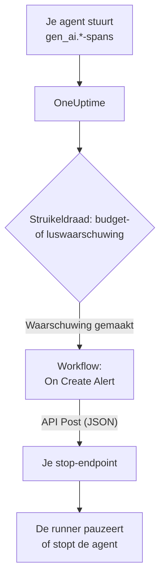

# Circuit breakers voor AI-agents

Een AI-agent faalt zelden door te crashen. Hij faalt door door te gaan: hij probeert een kapotte tool opnieuw, plant dezelfde stap nog eens of start meer subagents, terwijl elke ronde meer tokens kost. Deze pagina bouwt daarvoor een circuit breaker uit onderdelen die OneUptime al heeft: een waarschuwing die de op hol geslagen agent opmerkt, en een workflow die een endpoint van jou aanroept om hem te stoppen.

:::cards
- [Kies een struikeldraad](#kies-een-struikeldraad): Waarschuw bij uitgaven, of bij een tool die steeds opnieuw wordt aangeroepen.
- [Bouw het stop-endpoint](#bouw-het-stop-endpoint): De kleine service die je agent pauzeert.
- [Bouw de workflow](#bouw-de-workflow): Van een nieuwe waarschuwing naar een aanroep van je endpoint.
- [Test de circuit breaker](#test-de-circuit-breaker): Laat hem met de hand afgaan, en daarna echt.
:::

## Hoe het werkt



De circuit breaker volgt de OpenTelemetry die je agent al stuurt, rechtstreeks of [via een gateway](/docs/telemetry/ai-gateways), en handelt naast het pad van de verzoeken, niet erin. Er wordt niets aan elke modelaanroep toegevoegd, en wisselen van provider, SDK of gateway maakt hem niet kapot.

De prijs is snelheid: hij stopt een op hol geslagen agent in minuten, niet in milliseconden. Houd staplimieten en time-outs in de agent zelf, en laat de circuit breaker opvangen wat daar doorheen glipt.

| Struikeldraad | Vangt | Tijd tot de waarschuwing |
| --- | --- | --- |
| Een budgetwaarschuwing, van een metriekmonitor | Uitgaven die blijven stijgen, wat de oorzaak ook is | Tot 15 minuten, plus een minuut voor de monitor |
| Een luswaarschuwing, van een tracemonitor | Dezelfde tool die steeds opnieuw wordt aangeroepen | 1 tot 5 minuten |

## Voordat je begint

- Je agent stuurt GenAI-spans naar OneUptime. Zie [AI- / LLM-observability](/docs/telemetry/ai-llm-observability).
- Een HTTPS-endpoint dat de runner van je agent kan pauzeren of stoppen, bereikbaar vanaf OneUptime. Je bouwt het in [Bouw het stop-endpoint](#bouw-het-stop-endpoint).
- Toestemming om monitoren en workflows in het project te maken.

## Kies een struikeldraad

Beide struikeldraden eindigen op dezelfde manier: een monitor maakt een waarschuwing, en de nieuwe waarschuwing start de workflow. Je kunt ze allebei instellen: het maakt de workflow niet uit welke afging.

### Een budgetwaarschuwing

Uitgaven zijn het zekerste teken van een op hol geslagen agent. Een budget telt elke 15 minuten de AI-uitgaven van de dag op en publiceert ze als twee metrieken, `oneuptime.llm.budget.spend.usd` en `oneuptime.llm.budget.percent.used`, elk met de ID van het budget in `oneuptime.llm.budget.id`.

:::steps
1. Open **Producten → AI / LLM → Budgetten** en klik op **LLM Cost Budget aanmaken**. Stel een **Dagbudget (USD)** in, en kies de service van de agent bij **Service (optioneel)** zodat het budget alleen die agent volgt.
2. Kies in het rijmenu van het nieuwe budget **ID weergeven** en kopieer de ID.
3. Maak een [Metrics-monitor](/docs/monitor/metrics-monitor) op `oneuptime.llm.budget.percent.used`, gefilterd op het attribuut `oneuptime.llm.budget.id` met de gekopieerde ID, en zet het **Tijdsbereik** op **Past 30 Minutes**.
4. Voeg een criterium **Greater Than Or Equal To** `100` toe dat een waarschuwing maakt, en geef het een **Waarschuwingstitel** die de agent noemt, zoals `LLM budget exceeded: support-bot`. De workflow en je endpoint lezen allebei die titel.
:::

Filter op de ID, niet op de naam: een budget hernoemen hernoemt zijn reeks, en een monitor die op de oude naam filtert, zou ongemerkt niets meer vinden. Houd het tijdsbereik op 30 minuten: een budget publiceert elke 15 minuten één punt, dus een korter bereik vindt niets tussen twee punten en de waarschuwing gaat steeds open en dicht.

Een tweede criterium op `80` met een lagere ernst waarschuwt eerst een mens, via het dienstbeleid van de waarschuwing, voordat de circuit breaker bij `100` afgaat.

### Een luswaarschuwing

Een vastgelopen agent laat een herkenbaar spoor na: dezelfde tool-span, steeds weer. Een gezonde run roept een tool niet tientallen keren in een paar minuten aan, dus een telling vangt de lus lang voor het budget.

:::steps
1. Open **Monitoren**, klik op **Monitor maken** en kies **Traces** onder **Meer monitortypen**.
2. Zet onder **Meer velden** de optie **Filteren op telemetrieservice** op de service van de agent, en **Filteren op attributen** op `gen_ai.tool.name` gelijk aan de tool waarop je een lus verwacht, zoals `search_web`. Als je instrumentatie de span van elke tool een naam geeft, zet die naam dan in **Span-naam**.
3. Zet **Bewaak traces gedurende (time)** op **Laatste 5 minuten**.
4. Voeg een criterium **Span Count** **Greater Than** een getal toe dat geen gezonde run in vijf minuten haalt, zoals `50`, dat een waarschuwing maakt met een titel als `Agent loop: support-bot`.
:::

Een tweede tracemonitor met **Filteren op span-status** op **Fout** en een lagere telling vangt herhaalstormen: een tool die blijft falen en een agent die hem blijft proberen.

## Bouw het stop-endpoint

De workflow stuurt een `POST` met een JSON-body naar een endpoint dat jij draait. Wat "stoppen" betekent, bepaal jij. Van het kleinste effect tot het grootste:

| Actie | Effect |
| --- | --- |
| Nieuw werk stoppen | De runner start geen nieuwe runs voor die agent |
| De runs annuleren | Lopende runs van die agent worden geannuleerd |
| De pool pauzeren | Elke worker loopt leeg tot iemand de circuit breaker reset |

Een minimaal endpoint in Express dat per agent een circuit breaker laat afgaan:

```typescript title="circuit-breaker.ts"
import express from "express";

const app = express();
app.use(express.json());

const tripped = new Set<string>(); // agents whose breaker is open

app.post("/circuit-breaker", (req, res) => {
  if (req.headers["authorization"] !== `Bearer ${process.env.KILL_TOKEN}`) {
    return res.status(401).end();
  }

  const alertTitle: string = req.body.alertTitle ?? "";

  // "LLM budget exceeded: support-bot" -> "support-bot"
  const agent: string = alertTitle.split(": ").pop() ?? "unknown";

  tripped.add(agent); // your run loop checks this set
  abortActiveRuns(agent); // cancel that agent's runs in flight

  // Answer fast; do the slow cleanup in the background.
  return res.status(200).json({ tripped: agent });
});
```

Bouw het volgens deze regels:

- Maak het afgaan idempotent. Een waarschuwing en een overschrijding, of een budget- en een luswaarschuwing tegelijk, kunnen hem meer dan eens laten afgaan, en een tweede keer mag niets veranderen.
- Antwoord binnen een seconde of twee en ruim op de achtergrond op. De workflow telt elk 2xx-antwoord als succes.
- Eis een geheim. Wie het endpoint kan aanroepen, kan je agents stoppen, dus controleer een bearer-token, dat de workflow uit een geheime globale variabele stuurt.
- Reset met de hand. Een afgegane circuit breaker blijft af tot iemand naar de run heeft gekeken: open het gesprek van de agent onder **Producten → AI / LLM → Gesprekken** om te lezen of af te spelen wat hij deed.

Het verzoek gaat uit van OneUptime. Op OneUptime Cloud moet je endpoint vanaf internet bereikbaar zijn. Een zelf gehoste installatie weigert privénetwerkadressen, tenzij een beheerder ze toestaat: zie [Uitgaande netwerktoegang](/docs/workflows/configuration#uitgaande-netwerktoegang).

## Bouw de workflow

Bewaar eerst het token van het endpoint op een plek waar de workflow het kan gebruiken zonder het te tonen: open **Workflows → Globale variabelen**, klik op **Workflow Variabele aanmaken**, noem hem `AGENT_KILL_TOKEN`, zet het token in **Inhoud** en zet **Geheim** aan. Een geheime waarde wordt uit de logboeken van runs en de sporen van stappen gehaald.

:::steps
### Maak de workflow aan

Open **Producten → Workflows** en klik op **Workflow maken**. Klik op **Vanaf nul beginnen**, noem hem `AI agent circuit breaker` en klik op **Workflow maken**. Hij opent in de **Bouwer**, uitgeschakeld.

### Voeg de trigger toe

Klik op het gestippelde blok **Choose what starts this workflow** en kies **On Create Alert** in het paneel **Add Trigger**. Klik op de trigger, vink de titel en de beschrijving aan bij **Select Fields** en klik op **Opslaan**. De ID op het blok, `alert-on-create-1`, is hoe latere blokken ernaar verwijzen.

### Controleer de titel

Klik op **Component toevoegen**, kies **If / Else** en verbind het punt **Success** van de trigger ermee. Zet **Value to check** op de titel van de waarschuwing (klik op **{ }** en kies hem), **Comparison** op **bevat** en **Compare with** op het begin dat de titels van je struikeldraden delen, zoals `LLM budget exceeded`.

### Roep je endpoint aan

Voeg **API Post (JSON)** toe en verbind het punt **Yes** van de **If / Else** ermee. Zet de **URL** op je endpoint, zoals `https://agents.example.com/circuit-breaker`, en vul de headers en de body hieronder in.

### Meld een mislukking

Voeg **Send Message to Slack** of **Send Email** toe en verbind het punt **Error** van het API-blok ermee. Een circuit breaker die niet afgaat, is precies de waarschuwing die een mens moet zien.

### Zet hem aan

Zet **Ingeschakeld** aan bovenaan de **Bouwer**.
:::

De **Request Headers** van het API-blok:

```json title="Request Headers"
{
  "Authorization": "Bearer {{global.variables.AGENT_KILL_TOKEN}}",
  "Content-Type": "application/json"
}
```

Zijn **Request Body**:

```json title="Request Body"
{
  "source": "oneuptime-circuit-breaker",
  "alertId": "{{local.components.alert-on-create-1.returnValues.model._id}}",
  "alertTitle": "{{local.components.alert-on-create-1.returnValues.model.title}}",
  "alertDescription": "{{local.components.alert-on-create-1.returnValues.model.description}}"
}
```

Om op meerdere struikeldraden te reageren, laat je al hun titels hetzelfde beginnen, of koppel je meer **If / Else**-blokken aan het punt **No**. Zie [Een workflow bouwen](/docs/workflows/authoring) voor het canvas en [Variabelen](/docs/workflows/variables) voor de `{{…}}`-verwijzingen.

## Test de circuit breaker

:::steps
1. Laat hem met de hand afgaan. Open **Waarschuwingen**, klik op **Waarschuwing maken** en maak er een met de titel `LLM budget exceeded: test`. De run verschijnt onder **Workflows → Logboeken → Uitvoeringen**, en je endpoint krijgt de aanroep.
2. Laat hem echt afgaan. Maak een budget met een piepkleine limiet, zoals `0.01` USD, op de service van een testagent, richt een budgetmonitor erop en laat de agent draaien: het percentage gaat over 100, de waarschuwing gaat open, de workflow draait en de circuit breaker gaat af. Geef voor de luswaarschuwing een testagent een tool die altijd faalt.
3. Laat hem twee keer afgaan. Maak dezelfde waarschuwing opnieuw: je endpoint moet de tweede keer accepteren zonder iets te veranderen.
:::

## Hoe de circuit breaker zich in de tijd gedraagt

- De workflow draait wanneer een waarschuwing wordt gemaakt, dus een struikeldraad laat de circuit breaker één keer per waarschuwing afgaan, niet één keer per evaluatie.
- Een budget telt de UTC-dag, dus het percentage begint om middernacht UTC weer bij 0. Een budgetwaarschuwing kan dan opgelost raken, en de volgende slechte dag opent een nieuwe waarschuwing die de circuit breaker opnieuw laat afgaan.
- Een monitor houdt zijn waarschuwing open zolang aan de criteria wordt voldaan. Met **Waarschuwing automatisch oplossen** aan, lost de waarschuwing op wanneer dat niet meer zo is, en de volgende overschrijding opent een nieuwe waarschuwing.
- Resetten is aan beide kanten de beslissing van een mens: los de waarschuwing in OneUptime op, en reset de circuit breaker in je runner.
- Elke nieuwe waarschuwing in het project start de workflow. De **If / Else** houdt andere waarschuwingen weg bij de circuit breaker: laat hem niet weg.

## Probleemoplossing

:::details De workflow draait niet
Controleer of **Ingeschakeld** aan staat bovenaan de **Bouwer**: workflows worden uitgeschakeld aangemaakt. Controleer daarna of de waarschuwing is gemaakt nadat je de workflow aanzette: de trigger start alleen een run voor een nieuwe waarschuwing.
:::

:::details De workflow draait, maar neemt altijd de tak No
De titel is leeg of komt niet overeen. Een veld dat niet is aangevinkt bij **Select Fields** van de trigger, komt leeg aan, dus vink de titel aan. Vergelijk daarna de titel van de waarschuwing met **Compare with**: **bevat** moet precies die tekst erin vinden.
:::

:::details Je endpoint antwoordt 401
De header `Authorization` komt niet overeen met het token dat je endpoint verwacht. Controleer de naam in `{{global.variables.AGENT_KILL_TOKEN}}` en de waarde die in de globale variabele is opgeslagen. De waarde van een geheime variabele kan niet worden teruggelezen, dus typ hem bij twijfel opnieuw met **Update Content**.
:::

:::details De budgetwaarschuwing gaat steeds open en dicht
Het **Tijdsbereik** van de monitor is korter dan de 15 minuten tussen twee punten van het budget. Zet het op **Past 30 Minutes**.
:::

:::details Het verzoek bereikt je endpoint nooit
Open de run onder **Workflows → Logboeken → Uitvoeringen** en de stap **API Post (JSON)**: daar staat waarom het verzoek mislukte. Op OneUptime Cloud moet het endpoint vanaf internet bereikbaar zijn; een zelf gehoste installatie weigert privénetwerkadressen, tenzij een beheerder ze toestaat.
:::

## Volgende stappen

:::cards
- [AI- / LLM-observability](/docs/telemetry/ai-llm-observability): Budgetten, kosten en de spans die de circuit breaker volgt.
- [Traces-monitor](/docs/monitor/traces-monitor): Spanfilters en criteria in detail.
- [Workflows](/docs/workflows/index): Triggers, componenten, variabelen en runs.
- [AI-gateways](/docs/telemetry/ai-gateways): De modelaanroepen van alle agents via één export.
:::
