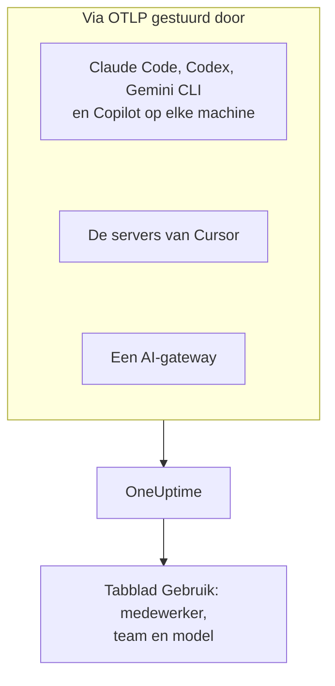

# AI-codeerassistenten

Je engineers gebruiken Claude Code, Cursor, Codex, Gemini CLI en Copilot, en de facturen blijven groeien. Deze pagina beantwoordt de vragen die een manager heeft: **wie welke tool gebruikt, met welke modellen, en wat elke persoon en elk team uitgeeft**.

De meeste codeerassistenten exporteren zelf OpenTelemetry, dus er hoeft niets op de machines van ontwikkelaars te worden geïnstalleerd: richt de export op OneUptime, en tokens, kosten en toolgebruik komen binnen naast de AI-aanroepen van je eigen apps. Alles hier komt binnen via OpenTelemetry; OneUptime bevraagt geen beheer- of facturatie-API van welke leverancier dan ook.

:::cards
- [Ondersteuningsmatrix](#ondersteuningsmatrix): Wat elke tool stuurt, en of hij een persoon noemt.
- [Toewijzing aan medewerkers en teams](#toewijzing-aan-medewerkers-en-teams): De sleutels die een naam en een team aan de uitgaven koppelen.
- [Het tabblad Gebruik](#het-tabblad-gebruik): Wat de uitgaventabellen wel en niet kunnen tonen voor een codeerassistent.
- [Waar je begint](#waar-je-begint): Een volgorde van uitrol die op de eerste dag resultaat laat zien.
:::

## Hoe het werkt

Elke tool stuurt zijn telemetrie naar het OTLP-endpoint van OneUptime met je ingestiesleutel: vanaf elke ontwikkelaarsmachine, vanaf de servers van de leverancier (Cursor), of vanaf een gateway waar je modelverkeer doorheen gaat.



## Voordat je begint

1. Maak een telemetrie-ingestiesleutel aan onder **Projectinstellingen → Telemetrie & APM → Ingestiesleutels**.
2. Je OTLP-endpoint is `https://oneuptime.com/otlp`, of `https://YOUR-ONEUPTIME-HOST/otlp` als je OneUptime zelf host.
3. Elke export stuurt de sleutel mee in de header `x-oneuptime-token`.

Eén ingestiesleutel voor de hele vloot is prima. Hij komt op elke ontwikkelaarsmachine terecht, dus behandel hem als een gedeelde referentie die alleen gegevens kan sturen, en roteer hem zoals elke andere.

## Ondersteuningsmatrix

Drie dingen bepalen wat je van een tool krijgt: of hij überhaupt OpenTelemetry stuurt, hoe zijn telemetrie OneUptime bereikt, en of iets erin een persoon noemt.

| Tool | Wat hij stuurt | Hoe het OneUptime bereikt | Wie hij noemt | Handleiding |
| --- | --- | --- | --- | --- |
| Claude Code | Metrieken en logs; traces in bèta | Vanaf elke machine; omgevingsvariabelen of een bestand met beheerde instellingen | `user.email`, als er is ingelogd met een Claude-account | [Claude Code](/docs/telemetry/claude-code) |
| Cursor | Metrieken en logs | Vanaf de servers van Cursor, eenmalig ingesteld in het dashboard van Cursor; alleen met het Enterprise-abonnement | `cursor.user.id`, een geheel getal | [Cursor](/docs/telemetry/cursor) |
| OpenAI Codex | Traces, metrieken en logs, elk aangezet in `~/.codex/config.toml` | Vanaf elke machine, een volledige URL per signaal | Niemand op spans of metrieken: je zet zelf `user.id` en `user.email` in `[otel.span_attributes]` | [OpenAI Codex](/docs/telemetry/openai-codex) |
| Gemini CLI | Traces, metrieken en logs | Vanaf elke machine, meestal via een lokale collector | `user.email`, als er is ingelogd | [Gemini CLI en GitHub Copilot](/docs/telemetry/gemini-cli-and-copilot) |
| GitHub Copilot | Traces, metrieken en logs, alleen vanuit zijn agentomgevingen | Vanuit de editor of de agenthost | Niemand: je zet zelf `enduser.id` en `user.email` op elke machine | [Gemini CLI en GitHub Copilot](/docs/telemetry/gemini-cli-and-copilot) |
| Cline | Metrieken en logs | Centraal geconfigureerd, in het organisatiedashboard van Cline | Een geanonimiseerde `user_id` | — |
| LiteLLM en Portkey | Traces van elke aanroep via de gateway | Vanuit het gatewayproces | Bij LiteLLM de eigenaar van de virtuele sleutel | [AI-gateways](/docs/telemetry/ai-gateways) |
| Je eigen apps | Wat je GenAI-instrumentatie stuurt | Vanuit je app | Wie je ook als `user.id` instelt | [AI- / LLM-observability](/docs/telemetry/ai-llm-observability) |
| Windsurf, JetBrains AI, Amazon Bedrock, Azure OpenAI | Geen eigen OpenTelemetry | Alleen via een gateway die je ervoor zet | Wie de gateway noemt | [AI-gateways](/docs/telemetry/ai-gateways) |

Een streepje betekent dat OneUptime nog geen handleiding voor de tool heeft. De telemetrie ervan wordt toch ingenomen zoals alle andere OpenTelemetry.

:::details Wat GitHub Copilot precies exporteert
Copilot exporteert OpenTelemetry alleen vanuit zijn agentomgevingen: de chat en agentmodus van VS Code, de agenthost achter Copilot CLI, de Copilot SDK, en agentworkflows in JetBrains-IDE's via de Copilot-plugin. GitHub documenteert geen export voor inline-aanvullingen, Copilot op github.com of codereview door Copilot. Copilot stuurt geen enkel gebruikersattribuut, dus zet `enduser.id` en `user.email` per machine via `resourceAttributes` of `OTEL_RESOURCE_ATTRIBUTES`.
:::

:::details Amazon Bedrock, Azure OpenAI, Windsurf en JetBrains AI
- **Amazon Bedrock**: de API's `InvokeModel` en `Converse` sturen geen OpenTelemetry. Bedrock AgentCore is anders: AWS documenteert er metrieken, spans en logs voor, standaard naar CloudWatch gestuurd. Met `DISABLE_ADOT_OBSERVABILITY=true` zet je de standaard ADOT-configuratie van de runtime uit, zodat je de ADOT-SDK op OneUptime kunt richten.
- **Azure OpenAI**: de service stuurt niets, en de Azure Monitor-metrieken hebben geen gebruikersdimensie. Instrumenteer de client, of zet API Management of een andere gateway ervoor.
- **Windsurf**: documenteert geen telemetrie-export. Gegevens per gebruiker staan in de Enterprise-API van Windsurf, die OneUptime niet bevraagt.
- **JetBrains AI Assistant en Junie**: exporteren geen gebruik. De OpenTelemetry-plugin van JetBrains ontvangt de telemetrie van je eigen app binnen de IDE; hij stuurt niets naar buiten.
:::

## Toewijzing aan medewerkers en teams

OneUptime kopieert de persoon die een aanroep deed, en diens team, naar kolommen zodra de telemetrie binnenkomt, zodat het tabblad **Gebruik** personen en teams kan rangschikken zonder attribuutfilters.

### Attributen die als de medewerker worden gelezen

Op een span wint de eerste aanwezige sleutel, in deze volgorde:

| Kolom | Sleutels, de voorkeur eerst |
| --- | --- |
| Medewerker-id | `user.id`, `enduser.id`, `litellm.metadata.user_api_key_user_id`, `metadata.user_api_key_user_id`, `traceloop.association.properties.user_id`, `langfuse.user.id`, `user.account_uuid`, `user.account_id`, `cursor.user.id` |
| E-mail van de medewerker | `user.email`, `litellm.metadata.user_api_key_user_email`, `metadata.user_api_key_user_email`, `traceloop.association.properties.user_email`, `enduser.email` |
| Team / kostenplaats | `team.id`, `team`, `cost_center`, `department`, `litellm.metadata.user_api_key_team_id`, `litellm.team.id`, `metadata.user_api_key_team_id`, `cursor.team.id` |

Op een datapunt van een metriek is de lijst korter en begint hij met het e-mailadres, omdat de codeerassistenten die metrieken sturen zelf `user.email` meesturen:

| Kolom | Sleutels, de voorkeur eerst |
| --- | --- |
| Medewerker | `user.email`, `user.id`, `user.account_uuid`, `user.account_id`, `cursor.user.id` |
| Team / kostenplaats | `team.id`, `team`, `cost_center`, `department`, `cursor.team.id` |
| Model | `gen_ai.request.model`, `model`, `cursor.model.name` |

Hoe deze sleutels worden gelezen:

- **Elke sleutel wordt ook gelezen met het voorvoegsel `resource.`.** OTLP-ingestie slaat resource-attributen op onder dat voorvoegsel, dus `OTEL_RESOURCE_ATTRIBUTES=team.id=platform` komt binnen als `resource.team.id`. De sleutels zonder voorvoegsel worden eerst geprobeerd, zodat een waarde op de span wint van een waarde op het hele proces.
- **Het tabblad Gebruik toont het e-mailadres van een persoon als de aanroep er een heeft, en anders het id.** Rijen met hetzelfde e-mailadres worden bij elkaar opgeteld, zodat één engineer op twee machines één rij is.
- **Identiteit wordt alleen uit AI-aanroepen gelezen.** `user.id`, `user.email` en `team.id` zijn algemene sleutels die ook browser- en backendspans dragen; alleen spans die al als AI-aanroep zijn herkend, krijgen de kolommen.
- **Logrecords worden niet gelezen voor identiteit.** Dat doet ertoe voor Codex, dat `user.email` alleen in zijn logs zet.
- LiteLLM schrijft deze sleutels op twee manieren: de standaard `otel`-callback gebruikt het voorvoegsel `metadata.`, en de optionele OpenTelemetry v2-modus (`LITELLM_OTEL_V2=true`) de naamruimte `litellm.`. OneUptime leest beide, dus een standaardproxy werkt zonder extra instellingen.

### Teams en kostenplaatsen

Geen enkele instrumentatie stuurt `team.id`, `team`, `cost_center` of `department`: je organisatie stelt ze in, meestal via `OTEL_RESOURCE_ATTRIBUTES` op het proces van de tool.

```bash
export OTEL_RESOURCE_ATTRIBUTES="team.id=platform,team=Platform_Engineering,cost_center=eng-123,department=engineering"
```

Stel het in waar je ontwikkelaarsmachines al inricht: een MDM-profiel, een bestand met beheerde instellingen, of een shellprofiel uit je dotfiles. Waarden mogen geen spaties bevatten: gebruik underscores, of procentcodering zoals `%20`. Codex heeft geen resource-attributen, dus zet dezelfde sleutels in plaats daarvan in zijn `[otel.span_attributes]`.

Om uitgaven per applicatie te scheiden, gebruik je de servicenaam (`OTEL_SERVICE_NAME`, of de eigen instelling van de tool). De uitsplitsing **Applicatie / Service** dekt alleen tools die GenAI-spans sturen.

### Wat bewust niet als de medewerker wordt behandeld

Een aanroep kan twee verschillende personen dragen: de medewerker die hem deed, en de klant voor wie hij werd gedaan. Deze sleutels dragen de klant, en OneUptime leest ze nooit in een identiteitskolom:

- `gen_ai.user` en `llm.user`: hoe instrumentaties de aanvraagparameter `user` van OpenAI doorgeven, die OpenAI beschrijft als een identificatie van je eindgebruikers.
- `litellm.metadata.user_api_key_end_user_id`, `metadata.user_api_key_end_user_id` en `litellm.end_user.id`: de eindgebruiker van LiteLLM, in tegenstelling tot de eigenaar van de sleutel, die de medewerker is.

Het id van een klant als medewerker lezen zou van een supportbot die 40.000 klanten bedient 40.000 spookmedewerkers maken, terwijl de engineer die eigenaar is van de uitgaven niets lijkt uit te geven. De sleutels blijven in de attributen van de span, en het tabblad **LLM** van de traceviewer toont ze als de eindgebruiker.

### Privacy

De e-mailkolom van de medewerker bevat persoonsgegevens. De **Scrub-regels** van de traces dekken hem precies zoals ze het attribuut dekken waaruit hij is gelezen, dus een regel die e-mailadressen maskeert, maskeert ook de kolom. Je vindt ze onder **Traces → Instellingen**.

## Metrieken van codeerassistenten die OneUptime leest

De codeerassistenten geven hun metrieken een eigen voorvoegsel in plaats van `gen_ai.*`, dus OneUptime kent ze elk bij naam:

| Metriek | Tool | Eenheid |
| --- | --- | --- |
| `claude_code.token.usage` | Claude Code | Tokens |
| `claude_code.cost.usage` | Claude Code | USD |
| `cursor.token.usage` | Cursor | Tokens |
| `cursor.cost.usage` | Cursor | USD, een schatting volgens Cursor zelf |
| `codex.turn.token_usage` | OpenAI Codex | Tokens |
| `codex.turn.cost_microusd` | OpenAI Codex | Miljoenste delen van een USD: OneUptime rekent het om, doe het dus niet zelf |

OneUptime leest ook tokens uit `gen_ai.client.token.usage`, `gen_ai.client.token.count`, `llm.token.usage` en `llm.usage.tokens`, en kosten uit `gen_ai.client.cost`, `gen_ai.client.cost.usd`, `gen_ai.usage.cost`, `litellm_spend_metric` en `litellm.cost.total`.

Twee dingen om te weten voordat je de getallen leest:

- **`gemini_cli.token.usage` wordt bewust overgeslagen.** Gemini CLI stuurt zijn tokens twee keer, als eigen metriek en als `gen_ai.client.token.usage`, en beide lezen zou ze verdubbelen. Zijn tokens worden één keer geteld, via `gen_ai.client.token.usage`. Gemini CLI stuurt geen kostenmetriek: zet zijn traces aan om elke aanroep een prijs te geven.
- **Alleen invoer- en uitvoertokens worden geteld.** Het tokentype wordt gelezen uit `gen_ai.token.type`, `llm.token.type`, `type`, `cursor.token.type` of `token_type`, en alleen `input` en `output` (of de oudere `prompt` en `completion`) tellen. Cachelezen en -schrijven, de `total` van Codex (die de andere herhaalt) en `reasoning_output` (onderdeel van `output`) worden weggelaten, dus een totaal uit metrieken is kleiner dan de som van alles wat een tool stuurt.

## Het tabblad Gebruik

Open **Producten → AI / LLM** en ga naar **Gebruik**. Het rangschikt **Medewerker**, **Team**, **Model**, **Provider** en **Applicatie / Service** op uitgaven, over de laatste 7 dagen, tenzij je een andere periode kiest. Aanroepen die niemand noemen, worden geteld onder **Niet toegewezen**: een grote rij **Niet toegewezen** vertelt je welke tool zijn identiteit nog moet krijgen.

### Metrieken van codeerassistenten zijn een terugval, geen aanvulling

GenAI-spans gaan voor: de metrieken worden alleen gelezen voor een getal waarvoor de spans niets meldden, en de twee worden nooit bij elkaar opgeteld ([waarom](/docs/telemetry/ai-llm-observability#spans-eerst-metrieken-vullen-aan)). Voor codeerassistenten heeft dat één botte consequentie: **als hetzelfde project GenAI-spans met kosten ontvangt, verschijnen de uitgaven van de codeerassistenten niet.** Geef de codeerassistenten een eigen project, met een eigen ingestiesleutel.

Als de terugval wel geldt, kan elke uitsplitsing dit tonen voor een tool die alleen metrieken stuurt:

| Uitsplitsing | Uit metrieken |
| --- | --- |
| **Medewerker** | Ja, uit elke identiteitssleutel hierboven, met en zonder voorvoegsel `resource.` |
| **Team** | Ja, uit de teamsleutels |
| **Model** | Ja: Claude Code en Codex sturen een kale `model`, Cursor `cursor.model.name` |
| **Provider** | Nee: de metrieken van codeerassistenten noemen geen provider |
| **Applicatie / Service** | Nee: hun metrieken horen bij geen enkele OneUptime-service |

Een rij die uit metrieken is gelezen, draagt alleen kosten: de cellen voor aanroepen en tokens tonen `—`, omdat een uitgaventeller geen details per aanroep heeft, en een 0 daar zou beweren dat de persoon geen aanroepen deed. De tabel is gemarkeerd met **uit GenAI-metrieken**.

## Geen OpenTelemetry? Zet er een gateway voor

Voor Windsurf, JetBrains AI, de model-API's van Bedrock, Azure OpenAI en alles zonder eigen export zet je er een AI-gateway voor. Elke aanroep gaat dan door één proces dat OpenTelemetry stuurt, en je configureert de export één keer.

**Gebruik LiteLLM met één virtuele sleutel per medewerker.** LiteLLM zet het id en het e-mailadres van de sleuteleigenaar op elke span, die OneUptime als de medewerker leest, en het team van de sleutel als het team. Het prijst ook zelf elke aanroep, met de aangepaste tarieven die je op de proxy instelt, en de kosten die het meldt winnen van de schatting van OneUptime. Gebruik hiervoor niet het eindgebruikers-id: dat is de klant. De instelling staat in [AI-gateways](/docs/telemetry/ai-gateways).

Twee beperkingen voordat je rond een gateway plant:

- **Een gateway ziet alleen verkeer dat erdoorheen wordt gestuurd.** De eigen overschrijving van de basis-URL in Cursor is een instelling per gebruiker die alleen chatmodellen dekt (Tab-aanvulling blijft de modellen van Cursor gebruiken), dus geef de voorkeur aan de eigen export van Cursor.
- **Een gateway ziet de modelaanroep, niet de agent.** Hij legt prompts en antwoorden vast, maar niet de toolaanroepen, bestandsbewerkingen en beslissingen om te accepteren of te weigeren die de eigen telemetrie van een tool meldt.

## Promptinhoud: de standaardinstellingen verschillen per tool

Prompts en antwoorden zijn de riskantste gegevens in deze pijplijn: ze bevatten regelmatig broncode, klantgegevens en geplakte inloggegevens. Controleer de standaardinstelling van elke tool:

| Tool | Promptinhoud standaard |
| --- | --- |
| Claude Code | Uit: elk soort inhoud heeft een eigen variabele om het aan te zetten |
| Cursor | Uit: alleen de optionele familie `conversation_content` stuurt berichttekst |
| OpenAI Codex | Uit: `log_user_prompt` staat standaard op `false` |
| Gemini CLI | **Aan**: `logPrompts` staat standaard op `true`, dus zet het op `false` wanneer je telemetrie aanzet |
| GitHub Copilot | Uit: `captureContent`, dat beheerde instellingen kunnen vergrendelen met `lockCaptureContent` |
| LiteLLM | Aan met de standaard `otel`-callback (zet het uit met `turn_off_message_logging`); uit in de OpenTelemetry v2-modus |

Codex stuurt zijn metrieken ook standaard naar OpenAI: zie [OpenAI Codex](/docs/telemetry/openai-codex). Waar je bewust inhoud vastlegt, gelden de **Scrub-regels** en **Drop-filters** van de traces er net zo voor als voor alle andere telemetrie.

## Wat OneUptime nog niet doet

- **Geen beheer- of facturatiekoppelingen met leveranciers.** OneUptime bevraagt de Admin API van Anthropic niet, noch de Admin API van Cursor, de gebruiks- en kosten-endpoints van OpenAI, de Copilot-facturatie van GitHub, of de API's van Windsurf of JetBrains. Haal cijfers op factuurniveau op bij de leverancier.
- **Kosten zijn een schatting, tenzij een tool ze meldt.** Gemelde kosten worden gebruikt zoals ze zijn; anders prijst OneUptime tokens tegen lijstprijzen. De `cursor.cost.usage` van Cursor is zelf een schatting.
- **Identiteit op logrecords wordt niet gelezen.** De `user.email` van Codex, die het alleen in logs stuurt, wordt niet aan de uitgaven gekoppeld.
- **De `cursor.user.email` van Cursor wordt nog niet gelezen**, dus gebruikers van Cursor verschijnen als hun gehele getal `cursor.user.id`.
- **Codex-spans noemen geen model**, dus OneUptime kan ze niet prijzen: Codex toont tokens per persoon, en zijn kosten alleen in de totalen.
- **Tools veranderen snel.** Als deze pagina zegt dat een tool geen export heeft, controleer dan de actuele documentatie voordat je rond een gateway bouwt.

## Waar je begint

Rol uit in deze volgorde; elke stap is op zichzelf nuttig. Gebruik een project dat nog geen GenAI-spans van je eigen apps ontvangt, anders houdt [de terugvalregel](#metrieken-van-codeerassistenten-zijn-een-terugval-geen-aanvulling) de uitgaven van de codeerassistenten van de pagina.

1. **Gemini CLI**, als iemand het gebruikt. Het stuurt `user.email` zonder instellingen, dus het laat de toewijzing van begin tot eind werken. Zet ook zijn traces aan: het stuurt geen kostenmetriek.
2. **Claude Code**: één bestand met beheerde instellingen voor de vloot, `user.email` gratis, een echte kostenmetriek, en acceptatiegraad, commits, pull requests en regels code per ontwikkelaar.
3. **Cursor**, met het Enterprise-abonnement: één scherm in het dashboard van Cursor, geen ontwikkelaarsmachine aangeraakt, al komen personen binnen als gehele getallen.
4. **Copilot en Codex**, die allebei een identiteit op elke machine nodig hebben. Doe het wanneer je machines inricht: aanroepen die zonder identiteit binnenkwamen, kunnen later niet worden toegewezen.
5. **Een LiteLLM-gateway** voor al het andere, met één virtuele sleutel per medewerker.

## Volgende stappen

:::cards
- [Claude Code](/docs/telemetry/claude-code): Zet de export van Claude Code aan voor één machine of de hele vloot.
- [Cursor](/docs/telemetry/cursor): Stuur de teamtelemetrie van Cursor vanuit het dashboard van Cursor.
- [OpenAI Codex](/docs/telemetry/openai-codex): Configureer de drie exporters van Codex en zet een identiteit op zijn spans.
- [AI- / LLM-observability](/docs/telemetry/ai-llm-observability): Gesprekken, waarschuwingen, kosten en budgetten voor elke AI-aanroep.
:::
