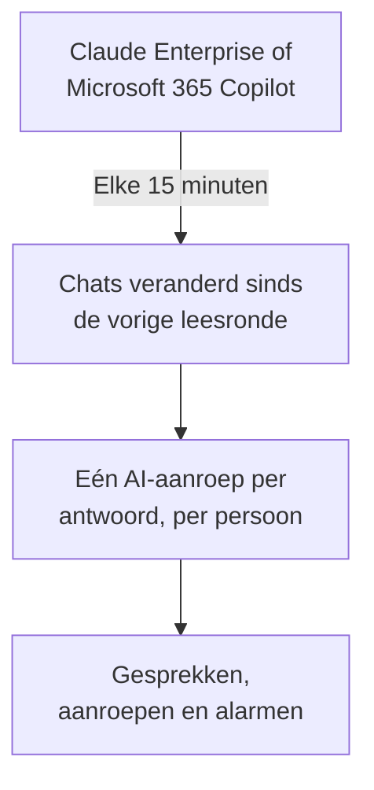

# AI-tools van je bedrijf

Zie wat je mensen vragen aan de AI-tools waarvoor je bedrijf betaalt, als gesprekken per persoon. Koppel Claude Enterprise of Microsoft 365 Copilot met inloggegevens die alleen kunnen lezen, en OneUptime haalt elke nieuwe chat elke 15 minuten binnen in **Gesprekken**. Alleen eigenaren en beheerders van het project kunnen ze lezen, tenzij je anders kiest.

:::cards
- [Vertel het eerst je mensen](#vertel-het-eerst-je-mensen): Hun chats zijn hun eigen woorden.
- [Een tool koppelen](#een-tool-koppelen): Plak de inloggegevens, kies wie mag lezen, test ze en koppel.
- [Privacy](#privacy): Wie de gesprekken mag lezen, en of de woorden bewaard blijven.
- [Andere AI-tools](#andere-ai-tools): ChatGPT Enterprise, Gemini, Open WebUI, LibreChat en codeerassistenten.
:::

## Vertel het eerst je mensen

> [!IMPORTANT]
> Dit zijn de eigen woorden van je mensen. Vertel ze voordat je een tool koppelt dat hun chats ermee bewaard worden en wie ze kan lezen, en vraag je juridische afdeling of HR wat jullie beleid en de lokale wet vragen.

## Hoe het werkt

Elke 15 minuten vraagt OneUptime de tool om de chats die sinds de vorige leesronde veranderd zijn. Elk antwoord wordt één AI-aanroep van de persoon die de vraag stelde, met de vragen sinds het vorige antwoord, en elke chat wordt één gesprek.

De chats komen binnen zoals de AI-aanroepen van je apps, dus scrubregels, dropfilters, bewaring en de AI-alarmen gelden voor ze. De tools worden per licentie betaald, dus deze aanroepen dragen geen tokens en geen kosten. Een vraag die een uur zonder antwoord blijft, komt los binnen, zodat ook een chat die de AI nooit beantwoordde zichtbaar is.

## Voordat je begint

- De rol Project Owner of Project Admin. Alleen zij kunnen een tool koppelen, wijzigen of verwijderen.
- Een beheerder van de tool, om de inloggegevens te maken: de sectie van elke tool hieronder zegt wie.
- Je mensen geïnformeerd, en het antwoord van je juridische afdeling of HR.

## Een tool koppelen

:::steps
### Open Koppelen

Open **Producten → AI / LLM → Koppelen**. Klik onder **De AI-tools van je bedrijf** op de tegel van de tool.

### Plak de inloggegevens

Vul bij **Inloggegevens** in wat de tool vraagt. Geheimen worden versleuteld opgeslagen en nooit meer getoond.

### Kies wie mag lezen

Stel bij **Privacy** **Wie gesprekken kan lezen** en **Bewaren wat geschreven is** in, zoals [Privacy](#privacy) uitlegt.

### Test ze

Klik bij **Testen** op **Verbinding testen**. OneUptime telt de chats van de laatste 7 dagen: niets van wat iemand schreef wordt gelezen, getoond of bewaard.

### Koppel

Klik op **Koppelen**. De eerste leesronde start binnen een minuut en haalt de laatste 7 dagen op.
:::

## Claude Enterprise

OneUptime leest elke claude.ai-chat van je organisatie via de Compliance API: wie de vraag stelde, wat er aan Claude gevraagd werd, wat het antwoordde en welk model het gebruikte. Een chat die een nieuw bericht krijgt, wordt opnieuw gelezen, en de al opgehaalde antwoorden worden herkend en overgeslagen.

:::steps
### Zet de Compliance API aan

De primaire eigenaar van je organisatie opent in claude.ai Organization settings, API en zet de Compliance API aan.

### Maak een compliance-toegangssleutel

Maak daar een sleutel met de scope `read:compliance_user_data`. Hij begint met `sk-ant-api01-`.

### Koppel Claude Enterprise

Plak de sleutel als **Compliancetoegangssleutel**.
:::

## Microsoft 365 Copilot

OneUptime leest de Copilot-interactiegeschiedenis van elke persoon uit Microsoft Graph: wat die aan Copilot vroeg in Teams, Outlook, Word, Excel, PowerPoint, Loop of Copilot Chat, wat het antwoordde en in welke app. Een prompt en de antwoorden erop worden één AI-aanroep, en een Copilot-sessie één gesprek. Een grote tenant wordt in delen gelezen, verder waar de vorige leesronde stopte.

:::steps
### Registreer een app

Registreer in Microsoft Entra ID een app en maak er een clientgeheim voor.

### Verleen de machtigingen

Geef de app de toepassingsmachtigingen `AiEnterpriseInteraction.Read.All` en `User.Read.All` van Microsoft Graph, en verleen beheerderstoestemming.

### Koppel Copilot

Vul **Directory-ID (tenant)**, **Applicatie-ID (client)** en **Clientgeheim** in. Om maar een deel van de mensen te lezen, zet je de object-ID van een groep in **Alleen mensen in deze groep** onder **Meer velden**, en geef je de app ook `GroupMember.Read.All`. Wijzig voor Azure Government daar **Cloud**.
:::

## Privacy

| Instelling | Wat ze doet |
| --- | --- |
| **Wie gesprekken kan lezen** | **Projecteigenaren en beheerders**, de standaard: niemand anders in het project ziet deze gesprekken, of de AI-aanroepen waaruit ze bestaan, waar dan ook in OneUptime. **Iedereen die AI-aanroepen mag lezen**: iedereen die de traces van het project mag lezen. |
| **Bewaren wat geschreven is** | Aan, de standaard: de vragen en antwoorden blijven bewaard. Uit: OneUptime bewaart wie vroeg, wanneer, met welk model en in welke app, maar niet de woorden. |

Een wijziging van wie mag lezen geldt binnen een minuut. **Bewaren wat geschreven is** uitzetten geldt voor de chats die daarna gelezen worden; wat eerder bewaard is, blijft tot de bewaartermijn afloopt.

Om de woorden te bewaren maar delen ervan te maskeren, zoals e-mailadressen of kaartnummers, gebruik je **Scrub-regels** onder **Traces → Instellingen**: die werken voordat er iets wordt opgeslagen. De gesprekken blijven bewaard zolang de service van de verbinding haar traces bewaart: zie [Gegevensbewaring](/docs/telemetry/data-retention). Een verbinding verwijderen stopt haar leesrondes; wat ze las, blijft, leesbaar voor dezelfde mensen, tot de bewaartermijn afloopt.

## Andere AI-tools

Deze tools hebben geen API waarmee OneUptime de chats van mensen kan lezen, of vragen een andere route.

### ChatGPT Enterprise

OpenAI stelt zijn Compliance API alleen op verzoek open voor een workspace en publiceert niet wat de records bevatten, dus OneUptime kan chats uit ChatGPT Enterprise nog niet lezen. Je OpenAI-organisatie koppelen als [provideraccount](/docs/telemetry/ai-provider-accounts#openai) toont het API-gebruik en de API-kosten, waar ChatGPT niet bij zit.

### Gemini voor Google Workspace

Google biedt geen API om de Gemini-chats van mensen te lezen. Google Vault bewaart ze voor eDiscovery.

### Codeerassistenten

Claude Code, Codex, Gemini CLI, GitHub Copilot en Cursor sturen hun eigen OpenTelemetry: zie [AI-codeerassistenten](/docs/telemetry/ai-coding-assistants).

### Open WebUI en LibreChat

Zelf gehoste chatapps roepen de modellen aan via een API die jij instelt. Zet een LiteLLM-proxy voor de modellen en stuur de traces ervan naar OneUptime zoals [AI-gateways](/docs/telemetry/ai-gateways#litellm-proxy) laat zien: de prompts en antwoorden van elke chat komen binnen als AI-aanroepen. Een virtuele sleutel per persoon noemt wie de vraag stelde; een sleutel die iedereen deelt, noemt niemand. De eigen OpenTelemetry-export van Open WebUI traceert zijn webverzoeken en databaseaanroepen, niet de chats.

## Probleemoplossing

:::details De test vindt geen chats
Niemand gebruikte de tool in de laatste 7 dagen, of de inloggegevens horen bij een andere organisatie of tenant. Controleer voor Copilot of de groep onder **Alleen mensen in deze groep** de groep is die je bedoelt.
:::

:::details De inloggegevens werken, maar mogen niet lezen wat de verbinding nodig heeft
Verleen voor Copilot beheerderstoestemming voor de Graph-machtigingen van de app, en ook `GroupMember.Read.All` als je een groep noemt. Maak voor Claude Enterprise de sleutel met de scope `read:compliance_user_data`.
:::

:::details Iemand kan de gesprekken niet zien
**Wie gesprekken kan lezen** staat op **Projecteigenaren en beheerders**. Een eigenaar of beheerder kan dat wijzigen met **Bewerken** in de rij van de verbinding.
:::

:::details De gesprekken tonen wie de vraag stelde, maar geen woorden
**Bewaren wat geschreven is** stond uit toen ze gelezen werden. Aanzetten geldt voor de chats die daarna gelezen worden.
:::

## Volgende stappen

:::cards
- [AI- / LLM-observability](/docs/telemetry/ai-llm-observability): Gesprekken lezen en afspelen, en horen wanneer antwoorden misgaan.
- [Accounts bij AI-providers](/docs/telemetry/ai-provider-accounts): Gebruik en kosten van je accounts bij OpenAI, Anthropic, Azure, Bedrock en Vertex AI.
- [AI-codeerassistenten](/docs/telemetry/ai-coding-assistants): Uitgaven per engineer aan de codeertools.
- [Gegevensbewaring](/docs/telemetry/data-retention): Hoe lang de gesprekken bewaard blijven.
:::
