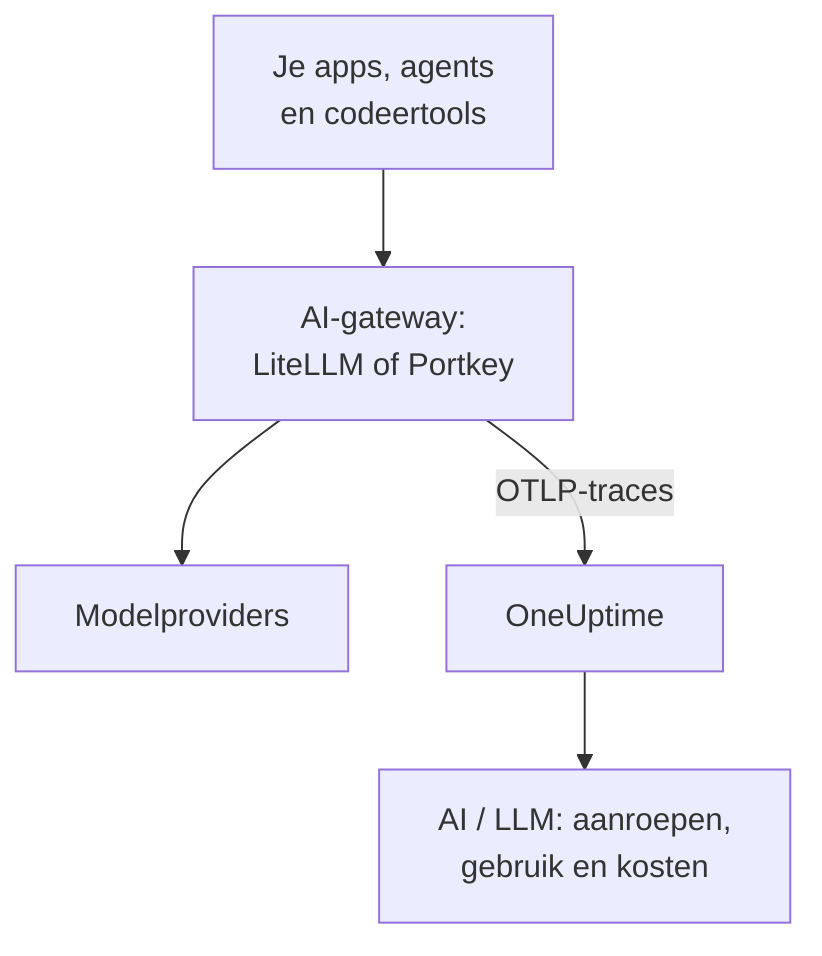

# AI-gateways (LiteLLM, Portkey)

Een AI-gateway zit tussen je apps en de modelproviders, dus elke modelaanroep gaat erdoorheen. Stuur de OpenTelemetry van de gateway één keer naar OneUptime, en elke aanroep erachter komt binnen in [AI / LLM](/docs/telemetry/ai-llm-observability) met model, tokens, kosten en, tenzij je het uitzet, de prompt en het antwoord, zonder elke app te instrumenteren.

:::cards
- [LiteLLM Proxy](#litellm-proxy): Ingebouwde export, ingesteld met drie variabelen.
- [Wie wat uitgaf](#eén-virtuele-sleutel-per-medewerker): Eén virtuele LiteLLM-sleutel per medewerker noemt elke persoon.
- [Portkey](#portkey): Ingebouwde export op zelf gehoste gateways; elders instrumenteer je de app.
- [Controleer of aanroepen binnenkomen](#controleer-of-aanroepen-binnenkomen): Wat je zou moeten zien, en wat je doet als dat niet zo is.
:::

## Hoe het werkt



| | LiteLLM Proxy | Portkey, zelf gehost of Enterprise | Portkey, open source of gehost |
| --- | --- | --- | --- |
| Export naar OneUptime | Ingebouwd | Ingebouwd, experimenteel | Geen: instrumenteer in plaats daarvan de app |
| In te stellen endpoint | `https://oneuptime.com/otlp/v1/traces` | `https://oneuptime.com/otlp` | De eigen exporter van de app |
| Noemt elke persoon | Ja, met één virtuele sleutel per medewerker | Nee | Alleen wat de app stuurt |
| Prompts en antwoorden | Verstuurd, tenzij je ze uitzet | Altijd verstuurd | Hangt af van de instrumentatie |

## Voordat je begint

- Een ingestiesleutel: open **Projectinstellingen → Telemetrie & APM → Ingestiesleutels** en klik op **Inname-sleutel aanmaken**.
- Je OTLP-basis-URL: `https://oneuptime.com/otlp`, of `https://YOUR-ONEUPTIME-HOST/otlp` als je OneUptime zelf host. OneUptime accepteert OTLP over HTTP, in protobuf en in JSON.
- De sleutel reist mee in de header `x-oneuptime-token` van elk exportverzoek.

## LiteLLM Proxy

De OpenTelemetry-callback van LiteLLM hoort bij de open-source proxy, en het officiële Docker-image (`ghcr.io/berriai/litellm`) bevat de pakketten die hij nodig heeft.

:::steps
### Zet de otel-callback aan

Voeg `otel` toe aan de callbacks in de `config.yaml` van de proxy:

```yaml title="config.yaml"
model_list:
  - model_name: gpt-4o
    litellm_params:
      model: openai/gpt-4o
      api_key: os.environ/OPENAI_API_KEY

litellm_settings:
  callbacks: ["otel"]
```

### Richt de exporter op OneUptime

Stel drie variabelen in op de proxy:

```bash
export OTEL_EXPORTER="otlp_http"
export OTEL_ENDPOINT="https://oneuptime.com/otlp/v1/traces"
export OTEL_HEADERS="x-oneuptime-token=YOUR_INGESTION_TOKEN"
```

### Start de proxy

:::tabs
@tab Docker
```bash
docker run \
  -v $(pwd)/config.yaml:/app/config.yaml \
  -e OPENAI_API_KEY="sk-..." \
  -e OTEL_EXPORTER="otlp_http" \
  -e OTEL_ENDPOINT="https://oneuptime.com/otlp/v1/traces" \
  -e OTEL_HEADERS="x-oneuptime-token=YOUR_INGESTION_TOKEN" \
  -e OTEL_SERVICE_NAME="litellm-gateway" \
  -p 4000:4000 \
  ghcr.io/berriai/litellm:main-stable \
  --config /app/config.yaml
```
@tab pip
```bash
pip install 'litellm[proxy]' opentelemetry-api opentelemetry-sdk opentelemetry-exporter-otlp
litellm --config config.yaml
```
:::

`litellm[proxy]` alleen bevat de OpenTelemetry-pakketten niet, dus installeer ze erbij.

### Stuur er een verzoek doorheen

Roep de proxy één keer aan en controleer daarna AI / LLM zoals beschreven in [Controleer of aanroepen binnenkomen](#controleer-of-aanroepen-binnenkomen).
:::

| Variabele | Waarde | Opmerkingen |
| --- | --- | --- |
| `OTEL_EXPORTER` | `otlp_http` | Wordt ook gelezen als `OTEL_EXPORTER_OTLP_PROTOCOL` |
| `OTEL_ENDPOINT` | `https://oneuptime.com/otlp/v1/traces` | Het volledige pad `/v1/traces` werkt met elke LiteLLM-versie; wordt ook gelezen als `OTEL_EXPORTER_OTLP_ENDPOINT` |
| `OTEL_HEADERS` | `x-oneuptime-token=YOUR_INGESTION_TOKEN` | Door komma's gescheiden `key=value`-paren; wordt ook gelezen als `OTEL_EXPORTER_OTLP_HEADERS` |
| `OTEL_SERVICE_NAME` | De naam van je gateway | De service waaronder de aanroepen verschijnen; `litellm` als je niets instelt |

### Wat LiteLLM stuurt

Elke aanroep draagt `gen_ai.system`, `gen_ai.request.model`, `gen_ai.response.model`, `gen_ai.usage.input_tokens` en `gen_ai.usage.output_tokens`, zijn parameters, en de prompt en het antwoord: alles wat OneUptime nodig heeft om [de aanroep te lezen](/docs/telemetry/ai-llm-observability).

Sinds LiteLLM 1.81 staan deze attributen op de span `Received Proxy Server Request` van het verzoek, en is er geen aparte span `litellm_request` meer. Als één verzoek meerdere modelaanroepen doet, overschrijft elke aanroep daar de attributen van de vorige, dus stel `USE_OTEL_LITELLM_REQUEST_SPAN=true` in om voor elke aanroep een span `litellm_request` te krijgen.

LiteLLM prijst elke aanroep zelf, inclusief eigen tarieven die je op de proxy hebt ingesteld, en meldt de prijs als `gen_ai.cost.total_cost`. OneUptime geeft een gemelde prijs voorrang boven zijn eigen schatting, en [schat op basis van de tokens](/docs/telemetry/ai-llm-observability) alleen als LiteLLM de aanroep niet kon prijzen, zoals bij een eigen model zonder ingestelde prijs.

### Eén virtuele sleutel per medewerker

Geef elke persoon een eigen virtuele LiteLLM-sleutel, en elke aanroep die hij doet komt binnen met wie hij is. LiteLLM schrijft de ID, het e-mailadres en het team van de eigenaar van de sleutel op de span, en OneUptime leest ze als de medewerker en het team, zodat het tabblad **Gebruik** de uitgaven per persoon rangschikt zonder iets op hun machines in te stellen.

Virtuele sleutels hebben een database en een mastersleutel op de proxy nodig (`DATABASE_URL` en `LITELLM_MASTER_KEY`). Maak een gebruiker met zijn e-mailadres, en daarna een sleutel voor die gebruiker:

```bash
curl -X POST "http://localhost:4000/user/new" \
  -H "Authorization: Bearer YOUR_MASTER_KEY" \
  -H "Content-Type: application/json" \
  -d '{"user_email": "alice@example.com"}'

curl -X POST "http://localhost:4000/key/generate" \
  -H "Authorization: Bearer YOUR_MASTER_KEY" \
  -H "Content-Type: application/json" \
  -d '{"user_id": "USER_ID_FROM_THE_FIRST_CALL", "team_id": "platform"}'
```

| Span-attribuut van LiteLLM | OneUptime leest het als |
| --- | --- |
| `metadata.user_api_key_user_id` | De ID van de medewerker |
| `metadata.user_api_key_user_email` | Het e-mailadres van de medewerker |
| `metadata.user_api_key_team_id` | Het team |
| `metadata.user_api_key_end_user_id` | Nooit de medewerker: het is de `user` die je app voor zijn eigen klant stuurt |

In de OpenTelemetry-v2-modus van LiteLLM komen dezelfde waarden binnen met het voorvoegsel `litellm.` (`litellm.metadata.user_api_key_user_email` enzovoort), die OneUptime ook leest.

### Houd prompts buiten

De callback `otel` stuurt standaard volledige prompts en antwoorden. Om ze buiten te houden, gebruik je een van deze opties:

:::tabs
@tab Elke callback
```yaml title="config.yaml"
litellm_settings:
  callbacks: ["otel"]
  turn_off_message_logging: true
```
@tab Alleen de OTel-callback
```yaml title="config.yaml"
litellm_settings:
  callbacks: ["otel"]

callback_settings:
  otel:
    message_logging: False
```
@tab Omgevingsvariabele
```bash
export OTEL_INSTRUMENTATION_GENAI_CAPTURE_MESSAGE_CONTENT="NO_CONTENT"
```
:::

`callback_settings` is een sleutel op het hoogste niveau, geen sleutel onder `litellm_settings`. Om prompts te houden maar delen ervan te maskeren, gebruik je in plaats daarvan opschoonregels onder **Traces → Instellingen**.

:::details De OpenTelemetry-v2-modus van LiteLLM
Nieuwere LiteLLM-versies hebben een optionele OpenTelemetry-v2-modus (`LITELLM_OTEL_V2=true`, geen wijziging in `config.yaml`). Die stuurt één trace per verzoek, met de HTTP-afhandeling, de authenticatie, de guardrails en de modelaanroep als GenAI-spans met namen als `chat gpt-4o`. In de v2-modus staan prompts standaard uit; zet ze aan met `OTEL_INSTRUMENTATION_GENAI_CAPTURE_MESSAGE_CONTENT`. De kosten komen binnen als `litellm.cost.total`, wat OneUptime ook leest. Gebruik de ene modus of de andere, niet allebei.
:::

## Portkey

Wat Portkey kan sturen, hangt af van hoe je het draait:

| Uitrol | Export naar OneUptime |
| --- | --- |
| Zelf gehoste of Enterprise-gateway | Ingebouwd (experimenteel): stel de variabelen hieronder in |
| Open-source gateway (`portkey-ai/gateway`) | Geen: instrumenteer de app die hem aanroept |
| Gehoste gateway (portkey.ai) | Geen op de gateway: instrumenteer de app die hem aanroept |

Portkey heeft ook een eigen OpenTelemetry-endpoint (`api.portkey.ai/v1/otel`). Dat ontvangt traces in Portkey, de andere richting dan deze pagina.

### Zelf gehoste en Enterprise-gateways

Stel deze variabelen in op de container van de gateway:

```yaml title="docker-compose.yml"
services:
  portkey-gateway:
    environment:
      EXPERIMENTAL_GEN_AI_OTEL_TRACES_ENABLED: "true"
      EXPERIMENTAL_GEN_AI_OTEL_EXPORTER_OTLP_ENDPOINT: "https://oneuptime.com/otlp"
      EXPERIMENTAL_GEN_AI_OTEL_EXPORTER_OTLP_HEADERS: "x-oneuptime-token=YOUR_INGESTION_TOKEN"
```

- Geef de basis-URL van OTLP op: Portkey voegt `/v1/traces` zelf toe.
- Headers zijn door komma's gescheiden `key=value`-paren. `EXPERIMENTAL_GEN_AI_OTEL_RESOURCE_ATTRIBUTES` voegt op dezelfde manier resource-attributen toe, zoals `deployment.environment=production`.
- Portkey stuurt OTLP over HTTP alleen met JSON, wat OneUptime accepteert zonder collector ertussen.
- Elke aanroep is een span met de naam `{operation} {model}`, zoals `chat gpt-4o`, onder de service `portkey`, met `gen_ai.provider.name`, het gevraagde en het geleverde model, de tokentellingen, `gen_ai.conversation.id`, en de berichten in `gen_ai.input.messages` en `gen_ai.output.messages`.
- Volledige prompts en antwoorden zitten er altijd in. Maskeer wat nodig is met opschoonregels onder **Traces → Instellingen**.
- Elke aanroep wordt na het antwoord apart verstuurd, zonder bundeling en zonder herhaling: een mislukte export is verloren. Behandel het als observability, niet als auditlog.
- Als je `x-portkey-trace-id` een geldige trace-ID is (32 hexadecimale tekens), hergebruikt Portkey hem, zodat de spans van de gateway aansluiten bij de trace van je eigen app.

Portkey markeert deze export als experimenteel. Als de variabelen geen effect hebben, leg dan de huidige documentatie van Portkey naast de versie van je gateway.

### Open-source en gehoste gateways

De open-source gateway heeft geen exporter, en op de gehoste gateway kun je zijn variabelen niet instellen. Instrumenteer in plaats daarvan de app die Portkey aanroept. Portkey spreekt de OpenAI-API, dus de GenAI-instrumentaties uit [AI- / LLM-observability](/docs/telemetry/ai-llm-observability) (OpenLLMetry, OpenInference, OpenLIT) tracen de aanroepen van je SDK, ook als de basis-URL naar Portkey wijst:

```python
from traceloop.sdk import Traceloop
from openai import OpenAI

Traceloop.init(
    app_name="my-ai-agent",
    api_endpoint="https://oneuptime.com/otlp",
    headers={"x-oneuptime-token": "YOUR_INGESTION_TOKEN"},
)

client = OpenAI(
    base_url="https://api.portkey.ai/v1",   # or your gateway's URL
    default_headers={"x-portkey-api-key": "PORTKEY_API_KEY"},
)
# Calls through Portkey are now traced to OneUptime.
```

Deze spans beschrijven de aanroep zoals je app hem deed: het model dat hij vroeg, de tijd dat hij wachtte, de tokens die hij terugkreeg. Wat de gateway onderweg besliste, zoals een fallback, een nieuwe poging of een cachetreffer, blijft in Portkey. Om dat in OneUptime te zien, gebruik je de export van de zelf gehoste gateway.

## Controleer of aanroepen binnenkomen

:::steps
1. Stuur een verzoek door de gateway en wacht een paar seconden.
2. Open **Producten → AI / LLM → Aanroepen**. De aanroep staat erbij met provider, model en tokens.
3. Klik op de aanroep om zijn trace te openen, en open het tabblad **LLM** van de span: het model, de tokens, de parameters en, tenzij je ze uitzette, de prompt en het antwoord.
4. Open **Gebruik**: de aanroep telt mee in de totalen, met de kosten die de gateway meldde of die OneUptime schatte.
:::

## Probleemoplossing

:::details Er komt niets binnen van LiteLLM
Stel even `OTEL_EXPORTER="console"` in. Verschijnen er spans in de uitvoer van de proxy, dan traceert LiteLLM, en ligt het probleem bij het endpoint of de sleutel. `DEBUG_OTEL="true"` laat zien wat de exporter doet.
:::

:::details De sleutel wordt geweigerd
OneUptime antwoordt `401` op een ontbrekende, onbekende of verlopen sleutel, en `422` op een uitgeschakelde sleutel of een browsersleutel. Maak een serversleutel aan onder **Projectinstellingen → Telemetrie & APM → Ingestiesleutels** en stuur hem in `x-oneuptime-token`.
:::

:::details Het endpoint klopt niet
LiteLLM neemt het volledige pad, `https://oneuptime.com/otlp/v1/traces`. Portkey neemt de basis-URL, `https://oneuptime.com/otlp`, en voegt `/v1/traces` zelf toe.
:::

:::details Spans komen binnen, maar niet in AI / LLM
Filter **Traces** op de service van de gateway (`litellm`, `portkey` of je `OTEL_SERVICE_NAME`) om de ruwe spans te zien. Een span telt alleen als modelaanroep als hij `gen_ai.*`-attributen draagt: controleer of de callback `otel` is en of de aanroep naar een model ging.
:::

:::details Uitgaven verschijnen als niet toegewezen
De aanroepen noemen geen persoon. Geef elke medewerker een eigen virtuele sleutel, zoals in [Eén virtuele sleutel per medewerker](#eén-virtuele-sleutel-per-medewerker). Het veld `user` dat je app stuurt, noemt zijn klant, niet de medewerker, en wordt nooit als de medewerker gelezen.
:::

:::details Van meerdere aanroepen verschijnt alleen de laatste
Sinds LiteLLM 1.81 delen de modelaanroepen van een verzoek één span. Stel `USE_OTEL_LITELLM_REQUEST_SPAN=true` in om voor elke aanroep een span te krijgen.
:::

## Volgende stappen

:::cards
- [AI- / LLM-observability](/docs/telemetry/ai-llm-observability): Gesprekken, waarschuwingen, gebruik en dagelijkse kostenbudgetten voor deze aanroepen.
- [AI-codeerassistenten](/docs/telemetry/ai-coding-assistants): Zet een gateway voor tools die zelf geen telemetrie sturen.
- [Circuit breakers voor AI-agents](/docs/telemetry/ai-agent-circuit-breaker): Stop een op hol geslagen agent wanneer zijn waarschuwing afgaat.
- [Traces-monitor](/docs/monitor/traces-monitor): Waarschuw bij spanpatronen, zoals een tool die in een lus wordt aangeroepen.
:::
