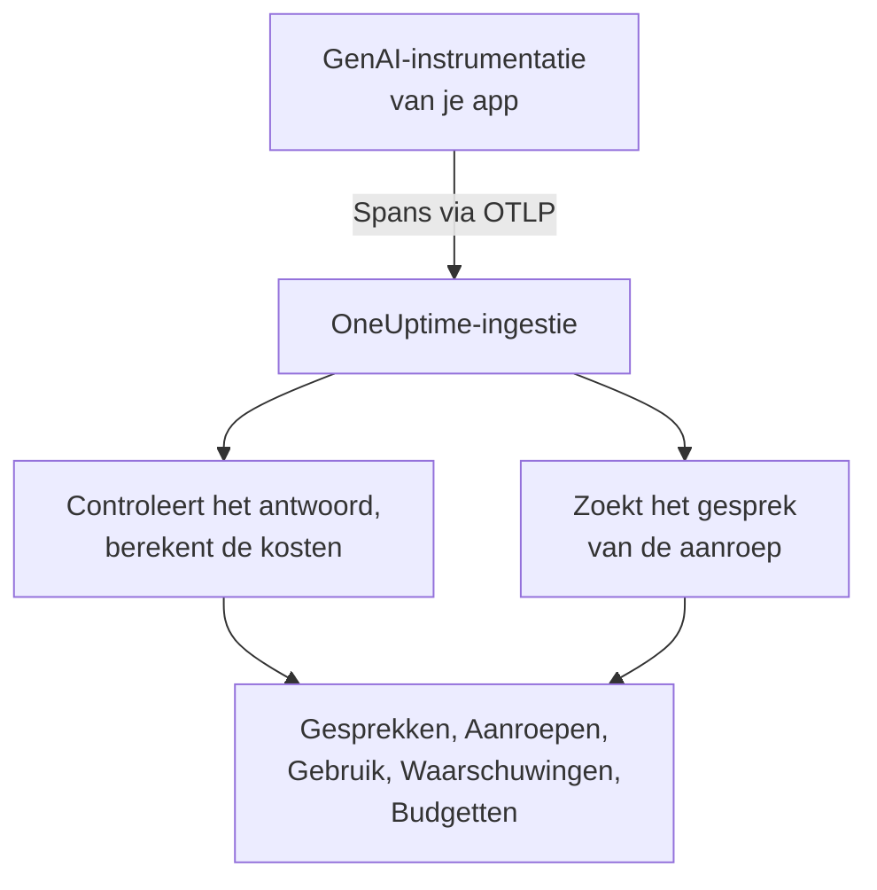
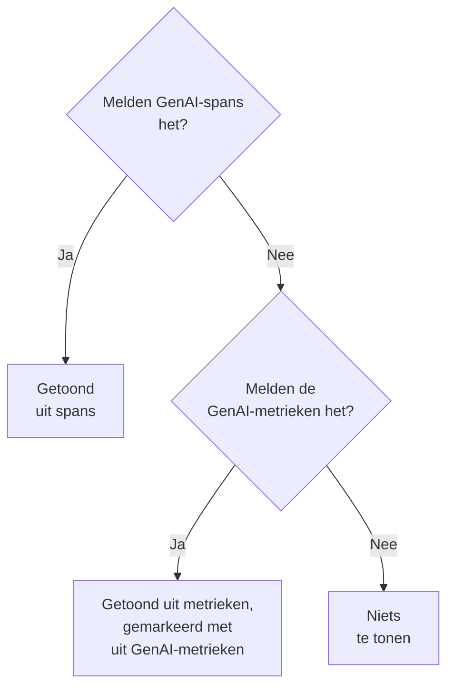

# AI- / LLM-observability

Lees elk gesprek dat je AI heeft gevoerd, speel het af zoals het gebeurde en krijg een melding wanneer de AI slecht antwoordt. OneUptime bouwt dat allemaal op standaard OpenTelemetry: als je app spans stuurt met de **GenAI-semantische conventies** (`gen_ai.*`), krijg je gesprekken, waarschuwingen, gebruik en kosten, zonder eigen SDK.

:::cards
- [Instellen](#in-vijf-stappen-instellen): Vijf stappen, van de eerste span tot gemarkeerde antwoorden.
- [Een gesprek afspelen](#een-gesprek-lezen-en-opnieuw-afspelen): Lees een chat zoals de persoon hem zag, in het tempo waarin hij gebeurde.
- [Waarschuwingen krijgen](#een-melding-krijgen-wanneer-de-ai-slecht-antwoordt): Kant-en-klare waarschuwingen voor antwoorden die mislukken, worden geweigerd, afgekapt, gemarkeerd of traag zijn.
- [De uitgaven volgen](#zien-wie-wat-uitgeeft): Kosten per persoon, team, model en app, met dagbudgetten.
:::

## Hoe het werkt

De GenAI-instrumentatie van je app exporteert elke aanroep naar het model als een OpenTelemetry-span. Zodra de span binnenkomt, leest OneUptime de `gen_ai.*`-attributen, controleert het antwoord op problemen, berekent de kosten van de aanroep en plaatst die bij het gesprek waar hij bij hoort.



Open **Producten → AI / LLM**, onder **Observability**. Het product heeft zeven tabbladen:

| Tabblad | Wat het toont |
| --- | --- |
| **Gesprekken** | Elk gesprek dat je AI heeft gevoerd, de gesprekken die aandacht nodig hebben eerst. Boven de lijst: gesprekken, AI-antwoorden, hoeveel er aandacht nodig hebben, kosten en de gebruikelijke antwoordtijd. |
| **Aanroepen** | Elke model-, embedding-, agent- en toolaanroep. Filter op service, provider, model, bewerking, persoon, team of gesprek; klik op een aanroep om hem in de traceviewer te openen. |
| **Gebruik** | Aanroepen, tokens en kosten over een periode, gerangschikt per medewerker, team, model, provider of app. |
| **Waarschuwingen** | Kant-en-klare waarschuwingen voor als de AI slecht antwoordt, en je AI / LLM-monitors. |
| **Budgetten** | Dagelijkse kostenlimieten, gepubliceerd als metrieken waarop je kunt waarschuwen. |
| **Prijzen** | Je eigen prijzen voor modellen die de ingebouwde prijslijst niet kent. |
| **Instellen** | De vijf stappen hieronder, met het endpoint van je project. |

In de traceviewer heeft de span van elke AI-aanroep ook een tabblad **LLM**: provider, model, tokens, kosten, aanvraagparameters, en de prompt en het antwoord.

## Voordat je begint

- Een OneUptime-project waarin je een telemetrie-ingestiesleutel kunt aanmaken.
- Een app die een model aanroept, en een GenAI-instrumentatie voor de taal ervan: **OpenLLMetry** (Traceloop), **OpenInference** (Arize), de **Vercel AI SDK**, of de OpenTelemetry-instrumentaties voor OpenAI, Anthropic en Gemini.

> [!TIP]
> Modelverkeer dat via een gateway zoals LiteLLM of Portkey loopt, kun je vanuit de gateway exporteren in plaats van vanuit elke app: zie [AI-gateways](/docs/telemetry/ai-gateways). Voor de codeerassistenten die je engineers gebruiken, zie [AI-codeerassistenten](/docs/telemetry/ai-coding-assistants).

## In vijf stappen instellen

De eerste stap is alles wat je nodig hebt om aanroepen te zien. Elke volgende stap laat meer zien.

:::steps
### Stuur je AI-aanroepen

Maak een ingestiesleutel aan onder **Projectinstellingen → Telemetrie & APM → Ingestiesleutels** (de [OpenTelemetry-snelstart](/docs/telemetry/open-telemetry#een-ingestiesleutel-maken) loopt het met je door). Richt daarna je instrumentatie op OneUptime:

:::tabs
@tab Python
```bash
pip install traceloop-sdk opentelemetry-exporter-otlp
```

```python
from traceloop.sdk import Traceloop

Traceloop.init(
    app_name="my-ai-agent",
    api_endpoint="https://oneuptime.com/otlp",
    headers={"x-oneuptime-token": "YOUR_INGESTION_TOKEN"},
)
# Your OpenAI, Anthropic and LangChain calls are now traced.
```
@tab Node.js
```bash
npm install @traceloop/node-server-sdk
```

```typescript
import * as traceloop from "@traceloop/node-server-sdk";

traceloop.initialize({
  appName: "my-ai-agent",
  baseUrl: "https://oneuptime.com/otlp",
  headers: { "x-oneuptime-token": "YOUR_INGESTION_TOKEN" },
});
```
@tab OpenTelemetry SDK
```bash
export OTEL_EXPORTER_OTLP_ENDPOINT="https://oneuptime.com/otlp"
export OTEL_EXPORTER_OTLP_HEADERS="x-oneuptime-token=YOUR_INGESTION_TOKEN"
export OTEL_EXPORTER_OTLP_PROTOCOL="http/protobuf"
export OTEL_SERVICE_NAME="my-ai-agent"
```
:::

Host je OneUptime zelf? Gebruik dan `https://YOUR-ONEUPTIME-HOST/otlp` in plaats van `https://oneuptime.com/otlp`. Roep je model één keer aan, en de aanroep verschijnt onder **Aanroepen**.

### Leg vast wat er gezegd is

Een gesprek laat alleen zien wat mensen vroegen en wat de AI antwoordde als je instrumentatie dat vastlegt. OpenLLMetry legt prompts en antwoorden vast, tenzij je `TRACELOOP_TRACE_CONTENT=false` instelt. De OpenTelemetry-instrumentaties leggen ze alleen vast als je erom vraagt:

```bash
export OTEL_INSTRUMENTATION_GENAI_CAPTURE_MESSAGE_CONTENT=true
```

Nieuwere OpenTelemetry-instrumentaties accepteren `span_only`, `event_only` of `span_and_event` in plaats van `true`. Zonder vastgelegde inhoud toont een gesprek nog steeds de tijden, de kosten en de problemen. Prompts kunnen gevoelige gegevens bevatten: [Privacy en redactie](#privacy-en-redactie) laat zien hoe je ze maskeert voordat ze worden opgeslagen.

### Groepeer aanroepen in gesprekken

Een chatapp doet één modelaanroep per beurt. Zet `gen_ai.conversation.id` (of `session.id`) op elke AI-aanroep op het id van je chat, en elke chat verschijnt als één gesprek, hoeveel aanroepen en traces hij ook nodig had. Met OpenLLMetry stel je het één keer per aanvraag in:

```python
from traceloop.sdk import Traceloop

Traceloop.set_association_properties({
    "session_id": chat.id,
    "user_email": user.email,
})
```

Geef met de Vercel AI SDK het id van de chat mee als `experimental_telemetry: { metadata: { sessionId } }`. Aanroepen zonder gespreks-id verschijnen nog steeds, één aanvraag (één trace) tegelijk.

### Geef aan wie het vroeg

Zet `user.id` of `user.email` op elke AI-aanroep (de associatie-eigenschap hierboven zet het e-mailadres). Elk gesprek laat dan zien met wie het was, je kunt de lijst op persoon doorzoeken, en het tabblad **Gebruik** rangschikt de uitgaven per medewerker. [Toewijzing aan medewerkers en teams](/docs/telemetry/ai-coding-assistants#toewijzing-aan-medewerkers-en-teams) somt elke identiteitssleutel op die OneUptime leest.

### Markeer slechte antwoorden

OneUptime controleert elk antwoord zodra het binnenkomt en markeert wat ermee misging:

| Probleem | Wat het betekent | Gevonden via |
| --- | --- | --- |
| Mislukt | De aanroep eindigde met een fout, dus er kwam geen antwoord | Spanstatus Error, `error.type`, of een eindreden `error` |
| Geweigerd | De AI weigerde, of een veiligheidsfilter blokkeerde het antwoord | Een weigerings- of veiligheidseindreden (`content_filter`, `refusal`, `SAFETY` en dergelijke), een weigering in het antwoord, of een antwoord dat opent met een standaardweigering in het Engels |
| Afgekapt | Het antwoord stopte bij de tokenlimiet | Een eindreden `length`, `max_tokens` of `MAX_TOKENS` |
| Leeg | Geen tekst en geen toolaanroep | Vastgelegde inhoud die niets bevat, of 0 uitvoertokens |
| Gemarkeerd | Een evaluatie die je app stuurde, zei dat het antwoord slecht was | Een `gen_ai.evaluation.result`-event |

De eerste vier vragen niets van je. Om een antwoord te markeren dat je guardrail, je evaluatie of een duim-omlaagknop afwijst, voeg je een `gen_ai.evaluation.result`-event toe aan de span van het antwoord, terwijl de span open is, met `gen_ai.evaluation.score.label` op `fail`:

```python
from opentelemetry import trace

trace.get_current_span().add_event(
    "gen_ai.evaluation.result",
    {
        "gen_ai.evaluation.name": "relevance",
        "gen_ai.evaluation.score.label": "fail",
        "gen_ai.evaluation.explanation": "The answer is about another product.",
    },
)
```

Labels zoals `incorrect`, `wrong`, `unhelpful`, `toxic`, `unsafe` en `hallucination` tellen ook als mislukt. OneUptime stuurt je gesprekken nooit naar een andere AI om ze te beoordelen: elke controle leest alleen wat de aanroep zelf meedraagt.
:::

## Een gesprek lezen en opnieuw afspelen

Een gesprek opent in zijn geheel, zoals een chatapp zijn geschiedenis toont: wat de persoon zei rechts, de antwoorden van de AI links met model, tijd, tokens en kosten, toolaanroepen daartussen, en wat er misging gemarkeerd op de plek waar het gebeurde. **Details** onder een antwoord toont waarom het stopte, de evaluaties en een link naar de aanroep in Traces.

De balk onderaan speelt het gesprek af zoals de persoon het beleefde:

| Bediening | Wat het doet |
| --- | --- |
| **Opnieuw afspelen** | Speelt het gesprek af vanaf het eerste bericht, in het tempo waarin het gebeurde. "De AI antwoordt…" telt op terwijl een antwoord onderweg is. Klik op de tijd van een bericht om vanaf daar af te spelen. |
| **Wachten overslaan** | Standaard aan: verkort elke stilte van meer dan 3 seconden. |
| `1x` | Verandert de snelheid: 1x, 2x, 4x of 8x. |
| **K**, **J** of **←**, **L** of **→** | Afspelen of pauzeren, een bericht terug, een bericht vooruit. |

Het adres van de pagina bewaart het bericht waar een afspeelsessie stopte (`?step=`), zodat een link die je deelt op dat moment opent.

## Een melding krijgen wanneer de AI slecht antwoordt

Het tabblad **Waarschuwingen** toont de waarschuwingen die de meeste AI-apps willen. Kies er een en **Monitor maken** opent al ingevuld; je kunt alles aanpassen voordat je opslaat:

| Waarschuwing | Wanneer je een melding krijgt | Ernst |
| --- | --- | --- |
| Antwoorden gaan mis | Meer dan 5% van de antwoorden in 15 minuten mislukt, wordt geweigerd, afgekapt, is leeg of gemarkeerd | Warning |
| AI-aanroepen mislukken | Meer dan 10% van de aanroepen naar het model in 5 minuten eindigt met een fout | Critical |
| De AI weigert te antwoorden | Meer dan 5% van de antwoorden in 30 minuten zijn weigeringen | Warning |
| Antwoorden worden afgekapt | 3 of meer antwoorden in 30 minuten stoppen bij de tokenlimiet | Warning |
| Antwoorden worden gemarkeerd | Een evaluatie markeert een antwoord als slecht | Warning |
| Antwoorden zijn traag | Meer dan 10% van de antwoorden in 15 minuten duurt langer dan 30 seconden | Warning |
| De AI stopt met antwoorden | De AI geeft 30 minuten lang geen antwoorden | Critical |

De waarschuwingen op een aandeel van de antwoorden wachten ook op minstens 3 slechte antwoorden, zodat één slecht antwoord op twee niemand oproept. Een Critical-waarschuwing krijgt de zwaarste waarschuwingsernst van je project en een Warning-waarschuwing de volgende: High en Low in een nieuw project.

Elke waarschuwing is een **AI / LLM**-monitor. De instellingen bepalen wat als slecht antwoord telt (**Een antwoord telt als slecht wanneer het**, **Of langer duurt dan (seconden)**), hoe ver elke controle terugkijkt (**Tijdvenster**, standaard 15 minuten), welke **Apps** hij bewaakt en, onder **Meer velden**, welk **Model**. Een **Voorbeeld** laat zien wat de monitor nu zou tellen. De criteria vergelijken drie getallen: **Slechte AI-antwoorden (in %)**, **Slechte AI-antwoorden** en **AI-antwoorden**.

Een kant-en-klare waarschuwing maakt een waarschuwing die zichzelf oplost, en toont de monitor als **Degraded** zolang de antwoorden slecht zijn. Het incident ervan is ingevuld maar uitgeschakeld: schakel het in om iemand op te roepen.

## Zien wie wat uitgeeft

Het tabblad **Gebruik** toont de aanroepen, tokens en kosten van een periode (de laatste 7 dagen, tenzij je een andere kiest), en een tabel met de top 25 in een van vijf uitsplitsingen: **Medewerker**, **Team**, **Model**, **Provider** en **Applicatie / Service**. Aanroepen die niemand noemen, worden geteld onder **Niet toegewezen**, nooit weggegooid.

Personen en teams komen uit identiteitsattributen op de aanroep: zie [Toewijzing aan medewerkers en teams](/docs/telemetry/ai-coding-assistants#toewijzing-aan-medewerkers-en-teams).

### Spans eerst, metrieken vullen aan

GenAI-spans dragen het model, de tokens en de kosten van één aanroep, dus waar ze bestaan, beantwoorden ze alles. Sommige tools publiceren token- en kostenmetrieken en geen GenAI-spans, zoals de meeste codeerassistenten. OneUptime leest die metrieken alleen voor een getal waarvoor de spans niets meldden, en telt de twee nooit bij elkaar op: veel instrumentaties sturen beide voor dezelfde aanroep, en optellen zou elke dollar twee keer tellen.



| Waar | Wat terugvalt op metrieken | Wanneer |
| --- | --- | --- |
| Invoer- en uitvoertokens | Beide totalen | De tokentotalen van de spans zijn allebei 0 |
| Kosten (USD) | De kosten, met de micro-USD-kosten van Codex omgerekend naar USD | Het kostentotaal van de spans is 0 |
| LLM-aanroepen | Niets: alleen spans | — |
| Tabellen **Medewerker**, **Team**, **Model** | Alleen kosten; de cellen voor aanroepen en tokens tonen `—` | Die tabel vond geen spanrijen |
| Tabellen **Provider**, **Applicatie / Service** | Niets: alleen spans | — |
| Gesprekken | Niets: gesprekken worden uit spans opgebouwd | — |

Een getal uit metrieken is gemarkeerd met **uit GenAI-metrieken**, omdat het geen bijbehorende rijen heeft onder **Aanroepen**. Zodra je GenAI-spans dus een getal melden, verschijnt het aandeel van een tool die alleen metrieken stuurt niet. Om de uitgaven van zo'n tool apart te zien, stuur je hem naar een eigen project, waar geen GenAI-spans binnenkomen.

## Wat een aanroep kost

Kosten die je instrumentatie meldt (`gen_ai.usage.cost`), worden gebruikt zoals ze zijn, ook als ze 0 zijn. Als er geen worden gemeld, schat OneUptime ze bij binnenkomst van de span, op basis van de tokenaantallen en een ingebouwde prijslijst voor gangbare modellen van OpenAI, Anthropic, Google Gemini, Mistral, DeepSeek, xAI, Cohere, Amazon Nova en Meta Llama. Eerst wordt het geleverde model geprijsd, daarna het gevraagde model.

Modellen worden gematcht op het langste naamvoorvoegsel, zodat ids met een datum of een leveranciersvoorvoegsel, zoals `gpt-4o-2024-08-06` en `us.anthropic.claude-sonnet-4-5-20250929-v1:0`, de prijs van hun familie vinden. Een model dat de lijst niet kent, ook een nieuwe release, wordt nooit geraden: de kosten blijven 0 tot je het een prijs geeft. Schattingen gebruiken lijstprijzen, zonder cache- of batchkortingen.

Om zelf een model te prijzen (een onderhandeld tarief, een fine-tune of een model dat je zelf host), voeg je het toe op het tabblad **Prijzen**, in **Aangepaste LLM-prijzen**: een **Modelvoorvoegsel**, een **Invoerprijs (USD per 1M tokens)** en een **Uitvoerprijs (USD per 1M tokens)**. Het langste overeenkomende voorvoegsel wint, over je eigen prijzen en de ingebouwde lijst heen; bij gelijkspel wint jouw prijs. Een prijs geldt voor aanroepen die ongeveer een minuut na het opslaan binnenkomen; al opgeslagen aanroepen houden hun kosten.

## Dagelijkse kostenbudgetten

Een budget volgt de uitgaven van één dag, in USD, over de UTC-dag. Elke 15 minuten telt OneUptime de AI-uitgaven van die dag op (uit spans, of uit GenAI-kostenmetrieken als geen enkele span uitgaven meldde), toont ze op het budget en publiceert twee metrieken:

| Metriek | Wat het is |
| --- | --- |
| `oneuptime.llm.budget.spend.usd` | De uitgaven van de dag tot nu toe, in USD |
| `oneuptime.llm.budget.percent.used` | De uitgaven als percentage van de daglimiet |

Beide dragen `oneuptime.llm.budget.id` en `oneuptime.llm.budget.name`, en het bereik van het budget als het er een heeft.

:::steps
### Maak het budget aan

Klik op het tabblad **Budgetten** op **LLM Cost Budget aanmaken**. Geef het een naam en een **Dagbudget (USD)**, en laat het bereik leeg voor het hele project, of kies een **Service (optioneel)**, een **LLM-provider (optioneel)** of een **LLM-model (optioneel)**. Meerdere budgetten kunnen verschillende bereiken bewaken.

### Waarschuw erop

Maak een [metrics-monitor](/docs/monitor/metrics-monitor) op `oneuptime.llm.budget.percent.used`, gefilterd op `oneuptime.llm.budget.id` (de naam verandert als je het budget hernoemt). Voeg een criterium `>= 80` toe dat een waarschuwing geeft en een `>= 100` dat een kritieke waarschuwing geeft.

### Verbreed het venster

Zet het voortschrijdende venster van de monitor op 30 minuten. Een budget publiceert elke 15 minuten één punt, dus het standaardvenster van 1 minuut zou tussen twee punten niets vinden.
:::

Een budgetwaarschuwing kan ook een workflow starten die een op hol geslagen agent stopt: zie [Circuit breakers voor AI-agents](/docs/telemetry/ai-agent-circuit-breaker).

## Dashboards en metriekwaarschuwingen

GenAI-metrieken zoals `gen_ai.client.token.usage` en `gen_ai.client.operation.duration` komen binnen als gewone OpenTelemetry-metrieken. Zet ze in een [dashboard](/docs/dashboards/index), of waarschuw erop met een [metrics-monitor](/docs/monitor/metrics-monitor), bijvoorbeeld wanneer de p95 van `gen_ai.client.operation.duration` een drempel overschrijdt, gegroepeerd per model.

## Privacy en redactie

AI-aanroepen worden opgeslagen als tracespans, dus de **Scrub-regels** en **Drop-filters** van de traces gelden ook voor hen: maskeer een attribuut, of laat een span vallen, voordat het wordt opgeslagen. Je vindt beide onder **Traces → Instellingen**. De e-mailkolom van de medewerker wordt gemaskeerd samen met het attribuut waaruit hij is gelezen, dus een regel die e-mailadressen maskeert, dekt hem ook.

Gesprekken worden gelezen met dezelfde machtiging als traces: wie de traces van het project kan lezen, kan de gesprekken lezen, en verder niemand.

## Attributen die OneUptime leest

OneUptime leest de OpenTelemetry-GenAI-conventies, en de spellingen die OpenLLMetry, OpenInference, de Vercel AI SDK en LiteLLM gebruiken, zodat de gangbare bibliotheken werken zoals ze zijn. Voor elke waarde wint de eerste sleutel die een span draagt:

| Waarde | Sleutels, in de volgorde waarin ze worden geprobeerd |
| --- | --- |
| Provider | `gen_ai.system`, `gen_ai.provider.name`, `llm.system`, `llm.provider` |
| Bewerking | `gen_ai.operation.name`, `llm.request.type`, `openinference.span.kind` |
| Gevraagd model | `gen_ai.request.model`, `llm.model_name`, `llm.request.model` |
| Geleverd model | `gen_ai.response.model`, `llm.response.model` |
| Invoertokens | `gen_ai.usage.input_tokens`, `gen_ai.usage.prompt_tokens`, `llm.token_count.prompt`, `llm.usage.prompt_tokens` |
| Uitvoertokens | `gen_ai.usage.output_tokens`, `gen_ai.usage.completion_tokens`, `llm.token_count.completion`, `llm.usage.completion_tokens` |
| Totaal tokens | `gen_ai.usage.total_tokens`, `llm.token_count.total`, `llm.usage.total_tokens` |
| Kosten (USD) | `gen_ai.usage.cost`, `gen_ai.usage.cost_usd`, `gen_ai.usage.total_cost`, `llm.usage.total_cost`, `gen_ai.cost.total_cost`, `litellm.cost.total` |
| Gesprek | `gen_ai.conversation.id`, `session.id`, `langfuse.session.id`, `traceloop.association.properties.session_id`, `ai.telemetry.metadata.sessionId` |
| Agent | `gen_ai.agent.name`, `agent.name` |
| Tool | `gen_ai.tool.name`, `tool.name`, `ai.toolCall.name` |
| Eindreden | `gen_ai.response.finish_reasons`, `gen_ai.response.finish_reason`, `llm.response.finish_reason`, `ai.response.finishReason` |
| Fout | `error.type` |

Een span telt als AI-aanroep als hij een van deze waarden draagt, of een attribuut dat begint met `gen_ai.`, `llm.` of `traceloop.`. Het totaal aantal tokens is invoer plus uitvoer als er geen totaal wordt gemeld. De sleutels `gen_ai.usage.total_tokens` en `gen_ai.usage.cost` horen niet bij de conventies, die geen van beide definiëren; OneUptime leest ze omdat gangbare instrumentaties ze sturen.

De identiteitssleutels (wie de aanroep deed, en het team van die persoon) staan onder [Toewijzing aan medewerkers en teams](/docs/telemetry/ai-coding-assistants#toewijzing-aan-medewerkers-en-teams).

### Waar prompts en antwoorden vandaan worden gelezen

De gespreksweergave leest de berichten van een aanroep, in deze volgorde, uit:

- het event `gen_ai.client.inference.operation.details`;
- de attributen `gen_ai.input.messages`, `gen_ai.output.messages` en `gen_ai.system_instructions`;
- de oudere events per rol: `gen_ai.system.message`, `gen_ai.user.message`, `gen_ai.assistant.message`, `gen_ai.tool.message` en `gen_ai.choice`;
- de geïndexeerde attributen: `gen_ai.prompt.N.content` en `gen_ai.completion.N.content` van OpenLLMetry, `llm.input_messages.N.message.content` en `llm.output_messages.N.message.content` van OpenInference;
- de berichtarrays in `gen_ai.prompt`, `gen_ai.completion`, `ai.prompt.messages`, `ai.response.text`, `input.value` en `output.value`.

## Problemen oplossen

:::details Aanroepen komen binnen, maar geen enkel gesprek toont tekst
Je instrumentatie legt de inhoud niet vast. Zet het aan zoals [Leg vast wat er gezegd is](#leg-vast-wat-er-gezegd-is) laat zien; aanroepen van daarvoor blijven zonder tekst.
:::

:::details Elke aanroep van een chat verschijnt als een eigen gesprek
De aanroepen dragen geen gespreks-id. Zet `gen_ai.conversation.id` of `session.id` op elke aanroep van de chat, zoals [Groepeer aanroepen in gesprekken](#groepeer-aanroepen-in-gesprekken) laat zien.
:::

:::details Aanroepen tonen tokens maar kosten $0
Het model staat niet in de ingebouwde prijslijst, of de span noemt geen model. Voeg de prijzen van het model toe op het tabblad **Prijzen**; aanroepen die daarna binnenkomen, krijgen een prijs.
:::

:::details Het tabblad Gebruik zegt uit GenAI-metrieken en toont `—` voor aanroepen en tokens
De getallen komen van een tool die metrieken stuurt en geen GenAI-spans, zoals een codeerassistent. Een metriek draagt kosten maar geen details per aanroep, dus die cellen blijven leeg. Zie [Spans eerst, metrieken vullen aan](#spans-eerst-metrieken-vullen-aan).
:::

:::details Een budgetmonitor schiet heen en weer tussen twee toestanden
Het voortschrijdende venster van de monitor is korter dan 15 minuten, dus soms vindt hij geen punt. Zet het op 30 minuten.
:::

## Volgende stappen

:::cards
- [AI-codeerassistenten](/docs/telemetry/ai-coding-assistants): Uitgaven per engineer voor Claude Code, Cursor, Codex, Gemini CLI en Copilot.
- [AI-gateways](/docs/telemetry/ai-gateways): Trace de modelaanroepen van elke app vanuit één LiteLLM- of Portkey-gateway.
- [Circuit breakers voor AI-agents](/docs/telemetry/ai-agent-circuit-breaker): Stop een op hol geslagen agent wanneer een budgetwaarschuwing afgaat.
- [OpenTelemetry](/docs/telemetry/open-telemetry): Endpoints, ingestiesleutels en limieten voor elk signaal.
:::
